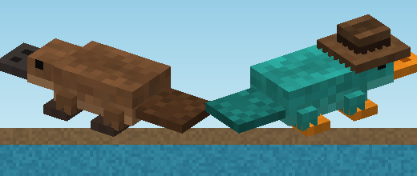

# Pack documentation

What each pack in this repo does, how to use it, and how to configure it.

> **Keep this file up to date.** Any change to a pack's behavior, commands or `config.js` must update this file in the same commit. `npm run check` fails if a pack, command, config option or `### How to use` section is missing from this file (see [Keeping this file current](#keeping-this-file-current)).
>
> **This file is also the players' documentation.** The [Our realm](https://mc.nish.software/realm/) page on mc.nish.software is generated from it (in the `nishant/hosting` repo: `cd minecraft && node tools/pack-docs.mjs`). Every pack section is published, plus the sections marked `<!-- on the site -->`. Write in plain American English, and quote in-game text and ids exactly as the code has them (in backticks). See [Publishing to mc.nish.software](#publishing-to-mcnishsoftware).

## Contents

- [Common to all packs](#common-to-all-packs)
  - [Requirements](#requirements)
  - [Installing from mc.nish.software](#installing-from-mcnishsoftware)
  - [Installing on a Realm](#installing-on-a-realm)
  - [Commands](#commands)
  - [Two ways to configure](#two-ways-to-configure)
  - [Updating a pack](#updating-a-pack)
  - [Formatting codes](#formatting-codes)
- [Realm Help — `help_bp`](#realm-help--help_bp)
- [Realm Settings — `settings_bp`](#realm-settings--settings_bp)
- [Realm Configuration — `admin_bp`](#realm-configuration--admin_bp)
- [Welcome Message — `welcome_bp`](#welcome-message--welcome_bp)
- [Low Durability Warning — `durability_bp`](#low-durability-warning--durability_bp)
- [AFK + Smart Sleep — `afk_bp`](#afk--smart-sleep--afk_bp)
- [Stats & Leaderboards — `stats_bp`](#stats--leaderboards--stats_bp)
- [Realm News & Tips — `news_bp`](#realm-news--tips--news_bp)
- [Creeper Guard — `guard_bp`](#creeper-guard--guard_bp)
- [Phantom Opt-out — `phantom_bp`](#phantom-opt-out--phantom_bp)
- [Right-click Harvest — `harvest_bp`](#right-click-harvest--harvest_bp)
- [Farm Loader — `farm_bp`](#farm-loader--farm_bp)
- [Quick Stack & Sort — `stash_bp`](#quick-stack--sort--stash_bp)
- [Chest Finder — `find_bp`](#chest-finder--find_bp)
- [Land Claims — `claims_bp`](#land-claims--claims_bp)
- [Death Point — `death_bp`](#death-point--death_bp)
- [Hotbar Refill — `refill_bp`](#hotbar-refill--refill_bp)
- [Coordinates HUD — `hud_bp`](#coordinates-hud--hud_bp)
- [Mob Health — `mobhp_bp`](#mob-health--mobhp_bp)
- [Elytra HUD — `elytra_bp`](#elytra-hud--elytra_bp)
- [Minimap — `map_bp`](#minimap--map_bp)
- [Realm Mail — `mail_bp`](#realm-mail--mail_bp)
- [Nicknames — `nick_bp`](#nicknames--nick_bp)
- [Daily Quests — `quests_bp`](#daily-quests--quests_bp)
- [Milestones — `milestones_bp`](#milestones--milestones_bp)
- [Community Goals — `goals_bp`](#community-goals--goals_bp)
- [Fast Leaf Decay — `leaves_bp`](#fast-leaf-decay--leaves_bp)
- [Lag Cleanup — `cleanup_bp`](#lag-cleanup--cleanup_bp)
- [Chairs — `chairs_bp`](#chairs--chairs_bp)
- [Townsfolk — `npc_bp`](#townsfolk--npc_bp)
- [Crowns — `crowns_bp`](#crowns--crowns_bp)
- [Merchant Caravan — `caravan_bp`](#merchant-caravan--caravan_bp)
- [Story Questlines — `saga_bp`](#story-questlines--saga_bp)
- [Wanderers of the Wilds — `wander_bp`](#wanderers-of-the-wilds--wander_bp)
- [Atlas of the Realm — `atlas_bp`](#atlas-of-the-realm--atlas_bp)
- [Realm Calendar — `calendar_bp`](#realm-calendar--calendar_bp)
- [Guilds & Reputation — `guilds_bp`](#guilds--reputation--guilds_bp)
- [Bounty Board — `bounty_bp`](#bounty-board--bounty_bp)
- [Champions — `elite_bp`](#champions--elite_bp)
- [Skills — `skills_bp`](#skills--skills_bp)
- [Parties — `party_bp`](#parties--party_bp)
- [Titles & Trails — `titles_bp`](#titles--trails--titles_bp)
- [Relics — `relics_bp`](#relics--relics_bp)
- [Field Journal — `journal_bp`](#field-journal--journal_bp)
- [Fishing 2.0 — `fishing_bp`](#fishing-20--fishing_bp)
- [Kitchen — `cooking_bp`](#kitchen--cooking_bp)
- [Deck of Many Things — `domt_bp`](#deck-of-many-things--domt_bp)
- [Slot Machine — `slots_bp`](#slot-machine--slots_bp)
- [Silly Enchants — `silly_bp`](#silly-enchants--silly_bp)
- [Silly Enchants Sounds — `silly_rp`](#silly-enchants-sounds--silly_rp)
- [Dolphin Friends — `dolphin_bp`](#dolphin-friends--dolphin_bp)
- [Platypus — `platypus_bp`](#platypus--platypus_bp)
- [Platypus Models — `platypus_rp`](#platypus-models--platypus_rp)
- [Treasure Maps & Riddles — `maps_bp`](#treasure-maps--riddles--maps_bp)
- [Waystones & Inns — `waystone_bp`](#waystones--inns--waystone_bp)
- [Expeditions — `expedition_bp`](#expeditions--expedition_bp)
- [Town Projects — `town_bp`](#town-projects--town_bp)
- [Easy Building — `build_bp`](#easy-building--build_bp)
- [Easy Building Guides — `build_rp`](#easy-building-guides--build_rp)
- [Safe Zones — `zones_bp`](#safe-zones--zones_bp)
- [Weather Almanac — `weather_bp`](#weather-almanac--weather_bp)
- [Regional Weather — `climate_bp`](#regional-weather--climate_bp)
- [Storm Chasing — `storm_bp`](#storm-chasing--storm_bp)
- [Tornadoes — `tornado_bp`](#tornadoes--tornado_bp)
- [Rainbows & the Pot of Gold — `rainbow_bp`](#rainbows--the-pot-of-gold--rainbow_bp)
- [Aurora & Shooting Stars — `night_bp`](#aurora--shooting-stars--night_bp)
- [Meteor Strikes — `meteor_bp`](#meteor-strikes--meteor_bp)
- [Blood Moon & Harvest Moon — `moon_bp`](#blood-moon--harvest-moon--moon_bp)
- [Realistic Rain — `rain_rp`](#realistic-rain--rain_rp)
- [Rain Extras — `rain_bp`](#rain-extras--rain_bp)
- [Realm Skies — `sky_rp`](#realm-skies--sky_rp)
- [Translucent Tools — `translucent_rp`](#translucent-tools--translucent_rp)
- [Translucent Tools Switch — `translucent_bp`](#translucent-tools-switch--translucent_bp)
- [Side HUD — `hud_rp`](#side-hud--hud_rp)
- [Bundling packs into one](#bundling-packs-into-one)
- [How the packs work together](#how-the-packs-work-together)
- [Troubleshooting](#troubleshooting)
- [Keeping this file current](#keeping-this-file-current)
- [Publishing to mc.nish.software](#publishing-to-mcnishsoftware)

---

## Common to all packs

### Requirements

| | |
|---|---|
| Minecraft | Bedrock **1.21.100+** (`min_engine_version`) |
| Script API | `@minecraft/server` **2.1.0**, `@minecraft/server-ui` **2.0.0** (stable) |
| Experiments | **None.** Only stable APIs are used, so no experimental toggles are needed on the Realm |
| Cheats | **Not required** for any command (`cheatsRequired: false`) |
| Achievements | Any non-Marketplace behavior pack turns off achievements for the world (that's how Bedrock works) |

### Installing from mc.nish.software
<!-- on the site -->

The realm runs everything as two packs: **Realm Bundle**, a behavior pack with every feature, and **Realm Resources**, a resource pack with every texture, particle, fog and sound. A pack can't be both kinds, so two is the fewest possible. To install or update them:

1. **Download** the latest Realm Bundle and Realm Resources `.mcpack` files from [mc.nish.software/realm](https://mc.nish.software/realm/) on the device you play on (Windows, phone or tablet) and open each. Minecraft starts and imports them as "Realm Bundle" and "Realm Resources".
2. **Open the realm's settings** (the pencil next to the realm). Under **Behavior Packs**, find Realm Bundle under **Available** and activate it. Under **Resource Packs**, activate Realm Resources and move it to the **top** of the active list, so its rain, sky and tools win over other resource packs. Minecraft uploads both to the realm.
3. **Join** once the realm restarts, and accept the resource pack download if asked. The welcome popup and the `/realm:` commands mean it's running.

**Updating:** download and open the newer version, then check that the realm's active Realm Bundle (or Realm Resources) shows the new version. If it still shows the old one, deactivate it and activate it again so the new version uploads. Nothing is lost: in-game settings and stats are stored in the world. Version numbers are the build date and time in UTC (`YYYY.MMDD.HHMM`, without leading zeros, so 5 January at 09:05 is `2026.105.905`), so every build is higher than the last, which Minecraft needs to treat it as an update.

**What's in each:** the Realm Bundle holds every behavior pack in this repo, Rain Extras included. Realm Resources holds the seven resource packs: [Realistic Rain](#realistic-rain--rain_rp), [Realm Skies](#realm-skies--sky_rp), [Translucent Tools](#translucent-tools--translucent_rp), [Side HUD](#side-hud--hud_rp), [Platypus Models](#platypus-models--platypus_rp), [Easy Building Guides](#easy-building-guides--build_rp) and [Silly Enchants Sounds](#silly-enchants-sounds--silly_rp). Players get both packs automatically when they join. Realm Skies draws the tornadoes, rainbows, aurora, shooting stars, meteors, sandstorms, blizzards, moon fogs and trails of the bundle's sky packs: without it those still happen, but you can't see them.

**Only some features?** Every feature is also its own pack, downloaded from its card or the "one at a time" list under the Realm Bundle download, and activated the same way. Use **either** the Realm Bundle **or** single packs, never both: the same commands would be registered twice and fail to load. The same goes for Realm Resources and the single resource packs. If you had Realistic Rain, Realm Skies, Translucent Tools or Rain Extras active on their own before, remove them when you add the bundles. Switching between them starts the features' in-game settings over (welcome and news text, tips, settings from `/realm:config`, per-player choices, remembered chests, zones and farms); stats on the scoreboard are kept. Single packs use ordinary version numbers (`1.0.0`) that go up whenever that pack changes.

### Installing on a Realm

For whoever builds the packs from this repo:

1. Build the packs with `npm run build` (one `dist/<folder>.mcpack` per pack), or `npm run bundle -- --all` and `npm run bundle -- --resources` for the two bundles (`dist/realm_bundle.mcpack`, `dist/realm_resources.mcpack`).
2. Open the `.mcpack` on a device with Minecraft. It imports automatically.
3. Go to **Play → Realms → ✏️ Edit Realm → Behavior Packs** and move the pack from **Available** to **Active**. A resource pack (Realm Resources, or `rain_rp`, `sky_rp`, `translucent_rp`, `hud_rp`, `platypus_rp`, `build_rp` on their own) goes under **Resource Packs** instead, at the top of the active list.
   *Another way:* download the Realm world, activate the pack under the world's **Behavior Packs**, and upload the world again.
4. Rejoin. Commands are registered when the world loads.

> ⚠️ Activate **either** the individual packs **or** a bundle that contains them, never both. Otherwise every command is registered twice, and the duplicate commands fail to load. Packs listed in `tools/standalone.json` (none today) are never in a bundle: activate them next to it.

### Commands

- **Every command starts with `/realm:`**, e.g. `/realm:welcome`, `/realm:stats`. Type `/realm` to see all of them in autocomplete, or run `/realm:help` for a page that explains each one, with usage.
- All packs share the `realm` namespace because Bedrock requires **one command namespace per add-on**. A bundle is one add-on, so if packs used different namespaces, only the first pack's commands would register and the rest would show as "unknown command". `npm run check` and the bundler both enforce this.
- **Everyone** commands work for all players. **Ops** commands (permission level `GameDirectors`) only work for, and are only shown to, operators. Every pack counts a player as an operator by that same permission level, and operators' menus and forms check it again when a button is picked or a form is sent, so a player de-opped while one is open gets `Only operators can do that.` (or a line naming the action) and nothing changes.

### Two ways to configure

| | Where | Who | Takes effect | Notes |
|---|---|---|---|---|
| **In-game, every pack** | `/realm:config` ([Realm Settings](#realm-settings--settings_bp)), or an item named `Realm Settings` | Operators | Immediately | The options that make sense to change live, in every installed pack: switches, numbers and choices. Saved in the world, and overrides `config.js`. **Reset a pack to defaults** goes back to `config.js` |
| **In-game, per player** | `/realm:prefs`, and toggles such as `/realm:durability`, `/realm:phantoms`, `/realm:rain` | Every player, for themselves | Immediately | Overrides the realm's value for that player only |
| **In-game editors** | `/realm:welcome_edit`, `/realm:news_edit`, `/realm:news_tips`, `/realm:stats_sidebar` | Operators | Immediately | Texts, tips and the sidebar. Saved in the world, and overrides `config.js` |
| **`config.js`** | `packs/<folder>/scripts/config.js` | Whoever builds the pack | After rebuilding and re-applying the pack | Defaults for all of the above, and the options that have no in-game editor: lists, texts, tick intervals and command permissions |

### Setting up a new world or a big server
<!-- on the site -->

- **Set up this world** (`/realm:admin_setup`, or the first button of the [Realm Configuration](#realm-configuration--admin_bp) item's **Operator Tools**) walks an operator through every one-time job, one page each: place the townsfolk, add a town, a safe zone at spawn, the caravan spot, the bounty board, a waystone at spawn, the expedition site and the rest. Operators are players with permission level 1 or more (Realm operators, `/op` or `permissions.json` on a dedicated server); tags never make anyone an operator.
- **Server size** (Operator Tools) switches the settings that depend on the number of players between **Small Realm** (the defaults, up to about 10 players) and **Large server** (30 to 100+), showing each change before anything changes.
- **Pack diagnostics** (`/realm:diag`) shows how much script time and saved data each pack uses, and can make one pack forget its saved data before you remove it.

### Updating a pack

1. Edit the pack.
2. **Increase `header.version`** in its `manifest.json`, e.g. `[1, 0, 0]` → `[1, 0, 1]`. If you don't, devices keep using their cached copy. (Bundles do this automatically.)
3. `npm run build`, then re-import and re-apply the pack.

### Formatting codes
<!-- on the site -->

Text that operators edit in game (the welcome popup, news, tips) supports these codes:

| Code | Effect |
|---|---|
| `\n` | New line, in the welcome and news **body** only (not in titles, the button or tips). The in-game text boxes are one line, so type a literal `\n` |
| `\|` | New line in text pasted with `/realm:news_body` or `/realm:news_add` (chat commands drop the backslash of `\n`, which then shows as a plain `n`) |
| `%` | Doesn't show: Minecraft takes it for a formatting code. Write `percent` instead |
| `§0`–`§9`, `§a`–`§f` | Colors: `§a` green, `§b` aqua, `§c` red, `§e` yellow, `§6` gold, `§7` gray |
| `§l` `§o` `§r` | Bold, italic, reset |

---

## Realm Help — `help_bp`

One help page for every realm command: how each feature works, and each command with its usage.

### How to use

1. Run `/realm:help`. A **Realm help** menu lists every feature installed on this realm, with its commands under its name.
2. Tap **All commands** to see every command with its usage on one page, or tap a feature for its how-to steps and its commands. **Back** returns to the menu.
3. Jump straight to a page with `/realm:help <feature>`, for example `/realm:help stash` or `/realm:help find`, or `/realm:help all` for every command. Chat autocompletes the feature names.
4. **Operators** also see the operator-only commands and steps, marked `(operators)`.

### What players see

- Only features that are installed show up: each pack answers when the help asks, so a realm running a few single packs gets help for just those.
- Usages follow the usual notation: `<name>` must be typed, `[name]` is optional.
- The text is the same as on mc.nish.software/realm: it's generated from this file.
- Running `/realm:help` again while the help is already open does nothing, so menus don't stack. If chat or another screen stays open for about 20 seconds, chat says `Couldn't open the help. Close chat or your inventory and try again.`

### Commands

| Command | Who | What it does |
|---|---|---|
| `/realm:help [feature]` | Everyone | Opens the help menu, or the page for `feature` (a pack's folder name without `_bp`, such as `stash`, `crowns` or `quests`; chat autocompletes them) or `all` |

### Configuration (`scripts/config.js` → `CONFIG`)

| Option | Default | Description |
|---|---|---|
| `answerTicks` | `10` | Ticks to wait for the installed packs to answer before the help opens (20 = 1 s) |
| `showOpsToEveryone` | `false` | Show operator-only commands and steps to everyone. Operators can change it in game with `/realm:config` |

### Saved data

| Key | Scope | Contents |
|---|---|---|
| `help:cfg` | World | Settings changed in `/realm:config` (`showOpsToEveryone`) |

### How it works

- `scripts/catalog.js` holds every pack's summary, `### How to use` steps and Commands table from this file, converted to Minecraft formatting. `node tools/help-catalog.mjs` writes it (and bumps this pack's patch version once per commit); `npm run check` fails when it's out of date.
- `/realm:help` sends the script event `realm:help_ping`. Every other pack answers `realm:help_pong` with its folder name, and the help lists the packs that answered within `answerTicks`. Realm Help answers other packs' pings too (`help_bp`), so the [Realm Configuration](#realm-configuration--admin_bp) menu lists `/realm:help`. Script events cross pack boundaries without imports, so the packs stay independent, and work the same in the Realm Bundle and as single packs.

---

## Realm Settings — `settings_bp`

Change the packs' settings in game: operators set them for everyone with `/realm:config`, and every player picks their own preferences with `/realm:prefs`.

### How to use

1. Run `/realm:prefs` to open **My preferences**: one form with your own choices from every installed pack, such as whether you get durability warnings, phantoms or the rain extras, what sneak-tapping a chest does, and whether chat announces you going AFK. Every switch is named for what it does: on means **Enabled**. Change what you like and tap **Save** at the bottom: nothing applies until you do. A preference the operators have overridden for the whole realm shows as gray text instead of a switch, with its value and why, such as `Coordinates HUD: Disabled` / `Locked by the operators: Coordinates HUD is Disabled for the whole realm` (or `Easy Building needs the tag "builder", which operators give`). Close with X and chat says `My preferences: closed with X, so nothing was saved. To change a setting, run /realm:prefs again and press Save at the bottom.` (the game doesn't hand back what was on a form closed with X). A summary pops up with how many changes were saved and each one as before -> after, for example `1 change saved` and `Phantom Opt-out > Phantoms near me: Enabled -> Disabled` (chat gets the same). Tap **Back to my preferences** to change more, or **Done**.
2. Your choices are remembered. `/realm:durability`, `/realm:phantoms` and `/realm:rain` flip the same switches as the form.
3. **Operators:** run `/realm:config`, or use any item renamed `Realm Settings` on an anvil (a stick works). The first button, **All settings**, holds every pack's settings with a heading per pack (see below); the buttons under it open one pack each. Change settings (switches, sliders and lists) and tap **Save**. They apply right away for everyone. A summary pops up with how many changes were saved and each one as before -> after, such as `Storm wind volume: 70% -> 50%`; tap **Back to Realm Settings** for another pack, or **Done**. A setting shown as text with `(change in config.js, then restart the world)` can only be changed there.
4. **Operators: All settings.** With the whole Realm Bundle that is about 370 settings, so they come on a few pages, such as `All settings (page 1 of 5)`, of at most 100 lines each (`allPageSize`); a pack is never split across pages. The list at the top, **After saving, go to**, picks where **Save and go** takes you next: the next page (already chosen), any other page (each named by its first and last pack, `Page 2: <first pack> to <last pack>`) or **Done (show what was saved)**. Each page saves its changes when you tap **Save and go**; closing a page saves nothing on it. At the end one summary lists every change from every page, each as `Pack > Setting: before -> after`. All settings and a pack's own page show the same saved values: change Leaderboard size on one and the other shows the new number the next time it opens.
5. **Operators:** **Reset a pack to defaults**, at the bottom of the menu, puts one pack's settings back to its `config.js` values after asking. Players' own preferences are kept.

### What players see

- Only installed packs are listed: each pack answers when the menu asks, as with `/realm:help`. Rain Extras is listed too, from the bundle or on its own.
- Each setting has a `!` icon: hover over it or tap it for what the setting does, its default and, for a slider, its range.
- Volumes and other 0 to 1 settings are sliders in percent (`Storm wind volume (%)`, 0 to 100 in steps of 5), and settings in fractional steps, such as Chairs' seat reach (1 to 5 blocks in 0.5s), are lists of their exact values: Bedrock's sliders only stop on whole numbers. A setting you don't touch is saved exactly as it was, even a `config.js` value between the steps or outside the in-game range (shown at the nearest place the control can show it).
- Tapping **Save** without changing anything says `No changes`.
- Switches read the same everywhere: the setting is named for what it does, the switch on means **Enabled**, and chat says `Enabled` or `Disabled`. Lists show plain choices, such as `Open the menu` or `Only in protected zones`.
- A preference set to what the realm has follows the realm: if an operator changes that setting later, you get the new value. A preference set to something else stays yours.
- If a pack doesn't confirm a change within half a second, the summary counts it as not saved (`1 change saved, 1 not saved`) and that line says `not saved, the pack didn't answer. Try again`; a value the pack refuses says why.
- Players who aren't operators and use an item named `Realm Settings` are pointed to `/realm:prefs`.

### Commands

| Command | Who | What it does |
|---|---|---|
| `/realm:prefs` | Everyone | Opens **My preferences**: your own choices from every installed pack, in one form |
| `/realm:config` | Ops | Opens **Realm Settings**: **All settings** first (every pack's settings with a heading per pack, about 100 lines per page, `allPageSize`), then each installed pack's own page, then **Reset a pack to defaults**. Using an item named `Realm Settings` opens it too (`itemName`) |

### What each pack offers

Each pack's own section says which of its options are in `/realm:config` and which are preferences in `/realm:prefs` (under its Configuration). With the whole Realm Bundle, `/realm:config` lists every pack that has settings (about 60) and `/realm:prefs` holds about 40 preferences in one form, with a heading per pack, such as **Stats ticker above my hotbar** and its stats, speed, style and colors (`/realm:stats_ticker`), **Welcome popup when I join**, **Low-durability warnings** (`/realm:durability`), **Phantoms near me** (`/realm:phantoms`), **Announce when I go AFK**, Quick Stack & Sort's sneak-tap and hotbar choices, **Unread letters notice on join** and **Rain extras** (`/realm:rain`).

Everything else (lists such as crops, `keepItems` and container types, texts such as name tag prefixes, tick intervals, and command permissions) stays in `config.js`.

### Configuration (`scripts/config.js` → `CONFIG`)

| Option | Default | Description |
|---|---|---|
| `answerTicks` | `10` | Ticks to wait for the installed packs to answer, and for each change to be confirmed (20 = 1 s) |
| `itemName` | `Realm Settings` | Operators who use an item with exactly this name (renamed on an anvil) open `/realm:config`. `""` turns it off |
| `allPageSize` | `100` | **All settings** puts at most this many lines on a page (a heading per pack plus a line per setting); a pack bigger than that gets a page of its own. `0` puts everything on one page (with the whole bundle about 370 controls, slow to open and to scroll on phones) |

### Saved data

None in this pack. Each pack saves its own settings, so they stay with that pack and still apply when Realm Settings is removed:

| Key | Scope | Contents |
|---|---|---|
| `<prefix>:cfg` (`afk:cfg`, `stash:cfg`, …) | World | JSON of the settings changed in `/realm:config` that differ from `config.js` |
| `<prefix>:pref` (`afk:pref`, `stash:pref`, `welcome:pref`) | Player | JSON of the player's own preferences that differ from the realm's. Stats also keeps an explicit ticker on/off choice when it matches the default, so a later default change does not undo it |
| `durability:off`, `phantom:off`, `rain:off` | Player | The existing switches, kept so nobody's earlier choice is lost |
| `news:tipSettings`, `welcome:settings` | World | Shared with `/realm:news_tips` and `/realm:welcome_edit`, so both menus show the same values |

### How it works

- **Locked preferences:** a player option may list `lock` (`[["enabled", false]]`: the world options and values that make it do nothing) and a `locked(player)` function for other reasons (a tag the player lacks). Each pack's `realm:cfg_schema` answer then gives the option `locked` (the reason, in words, built from the world option's label), and My preferences shows it as text rather than a control. Every player preference whose pack has a realm-wide switch has one, so a preference you can change always does something. Number options may list `choices` (`["1", "2", "5", "10"]`): the menu shows a list, and other values are refused.
- **All settings** and a pack's own page are two views of the same thing: both ask the packs for their current values (`realm:cfg_ping`) each time they open, draw each setting with the same control, and save through the same `realm:cfg_set`, so neither keeps a copy that could go stale. **My preferences** is one form with a heading per pack.
- Every other behavior pack has a `scripts/settings.js` that lists what can change in game. The pack reads those options through it (`get(key)`: the world's saved value over `config.js`; `getFor(player, key)`: the player's own value over the world's), so a change applies on the next use, with no restart.
- The packs never import each other. This pack sends the script event `realm:cfg_ping` (`{id, player}`), and each pack answers `realm:cfg_schema` with its options and their current values (`{id, pack, title, part, parts, options}`), split into parts under the 2048-character limit of a script event message. Saving sends `realm:cfg_set` (`{id, pack, key, value, player?}`) and resetting `realm:cfg_reset` (`{id, pack}`). The pack checks the value (type, range, choices), ignores keys it doesn't have, saves it and answers `realm:cfg_ack` (`{id, pack, key, ok, value, error?}`), which is what the save summary reports.
- An option can carry `invert` (a switch stored as `off` but shown as **Enabled**, so no label is a double negative) and `names` (readable words for a list's choices). Labels name what the setting does, never "Turn off ...".
- In-game text is plain ASCII: Bedrock draws a whole line in a smaller fallback font when it holds a character like `…`, `–`, `•` or an emoji, which is why `/realm:help` once looked different in `/help`. `npm run check` (`tools/check-ascii.mjs`) fails on any other character in pack code, and `tools/help-catalog.mjs` converts the docs' typography when it builds the help.
- The part of `settings.js` that does this is the same in every pack: it's copied from `tools/settings-shared.js` by `node tools/sync-settings.mjs`, and `npm run check` fails if a copy is missing or out of date.
- Operators with cheats on could send the same script events with `/scriptevent`; that does nothing an operator can't do in the menu.

---

## Realm Configuration — `admin_bp`

Every player carries a **Realm Configuration** item (a nether star with a gold name, whose lore starts `Hold it in your hand and use it` / `to open the realm menu:`). Using it opens one menu with **every realm command you can use**: pick what you want to do, pick a command, choose its options from preset lists (townsfolk, weather kinds, relics, online players, sliders with sensible ranges, your position filled in), and it runs as you, with the command's own checks, messages and menus. Players who aren't operators see the same menu without the operator entries; operators see everything, with operator-only entries in **red**. The commands still work as typed; this is for when you'd rather not type them while playing.

### How to use

1. You get the `Realm Configuration` item when you join or respawn without one (`giveToPlayers`). It stays through death and can't be dropped or put in a chest, and you only ever get one. Lost it anyway? Run `/realm:admin_item`. `/realm:admin` opens the same menu. Operators: on a world whose setup isn't finished, chat says once `New world? Set up this world walks you through the one-time setup (townsfolk, a town, safe zones, server size...)`; **Don't remind operators** on its first page stops it for every operator.
2. Use the item (right-click or long press, like eating). The menu starts with **My Preferences** (opens `/realm:prefs`), **Recent** and **Search**, then **What do you want to do?**: **My Screen & Toggles**, **Items & Building**, **Story & Adventure**, **Friends, Crowns & Fun**, **World & Events** and **Towns & Townsfolk** (and **Other** for a pack the menu doesn't know yet; a page with nothing you can use is left out). Each is one page that scrolls, with a heading per section (`On your screen`, `Weather and sky`...). Every button has two lines: what it is (`Find Container`, `Set Weather`...) and, under it, what it does.
3. Pick a command. Without options it runs right away (a menu command such as `/realm:map` opens its own menu). With options, a form asks for them: lists for choices, a list of online players, sliders for amounts, a switch for true or false, and your current position already filled in for coordinates. Leave an optional choice on `(leave out)` or its box empty to skip it. Press **Run**. Afterwards the page you picked it from comes back, so the next command is two taps away (a command that opened its own menu keeps it). Closing the options form, or **Cancel**, goes back too. Chat says `[Realm Configuration] Ran /realm:...` with the exact command, or that it didn't run.
4. **Recent** (with how many it holds, like `Recent (3)`) keeps your last 8 commands with their options (`recentSize`), each with the exact command under it: tap one to run it again right away, with no form. **Search** finds commands by any word of their name, hint, command or description; the results end with **Search again**.
5. **Operators:** you see everything, and the top of each page says `Red = operators only. The rest is for every player.` Red buttons are operator commands; the plain dark ones are what every player sees too. Each pack's own menu (for example `/realm:stats`, `/realm:town` or `/realm:caravan`) marks its operator buttons the same way, in red, and shows them only to operators. The main menu adds **Realm Settings** (right after **My Preferences**; opens `/realm:config`) and, last, **Operator Tools**.
6. **Operators: Operator Tools** is one page (everything on it is for operators). It starts with **Set up this world** (see `/realm:admin_setup`) and **Server size**: **Small Realm** (up to about 10 players: every setting below at its pack's default) or **Large server** (30 to 100+ players). Picking one lists every change first, `Pack: Setting: old -> new` in menu words, plus how many already match and which packs aren't installed; **Yes** changes them all at once (chat: `Server size: Large server. Changed 8 settings.`). Large server sets: [Minimap](#minimap--map_bp) `budgetLevel` normal -> low and `mobRadiusMax` 32 -> 24, [Champions](#champions--elite_bp) `maxAlive` 8 -> 16, [Expeditions](#expeditions--expedition_bp) `slots` 1 -> 3, [Easy Building](#easy-building--build_bp) `maxBlocksCap` 50,000 -> 2,000, `operatorsOnly` Enabled and `allowInfiniteReach` Disabled, [Lag Cleanup](#lag-cleanup--cleanup_bp) `threshold` 500 -> 1,500, [Chest Finder](#chest-finder--find_bp) `liveScanRadius` 16 -> 8, Realm Configuration `checkSeconds` 30 -> 60, [Realm Mail](#realm-mail--mail_bp) `sendCooldownSeconds` 10 -> 30 and [AFK + Smart Sleep](#afk--smart-sleep--afk_bp) `sleep.percent` 100 -> 50; Small Realm puts each back to its default. Then come three headings. **Quick actions** are the vanilla things you'd otherwise type: set the weather (with the [Weather Almanac](#weather-almanac--weather_bp) installed this runs `/realm:weather_set`, because the almanac plans the weather and would undo a plain change), set the time (day, noon, sunset, night, midnight, sunrise), game mode for a player, teleport to a player (nearest first) or a player to you, give an item by id and amount, clear effects, heal, **Show a Title** (1 to 25 seconds, default 5, for everyone online or one player), set the world spawn where you stand, remove hostile mobs nearby (monsters only, named mobs are kept, radius 8 to 128) and game rules (day and night cycle, keep inventory, mob spawning, mob griefing). They work without cheats. **Pack diagnostics**, after the quick actions, measures every pack's script time for 10 seconds and lists the packs, slowest first, with their saved data; a pack's page can forget its saved data (see `/realm:diag`). **Server setup checklist** lists the one-time jobs across the installed packs (place the townsfolk, the relicsmith, story places, towns and their project spots, bounty board, caravan spots, expedition site, waystones, safe zones, Creeper Guard zones, farms, a community goal, welcome message, news, settings); tap one to do it. **Relicsmith** (`/realm:relics_smith`) places Ida, exactly like picking her in **Place the Townsfolk**. The marks are the same as in Set up this world: `[x]` done (its pack says so, or it ran from Set up this world), `[-]` skipped there, a red `[ ]` when its pack says not yet. Under **Realm Configuration**, **Get the Menu Item** gives the item to other players.
7. **Operators:** every `*_remove` and `*_reset` command, anything run for **Everyone online (@a)**, and `/realm:meteor_now`, `/realm:tornado_spawn`, `/realm:caravan_call`, `/realm:crowns_give`, `/realm:domt_draw`, `/realm:weather_set`, `/realm:moon_set`, `/realm:storm_cell`, `/realm:fishing_tournament`, `/realm:wander_clear` and `/realm:calendar_set` ask **Are you sure?** first; so do set the time, set the weather, game rules, and give, heal, clear effects, teleport or a title for everyone online.
8. **Operators: use `/realm:admin_title` (or Show a Title) instead of `/title`.** The [Minimap](#minimap--map_bp)'s compass strip, the story tracker and the other [Side HUD](#side-hud--hud_rp) boxes share the title channel with real titles, so they draw over a plain `/title` within a second or two. `/realm:admin_title "Market Day" "In the square" 8` tells every pack with a box first (the title protocol), so the boxes step aside until it has faded and then come back.

### What players see

- **Everyone:** the item in their inventory, a chat line when they're given one (`You have the Realm Configuration item: use it for every realm command you can use, in one menu.`), and the menu. The menu shows only the commands of installed packs that the player's permission level allows: a player who isn't an operator never sees **Realm Settings**, **Operator Tools**, a quick action or a red command, and their search and **Recent** leave those out too.
- **Operators:** everything, with the legend `Red = operators only. The rest is for every player.` at the top of each page, and `(operators only)` next to the command at the top of an operator command's options form.
- Hiding isn't the only check: right before an operator command runs, the menu checks the player's level again, so someone who stopped being an operator with the menu open gets `/realm:... didn't run: it's for operators.` (a quick action: `... didn't run: you aren't an operator any more.`) and nothing changes.
- An item renamed `Realm Settings` on an anvil still opens [Realm Settings](#realm-settings--settings_bp) as before (operators only); the Realm Configuration menu's **Realm Settings** button opens it too.
- With `giveToPlayers` off, only operators get the item (`giveToOperators`), and a player who isn't an operator and uses the real item sees `The Realm Configuration item is for operators here. /realm:admin opens the menu` above the hotbar while it's put away (`removeFromOthers`). `/realm:admin` still opens the menu, with their own commands, for everyone.

### Commands

| Command | Who | What it does |
|---|---|---|
| `/realm:admin` | Everyone | Opens the Realm Configuration menu (the same as using the item): every command you can use; operators see theirs in red |
| `/realm:admin_item [player]` | Everyone | Gives you the Realm Configuration item if you don't carry one. Operators can name other players to check them and give them one. With `giveToPlayers` off it's for operators only |
| `/realm:admin_setup` | Ops | **Set up this world**: walks you through the one-time jobs a new world needs, one page each: what it is, why, whether it's done (the packs say so where they can: townsfolk placed, a town, a safe zone or town over world spawn, a waystone you know near spawn), a button that runs the step's own command, **Mark as done** where no pack can tell, and **Skip**. Steps (only those of installed packs): place the Townsfolk, add a town, a safe zone at spawn, a caravan arrival spot, the bounty board, a first waystone at spawn, the expedition site, Server size, then the rest of the setup checklist. Ends with a summary (`Setup finished: 3 done, 2 skipped.`). A page stops quietly when the operator leaves, dies or respawns; it never reopens forms or changes what a newer page set, and a page waiting for a busy client keeps waiting instead of giving up on the first busy answer. Also the first button of **Operator Tools** |
| `/realm:diag [seconds]` | Ops | **Pack diagnostics**: measures every pack's script time for a few seconds (default 10, 1 to 60), then lists every pack that answered, slowest first, with its version, ms per tick and saved data. Red: over 0.5 ms per tick, or one saved entry over 24 KB (one entry can hold 32 KB). Packs that don't answer (an older version) are listed under **No answer**. A pack's page shows what takes its time (its top two callbacks), its biggest saved entry, and **Forget this pack's saved data**: after you confirm, the pack deletes everything it saved in the world (in a bundle only its own entries), including anything it kept for players there such as stored inventory pages or letters, and saves nothing more until you run `/reload` or restart. If the pack has not answered after 200 ticks, the page says `<pack> hasn't answered yet: it may still have deleted its data` and an answer that arrives later is reported to you in chat (`... forgot N saved entries ..., after taking longer than expected. Run /reload or restart the server now.`, or that it didn't). Up to 16 forgets wait at once, one per pack (a second says it is still waiting), and a forget with no answer after 12,000 ticks (10 minutes) is dropped and a later reply ignored. Scoreboards, tags, structures and data saved on players are kept. Also **Operator Tools > Pack diagnostics** |
| `/realm:admin_title <title> [subtitle] [seconds] [player]` | Ops | Shows a title (quote text with spaces; `""` for no subtitle) for 1 to 25 seconds (default 5) to everyone online, or to the players named. Use it instead of `/title`: the Minimap compass and the other side boxes step aside for it and come back when it fades |

### Configuration (`scripts/config.js` → `CONFIG`)

| Option | Default | Description |
|---|---|---|
| `giveToPlayers` | `true` | Every player without the item gets one when they join or respawn (once: never a second one). Players who aren't operators see only the commands they can use |
| `giveToOperators` | `true` | With `giveToPlayers` off: operators without the item get one when they join or respawn, and within `checkSeconds` of becoming an operator |
| `removeFromOthers` | `true` | With `giveToPlayers` off: take the real item from players who aren't operators (an anvil-renamed item is left alone) |
| `checkSeconds` | `30` | How often to check who carries the item, in seconds (5 to 300). Each round reads the whole inventory of players who became (or stopped being) operators, should get the item and have none, or had a removal fail, one player per tick; every other inventory is read once in 10 rounds (5 minutes by default), for an off hand or cursor changed by a command. Inventory changes are checked at once, not by the round; the cursor is read on a change that involves no real item only after a real item left a slot, was seen in the off hand or on the cursor, or the player spawned |
| `itemType` | `"minecraft:nether_star"` | The vanilla item it's made from. It gets the name, lore, keep on death and an inventory lock |
| `recentSize` | `8` | How many of your last commands **Recent** keeps (1 to 20) |
| `answerTicks` | `10` | Ticks to wait for the installed packs (and the safe zone lists, for the checklist) to answer (20 = 1 second) |

Operators can change `giveToPlayers`, `giveToOperators`, `removeFromOthers`, `checkSeconds` and `recentSize` in game with `/realm:config` when Realm Settings is installed.

### Saved data

| Key | Scope | Contents |
|---|---|---|
| `admin:setup` | World | JSON (under 1 KB) for Set up this world: `{ d: {<step>: 1}, s: {<step>: 1}, f?: 1, x?: 1, size?: "small" \| "large" }`: steps done (`d`) and skipped (`s`), finished (`f`), reminders dismissed (`x`) and the Server size picked |
| `admin:setupTold` | Player | `true` once the operator was told about Set up this world. The older `admin:setupHint` is no longer read or written |
| `admin:recent` | Player | JSON list of that player's last commands, newest first: `{ t, l }` (a title and the command line) or `{ t, a, v }` (a quick action's id and its values, with player names rather than list positions) |
| `admin:cfg` | World | Settings changed in `/realm:config` |

### How it works

- `scripts/catalog.js` lists every `realm:` command of every pack: name, description, permission level, parameters (type, optional, enum values) and the pack. `node tools/admin-catalog.mjs` writes it by loading each pack's `scripts/main.js` in Node with a stand-in for the Minecraft modules and recording what its startup handler registers, so enum values computed from `config.js` (townsfolk ids, relics, story places...) are exact. `npm run check` runs it with `--check` and fails when a command was added or changed and the catalog wasn't rewritten. `scripts/presets.js` (hand-written) adds the groups and their sections (`GROUPS`; `--check` also measures each group's two lines), each command's button name and hint (`NAMES`; `--check` fails when a command has none, or when a name or hint is wider than a button line, 168 pixels of the Minecraft font, because Bedrock cuts longer lines off with `...`), friendlier labels, how enum choices read (townsfolk by name), slider ranges and defaults, the commands that ask first and the setup checklist; a command it doesn't mention still shows in game (under its command name, with plain inputs).
- Which packs are installed: the menu sends `realm:help_ping` like `/realm:help` and keeps the folders that answer (for a minute). If nobody answers, it shows everything.
- Commands run with `player.runCommand`, so a command does exactly what it does when typed by that player. When a command refuses (a bad name, too far from a town...), the game doesn't hand its reason to the script, so chat says `didn't run: the command refused. Check the options, or type it to see its reason` (some packs also explain in chat); a command that doesn't parse shows the game's own error.
- **Titles:** `/realm:admin_title` and **Show a Title** send `realm:title` `{ player, ticks, from: "admin_bp" }` for each player (`ticks`: fade in 10 + the seconds + fade out 20, at most 530) right before `setTitle`; a title without a subtitle sends a one-space subtitle, so the last title's subtitle doesn't show under it. This is the title protocol in [How the packs work together](#how-the-packs-work-together), so every copy of the side boxes waits until it's over.
- **Set up this world and the checklist** ask the packs only while a page opens (one wait of `answerTicks`; no interval, and a `realm:` listener only while waiting): `realm:npc_places_ping` (townsfolk placed), the safe zones protocol (`realm:zones_ping`: towns, and any safe zone or town covering `world.getDefaultSpawnLocation()` in the Overworld) and `realm:waystones_known_ping` (a waystone this operator knows within 48 blocks of spawn). Steps no pack can answer (caravan spot, bounty board, expedition site and the rest) count as done once their command ran from the wizard, or with **Mark as done**. After a step's command opens its own menu, the step page waits up to 2 minutes for it to close, then says in chat `Setup paused...` if it never could. The reminder chat line goes to an operator once (on join and at each item check) until the setup is finished or dismissed; it needs no item.
- **Server size** asks `realm:cfg_ping` and keeps the `realm:cfg_schema` answers of the packs in the profile, shows the changes, and on **Yes** sends `realm:cfg_set {id, pack, key, value}` per change and waits for `realm:cfg_ack`, like Realm Settings. The operator is checked when the page opens and again right after the confirmation. Only options that change live are in the profile (restart-only ones like the HUDs' `intervalTicks` aren't). Small Realm is each option's default in its pack's `config.js`.
- **Pack diagnostics** sends `realm:diag_ping {id, ticks}` and lists the `realm:diag_pong` answers; packs installed (from the help ping) that don't answer within 40 ticks after the window are **No answer**. Forget sends `realm:diag_forget` (the [diagnostics protocol](#how-the-packs-work-together)) after the confirmation, checking the operator again right before. Each pack declares its world-key prefix (for example `titles`, `welcome`) when its `diag.js` loads, so saved keys no one has touched since the reload are still owned and forgotten by the right pack; an unknown or ambiguous prefix stays unowned and is not forgotten. Times are measured like the test harness's profiler (`Date.now()`, so only totals over many calls mean much; time after an `await` isn't counted) and are approximate.
- The menu opens for everyone and hides commands above the player's level (`commandPermissionLevel`; `GameDirectors` or higher is an operator). Operators are players with permission level 1 (`GameDirectors`) or more: Realm operators, and on a dedicated server players made operator with `/op` or `permissions.json`. Tags never make someone an operator. Right before each command runs it checks that level again against the command's own permission in the catalog, and before each quick action that the player is an operator, so an operator command never runs for someone below its level, whatever the menu showed.
- Items handed out before this change say `Operators only` in their lore; they still count as the real item, and their lore is updated to `Red entries: operators only` the next time the pack checks. So are items that say `Gold entries: operators only` (from when operator entries were gold).
- **One carried item at a time:** when a player joins or respawns, uses the item, runs `/realm:admin_item`, changes their inventory (including switching [Expansive Inventory](#expansive-inventory--stash_bp) pages back to a page that held an older copy) or is checked every `checkSeconds`, the pack keeps a single real `Realm Configuration` item (preferring the selected hotbar slot, then hotbar, then main inventory), normalizes its stack size (`1`), name, lore, `keepOnDeath` and inventory lock in place, and removes any extra real copies across the inventory, offhand and cursor while leaving ordinary items, other locked items and anvil-renamed items without the pack's lore untouched. An item with the pack's lore made of another item than `itemType` (after `itemType` changed) also counts as the real item and is replaced by one made of the current `itemType`, so nobody keeps a locked item they can't drop.

---

## Welcome Message — `welcome_bp`

Shows the same short, spoiler-free default welcome on every world, including this Realm. One scrolling popup introduces the story and the main features that are actually installed, then points to help, personal settings and the story journal. Operators can save their own text in-game.

### How to use

1. Join the realm. The welcome popup appears after about 2 seconds; scroll through it and tap `Close`.
2. Run `/realm:welcome` (or `/realm:welcome_show`) any time to see it again. Don't want the popup when you join? Disable **Welcome popup when I join** in `/realm:prefs`; the chat welcome and the title still come (before 1.5.3 that switch turned them off too).
3. **Operators:** `/realm:welcome` opens the **Welcome Message** menu instead: `Show the welcome message`, `Edit the welcome message`, `Reset to the defaults` and `Settings` (which points to `/realm:config` → Welcome Message). The edit and reset buttons do the same as the commands below. When the one-time migration (below) replaced this world's old saved welcome, the menu also has `Old welcome`: it shows the kept copy, with `Restore it` (puts the old body back, and the old title and button if they were taken out with it and no newer title or button was saved since) and `Delete the copy`. Run `/realm:welcome_edit`, change the title, body or button text and the switches, then submit. The body is split over boxes of 100 characters each (Minecraft's limit), joined in order; type `\n` for a new line. Players see the new text on their next join (with "show once" on, each player sees it one more time, unless you turn off "Show it again to players who've seen it" for a typo fix). `/realm:welcome_reset` asks first, then goes back to the pack's default text.

The default has three normal-size bold gold headings: `The World`, `What You Can Do` (omitted when there are no listed features) and `Where To Go Next`. With Story Questlines installed, it introduces the harbor bell and the strange stars without revealing later events; with Townsfolk too, it names Old Tobin and Mara as the starting point, but only the ones who are placed (`/realm:npc_add`): a new world with nobody placed yet gets no "Tap ..." line, one with only Mara placed says `Tap Mara in town to begin ...`. Townsfolk reports every placement, so the next joiner sees the change. Without Story Questlines it simply welcomes players to explore and build together. Feature and help lines name only installed packs. Installed packs are asked at most once a minute; concurrent joins wait for the same discovery, rather than seeing an incomplete list.

The old saved Realm welcome containing `Tap Old Tobin or Mara in town to begin` is migrated once to this default. Its old built-in title and button are removed only if they still match; other settings and unknown fields stay. Unrelated saved text is not changed. What it takes out is kept in `welcome:legacy`, so house rules or links an operator wrote around the old sentence are not lost: the first operator who joins afterwards is told once in chat (`A copy is kept: /realm:welcome -> Old welcome`), and the copy stays until an operator restores or deletes it. After that migration, later operator edits always win, even if they reuse the old words. `/realm:welcome_reset` returns to the new default, not the retired Realm-specific text.

### What players see

- About 2 seconds after joining (`delayTicks`), one scrolling popup appears with three short sections and one close button. The all-installed default is about 151 words; form labels and content bounds are checked separately from real client rendering, which remains unverified.
- If the player is still loading, or has chat or their inventory open, the game rejects the popup. The pack retries every second for up to 30 seconds.
- Respawning after death does **not** show it. Only joining does.

### Commands

| Command | Who | What it does |
|---|---|---|
| `/realm:welcome` | Everyone | Shows the welcome message to yourself, like `/realm:welcome_show`. Operators get the **Welcome Message** menu instead: show, edit, reset and `Settings` |
| `/realm:welcome_show` | Everyone | Shows the welcome message to yourself (preview). Ignores `showOnce` |
| `/realm:welcome_edit` | Ops | Opens an editor: title, body (Minecraft's text boxes hold only 100 characters each, so the body is split over at least 4 boxes, joined in order with nothing between them; `\n` is a new line; all boxes empty = the default text; a body over 20000 characters isn't saved, and chat says so), button text, and toggles for show once, chat copy, big on-screen title and "Show it again to players who've seen it" (on by default; turn it off for a quiet fix). Saving changes only what you changed: a switch flipped in `/realm:config`, or another operator's edit made while your editor was open, stays. If chat or the inventory stays open, it retries for about 20 s and then says so once |
| `/realm:welcome_reset` | Ops | Asks `Reset the welcome message?` first, then discards in-game edits and goes back to the `config.js` defaults |

Every save from `/realm:welcome_edit` counts as a new revision. With **show once** turned on, everyone sees the edited message one more time.

### Placeholders

| Placeholder | Replaced with |
|---|---|
| `{player}` | The joining player's name |
| `{online}` | Number of players online |

### Configuration (`scripts/config.js` → `DEFAULTS`)

These are defaults. Once an op saves with `/realm:welcome_edit`, the saved values win until `/realm:welcome_reset`. The switches `showOnce`, `chat` and `screenTitle` are also in `/realm:config`, saved in the same place, so both menus always show the same values. Each player can disable the popup on join for themselves in `/realm:prefs` (`/realm:welcome` still shows it).

| Option | Default | In-game? | Description |
|---|---|---|---|
| `title` | `§l§6Welcome!` | ✅ | Popup title |
| `body` | `""` | ✅ | Empty means the installed-pack default below. A saved body replaces it with the operator's text, supporting placeholders and formatting |
| `button` | `§lClose` | ✅ | Close button text |
| `showOnce` | `false` | ✅ | `true` = only once per player, shown again after each edit (unless the edit turns that off). `false` = every join |
| `chat` | `false` | ✅ | Also post the title + body in that player's chat |
| `screenTitle` | `false` | ✅ | Also flash the title as big on-screen text |
| `delayTicks` | `40` | ❌ | Ticks after spawn before the first try (20 ticks = 1 s). Not editable in game, so a new value here always applies, edits or not |


### Default text (`scripts/config.js` -> `GENERIC`)

These file defaults apply to every world. They are not extra Realm Settings switches. Saved operator text wins after the one-time legacy migration.

| Option | Default | Description |
|---|---|---|
| `title` | `§l§6Welcome!` | Default popup title |
| `heading.world` | `The World` | First section |
| `heading.features` | `What You Can Do` | Installed-feature section |
| `heading.next` | `Where To Go Next` | Help and settings section |
| `greeting` | `Hey §b{player}§r, glad you're here! §7({online} online)§r` | Supports the player and online placeholders |
| `story` | A sleepy harbor town, its bell lost forty winters ago, ringing again, and strange stars | Exact spoiler-free paragraph in `config.js`; shown only with Story Questlines |
| `storyStart` | `Tap {who} in town to begin §eThe Lantern and the Hollow§r.` | Shown only with Story Questlines and Townsfolk, and only while at least one of `starters` is placed; `{who}` is their names joined with ` or ` |
| `starters.tobin` | `§bOld Tobin§r` | How the start line names Townsfolk `tobin`, the first prologue giver, when he is placed |
| `starters.mara` | `§bMara§r` | How the start line names Townsfolk `mara`, the second prologue giver, when she is placed |
| `noStory` | `A world to explore, build and play in together.` | Used without Story Questlines |
| `lines.quests_bp` | `Daily quests (§b/realm:quests§r)` | Shown only with Daily Quests |
| `lines.expedition_bp` | `Expeditions (§b/realm:expedition§r)` | Shown only with Expeditions |
| `lines.bounty_bp` | `A bounty board (§b/realm:bounty§r)` | Shown only with Bounty Board |
| `lines.town_bp` | `Towns that grow as you help, each with its mayor (§b/realm:town§r)` | Shown only with Town Projects |
| `lines.skills_bp` | `Skills that grow as you play (§b/realm:skills§r)` | Shown only with Skills |
| `lines.crowns_bp` | `Crowns to earn and spend (§b/realm:crowns§r)` | Shown only with Crowns |
| `lines.claims_bp` | `Land claims to keep your builds safe (§b/realm:claim§r)` | Shown only with Land Claims |
| `lines.calendar_bp` | `A calendar of seasons and festivals (§b/realm:calendar§r)` | Shown only with Realm Calendar |
| `lines.party_bp` | `Teams with friends (§b/realm:party§r)` | Shown only with Parties |
| `lines.mail_bp` | `Mail for other players (§b/realm:mail§r)` | Shown only with Realm Mail |
| `lines.map_bp` | `A minimap (§b/realm:map§r)` | Shown only with Minimap |
| `lines.stats_bp` | `Your play stats (§b/realm:stats§r)` | Shown only with Stats |
| `lines.journal_bp` | `A journal of what you have found (§b/realm:journal§r)` | Shown only with Field Journal |
| `next.help_bp` | `/realm:help lists everything this server adds.` | Shown only with Realm Help |
| `next.settings_bp` | `/realm:prefs holds your own settings, this popup included.` | Shown only with My Preferences |
| `next.saga_bp` | `/realm:saga opens your story log: quests, hints and the codex.` | Shown only with Story Questlines |
| `operators` | `Operators: /realm:welcome_edit changes this message.` | Operator directions come last |

### Legacy migration matcher (`scripts/config.js` -> `LEGACY_REALM`)

These identify the retired built-in message, not additional operator settings. They are used only before `welcome:migrated` is set.

| Option | Default | Description |
|---|---|---|
| `sentence` | `Tap Old Tobin or Mara in town to begin` | The saved body must contain this exact phrase after color codes are stripped |
| `title` | `§l§6Welcome to the Realm!` | Only this old title is removed with the matching body |
| `button` | `§lLet's go!` | Only this old button is removed with the matching body |

### Saved data

| Key | Scope | Contents |
|---|---|---|
| `welcome:settings` | World | JSON of in-game edits (only the fields that differ from `config.js`; a field set back to its `config.js` value is removed, so it follows later changes there) |
| `welcome:revision` | World | Increases on every save or reset |
| `welcome:migrated` | World | `1` after the one-time legacy-body migration. Checked on load and before showing or editing; later operator saves are never migrated again |
| `welcome:legacy` | World | JSON `{ body, title?, button?, noted? }`: what the one-time migration took out of the old saved welcome (`noted` once an operator was told). Deleted by `Restore it` or `Delete the copy` |
| `welcome:profile` | World | Retired. Deleted when the world loads |
| `welcome:seen` | Player | Last revision the player saw (used by `showOnce`) |
| `welcome:pref` | Player | JSON `{ popup: false }` when the player turned the popup on join off in `/realm:prefs` |

---

## Low Durability Warning — `durability_bp`

Warns players before a tool, weapon or armor piece breaks.

### How to use

1. Nothing to set up: hold or wear any tool, weapon or armor piece. At **10%** durability left a yellow warning appears above the hotbar with a soft chime; at **3%** a red "about to break!" warning, an anvil sound and the same line in chat.
2. Repair the item (Mending, an anvil) or swap it before it breaks. A repaired item warns again the next time it runs low.
3. Don't want the warnings? Run `/realm:durability` to turn them off for yourself; run it again to turn them back on. The same switch is in `/realm:prefs`. The choice is remembered.

### What players see

| Level | When | Shows |
|---|---|---|
| **Warning** | ≤ `warnPercent` (10%) left | Yellow message above the hotbar: `! Diamond Pickaxe is low: 141/1561 (9.0%)` + soft "pling" |
| **Critical** | ≤ `criticalPercent` (3%) left | Red message `! Diamond Pickaxe is about to break! 31/1561 (2.0%)` above the hotbar **and in chat** (`chatOnCritical`) + anvil sound |

- Checks the **main hand and offhand** at the next check (every `checkIntervalTicks`, half a second by default) after you mine, hit, use an item (a bow, a hoe, flint and steel...), switch hotbar slots or your inventory changes, and the **helmet, chestplate, leggings and boots** after you get hurt or put armor on from your inventory. A worn **elytra** is checked every fourth check (every 2 seconds), since gliding wears it with no event. A hand holding a **shield** or a **brush** is checked at every check, since a shield wears when it blocks a hit (which hurts no one) and a brush when brushing ends, both with no event. Every slot of every player is also checked once every 10 checks (5 seconds), for armor put on by a dispenser or a command.
- Warns **once per level**. It only warns again when the item drops to the next level.
- A different kind of item in that slot, emptying the slot, or a repair (Mending, an anvil, grindstone) that lifts it at least 2% of its durability above the level resets it, so a Mending tool hovering right at the line doesn't warn again and again. Another item of the same kind that's just as worn doesn't warn again.
- Each **hotbar slot** is tracked separately, so switching to another worn tool warns for that one too.
- Items without durability (blocks, torches, …) are ignored.
- Named items use their custom name (e.g. `Excalibur is low`).
- The [Coordinates HUD](#coordinates-hud--hud_bp) steps aside for 3 seconds so the warning stays readable.

### Commands

| Command | Who | What it does |
|---|---|---|
| `/realm:durability` | Everyone | Enables or disables warnings **for yourself**. Remembered between sessions. Chat says `Low-durability warnings: Disabled. Run /realm:durability again to enable them.` |

### Configuration (`scripts/config.js` → `CONFIG`)

| Option | Default | Description |
|---|---|---|
| `warnPercent` | `10` | Warning level, in % of durability left |
| `criticalPercent` | `3` | Critical level, in % left |
| `maxUsesForWarning` | `0` | If > 0, never warn while more than this many uses are left, even under the % (useful for netherite). `0` = off |
| `chatOnCritical` | `true` | Also post critical warnings in chat |
| `checkIntervalTicks` | `10` | How often to check (20 = 1 s) the items players used, hit with or wore down since the last check; every slot of every player is checked once every 10 checks. Read when the world starts, so `/realm:config` only shows it |

Operators can change `warnPercent`, `criticalPercent`, `maxUsesForWarning` and `chatOnCritical` in game with `/realm:config`; they apply at the next check.

### Saved data

| Key | Scope | Contents |
|---|---|---|
| `durability:off` | Player | `true` when the player turned warnings off (`/realm:durability` or `/realm:prefs`) |
| `durability:cfg` | World | Settings changed in `/realm:config` |

---

## AFK + Smart Sleep — `afk_bp`

Marks idle players as AFK, and skips the night without waiting for them.

### How to use

1. **Going AFK:** just stop playing. After 5 minutes your name shows `[AFK]` and chat says so. To go AFK right away (so the night can be skipped without you), run `/realm:afk`.
2. **Coming back:** move or look around. Chat says you're back and, after 30 seconds or more, how many minutes you were marked AFK. Rather chat didn't announce you? Disable **Announce when I go AFK** in `/realm:prefs`.
3. **Skipping the night:** get in a bed. Players who are AFK, and players in the Nether or the End, aren't waited for. While anyone is in bed, Overworld players see how many are asleep out of how many are needed, above the hotbar, and, when only 1 to 3 counted players are still up, who they are (`Zzz 1/2 sleeping - awake: Sam`). Once everyone needed is in bed, it's morning within about 8 seconds, and rain or thunder stops.

### AFK detection

A player counts as **active** when they do any of these:

| Signal | Notes |
|---|---|
| Movement keys or stick | Checks the actual movement input, so being pushed by water streams, pistons or minecarts **doesn't** count. Tiny stick input (< 10%, controller drift) is ignored |
| Turning the camera | More than 0.5° |
| Breaking, placing, interacting with blocks or entities | |
| Using an item, hitting a block or entity | |
| Jumping or sneaking, changing hotbar slot | |

After `afkMinutes` (5) with none of these:

- The name above the player's head becomes `[AFK] Name` (`nameTagPrefix`). The prefix goes in front of whatever the name tag already shows, so a nickname or title from [Nicknames](#nicknames--nick_bp) stays.
- The player gets the `afk` tag (`tag`). Other packs and commands can use it, e.g. `@a[tag=!afk]`.
- Chat shows `Name is now AFK` (`announce`).

Any activity brings them back, with `Name is back (AFK 12m)` in chat (minutes since being marked AFK; left out under 30 seconds). Sleeping players are never marked AFK. Leftover AFK names or tags are cleared when a player rejoins, and after a script reload.

### Smart sleep (night skip)

Checked every second while at least one player is in bed:

1. **Counted players** = everyone asleep, plus every non-AFK player in the Overworld (also those in the Nether/End if `sleep.countOtherDimensions` is on).
2. **Needed** = `ceil(counted × sleep.percent / 100)`, at least 1.
3. While anyone is in bed, Overworld players see `Zzz 1/2 sleeping - awake: Sam (1 AFK ignored)` above the hotbar. The names show when 1 to 3 counted players are awake. The [Coordinates HUD](#coordinates-hud--hud_bp) steps aside for it.
4. **If vanilla's own rule already covers it**, i.e. enough players are asleep to meet the `playerssleepingpercentage` gamerule counting *everyone*, the pack does nothing and lets vanilla skip the night. That's always the case when nobody is AFK and everyone is in bed. Doing both would race, and the second skip would land a full day later.
5. Otherwise, once enough players have been asleep for `sleep.requiredTicks` (about 8 s, and never less than about 7 s, so vanilla's ~5 s skip always comes first):
   - **At night:** moves to the **next morning**. Absolute time moves forward, so the day counter (`showdaysplayed`) stays correct. The weather clears too.
   - **During a daytime thunderstorm:** only clears the weather. The game doesn't let packs read the weather, so the pack remembers the last change it saw (saved, so it survives a restart); a storm that started before the pack was installed isn't cleared.
   - Chat shows `Good morning! (1 AFK player skipped)`.

Lying in bed counts as activity, so a player who waits in bed for a long night isn't marked AFK when they get up.

This works **alongside** the vanilla `playerssleepingpercentage` gamerule: vanilla handles everything it can, and this pack only covers what vanilla wouldn't, such as nights blocked by AFK players or by players in other dimensions.

### Commands

| Command | Who | What it does |
|---|---|---|
| `/realm:afk` | Everyone | Marks you AFK right away. Anything you do in the next 3 seconds (closing chat, the camera settling) is ignored. After that, move to come back. With announcements off (`announce`, or yours in `/realm:prefs`), only you get a confirmation. Run it again while you're AFK and it answers `You're already AFK. Move to come back.` |

### Configuration (`scripts/config.js` → `CONFIG`)

| Option | Default | Description |
|---|---|---|
| `afkMinutes` | `5` | Minutes without input before a player is marked AFK |
| `announce` | `true` | Post AFK / back messages in chat |
| `nameTagPrefix` | `§7[AFK]§r ` | Shown before the name above the player's head |
| `tag` | `afk` | Tag added while AFK. The Stats pack's `afkTag` must match |
| `sleep.enabled` | `true` | Skip the night when enough non-AFK players are in bed |
| `sleep.percent` | `100` | % of counted players that must be asleep |
| `sleep.countOtherDimensions` | `false` | Also count non-AFK players in the Nether/End (who can't sleep), like vanilla |
| `sleep.requiredTicks` | `160` | How long enough players must be asleep before skipping (20 = 1 s). Values below `140` are raised to `140`, so vanilla's ~100-tick skip always comes first |

Operators can change `afkMinutes`, `announce` and every `sleep.` option in game with `/realm:config`; they apply within a second. Each player can stop chat announcing them in `/realm:prefs`. With `announce` off, nobody is announced.

### Saved data

| Key | Scope | Contents |
|---|---|---|
| `afk:cfg` | World | Settings changed in `/realm:config` |
| `afk:pref` | Player | JSON `{ announce: false }` when the player turned their announcements off in `/realm:prefs` |
| `afk:thunder` | World | `true` while the last Overworld weather change seen was a thunderstorm (for clearing a daytime storm) |

AFK state itself isn't saved: it's kept in memory and resets on rejoin. While a player is AFK, their name tag and the `afk` tag are changed.

### Known limits

- Being fully AFK while in a vehicle with no input still counts as AFK, which is intended.
- Name-tag changes may clash with other packs that also change player name tags. [Nicknames](#nicknames--nick_bp) keeps the prefix in step (its `afkPrefix` must match `nameTagPrefix`).

---

## Stats & Leaderboards — `stats_bp`

Tracks player stats as scoreboards, with leaderboard menus, a stats ticker above each player's hotbar that each player sets up for themselves, and an optional sidebar for everyone.

With Realm Resources, the native sidebar sits in the vertically centered left-side group after the mob health and Elytra readouts. Its full native height contributes to centering; it is not given a one-row placeholder. Without Realm Resources, vanilla decides its placement. Rotation, scores, colors and the saved sidebar setting are unchanged; this does not enable a previously hidden board.

### How to use

1. Play: stats count on their own (playtime and distance, except while AFK; deaths; mob and player kills; blocks mined and placed; elytra distance; joins).
2. Run `/realm:stats` to open **Realm Stats**. **My stats** shows every stat, with your rank (`#2 of 7`) in each one you've scored in (players with the same score share a place, here, on the leaderboards and on the ticker), and the date you first joined (UTC); **Leaderboards** and a stat shows the top 10.
3. Your own stats show above your hotbar by default, one stat at a time, such as `Mob kills 120 #2 of 7`, changing every 5 seconds. Only you see yours. Tap **Stats ticker** in the same menu (or run `/realm:stats_ticker`) to turn yours off or on; `/realm:prefs` has the same switch.
4. Tap **My ticker settings** (or open `/realm:prefs`, the same settings) to choose which stats it shows (one switch each), how many seconds each stays, **One stat at a time** or **Every chosen stat on one line**, the full style or a compact one (`Kills 120`), and the colors of the names and the numbers. Your choices are remembered.
5. **Operators:** **Sidebar (everyone)** in `/realm:stats` (or `/realm:stats_sidebar <stat>`) picks what the sidebar shows: **Hidden**, one stat, or **Rotate through the stats**, how many seconds each stat stays and which stats the rotation includes. Bedrock shows the same sidebar to everyone, so players can't hide it for themselves; leave it **Hidden** and let players use the ticker if some don't want it. The stat IDs for the command are `playtime`, `deaths`, `mobkills`, `pvpkills`, `mined`, `placed`, `travelled`, `flown` and `joins`, plus `cycle` (rotate) and `off`, for example `/realm:stats_sidebar travelled`.
6. **Operators:** `/realm:config` → **Stats & Leaderboards** has all of that, plus the leaderboard size, **Allow the stats ticker** (`tickerEnabled`), **Stats ticker default** (`tickerDefaultOn`, enabled by default), and what every ticker setting starts as for players who haven't chosen. Disallowing the ticker hides it without erasing anybody's saved choice.

### Stats

| ID (for `/realm:stats_sidebar`) | Label | How it's counted |
|---|---|---|
| `playtime` | Playtime | +1 min per 60 s online. Paused while the player has the `afkTag` tag |
| `deaths` | Deaths | Player deaths |
| `mobkills` | Mob kills | Non-player entities killed by the player (arrows count for the shooter) |
| `pvpkills` | Player kills | Other players killed |
| `mined` | Blocks mined | Blocks broken by the player. Essentials+ tree felling and vein mining only count the first block |
| `placed` | Blocks placed | Blocks placed by the player |
| `travelled` | `Distance traveled` | Blocks moved, not gliding, measured every second. Includes walking, swimming, boats and minecarts. Not counted while AFK, so a water stream or minecart loop doesn't climb the board |
| `flown` | Elytra distance | Blocks moved while gliding |
| `joins` | Times joined | Each join |

- Movement faster than `maxSpeed` blocks/s is treated as a teleport and not counted. Respawning isn't counted either.
- Each stat is the scoreboard objective **`stats_<id>`** (e.g. `stats_deaths`). Scores are stored under the player's **name** (a "fake player" participant), not the player entity. Bedrock shows offline entity participants as "Player Offline", so this keeps real names on leaderboards and the sidebar when people are offline.
- Vanilla commands work too, e.g. `/scoreboard players list "Steve"`.
- If someone changes their gamertag, their stats start again under the new name, and the old name stays on the leaderboard.
- Scores from the first Stats pack (v1.0.0, before the Realm Bundle), which stored them on the player entity, move to the name automatically the next time that player joins. Until then they're hidden from the menus, and the vanilla sidebar may still show them as "Player Offline".
- First-joined date is saved per player, from the first join after the pack was added.

### The stats ticker

- **On until a player turns it off** (`tickerDefaultOn`, default enabled), with **Stats ticker** in `/realm:stats`, `/realm:stats_ticker` or **Stats ticker above my hotbar** in `/realm:prefs` (all the same switch). An explicit on or off stays saved even if it matches the realm default; later default changes affect only players who never chose. Existing saved realm defaults and player choices are kept. While an operator disallows it (`tickerEnabled`), nobody sees it, and the menu and `/realm:stats_ticker` say `The stats ticker is disabled on this realm.`
- **Older off choices:** the old helper erased a choice equal to the default. An off choice made while the default was off may therefore have no saved record; it cannot be distinguished from never choosing. If it comes back after updating, turn it off once more. Choices that were actually saved are preserved.
- **Which stats:** one switch per stat, **Ticker shows Playtime** and so on. Players start with Playtime, Deaths, Mob kills, Blocks mined and Distance traveled (`tickerStats`). With none chosen, the ticker shows nothing.
- **Speed:** **Ticker seconds per stat**, 2 to 60 (default 5, `tickerSeconds`), when it shows **One stat at a time** (`tickerMode`). **Every chosen stat on one line** shows them all at once, which gets long with many stats in the full style.
- **Style:** **Name, value and rank** (`Mob kills 120 #2 of 7`) or **Compact: short name and value** (`Kills 120`, with the short names `Time`, `Deaths`, `Kills`, `PvP`, `Mined`, `Placed`, `Walked`, `Flown` and `Joins`) (`tickerStyle`).
- **Colors:** **Ticker name color** (default gray) and **Ticker number color** (default white): White, Gray, Dark gray (dim), Gold, Yellow, Green, Aqua, Blue, Light purple or Red (`tickerLabelColor`, `tickerValueColor`). Dark gray for both is the closest to a faint, see-through ticker.
- **Transparency:** scripts can't change how see-through the bar's dark background is. Each player sets that in Bedrock's own **Settings > Accessibility > Text Background Opacity**, which also changes chat and other text backgrounds.
- **Sharing the bar:** the ticker uses the bar above the hotbar, like other packs' short notes. It waits while one is showing (packs that send `realm:actionbar`, such as Mob Health and the Elytra HUD while you glide) and redraws right after. With the [Coordinates HUD](#coordinates-hud--hud_bp) on, the ticker is a second line under your coordinates instead, so the two don't take turns.
- It checks your stats once a second and resends the line every 2 seconds, so it doesn't fade. A new stat, a setting you change or the end of another pack's note shows at once; a number that changed on the same stat (your distance while you walk) shows with the next resend, within 2 seconds. Your own rank moves as soon as your score does; the other players' scores behind it can be up to 5 seconds old.

### Commands

| Command | Who | What it does |
|---|---|---|
| `/realm:stats` | Everyone | Opens **Realm Stats**: **My stats** (every stat with your rank `#2 of 7`, plus first-joined date), **Leaderboards** (pick a stat to see the top 10, `leaderboardSize`, with your own position underneath if you're outside it), **Stats ticker** (shows or hides yours), **My ticker settings** (which stats, seconds per stat, style and colors). Operators also get **Sidebar (everyone)** |
| `/realm:stats_ticker` | Everyone | Shows or hides your own stats above the hotbar (default on, `tickerDefaultOn`). Your choice is remembered between sessions and across later default changes. Says so when an operator has disallowed the ticker for the realm (`tickerEnabled`) |
| `/realm:stats_sidebar <stat>` | Ops | Shows a stat on everyone's sidebar. `<stat>` is a stat ID, **`cycle`** (rotates through the chosen stats every 30 seconds, `sidebarCycleSeconds`, `sidebarStats`) or **`off`** (hides it). The same setting as **Sidebar (everyone)** |

### Configuration (`scripts/config.js` → `CONFIG`)

| Option | Default | Description |
|---|---|---|
| `afkTag` | `afk` | Playtime isn't counted while a player has this tag. Must match the AFK pack's `tag`. `""` = always count |
| `leaderboardSize` | `10` | Number of players on a leaderboard |
| `sidebar` | `off` | What everyone's sidebar shows until an operator chooses: `off`, `cycle` or a stat ID |
| `sidebarCycleSeconds` | `30` | Seconds per stat in `cycle` mode |
| `sidebarStats` | every stat | The stats the sidebar rotates through in `cycle` mode |
| `tickerEnabled` | `true` | Allow the stats ticker. Disabled: nobody sees it, whatever they chose; their saved choices are kept |
| `tickerDefaultOn` | `true` | Show the ticker to players who never chose. This Realm starts with it on |
| `tickerMode` | `cycle` | What players start with: `cycle` (one stat at a time) or `all` (every chosen stat on one line) |
| `tickerSeconds` | `5` | What players start with: seconds per stat in `cycle` mode (2 to 60 in game) |
| `tickerStyle` | `full` | What players start with: `full` (name, value and rank) or `compact` (short name and value) |
| `tickerLabelColor` | `gray` | What players start with: the color of the stat names. One of `white`, `gray`, `dark_gray`, `gold`, `yellow`, `green`, `aqua`, `blue`, `light_purple`, `red` |
| `tickerValueColor` | `white` | What players start with: the color of the numbers (same colors) |
| `tickerStats` | `playtime`, `deaths`, `mobkills`, `mined`, `travelled` | What players start with: the stats the ticker shows |
| `maxSpeed` | `100` | Faster movement (blocks/s) counts as a teleport and isn't added to distance |

Operators can change every option except `afkTag` and `maxSpeed` in game with `/realm:config` (28 settings; `sidebarStats` and `tickerStats` as one switch per stat, such as **Sidebar rotation includes Deaths** and **Ticker shows Deaths (players start with)**). A new cycle length applies from the next second. Each player chooses their own ticker (on or off, mode, seconds, style, both colors and a switch per stat: 15 preferences) in `/realm:prefs` or **My ticker settings**; a player who never chose follows the realm's value, including later changes to it.

### Saved data

| Key | Scope | Contents |
|---|---|---|
| `stats_playtime`, `stats_deaths`, `stats_mobkills`, `stats_pvpkills`, `stats_mined`, `stats_placed`, `stats_travelled`, `stats_flown`, `stats_joins` | World scoreboard | The stats, one participant per player name. **Kept** when switching between the individual pack and a bundle |
| `stats:sidebar` | World | Current sidebar choice (`<stat>`, `cycle` or `off`) when it differs from `sidebar`. Set by `/realm:stats_sidebar`, **Sidebar (everyone)** and `/realm:config` |
| `stats:firstJoin` | Player | First join time (ms since epoch) |
| `stats:pref` | Player | JSON of the player's ticker choices. An explicit `ticker` on/off is always retained; other settings are kept when they differ from the realm's. Existing valid choices and unknown fields are preserved |
| `stats:cfg` | World | Settings changed in `/realm:config` |

### How it works

- The sidebar is a scoreboard display slot, which Bedrock has one of per world: everyone sees the same sidebar, and scripts can't hide it for one player. That's why the per-player display is the ticker on the bar above the hotbar (`onScreenDisplay.setActionBar`), which is each player's own.
- Once a second the pack builds each ticker from the player's own score, read then. Every player's ticker is handled in that one pass (spreading players over 4 passes a second was measured slower), from a list of the players online kept by join and leave events. A player's bar is written only when the stat shown, the place (bar or HUD) or a setting changed, after another pack's note, or 2 seconds after the last write (the refresh, which also carries a changed number), since writing the bar is the ticker's biggest cost. In the seconds between, and while another pack's note holds the bar, no score is read for that player. Ranks in the full style come from each board read at most once every 5 seconds for everyone, however many tickers are on (a board holds everyone who ever played); the player's own live score is placed in it with a binary search. Drawing on its own, the ticker is the bottom line of the action bar protocol: it writes without a `realm:actionbar` request and waits for every other pack's. While the [Coordinates HUD](#coordinates-hud--hud_bp) is on for that player, it sends the line to the HUD with the script event `realm:hud_line` (`{"player":"<id>","key":"stats","text":"...","ticks":80}`) instead of drawing it; the HUD says who sees it with `realm:hud_state`. The packs don't import each other: without the HUD, the ticker draws on its own.

### Resetting stats

Use vanilla commands (cheats needed):

- `/scoreboard players reset * stats_deaths` resets one stat for everyone.
- `/scoreboard players reset "Steve" stats_deaths` resets it for one player.
- `/scoreboard objectives remove stats_deaths` removes the stat entirely.

 The pack recreates missing objectives automatically.

---

## Realm News & Tips — `news_bp`

A news popup with what changed in the latest update (written automatically for every bundle, from `docs/NEWS.md`), or news operators edit in game, a "welcome back" notice, and rotating chat tips.

### How to use

1. After the realm's packs are updated, the update's news pops up once for everyone: what's new, written for players. Operators don't type it: it comes with the packs (`releaseNews`).
2. When there's news, it pops up about 5 seconds after you join, after the welcome popup. Tap `Got it` to close it. If you're online when it's posted, chat says `Realm news updated. Run /realm:news to read it.`
3. Missed it, or want to read it again? Run `/realm:news` (or `/realm:news_read`).
4. Tips appear in chat every 20 minutes while someone is online, starting with `[Tip]`.
5. **Operators:** `/realm:news` opens the **Realm News & Tips** menu instead: `Read the news`, `Edit the news`, `Paste a long news body` (how to use the chat commands below), `Chat tips` and `Settings` (which points to `/realm:config` → Realm News & Tips). `/realm:news_edit` writes the news. Minecraft's text boxes hold only 100 characters each, so the body is split over at least 10 boxes (1,000 characters) that are joined in order with nothing between them; type `\n` for a new line. Easier for a long message: paste it into chat as `/realm:news_body "<text>"`, with `|` for each new line, and the editor opens with every box filled in; check the title and tap **Save**. Chat has a length limit too, so for a message longer than one paste, paste it in parts: the first part with `/realm:news_body` (close the editor that opens, or just keep chat open), each next part with `/realm:news_add "<text>"`, then run `/realm:news_edit` to check and save the whole draft. Parts are joined exactly as pasted, so end a part on a space or start the next one with one. Leave "Pop up for everyone on their next join" on to announce it, or turn it off for a quiet fix such as a typo. `/realm:news_tips` adds, edits or deletes tips, posts the next one now, changes how often they're posted (5 to 120 minutes) or turns them off.

### News popup

- **Release news:** the pack carries `scripts/release.js`, generated by `node tools/gen-news.mjs` (which `npm run bundle` runs) from the newest `## ` entry of `docs/NEWS.md`. When the world loads (or a player joins) with a release id it hasn't posted (`news:release`), that entry becomes the news and pops up once for everyone, like news saved with the pop-up toggle. Operators can still write news in game; the next update's release news replaces it. `releaseNews` `false` turns this off. On a new world, or when Realm News is first added, the release news doesn't pop up (nothing changed there yet): the next update's news is the first.
- When an op saves news with **"Pop up for everyone on their next join"** checked, every player sees it **once** on their next join, and everyone online gets `Realm news updated. Run /realm:news to read it.` in chat. Reading it with `/realm:news` counts, so a player who already read it isn't shown the popup again.
- The popup is timed after the welcome popup (`delayTicks` = 5 s). If another popup is still open, it waits up to about 90 s.
- If it still can't show, chat says `There's new Realm news! Run /realm:news to read it.` (on the same line after the "welcome back" notice, if there is one), and the player sees the popup on their next join instead.
- Saving **unchecked** is a quiet edit (e.g. a typo fix). Players who already saw the news don't see it again.
- An empty body means no news.

### "Welcome back"

Players returning after at least `awayNoticeHours` (12 h) get `Welcome back! You were away 3d 5h.` It appears at the top of the news popup if there's unseen news, otherwise in chat. Last-seen time is refreshed every minute while online.

### Tips

- A tip from the list is posted in chat every `tipIntervalMinutes` (20), as `[Tip] …` (`tipPrefix`), only while someone is online.
- The 9 default tips are about these packs (`/realm:stats`, `/realm:afk`, `/realm:help`, the Quick Stack & Sort sneak-tap, `/realm:find`, `/realm:prefs`, `/realm:mail`, `/realm:quests` and `/realm:nick`); a default tip is posted (and listed in `/realm:news_tips`) only while its pack is installed (asked with `realm:help_ping` before each tip). A world that already saved its own tips keeps them as they are; add others with `/realm:news_tips`.
- A tip holds up to 100 characters, the most Minecraft's text box takes. If another operator changes or deletes a tip while you edit it, saving says `That tip was changed or deleted meanwhile, so nothing was saved.`
- Opening **+ Add a tip** and saving it empty changes nothing. Only a real change saves the list, and from then on the saved list is used instead of `config.js`.

### Commands

| Command | Who | What it does |
|---|---|---|
| `/realm:news` | Everyone | Shows the current news, like `/realm:news_read`. Operators get the **Realm News & Tips** menu instead: read, edit, paste a long body, chat tips and `Settings` |
| `/realm:news_read` | Everyone | Shows the current news, which also counts as having seen its popup |
| `/realm:news_edit` | Ops | Editor: title, the body in 100-character parts (at least 10, joined in order), and the "pop up on next join" toggle. If you have a draft from `/realm:news_body` or `/realm:news_add`, it shows the draft instead of the saved news, with a toggle to discard it. **Save** saves the news and clears the draft; closing the editor keeps the draft. Parts added with `/realm:news_add` while the editor waits for chat to close are included. Saving changes only the title or body you changed, so news another operator saved while your editor was open stays. If chat stays open for about 20 s, it says it couldn't open (with a draft: that the draft is kept) |
| `/realm:news_body "<text>"` | Ops | Starts a news draft from pasted text (chat takes more than a form's 100-character boxes) and opens the editor with it split over the boxes. Put the text in double quotes, use `|` for new lines (chat drops the backslash of `\n`), and `'` rather than `"` inside it |
| `/realm:news_add "<text>"` | Ops | Adds pasted text to the end of your draft, for news longer than chat lets you paste at once. Doesn't open the editor; it says how long the draft is now (10,000 characters at most). `|` is a new line here too |
| `/realm:news_tips` | Ops | Tips menu: **+ Add a tip**, **Settings** (on/off, interval 5–120 min in steps of 5), **Post the next tip now**, or tap a tip to edit or delete it |

### Configuration (`scripts/config.js`)

`DEFAULTS` are starting values that ops can change in-game. Of the `CONFIG` options, `awayNoticeHours` is in `/realm:config`; the others can only be changed in the file.

| Option | Default | In-game? | Description |
|---|---|---|---|
| `news.title` | `§l§bRealm News` | ✅ `/realm:news_edit` | News popup title |
| `news.body` | *(empty)* | ✅ `/realm:news_edit` | News text. Empty = no news |
| `tips` | 9 tips about the packs, each posted only while its pack is installed (`{ text, pack }`) | ✅ `/realm:news_tips` | Starting tip list |
| `tipIntervalMinutes` | `20` | ✅ `/realm:news_tips` → Settings, or `/realm:config` | Minutes between tips |
| `tipsEnabled` | `true` | ✅ `/realm:news_tips` → Settings, or `/realm:config` | Post tips at all |
| `delayTicks` | `100` | ❌ | Ticks after joining before showing the news (after the welcome popup's `40`) |
| `awayNoticeHours` | `12` | ✅ `/realm:config` | Minimum time away for the welcome-back notice. `0` = never |
| `tipPrefix` | `§b[Tip]§r ` | ❌ | Text before each tip in chat |
| `releaseNews` | `true` | ❌ | Post each update's release news (`scripts/release.js`, from `docs/NEWS.md`) once, as news that pops up for everyone |

### Saved data

| Key | Scope | Contents |
|---|---|---|
| `news:news` | World | JSON `{ title, body }` |
| `news:revision` | World | Increases on each announced save |
| `news:release` | World | Id of the release news last posted, so each update's news pops up once |
| `news:tips` | World | JSON list of tips, once edited in-game |
| `news:tipSettings` | World | JSON `{ enabled, intervalMinutes }`, from `/realm:news_tips` or `/realm:config` |
| `news:cfg` | World | Other settings changed in `/realm:config` (`awayNoticeHours`) |
| `news:seen` | Player | Last revision the player saw |
| `news:lastSeen` | Player | Last time online (ms since epoch) |
| `news:draft` | Player | Unsaved news body from `/realm:news_body` and `/realm:news_add`, until it's saved or discarded in the editor |

---

## Creeper Guard — `guard_bp`

Creepers still hurt, but their explosions break no blocks, so nobody comes home to a crater. TNT is left alone.

### How to use

1. Nothing to set up: a creeper that explodes still damages and knocks back players and mobs, but the ground and your builds stay intact.
2. Run `/realm:guard` for the menu: it shows whether you stand in a protected spot, the mode, which blasts are covered and any protected zones, and **Status** posts the same in chat (like `/realm:guard_status`). With [Safe Zones](#safe-zones--zones_bp) installed, **Safe zones** opens its menu.
3. **Operators:** to keep creeper craters in the wild and protect only bases, set the mode to `zones` in `/realm:config` (or `mode` in `config.js`), then stand in a base and pick **Protect this spot** in `/realm:guard` (a name and a radius), or run `/realm:guard_add <name> [radius]` (for example `/realm:guard_add home 64`). **Remove a zone** or `/realm:guard_remove <name>` removes one. In `zones` mode, safe zones from [Safe Zones](#safe-zones--zones_bp), and towns and claims protected from world events, are protected too (`safeZones`).

### What players see

- **`everywhere` mode (default):** every blast from a listed source (`sources`, creepers by default) hurts and knocks back as usual but breaks no blocks.
- **`zones` mode:** blocks inside a zone are kept; the rest of the blast breaks blocks as in vanilla. A creeper at the edge of a zone breaks only the part of its crater that lies outside. With `safeZones` (default enabled), every safe zone counts as a zone too: [Safe Zones](#safe-zones--zones_bp), and towns and claims protected from world events, top to bottom. **Status** then says `Where you stand: protected (safe zone Home)`.
- Charged creepers are covered too. TNT, beds in the Nether or End, respawn anchors and end crystals are never touched, because they aren't listed (beds and anchors have no source entity at all).
- Unlike the `mobGriefing` gamerule, this changes nothing else: villagers still farm, sheep still eat grass (the Wool Farm guide needs that) and endermen still pick up blocks.

### Commands

| Command | Who | What it does |
|---|---|---|
| `/realm:guard` | Everyone | Opens the Creeper Guard menu: **Status**, and for operators **Protect this spot** (a zone around you: a name and a radius, 8–256, default 64, `defaultRadius`) and **Remove a zone**; **Safe zones** when Safe Zones is installed |
| `/realm:guard_status` | Everyone | Shows whether the spot you're standing on is protected (and by which zone or safe zone), then the mode, the covered blast sources and the zones |
| `/realm:guard_add <name> [radius]` | Ops | Protects a sphere around you, `radius` 8–256 blocks (default 64, `defaultRadius`). Names use letters, digits, `_` and `-`, up to 24, and must be unique whatever their case (`home` and `Home` are the same zone). Only matters in `zones` mode |
| `/realm:guard_remove <name>` | Ops | Removes a zone (any case) |

### Configuration (`scripts/config.js` → `CONFIG`)

| Option | Default | Description |
|---|---|---|
| `mode` | `everywhere` | `everywhere`: listed blasts never break blocks. `zones`: only inside the zones from `/realm:guard_add` (and safe zones, with `safeZones`) |
| `safeZones` | `true` | In `zones` mode, safe zones count as zones too: Safe Zones, and towns and claims protected from world events |
| `sources` | `["minecraft:creeper"]` | Exploding entity types to neutralize. Add `minecraft:fireball` (ghast fireballs) or `minecraft:wither_skull` if wanted |
| `defaultRadius` | `64` | Zone radius in blocks when `/realm:guard_add` is given none |

Operators can change `mode`, `safeZones` and `defaultRadius` in game with `/realm:config`; a new mode applies to the next explosion. `sources` stays in `config.js`.

### Saved data

| Key | Scope | Contents |
|---|---|---|
| `guard:zones` | World | JSON list of zones `{ name, dim, x, y, z, radius }`, up to 100 |
| `guard:cfg` | World | Settings changed in `/realm:config` |

### How it works

The pack listens to `world.beforeEvents.explosion`. When the exploding entity's type is in `sources`, it empties the list of blocks the blast will break (`everywhere`), or drops the blocks inside a zone from it (`zones`, checking only the zones and safe zones that reach the blast). It never cancels the explosion, which would also remove the damage and drops. Safe zones come from the safe zones protocol (`realm:zones`, see [How the packs work together](#how-the-packs-work-together)), kept in memory.

---

## Phantom Opt-out — `phantom_bp`

Lets each player disable phantoms for themselves. Phantoms come from not sleeping, and with smart sleep the night can be skipped without everyone in bed, so some players never need to sleep.

### How to use

1. Run `/realm:phantoms`, or disable **Phantoms near me** in `/realm:prefs`. Chat says `Phantoms near you: Disabled. Run /realm:phantoms again to enable them.` The choice is remembered.
2. Phantoms that spawn for you now vanish the moment they appear, with no drops. Everyone else's phantoms are untouched.
3. Run `/realm:phantoms` again to get them back (for phantom membranes, say).

### What players see

- Bedrock spawns phantoms at night, in small groups high above a player who hasn't slept for 3 or more in-game days. When the nearest player to a new phantom has phantoms off, and the phantom appeared at least `minHeightAbovePlayer` (10) blocks above them, it is removed on the spot.
- Every phantom in a group is checked the same way. If two players stand close together, only the nearest one's choice counts. Players in creative or spectator are skipped when looking for the nearest player, since phantoms never come for them.
- Phantoms from spawn eggs or `/summon` near a player are left alone, because they don't appear high overhead.
- Turning phantoms off doesn't reset the game's own "time since rest" counter. A player who turns them back on without sleeping may get phantoms that same night.

### Commands

| Command | Who | What it does |
|---|---|---|
| `/realm:phantoms` | Everyone | Enables or disables phantoms **for yourself**. Remembered between sessions |

### Configuration (`scripts/config.js` → `CONFIG`)

| Option | Default | Description |
|---|---|---|
| `defaultOff` | `false` | Start with phantoms off for players who never ran `/realm:phantoms` |
| `minHeightAbovePlayer` | `10` | Only remove phantoms that appear at least this many blocks above their nearest player, as natural spawns do |
| `searchRadius` | `64` | How far (blocks) to look for a new phantom's nearest player. Phantoms with no player this close are left alone |

Operators can change `defaultOff` in game with `/realm:config`. Players whose own choice differs from the realm's keep it.

### Saved data

| Key | Scope | Contents |
|---|---|---|
| `phantom:off` | Player | `true` when the player turned phantoms off, `false` when they turned them back on while `defaultOff` is `true`. Not set = `defaultOff`. Set by `/realm:phantoms` and `/realm:prefs` |
| `phantom:cfg` | World | Settings changed in `/realm:config` |

---

## Right-click Harvest — `harvest_bp`

Tap a ripe crop to harvest it and replant it in one go, so fields never need re-seeding.

### How to use

1. Tap (use) a fully grown crop with an empty hand or a hoe. It pops its normal drops and goes back to a seedling, with the break sound.
2. Unripe crops behave as in vanilla, and so does anything else in your hand: seeds still plant, bone meal still grows.
3. Sneak while tapping to skip the harvest for that tap.

### Crops

| Crop | Block id | Ripe when |
|---|---|---|
| Wheat | `minecraft:wheat` | `growth` = 7 |
| Carrots | `minecraft:carrots` | `growth` = 7 |
| Potatoes | `minecraft:potatoes` | `growth` = 7 |
| Beetroots | `minecraft:beetroot` | `growth` = 7 |
| Nether wart | `minecraft:nether_wart` | `age` = 3 |
| Cocoa | `minecraft:cocoa` | `age` = 2 (keeps the direction it faces) |

### What players see

- Drops come from the block's own Bedrock loot table, as if you had broken it with what's in your hand, so the counts match vanilla and a Fortune hoe raises carrot, potato and other yields.
- Only one harvest per tap. Holding the button down doesn't sweep a field.
- With `replantCostsSeed` on and no seed to spare, the bar above the hotbar says `No seed to replant it` and the spot is left empty.
- Villager farmers are unaffected, and a farm guide's water-flush harvest still works on the same field.
- Harvests don't count as **Blocks mined** in the Stats pack, because no block is broken.
- Where a tap is blocked, nothing is harvested: in someone else's [Land Claims](#land-claims--claims_bp) claim, and in adventure mode (which can't break blocks either).

### Configuration (`scripts/config.js` → `CONFIG`)

| Option | Default | Description |
|---|---|---|
| `crops` | the table above | Which blocks harvest: `block`, the growth `state`, its `ripe` value, the `seed` item a replant uses and the harvest `sound` |
| `requireHoe` | `false` | Only harvest when a hoe is held |
| `damageHoe` | `false` | A held hoe loses one durability per harvest (Unbreaking applies, and the hoe can break; never in creative) |
| `replantCostsSeed` | `false` | The replant uses one seed (or carrot, potato, wart, cocoa bean): from the drops, else from your inventory. With none, the crop is harvested and not replanted |

Operators can change `requireHoe`, `damageHoe` and `replantCostsSeed` in game with `/realm:config`; they apply to the next harvest. `crops` stays in `config.js`.

### Saved data

| Key | Scope | Contents |
|---|---|---|
| `harvest:cfg` | World | Settings changed in `/realm:config` |

### How it works

`world.beforeEvents.playerInteractWithBlock` cancels the tap when no other pack canceled it already, it is the first event of the press, the player isn't sneaking or in adventure mode, the hand is empty or holds a `*_hoe`, and the block is a listed crop at its ripe value. On the next tick the pack runs `loot spawn <center> mine <block> mainhand` as the player, then sets the crop's state back to 0. If `/loot` fails for a harvest, that harvest drops from a built-in table close to vanilla (without Fortune), and the first failure logs `[harvest] /loot failed`.

---

## Farm Loader — `farm_bp`

Keeps named farms loaded with Bedrock ticking areas, so crops grow, furnaces smelt and redstone runs while everyone is elsewhere.

### How to use

1. Run `/realm:farm` to open the **Farm Loader** menu: it lists which farms are kept loaded (name, dimension, coordinates, size, who added it and when).
2. **Operators:** stand in the middle of a farm, run `/realm:farm` and tap `Add a farm here`: type a name and pick the radius (1 to 4 chunks). Or run `/realm:farm_add <name> [radius]`, for example `/realm:farm_add kelp 2`. The chunks within that many chunks of you stay loaded, and chat confirms `Farm "kelp" stays loaded (radius 2 chunks, 3/10 used)`.
3. **Operators:** tap `Remove <name>` in `/realm:farm` and confirm with `Remove` (the menu comes back afterwards, so you can remove another), or run `/realm:farm_remove <name>`. The menu's `Settings` button points to `/realm:config` → Farm Loader.

### What keeps running, and what doesn't

Bedrock rules, worth knowing before you add a farm:

- **Keeps running:** random ticks (crops, kelp, sugar cane, bamboo, cactus and trees grow), furnaces, smokers and blast furnaces, hoppers, redstone, pistons, observers and flowing water.
- **Doesn't:** mob spawning. Mobs only spawn near a player, so iron farms, mob farms and the slime farm still need someone nearby.
- **Costs performance:** every loaded chunk costs the realm. A radius of 2 chunks covers a circle about 5 chunks (80 blocks) across. Bedrock allows 10 ticking areas per world, and the pack refuses an 11th before the game does.
- The game keeps the ticking areas across realm restarts by itself. The pack only keeps the list for the menu.

### Commands

| Command | Who | What it does |
|---|---|---|
| `/realm:farm` | Everyone | The **Farm Loader** menu: lists the loaded farms. Operators (everyone, with `everyoneCanAdd`) also get `Add a farm here` (a name and a radius, like `/realm:farm_add`) and a `Remove <name>` button for each farm; operators also get `Settings` |
| `/realm:farm_add <name> [radius]` | Ops (everyone if `everyoneCanAdd`) | Adds a ticking area centered on you, `radius` 1–4 chunks (default 2, `defaultRadius`). Names use letters, digits, `_` and `-`, up to 24, and must be unique |
| `/realm:farm_remove <name>` | Ops (everyone if `everyoneCanAdd`) | Stops keeping the farm loaded and removes it from the list |

### Configuration (`scripts/config.js` → `CONFIG`)

| Option | Default | Description |
|---|---|---|
| `everyoneCanAdd` | `false` | Let everyone add and remove farms, not just operators |
| `defaultRadius` | `2` | Radius in chunks when `/realm:farm_add` is given none |
| `maxAreas` | `10` | Most farms at once. Bedrock's limit is 10 ticking areas per world, including any made with `/tickingarea` by hand |

Operators can change `defaultRadius` and `maxAreas` in game with `/realm:config`. `everyoneCanAdd` sets who may run the commands, which is fixed when the world starts, so `/realm:config` only shows it.

### Saved data

| Key | Scope | Contents |
|---|---|---|
| `farm:areas` | World | JSON list of farms `{ name, dim, x, z, radius, by, at }` for the menu. The ticking areas themselves are saved by the game |
| `farm:cfg` | World | Settings changed in `/realm:config` |

### How it works

`/realm:farm_add` runs `tickingarea add circle <x> <y> <z> <radius> "<name>" true` in your dimension. If the game reports no success (for example, the world already has 10 ticking areas), the pack says so and saves nothing. `/realm:farm_remove` runs `tickingarea remove "<name>"`. A ticking area removed by hand with `/tickingarea remove` stays in the menu until it is removed there too.

---

## Quick Stack & Sort — `stash_bp`

Sneak-tap a chest, barrel or shulker box with an empty hand to sort it at once; holding a tool, weapon or armor opens its menu to sort, lock or quick stack into storage that already holds each item (like Terraria). The **5 native-persistent inventory pages** share your hotbar, have previous/menu/next controls together at the top right, and let you move a stack or whole row to a page you choose. When the viewed page has at most one free slot, auto-store routes new pickups through the other pages; **Fill earlier pages** tidies all later pages on demand without sorting them.

### How to use

1. **Sort storage:** sneak and tap a chest, trapped chest, copper chest, barrel or shulker box with an empty hand. It sorts at once and the bar says `Sorted 31 stacks`. **Open the menu:** sneak-tap holding a tool, weapon or armor. An ender chest gets the menu with an empty hand too. A **Quick Stack & Sort** menu opens instead of the container, with these buttons:
   - **Sort this chest** (or barrel, shulker box): the same as the empty-hand sort.
   - **Lock this chest:** only you can open, sort or break it. Once it's yours, the button reads **Share or unlock**: share it with players who are online, stop sharing, or unlock it.
   - **Quick stack my inventory:** the same as `/realm:stash`, below.
   - **Sort my inventory:** the same as `/realm:sort`, below.
2. **Quick stack:** stand near your storage and run `/realm:stash`. Every item in your main inventory goes into a chest, copper chest or barrel within 8 blocks that already holds the same item. Your gear, shulker boxes, bundles, totems, maps and compasses stay with you. The bar says `Stashed 143 items into 3 chests`, and each container that got something sparkles.
3. **Sort your inventory:** run `/realm:sort`. Your main inventory is sorted; the hotbar stays as it is.
4. **Your way:** in `/realm:prefs`, choose what sneak-tapping a container does for you (**When I sneak-tap a container**: `Empty hand sorts, gear opens menu`, `Sort it right away` with an empty hand or gear, or `Nothing (opens as usual)`), and whether sorting your inventory includes your hotbar.
5. **Help:** run `/realm:stash_help` for a page that explains the menu, chest locks and every command with its usage. `/help realm:stash` and `/help realm:sort` also describe them.
6. **Inventory pages:** open your inventory. The last three slots of the main inventory's top row hold `<` (previous page), the current page number/menu, and `>` (next page), together from left to right. A page change replaces the other 24 slots. The hotbar, armor and offhand are the same on every page. `/realm:inv` opens a menu with every page and how full it is, **Scan all items across pages** (pick an item to jump to a page that holds it), **Move to page**, **Sort this page**, **Quick stack to nearby chests** and **Inventory settings**. Click the menu button, then close your inventory, and the same menu opens. **Move to page** asks for a stack or a whole row of your current page, then a destination. The top row has six usable slots; the other two rows have nine each. Matching stacks fill first, then empty slots. The whole move is refused if it cannot fit, a chosen stack changed, or you left, died, changed dimension or switched page. Your hotbar, cursor and page controls never move.
7. **Hotbar refill from other pages:** with [Hotbar Refill](#hotbar-refill--refill_bp) on, a hotbar stack you use up is refilled from another page when the page you're on has none (`realm:refill_need` `{ player, slot, id, name?, lore?, loreHash? }`, the lore cut to its first 1500 characters and `loreHash` a hash of all of it: the fullest stack on another page with the same item, name and lore moves into that empty hotbar slot, in one saved step like a page switch). Tipped arrows, ominous bottles, banners and firework stars never come from another page (what tells them apart isn't compared), and nothing is moved for a player who just died.
8. **Auto-store:** when the viewed page has at most one free slot, genuinely new pickup amounts try the other pages in order, each page's compatible stacks before its empty slots. Routing stops once the viewed page has two free slots; while it has more room, pickups stay there. Your hotbar stays as it is. **Fill earlier pages** in `/realm:inv` pulls items from every later page toward page 1, in page and slot order without sorting; it also works with auto-store disabled.
9. **Settings:** in `/realm:prefs` or **Inventory settings**, turn the in-inventory buttons (`invButtons`) and auto-store (`autoStore`) off for yourself. With the buttons off you still switch pages with `/realm:inv`. **Expansive inventory (5 pages)** (`invOff`, on by default) switches the extra pages off entirely: you get a normal 27-slot inventory with no buttons, and the items on pages 2 and up move back to page 1 or your hotbar. If there is no room, overflow stays safely saved until you make room or re-enable those pages; it is not dropped on the ground. `/realm:inv` has a one-click **Use normal inventory (turn off pages)** button, and **Enable Expansive Inventory (5 pages)** brings the pages and buttons back. Operators' personal page count (`/realm:inv_pages`, or the slider in **Inventory settings**) also takes `1` for a normal inventory.
10. **Operators:** sneak-tap someone else's locked container holding gear for **Remove the lock (operator)**. To switch chest locks off for the realm, disable **Chest locks** in `/realm:config` (existing locks are kept for when they're enabled again). `/realm:inv_pages <count>` gives you your own number of pages (2 to 25, `1` for a single page with no buttons, `0` to follow the realm again) without changing everyone else's; **Inventory pages** in `/realm:config` (`pages`, 1 to 15) sets the realm's. If a failed inventory save has paused a player's pages, back up the world, run `/realm:inv_recover <player>` for that online player, and read its confirmation: it lists the stacks from the retained before-image that the player no longer carries (a stack they kept in their inventory, on the cursor, as armor or in the offhand, or the part of one they kept, is left out). A tool, armor piece or other single item they still have one of but used, renamed, enchanted or dyed since is listed apart as changed: **Export to chests** leaves those out, **Also export the changed items** copies them too (a second copy if it is the same item, so ask the player first). Confirming puts only those stacks into empty chest spots near you; it never takes anything from the player. While the player is dead it refuses: run it again once they have respawned. If it stops part way, run it again: it places only what it hasn't placed yet, never refilling a stack someone already took out of a chest.

### What players see

- **Inventory pages (Expansive Inventory):** with `pages` at its default of `5`, your main inventory (slots 9 to 35) is five pages of 24 slots, 120 slots in all, plus the hotbar, which is shared by every page. All pages are open from the start. The buttons sit together in slots 15 (previous), 16 (current page/menu), and 17 (next): `Page 5/5 (Prev)`, `Page 1/5 Inventory Menu`, `Page 2/5 (Next)`. Previous and next show their destinations; the middle button shows the committed active page. Clicking one (or dropping it, or shift-clicking it out of its slot) restores the control and requests its action, and the bar says `[Page #2/5] 2/24 slots used`. A button that ends up in your hand when you right-click it goes back to its slot and does its job too. Buttons can't be dropped, and `/realm:sort` and `/realm:stash` never touch them.
- **Native, durable pages:** every stack belongs to its page, including filled shulker boxes, bundles, potions, maps, books, fireworks and trimmed armor. Inactive pages preserve native item data in World structure snapshots, not a script's memory or a partial JSON item copy. They survive logging out, dying on another page and clean server restarts without being dropped. A page and both inventory images are saved and restored for readback before live slots change. An error cancels the switch and rolls the inventory back; if recovery itself fails, the durable recovery images are retained and the pack reports it rather than silently discarding data.
- **Items on the cursor and button slots:** only a page-button item is cleared from the cursor; ordinary held items are untouched. A real item placed in a button slot is moved to the current page, hotbar or another page. If all storage is full, it stays in that slot and the pack asks you to move it; the button never overwrites it.
- **Fewer pages:** when your page count goes down (an operator lowers `pages`, you run `/realm:inv_pages 1`, or you disable extra pages), you are moved to page 1 and saved items move into your current inventory, hotbar or remaining pages. Overflow stays durably saved on its original page and is retried once a second while your inventory is changing, and every 5 seconds otherwise; re-enabling the pages also makes it accessible. Merely hiding buttons does not remove pages. Slots 15, 16 and 17 are ordinary slots while buttons are absent.
- **Auto-store** (`autoStore`) looks every half second while your inventory is changing (for a second after any change) and every 25 seconds otherwise. Only new amounts attributable to an acquisition move, and only while the viewed page has 1 or no free slots. Other pages are tried earliest first, each page's compatible partial stacks before its empty slots, until two viewed-page slots are free. A saved page with no free slot and no stack of that item with room left is skipped without being loaded (the page index records which items each page could still top up). Hotbar pickups stay there; moving existing items between the hotbar, main slots, cursor or worn gear is not a pickup. To tell the two apart it compares everything you carry (page, hotbar, cursor, worn gear) between looks, but only while the viewed page has 4 or fewer free slots; with more room a look reads just the page. If one look sees the page go from 5 or more free slots to 1 or none at once (a broken chest, mob loot, or several pickups between two quiet 25-second looks), every new stack on the page counts as a pickup and is routed, since there is nothing to compare the rest with; in that one case a stack you moved from the hotbar onto the page within that look goes to another page too (nothing is lost). Turning auto-store off and back on does not route items acquired while it was off. A failed save reports the error and discards its old pickup baseline rather than retrying it as another acquisition.
- **Fill earlier pages:** available whenever you have more than one page, including while viewing page 1. It pulls from pages 2 through your last page in page/slot order, preserving names, lore and native data without alphabetical sorting. Slot-locked stacks, the hotbar and controls never move. All changed pages commit together or the move is rolled back.
- **The menu** shows how full the container is and how full your inventory is (`Barrel - 18 of 27 slots used`, `Your inventory - 22 of 27 slots used`). Close it to do nothing. Holding anything other than gear (a block, a hopper, honeycomb) skips both sorting and the menu, so sneak-placing a hopper on a chest or waxing a copper chest works as usual. To scrape a copper chest with an axe, don't sneak.
- **Move to page** moves a selected stack or whole row without sorting either page. Native names, lore, enchantments, damage, filled shulker contents and potion data stay intact. A full or unreadable destination, changed stack, stale form or pending recovery leaves the source untouched. Slot-locked stacks are refused. The menu uses one ordinary durable page transaction, including verified snapshots and rollback/quarantine; manual moves do not create pickup signals.
- **Ender chests** get the menu without **Sort this**: add-ons can't see inside an ender chest, so it can't be sorted or stashed into.
- **Sorting** merges partial stacks of the same item, then orders the slots by item id, the biggest stack first, with empty slots at the end. A chest with 3 partial stacks of cobblestone ends with 1 full stack plus the rest.
- Items with a custom name, lore or enchantments are never merged, only moved, and moving keeps every item exactly as it was: enchanted gear, named items, written books, filled maps, banners and shulker boxes with their contents.
- `/realm:stash` only takes from your main inventory (slots 9–35): never the hotbar, armor or offhand. It also leaves you your gear (anything with durability: tools, weapons, armor, elytra; `stashGear`), named items (`stashNamedItems`) and everything in `keepItems`: shulker boxes, bundles, the totem of undying, filled maps, compasses and clocks. A container that holds the item gets matching stacks topped up first, then its empty slots, nearest container first.
- **What receives stashes:** chests, trapped chests, copper chests and barrels (`stashTypes`). Placed shulker boxes don't: they're a kit you pick up and carry, so they only get the menu and sorting.
- Double chests (copper ones too) count once. Ender chests never receive anything. Containers in chunks that aren't loaded are never touched. Another player having the chest open is fine.
- Containers you can't open get nothing: someone else's locked container, and any container in someone else's [Land Claims](#land-claims--claims_bp) claim, so nothing lands where you couldn't take it back. When those are the only ones around, the bar says `Nothing to stash: the containers nearby aren't yours to open`.
- Each player can sort or stash once per second (`cooldownTicks`). A menu button pressed sooner says `Too fast. Try again in a moment.`

#### Chest locks

- **Locking** (`locks`, enabled): the menu's **Lock this chest** (or barrel, copper chest, shulker box…) locks it to you; the bar says `Locked: only you can open this chest`. Both halves of a double chest are locked, and a chest added next to a locked one later is locked with it.
- **Someone else's locked container** doesn't open for anyone else: they see `Locked by Sam` above the hotbar. Their sneak-tap menu shows `Chest: locked by Sam.` with only the inventory buttons. They can't break it, `/realm:stash` never puts anything in it, and nobody else can place a hopper or a chest right next to it (a hopper could drain it; a chest could join it into a double chest).
- **Sharing:** **Share or unlock** lists the players online now (up to 10 per container, `maxShared`); a shared player can open, sort and break it like you, and sees `Locked by Sam, shared with Alex` in the menu. The same menu stops sharing or unlocks it.
- Explosions never break a locked container; the blast still hurts as usual.
- Each player can have up to 50 locked containers (`maxLocks`); a double chest counts once.
- Breaking a locked container (you can, as its owner) removes its lock. Breaking one half of a locked double chest leaves the other half locked, and it still counts once toward `maxLocks`.
- **What a lock can't stop:** a hopper (or hopper minecart) that was already under it before it was locked, a copper golem that takes from a locked copper chest, and pistons. [Chest Finder](#chest-finder--find_bp) doesn't list a locked container for anyone who can't open it.
- Locks only show in the sneak-tap menu while holding a tool, weapon or armor. A player who chose `Sort it right away` or `Nothing (opens as usual)` locks nothing until they switch back to `Empty hand sorts, gear opens menu`. Existing locks still hold. Sorting and opening an editable storage menu ask the Claims/locks access protocol before acting, whichever pack loads first. Gear can still show a locked container's owner and your own inventory actions without granting access to its contents.

### Commands

| Command | Who | What it does |
|---|---|---|
| `/realm:stash` | Everyone | Quick stack: puts your main inventory into chests and barrels within 8 blocks that already hold the same items, keeping your gear and carried items. Same as the menu's **Quick stack my inventory** |
| `/realm:sort` | Everyone | Sorts your inventory, slots 9–35. The hotbar is untouched, unless you turned that on in `/realm:prefs` (default off, `sortHotbar`). Same as the menu's **Sort my inventory** |
| `/realm:stash_help` | Everyone | Opens the help page: the sneak-tap menu, then each command with its usage and what it never touches |
| `/realm:inv` | Everyone | Opens the Expansive Inventory menu: your current page (`Page #1 of 5`), every page with how many of its 24 slots are used (click one to switch), **Scan all items across pages**, **Move to page** (one stack or whole row, all or nothing), **Sort this page**, **Quick stack to nearby chests** and **Inventory settings**. When your inventory screen is open it waits and appears as soon as you close it |
| `/realm:inv_pages [pages]` | Operators | Sets how many pages you have, only for yourself (`pages`: 0 to 25; with no number, `0`, which follows the realm's `pages`, default `5`): `2` to `25` is your own total, `1` is one vanilla page with no buttons, `0` or no number follows the realm's setting again. Items on pages that go away move to the pages you keep. The realm's setting is not changed |
| `/realm:inv_recover <player>` | Operators | Shows the stacks from one online player's retained failed-save before-image that they no longer carry (inventory, cursor, armor and offhand count as carried; a single item of the same type that was used, renamed, enchanted or dyed since is listed apart and exported only with **Also export the changed items**), then, after confirmation, puts only those into empty chest spots near you and clears that recovery journal. Proven page controls are omitted; real items and native metadata are kept. Their live inventory is untouched and nothing they still carry is copied. A run that stopped part way continues where it stopped. No normal save or healthy inventory is recovered by this command |

`/realm:stash`, `/realm:sort` and `/realm:stash_help` take no parameters. The help page follows the settings in force, yours from `/realm:prefs` included; the `/help` description of `/realm:stash` follows `stashRadius` in `config.js`.

### Configuration (`scripts/config.js` → `CONFIG`)

| Option | Default | Description |
|---|---|---|
| `stashRadius` | `8` | Blocks around the player to look for containers (a 17 × 17 × 17 cube) |
| `containerTypes` | chest, trapped chest, copper chest (all 8: every stage, waxed or not), barrel, placed shulker boxes (all 17 colors) | Block ids that get the sneak-tap menu and can be sorted. Ender chests get the menu regardless and are never sorted or stashed into |
| `stashTypes` | chest, trapped chest, copper chest (all 8), barrel | Block ids that receive `/realm:stash`. Ids this game version doesn't have are skipped. Shulker boxes are left out on purpose |
| `sneakTap` | `"menu"` | `"menu"` sorts with an empty hand and opens the menu with gear in hand; an ender chest gets the menu because it cannot be sorted. `"sort"` sorts with an empty hand or gear (no menu, no ender chests). `"off"` does nothing so it opens as usual. With `"menu"` or `"sort"`, sneak-tapping never opens the container |
| `stashNamedItems` | `false` | `/realm:stash` also moves items with a custom name |
| `stashGear` | `false` | `/realm:stash` also moves gear: anything with durability (tools, weapons, armor, elytra, shields…) |
| `keepItems` | shulker boxes (17), bundles (17), `totem_of_undying`, `filled_map`, `compass`, `lodestone_compass`, `recovery_compass`, `clock`, `custom:inv_prev`, `custom:inv_menu`, `custom:inv_next` | Item ids `/realm:stash` never moves (the last three are the inventory page buttons) |
| `sortHotbar` | `false` | `/realm:sort` and the menu's **Sort my inventory** also sort the hotbar |
| `pages` | `5` | Expansive Inventory: how many pages of the main inventory everyone has, 1 to 15 (`1` = the vanilla inventory, no buttons). Each page is 24 slots. Operators can set their own with `/realm:inv_pages` |
| `invButtons` | `true` | The three page buttons together in slots 15, 16 and 17 of the inventory's top row. Each player can turn them off for themselves in `/realm:prefs` |
| `autoStore` | `true` | Only when the viewed page has at most one free slot, route genuine pickup amounts through other pages earliest first until two slots are free. Each player can turn it off in `/realm:prefs` |
| `cooldownTicks` | `20` | Minimum time between sorts and stashes per player (20 = 1 s). Opening the menu, the help page or a lock button doesn't count |
| `locks` | `true` | Chest locks: the sneak-tap menu's **Lock this chest**. Disabled: no lock buttons and no lock is enforced; the locks are kept and apply again once it's enabled |
| `maxLocks` | `50` | Most containers one player can have locked at a time (a double chest counts once) |
| `maxShared` | `10` | Most players one locked container can be shared with |

Operators can change `pages`, `invButtons`, `autoStore`, `sneakTap`, `sortHotbar`, `stashGear`, `stashNamedItems`, `cooldownTicks`, `locks` and `maxLocks` in game with `/realm:config`. Each player can choose their own `invOff` (shown as **Expansive inventory (5 pages)**), `invButtons`, `autoStore`, `sneakTap` and `sortHotbar` in `/realm:prefs`, which wins over the realm's for them. `stashRadius` and the lists stay in `config.js`.

### Saved data

| Key | Scope | Contents |
|---|---|---|
| `stash:cfg` | World | Settings changed in `/realm:config` |
| `stash:pref` | Player | JSON of the player's own `invOff`, `invButtons`, `autoStore`, `sneakTap` and `sortHotbar` from `/realm:prefs` |
| `stash:native` | Player | Versioned committed index: active page, active-image `layout: 2`, each page's World structure identifier, occupied slots and optional independent `layout: 2`, plus `idx` snapshot-bound item/name counts (`k`) and, since 1.8.9, the item/name kinds that have a stack with room left (`p`), capped at 30,000 bytes. An entry without `p` (written by 1.8.8 or older) is still used for counts; that page is loaded once when it might take an item, and rewritten with `p` the next time it changes. Unknown, stale or unindexed pages are read, never assumed empty. The optional rollback journal keeps native before/after images; `pending.out` is `{ d, p, x?, f? }`: the export dimension and chest spots, the plan of what the player no longer carries (`x`, before-image `[slot, count]` pairs) and the plan indexes already placed (`f`), saved before recovery starts. A journal from 1.8.7 or older has no `x` and finishes exporting its whole before-image in the old chest layout. Missing layout fields mean the old layout for that image only. Empty references prevent old JSON being restored twice |
| `stash:snapshot_next` | World | Monotonically allocated native snapshot identifier; `stash:page_<n>` structures use World save mode and contain an inert, private native inventory entity |
| `stash:cur` | Player | Legacy active-page number, read only before the native index exists (absent = page 1) |
| `stash:page:<n>` | Player | Legacy saved JSON stacks. Large pages use `#<count>` plus `stash:page:<n>:<k>` chunks. Each page is validated in full and migrated to native snapshots on use; original legacy properties are shadowed, not treated as a second source of items |
| `stash:op_pages` | Player | An operator's own page count from `/realm:inv_pages` (absent = the realm's `pages`) |
| `stash:lock:<dimension>:<x>,<y>,<z>` | World | One per locked block (both halves of a double chest): JSON `{ o, n, s, h? }`, the owner's id and name, the players it's shared with (`[{ i, n }]`), and `h: 1` on a double chest's second half so it counts once |

### How it works

- **Inventory pages:** the active page is the real inventory; inactive pages are native `realm:stash_page_store` inventories captured in `StructureSaveMode.World` snapshots. Snapshot creation and restoration are verified before any live inventory mutation. A single player dynamic property commits all changed page references, layout, active-page number, and matching controls together. A failed or interrupted rollback retains native before/after images and pauses page operations for operator recovery. These images are never replayed automatically: matching visible item signatures cannot prove that items were not dropped or that hidden contents stayed unchanged. The player is notified once per session, not every tick. Operators can export what the player lost with `/realm:inv_recover`: it compares the before-image with the live inventory, the stack held on the cursor and the worn armor and offhand (by everything a script can read about a stack, ignoring its size, so part of a stack counts) and exports only the difference (it refuses while the player is dead and asks to be run again after they respawn, and anything they dropped or stored elsewhere since counts as missing, which the form says). A before-image item with a stack size of 1 that matches nothing exactly while a live item of the same type is left over (most likely the same tool or armor, used, renamed, enchanted or dyed since) is listed apart as changed and exported only when the operator picks **Also export the changed items**. Saved pages are not compared: they stay frozen while a journal is pending, so the before-image was never on them. The plan (before-image slot and count) and the chest spots are saved in the journal (`pending.out.x`, `pending.out.p`) before the first chest, and every stack placed is recorded (`pending.out.f`) after each chest, so an interrupted export continues in the same chests and never places a stack twice, even one someone took out in between; a slot already holding the planned kind counts as placed. An export started by an older version (no saved plan) keeps exporting its whole before-image in the same layout. Recovery refuses a changed journal or a live inventory that changed while the form was open, a stale operator form or a different recorded dimension, and retries its form while the operator's chat is still closing. Hidden contents (a shulker box's items) can't be compared, so a kept shulker box of the same look counts as kept. The images stay in the world as `stash:page_<n>` structures; a `realm:stash_page_store` entity loaded by hand is removed at once, so do not use `/structure load` to recover it. No JavaScript map owns saved items. For a second after an inventory or setting change the pack checks slots 15, 16 and 17 every two ticks, otherwise every 5 seconds (spread over the ticks); inventory events also observe live slots/cursor and queue distinct gestures in order, with writes deferred outside event dispatch. Historical event payloads cannot request extra switches, and a co-observed clear restores controls without navigating. Only actual button items are cleared from the cursor. The menu button opens `/realm:inv`; each busy retry rebuilds the body, active marker, usage and corresponding action list together. `/realm:sort`, `/realm:stash` and menu sorting skip button slots. Button textures remain in `build_rp`.
- **Snapshots in every dimension:** snapshots are placed with the `structure load` command, because the script API's structure placement puts entities into the Overworld while a player is in the Nether or the End. Any `realm:stash_page_store` entity found outside a save or load is a leftover and is removed (it never holds the only copy). The staging spot is 8 to 32 blocks above the player, moved aside when something is in the way; a player whose save can't be staged (an unloaded chunk right after a teleport) waits 2 seconds before the next try, and the same warning is logged at most once a minute.
- **Slot-layout upgrade (1.7.0):** old pageable slots `[10,11,12,14,15,16,18..35]` map by logical order to `[9,10,11,12,13,14,18..35]`. Active images migrate transactionally before new controls appear; each inactive native image keeps its own layout marker and migrates on access, as does validated old JSON. Full 27-slot normal/hidden-button inventories retain real items occupying old or new control positions; enabling controls rescues reserved-slot items into the hotbar or native pages without overwriting them. Interrupted transactions retain the same quarantine behavior. Back up the world before upgrading, and do not downgrade a world with layout-2 saves to an older stash pack that does not understand them.
- **Validation limit:** delayed script events, ordered gestures, busy-menu retries, layout upgrades, opaque items and real server restarts have headless/native regression coverage. Physical open-inventory mouse/touch transactions remain unverified; simulated slot mutations are not client acceptance.
- **Upgrading from 1.6.2 or 1.6.3:** those releases can hold inactive shulker boxes, potions and other opaque stacks only in RAM. Before stopping/reloading a server that is still running either release, each affected player should open every page with `/realm:inv` and move its items into ordinary placed chests, without disconnecting between pages. Alternatively, operators can run `/realm:inv_pages 1` while that old script is still alive to return extra-page items, but must collect any overflow it drops at their feet before the restart. Only then install the update. The new release migrates saved JSON; it cannot reconstruct RAM items already lost by an earlier restart or failed disconnect drop.
- **Menu:** `world.beforeEvents.playerInteractWithBlock` cancels the tap when the player is sneaking, the hand is empty or holds an item with a `minecraft:durability` component, and the block is a listed container or an ender chest. On the next tick an `ActionFormData` from `@minecraft/server-ui` shows the menu; a player can have one open at a time. The chosen action re-reads the block, so a container broken while the menu was open is left alone.
- **Sort:** stacks are merged by changing the amount of the slot that stays (`ContainerSlot.amount`) and ordered with `swapItems`. Both are native moves, so no item is ever copied or re-created and nothing about it can be lost.
- **Stash:** one `dimension.getBlocks` query finds the `stashTypes` containers in the cube (loaded chunks only), and they are read a few per tick with `system.runJob`. The pack then asks the other packs which of them the player may not open (`realm:access_check`, below) and leaves those out. Each main-inventory slot is then moved with `transferItem` into the nearest container holding that item, then the next.
- When both halves of a double chest report the whole 54 slots, the second half is recognized (same kind of chest, same contents, same facing, side by side; in a row of identical chests, counted from the row's end) and skipped. Copper chests of different stages count as the same kind.
- If `transferItem` ever hands a leftover back instead of leaving it in the slot, the pack puts it back, so nothing is lost.
- **Locks:** every lock is read into memory once and kept in step as it changes. `beforeEvents.playerInteractWithBlock` cancels opening someone else's locked container, and tapping a block with a hopper or chest in hand when the spot it would go is next to one (the stable API has no "before place" event, and placing starts with that tap). `beforeEvents.playerBreakBlock` cancels breaking it, and `beforeEvents.explosion` takes locked blocks out of the blast. A double chest's other half is found the same way as for stashing. A lock left where its block is gone some other way (a piston, a command) is removed when something is placed there.
- **Access checks:** packs that keep players out of blocks answer `realm:access_check` `{ id, player, spots: [[dim, x, y, z], ...] }` (at most 40 spots a message) with `realm:access_check_result` `{ id, from, closed: [i, ...] }`, the indexes of the spots that player may not open. This pack answers for someone else's locked container (none while `locks` is disabled), Land Claims for someone else's claim. Every check is answered, so an asker learns who answers: it waits for each pack that has answered before (2 seconds at most), or 5 ticks while none has; it says hello 3 seconds after the world loads. Quick stack asks; so do [Chest Finder](#chest-finder--find_bp) and [Chairs](#chairs--chairs_bp) (before seating someone on a stair or slab).
- Messages above the hotbar send `realm:actionbar` first, so the [Coordinates HUD](#coordinates-hud--hud_bp) leaves them on screen for a moment.

---

## Chest Finder — `find_bp`

Answers "which chest has the iron?" for a shared base: it remembers what each container held the last time anyone opened it, and points you to it.

### How to use

1. Open chests as usual. The pack quietly remembers what's in them.
2. Run `/realm:find iron`, or just `/realm:find` while holding the item. A menu lists the containers that have it, nearest first, for example `Chest - 23 Iron Ingot` with `35 blocks NE - seen 2h ago` under it.
3. Tap a result: a bright downward arrow above the container marks it for 10 seconds (`highlightSeconds`), and the bar above your hotbar says which way and how far, such as `Chest 12 blocks NE`. Only you see the arrow and line; chat still gives its coordinates. Marking another container replaces the first mark. Leaving, dying, changing dimension or reaching the timeout stops it. A container in another dimension only gets its coordinates in chat.

### What players see

- **Matching:** the item id first. `/realm:find diamond` finds diamonds only, because an item is called exactly that. When nothing is called exactly what you typed, every item whose id contains it is listed: `/realm:find iron` finds iron ingots, iron blocks, raw iron, iron swords and so on. Type one word, or use `_` for a space: `/realm:find iron_ingot` (or quote it: `/realm:find "iron ingot"`).
- **Always current nearby:** containers within `liveScanRadius` (16 blocks) are read at search time, so a chest filled by hoppers that nobody ever opened is still found. Farther ones show what they held when last seen, hence `seen 2h ago`: hoppers and the copper golem sorter may have changed them since.
- Results in your dimension are sorted by distance; containers in other dimensions are listed after them, without a distance.
- Copper chests count, in every stage, waxed or not, and the result names the exact one (`Waxed Oxidized Copper Chest`), which helps tell them apart.
- A double chest (copper ones too) is listed once. A broken container disappears from the results. One that was removed some other way (an explosion, say) disappears the next time a search finds its spot loaded and empty.
- Containers you can't open aren't listed: someone else's locked container ([Quick Stack & Sort](#quick-stack--sort--stash_bp)) and any container in someone else's [Land Claims](#land-claims--claims_bp) claim. Their owners (and the players they're shared with) still find them. When only such containers hold the item, chat says `Only containers you can't open (locked, or in someone else's claim) have "diamond".`
- Only containers and their contents are remembered, never who opened them.

### Commands

| Command | Who | What it does |
|---|---|---|
| `/realm:find [item]` | Everyone | Searches remembered and nearby containers for `item` (any part of an item id), or for the item in your hand if you leave it out |

### Configuration (`scripts/config.js` → `CONFIG`)

| Option | Default | Description |
|---|---|---|
| `liveScanRadius` | `16` | Containers this close (blocks) are read live at search time, so nearby results are always current |
| `maxContainers` | `2000` | Most containers remembered; the ones seen longest ago are forgotten first |
| `maxResults` | `20` | Rows in the results menu |
| `highlightSeconds` | `10` | How long the bright arrow and direction line show |
| `privateIndex` | `true` | Players find only containers they opened themselves (or that were shared with them). `false` = the old world-wide index, where anyone finds any remembered container they may open. A world where Chest Finder had already saved an index or its settings before this option was added is set to `false` once, so it keeps the world-wide index until an operator turns this on. Only Chest Finder's own saved data counts: other packs' data (in the Realm Bundle they share one store and write when a world loads) never makes a new world look old |
| `containerTypes` | chest, trapped chest, copper chest (all 8: every stage, waxed or not), barrel, placed shulker boxes (all 17 colors) | Block ids that are remembered and searched. Ids this game version doesn't have are skipped |

Operators can change `liveScanRadius`, `maxResults` and `highlightSeconds` in game with `/realm:config`; they apply to the next search.

### Saved data

| Key | Scope | Contents |
|---|---|---|
| `find:cfg` | World | Settings changed in `/realm:config` |
| `find:mig` | World | Set once the world's index mode (private or world-wide) was decided, from `find:idx:0` and `find:cfg` alone. Old worlds keep the world-wide index until an operator changes `privateIndex` |
| `find:idx:0`, `find:idx:1`, ... | World | The index as JSON shards under 30,000 characters each: `{ "<dimension>:<x>,<y>,<z>": { t: [[itemId, count], …], at: epochMs, b: blockId, w: [openers], o: [placers] } }`, ids without the `minecraft:` prefix. `w` (who opened it) and `o` (who placed it) are kept separately, up to 8 each. Written at most once every 30 seconds, and whenever a player leaves |

### How it works

- **Remembering:** on `world.afterEvents.playerInteractWithBlock` with a listed container, its contents are counted per item id right away, again 10 seconds later, after the player has put things in or taken them out, and once more after a minute, for long sorting sessions. `playerBreakBlock` removes the entry. Empty containers aren't kept. A save serializes only the entries that changed since the last one.
- **Searching:** one `dimension.getBlocks` query finds the containers within `liveScanRadius`, which are read a few per tick with `system.runJob`, then the whole index is matched in one pass and sorted by distance. The nearest matches (twice `maxResults`) are checked with Quick Stack & Sort and Land Claims over `realm:access_check` (see Quick Stack & Sort's **How it works**), and the ones the player may not open are dropped. Without either pack installed, the search waits 5 ticks at most for an answer.
- **Double chests:** when both halves report the whole 54 slots, both are stored under the half with the smaller coordinates. Copper chests of different stages count as the same kind of chest. The halves are told apart from a neighboring double chest with the same contents by their facing and, in a row of identical chests, by counting from the row's end.
- **Marking:** a bounded yellow/orange arrow is redrawn every 10 ticks with `player.spawnParticle`, never a world-wide particle. Its direction line requests `realm:actionbar` with `from: "find_bp"`, `ticks: 30`, `steady: 25`, waits for notes and higher-ranked lines, and never clears somebody else's bar when it ends. Each mark owns its cleanup generation, so an old callback cannot clear a newer mark. Actual prominence against chests and signs still needs a private PC/phone check.

---

## Land Claims — `claims_bp`

Claim the land around your base so other players can't break, place or open anything there. **Off until an operator enables it**: until then `/realm:claim` only says so and nothing is protected.

### How to use

1. Once an operator has enabled land claims, stand in the middle of your base and run `/realm:claim`, then pick **Claim this land**. You get 33 × 33 blocks around you (default radius 16, `radius`), from the bottom of the world to the top, and green sparkles show its borders.
2. Inside it, only you and the players you share it with can break or place blocks, open chests, furnaces and doors, press buttons, pour buckets, or use armor stands and chest minecarts or boats. Anyone else sees `This land is claimed by Sam`.
3. **Share it:** `/realm:claim` → **My claim: 120, -340** → **Share with Alex** (players online now). In a [party](#parties--party_bp), **Share with my party** shares it with everyone in your party, now and later, in one tap. The same menu stops sharing, shows its borders or removes the claim (it asks first). The same menu has **Visitors may open doors**, which lets visitors open doors, trapdoors and gates (off by default).
4. **Where are the borders?** `/realm:claim` → **Show claim borders** sparkles the edges of every claim near you for 10 seconds (asking again starts over). Walking in or out of one says `Entering Sam's claim` / `Leaving Sam's claim` above the hotbar.
5. Claims are safe zones for world events too: meteors, storm lightning and the other world-event packs break no blocks in them (see [Safe Zones](#safe-zones--zones_bp)).
6. **Operators:** enable it in `/realm:config` → **Land Claims** → **Land claims**, and set the claim size and how many each player gets there. `/realm:claim` → **All claims (operator)** lists every claim to remove any of them. **Protect claims from world events** (`protectWorldEvents`) turns the safe zone part off.

### What players see

- **While disabled** (`enabled`, disabled by default): `/realm:claim` answers `Land claims are disabled on this realm. An operator can enable them in /realm:config (Land Claims).` and nothing is protected. Disabling it later keeps every claim; they apply again once it's enabled.
- **The menu** says whose land you're on and how many claims you have (`You have 1 of 2 claims`), then **Claim this land** (when you're on unclaimed land and have one left), **Show claim borders**, one **My claim** button per claim, and for operators **All claims (operator)**.
- **Claiming** is refused with a reason when you already have 2 (`maxClaims`), or when the new square would overlap another claim (`That would overlap Sam's claim (-16, 48 to 16, 80). Move further away.`). Only operators can claim land reaching into a [Safe Zone](#safe-zones--zones_bp) or a [town](#town-projects--town_bp) with **Protect from world events** Enabled (`That would overlap the safe zone Spawn. Only operators can claim land there. Move further away.`, or `the town Riverside`); claims made there before stay. A claim keeps the size it was made with when operators change `radius` later.
- **What's protected** from everyone who isn't the owner or shared: breaking and placing blocks, tapping any block (chests, doors, trapdoors, buttons, levers, beds, crafting tables, buckets), and using the entities in `protectedEntities`. A block placed from outside onto the edge of a claim is refused too; with an empty hand you can still open a door or chest just outside the border.
- **Your own pets** go where you go: a pet you tamed (a wolf, cat or parrot you fed, a horse, donkey, mule or llama you rode until it was tame) can be leashed, ridden, fed or told to sit by you in anyone's claim, while other visitors still can't. A vanilla pet doesn't keep who tamed it in a way packs can read, so Land Claims writes the tamer down when the taming happens: pets tamed before this update, bred from your pets, or tamed by a command are locked in other people's claims like any tamed animal. When two players fed the same animal at about the same time and it can't tell whose feed tamed it, nobody is written down and the pet stays locked in other people's claims too; a horse is the rider's who tamed it, whoever else tapped it.
- **Explosions** break no blocks inside a claim (`protectExplosions`), whatever caused them; the damage is unchanged, and the part of the blast outside the claim breaks blocks as usual.
- **World events** (`protectWorldEvents`, default enabled): every claim is a safe zone, so no meteor crater, storm cell lightning or other world event changes blocks in it, and [Safe Zones](#safe-zones--zones_bp) lists it under **Towns and claims** as `Sam's claim`.
- **Sharing with your party** (only offered while you're in a [party](#parties--party_bp)): **Share with my party** lets every member of your party build and open things in the claim, without using up the `maxShared` places. The claim follows the party you're in now, checked once a second while you're online: a player who joins your party gets in, a member who leaves loses access, and if you join another party, that party gets it instead (nobody, while you're in none). The menu says `Shared with your party: everyone in it can build here.` (or `Shared with your party, once you're in one.`), the **My claim** button adds `and your party`, and **Stop sharing with my party** ends it.
- **Operators** can't build in other players' claims unless **Operators can build in any claim** is enabled (`operatorsBypass`), so a realm where everyone is an operator still gets protection. They can always remove a claim.
- **Containers in a claim** are also kept from other players' [Quick Stack & Sort](#quick-stack--sort--stash_bp) (`/realm:stash` puts nothing in them) and [Chest Finder](#chest-finder--find_bp) (`/realm:find` doesn't list them).
- **Other packs' blocks in a claim** follow the same rule, since tapping them is refused like any other tap: only the claim's players can collect a charged lightning rod's Storm Glass ([Storm Chasing](#storm-chasing--storm_bp)), sit on its stairs and slabs ([Chairs](#chairs--chairs_bp)), cook in its pots ([Kitchen](#kitchen--cooking_bp)), play its slot machines ([Slot Machine](#slot-machine--slots_bp)) or use its waystones ([Waystones & Inns](#waystones--inns--waystone_bp)).
- **What a claim doesn't stop:** mobs, hurting animals or pets (the stable API can't cancel damage, so `protectAnimals` covers leashing, riding, feeding, milking, shearing, naming, sitting and taming, not hits), fire spreading, lava or water flowing in, pistons pushing blocks in from outside, hoppers or minecarts pulling items across the border, and hits: punching an armor stand to break it, or punching the item out of an item frame, isn't stopped (only tapping them is).

### Commands

| Command | Who | What it does |
|---|---|---|
| `/realm:claim` | Everyone | Opens the Land Claims menu: claim the land around you (default 33 × 33 blocks, `radius` 16), show nearby claim borders, share or remove your claims (default 2 each, `maxClaims`), including with your whole party while you're in one; operators also get every claim, to remove any. Only works once an operator has enabled land claims (default disabled, `enabled`) |

### Configuration (`scripts/config.js` → `CONFIG`)

| Option | Default | Description |
|---|---|---|
| `enabled` | `false` | Land claims for the whole realm. Disabled: `/realm:claim` only says so and nothing is protected; claims are kept |
| `radius` | `16` | How far a new claim reaches from where you stand, each way: 16 = 33 × 33 blocks, top to bottom (4–64 in game) |
| `maxClaims` | `2` | Most claims one player can have (1–10 in game) |
| `maxShared` | `10` | Most players one claim can be shared with |
| `protectExplosions` | `true` | Explosions break no blocks inside a claim |
| `protectWorldEvents` | `true` | Claims are safe zones: meteors, tornadoes, storm lightning and other world events break no blocks in them |
| `operatorsBypass` | `false` | Operators can build, break and open things in anyone's claim |
| `protectedEntities` | `armor_stand`, `chest_minecart`, `hopper_minecart`, `chest_boat` | Entities only a claim's players can use inside it |
| `protectAnimals` | `true` | Others can't leash, ride, feed, milk, shear, name or tame the animals in `protectedAnimals` inside a claim, and any tamed animal in a claim is covered too, except for its own tamer, who can always use it (tamed since this update; see What players see). Doesn't stop damage. `false` = anyone can use them |
| `protectedAnimals` | cow, mooshroom, sheep, pig, chicken, goat, horse, donkey, mule, llama, camel, wolf, cat, parrot, trader llama, skeleton horse, zombie horse, fox, axolotl, allay, rabbit, bee, frog, sniffer, armadillo, turtle, panda, ocelot, strider | Which animals `protectAnimals` covers (`minecraft:` ids) |
| `borderSeconds` | `10` | How long **Show claim borders** draws them |

Operators can change `enabled`, `radius`, `maxClaims`, `protectExplosions`, `protectWorldEvents` and `operatorsBypass` in game with `/realm:config`. The rest stays in `config.js`. The realm has room for 500 claims in all.

### Saved data

| Key | Scope | Contents |
|---|---|---|
| `claims:c:<id>` | World | One per claim: JSON `{ id, o, n, dim, x, z, r, s, pt?, pc? }`, the owner's id and name, the dimension, the center, the radius, the players it's shared with (`[{ i, n }]`), whether it's shared with the owner's party (`pt`) and the owner's party code (`pc`, `""` for none; access also needs the owner and the player on the Parties pack's current member list). The owner's and shared players' names are updated when they join with a new gamertag. `dr` (true when set) lets visitors open doors, trapdoors and gates. `lv` is the owner's last visit (ms), refreshed at most once every 60 seconds while the owner is inside that claim; when it's missing the claim shows the owner's last visit as unknown |
| `claims:next` | World | The next claim id |
| `claims:cfg` | World | Settings changed in `/realm:config` |
| `claims:tamer` | Entity (a tamed pet) | The id of the player who tamed it, written when Land Claims saw the taming; lets that player use the pet in other people's claims |

### How it works

- Claims are read into memory once and kept in step as they change, so the checks below never read saved data.
- `beforeEvents.playerBreakBlock` and `beforeEvents.playerInteractWithBlock` are canceled inside someone else's claim. The tap is checked at the block and at the spot a block would be placed, since the stable API has no "before place" event and placing starts with that tap. `afterEvents.playerPlaceBlock` breaks anything that still got placed (`setblock ... air destroy`, so the block and what it holds drop as items). `beforeEvents.playerInteractWithEntity` is canceled for `protectedEntities`.
- `beforeEvents.explosion` takes the blocks inside claims out of the blast without canceling it.
- **Party sharing:** a claim with `pt` lets a player in only while both the owner and that player are on party `<pc>`'s current member list, which [Parties](#parties--party_bp) sends with `realm:party_members` (kept in memory and asked for with `realm:party_members_ping` about 3 seconds after the world loads). The `realm_party:<code>` tag alone isn't enough, so an owner removed from the party while offline, or a later party that got the same code, opens nothing. Once a second, for each such claim whose owner is online, `pc` is set to the owner's current party code and saved when it changed.
- The pack is the `claims` provider of the safe zones protocol: while claims are enabled and `protectWorldEvents` is on, it sends every claim as a square zone (`realm:zones`) whenever claims change, when the world starts and when asked (`realm:zones_ping`); otherwise it sends an empty list. It also listens to the other providers (Safe Zones' `zones`, Town Projects' `town`) to refuse a player's new claim that would reach into one of their zones (operators may claim there).
- Other packs ask before changing blocks in a box (Easy Building): `realm:claims_check` `{ id, player, dim, x1, z1, x2, z2 }` is answered with `realm:claims_check_result` `{ id, claims: [{ n, x1, z1, x2, z2 }] }`, the owner's name and corners of up to 10 claims in that box the player may not build in (none while claims are disabled; shared players, and operators with `operatorsBypass`, may build). It is always answered, so the asker also learns that Land Claims is installed.
- Quick Stack & Sort, Chest Finder and Chairs ask which blocks a player may not open: `realm:access_check` `{ id, player, spots: [[dim, x, y, z], ...] }` is answered with `realm:access_check_result` `{ id, from: "claims_bp", closed: [i, ...] }`, the spots in a claim that player may not open (the same rule as tapping a chest there; none while claims are disabled). See Quick Stack & Sort's **How it works**.
- Once a second, each player's claim is looked up to say when they walk in or out of one. Messages above the hotbar send `realm:actionbar` first, so the [Coordinates HUD](#coordinates-hud--hud_bp) leaves them on screen.

---

## Death Point — `death_bp`

Tells you where you died once you respawn, and points you back there. On a world that keeps inventories nothing is lying on the ground; otherwise your items wait at the death point for 5 minutes before they despawn. Either way this is for finding your way back to where you were, say a cave you were exploring or a long trip through the Nether.

### How to use

1. Nothing to set up: when you respawn after dying, chat says `You died at 120, 64, -340 in the Overworld.`
2. Run `/realm:death` any time to see your last death point again, how far it is from where you stand and in which direction, for example `It's 245 blocks to the NE, 12 blocks down.` When teleporting back is enabled (or you're an operator) it opens the **Death Point** menu with that text and the buttons `Where I died` (the same in chat), `Teleport back` and, for operators, `Settings`; otherwise it answers in chat right away. `/realm:death_info` always answers in chat.
3. In a [party](#parties--party_bp), your online mates are told where you died, with how far and which way it is from them, so they can come help. Don't want to hear about theirs? Disable **Tell me where party mates die** in `/realm:prefs`.
4. Don't want the chat message? Disable **Tell me where I died** in `/realm:prefs`. `/realm:death` still works.
5. If an operator has enabled it, tap `Teleport back` in `/realm:death`, or run `/realm:death_back`, to teleport to your last death point, once per death. It only lands you somewhere safe to stand, and says so when there isn't such a place.
6. **Operators:** enable `/realm:death_back` in `/realm:config` → **Death Point** → **Teleport back to the death point (/realm:death_back)**. The same page turns the respawn message and the party message off for everyone.

### What players see

- **On respawn** (`announce`): `You died at 120, 64, -340 in the Overworld. Run /realm:death to see where that is from here.` A player who leaves on the death screen gets it when they next spawn.
- **Party mates** (`tellParty`, each player's own **Tell me where party mates die** in `/realm:prefs`): right when a [party](#parties--party_bp) member dies, every other online member gets `[Party] Ann died at 120, 64, -340 in the Overworld (40 blocks W of you).`, the distance along the ground and one of 8 directions from where they stand, or `(right where you are)` within 2 blocks. A mate in another dimension gets the line without the distance.
- **`/realm:death`** (or `/realm:death_info`) shows the block you died in and its dimension, then the distance along the ground, rounded to whole blocks, with one of 8 directions (N, NE, E, SE, S, SW, W, NW; north is toward negative Z) and how far up or down. Within 2 blocks it says `You're standing on it.` In another dimension it says which one you're in, with no distance. When `/realm:death_back` is enabled it adds whether you can still use it for this death.
- **`/realm:death_back`** while disabled (`backEnabled`, disabled by default): `Teleporting back is disabled on this realm. An operator can enable it in /realm:config (Death Point). /realm:death still shows the way.`
- **`/realm:death_back`** while enabled looks for the nearest safe spot within 2 blocks sideways (`backSearchRadius`) and 8 blocks up or down (`backSearchHeight`) of the death point: two blocks of air (or grass, ferns, flowers, a dead bush, vines, glow lichen or a torch) to stand in, on a block that isn't air, water, lava, magma, fire, a campfire, cactus, a berry bush, a wither rose, powder snow or pointed dripstone, with no lava or fire right beside it. It works across dimensions. Then:
  - it teleports you and says `Teleported back to your death point (120, 65, -340).` Once per death: a second try says `You already went back to this death point.`
  - with no safe spot (you died in lava, deep water, inside a wall or below the world) it says so and doesn't move you, and you can try again after the lava cools or the water is drained.
  - a death point far from every player isn't loaded: it's loaded for a moment (up to 5 seconds, `backLoadSeconds`) and the search runs then. If it can't be loaded it says so.
- `/realm:death_back` doesn't bring back dropped items or experience. On a world without the `keepInventory` game rule, go back for them within 5 minutes, before they despawn.

### Commands

| Command | Who | What it does |
|---|---|---|
| `/realm:death` | Everyone | The **Death Point** menu: your last death point in its text, with `Where I died`, `Teleport back` (when `backEnabled` is on) and, for operators, `Settings`. With nothing else to choose it answers in chat like `/realm:death_info` |
| `/realm:death_info` | Everyone | Shows your last death point (x, y, z and dimension), with the distance and direction from where you stand, or which dimension it's in |
| `/realm:death_back` | Everyone, once an operator enables it | Teleports you to a safe spot at your last death point, once per death (default disabled, `backEnabled`). Refuses with a reason when there's no safe place to stand |

### Configuration (`scripts/config.js` → `CONFIG`)

| Option | Default | Description |
|---|---|---|
| `announce` | `true` | Tell players in chat where they died once they respawn. Each player can change it for themselves |
| `tellParty` | `true` | Tell a player's online party mates ([Parties](#parties--party_bp)) in chat where they died, with the distance and direction from each mate. Each player can change it for themselves |
| `backEnabled` | `false` | `/realm:death_back` teleports players to their last death point, once per death |
| `backSearchRadius` | `2` | How far sideways (blocks) from the death point `/realm:death_back` looks for a safe place to stand (0 to 4 in game) |
| `backSearchHeight` | `8` | How far up and down (blocks) it looks (0 to 16 in game) |
| `backLoadSeconds` | `5` | How long `/realm:death_back` waits for a faraway death point to load before giving up |

Operators can change `announce`, `tellParty`, `backEnabled`, `backSearchRadius` and `backSearchHeight` in game with `/realm:config`. `backLoadSeconds` stays in `config.js`. Each player can disable the respawn message (**Tell me where I died**) and the party mates' deaths (**Tell me where party mates die**) for themselves in `/realm:prefs`; each follows the realm's setting until they choose.

### Saved data

| Key | Scope | Contents |
|---|---|---|
| `death:last` | Player | JSON `{ d, x, y, z, told, used }`: the dimension and block of the last death, whether the respawn message was sent and whether `/realm:death_back` was used for it |
| `death:pref` | Player | The player's choices for **Tell me where I died** and **Tell me where party mates die**, when they differ from the realm's |
| `death:areas` | World | JSON list of the temporary ticking areas `/realm:death_back` is using right now; any left after a restart are removed when the world loads |
| `death:cfg` | World | Settings changed in `/realm:config` |

### How it works

- `world.afterEvents.entityDie` saves the block a player died in; `world.afterEvents.playerSpawn` sends the message once.
- **Party message:** right after saving, the pack finds the dead player's `realm_party:<code>` tag (from [Parties](#parties--party_bp)) and messages every other online player with the same tag whose own `tellParty` is on.
- `/realm:death_back` checks the blocks around the death point with `Dimension.getBlock`, nearest first. When the death point isn't loaded, it runs `tickingarea add circle <x> <y> <z> 1 "death_back_<id>" true` in that dimension, checks again every 5 ticks until the blocks can be read, and removes the ticking area right after (`tickingarea remove`). While it's there it counts toward Bedrock's 10 ticking areas per world (see [Farm Loader](#farm-loader--farm_bp)); if all 10 are taken, `/realm:death_back` says it can't load the death point now.
- The teleport uses `Entity.tryTeleport` with `checkForBlocks`, so the game refuses it too if the spot became blocked meanwhile. It is marked used only after it succeeds.
- **Minimap:** after each death the pack sends `realm:death_point` `{ player, dim, x, z }`, and on `realm:death_point_ping` `{ player? }` the point of every online player (`{ player }` alone when there is none).

---

## Hotbar Refill — `refill_bp`

When the stack in your hand runs out, or your tool breaks, the same slot is refilled from your inventory, so you keep building, eating or fighting without opening it.

### How to use

1. Nothing to set up: keep spare stacks and spare tools in your main inventory (above the hotbar). Place your last block, eat your last steak, throw your last snowball or ender pearl, or break your pickaxe, and a matching stack or tool from your inventory moves into that hotbar slot.
2. Don't want it? Run `/realm:refill` to disable it for yourself; run it again to enable it. The same switch is **Refill my hotbar** in `/realm:prefs`. The choice is remembered.
3. **Operators:** `/realm:config` → **Hotbar Refill** disables it for the whole realm, stops it replacing broken tools, or changes what new players start with.

### What players see

- **A stack runs out** (the last block placed, the last food eaten, the last snowball, egg, ender pearl or firework used, the last bone meal or seeds used on a block): the fullest stack in your main inventory that would have stacked with it moves into the same slot. With [Quick Stack & Sort](#quick-stack--sort--stash_bp)'s inventory pages, a stack on another page counts too: when the page you're on has none, the fullest one with the same item, name and lore on your other pages moves into the slot (never tipped arrows, ominous bottles, banners or firework stars, whose differences aren't compared across pages), and the bar says `[Page #2] Refilled 64x Firework rocket into your hotbar` (before Hotbar Refill 1.1.0 and Quick Stack & Sort 1.8.0, only the open page was searched, so a last rocket with 64 more on page 2 wasn't refilled). "Would have stacked" means the same item with the same name, enchantments and other data, so a renamed stack never replaces a plain one, and the other way around.
- **Rocket flight duration across pages:** while gliding, cross-page refill can replace a Flight 3 rocket with a Flight 1 rocket. Flight duration is not compared across saved pages; rockets intentionally remain eligible. Keep only the duration you want in refillable storage if this matters to your flight.
- **A tool, weapon or other item with durability breaks** while you use it (mining, hitting, tilling, shearing, lighting, fishing; `refillTools`): a spare of the same item moves in, the one with the most uses left. Two rules keep your special gear where it is:
  - a spare with a name (renamed on an anvil) only replaces a broken tool with that same name;
  - a plain (unenchanted) tool is only replaced by a plain spare, so a Silk Touch or Fortune pickaxe isn't pulled out when an ordinary one breaks. A broken enchanted tool is replaced by the spare sharing the most of its enchantments (any spare of that item counts, enchanted or not), then the one with the most uses left.
- **Not refilled:** a stack you drop, move or put away by hand, armor and elytra you put on from the hotbar, a thrown trident, an item that turns into another (a bucket, a bowl, a glass bottle), slots other than the one in your hand, items locked in their slot, and anything when there's no match in the main inventory (the 27 slots above the hotbar, and the other inventory pages for stacks; the other hotbar slots aren't used). A broken tool is replaced only from the open page.
- The item is moved, not copied: it keeps its enchantments, name, lore, durability and everything else.
- Nothing is shown or played; the slot just fills.

### Commands

| Command | Who | What it does |
|---|---|---|
| `/realm:refill` | Everyone | Enables or disables hotbar refills **for yourself** (default enabled, `defaultOn`). Remembered between sessions. Chat says `Hotbar refill: Disabled. Run /realm:refill again to enable it.` |

### Configuration (`scripts/config.js` → `CONFIG`)

| Option | Default | Description |
|---|---|---|
| `enabled` | `true` | Hotbar refill for the whole realm. Disabled: nothing is refilled, whatever players chose |
| `refillTools` | `true` | Also replace a tool, weapon or other item with durability that breaks |
| `defaultOn` | `true` | Players get refills until they disable them for themselves |

Operators can change all three in game with `/realm:config`. Players whose own choice differs from `defaultOn` keep it when `defaultOn` changes. Each player switches it for themselves with `/realm:refill` or **Refill my hotbar** in `/realm:prefs`.

### Saved data

| Key | Scope | Contents |
|---|---|---|
| `refill:pref` | Player | The player's choice from `/realm:refill` or `/realm:prefs`, when it differs from `defaultOn` |
| `refill:cfg` | World | Settings changed in `/realm:config` |

### How it works

- `world.afterEvents.playerInventoryItemChange` reports a hotbar slot going from an item to empty. Only the selected slot counts.
- A slot that empties within 3 ticks of a use counts as used up: placing a block (`playerPlaceBlock`), mining (`playerBreakBlock`), tapping a block or mob (`playerInteractWithBlock`, `playerInteractWithEntity`), hitting (`entityHitEntity`), or using, eating or releasing an item (`itemUse`, `itemCompleteUse`, `itemReleaseUse`). Moving items by hand fires none of these, which is how a deliberate move is told apart. Items that don't stack only come back when they broke: they had 2 uses or fewer left, or vanished while being used in hand.
- Two ticks later, if the slot is still empty, `Container.swapItems` swaps it with the chosen inventory slot. A native swap keeps the item exactly as it was.

---

## Coordinates HUD — `hud_bp`

Your own coordinates, the direction you're facing and the day and time, on the bar above the hotbar (or in a [Side HUD](#side-hud--hud_rp) box, if you prefer), for players who enable it. Handy for building, mapping and meeting up without opening a map.

### How to use

1. Run `/realm:hud`. Above your hotbar you now see one line in sections, `X 120  Y 64  Z -340  |  Facing NE  |  Day 12  6:30 AM`, updated as you move. Only you see yours.
2. Run `/realm:hud` again to hide it. The choice is remembered. The same switch is **Coordinates HUD** in `/realm:prefs`.
3. Only want the coordinates? Disable **HUD shows the day and time** in `/realm:prefs`.
4. Want it off the hotbar bar, where other packs' notes push it aside? Set **Where my HUD shows** in `/realm:prefs` to one of the side boxes (**Right 1** to **Right 4**, **Left 1** to **Left 4**). Pick one no other pack of yours uses (Mob Health now defaults to Left 1, the Elytra HUD Left 2, Warmer / Colder Right 3 and the story tracker Right 4; existing saved choices are kept).
5. **Operators:** `/realm:config` → **Coordinates HUD** disables it for the whole realm (for servers that play without coordinates), shows it to new players from the start, switches the facing to 4 directions, or changes where it shows for players who haven't chosen.

### What players see

- **Coordinates** are the block your feet are in, as in the game's own coordinates. **Facing** is one of 8 directions, `N`, `NE`, `E`, `SE`, `S`, `SW`, `W`, `NW` (`eightWay`; 4 directions when disabled); north is toward negative Z.
- **Day and time** (`showTime`): the in-game day, counted from 1, and the time on a 12-hour clock in 10-minute steps, with sunrise at 6:00 AM and noon at 12:00 PM (an in-game day lasts 20 minutes, so 10 in-game minutes pass in about 8 seconds).
- Off for every player until they enable it (`defaultOn`). While an operator has disabled it for the realm (`enabled`), nobody sees it and `/realm:hud` says `The coordinates HUD is disabled on this realm.`
- It updates at most twice a second (`intervalTicks`), and only when the text changes, or every 2 seconds (`refreshTicks`) so it doesn't fade while you stand still.
- **The stats ticker:** a player who also has the [Stats pack](#stats--leaderboards--stats_bp)'s ticker on sees it as one more section of the line, such as `... |  Mob kills 120 #2 of 7`, instead of the two taking turns on the bar; so does the [Parties](#parties--party_bp) HUD's mate line (`|  Bob 20hp 2m E`). In a side box each takes a line of its own.
- **In a side box** (`showAt`, default **Above the hotbar**; each player's **Where my HUD shows**): the same text in a [Side HUD](#side-hud--hud_rp) box, the day and time on a second line. There it never waits for other packs' notes, and it shows next to the other packs' boxes. It is sent again only when it changes or every 5 seconds. Without Side HUD the text shows in the middle of the screen.
- **Sharing the bar with other packs:** above the hotbar, the same bar also shows other packs' short messages: low-durability warnings, `Sorted 31 stacks` and other Quick Stack & Sort results, entering or leaving a claim, the Chairs reminder, the smart sleep count, [Mob Health](#mob-health--mobhp_bp) after a hit, [Daily Quests](#daily-quests--quests_bp) progress notes and others. Each of them asks the HUD to wait (usually 2 to 3 seconds) so the message stays readable, and the HUD redraws right after. While you glide with the [Elytra HUD](#elytra-hud--elytra_bp) above the hotbar, it keeps the bar to itself; the coordinates come back a second or two after you land. Other packs can do the same (see How it works).

### Commands

| Command | Who | What it does |
|---|---|---|
| `/realm:hud` | Everyone | Shows or hides your coordinates, facing and the day and time above the hotbar, **for yourself** (default hidden, `defaultOn`). Remembered between sessions. Says so when an operator has disabled it for the realm (`enabled`) |

### Configuration (`scripts/config.js` → `CONFIG`)

| Option | Default | Description |
|---|---|---|
| `enabled` | `true` | The HUD for the whole realm. Disabled: nobody sees it, whatever they chose |
| `defaultOn` | `false` | Show the HUD to players who never ran `/realm:hud` |
| `showTime` | `true` | Show the day and time after the coordinates. Each player can change it for themselves |
| `eightWay` | `true` | Facing in 8 directions; `false` shows `N`, `E`, `S` and `W` only |
| `intervalTicks` | `10` | How often (ticks) the HUD updates. 10 is the fastest it goes (twice a second). Read when the world starts |
| `refreshTicks` | `40` | Send an unchanged HUD again after this many ticks, so the bar doesn't fade |
| `showAt` | `"hotbar"` | Where the HUD shows for players who haven't chosen: `hotbar` (the bar above the hotbar) or a [Side HUD](#side-hud--hud_rp) box, `right1` to `right4` or `left1` to `left4` (top to bottom) |

Operators can change `enabled`, `defaultOn`, `showTime`, `eightWay` and `showAt` in game with `/realm:config`; `intervalTicks` is fixed when the world starts, so `/realm:config` only shows it. `refreshTicks` stays in `config.js`. Each player chooses **Coordinates HUD** (`/realm:hud`), **HUD shows the day and time** and **Where my HUD shows** in `/realm:prefs`; a player who never chose follows `defaultOn`, `showTime` and `showAt`.

### Saved data

| Key | Scope | Contents |
|---|---|---|
| `hud:pref` | Player | JSON of the player's choices (HUD shown, day and time, where it shows) that differ from the realm's |
| `hud:cfg` | World | Settings changed in `/realm:config` |

### How it works

- Every `intervalTicks`, for each player with the HUD on, the pack builds the text from the player's location, `getRotation()` (the yaw), `world.getDay()` and `world.getTimeOfDay()`, and calls `onScreenDisplay.setActionBar` only if it changed or `refreshTicks` have passed. In a side box it shows the text with the side boxes protocol instead (`scripts/side.js`, see [How the packs work together](#how-the-packs-work-together)), for 140 ticks, sent again when it changes or after 100 ticks; `realm:actionbar` requests don't pause it there.
- Another pack that puts a message on the bar can send the script event `realm:actionbar` with `{"player":"<player id>","ticks":40}`; the HUD then leaves that player's bar alone for that many ticks (up to 200) and redraws right after. Every pack that writes the bar does this; the HUD itself and the stats ticker, the bottom lines, are the only ones that write without a request (see the action bar protocol in [How the packs work together](#how-the-packs-work-together)); the packs never import each other.
- Turning the HUD off (or moving it) clears the bar or its box right away.
- Another pack can add a section to the HUD (a line of its own in a side box) for one player with the script event `realm:hud_line` (`{"player":"<player id>","key":"stats","text":"...","ticks":80}`): it shows while the HUD is on, until `ticks` pass (up to 400; resend to keep it) or a message with `"text":""` removes it. Sections show in `key` order, after the coordinates, facing and time, each after a dark gray `|`. The Stats pack's ticker (`stats`) and the Party HUD (`party`) use it.
- So those packs know whether to draw on their own, the HUD sends `realm:hud_state` (`{"part":1,"parts":1,"seq":7,"players":["<player id>", ...]}`, the players who see it, in parts under 1900 bytes, so any number of them) when that changes, every 5 seconds while anyone sees it (an empty list goes once: Stats and Parties treat a list not heard for 10 seconds as empty), and in reply to `realm:hud_ping`.

---

## Mob Health — `mobhp_bp`

Hit a mob and its name and health show in a small box on the left side of your screen (or in your existing chosen box, above the mob's head, or above your hotbar), so you know how close it is to going down.

### How to use

1. Nothing to set up: hit a mob with anything, or shoot it, and **Left 1** in the centered left-side group shows something like `Zombie  14/20 HP ||||||||||` (a killing blow shows `Zombie  defeated`; it's the mob's health, not a quest counter) with the bar in color. Only you see it. Existing realm or player placement choices are not reset.
2. Prefer it somewhere else? Set **Where the health of mobs I hit shows** in `/realm:prefs`: another [Side HUD](#side-hud--hud_rp) box, **Above the mob** (the health floats over the mob's head for 2 seconds) or **Above the hotbar**.
3. Don't want it? Run `/realm:mobhp` to hide it for yourself; run it again to show it. The same switch is **Show the health of mobs I hit** in `/realm:prefs`. The choice is remembered.
4. **Operators:** `/realm:config` → **Mob Health** disables it for the whole realm, shows players' health too when one player hurts another, changes the bar length, or changes what new players start with (on or off, and where it shows).

### What players see

- **Name:** the mob's name tag if it has one, otherwise its name made from its id (`Zombie`, `Iron Golem`; above the hotbar, in the game's language).
- **Health** after the hit, rounded up to whole points, out of its maximum (`14/20 HP`; 2 points are one heart; `defeated` after a killing blow), then a bar of 10 `|` characters (`barLength`): green above half health, yellow above a quarter, red below that, with the lost part in dark gray.
- Shown for melee hits and for arrows, tridents and other projectiles you fired, every time the mob is hurt by you.
- **Other players** only when an operator enabled **Show players' health too** (`players`, disabled by default): then hurting a player shows their name and health the same way.
- Enabled for every player until they disable it (`defaultOn`). While an operator has disabled it for the realm (`enabled`), nobody sees it.
- **Where it shows** (`showAt`, default **Left 1**): the first occupied box in the centered left-side group, for 2 seconds (`holdTicks`). The native text, colors and bar are unchanged. Existing saved realm and player placement choices are kept. [Side HUD](#side-hud--hud_rp) draws independent boxes, so the other readouts can show together; without it the text appears as a vanilla subtitle. Pick **Right 1-4**, **Left 1-4**, **Middle of the screen**, **Above the mob** or **Above the hotbar** in `/realm:prefs`. Above the hotbar the Coordinates HUD waits 2 seconds after each hit.
- **Above the mob:** the health, like `14/20 HP ||||||||||`, becomes the mob's name tag for 2 seconds, then the mob is unnamed again. A killing blow never writes it: the name comes off at once and the `0/20` shows in the realm's default box instead. It's a name tag, so **everyone nearby sees it**, and it shows as name tags do (when you look at the mob). Players and mobs that already have a name keep it: their health shows in the realm's default box instead (**Left 1** when the realm default is Above the mob or Above the hotbar).

### Commands

| Command | Who | What it does |
|---|---|---|
| `/realm:mobhp` | Everyone | Shows or hides the health of mobs you hit, **for yourself** (default shown, `defaultOn`). Remembered between sessions. Chat says `Mob health: Disabled. Run /realm:mobhp again to show it.` |

### Configuration (`scripts/config.js` → `CONFIG`)

| Option | Default | Description |
|---|---|---|
| `enabled` | `true` | Mob health for the whole realm. Disabled: nobody sees it, whatever they chose |
| `defaultOn` | `true` | Players see it until they disable it for themselves |
| `players` | `false` | Also show a player's health when you hurt another player |
| `barLength` | `10` | How many `\|` characters make up the bar (5 to 20 in game) |
| `showAt` | `"left1"` | Where it shows for players who haven't chosen: a [Side HUD](#side-hud--hud_rp) box, `right1` to `right4` or `left1` to `left4` (top to bottom) or `middle`; `overhead` (the hit mob's name tag, which everyone nearby sees); or `hotbar`. Existing saved choices are kept |
| `holdTicks` | `40` | How long (ticks) the health stays on screen or above the mob; above the hotbar, how long the Coordinates HUD leaves it before drawing itself again |

Operators can change `enabled`, `defaultOn`, `players`, `barLength` and `showAt` in game with `/realm:config`. Players pick their own place with **Where the health of mobs I hit shows** in `/realm:prefs`. `holdTicks` stays in `config.js`. Each player switches it for themselves with `/realm:mobhp` or **Show the health of mobs I hit** in `/realm:prefs`; players whose own choice differs from `defaultOn` keep it when `defaultOn` changes.

### Saved data

| Key | Scope | Contents |
|---|---|---|
| `mobhp:pref` | Player | JSON of the player's choices from `/realm:mobhp` or `/realm:prefs` (shown or hidden, where it shows) that differ from the realm's |
| `mobhp:cfg` | World | Settings changed in `/realm:config` |
| `mobhp:tag` | Entity | While the health shows above a mob: the name tag the pack wrote, so it only takes off its own. The mob also carries the tag `mobhp_tag` |

### How it works

- `world.afterEvents.entityHurt` gives the hurt mob and the damage source. When the damaging entity (the shooter, for a projectile) is a player with it on, the pack reads the mob's `minecraft:health` component and shows it: in the player's [Side HUD](#side-hud--hud_rp) box for `holdTicks` with the side boxes protocol (`scripts/side.js`, see [How the packs work together](#how-the-packs-work-together)), or on the action bar with the mob's name as a translated text so it reads in each player's language. When one hit hurts several mobs in the same tick (a sweep), the readout is drawn once, after the tick, with the last mob hit.
- **Above the mob:** the pack sets the mob's `nameTag` to the health, adds the tag `mobhp_tag` and saves what it wrote in `mobhp:tag`; every 5 ticks it takes the name off mobs whose `holdTicks` passed (only if the name is still what it wrote: a player or another pack may have named the mob meanwhile, and a mob named that way keeps its name on the next hit too, with its health in the box instead). Another player who hits a mob showing it, with a box chosen, sees the mob's own name there, not the health. A mob that unloaded or a server that stopped mid-display is cleaned up when the mob loads again (`entityLoad`) and when the world loads (every mob tagged `mobhp_tag`), because named mobs never despawn. Players and mobs with a name tag are never renamed.
- Above the hotbar it also sends the script event `realm:actionbar` with `{"player":"<id>","ticks":40}` (`holdTicks`), which the Coordinates HUD understands. Without the HUD nothing listens and nothing happens.

---

## Elytra HUD — `elytra_bp`

While you glide, a small box on the left side of your screen (or your existing chosen box, or the line above your hotbar) shows your speed, height, how much durability your elytra has left and how many firework rockets and **NOS Rockets** you carry. This pack also adds the **NOS Rocket** (`custom:nos_rocket`), a high-powered nitrous Elytra booster crafted from 8 gunpowder around 1 firework rocket that delivers roughly 3.5x the forward acceleration burst of a normal firework rocket with cyan/blue and orange flame particles. It also adds the **Music Disc - Run Away** (`custom:music_disc_run_away`), a custom music disc that plays in a Jukebox or in your hand.

### How to use

1. Put on an elytra and glide. **Left 2** in the centered left-side group shows something like `31.4 blocks/s  Y 142` and under it `Elytra 87%  Rockets 12  NOS 4`, updated 4 times a second. Existing realm and player placement choices are kept. Prefer another place? **Where my Elytra HUD shows** in `/realm:prefs`.
2. Craft a **NOS Rocket** (`custom:nos_rocket`) at a crafting table by placing **1 Firework Rocket** in the center and **8 Gunpowder** around it (`GGG / GFG / GGG`). Right-click / use a NOS Rocket while gliding with an elytra for a hard 3.5x nitrous acceleration burst in the direction you're looking, complete with blue/cyan + orange flame particles and pressurized boost audio. (Using it on the ground does not consume it.)
3. Don't want the HUD? Run `/realm:elytra`, or disable **Elytra HUD while gliding** in `/realm:prefs`. Chat says `Elytra HUD: Disabled. Run /realm:elytra again to enable it.` The choice is remembered.
4. **Operators:** run `/realm:elytra_nos [count]` to give yourself NOS Rockets directly. To turn the HUD or NOS Rockets off, or tune the NOS boost multiplier (`nosMultiplier`) and max flight speed cap (`nosMaxSpeed`), open `/realm:config` → **Elytra HUD**.
5. Craft a **Music Disc - Run Away** (`custom:music_disc_run_away`, a red CD with a gold and black center) at a crafting table with **1 Gold Ingot** in the center, **4 Redstone** on the edges and **4 Coal** in the corners (`CRC / RGR / CRC`), or run `/realm:disc` to get one. Right-click a Jukebox with it to play the song for everyone nearby (it's taken from your hand outside Creative); right-click the Jukebox again, or break it, to pop the disc back out and stop the song. Right-click the disc in the air to listen on your own, and again to stop.

### What players see

- **Speed** in blocks per second (your total speed, diving included), **Y** (your height), **Elytra** durability left in percent, **Rockets** (firework rockets in your inventory and offhand) and **NOS** (NOS Rockets carried, when at least 1).
- **NOS Rocket** (`custom:nos_rocket`, stack size 64, 128x128 `nos_rocket` icon in `build_rp`): when activated while gliding, consumes 1 item (outside Creative), spools up the turbo for 0.55s at regular firework-rocket speed (~32 to 36 blocks/s), kicks up to and holds a `nosMultiplier` (`3.5`x) forward nitrous boost over `nosBurstTicks` (`50` ticks = 2.5s at peak speed, clamped to `nosMaxSpeed` = `3.6` blocks/tick, ~72 blocks/s), and then carries its momentum through a slow 4.5s taper down to ~31 blocks/s with a `"stu-tu-tu-tu"` wastegate turbo flutter (`realm.nos.boost`) and cyan-blue + orange slipstream flames: a four-point slipstream ring streams past the corners of your view well ahead of the camera (it leads by your speed, so it stays in front even at ~72 blocks/s) and a continuous, gap-free afterburner ribbon trails behind you. Even without a NOS Rocket, gliding at 24+ blocks/s (`1.2` blocks/tick) shows faint wingtip sparks ahead and a puff of smoke behind. Normal vanilla firework rockets remain completely unchanged.
- **Music Disc - Run Away** (`custom:music_disc_run_away`, stack size 1, `music_disc_run_away` icon and `realm.disc.run_away` / `realm.disc.run_away_personal` sounds in `build_rp`): the song lasts 5m 50s. In a Jukebox it plays in 3D for players nearby with note particles above the Jukebox and a `Now Playing: Run Away` note on the bar; any Jukebox disc already inside is popped out first. Right-clicking the Jukebox or breaking it drops the disc and stops the song. In Creative the disc stays in your hand when you put it in a Jukebox. Using the disc in the air plays the song only for you (`Now Playing`) and using it again stops it (`Stopped`).
- The speed readout is a 3-sample moving average, so it doesn't flicker from tick to tick. **Elytra** shows `--` when you wear nothing in the chest slot or the item has no durability; vanilla and armored elytras show their percentage.
- Durability shows green, yellow at 30 percent or less, and red at 10 percent or less (`lowPercent`). An elytra stops working at 1 durability left, which shows as 0%.
- It only shows while you're gliding: the box goes away as you land (above the hotbar, the bar fades a moment after). Nothing is shown for players who aren't gliding.
- When it shows above the hotbar and the [Coordinates HUD](#coordinates-hud--hud_bp) is on, the coordinates pause while you glide, so the two don't take turns on the bar; they come back a second or two after you land. In a side box, both show at once.
- **Where it shows** (`showAt`, default **Left 2**): a [Side HUD](#side-hud--hud_rp) box in the centered left group, with the original speed, height, durability and rocket text/colors. Existing saved choices are not reset. Other packs' boxes remain independent. Pick another **Right 1-4**, **Left 1-4**, **Middle of the screen** or **Above the hotbar** in `/realm:prefs`; above the hotbar it waits for other packs' held notes.

### Commands

| Command | Who | What it does |
|---|---|---|
| `/realm:elytra` | Everyone | Enables or disables the gliding HUD **for yourself** (enabled by default). Remembered between sessions. Works while the HUD is enabled for the realm (default enabled, `enabled`) |
| `/realm:elytra_nos [count]` | Operators | Gives yourself `count` (1 to 64, default 16) **NOS Rockets** (`custom:nos_rocket`) |
| `/realm:disc` | Everyone | Gives yourself 1 **Music Disc - Run Away** (`custom:music_disc_run_away`) |

### Configuration (`scripts/config.js` → `CONFIG`)

| Option | Default | Description |
|---|---|---|
| `enabled` | `true` | The gliding HUD for the whole realm. Disabled: nobody sees it and `/realm:elytra` says so |
| `intervalTicks` | `5` | Ticks between HUD updates while gliding (5 = 4 times a second) |
| `lowPercent` | `10` | Elytra durability left (percent) at or below which it shows in red (1 to 50 in game) |
| `showAt` | `"left2"` | Where it shows for players who haven't chosen: a [Side HUD](#side-hud--hud_rp) box, `right1` to `right4` or `left1` to `left4` (top to bottom), `middle`, or `hotbar`. Existing saved choices are kept |
| `nosEnabled` | `true` | Allow using NOS Rockets (`custom:nos_rocket`) while gliding with an elytra |
| `nosMultiplier` | `3.5` | NOS Rocket boost multiplier relative to a normal firework rocket baseline (2.0 to 5.0 in game) |
| `nosBaseline` | `0.75` | Normal firework rocket impulse baseline in blocks/tick |
| `nosMaxSpeed` | `3.6` | Maximum total flight speed cap in blocks/tick (~72 blocks/s) so repeated NOS Rockets stay steerable and do not compound infinitely |
| `nosBurstTicks` | `50` | Sustained full-boost turbo hold duration in ticks (2.5s at peak speed, preceded by a 0.55s regular-speed spool-up and followed by a 4.5s slow momentum taper with wastegate flutter) |

Operators can change `enabled`, `lowPercent`, `showAt`, `nosEnabled`, `nosMultiplier`, `nosBaseline`, `nosMaxSpeed` and `nosBurstTicks` in game with `/realm:config`; `intervalTicks` shows there but is read when the world starts, so change it in `config.js`. Each player can disable the HUD for themselves in `/realm:prefs` (**Elytra HUD while gliding**), the same switch as `/realm:elytra`, and pick where it shows (**Where my Elytra HUD shows**).

### Saved data

| Key | Scope | Contents |
|---|---|---|
| `elytra:pref` | Player | JSON of the player's own choices: `"off": true` when they disabled the HUD (`/realm:elytra` or `/realm:prefs`), and `where` when they picked where it shows |
| `elytra:cfg` | World | Settings changed in `/realm:config` |
| `elytra:jukeboxes` | World | JSON list of Jukebox positions (`"dimension|x|y|z"`) that hold a Run Away disc, so the discs survive restarts |

### How it works

Every `intervalTicks` the pack looks at each player's `isGliding`. For gliding players who haven't disabled it, it reads `getVelocity()` (blocks per tick, times 20), their Y, the chest slot's durability through the equippable component, and counts rockets in the inventory and offhand, then writes it: in the player's [Side HUD](#side-hud--hud_rp) box for `intervalTicks` + 10 ticks with the side boxes protocol (`scripts/side.js`, as Mob Health does), taken off as soon as the player stops gliding, or with `onScreenDisplay.setActionBar`. The same look keeps the list of gliding players: every 2 ticks, those of them gliding faster than 24 blocks a second without a NOS burst (and with the HUD enabled) get the slipstream, two `realm:sky_spark` ahead and a puff of smoke behind; nobody else is looked at between rounds.

Above the hotbar, it also sends the script event `realm:actionbar` with `{"player":"<id>","ticks":30,"from":"elytra_bp","steady":50}` (renewed every 10 ticks; `ticks` is at least 3 times `intervalTicks`), the same request Mob Health makes, so the Coordinates HUD leaves that player's bar alone until they stop gliding. `steady: 50` is the highest steady line rank (see the action bar protocol in [How the packs work together](#how-the-packs-work-together)), so the other steady lines (a run line, the build mode line, the story tracker, the Relics readouts) wait while you glide. It also listens to `realm:actionbar`: while another pack's note lasts (not its own, not a `background` one like the Party HUD's, and not a lower steady line's) it skips its redraws but keeps sending its own request, so steady lines still wait and it gets the bar back first when the note ends.

---

## Minimap — `map_bp`

A compass strip across the top of your screen shows which way you're facing, the region you're in and what's around: your destination or quest target (a gold star with its distance), party mates, other online friends, wanderer camps, the Atlas sites you found, the nearest town, your bed, a rainbow's pot of gold, and nearby mobs in red. A 21 x 21 (441-cell) topographic minimap radar at the top right below the compass strip (above the Elytra speed HUD) samples visible water, roofs, vegetation and ground, with elevation shading, live block-change updates, and automatic cave layers below solid roofs or in the Nether. Gold route breadcrumbs (`Q_ROUTE`) point toward your destination or quest target; markers show nearby townsfolk, friendly wanderers, mobs, camps and sites, with edge arrows for off-map party mates, online friends and destinations. The radar reclaims its old thick border for terrain, protects all four direction labels, and makes your arrow and real-player markers slightly larger without changing the grid or world coverage. **Mara's Field Map**, Minecraft's own locator map, shows the land itself. The strip, radar and icons are drawn by [Side HUD](#side-hud--hud_rp), part of **Realm Resources**.

### How to use

1. Look at the top of your screen and the top right below it. The compass strip shows N, E, S and W with a tick every 15 degrees (60 degrees to each side of where you face) and, under it, the [Atlas](#atlas-of-the-realm--atlas_bp) region you're in. Icons on the strip: a **gold star** is your destination (or active quest target), **blue dots** are party mates, **white dots** are other online players (`showOthers`, enabled by default), **red dots** are mobs within 24 blocks, a **tent** is a wanderer camp, a **purple diamond** is an Atlas site you found, a **house** is the nearest town ([Town Projects](#town-projects--town_bp)), a **red bed** is where you respawn (your bed or respawn anchor) and a **rainbow** is where an unfound [pot of gold](#rainbows--the-pot-of-gold--rainbow_bp) is. Your destination, party mates, other online players, mobs and the rainbow show as arrows in their color at the ends of the strip when they're out of view (behind you); the rainbow's arrows are striped like a rainbow. Ordinary townsfolk (**yellow dots**) and friendly wanderers (**green dots**) show only on the 21 x 21 minimap radar so they don't clutter the compass strip, unless you picked one as your destination or have an active quest reporting to them (when the gold star points to them on both the strip and the minimap).
2. Run `/realm:map` and pick **Get Mara's Field Map** to get an empty locator map. Use it once to draw the land around you, then hold it in your other hand (offhand): Minecraft shows it at the side of your view with your arrow and other players' arrows on it. The pack doesn't draw on it.
3. Want to go somewhere? Run `/realm:map`, pick **Pick a destination**, then choose from **Townsfolk**, **Waystones I know**, **Towns**, **Wanderer camps**, **Atlas sites I found**, **Where I died**, **Party mates** or **My marked spots** (each list is nearest first, with the direction and distance). The star points there. When you get within 8 blocks (`arriveDistance`), chat says `Arrived at ...` and the destination clears.
4. With no destination picked, the star follows your [story tracker](#story-questlines--saga_bp)'s current goal (the place to go or the townsfolk or wanderer to report to). That one never clears on its own: it moves on with the story. During a [Choir siege](#realm-calendar--calendar_bp) the star points to the siege instead, for everyone in the Overworld: the besieged town during the warning (`Siege: Lanternford`), then the nearest Ritual Circle still singing (`Choir circle (3 left)`); after the siege it goes back to the story. A destination you picked still wins.
5. Mark a spot with `/realm:map_mark "Iron cave"` (or **Mark this spot** in `/realm:map`). You can keep 5 (`maxMarks`); marking one more forgets the oldest, and **My marked spots** has **Forget a spot**. `/realm:map_clear` clears your destination.
6. Toggle your minimap radar at any time with `/realm:minimap` and your compass strip with `/realm:compass` (or use the quick toggles in `/realm:map`). Change your settings in `/realm:prefs` → **Minimap**: **Compass strip** (enabled by default), **Radar** (enabled by default; a 21 x 21 topographic minimap at the top right below the compass strip and above the Elytra speed HUD, with you in the middle), **Terrain colors on my minimap** (enabled by default, `radarTerrain` / `terrain`), **Radar keeps north up** (disabled: the radar turns with you, so ahead is always up), **Show mobs on my minimap**, **Show the nearest town** and **Show my bed** (both enabled by default, `showTown` and `showHome`) and **My mob and radar range** (default 24 blocks, `mobRadius`).
7. **Operators:** `/realm:config` → **Minimap** turns the strip and radar off for everyone (`enabled`), sets what new players start with (`compassDefault`, `radarDefault`, `radarTerrain`), the largest mob range anyone may pick (default 32, `mobRadiusMax`), whether players outside your party show (**Show players outside your party**, enabled by default, `showOthers`) and **Minimap script time a tick** (default normal, `budgetLevel`): on a big server, low costs the server less. **Server size** in [Realm Configuration](#realm-configuration--admin_bp)'s Operator Tools sets it to low for a Large server. `/realm:map_reset` explains the reset; `/realm:map_reset confirm` clears everyone's picked destination and saved marks, including offline players once they next join. A form opened before the reset cannot restore old marks. To show everyone a title, use `/realm:admin_title "Text" "Subtitle" 5` instead of `/title`: the strip draws over a plain `/title` within about 1.5 seconds.

### See and hear it


### What players see

- **The strip** is 25 icons wide at the top center of the screen (5 degrees each), on a light dark background. The middle shows a white mark where you face, unless a letter or an icon is there. Each icon sits at its bearing from you; when two land on the same spot the more important one shows (destination, then party mate or rainbow, then mob, then other online player, then camp or site, then town or bed; nearer wins between equals). Ordinary townsfolk and friendly wanderers stay on the 21 x 21 minimap only, unless picked as your destination or active quest target (shown as the gold star).
- **Its second line:** the destination as `<star> Mara 57m` (or `<star> Mara (in the Nether)`), then the region in gray (`The Gray Downs`; in the Nether or the End, `In the Nether`). A picked party mate who is offline shows as `Mate is offline`. Arriving shows `Arrived: Mara` with a green check for 3 seconds. A story goal with no place to point at shows its label in gray, with no star.
- **What shows where:** townsfolk (and caravan traders) and friendly wanderers within 64 blocks (`npcRange`) on the 21 x 21 minimap radar only (and as the gold star on both the strip and minimap when you have an active quest reporting to them or picked them as your destination); mobs within your mob range, the nearest 8 (`maxMobs`); wanderer camps and the Atlas sites you found within 256 blocks (`placeRange`); party mates anywhere in your dimension; other online players in your dimension within 128 blocks (`showOthers`, enabled by default); the nearest town in your dimension at any distance (none while you're within 24 blocks of its middle: you're there); your respawn point (`getSpawnPoint`: your bed or respawn anchor) at any distance in its dimension, hidden within 4 blocks; and an unfound rainbow's pot of gold anywhere in the Overworld, until someone finds it or it expires (it has no distance or name on the strip, so it stays a race). Only your own death point, the waystones you know and the sites you found are offered as destinations.
- **Wanderers:** a wanderer at their camp always shows on the minimap. One on the road shows on the minimap only once the Wanderers pack has said they're friendly, so a hostile in disguise never shows (no green dot, and no red one either until it drops the disguise and becomes a mob). When you have an active quest to report back to a wanderer (`realm:track`), the gold star points to them on both the compass strip and the minimap. A wanderer already on the road when the realm started stays hidden until they leave.
- **The radar** (`realm_side_radar`) sits at the top right below the compass strip and above the Elytra speed HUD: a 21 x 21 (441-cell) topographic grid with you in the middle as a white arrow, where its edge is your mob range (24 blocks by default, ~2.4 blocks a cell). With **Terrain colors on my minimap** (`radarTerrain` / `terrain`, enabled by default), cells show actual sampled material and elevation: sunlit hills, shaded slopes, grass, sand, snow, stone, forest, paths, crops, wood and masonry, biome palettes, shallow/deep water and lava. Placements or breaks refresh terrain live. A solid roof more than 6 blocks above you (or the Nether) selects the cave slice at your elevation: solid walls (`Q_CAVE_WALL`), floors (`Q_CAVE_FLOOR`), and underground pools; water above a diver is not a solid roof. Gold route breadcrumbs (`Q_ROUTE`) point toward your destination or quest target. Turning with you, a small red `N` on the edge shows north. Off-map destinations/quest targets, party mates and online friends use 8-way edge arrows (gold `Q_STAR_0..7`, blue `Q_PARTY_0..7`, cyan/white `Q_FRIEND_0..7`); the rainbow's pot of gold also appears on the edge, while ordinary townsfolk, wanderers, the town and your bed show only within range.
- **Radar directions and players:** all four N, E, S and W badges are protected from marker overwrites; a marker sharing a badge's edge cell uses an adjacent cell on that same edge when one is available. The terrain fills the space previously used by the thick black border, with a thin boundary and no dark vignette over the letters. Your white arrow, other real players' white markers and real party members' blue markers are slightly larger within their cells; NPC, mob and wanderer icon art is unchanged. The strip above the map is unchanged. Generated pixel tests cover the larger player art, but a simulated player or single-client screenshot does not prove how a second real player's marker looks.
- **Titles** from other packs (a region banner, a card, a level-up) hide the strip and radar until they fade, like the side boxes. A `/title` typed by an operator or run by a command block isn't announced to the packs, so while the strip is on it replaces such a title within about 1.5 seconds (titles and the strip share one channel). Operators: use `/realm:admin_title` ([Realm Configuration](#realm-configuration--admin_bp), also its **Show a Title** quick action) instead; the strip steps aside for it.
- **Without Realm Resources** (or with an older Side HUD) the icons show as boxes and the strip shows in the middle of the screen as a subtitle. Turn **Compass strip** and **Radar** off in `/realm:prefs` (or run `/realm:compass` and `/realm:minimap`) until you have it.
- **Turning a part off** (the realm option, or your own radar or compass preference) sends its empty segment. The resource binding hides that whole panel, including its background, rather than leaving an empty black square.

### Commands

| Command | Who | What it does |
|---|---|---|
| `/realm:map` | Everyone | The **Minimap** menu: your destination, **Get Mara's Field Map** (an empty locator map), **Pick a destination**, **Mark this spot**, **Clear destination**, and quick toggles for the Minimap and Compass strip |
| `/realm:minimap` | Everyone | Shows or hides your minimap radar at the top right below the compass strip |
| `/realm:compass` | Everyone | Shows or hides your compass strip at the top of the screen |
| `/realm:map_mark [name]` | Everyone | Marks where you stand (default name `Spot 1`, `Spot 2`...); you keep 5 (`maxMarks`), the oldest goes first. Pick it later in `/realm:map` |
| `/realm:map_clear` | Everyone | Clears your destination: the star follows your story again |
| `/realm:map_reset [confirm]` | Operators | With no argument, explains what will be cleared. With `confirm`, clears online players' destinations and marked spots now and offline players' once on their next join. Only a player who had a destination or spots to clear gets the chat line saying so; a player who joins later with nothing saved is not told. New marks saved after the reset stay; preferences, known waystones and native map items are untouched |

### Configuration (`scripts/config.js` → `CONFIG`)

| Option | Default | Description |
|---|---|---|
| `enabled` | `true` | The compass strip and radar for the whole realm. Disabled: nobody sees them; `/realm:map`, destinations and Arrived still work |
| `compassDefault` | `true` | The compass strip for players who haven't chosen |
| `radarDefault` | `true` | The minimap radar for players who haven't chosen |
| `radarTerrain` | `true` | Terrain colors on the minimap radar (`terrain` in `/realm:prefs`) for players who haven't chosen |
| `radarNorthUp` | `false` | The radar keeps north up for players who haven't chosen (disabled: it turns with them) |
| `showMobs` | `true` | Mobs show as red dots, for players who haven't chosen |
| `mobRadius` | `24` | How far mobs show and how far the radar reaches (blocks), for players who haven't chosen (8 to 48 in game) |
| `mobRadiusMax` | `32` | The largest mob range a player may pick (8 to 48); a player's own range is cut to it |
| `maxMobs` | `8` | Mobs drawn at most per player, the nearest (1 to 16) |
| `showTown` | `true` | The nearest town (Town Projects) shows as a house, for players who haven't chosen |
| `showHome` | `true` | Your bed or respawn anchor shows as a red bed, for players who haven't chosen |
| `showOthers` | `true` | Online players outside your party show on the compass strip and minimap (with directional arrows at the minimap edge when off-map). Party mates always show |
| `npcRange` | `64` | Townsfolk and wanderers this close show on the minimap (16 to 96) |
| `placeRange` | `256` | Wanderer camps and found Atlas sites this close show on the strip (32 to 512) |
| `arriveDistance` | `8` | A picked destination clears this close (2 to 32 blocks). The story goal never does |
| `maxMarks` | `5` | Spots each player keeps with **Mark this spot** (1 to 10) |
| `budgetLevel` | `normal` | How much script time the minimap may use a tick, for everyone together: `low` (about 2 ms a tick: with many players the radar's land and mob dots lag a little more), `normal` (about 2.9 ms) or `high` (about 4.4 ms, smoother with many players moving). In `/realm:config` as **Minimap script time a tick**; changes at once |
| `intervalTicks` | `10` | How often (ticks) the markers, destination and region are looked up (10 at the fastest); the strip and radar turn with you every tick in between. Read when the world starts |

Operators can change every option but `intervalTicks` in game with `/realm:config`. Each player picks **Compass strip**, **Radar**, **Terrain colors on my minimap**, **Radar keeps north up**, **Show mobs on my minimap**, **Show the nearest town**, **Show my bed** and **My mob and radar range** in `/realm:prefs` (or toggles the minimap and compass strip directly with `/realm:minimap` and `/realm:compass`).

### Saved data

| Key | Scope | Contents |
|---|---|---|
| `map:wp` | Player | JSON `{ k, id?, n, dim, x, z }`: the picked destination (kind: `npc`, `waystone`, `town`, `camp`, `site`, `death`, `party` or `mark`; townsfolk, camps, the death point and party mates are followed live, the rest stay where they were picked) |
| `map:marks` | Player | JSON list of `{ n, dim, x, z }`: the marked spots, oldest first |
| `map:pref` | Player | The player's choices in `/realm:prefs`, when they differ from the realm's |
| `map:cfg` | World | Settings changed in `/realm:config` |
| `map:reset` | World | The reset generation, a whole number set by each `/realm:map_reset confirm` to the larger of the previous value plus 1 and the time in Unix seconds (so it is not a count of resets: it stays above every player's `map:gen` even if this property was forgotten). Missing or 0 means no reset has run |
| `map:gen` | Player | The `map:reset` generation last applied to this player (written on their first join after a reset even when they had nothing to clear), so an offline player resets once without erasing later marks; a player whose value is lower than `map:reset` is reset on their next join |

Everything else (townsfolk, waystones, towns, camps, sites, regions, death points, story goals, the rainbow's pot) is what the other packs send; it lives in memory and is asked for again when the world loads and when a player joins.

### How it works

- **Drawing:** scripts can't draw on the HUD or on map items, so the strip and radar are text made of icons from a glyph font: Side HUD's `font/glyph_F3.png` draws U+F300 to U+F3FF (Unicode's Private Use Area, a page away from the ones add-ons usually use). The icons carry their own colors and are each drawn edge to edge, so they line up like cells. The characters are named in `scripts/glyphs.js`, the only pack file allowed characters outside ASCII; both are generated by `tools/gen-glyphs/gen.mjs` (`npm run gen:glyphs`; `npm run check` runs it with `--check`).
- **Terrain:** a scanner reads the land a little every tick within a time budget (about 1 ms a tick, saved up while there is little to read) and at most 48 columns a tick (24 for one player). Walking or standing, it reads what your radar's own picture is missing (the exact block columns near you once you stop); flying or riding fast, also the ground ahead of you. Liquid-inclusive downward rays find river water instead of its sandy bottom; water plants resolve to water, while a visible bridge, slab, roof or waterlogged built block keeps its solid material and height. Depth/material probes use the same operation budget, not uncounted vertical loops. Canonical 4-block outer samples and separate exact 1-block samples within 6 blocks keep thin nearby structures from aliasing into a neighbor's cache entry; outer coverage is filled first and known coarse data can fill a missing fine sample. Resolution is part of the collision-free cache identity. Unknown ground stays blank; failed reads preserve known data and become eligible for retry after 5 ticks under the same budget. Surface and per-floor underground stores stay separate (the floor is the height you stand at: a jump keeps the floor you jumped from, a fall or climb of 3 blocks or more changes it at once), water above a diver does not count as a solid roof, and placing or breaking a block invalidates both resolutions and affected elevation shades for every viewer.
- **Elevation and shared compass data:** relief uses actual sampled heights with stronger grass, rock and path/wood contrast, distinct pale sandstone masonry, and farmland/crop rows. Shaded glyphs are reused per column until that column or an affected neighbor changes. Compass and radar already share one render pose, heading, dimension, destination, region and marker set; vertical movement now refreshes that pose too, including ascent/descent through cave layers. The compass and radar still toggle independently, and off-dimension targets do not appear as local arrows. The unchanged 21 x 21 grid and default 24-block radius are not a native map's 128 x 128 detail.
- **A full cache:** separate adaptive coarse/fine queues retain useful near detail within a 6000-column store cap (300 more per player with the radar on); reading a viewer's exact origin promotes it so another viewer cannot evict its roof probe immediately. Flowering azalea leaves remain canopy, not ground-level flowers. Cached terrain also has a 2400-tick freshness limit (stale columns are found when the radar is next built, at least every 200 ticks); periodic refresh reads are distinct from cache-eviction churn and unloaded-chunk retries.
- **Layout:** the accepted minimap stays fixed at the top right, offset `[-4, 48]`, with a 100.8 x 105.8 widget, 98.8 x 103.8 terrain window and 108-unit reserve. The original top compass is unchanged. Right readouts center only in the remaining region below the map; left readouts and the full native Stats scoreboard center below the compass band. The one-pixel generated frame, measured 8.5/9-pixel native advance, dual-mesh offsets and rounding allowance retain the complete 21 x 21 grid without changing world radius, terrain cache or subtitle slices. Player art remains selectively enlarged (self/edge-player arrows 8%, other-player radius 3.2 to 3.8, party-player radius 4.2 to 4.8); NPC/mob/wanderer and compass art stay unchanged. The frame/font/render come from `tools/gen-glyphs/gen.mjs`. The calibrated map passed four-heading Windows client checks at the prior layout; the latest centered readout layout has separate acceptance.
- **Sending it:** the strip and the radar travel in the [side boxes protocol](#how-the-packs-work-together) as two more slots after the nine boxes: `top` (the strip, 25 icons of 3 bytes, a spacer line holding one space, a new line and the second line, within 159 bytes) and `radar` (21 rows of 21 icons, 1343 bytes in a 1352-byte segment / 1351 text bytes), the radar as the part `map/radar`. A readout is drawn again only when it changed, or every 30 ticks to keep it up (it lasts 40); a player who hasn't turned, moved or got new markers since gets the same title again without the strip and radar being built. The Minimap is the side boxes' compositor: it draws the title of every player it shows something to, with the other packs' boxes in it, and never sends its own parts to the other packs (`realm:side_comp`, see the side boxes protocol in [How the packs work together](#how-the-packs-work-together)).
- **Each pass** (every 10 ticks per player with the strip or radar on, spread over the ticks in between, at most two a tick and within a time budget of about 0.5 ms: with more than about 15 players a pass comes a little less often; mob markers then refresh about every 1.3 seconds with 40 players): one `getEntities` for `monster` family mobs within the player's range (`closest: maxMobs`, without `realm:npc`), and one for `realm:npc` within `npcRange`, done every other pass and kept while the player moves less than 8 blocks. Townsfolk are those with `realm:npc_owner:npc_bp` (and caravan traders); wanderers carry `realm:npc_owner:wander_bp`: those with a `wander:c:` tag (at their camp) show, those on the road only once `realm:wander_spawn` said they aren't hostile (`realm:wander_turn` hides them again). Party mates are the players with the same `realm_party:<code>` tag. The respawn point is `player.getSpawnPoint()`, read once a pass. Everything else is arithmetic on what other packs broadcast (the minimap events in [How the packs work together](#how-the-packs-work-together)). A pass draws the strip and radar again only when it found something new: a marker that moved a quarter block or more, another second line, or other settings. Between passes, every tick (up to 12 players a tick, the rest in turns), players who turned at least 2 degrees or moved at least half a block, including vertically, or whose land nearby was just read, get the strip and radar drawn again; only a part whose text changed is sent, and each part again every 30 ticks so it never fades (a player whose title is due for that is always looked at that tick, whatever their turn). Drawing and building the radar's terrain picture each have a time budget a tick (about 1 ms and 0.4 ms), the players waiting longest first: with many players moving at once, each one's strip comes a few ticks later and the terrain under the radar may lag behind its markers for a moment. The terrain grid moves in whole blocks and turns in 2-degree steps; markers, arrows and the strip are exact. Each radar's terrain picture is also built again every 10 seconds, each player at their own moment (not everyone's in the same tick), so land read more than 2 minutes ago is found and read again. After a change of dimension, a move of more than 256 blocks since the pass (a teleport) or a change of settings or destination, it waits for the next pass.
- **Cost:** the minimap keeps to time budgets instead of a per-player cost: about 4.2 ms a tick with 40 players moving around and 2.7 ms with 10 (measured with the harness profiler on a 4-core dedicated server, October 2026; it was 108 and 25). One player alone is drawn every tick, and players standing still cost no redraws. A title about to fade is drawn first, and drawn again as it is (cheap) even when the drawing budget is spent, so with many players moving a strip can lag a little but never goes off. The budgets are constants at the top of `scripts/main.js` (drawing 1 ms a tick, terrain pictures 0.4, passes 0.5, scanner 1; each saves up a little for bursts), at `budgetLevel` normal: about 2.9 ms a tick at most. `low` keeps the drawing budget (it is what keeps every strip and radar from fading with many players) and gives the terrain pictures and scanner half and the passes 0.6: about 2.0 ms a tick at most (measured with 40 players: 3.5 ms a tick instead of 4.2; with 10: 2.4 instead of 2.7). `high` is 1.5 times every budget, about 4.4 ms. `realm:map_state` reports `budgetLevel` and `perTick`.
- **For players on a big server:** with `budgetLevel` low, or many players moving at once, your strip and radar still keep up, but the land under the radar and the mob dots can lag a second or two behind; standing still, everything catches up.
- **The field map** is `give @s minecraft:empty_map 1 2` (data 2 is the empty locator map; the stable API can't set an item's data), then named `Mara's Field Map` with a hint in its lore. Locator maps draw the land and the players' arrows themselves.
- **Checked** on a dedicated server (`tools/test-bds/examples/map.js`: the strip and radar for known positions, the title decoded byte for byte, destinations, Arrived, the story goal, wanderers, party mates, every broadcast and ping, the cost), not in a game client: how the glyphs and the strip look on screen hasn't been seen (a dedicated server doesn't draw the HUD). If the strip sits in the wrong place, the numbers are `offset` and `$slot_max` of `realm_side_top` and `realm_side_radar` in Side HUD. In game each icon turned out about 17 units wide, so 25 cells take about 430: before Side HUD 1.3.0 the strip's limit was 420 and its last cell (the right edge arrow) wrapped onto a line of its own under the middle; it's 440 now (the 21 x 21 radar sits in its own 1352-byte slot). The icons are also taller than a line of text (about 16 units against 10), so a second line right under them was drawn over the strip's baseline: since Minimap 1.2.1 a spacer line goes between them (and under a strip on its own, so the box covers the icons), and the top box may be 40 high (it was 30).
- **Testing hook:** `/scriptevent realm:map_debug {"player":"<id or name>","action":"state"}` (operators and scripts) answers `realm:map_state` with the last strip, second line and radar, the destination, what the pack heard and the cost so far; `"action":"cost"` also starts the cost count again.

---

## Realm Mail — `mail_bp`

Write letters to anyone who has played on the realm, online or not. Letters to offline players wait in their inbox, and they're told about them when they join. Letters carry words only: for items, see the [Player Mailroom](https://mc.nish.software/mailroom/) build.

### How to use

1. Run `/realm:mail` and pick **Write a letter**. Choose who it's for from the list (online players, with `(online)` after their names, and those seen most recently: 60 names at most), or, once more players have joined than the list holds, type a name in **Or type their name** (the whole name, or enough of it to match one player; offline players get it when they're back; a typed name wins over the list). A name nobody has brings the form back with `No player called "..." has joined the realm.` Then type a subject and the letter, and press **Send**. Minecraft's text boxes hold only 100 characters each, so the letter has several boxes (6 for the default 600 characters): a full box runs straight on into the next, and after a box that isn't full the next one starts a new line. You can also type `\n` for a new line.
2. **Write to your whole party:** in a [party](#parties--party_bp), the first choice in the list is **My party (Bob, Dan)**: it sends a copy of the letter to every mate, offline ones included.
3. If they're online, they see `New letter from Sam: "Hello!". Read it with /realm:mail` in chat. If not, the letter waits: the next time they join, chat says `You have 2 unread letters: /realm:mail`.
4. **Read your letters:** `/realm:mail` → **Inbox**. New letters are marked `[New]`. Open one to read it, then **Reply** or **Delete** it. **Delete all read letters** clears out the rest and shows the inbox again.
5. **Block a sender:** open one of their letters and tap **Block sender** (their later letters to you aren't delivered). **Blocked players** in `/realm:mail` lists who you've blocked; tap a name to unblock it.
6. **See what you sent:** `/realm:mail` → **Sent** shows your recent letters and whether each was read yet.
7. Don't want the chat line on joining? Disable **Unread letters notice on join** in `/realm:prefs`.
8. **Operators:** `/realm:config` → **Realm Mail** sets how many letters an inbox holds, how many are kept in Sent, the wait between letters, and whether players are told about unread letters on joining. `/realm:mail` → **Delete letters from a player** (operators only) finds a writer by gamertag and removes all their letters from every inbox and Sent list after you confirm; it can't be undone.

### What players see

- **The menu** says how many unread letters you have, then **Inbox** (`3 letters, 1 unread`), **Write a letter** and **Sent**.
- **Writing:** the recipient list holds every player who has joined since the pack was added (up to 400, `maxRoster`; the ones seen longest ago are forgotten first). The subject is shortened to 40 characters (`subjectLength`) and the letter to 600 (`bodyLength`); chat says `(It was shortened to fit.)` when that happens. An empty letter brings the form back with `Write something in the letter first.` A letter without a subject gets `(no subject)`. Color and format codes (`§` and the character after it) are taken out of the subject and the letter, so a letter can't pass for a message from the realm. The subject is at most 100 characters whatever `subjectLength` says, the most a text box takes.
- **To your party:** while you're in a [party](#parties--party_bp), the recipient list starts with `My party (Bob, Dan)`: every member of your party, offline ones included, from the Parties pack's member list. It sends each of them their own copy, to read, answer and delete like any letter, and each copy shows in your Sent list. Chat says `Letter sent to your party: Bob, Dan.`; a mate whose mailbox is full of unread letters is skipped and named (`Dan's mailbox is full of unread letters, so they didn't get it.`), and when every mailbox is full the form comes back with `Every mailbox in your party is full of unread letters (Bob, Dan). Try again once they've read some.` The wait between letters counts once for the whole party letter.
- **Waiting between letters:** each player can send one letter every 10 seconds (`sendCooldownSeconds`); sending sooner brings the form back, filled in, with `Wait 4 more seconds before sending another letter, then press Send again.` at the top
- **Full inboxes:** an inbox holds 50 letters (`inboxLimit`). For an ordinary player letter, the oldest letters its owner has already read are dropped to make room. If every letter in it is still unread, the letter isn't sent: the form comes back, filled in, with `Alex's mailbox is full of unread letters. Try again once they've read some.` at the top, so you can pick someone else or keep the text. Pack letters use the stricter policy below and never evict player-written letters.
- **Reading** a letter shows who sent it and when (`3h ago (2026-10-06 14:05 UTC)`), and marks it read. **Reply** opens the letter form with the sender picked and the subject `Re: ...`.
- **Sent** keeps your last 30 letters (`sentLimit`), each marked `read`, `not read yet` or `deleted` (by the recipient). **Remove from Sent** removes your copy only; the recipient keeps theirs.
- **No items:** letters can't carry items, because an item's full data can't be stored safely by an add-on. To send items, use the [Player Mailroom](https://mc.nish.software/mailroom/) build (the mail menu points to `mc.nish.software/mailroom`; another realm can change or remove that line with `itemsHint`).
- **Letters from the realm:** other packs can send letters (a townsfolk writes when you become Close with them, in [Townsfolk](#townsfolk--npc_bp)). They show the sender's name (`From: Old Tobin`), have no **Reply** button, skip the wait between letters and keep no Sent copy. New arrivals keep at most 20 pack letters per inbox (`systemInboxLimit`), replacing an older pack letter rather than a player's letter. Pack letters expire after 30 days (`systemLetterDays`) even if unread; a missing or invalid old timestamp is not treated as ancient. At the realm-wide 5,000-letter bound, 1,000 places are reserved from pack senders for player correspondence (`systemReserve`); a pack letter that cannot fit is not delivered, and none of the recipient's letters are deleted to make room for it (only expired pack letters are cleared). Existing player letters are not evicted to meet this reserve.

### Commands

| Command | Who | What it does |
|---|---|---|
| `/realm:mail` | Everyone | Opens Realm Mail: your **Inbox** (read, reply, delete; default 50 letters each, `inboxLimit`), **Write a letter** to any player who has joined, even offline, or to your whole party, and **Sent** (your last 30 letters, `sentLimit`) |

### Configuration (`scripts/config.js` → `CONFIG`)

| Option | Default | Description |
|---|---|---|
| `inboxLimit` | `50` | Most letters one inbox holds. A new letter in a full inbox drops the oldest read letters first; if all are unread, it isn't sent (10–200 in game) |
| `systemInboxLimit` | `20` | Most pack-originated letters kept in one inbox when a new one arrives; only older pack letters are replaced |
| `systemLetterDays` | `30` | Pack-letter retention in real days, read or unread; `0` disables expiry. Player-written letters and unknown legacy sender records are not expired by this policy |
| `systemReserve` | `1000` | Places reserved from pack senders at the 5,000-letter realm cap: by default pack letters stop at 4,000. Does not delete player letters |
| `sentLimit` | `30` | Most letters kept in each player's Sent list; the oldest drop off first. `0` keeps none (0–100 in game) |
| `subjectLength` | `40` | Longest subject, in characters |
| `bodyLength` | `600` | Longest letter, in characters. The form gets one 100-character box per 100 characters |
| `notifyOnJoin` | `true` | Players with unread letters get `You have 2 unread letters: /realm:mail` in chat on joining |
| `notifyDelaySeconds` | `8` | Seconds after joining before that line, so it comes after the welcome and news popups |
| `sendCooldownSeconds` | `10` | Seconds a player waits between two letters. `0` = no wait (0–120 in game) |
| `maxRoster` | `400` | Most players remembered as recipients; the ones seen longest ago are forgotten first. Their letters stay |
| `itemsHint` | `"To send items, use the Player Mailroom build (mc.nish.software/mailroom)."` | The mail menu's line on how to send items. `""` = no line |
| `senderUnreadCap` | `5` | Most unread letters from one player that one inbox holds; they can send again once some are read or deleted. `0` = no cap (menu range 0 to 50). Letters from packs aren't counted |
| `blockListMax` | `30` | Most players one player can block (config only). A blocked player's letters aren't delivered; letters from packs still are |

Operators can change `inboxLimit`, `systemInboxLimit`, `systemLetterDays`, `systemReserve`, `sentLimit`, `notifyOnJoin` and `sendCooldownSeconds` in game with `/realm:config`; changes apply without a restart. Each player can switch the join notice off or on for themselves with **Unread letters notice on join** in `/realm:prefs`, which follows `notifyOnJoin` until they choose. The rest stays in `config.js`.

### Saved data

| Key | Scope | Contents |
|---|---|---|
| `mail:l:<id>` | World | One per letter: JSON `{ id, f, fn, t, tn, s, b, at, r, di, ds }`, the writer's and recipient's ids and names, subject, letter, when it was sent (ms), read, deleted from the inbox, removed from Sent. Removed once both the recipient deleted it and it left the writer's Sent list |
| `mail:next` | World | The next letter id |
| `mail:roster` | World | JSON list of players who have joined: `[{ i, n, t }]`, id, name and last join (ms), newest first, up to `maxRoster` |
| `mail:b:<id>` | World | One per recipient who blocks senders: JSON list `[{ i, n }]` of blocked players (id and name), up to `blockListMax` (default 30) |
| `mail:pref` | Player | JSON of the player's own `joinNotice` choice from `/realm:prefs` |
| `mail:cfg` | World | Settings changed in `/realm:config` |

### How it works

- Each letter is its own small world property (a few hundred bytes up to about 2 KB), so no property comes near the 32 KB limit however many letters a player keeps. The realm holds up to 5,000 letters in all. Letters are read into memory once and kept in step as they change.
- The roster is updated on every join (`afterEvents.playerSpawn` with `initialSpawn`), so a player who changes their gamertag shows under the new name. Letters are addressed by player id, so they still arrive.
- **Party letters:** [Parties](#parties--party_bp) sends every party's members, offline ones included, with `realm:party_members` (kept in memory and asked for with `realm:party_members_ping` about 3 seconds after the world loads). **My party** lists the other members of the writer's party (by their `realm_party:<code>` tag), as long as the writer is on that party's list, with each mate's roster name when there is one (else the gamertag Parties saved). Mates who are offline still get the letter; it is sent as one ordinary letter per mate.
- The unread notice is sent `notifyDelaySeconds` after joining. A letter to someone online reaches them straight away with a chat line and a sound.
- The forms are `ActionFormData` and `ModalFormData` from `@minecraft/server-ui`.
- **Letters from other packs:** `realm:mail_send` `{ to, from, subject, body }`: `to` a player id or name from the roster, `from` any name to show as the sender, the subject and letter shortened to `subjectLength` and `bodyLength`. The letter has an explicitly empty writer id (`f === ""`), so it cannot be answered and uses the system inbox/expiry/reserve policy. A missing or unknown legacy writer field is not silently reclassified. The recipient gets the usual chat line if online.
- **Test hook:** `realm:mail_test` `{ roster: n }` adds n long-gone players to the roster. It only works from the server console, and it changes the world's saved data: for tests only.

---

## Nicknames — `nick_bp`

Pick a nickname and a color to show above your head instead of your gamertag. Chat, the player list and death messages still show gamertags: the stable Script API can't change chat. With [Titles & Trails](#titles--trails--titles_bp), the title a player wears shows in gray on a line under the name, with or without a nickname.

### How to use

1. Run `/realm:nick`, type a nickname (3 to 16 letters A-Z, digits, spaces or `_`), pick a color and tap **Save**. It shows above your head right away, with your gamertag in gray underneath.
2. Run `/realm:nick` again to change it, or enable **Remove my nickname** there to show your gamertag again. Your nickname stays when you leave, die or the realm restarts.
3. Wear a title from `/realm:titles` (the Titles & Trails pack) and it shows in gray on its own line under your name, whether or not you have a nickname. Choose **None** there to take it off.
4. **Operators:** `/realm:nick` → **Players' nicknames (operator)** lists saved nicknames 20 to a page (**Previous page** / **Next page**), with **Search by name** (part of a nickname or gamertag) and **Show everyone**; tap one to clear it, even for players who are offline. If the nickname changed while the question was open, nothing is cleared. To turn nicknames off for everyone, disable **Nicknames** in `/realm:config` → **Nicknames**.

### What players see

- **Above your head:** your nickname in the color you picked, and your gamertag in gray on a second line (`showGamertag`), so everyone still knows who is who. With the AFK pack, an AFK player's tag reads `[AFK] Nickname`. A title from Titles & Trails adds one more gray line under that, and shows under the plain gamertag for players without a nickname.
- **Chat still shows your gamertag**, and so do the player list, death messages, `/realm:` command messages and other packs' messages. The stable Script API has no chat events, so a pack can't change the name in chat.
- **Rules:** 3 to 16 characters: letters A-Z, digits, spaces and `_` (spaces at the ends are trimmed, repeated spaces become one). A nickname cannot be another player's remembered gamertag or nickname, whatever the case: the form says `Alex is someone else's gamertag.` or `Sam already has that nickname.` and opens again. Offline gamertag protection starts on the player's first join after the October 2026 update. Remembered gamertags expire after 365 inactive days by default (`forgetGamertagsAfterDays`); `0` keeps them indefinitely. Saved nicknames are not pruned by this setting.
- **Colors:** White, Gray, Red, Dark red, Gold, Yellow, Green, Dark green, Aqua, Dark aqua, Blue, Light purple, Dark purple.
- **Operators** clearing a nickname see `Cleared Nick (Gamertag).`; the player, if online, gets `An operator cleared your nickname.` An operator who is de-opped while the question is open clears nothing.
- **While nicknames are disabled** (`enabled`): `/realm:nick` answers `Nicknames are disabled on this realm. An operator can enable them in /realm:config (Nicknames).`, everyone shows their gamertag, and saved nicknames come back once it's enabled again. Titles still show under the gamertag.

### Commands

| Command | Who | What it does |
|---|---|---|
| `/realm:nick` | Everyone | Set, change or remove your nickname and its color, shown above your head (3 to 16 letters, digits, spaces or `_`). Operators also get the saved nicknames, 20 to a page and searchable, to clear any of them. Works while nicknames are enabled (default enabled, `enabled`) |

### Configuration (`scripts/config.js` → `CONFIG`)

| Option | Default | Description |
|---|---|---|
| `enabled` | `true` | Players can set nicknames. Disabled: everyone shows their gamertag; nicknames are kept |
| `showGamertag` | `true` | Show the gamertag in gray on a second line under the nickname |
| `forgetGamertagsAfterDays` | `365` | Forget remembered gamertags after this many real inactive days; `0` disables pruning. Online players are skipped, saved nicknames stay, and untimestamped legacy records start counting when first observed |
| `reservedNames` | `"Admin, Owner, Server"` | Nicknames players can't take (comma separated; any case, spaces and underscores ignored, so "Ad min" is "Admin"). Operators may use them. Saved nicknames are kept |
| `reservedGamertags` | `""` | Gamertags reserved even while their player is offline or has never joined (comma separated), so nobody else can take them. The game doesn't tell packs who the operators are, so list the offline ones here. A player may still use their own gamertag. Online operators are reserved automatically; never-seen offline operators need this list |
| `afkTag` | `afk` | The tag the AFK pack gives AFK players. Keep it the same as AFK `tag` |
| `afkPrefix` | `§7[AFK]§r ` | Shown before a nickname while the player has `afkTag`. Keep it the same as AFK `nameTagPrefix` |

Operators can change `enabled`, `showGamertag` and `forgetGamertagsAfterDays` in game with `/realm:config`; name tags update at once. Pruning reads the live setting again before each deletion. `afkTag` and `afkPrefix` stay in `config.js`.

### Saved data

| Key | Scope | Contents |
|---|---|---|
| `nick:p:<player id>` | World | One per nicknamed player: JSON `{ n, c, g }`, the nickname, its color code and the player's gamertag when last seen (for the operators' list) |
| `nick:g:<lowercase gamertag>` | World | The player id of each gamertag seen joining, so nobody takes an offline player's name as a nickname |
| `nick:t:<player id>` | World | Last observed join in real milliseconds, refreshed at most once a day, for remembered-gamertag pruning. A missing timestamp starts now rather than at the epoch |
| `nick:cfg` | World | Settings changed in `/realm:config` |

### How it works

- The nickname is the player's `nameTag` (`§<color><nickname>§r`, then `\n§7<gamertag>`, then `\n§7<title>` when the player has the tag `realm_title:<title>`). Bedrock forgets a player's name tag when they leave, so it's set again whenever a player spawns.
- The pack compares a player's name tag with what it should be and sets it again if it differs: at once when the AFK pack marks them away or back or the Titles pack changes the title they wear (both send `realm:nametag` `{ player, from }` right after), and for everyone every 5 seconds (for anything that says nothing, such as an operator's `/tag`, or the [Deck of Many Things](#deck-of-many-things--domt_bp) rainbow or false-title name and the name it puts back when that ends: those can show for up to 5 seconds). That puts the tag back whatever else changed it, and adds `afkPrefix` itself for players with the `afk` tag (the AFK pack only adds and removes its prefix in front of the existing tag, so the two agree). The same check picks up a title being put on or taken off, and puts the plain gamertag back once a player has neither a nickname nor a title.
- Nicknames are read into memory once and kept in step as they change.
- Inactive gamertags are checked shortly after load and every six hours. Deletions are logged; online players and the live disable setting are rechecked across yielded work. This removes remembered gamertags and their timestamp, not a player's saved nickname.

---

## Daily Quests — `quests_bp`

Every player gets three quests a day, such as mining coal, defeating zombies, harvesting wheat or traveling 1,000 blocks, each with a reward of XP levels or items. New quests come at midnight UTC.

### How to use

1. Play: about 10 seconds after you join, chat lists today's quests, for example `New daily quests: Mine 12 coal ore, Defeat 10 zombies, Travel 1,000 blocks.` They count as you play; nothing to start.
2. A note above the hotbar shows your progress at each quarter, counting down what's left (`Quest: Mine 6 more coal ore 6/12`). Finishing one says `Quest complete: Mine 12 coal ore! Reward: 16 Torch` in chat and gives the reward.
3. Run `/realm:quests` to see today's quests with progress bars, their rewards and the time until new ones (`New quests in 5h 12m`).
4. Hunting with friends? In a [party](#parties--party_bp), a mob you defeat also counts for the Defeat quests of party mates within 32 blocks in your dimension, and theirs count for you.
5. Don't want the progress notes? Disable **Quest progress notes** in `/realm:prefs`.
6. **Operators:** `/realm:config` → **Daily Quests** sets the hour new quests come (UTC), how many each player gets, whether creative mode counts, and whether party mates share defeats (and how near they must be). The quests themselves and their rewards are the `pool` in `config.js`.

### What players see

- **Each day** (from `resetHourUtc`, 0 = midnight UTC) every player gets 3 quests (`questsPerDay`) picked at random from the `pool`, each of a different kind where possible. Players get different quests. Joining with quests left says `You have 2 daily quests to finish: /realm:quests`; a new day while playing lists the new quests in chat.
- **Quest kinds**, and what counts:
  - **Mine:** breaking the listed blocks. Blocks a player placed lately (the last 10,000 placed on the realm, since it last started) don't count, so placing and breaking the same block doesn't work.
  - **Defeat:** killing the listed mobs (any mob when none are listed). Arrows and tridents count for the shooter. Online [party](#parties--party_bp) mates of the killer in the same dimension within 32 blocks (`partyRange`) count the mob for their own Defeat quests too (`partyShare`).
  - **Harvest:** breaking a fully grown crop (wheat, carrots, potatoes, beetroot, nether wart, cocoa), or a melon or pumpkin, from `crops`. Tapping a grown crop so it resets, as the Right-click Harvest pack does, counts too. Crops you planted yourself count once grown; a melon or pumpkin block you placed doesn't.
  - **Place:** placing blocks.
  - **Travel:** blocks moved any way (walking, swimming, riding, flying), added every 5 seconds. Teleports (faster than `maxSpeed`) and respawning don't count.
  - **Eat:** finishing eating any food.
  - **Fish:** fish caught with a fishing rod (cod, salmon, tropical fish, pufferfish by default). Fish you drop from your inventory next to your hook don't count.
- **Progress notes** appear above the hotbar at a quarter, half and three quarters of a quest (`progressNotes`). With the [Coordinates HUD](#coordinates-hud--hud_bp) on, the HUD waits 2 seconds so the note stays readable (the pack sends `realm:actionbar` with `from: "quests_bp"` before the note, like Mob Health).
- **Rewards** go into your inventory; what doesn't fit drops at your feet, and the chat line says so. XP levels are added to your level. Finishing all of them says `All of today's quests are done. New ones in 5h 12m.`
- **Other packs hear about it:** finishing a quest sends `realm:quest_done`, so [Guilds & Reputation](#guilds--reputation--guilds_bp) gives reputation for it. Without other packs nothing changes.
- **Creative mode** makes no progress (`skipCreative`).
- **The menu** (`/realm:quests`) shows `1 of 3 done today. New quests in 5h 12m.`, then each quest, counting down once started (`Mine 6 more coal ore`), with a bar, `6/12`, and its reward; finished ones are marked `[Done]`.

### Commands

| Command | Who | What it does |
|---|---|---|
| `/realm:quests` | Everyone | Shows today's quests (default 3, `questsPerDay`) with your progress and rewards, and the time until new ones (default midnight UTC, `resetHourUtc`) |

### Configuration (`scripts/config.js` → `CONFIG`)

| Option | Default | Description |
|---|---|---|
| `resetHourUtc` | `0` | New quests every day at this hour, UTC (0–23). Changing it can hand out new quests early once |
| `questsPerDay` | `3` | Quests each player gets per day (1–5 in game). Applies from the next day |
| `progressNotes` | `true` | A note above the hotbar at each quarter of a quest |
| `skipCreative` | `true` | Players in creative mode make no progress |
| `partyShare` | `true` | A mob a player defeats also counts for the Defeat quests of their online party mates ([Parties](#parties--party_bp)) within `partyRange` in the same dimension |
| `partyRange` | `32` | How near (blocks) a party mate must be to share a defeat (8–128 in game) |
| `maxSpeed` | `100` | Movement faster than this (blocks per second) is a teleport and doesn't count for travel quests |
| `crops` | wheat, carrots, potatoes, beetroot (`growth` 7), nether wart (`age` 3), cocoa (`age` 2), melon, pumpkin | What counts for harvest quests: `{ block, state, ripe }`, the block, its growth state and fully grown value; without `state`, any break counts |
| `pool` | 16 quests (below) | The quests to pick from: `{ id, kind, count, label, targets?, reward: { levels?, item?, amount? } }`. `kind` is `mine`, `kill`, `harvest`, `place`, `travel`, `eat` or `fish`; `targets` lists the block, mob, crop, food or fish ids that count (leave it out for any). Keep each `id` when editing: progress is saved by it |

The default `pool`:

| Quest | Reward |
|---|---|
| Mine 64 stone (stone, cobblestone, deepslate, cobbled deepslate, andesite, diorite, granite, tuff) | 2 levels |
| Mine 12 coal ore | 16 torches |
| Mine 8 iron ore | 3 levels |
| Chop 32 logs (any wood, crimson and warped stems) | 4 apples |
| Defeat 10 zombies (husks, drowned and zombie villagers too) | 3 levels |
| Defeat 8 skeletons (strays and bogged too) | 16 arrows |
| Defeat 5 creepers | 4 levels |
| Defeat 8 spiders (cave spiders too) | 8 string |
| Defeat 25 mobs of any kind | 3 levels |
| Harvest 32 grown crops | 16 bone meal |
| Harvest 24 wheat | 6 bread |
| Place 64 blocks | 2 levels |
| Travel 1,000 blocks | 2 levels |
| Travel 3,000 blocks | 4 golden carrots |
| Eat 5 meals | 1 level and 4 cookies |
| Catch 5 fish | 3 levels |

Operators can change `resetHourUtc`, `questsPerDay`, `progressNotes`, `skipCreative`, `partyShare` and `partyRange` in game with `/realm:config`. Each player can switch the progress notes for themselves with **Quest progress notes** in `/realm:prefs`, which follows `progressNotes` until they choose. `pool`, `crops` and `maxSpeed` stay in `config.js`.

### Saved data

| Key | Scope | Contents |
|---|---|---|
| `quests:day` | Player | JSON `{ d, q }`: the day number and today's quests, `[{ id, p, done }]` (pool id, progress, finished) |
| `quests:pref` | Player | JSON of the player's own `progressNotes` choice from `/realm:prefs` |
| `quests:cfg` | World | Settings changed in `/realm:config` |

### How it works

- The day number counts days since 1970 from `resetHourUtc`; when a player's saved day is older, they get new quests the next time anything checks them (joining, the once-a-second loop, any progress).
- **Mine** and **harvest** use `afterEvents.playerBreakBlock` (its `brokenBlockPermutation` tells a grown crop); **place** uses `afterEvents.playerPlaceBlock`, which also remembers the spot so mining it again doesn't count; **defeat** uses `afterEvents.entityDie` with the killer from its damage source, then counts the same mob for every online player with the killer's `realm_party:<code>` tag in the same dimension within `partyRange`; **eat** uses `afterEvents.itemCompleteUse` for items with a food component.
- **Harvest by tapping:** `beforeEvents.playerInteractWithBlock` notes a tap on a grown crop, and 3 ticks later the crop is checked again: if it's the same crop at its first stage, it was harvested.
- **Fish:** a fishing hook belongs to the player nearest to it when it appears, and its place is followed every 2 ticks. An item that appears within 3 blocks of where a hook was in the last second is that player's catch, once per hook, unless it appears within 1 block of the player's head, where items dropped from the inventory appear. There is no "caught a fish" event in the stable API, so this is how a catch is recognized.
- **Travel** adds the distance moved each second while a travel quest is open, as the Stats pack measures it.
- The quests are saved on the player whenever they progress.
- **Test hook** (for the BDS scenario tests, since quests are picked at random): the script event `realm:quests_test` `{ player, ids }` (a player name and pool ids) sets that player's quests for today. It only works from the server console.
- Finishing a quest sends the script event `realm:quest_done` `{ player: player.id, pack: "quests_bp", id, label, kind }`, the same event Story Questlines, Bounty Board, Treasure Maps, Fishing 2.0, Expeditions and Town Projects send for their quest-like things.

---

## Milestones — `milestones_bp`

Realm achievements in tiers: play 1, 10 and 100 hours, mine 1,000, 10,000 and 100,000 blocks, travel a million blocks and more. Unlocks are announced in chat, and anyone can look at anyone's progress.

### How to use

1. Play: milestones count on their own. Reaching one tells everyone in chat, for example `Sam reached a milestone: Miner II (Mine 10,000 blocks)`, with a sound.
2. Run `/realm:milestones` to see yours: each milestone with the tier you have, a progress bar toward the next one and what it takes (`Mine 100,000 blocks`).
3. Pick **Another player's milestones** to see up to 50 players who have played since the pack was added: online players first, then those with the most milestones.
4. **Operators:** to keep unlocks out of public chat, disable **Announce unlocks to everyone** in `/realm:config` → **Milestones**; then only the player is told. The milestones and their tiers are `milestones` in `config.js`.

### What players see

- **The milestones** (`milestones`), each with three tiers, numbered I, II, III:

  | Milestone | Counts | Tiers |
  |---|---|---|
  | Regular | Hours played | 1, 10, 100 |
  | Miner | Blocks mined | 1,000, 10,000, 100,000 |
  | Builder | Blocks placed | 1,000, 10,000, 100,000 |
  | Explorer | Blocks traveled (not gliding) | 10,000, 100,000, 1,000,000 |
  | Aviator | Blocks flown with an elytra | 10,000, 100,000, 1,000,000 |
  | Monster Hunter | Mobs defeated | 100, 1,000, 10,000 |
  | Unlucky | Deaths | 10, 50, 100 |
  | Loyal | Times joined | 10, 100, 365 |

- **Counting** follows the Stats pack's rules: playtime and distance pause while a player has the `afk` tag (`afkTag`), teleports (faster than `maxSpeed`) and respawns don't add distance, and arrows count for the shooter.
- **With the Stats pack** installed, a milestone uses the larger of the Stats pack's number and this pack's own count, so players who had stats before Milestones was added get credit for them. Without it, this pack's own count is used.
- **Unlocking:** each player is checked every 10 seconds (`checkSeconds`), and when you open the menu. Unlocking several at once gives one line: `Sam reached milestones: Miner I (Mine 1,000 blocks), Builder I (Place 1,000 blocks)`. The player hears a level-up sound and everyone else a chime.
- **The first check** after the pack is added (or a player's first join) tells only that player what they already have, `Milestones you already have: Regular I (Play 1 hour), ...`, so a veteran's history doesn't flood chat.
- **The menu** says `5 of 24 unlocked`, then each milestone: its tier (`Miner II`, `next: Miner III`), a bar and `12,345 / 100,000`, or `(every tier)` once all are done.
- **Top tiers:** reaching a milestone's last tier gives its title, such as `Miner III` or `Loyal III`, with [Titles & Trails](#titles--trails--titles_bp), and the townsfolk gossip about it (with [Townsfolk](#townsfolk--npc_bp); at most one piece of news from this pack per in-game hour, see Town news in [How the packs work together](#how-the-packs-work-together)). A top tier reached before this was added (or one the player already had when the pack first saw them) gives its title the next time they join, without gossip. Titles you already earned are not offered again on every join: once Titles & Trails has confirmed every top-tier title (`realm:title_ack`), the pack remembers that (`tc`), and only a new top tier unlocks later. While Titles & Trails is missing or hasn't confirmed one, each join sends your top-tier titles again (it ignores ones you have), so turning it on later still gives them.

### Commands

| Command | Who | What it does |
|---|---|---|
| `/realm:milestones` | Everyone | Shows your milestones with progress toward the next tier, and **Another player's milestones** (up to 50 players who have played since the pack was added, online first, then the most milestones). Unlocks are announced to everyone (default enabled, `announce`) |

### Configuration (`scripts/config.js` → `CONFIG`)

| Option | Default | Description |
|---|---|---|
| `announce` | `true` | Unlocks are announced in chat to everyone online. Disabled: only the player who unlocked it is told |
| `checkSeconds` | `10` | Seconds between checks for new unlocks |
| `afkTag` | `afk` | Playtime and distance aren't counted while a player has this tag. Must match the AFK pack's `tag`. `""` = always count |
| `maxSpeed` | `100` | Movement faster than this (blocks per second) is a teleport and isn't counted as distance |
| `milestones` | the 8 above | `{ id, stat, name, tiers }`: `stat` is one of `playtime` (in hours), `mined`, `placed`, `travelled`, `flown`, `mobkills`, `pvpkills`, `deaths`, `joins`; `tiers` the amount for each tier, lowest first. Keep each `id` when editing: unlocks are saved by it |

Operators can change `announce` in game with `/realm:config`. The rest stays in `config.js`.

### Saved data

| Key | Scope | Contents |
|---|---|---|
| `milestones:p:<player id>` | World | One per player, so anyone's milestones show while they're offline: JSON `{ n, c, g, tf?, tc? }`, their name, this pack's own counts per stat (playtime in minutes) and the tiers unlocked per milestone id; `tc` and `tf` are both 1 once Titles & Trails has confirmed every top-tier title (a record without `tc` sends its top-tier titles again on each join until all are confirmed; a new top tier clears both until confirmed). A `tf` without `tc` was written by older versions without any confirmation, so it counts as unconfirmed and gets one more backfill; `tf` is still written so an older version keeps skipping the backfill. Unknown fields are kept |
| `milestones:cfg` | World | Settings changed in `/realm:config` |

The Stats pack's scoreboards (`stats_mined` and the rest) are only read, never written.

### How it works

- Counting uses the same events as the Stats pack: `afterEvents.playerBreakBlock`, `playerPlaceBlock`, `entityDie`, `playerSpawn` (joins), and a once-a-second loop for playtime and distance (gliding counts as elytra distance).
- The Stats pack's numbers are read from its scoreboard objectives `stats_<stat>`, where scores are kept under each player's name. The packs don't import each other: without those objectives, the pack uses its own counts only.
- Counts are kept in memory and each player's are saved when they're checked and when they leave.
- **Test hook:** `realm:milestones_test` `{ fill: n }` adds n offline players' records. It only works from the server console, and it changes the world's saved data: for tests only.

---

## Community Goals — `goals_bp`

Shared goals for the whole realm, like 10,000 cobblestone for the Colosseum. Operators set the item, the amount and the chest it goes into; everyone donates from their inventory, and chat cheers each quarter of the way.

### How to use

1. Run `/realm:goals` to see the realm's goals, each with how far along it is (`Colosseum: 23 percent`, `2,340 / 10,000 Cobblestone`).
2. Pick a goal, then **Donate from my inventory**: every matching item you carry (hotbar included) goes into the goal's chest, up to what the goal still needs. Chat says `You gave 320 Cobblestone to Colosseum.`
3. The goal's page shows a progress bar, where its chest is, what you gave and the top contributors.
4. At 25, 50 and 75 percent everyone sees it in chat, and when a goal is reached chat thanks its top contributors.
5. **Operators:** place a chest or barrel for the donations, look at it, run `/realm:goals` and tap `Add a goal`: the item you hold is filled in; type the amount and, if you like, a name. Or run `/realm:goals_add <item> <amount> [name]`, for example `/realm:goals_add cobblestone 10000 Colosseum`. The menu's `Settings` button points to `/realm:config` → Community Goals. In a goal's page, **Mark finished** stops donations early, **Link to the block I'm looking at** moves the goal to another container (one that no other open goal collects into), and **Remove this goal** deletes it (the items stay in its chest). After each, the menu comes back: the goals list, or the goal's page after linking.

### What players see

- **The menu** lists the goals still open, oldest first, then **Finished goals** when there are any. Operators also get `Add a goal` (the same as `/realm:goals_add`, in a form, for the container they look at; looking at none, it explains what to do) and `Settings`. A mistyped item or amount shows the form again with what you typed and what to fix.
- **Donating** moves stacks of the goal's item from anywhere in your inventory into the goal's container, as if you'd shift-clicked them. Only what the goal still needs is taken: the rest of a stack stays with you. Items with a custom name are never donated (`keepNamedItems`), so a named tool stays yours; `You only have Diamond Sword with a custom name, and those are never donated.` Items locked in their slot stay too.
- **A full container** stops the donation: `The goal's chest at 120, 64, -340 (overworld) is full, so the rest stayed with you. An operator needs to empty it or link a bigger one.` What already went in still counts.
- **The container must be loaded:** someone has to be near it (the same area as you, usually). Otherwise: `The goal's chest at 120, 64, -340 (overworld) isn't loaded. Go closer to it and try again.` If it was broken: `The goal's chest ... is gone. Ask an operator to link the goal to a new one.`
- **Announcements** (`announce`): a new goal (`New community goal: Colosseum, 10,000 Cobblestone. Donate with /realm:goals`), and `Community goal Colosseum: 50 percent there (5,000 / 10,000 Cobblestone). /realm:goals to help` at each quarter. Reaching the goal finishes it and says `Community goal Colosseum reached: 10,000 Cobblestone! Top contributors: Sam 4,200, Alex 3,100, Kim 900. Thanks, everyone!`; with announcements disabled, only the donor who finished it sees that.
- **A goal's page** shows the bar and `2,340 / 10,000 (23 percent)`, where its chest is, `You gave: 320`, and the top 5 contributors (`topContributors`). A goal with hundreds of contributors keeps the 400 who gave most by name and adds up the rest as Others, so its total and top list stay right (a player added up there starts a new count if they give again).
- **Only donations count:** items put into the chest by hand, or by hoppers, don't add to the goal, and items taken out don't lower it. An operator can lock the chest with Quick Stack & Sort so only they can take from it; donations still go in.
- **When a goal is reached** the townsfolk gossip about its top contributor (with [Townsfolk](#townsfolk--npc_bp); at most one piece of news from this pack per in-game hour, see Town news in [How the packs work together](#how-the-packs-work-together)), who gets the title `Pillar of <goal>` (`Pillar of the Town` when that's longer than 32 characters) with [Titles & Trails](#titles--trails--titles_bp), and each of the top contributors (`topContributors`, default 5, at most 10), online or not, gets a thank-you letter from `Community Goals` with [Realm Mail](#realm-mail--mail_bp): what they gave and their place. **Mark finished** by an operator celebrates nothing.

### Commands

| Command | Who | What it does |
|---|---|---|
| `/realm:goals` | Everyone | Lists the community goals with their progress; pick one to donate from your inventory and see the top contributors (default 5, `topContributors`). Operators can add a goal (`Add a goal`), mark a goal finished, move it to another container or remove it there |
| `/realm:goals_add <item> <amount> [name]` | Ops | Adds a goal collected into the chest, barrel or other container you're looking at (within 8 blocks, `linkDistance`): `item` is the item id, `amount` 1 to 1,000,000, `name` up to 32 characters (default: the item's name). Up to 30 goals at a time, finished ones included (`maxGoals`) |

### Configuration (`scripts/config.js` → `CONFIG`)

| Option | Default | Description |
|---|---|---|
| `announce` | `true` | New goals and progress at 25, 50, 75 and 100 percent are announced in chat to everyone |
| `linkDistance` | `8` | How far away (blocks) the container an operator looks at can be |
| `maxGoals` | `30` | Most goals at a time, finished ones included |
| `topContributors` | `5` | Players listed under "Top contributors" (3–20 in game) |
| `keepNamedItems` | `true` | Items with a custom name are never donated |

Operators can change `announce`, `topContributors` and `keepNamedItems` in game with `/realm:config`. The rest stays in `config.js`.

### Saved data

| Key | Scope | Contents |
|---|---|---|
| `goals:g:<id>` | World | One per goal: JSON `{ id, n, item, target, got, dim, x, y, z, c, by, at, done, m }`, its name, item id, target and progress, the container's dimension and position, contributions by player id (`{ "<id>": [name, amount] }`, plus `"*": ["Others", amount]` once there are too many to keep by name), who added it and when, whether it's finished, and the last quarter announced |
| `goals:next` | World | The next goal id |
| `goals:cfg` | World | Settings changed in `/realm:config` |

### How it works

- `/realm:goals_add` finds the container with `getBlockFromViewDirection` and stores its position; the goal is linked to that block, so a double chest counts as one container.
- Donating goes through the player's 36 inventory slots and moves each matching stack with the native `Container.transferItem`, which fills matching stacks in the container first, then empty slots. When a goal needs fewer than a whole stack, a copy of that many goes in with `addItem` and the stack is reduced by what went in. Progress is counted from what actually left the inventory, so nothing is counted twice or lost.
- **Tip for operators:** the goal's chest is an ordinary container; protect it with a [Land Claim](#land-claims--claims_bp) so nobody takes donations out to give them again.
- **Test hook:** `realm:goals_test` `{ donors: n }` adds n offline contributors to every open goal. It only works from the server console, and it changes the world's saved data: for tests only.
- Goals are read into memory once and kept in step as they change.

---

## Fast Leaf Decay — `leaves_bp`

Chop a tree and its leaves fall within a few seconds instead of hanging in the air for minutes, dropping the usual saplings, sticks and apples. Leaves you placed yourself are never touched.

### How to use

1. Chop down a tree as usual, log by log or all at once with a sneak-break (Bedrock Essentials+ tree felling).
2. About a second after the last log breaks, the leaves that no longer reach a log start breaking on their own, a few at a time, with their normal drops. Pick up the saplings and apples underneath.
3. Leaves still held by another tree's logs stay, as in vanilla. So do leaves you placed, sheared ones included.
4. **Operators:** to go back to vanilla leaf decay, disable **Fast leaf decay** in `/realm:config` → **Fast Leaf Decay**. The same page sets how many leaves break per tick.

### What players see

- After a player breaks a log, natural leaves nearby that are now more than 6 steps (`logDistance`) from any log, counted through leaves the way vanilla counts, break within a few seconds: `leavesPerTick` (6) per tick across the realm, in a random order so a canopy thins out evenly. A 120-leaf oak canopy is gone in about a second.
- Each leaf breaks as if broken by hand: the leaves' own drops (saplings, sticks, apples from oak and dark oak), particles and sound. Fortune and shears don't apply, as with vanilla decay.
- Leaves placed by a player (`persistent_bit`) never break, but like in vanilla they still link other leaves to a log.
- **Tree felling (Bedrock Essentials+):** a sneak-break that fells a whole tree is checked once, from the log you broke: the pack follows the trunk's now-empty column up to 32 blocks (`fellHeight`) to find the canopy. Logs broken close together within a second (`delayTicks`) are checked together too, so chopping a tree log by log costs one check.
- Breaking the bottom log of a tree that still stands changes nothing: the logs above still hold the leaves.
- Only logs broken by players start a check. Trees burned down or removed by commands decay at vanilla speed, and so does anything in a chunk that unloads first.

### Commands

None. The pack works by itself once installed.

### Configuration (`scripts/config.js` → `CONFIG`)

| Option | Default | Description |
|---|---|---|
| `enabled` | `true` | Leaves decay quickly after a log is broken. Disabled: vanilla speed |
| `delayTicks` | `20` | Ticks to wait after a log breaks before checking (20 = 1 second), so a felled tree or a tree chopped log by log is checked once |
| `leavesPerTick` | `6` | Most leaves that break per tick, across the realm (1–20 in game) |
| `logDistance` | `6` | Leaves stay while a log is this many steps away or closer, through leaves (vanilla: 6) |
| `searchDepth` | `16` | How far (steps through leaves) from a broken log one check looks |
| `maxBlocks` | `3000` | Most blocks one check reads. Leaves past it count as held by a log, so nothing that might still be attached breaks |
| `fellHeight` | `32` | How far up the pack follows an empty trunk column to find a felled tree's canopy |

Operators can change `enabled` and `leavesPerTick` in game with `/realm:config`; they apply to the next broken log. The rest stays in `config.js`.

### Saved data

| Key | Scope | Contents |
|---|---|---|
| `leaves:cfg` | World | Settings changed in `/realm:config` |

Checks and the leaves waiting to break are kept in memory only: after a restart, leftovers decay at vanilla speed.

### How it works

- `world.afterEvents.playerBreakBlock` notes each broken log (`*_log`, `*_wood`, stripped or not). Logs within 10 blocks of a waiting check join it; a check starts once no log has joined for `delayTicks`, or after 10 seconds at most.
- Each check runs as a `system.runJob` job, spread over ticks, one at a time. It starts from the leaves next to the broken logs and up their empty trunk columns, follows connected leaves up to `searchDepth` steps (at most `maxBlocks` reads), then measures each leaf's distance to a log through leaves. A leaf next to a log, an unloaded block, or anything the check didn't read counts as held, so the pack only ever errs toward leaving leaves alone.
- Natural leaves with no log within `logDistance` are queued; each tick up to `leavesPerTick` of them are checked again (still natural leaves?) and broken with `setblock <x> <y> <z> air destroy`, which gives the normal drops.
- Disabling the pack drops any waiting checks and queued leaves.

---

## Lag Cleanup — `cleanup_bp`

When too many dropped items pile up (a broken farm, a big explosion), the realm warns everyone and clears them 30 seconds later, so the server doesn't lag. Renamed, enchanted and rare items, items with lore (like silly-enchanted tools), items right next to a player and a player's death drops are kept.

### How to use

1. Nothing to set up. If more than 500 dropped items (`threshold`) lie around, chat says `Clearing 612 dropped items in 30 s: pick up what you need`. Pick up anything you want to keep. 10 seconds before, chat reminds everyone: `Clearing dropped items in 10 s: pick up what you need`.
2. 30 seconds later they're removed, and chat says `Cleared 580 dropped items. (32 kept: renamed, rare, enchanted, with lore, or near a player or a recent death)`.
3. Items renamed on an anvil, enchanted items, items with lore, shulker boxes, bundles, elytra, nether stars, totems, enchanted books and the other items in `keepItems`, items within 4 blocks of a player (`nearPlayerRadius`), and items within 8 blocks of where a player died in the last 5 minutes (`keepDeathDropsMinutes`) are never cleared.
4. Run `/realm:cleanup` to see how many dropped items there are in each dimension.
5. **Operators:** `/realm:cleanup` opens a menu to clear now, clear after a warning, or call off a coming cleanup. Change the threshold, timing and what's kept in `/realm:config` → **Lag Cleanup**, or disable **Automatic cleanup** there.

### What players see

- Every 60 seconds (`checkSeconds`) the pack counts the dropped items a cleanup would remove (not the kept ones) in the Overworld, Nether and End together. A stack counts once, however many items it holds. Only loaded chunks (near players) count. Kept items don't count, so a big pile of kept items can't start a cleanup that clears nothing, again and again.
- **Above the threshold:** `Clearing 612 dropped items in 30 s: pick up what you need` in chat (`warnSeconds`; 0 clears at once, without a warning), and `Clearing dropped items in 10 s: pick up what you need` 10 seconds before (when the warning is longer than that). When the time is up, every dropped item that isn't kept is removed and chat says how many: `Cleared 580 dropped items.`, with how many were kept.
- **Kept:** items with a custom name, enchanted items, items with lore (another pack made or changed them: a silly-enchanted tool, the Easy Building book, Expeditions run gear), items whose id is in `keepItems`, (`keepNearPlayers`) items within `nearPlayerRadius` blocks of any player, so the pile you're standing in and the items a farm drops next to you stay, and items within 8 blocks of where a player died in the last `keepDeathDropsMinutes` minutes, so a player running back for their things finds them (the game itself removes dropped items after 5 minutes). Death points are remembered in memory only: after a restart, older deaths aren't known. Everything else goes.
- **`/realm:cleanup` for everyone:** `Dropped items: 312 (Overworld 300, Nether 12, End 0).` and `280 of them would be cleared, the others are kept.`, then whether a cleanup is coming (`Clearing in 18 s.`), the threshold and how often it counts, or `Automatic cleanup is disabled.`
- **`/realm:cleanup` for operators:** the same counts in a menu, with **Clear now** (no warning; chat says `Sam cleared 580 dropped items.`), **Clear in 30 s** (warns everyone first) and, while one is coming, **Call off the coming cleanup** (chat says `The dropped item cleanup was called off.`). Disabling **Automatic cleanup** also calls off one that's coming.
- Experience orbs, arrows and mobs are never touched.

### Commands

| Command | Who | What it does |
|---|---|---|
| `/realm:cleanup` | Everyone | Shows the dropped items in each dimension and when they're cleared (above 500, `threshold`, counted every 60 s, `checkSeconds`). Operators get a menu to clear them now, clear after a 30 s warning (`warnSeconds`) or call off a coming cleanup |

### Configuration (`scripts/config.js` → `CONFIG`)

| Option | Default | Description |
|---|---|---|
| `enabled` | `true` | Clear dropped items automatically when there are too many. Disabled: only operators' `/realm:cleanup` clears them |
| `threshold` | `500` | Dropped items in all dimensions together that start a cleanup (100–5000 in game) |
| `checkSeconds` | `60` | Seconds between counts (10–600 in game) |
| `warnSeconds` | `30` | Seconds between the chat warning and the clearing; 0 = no warning (0–120 in game) |
| `keepNearPlayers` | `true` | Keep items lying near a player |
| `nearPlayerRadius` | `4` | Blocks around each player where items are kept (1–16 in game) |
| `keepDeathDropsMinutes` | `5` | Keep items within 8 blocks of where a player died for this many minutes after the death; `0` = don't (0–30 in game) |
| `keepItems` | `shulker_box`, `bundle`, `minecraft:elytra`, `minecraft:nether_star`, `minecraft:totem_of_undying`, `minecraft:dragon_egg`, `minecraft:beacon`, `minecraft:heavy_core`, `minecraft:enchanted_book` | Item ids never cleared. An entry matches any id ending with it, so `shulker_box` and `bundle` cover every color. Renamed and enchanted items and items with lore are always kept as well |

Operators can change `enabled`, `threshold`, `checkSeconds`, `warnSeconds`, `keepNearPlayers`, `nearPlayerRadius` and `keepDeathDropsMinutes` in game with `/realm:config`; they apply from the next count. `keepItems` stays in `config.js`.

### Saved data

| Key | Scope | Contents |
|---|---|---|
| `cleanup:cfg` | World | Settings changed in `/realm:config` |

A coming cleanup is kept in memory only: a restart during the warning calls it off.

### How it works

- Once a second the pack checks whether a count is due; a count is one `getEntities({ type: "minecraft:item" })` per dimension, and a look at each item's stack to leave out the kept ones.
- Player deaths come from `afterEvents.entityDie` (players only); the last 50 death points are kept in memory.
- Clearing reads the items again, skips any picked up meanwhile, and removes the rest with `Entity.remove()` (no drops, nothing left behind) in a `system.runJob` job, 50 at a time.

---

## Chairs — `chairs_bp`

Sit on any stair or bottom slab, which makes the furnished houses on mc.nish.software feel lived in.

### How to use

1. Tap a stair or a bottom slab with an empty hand, standing within 2.5 blocks of it. You sit on it, facing away from the stair's back.
2. Sneak to stand up (on touch screens, the dismount button). The bar above the hotbar reminds you when you sit.
3. Run `/realm:sit` to sit down right where you stand.

### What players see

- Works on every stair that isn't upside down and every bottom slab, in any wood or stone: oak, stone brick and quartz stairs alike. Upside-down stairs, top slabs and double slabs (copper ones included) do nothing.
- The two blocks above the seat must be air, so you can't sit with your head in a ceiling.
- One player per seat: tapping a taken seat says `Someone is already sitting there`.
- In someone else's [land claim](#land-claims--claims_bp) you can't sit on its stairs or slabs (unless the owner shared the claim with you); `/realm:sit` still works anywhere.
- Breaking the stair or slab stands its rider up. Seats nobody sits on vanish within a second.
- You can still use blocks and items while seated. The AFK pack still marks a seated, idle player as AFK, and sitting adds nothing to the Stats pack's distance.

### Commands

| Command | Who | What it does |
|---|---|---|
| `/realm:sit` | Everyone | Sits you down where you stand (on the ground). Sneak to stand up |

### Configuration (`scripts/config.js` → `CONFIG`)

| Option | Default | Description |
|---|---|---|
| `blocks` | `["*_stairs", "*_slab"]` | What can be sat on, `*` as a wildcard. Stairs must not be upside down and slabs must be bottom slabs |
| `maxReach` | `2.5` | Farthest the seat may be from the player's feet, in blocks (1–5 in game) |
| `cleanupTicks` | `20` | How often (ticks) empty seats, and seats whose block is gone, are removed |
| `seatHeight` | `0.25` | Height of the seat above the bottom of the block. Raise or lower it in steps of `0.05` if players sit too high or too low |

Operators can change `maxReach` in game with `/realm:config`. `cleanupTicks` is fixed when the world starts, so `/realm:config` only shows it.

### Saved data

| Key | Scope | Contents |
|---|---|---|
| `chairs:cfg` | World | Settings changed in `/realm:config` |

Seats are entities and are cleaned up; any left over from before a restart are removed as soon as their chunk loads.

### The seat entity

`entities/seat.json` defines `realm:seat`: not spawnable naturally, summonable, a tiny collision box, no gravity or collision, not pushable, immune to all damage, no AI, and a `minecraft:rideable` with one seat for players. The pack has no resource pack, so the game has no model for it and draws nothing. If a seat ever shows up under a player, a `chairs_rp` resource pack with an empty model is the fix.

### How it works

- `world.beforeEvents.playerInteractWithBlock` cancels the tap when it is the first event of the press, the hand is empty, the player isn't sneaking or already riding, the block can be sat on, the two blocks above are air and the seat is within `maxReach`.
- A tap another pack already canceled (a land claim loaded before this pack) does nothing. Otherwise, on the next tick, the pack asks the protection packs whether the player may use that block (`realm:access_check`, see Quick Stack & Sort's **How it works**), because in the Realm Bundle this pack's tap handler runs before Land Claims' and never sees its cancel. With Land Claims installed the answer comes a tick or two later; without any protection pack the seat waits 5 ticks at most (a hello 3 seconds after the world loads learns who answers).
- Once the answer allows it, the pack spawns `realm:seat` in the block, turns the player to face away from a stair's back (its `weirdo_direction` state; slabs keep your facing) and adds them as its rider.
- Every `cleanupTicks`, seats without a rider, and block seats whose stair or slab is gone, are removed.

---

## Townsfolk — `npc_bp`

Twelve named townsfolk that operators place around town: Mara the Cartographer, Old Tobin the Fisherman, Warden Reyes, Elsie the Innkeeper, Mayor Bram, Quill the Trader, Ida the Relicsmith, Sol the Sky-reader, Brother Hollis the Chapel Keeper, Moss the Gravedigger, Wren the Stable Girl and Bea the Cook. Each one lives in a house of its own and stays inside it, day and night, so you always know where to find them. They turn to face you as you walk in, mutter to themselves now and then, and greet you depending on the time of day and the weather. They also remember you (Hearth & Hearsay): talk to them, bring gifts and help them, and each one warms up from Stranger to Confidant, with more to say, friend prices, a heart story, a title and keepsakes. They pass on gossip about what players did, and react to the choices you made in the stories. Tap one to talk: the menu lists what the realm's other packs offer at that NPC, such as Quill's market from [Crowns](#crowns--crowns_bp), the stories of [Story Questlines](#story-questlines--saga_bp) or Sol's forecast from the [Weather Almanac](#weather-almanac--weather_bp). The townsfolk are the game's own NPC entities, so operators can give each one any of the game's NPC skins. With [Town Projects](#town-projects--town_bp), every town also gets a mayor of its own (`Mayor Alda of Riverside`), a townsfolk made for that town.

### How to use

1. Run `/realm:npc` and pick **Who lives here?** (or run `/realm:npc_who` for the list in chat) to see who lives on the realm and where: each townsfolk with the distance and direction from you, like `Mara the Cartographer - 240m NE (cartographer)`.
2. Their names stay pinned above their heads from across the street (about 20 blocks out), shrinking naturally with distance. Walk up to one: they turn to face you, and now and then say something above their head (`Where did I leave my compass?`).
3. Tap them to talk. The menu greets you (`Mara: "Morning, Steve! The light's perfect for surveying."`) and lists what they can do for you, then **Who lives here?** (where everyone is) and **Goodbye**. What's on the list depends on which packs the realm has: Quill opens the **Market**, for example.
4. **Get to know them.** The menu says how well you know each one (`You and Old Tobin: Friend (260/500)`). Your first talk with a townsfolk each real day adds affinity. To give a gift, hold the item and sneak-tap them, or tap them and pick **Give <item>** at the top of the menu (it takes 1; one gift per townsfolk per real day). Each one loves, likes and dislikes different things: Tobin loves salmon, Hollis can't bear a bell. Finishing their daily favor or a story chapter they give or end adds more.
5. **What it opens:** at Acquaintance, more idle chatter and an **Ask about...** button; at Friend, 10% off where they sell (Quill's market, Bea's recipes, Elsie's beds, Mara's treasure maps, Ida's relic forge needs fewer shards, and Tobin pays 10% more for fish); at Close, a letter in your Realm Mail and their heart story in Story Questlines; at Confidant, the title `<Name>'s Confidant`, the `Hearts` trail and a keepsake every week.
6. **Gossip:** now and then a greeting is news about another player (`Sam put down Grimtooth. Clean work.`), or about you.
7. Townsfolk never wander: each one stands inside their own house, near the door and facing it, day and night. Knock and walk in.
8. **Town mayors:** each town of [Town Projects](#town-projects--town_bp) has its own mayor (`Mayor Alda of Riverside`), standing in the town. Tap them for **Town projects (Riverside)**. Mayors greet you and chat like the others, but they have no affinity, gifts or stories: those stay with the twelve. A town's news (a new family, a new house, a new level) is told only by its own mayor (`Riverside keeps growing. New roofs, new faces.`), or by Mayor Bram for his town.
9. **Operators:** `/realm:npc` has every tool as a button: **Add or move a townsfolk here**, **Move them into the houses around me**, **Undo the last move**, **Remove the nearest townsfolk** and **List with coordinates**. Or stand inside the townsfolk's house where it should live, face the way it should look (at the door, so it greets whoever comes in), and run `/realm:npc_add <id>` (`mara`, `tobin`, `reyes`, `elsie`, `bram`, `quill`, `ida`, `sol`, `hollis`, `moss`, `wren`, `bea`): that spot is where it lives from now on. To pick a skin, sneak and tap the NPC in creative mode: that opens the game's NPC editor (only the skin matters; the name comes from `config.js`). List everyone with `/realm:npc_list`, and remove the nearest NPC with `/realm:npc_remove`. To give everyone a house at once, stand in the middle of the town and run `/realm:npc_houses` (or **Move them into the houses around me** in `/realm:npc`): it finds the houses by their doors, gives each townsfolk one of its own, shows who would live where, then moves them; `/realm:npc_undo` puts them back. `/realm:config` → **Townsfolk** switches the turning and idle lines, Hearth & Hearsay, gossip and letters.

### What players see

- **The NPCs** show their name in yellow and their trade in gray above their heads (`Mara the Cartographer`). Each one has one spot, its post, inside its own house, and stays there day and night: no walks, no schedule, nothing moves them. They can't be hurt, pushed away or led off: one that's moved more than 1.5 blocks is put back at its post, once nobody is standing on it (a player, another townsfolk or a mob within 0.9 blocks of the spot): until then it waits beside it, so it doesn't bounce off whoever is in the way. One that keeps being pushed off waits a little longer each time (2 seconds, then 4, up to 30) before going back. If the floor under a post is dug out, the NPC drops down and its post moves down with it, instead of putting it back up to fall again; once the floor is put back, it goes back up to its own post. If it can't land under its post (the hole goes down into water), it waits on a free spot next to the post instead, and goes back once the floor is there again.
- **Turning:** a townsfolk turns, in steps, toward the nearest player within 8 blocks (`faceRange`), and back to the way it was placed when nobody is near.
- **World-fixed names near and far:** each townsfolk uses one invisible, zero-hitbox helper (`realm:npc_label` with `always_show: true`) at its real head position plus 0.4 blocks vertically while a non-spectator observer is within 24 blocks. Its native `nameTag` uses invisible format codes while the helper carries the readable name or speech, avoiding viewer-relative projection and aiming for a single caption near and far. If helper creation fails, the ordinary readable native name is restored. On a new viewer entering 20 blocks, both captions are resent around 1 and 3 seconds later using a trailing `§r` toggle. The sync (every 10 ticks) lists the observers of each dimension that has a townsfolk in it (`dimension.getPlayers`), so no player's dimension is read, and it reads a viewer's id only within 20 blocks; what it last wrote to the helper and to the townsfolk's own name is read back once every 10 syncs (5 seconds), so a name tag used on a townsfolk is put right within 5 seconds. Helpers are excluded from skin saves/restores. The latest native-caption resend correction passed server tests, but its final 5-block production rejoin view was not recaptured; exact draw distance, readability and client cache behavior remain client-dependent. The separate test-only `realm:npc_name_probe` remains `NAME_PROBE_RELEASE_READY = false` and is never spawned in production.
- **Idle lines:** every 30 to 60 seconds (`idleMinSeconds`, `idleMaxSeconds`), if a player is within 12 blocks (`idleRange`), the NPC's name turns into a line for 3 seconds (`speechSeconds`), like a speech bubble. Mostly its own chatter, sometimes a remark about the time of day or the weather.
- **Greetings** in the menu fit the moment: morning, day, evening or night, or the rain or a thunderstorm (in the Overworld). `{player}` in a line is your name.
- **Affinity** (Hearth & Hearsay, `affinity`): each townsfolk keeps 0 to 1000 points per player. Levels start at 100 Acquaintance, 250 Friend, 500 Close and 900 Confidant (`levels`; Stranger below). Points: the first talk each real (UTC) day +5 (`talkPoints`); a gift +40 loved, +20 liked, +5 for anything else, -15 disliked (`giftPoints`), doubled (when positive) on that townsfolk's birthday; their daily favor done +15 (`favorPoints`); a story chapter they give or end +20 (`chapterPoints`). Gifts can't be named items or items with lore (relics, quest items): they say to keep it. Real days, not Realm days, so sleeping can't farm them. Nothing decays. Chat says what each change did (`+40 with Old Tobin (Salmon: ...; Friend (290/500))`) and a level-up gets a line from them and a sound.
- **Each level:** Acquaintance: 4 more idle lines when you're the nearest listener, and **Ask about...** with 3 topics. Friend: 10% off (`friendDiscount`) at their shop: Quill's market prices ([Crowns](#crowns--crowns_bp)), Bea's recipe prices ([Kitchen](#kitchen--cooking_bp)), Elsie's bed (10 to 9 Crowns, [Waystones & Inns](#waystones--inns--waystone_bp)), Mara's treasure map (50 to 45, [Treasure Maps](#treasure-maps--riddles--maps_bp)), Ida's forge (8 to 7 shards, [Relics](#relics--relics_bp)), and Tobin pays 10% more for fish ([Fishing 2.0](#fishing-20--fishing_bp)), rounded down. Close: a letter through [Realm Mail](#realm-mail--mail_bp) (`letters`) and their heart story in [Story Questlines](#story-questlines--saga_bp). Confidant: the title `<Name>'s Confidant` and the `Hearts` trail ([Titles & Trails](#titles--trails--titles_bp)), and a keepsake with lore (Tobin's Smoked Salmon, Wren's flowers...) on your first talk every 7 real days (`keepsakeDays`).
- **Birthdays:** each townsfolk has a day of the 96-day Realm Year (Mara 5, Wren 16, Tobin 20, Reyes 29, Bea 41, Elsie 44, Bram 52, Quill 65, Ida 70, Moss 77, Sol 88, Hollis 92). On it the menu says so and gifts count double. During Starwright's Long Night ([Realm Calendar](#realm-calendar--calendar_bp), days 82-85) every gift counts double too (not four times on a birthday), and during any festival the townsfolk sometimes greet you with a festival line.
- **Reactions:** sometimes a greeting is about what you did in the stories (about 140 lines): the bell you rang or silenced, whether you trusted Quill, saved Hollis, forgave Elsie, the ending you chose. Story Questlines sends the flags (below).
- **The Hollow-Crowned** (the dark ending of Lantern Night): every townsfolk greets you from a cold set, and below Friend you gain three quarters of the points (`crownedGain`). A Confidant still greets you warmly when no other player is within 16 blocks. Brother Hollis is never cold if you saved him, Wren is warm but scared, and Quill likes you more: 5% more off at any level (`crownedQuillBonus`). Gossip calls you "the Crowned".
- **Gossip:** other packs report news: a champion slain, a legendary fish, an expedition cleared on Nightmare 5 or more, an act of the main story finished, a guild's Master rank, a town project's top contributor, a Blood Moon survived, a meteor crater found first, a community goal reached, a milestone's top tier, a champion bounty claimed, a treasure found, a tornado ridden out, a storm rod's haul, and town news about nobody in particular (a caravan arriving). The town remembers the last 24 (`gossipMax`) for 48 hours (`gossipHours`), at most 4 of one kind, One busy pack can't push the rest out; news about the same player and the same place within 30 minutes is one piece. A piece with no player never says an empty name: a townsfolk uses a line that needs no name, or the general town-news line when every line of that kind needs one (a caravan still names its place). The town still keeps 24 pieces, 4 of one kind. On a tap, a 25% chance (`gossipChance`) that the greeting is the newest piece you haven't heard, in that townsfolk's voice: about someone else, or praise when it's about you.
- **The menu:** title is the NPC's name, then a greeting and how well you know them (and their birthday, today), then **Give <item>** when you hold a gift, the offers from other packs in their order, **Ask about...** (Acquaintance and up), **Who lives here?**, and **Goodbye**. Who lives here? lists every placed townsfolk with distance and direction, nearest first (`in the Nether` for another dimension), where they are in their day (`at lunch`, `at their evening spot`, `at home`) and your level with each.
- **The default townsfolk** (ids are fixed; other packs and the stories use them):

  | id | Name | Roles |
  |---|---|---|
  | `mara` | Mara the Cartographer | `cartographer`, `questgiver` |
  | `tobin` | Old Tobin the Fisherman | `fisher`, `questgiver` |
  | `reyes` | Warden Reyes | `warden`, `guildmaster`, `questgiver` |
  | `elsie` | Elsie the Innkeeper | `innkeeper`, `questgiver` |
  | `bram` | Mayor Bram | `mayor`, `questgiver` |
  | `quill` | Quill the Trader | `merchant`, `questgiver` |
  | `ida` | Ida the Relicsmith | `relicsmith`, `questgiver` |
  | `sol` | Sol the Sky-reader | `skymage`, `questgiver` |
  | `hollis` | Brother Hollis the Chapel Keeper | `priest`, `questgiver` |
  | `moss` | Moss the Gravedigger | `gravedigger`, `questgiver` |
  | `wren` | Wren the Stable Girl | `stablehand`, `questgiver` |
  | `bea` | Bea the Cook | `chef`, `questgiver` |

  Roles decide what other packs offer: `merchant` (the market of [Crowns](#crowns--crowns_bp)), `questgiver` (stories and daily favors; [Story Questlines](#story-questlines--saga_bp) picks by NPC id, so the role is a label), `priest`, `gravedigger` and `stablehand` (labels for the story cast), `chef` (recipes from [Kitchen](#kitchen--cooking_bp)), `skymage` (the forecast, [Weather Almanac](#weather-almanac--weather_bp)), and `guildmaster` (`guilds_bp`), `cartographer` (`maps_bp`), `fisher` (`fishing_bp`), `innkeeper` (`waystone_bp`), `mayor` (`town_bp`), `warden` (`bounty_bp`), `relicsmith` (`relics_bp`).
- **Standing on the floor:** on load, every 10 seconds, at spawn and when teleported back, a townsfolk's post whose feet block is solid (not air, liquid, plants, torches, signs, carpets, rails, doors...) is lifted onto the top of that block (at most 1 block: slabs 0.5, paths 0.9375), when there's room for feet and head there, saved in `npc:list`, and the NPC is moved there, so a path or slab laid at a townsfolk's feet never swallows it. A block at head height never lifts it, and it is never lifted through a ceiling: a spot it can't stand on is left as it is (with a warning in the log).
- **Houses** (`/realm:npc_houses [radius]`, operators): finds the houses within `radius` blocks of where you stand (default 48, `housesRadius`; 16 to 64) by their doors: a door (any kind but trapdoors) is a house's front door when one side is clearly roofed and the other clearly more open, counting the 6 blocks straight out on each side that have something solid 2 to 8 blocks above (it takes a difference of 2 or more, so a porch roof, an awning or eaves over the step still count as outside), and doors within 3 blocks of each other (double doors) are one house; neighbors' doors further apart are separate houses. Houses nearest you come first. Each townsfolk gets a house of its own (never shared): its post is inside, under the roof, 2 blocks in from the door if there's room (else 3, 1 or 4 blocks in, up to 2 to the side), at least 2 blocks from any other townsfolk's post, facing the door so it greets whoever comes in. With fewer houses than townsfolk, the rest stay where they are and the preview names who has no house yet. The preview (and the message when none fit) says how many doors it checked, how many had no clear inside and outside, and how many had no room to stand inside, then lists who lives where, with the distance and direction from you, and **Move them**, **Shuffle who lives where** and **Cancel**. The town is loaded for a moment with a ticking area of the pack's own (`realm_npc_houses`; it needs one of the world's 10 free). The NPCs themselves are moved, so their skins stay; one that can't be reached is placed from its saved skin. `/realm:npc_undo` (or **Undo the last move**) puts every townsfolk back on the spot it had before, after asking; run it again to swap back.
- **Skins are saved:** scripts can't read an NPC's skin, but a structure keeps the whole NPC. Each townsfolk is saved as a small structure in the world (`realm_npc:<id>`, no blocks) the first time it loads with no other mob or NPC within 2 blocks, and again 5 seconds, 30 seconds and 2 minutes after an operator opens its NPC editor (sneak-tap in creative), and after a move to houses.
- **Town mayors** (with [Town Projects](#town-projects--town_bp)): one per town, asked for by Town Projects when a town is added (and when a player comes near a town whose mayor is missing). A mayor's id is `mayor:<town id>`, so the twelve fixed ids and the stories are untouched. Its name is yellow and `of <Town>` gray above its head (`mayorTemplate.title`), it greets and chats with the lines of `mayorTemplate` (`{town}` is the town's name), and its only role is `mayor`. It lives at its post like any townsfolk: same name label, put back when pushed, its skin saved (as `realm_npc:m_<town id>`) and placed again when it goes missing, and one of each. Mayors have no affinity, gifts, keepsakes, letters or **Ask about...**, are left where they are by `/realm:npc_houses`, and aren't in the `/realm:npc_add` list: operators move or rename a town's mayor in `/realm:town` (**Mayor**). Removing the town removes its mayor. At most 64 mayors.
- **A missing NPC comes back:** if a townsfolk isn't at its post while a player has been within 24 blocks of it for about 6 seconds (`respawnRange`), it's found again by its tags or placed again there from its saved skin (with the default skin only if none was saved yet). Each townsfolk exists once: any second copy is removed when its chunk loads.

### Commands

| Command | Who | What it does |
|---|---|---|
| `/realm:npc` | Everyone | The townsfolk menu: **Who lives here?**, and for operators Add or move a townsfolk here (pick one from a list), Move them into the houses around me, Undo the last move, Remove the nearest townsfolk, List with coordinates |
| `/realm:npc_who` | Everyone | Lists the townsfolk on the realm in chat with their distance and direction from you, and their roles |
| `/realm:npc_add <id>` | Operators | That townsfolk lives where you stand (stand inside its house) and stays there, facing the way you face (moves it there if it's already placed); if you're flying, on top of the floor under you (a slab's or path's real top). Warns when that puts it on another townsfolk's spot (within 1.5 blocks): two on one spot push each other |
| `/realm:npc_remove` | Operators | Removes the nearest townsfolk within 5 blocks (default 5, `removeRange`) and forgets its spot, after a **Remove** / **Cancel** confirmation (the skin picked for it is lost). A town mayor comes back when a player comes near its town, unless Town Projects' **Town mayors** (`townMayors`) is Disabled |
| `/realm:npc_houses [radius]` | Operators | Gives each townsfolk a house of its own in the town around you (within 48 blocks, default `housesRadius`), found by its door: it lives inside, facing the door. Townsfolk left without a house stay where they are. Shows who lives where first, with **Move them**, **Shuffle who lives where** and **Cancel** |
| `/realm:npc_undo` | Operators | Puts every townsfolk back where it was before the last `/realm:npc_houses` (asks first); run again to swap back |
| `/realm:npc_list` | Operators | Every placed townsfolk with its coordinates, dimension and whether it's loaded, and the ids not placed yet. A townsfolk whose spot is within 1.5 blocks of another's is marked in red (`(same spot as Elsie the Innkeeper)`) |

### Configuration (`scripts/config.js` → `CONFIG`)

| Option | Default | Description |
|---|---|---|
| `enabled` | `true` | Townsfolk turn to face players and say idle lines. They stay in their house either way, and taps and the menu work |
| `faceRange` | `8` | Townsfolk turn toward the nearest player within this many blocks. `0` = never turn |
| `idleRange` | `12` | An idle line is only said while a player is within this many blocks |
| `idleMinSeconds` | `30` | Shortest time between an NPC's idle lines, in seconds |
| `idleMaxSeconds` | `60` | Longest time between an NPC's idle lines, in seconds |
| `speechSeconds` | `3` | How long an idle line stays above the NPC |
| `removeRange` | `5` | How far `/realm:npc_remove` looks, in blocks |
| `housesRadius` | `48` | `/realm:npc_houses` looks for houses within this many blocks of the operator (16 to 64) |
| `respawnRange` | `24` | A missing NPC is spawned again once a player has been this close to its spot for a few seconds |
| `affinity` | `true` | Hearth & Hearsay: affinity, gifts, the levels' rewards, reactions and gossip. Disabled: nothing is gained or lost and nobody gossips; earned levels and discounts stay |
| `talkPoints` | `5` | Points for the first talk with each townsfolk every real (UTC) day |
| `giftPoints.loved` | `40` | Points for a gift that townsfolk loves |
| `giftPoints.liked` | `20` | ...likes |
| `giftPoints.neutral` | `5` | ...anything else |
| `giftPoints.disliked` | `-15` | ...dislikes (points taken) |
| `favorPoints` | `15` | Points when you finish their daily favor (Story Questlines) |
| `chapterPoints` | `20` | Points when you finish a story chapter they give or end |
| `levels` | `[100, 250, 500, 900]` | Where Acquaintance, Friend, Close and Confidant start; points stop at 1000 |
| `friendDiscount` | `10` | Percent off at a Friend's shop (Tobin: percent more for fish) |
| `crownedGain` | `0.75` | Share of the points a Hollow-Crowned player gains below Friend (not with Quill) |
| `crownedQuillBonus` | `5` | Extra percent Quill takes off for a Hollow-Crowned player, at any level |
| `keepsakeDays` | `7` | Real days between two keepsakes from a townsfolk you're a Confidant of |
| `letters` | `true` | A townsfolk writes you a letter (Realm Mail) when you become Close |
| `gossipChance` | `25` | Percent chance a tap's greeting is gossip you haven't heard. `0` = none |
| `gossipHours` | `48` | Gossip is forgotten after this many hours |
| `gossipMax` | `24` | Most pieces of gossip remembered at once; the oldest go first |
| `mayorTemplate` | `of {town}`, 12 greetings, 4 idle lines | Town mayors' title and lines: `mayorTemplate.title` (gray after the name), `mayorTemplate.greetings.morning`, `mayorTemplate.greetings.day`, `mayorTemplate.greetings.evening`, `mayorTemplate.greetings.night`, `mayorTemplate.greetings.rain`, `mayorTemplate.greetings.thunder` and `mayorTemplate.idle`. `{town}` is the town's name, `{player}` the player's |
| `townsfolk` | the 12 above | `{ id, name, title, roles, greetings: { morning, day, evening, night, rain, thunder }, idle }`: the name (yellow) and title (gray) above the NPC, its roles, and its lines. `{player}` in a line is the player's name. Keep the ids: saved spots, tags and other packs use them. An id removed here removes that NPC when its chunk loads |

Operators can change `enabled`, `faceRange`, `idleMinSeconds`, `idleMaxSeconds`, `affinity`, `gossipChance` and `letters` in game with `/realm:config` (**Townsfolk**). The rest stays in `config.js`. Settings saved in a world for options this pack no longer has (the old far-name range, going home at night, the daily schedule, strolling) are ignored. What each townsfolk loves, says, gives and gossips is in `scripts/hearth.js` (gift tables, gift and level-up lines, topics, cold and warm greetings, keepsakes, birthdays, letters, gossip templates and the story-flag reactions).

### Saved data

| Key | Scope | Contents |
|---|---|---|
| `npc:list` | World | JSON `[{ id, dim, x, y, z, yaw, eid, orig? }]`: each placed townsfolk's post (where it lives, inside its house), the way it faces and its entity id; `orig` (`{ x, y, z }`) is its own post while the floor under it is gone (the post is then where it landed, or a free spot next to it), and goes when it is back there. A list saved by an older version with a `home` (and lunch and evening `posts`) is upgraded once on load: the home becomes the post, with its yaw kept, and the rest is dropped |
| `npc:list_prev` | World | The same list from before the last `/realm:npc_houses` (or `/realm:npc_undo`), for `/realm:npc_undo`; an older one with homes is upgraded the same way when it's used |
| `realm_npc:<id>` | World structure | Each townsfolk's saved NPC (its skin and data, no blocks), placed again when it has to come back; `realm_npc:m_<town id>` for a town mayor. Removed with `/realm:npc_remove` (and a mayor's with its town) |
| `npc:mayors` | World | JSON `{ "mayor:<town id>": { n, t, tn } }`: the town mayors Town Projects asked for, with their name, town id and town name (at most 64). Their posts are in `npc:list` like everyone's; a `mayor:` post is kept only while it is listed here |
| `npc:aff` | Player | JSON `{ <id>: [points, talkDay, giftDay, bits, keepsakeDay] }`: affinity with each townsfolk, the real (UTC) day of the last counted talk, gift and keepsake, and which one-time rewards were sent (1 the Close letter, 2 the Confidant title and trail) |
| `npc:flags` | Player | JSON: the story flags Story Questlines last sent (`realm:npc_flags`), for reactions and the Hollow Crown |
| `npc:heard` | Player | JSON list of the gossip ids this player has heard |
| `npc:gossip` | World | JSON `{ n, e: [{ i, k, p, n, pl?, x?, t, c? }] }`: the next id and the gossip (id, kind, player id and name, place, number, when, `c` the player was Hollow-Crowned), at most `gossipMax` |
| `npc:day` | World | JSON `{ d, n }`: the Realm day counter and whether the night was seen since the last dawn |
| `npc:weather` | World | The Overworld weather from the last change (`Clear`, `Rain` or `Thunder`), for weather greetings; scripts can't read the weather |
| `npc:cfg` | World | Settings changed in `/realm:config` |

### How it works

- Each townsfolk is a vanilla `minecraft:npc` with the tags `realm:npc`, `realm:npc_id:<id>`, `realm:npc_role:<role>` (one per role) and `realm:npc_owner:npc_bp`. Its own `nameTag` is its name while nobody is within 24 blocks; closer, an invisible helper (`realm:npc_label`) carries the name and the NPC's own `nameTag` is `§r`. When a player comes within 20 blocks, or the NPC loads or spawns, both are sent again 1 and 3 seconds later (switching to look-alike forms ending in `§r`), because a game can show a `minecraft:npc` as `NPC` until its name changes while it watches. Labels are synced every half second, and only while there is something to label: with no townsfolk placed the label code does nothing. The label code is shared with Merchant Caravan, Wanderers of the Wilds and Story Questlines (`tools/name-labels-shared.js`, copied into each as `scripts/name-labels.js` by `node tools/sync-labels.mjs`).
- **One of each:** the saved entity id is the real one (entity ids stay the same across loads). An NPC entity of this pack that loads (`afterEvents.entityLoad`, and a check of loaded NPCs every 10 seconds) is removed if its townsfolk isn't placed any more, or if the saved one is loaded too; if the saved one isn't loaded, the newcomer takes over. A townsfolk whose entity isn't loaded, while its spot is loaded and a player has been near it for 3 checks 2 seconds apart, is looked for by its tags and otherwise spawned again.
- **Every 10 ticks** each loaded townsfolk with a player nearby is teleported back if it's more than 1.5 blocks from its post, and otherwise, with `enabled` on, turned up to 45 degrees toward the nearest player (not spectators) with a teleport in place (`rotation`). A tap turns it toward the player at once, in place. With no player in its dimension within the largest of the native-name, respawn, far-name, facing and idle ranges plus 16 blocks (136 by default), the loop skips that townsfolk before any entity lookup or block query. Names from afar update every 2 ticks separately, with no block reads for townsfolk outside their display range.
- **Taps** (`beforeEvents.playerInteractWithEntity`) already canceled by another handler are left alone: no conversation or editor skin-save work is queued. Otherwise taps on an NPC with `realm:npc_owner:npc_bp` are canceled, except an operator sneaking in creative mode, who gets the game's NPC editor. Then the offer round: `realm:npc_talk` `{ req, player, npc, roles, name }` goes out, `realm:npc_offer` `{ req, pack, key, label, order? }` answers are collected for 4 ticks, the menu lists them by `order` (default 50) then label (offers with an empty label, or claiming to be from `npc_bp`, are ignored), and a pick sends `realm:npc_choose` `{ player, npc, pack, key }` to the pack that offered it. `realm:npc_talk` also tells quest packs the player talked to that NPC. NPCs of other packs (the [Merchant Caravan](#merchant-caravan--caravan_bp)'s traders) carry their own owner tag and are left to them.
- **Weather** can't be read by scripts, so the pack remembers the last `afterEvents.weatherChange` in the Overworld (the event names it `overworld` on current servers; both spellings are accepted).
- **Taps for test scenarios:** `realm:npc_debug` `{ player, action: "tap", npc, sneak? }` (operators and scripts; `/scriptevent` needs operator rights) taps that townsfolk as that player (id or name), with `sneak: true` a gift. Simulated players' own taps fire no interact events. `realm:npc_debug` `{ "action": "gossip" }` answers `realm:npc_gossip` `{ count, kinds, last }` (the newest 6 pieces).
- **Affinity** is cached per player and saved on each change (a few hundred characters). `realm:affinity` `{ player, npc, level, pts, off }` goes out on every level change, and `{ player, all: { <id>: level }, off: { <id>: percent } }` 3 seconds after a player joins (and for everyone online 5 seconds after the world loads). `off` is the percent off at that townsfolk's shop (Friend and up, plus Quill's bonus for the Hollow-Crowned); the shop packs keep it in memory. At Close the townsfolk sends `realm:mail_send`; at Confidant `realm:title_unlock` `{ title: "<Name>'s Confidant" }` and `realm:trail_unlock` `{ trail: "hearts" }`.
- **Story flags:** Story Questlines sends `realm:npc_flags` `{ player, flags }` within 5 seconds of a player joining and whenever they change: about 40 flags (`g:ending`, `g:hollis`, `g:quill`, `g:vesna`, `g:fen`, `g:allies`, `g:mercy`, `g:iron`, some story flags such as `drowned_bell.bell` or `act3_deep.elsie`, and `fin:<story>` = `1` for finished stories). Townsfolk sends `realm:npc_flags_ping` 5 seconds after the world loads so it gets them again. `realm:quest_done` from `saga_bp` with `kind: "favor"` and `npc`, or `kind: "story"` and `npcs` (who gave and ended the chapter), adds `favorPoints` or `chapterPoints`.
- **Gossip:** `realm:gossip` `{ kind, player, name?, place?, n?, from? }` adds one piece (`player` an id or name; `name` the name to say, else the online player's, with `§` codes taken out; no `player`, or `""`, is town news about nobody, never "about you"). The same kind about the same player within 30 minutes replaces the older one, and so does the same player and `place` in any kind (Champions' `champion` and the Bounty Board's `bounty` about one kill are one piece). At most 4 pieces of one kind are kept (`GOSSIP_PER_KIND`): a fifth drops the oldest of that kind. Kinds with templates: `goal`, `milestone`, `bounty`, `treasure`, `tornado`, `storm_haul`, `caravan`, `news` (town news of a kind with no template), `champion`, `fish_legendary`, `expedition`, `act`, `guild_master`, `town_project`, `blood_moon`, `meteor`, `wander_chain`, `siege`, `atlas` (an [Atlas of the Realm](#atlas-of-the-realm--atlas_bp) milestone, `place` the title) and `atlas_site` (a Choir Cairn silenced or a watch post held, `place` the site), and from [Realm Calendar](#realm-calendar--calendar_bp) `siege_lost` (a siege the town lost, `place` the town), `regatta` (the regatta's winner, `place` the time) and `carve_off` (the carve-off's winner, `n` the votes); Brother Hollis has his own lines for `siege` and `siege_lost`. Any other kind (lowercase, up to 24 characters) gets general lines. `from` (a townsfolk id: `bram`, or a town mayor's `mayor:<town id>`) makes the piece that townsfolk's alone: only they tell it, and pieces from different townsfolk never replace each other. [Town Projects](#town-projects--town_bp) sends `town_life` (`place` the town, `from` its mayor) for a new family, a new house or a new level, at most one piece of its news an in-game hour.
- **Gifts for other packs:** each gift given sends `realm:npc_gift` `{ player, npc, tier }` (Realm Calendar's Gift Round).
- **The Realm day counter** (until Realm Calendar takes it over): `npc:day` goes up by 1 at each dawn seen: the time of day must have been 12000 or later since the last dawn, then come back under 6000. Sleeping through the night or `/time set` from night to morning counts; setting the time back to the morning by day never does, and the counter never goes back. At each dawn, 3 seconds after a player joins, 5 seconds after the world loads and on `realm:calendar_ping`, Townsfolk sends `realm:calendar` `{ day, doy, year, season, festival?, ends?, from: "npc_bp" }`: the 96-day Realm Year has 4 seasons of 24 days (`thaw`, `high_sun`, `harvest`, `long_dark`), each with a 4-day festival (`hatchling_tide` days 10-13, `midsummer_regatta` 34-37, `lantern_fair` 58-61, `long_night` 82-85; `ends` is the festival's last Realm day). When another pack sends `realm:calendar` ([Realm Calendar](#realm-calendar--calendar_bp)), Townsfolk stops sending for 2 hours after each of its messages and uses its day and festival for birthdays, the Long Night and festival lines; it still counts its own days, and answers `realm:calendar_ping` `{ own: true }` (Realm Calendar's first run) with its own count.
- **Summon for other packs:** `realm:npc_summon` `{ id, player }` places (or moves) townsfolk `id` at that player, exactly like `/realm:npc_add <id>` run by them, and answers `realm:npc_summoned` `{ id, player, ok, error? }`. Only honored when the player is an operator (`GameDirectors`); the Relics pack uses it to bring the relicsmith.
- **Minimap:** after each change to the saved list the pack sends `realm:npc_places` `{ part, parts, folk: [{ id, n, dim, x, z }] }` (only when a position or name changed; town mayors included), and again on `realm:npc_places_ping`.
- **Town mayors for Town Projects:** `realm:npc_mayor` `{ op: "set", id, name, town, tn, dim, x, y, z, yaw }` creates the mayor `id` (`mayor:<town id>`) or moves it: it is placed on the spot (lifted onto a slab or path under it, or the nearest standable spot within 3 blocks), facing `yaw`, and spawned there at once when that spot is loaded (else by the missing check once a player is near). `{ op: "rename", id, name, tn }` renames it (24 characters, plain ASCII) and `{ op: "remove", id }` removes its NPC, label, skin and records. Every request is answered with `realm:npc_mayor_ack` `{ id, op, ok, error? }` (`world still loading`, `too many mayors (at most 64)`). Town Projects also sends every mayor id it knows as `realm:npc_mayors` `{ part, parts, ids }` (parts under 2,048 characters; `parts: 0` for none) when the world loads: once a complete list is in, mayors it doesn't list are removed (their town was removed while Townsfolk wasn't listening). Without Town Projects no list comes and mayors are left alone. Mayors offer nothing by themselves: Town Projects answers their `realm:npc_talk` (role `mayor`).

---

## Crowns — `crowns_bp`

The realm's currency. Crowns are paid by other packs (quests, bounties, stories and more), earned by selling harvest, loot and ores at the market, and spent on supplies there or on rare goods from the [Merchant Caravan](#merchant-caravan--caravan_bp). Everyone gets a small bonus for their first visit of each day, can pay other players, and can see who's richest. The market is Quill the Trader's: tap a merchant from [Townsfolk](#townsfolk--npc_bp) and pick **Market**.

### How to use

1. Run `/realm:crowns` for the Crowns menu: **Balance and top list** (your balance, your rank and the top 10; also `/realm:crowns_balance`), **Pay a player**, and **Market** where the realm opens it anywhere.
2. Log in each day for the daily bonus: `+5 Crowns (Daily login bonus. Balance: 25)` in chat, once per UTC day.
3. To sell or buy, find Quill the Trader (`/realm:npc` says where), tap them and pick **Market**. **Sell** lists what you carry that the market buys; pick one and slide how many. **Buy** lists the supplies for sale.
4. Pay a friend from the menu (**Pay a player**: pick who and type the amount) or with `/realm:crowns_pay <player> <amount>`, for example `/realm:crowns_pay Steve 25`.
5. **Operators:** the menu's **Give Crowns** (one player or everyone online), or `/realm:crowns_give <player> <amount>`, gives Crowns (a negative amount takes them). `/realm:config` → **Crowns** sets the daily bonus, the starting balance, whether the market is open and whether `/realm:crowns_market` opens it anywhere. Prices are the `sell` and `buy` lists in `config.js`.

### What players see

- **The menu:** `/realm:crowns` shows `Your balance: 120 Crowns` and a button for each thing you can do: **Balance and top list**, **Pay a player**, **Market** (only with the market open anywhere) and, for operators, **Give Crowns**.
- **Balance:** **Balance and top list** (or `/realm:crowns_balance`) shows `Your balance: 120 Crowns`, `Rank: #3 of 12` and the top 10 (`topCount`), you in green. With the market open anywhere, it has a **Market** button.
- **Getting Crowns:** any pack can pay into the `crowns` scoreboard; packs say so in chat, like `+25 Crowns (Bounty: Gerald the Unexploded)`. New players start with `startBalance` (default 0). The daily bonus (default 5, `dailyBonus`) comes about 10 seconds after your first join of each UTC day, or when a new UTC day starts while you play.
- **Paying:** **Pay a player** picks an online player from a list and takes the amount as a typed whole number (`1,000` works too); `/realm:crowns_pay` takes one online player and a whole amount from 1 to 100,000 (`maxPay`). You can't pay yourself, send more than you have, or send more than the other player's balance can still hold (a balance tops out at 2,147,483,647). You see `You paid 25 Crowns to Steve. Balance: 75`; they see `+25 Crowns (from Alex. Balance: 125)`.
- **The market** (tap a townsfolk with the `merchant` role, `merchantRole`, and pick **Market**):
  - **Sell** shows only what you have enough of, like `Wheat: 64` / `8 for 1 Crown`. A slider picks how many, in whole lots; chat says `+8 Crowns (Sold 64 Wheat. Balance: 108)`. It counts your main inventory and hotbar (not armor or the offhand), and counts again when you confirm, so nothing sells twice. Storm Glass and Relic Shards are recognized by their lore; plain prismarine crystals and amethyst shards aren't bought, and relics never are.
  - **Buy** lists supplies with their price; a slider picks how many lots (up to 16, and what you can afford). Chat says `-6 Crowns (Bought 8 Bread. Balance: 102)`; what doesn't fit in your inventory drops at your feet.
- **`/realm:crowns_market`:** opens the market when `marketAnywhere` is enabled; otherwise it says `The market is at Quill the Trader: tap them to trade.`
- **Default prices.** The market buys:

  | Item | Crowns |
  |---|---|
  | Wheat, bone, string, coal, copper ingot, lapis lazuli | 1 per 8 |
  | Carrot, potato, beetroot, melon slice, sugar cane, rotten flesh, redstone | 1 per 16 |
  | Pumpkin, cod, salmon, gunpowder, leather | 1 per 4 |
  | Iron ingot | 3 each |
  | Gold ingot | 4 each |
  | Relic Shard | 4 each |
  | Emerald | 5 each |
  | Storm Glass | 15 each |
  | Diamond | 25 each |

  It sells: 4 bread for 3, 4 steak (cooked beef) for 5, 16 torches for 2, 16 arrows for 4, 16 bone meal for 3, an empty map for 8, a lead for 6, a name tag for 20 and a saddle for 25.
- **Friend prices:** a player who is a Friend of Quill ([Townsfolk](#townsfolk--npc_bp)) pays 10% less for everything in **Buy** (rounded down), and a Hollow-Crowned player 5% less on top; the Buy page says `Quill's friend price: 10% off.` Townsfolk sends the percent with `realm:affinity` (kept in memory; sent again when you join).

### Commands

| Command | Who | What it does |
|---|---|---|
| `/realm:crowns` | Everyone | The Crowns menu: balance and top list, pay a player, the market (where it's open anywhere, default off, `marketAnywhere`), and for operators, give Crowns |
| `/realm:crowns_balance` | Everyone | Your balance, rank and the top 10 (`topCount`) |
| `/realm:crowns_pay <player> <amount>` | Everyone | Pays one online player from your balance (1 to 100,000, `maxPay`), up to `dailyPayLimit` a UTC day |
| `/realm:crowns_market` | Everyone | Opens the market if it's open anywhere (disabled by default, `marketAnywhere`); otherwise tells you to visit Quill the Trader (`merchantName`) |
| `/realm:crowns_give <player> <amount>` | Operators | Gives Crowns to the players picked (`@a` works); a negative amount takes them, down to 0. A balance tops out at 2,147,483,647, so a give stops there (the reply says `(the most a balance can hold)`) |
| `/realm:crowns_audit` | Operators and Game Directors | A form with the newest 50 of the last 200 pays and gives, newest first (times in UTC) |

### Configuration (`scripts/config.js` → `CONFIG`)

| Option | Default | Description |
|---|---|---|
| `startBalance` | `0` | Crowns a player gets the first time they join with this pack installed |
| `dailyBonus` | `5` | Crowns for each player's first visit of each UTC day. `0` = none |
| `marketEnabled` | `true` | The market is open: merchants offer it, and `/realm:crowns_market` works where allowed |
| `marketAnywhere` | `false` | `/realm:crowns_market` opens the market anywhere; when `false` it points players to the merchant |
| `merchantRole` | `"merchant"` | The townsfolk role that offers the market (Quill the Trader has it) |
| `merchantName` | `"Quill the Trader"` | Who `/realm:crowns_market` sends players to |
| `maxPay` | `100000` | Most Crowns one `/realm:crowns_pay` can send |
| `dailyPayLimit` | `250000` | Most Crowns one player can send with `/realm:crowns_pay` per UTC day (it resets at midnight UTC). `0` = no limit (menu range 0 to 1,000,000) |
| `topCount` | `10` | How many players the top list shows |
| `sell` | 24 items (above) | What the market buys: `{ item, per, price, name?, lore? }`, `per` items for `price` Crowns. With `lore`, only items whose first lore line is exactly that; without it, only items with no lore |
| `buy` | 9 items (above) | What the market sells: `{ item, amount, price, name? }`, `amount` items for `price` Crowns |

Operators can change `dailyBonus`, `startBalance`, `marketAnywhere` and `marketEnabled` in game with `/realm:config` (**Crowns**). The rest stays in `config.js`.

### Saved data

| Key | Scope | Contents |
|---|---|---|
| `crowns` | Scoreboard | Every player's balance. Any pack may add to it or spend from it; operators can also use `/scoreboard players` |
| `crowns:joined` | Player | `true` once the starting balance was given |
| `crowns:bonus` | Player | The UTC day number (days since 1970) of the last daily bonus |
| `crowns:names` | World | JSON `{ scoreboard id: name }` of up to 800 players, so the top list shows names of players who are offline |
| `crowns:paid` | Player | JSON `[UTC day, Crowns sent that day]`, the player's paid-out total for the current day, used to enforce the daily pay limit |
| `crowns:ledger` | World | The newest 200 payment entries, capped at 30,000 UTF-8 bytes; each entry is `[time (ms), "p" or "g", from, to, amount, ...]` |
| `crowns:cfg` | World | Settings changed in `/realm:config` |

### How it works

- Balances are the `crowns` scoreboard (display name `Crowns`), so other packs pay and charge without this pack: they add to the objective and say so in chat. This pack only reads it for the menu, and writes it for payments, the bonus and the market.
- **The market offer:** on `realm:npc_talk` with the `merchant` role, the pack answers `realm:npc_offer` with **Market** (`order` 10); on `realm:npc_choose` for it, it opens the market for that player.
- **Selling** removes items slot by slot from the inventory container after counting again; items with a `relic:id` property are never counted.
- The daily bonus is checked 10 seconds after joining and once a minute for everyone online.

---

## Merchant Caravan — `caravan_bp`

Once a week a merchant caravan comes to town: three traders and their pack llamas set up at one of the arrival spots operators picked, stay for 40 real minutes (about two in-game days) and sell rare goods for [Crowns](#crowns--crowns_bp): a Mending book, a totem, music discs, armor trims, pottery sherds, golden apples, Storm Glass and more, a different selection each visit, each trader with goods of their own, and only a few of each. They also buy Storm Glass and Relic Shards. Chat announces when the caravan arrives and when it leaves, and `/realm:caravan` tells you when the next one comes.

### How to use

1. Run `/realm:caravan` for the caravan menu; it and its **Caravan info** button (also `/realm:caravan_info`, in chat) say when the next caravan comes (`The next merchant caravan comes in 3d 5h (Saturday 18:00 UTC), and stays 40m.`) or, while it's here, where it is (`at Market Square (120, -45), 240m NE of you. It leaves in 23m.`).
2. When it arrives, chat says `A merchant caravan has arrived at Market Square (120, -45)! It stays 40m. Tap a trader to buy rare goods for Crowns.` Go there.
3. Tap a trader. Each one sells different goods, so visit all three. The shop lists that trader's goods for this visit with their price and how many are left; pick one and choose how many. Chat confirms: `-60 Crowns (Caravan: bought 1 Enchanted Book (Mending))`.
4. Have Storm Glass or Relic Shards? Pick **Sell to the caravan** in the shop.
5. Five minutes before it leaves, chat warns you; then it packs up and is gone until next time.
6. **Operators:** stand where the caravan should set up and pick **Add an arrival spot here** in `/realm:caravan` (or run `/realm:caravan_spot [name]`, for example `/realm:caravan_spot "Market Square"`); add a few and each visit picks one at random. **Remove an arrival spot** lists them to pick from (`/realm:caravan_spot_remove` removes the nearest one). **Bring the caravan now** (or `/realm:caravan_call`) brings it now. `/realm:config` → **Merchant Caravan** sets how often it comes, which day, the hour, how long it stays and how many goods each trader brings. The goods are `goods` in `config.js`. To give a trader a skin, sneak and tap it in creative mode: that opens the game's NPC editor (only the skin matters; the name comes from `config.js`). The skin is kept for that trader on every later visit.

### What players see

- **When:** every 7 days (`everyDays`) at 18:00 UTC (`hourUtc`). The day is counted from 1 January 1970, a Thursday, shifted by `offsetDays`: with 7 days, `0` is Thursday and the default `2` is Saturday. If nobody is online when it's due, it comes when someone joins within 24 hours (`lateHours`) and stays its full time. The first caravan after installing the pack is the next one due.
- **Where:** at a random one of the operators' spots (`/realm:caravan_spot`). With no spots, it comes to world spawn, on the surface. Arrival happens even far from everyone: the traders appear once a player comes near enough for the spot to load. The caravan places and breaks no blocks.
- **The caravan:** three traders (`traders`: Zahir the Spice Merchant, Old Marisol and Fennick the Peddler), one at the spot and the others about 3 blocks to the sides where there's room, with their names in gold. Two pack llamas (`llamas`, `Caravan Llama`) come along and graze behind the caravan: one that wanders more than 5 blocks from its spot slows down and turns back, and only one that ends up more than 10 blocks away is teleported back, to a free spot near its own that it could walk to (never behind a fence or up on a wall). Traders turn to face the nearest player within 8 blocks (`faceRange`), can't be hurt, and go back to their place if pushed (if something keeps pushing one off, it waits a little longer each time before going back).
- **World-fixed names near and far:** one invisible, zero-hitbox `realm:caravan_label` with `always_show: true` follows the trader's real head plus 0.4 blocks vertically, without camera projection. The native caption uses invisible format codes while the helper carries the readable name; helper failures restore the ordinary native name. A new viewer within 20 blocks causes both captions to be resent around 1 and 3 seconds later with a trailing `§r` toggle. Helpers are excluded from skin saves/restores. This shares the Townsfolk client-acceptance limitation: the final near-player rejoin resend has native proof, not a recaptured production client view.
- **Skins are kept:** scripts can't read an NPC's skin, but a structure keeps the whole NPC. 5 seconds, 30 seconds and 2 minutes after an operator opens a trader's NPC editor, that trader is saved as a small structure in the world (`realm_caravan:<n>`, no blocks; not while another mob is within 2 blocks), and every later visit, or a missing trader spawned again, is placed from it with its skin. A trader with no saved skin is a new NPC with the default skin.
- **The shop:** `You have 140 Crowns. The caravan leaves in 23m.`, then one button per good that trader sells (`Enchanted Book (Mending)` / `60 Crowns, 1 left`, or `Sold out`), **Sell to the caravan** and **Goodbye**. Each trader has goods of their own (5 each, `stockSize`), and no two traders sell the same good while there are enough goods to go around (24 goods, 3 traders). Stock is shared between players: what one player buys, others can't. A purchase can be up to 16 at once, as far as the stock and your Crowns go. Goods that don't fit in your inventory drop at your feet.
- **Selling to the caravan:** Storm Glass for 18 Crowns and Relic Shards for 5 Crowns each (`buys`), recognized by their lore; better than the market's prices.
- **Leaving:** `The merchant caravan leaves in 5m.` (`warnMinutes`), then `The merchant caravan has packed up and left. Next visit in 6d 23h.` Traders and llamas are removed; any that were in an unloaded chunk are removed when it loads.
- **Default goods** (each visit picks 5 for each trader, `stockSize`; price in Crowns, then stock per visit): Enchanted Book (Mending) 60, 1; Enchanted Book (Unbreaking III) 30, 2; Totem of Undying 80, 1; Heart of the Sea 45, 1; 2 Golden Apples 20, 3; Enchanted Golden Apple 150, 1; Name Tag 12, 4; music discs Pigstep 40, Otherside 35 and Relic 35, 1 each; armor trims Silence 90, 1, Wayfinder 20, 2, Coast 20, 2 and Spire 40, 1; Netherite Upgrade 70, 1; Prize, Heart, Skull and Archer pottery sherds 8, 2 each; Sniffer Egg 40, 1; 2 Echo Shards 20, 2; 2 Nautilus Shells 8, 3; Storm Glass 25, 2; 2 Relic Shards 10, 4.
- **When a caravan arrives** the townsfolk tell everyone, as town news about nobody in particular (with [Townsfolk](#townsfolk--npc_bp); at most one piece of news from this pack per in-game hour, see Town news in [How the packs work together](#how-the-packs-work-together)).

### Commands

| Command | Who | What it does |
|---|---|---|
| `/realm:caravan` | Everyone | The caravan menu: caravan info, and for operators, add or remove an arrival spot and bring the caravan now |
| `/realm:caravan_info` | Everyone | In chat: when the next caravan comes (every 7 days at 18:00 UTC, `everyDays`, `hourUtc`), or where it is and when it leaves. Operators also see the arrival spots |
| `/realm:caravan_spot [name]` | Operators | Adds an arrival spot where you stand (up to 20); without a name it's `Spot 1`, `Spot 2`... |
| `/realm:caravan_spot_remove` | Operators | Removes the nearest arrival spot within 32 blocks (`removeRange`) |
| `/realm:caravan_call` | Operators | Brings the caravan now, for the usual stay (40 minutes, `stayMinutes`). It counts as the visit due most recently |

### Configuration (`scripts/config.js` → `CONFIG`)

| Option | Default | Description |
|---|---|---|
| `enabled` | `true` | Caravans come on their own schedule. `/realm:caravan_call` works either way |
| `everyDays` | `7` | A caravan comes every this many real days (1–30 in game) |
| `offsetDays` | `2` | Shifts the visit day: visit days are days since 1 January 1970 where (day - `offsetDays`) is a multiple of `everyDays`. With 7: 0 = Thursday, 1 = Friday, 2 = Saturday, 3 = Sunday. Changing the schedule can bring a caravan early once |
| `hourUtc` | `18` | The hour it arrives, UTC |
| `stayMinutes` | `40` | How long it stays, in real minutes (40 = two in-game days) |
| `lateHours` | `24` | If nobody is online when it's due, it comes when someone joins within this many hours, else that visit is skipped |
| `warnMinutes` | `5` | Chat warns this many minutes before it leaves. `0` = no warning |
| `stockSize` | `5` | Goods each trader sells per visit (1-8 in game), picked at random from `goods` so no two traders sell the same good |
| `traders` | 3 names | One trader NPC per name (up to 6) |
| `llamas` | `2` | Pack llamas that come along |
| `faceRange` | `8` | Traders turn toward the nearest player within this many blocks. `0` = never |
| `respawnRange` | `24` | A missing trader is spawned again once a player has been this close to the caravan for a few seconds |
| `removeRange` | `32` | How far `/realm:caravan_spot_remove` looks, in blocks |
| `goods` | 24 goods (above) | What the traders may sell: `{ id, item, amount, price, stock, name?, nameTag?, lore?, enchant?: { id, level } }`. `amount` items per purchase for `price` Crowns, `stock` purchases per visit shared by everyone. Goods the game can't make (an unknown item, an enchantment it refuses) are skipped |
| `buys` | Storm Glass 18, Relic Shard 5 | What the traders buy: `{ item, name, lore, price }`, recognized by the exact first lore line |

Operators can change `enabled`, `everyDays`, `offsetDays`, `hourUtc`, `stayMinutes` and `stockSize` in game with `/realm:config` (**Merchant Caravan**). The rest stays in `config.js`.

### Saved data

| Key | Scope | Contents |
|---|---|---|
| `caravan:spots` | World | JSON `[{ name, dim, x, y, z }]`: the arrival spots |
| `caravan:visit` | World | JSON of the caravan while it's here: `{ v, until, spot, surface, placed, traders: [{ name, eid, at, stock: [{ id, left }] }], llamas, warned }` (before 1.2.0 one `stock` list for all traders; a visit saved that way is dealt out between them) |
| `realm_caravan:<n>` | World structure | Trader `n`'s saved NPC (its skin and data, no blocks), placed again on every later visit |
| `caravan:last` | World | Arrival time (ms) of the last scheduled visit already handled |
| `caravan:cfg` | World | Settings changed in `/realm:config` |

### How it works

- Every 2 seconds the pack checks the schedule (only while someone is online), the time left and the caravan itself. Traders are spawned once the spot's chunk is loaded; at world spawn the height is found with `getTopmostBlock` then.
- Traders are vanilla `minecraft:npc` entities tagged `realm:npc`, `realm:npc_owner:caravan_bp`, `realm:caravan`, `realm:caravan_v:<visit>` and `realm:caravan_trader:<n>`; llamas (`minecraft:trader_llama`) are tagged `realm:caravan`, `realm:caravan_v:<visit>` and `realm:caravan_llama` and named, so they never despawn. The [Townsfolk](#townsfolk--npc_bp) pack leaves NPCs with another owner tag alone; this pack handles taps on its own (`beforeEvents.playerInteractWithEntity`, canceled except for an operator sneaking in creative mode).
- Any caravan entity from another visit, or found after the caravan left, is removed when its chunk loads (`afterEvents.entityLoad`, and a check of loaded entities every 10 seconds); so is a second copy of a trader. A trader that's missing while a player has been near for 6 seconds is found by its tags or spawned again.
- On arrival the pack sends `realm:sky_event` `{ kind: "caravan", dim, x, z, text }`, so packs that announce events can pick it up.
- Prices are paid from and into the `crowns` scoreboard directly, so the shop works with or without the Crowns pack (with it, players can see their balance). Enchanted books are made with the item's enchantable component.

---

## Story Questlines — `saga_bp`

An RPG quest engine told by the realm's townsfolk: 42 stories and 234 chapters (about 55 hours). A five-act main story, **The Lantern and the Hollow**, that starts with two prologue stories (**The Drowned Bell** and **The Cartographer's Last Map**), plus side questlines that open up as the world does, a **heart story** for each townsfolk you become Close with, a **daily favor** from each questgiver, and the quests of the people you meet out in the wilds ([Wanderers of the Wilds](#wanderers-of-the-wilds--wander_bp)): eight Recurring Wanderers with chains and camps, Strangers' requests and hostile wanderers' fights. With the world-event packs installed, the sky joins in (a meteor over the Hollow Gate, a Blood Moon for the Long Night, a rainbow at dawn), and Expeditions get a questline of their own. Each chapter starts with a conversation, gives you things to do (go somewhere, sneak past guards, escort someone, answer a riddle, hold a place against waves, follow a wisp, fight a champion...), and ends when you report back, often with a choice that changes later chapters, the ending, and which guild thanks you. A tracker on screen points the way, **Ask for a hint** helps when you're stuck, and `/realm:saga` is your story log, with a **Codex** of every secret you've uncovered. Needs the [Townsfolk](#townsfolk--npc_bp) pack: the stories are told through its NPCs.

### How to use

1. Tap a townsfolk with a story button: `Main story: The Drowned Bell` (Old Tobin) or `Main story: The Cartographer's Last Map` (Mara) to begin. Read the pages with **Next**, then pick **Accept** (or **Not now**: you can come back any time). Some intros end with a choice instead of Accept.
2. Chat lists the chapter's objectives. Do them in any order (a few boss chapters go one step at a time). The tracker is a quest box at **Right 4** (bottom right, below the minimap), up to about 10 rows: the quest and chapter in aqua (`Drowned Bell: Salt and Silence`), whether the steps go `Steps, in any order:` or `Steps, one at a time, in order:`, then the checklist: `[>]` the focused step, `[ ]` other open steps with their place or wait, `[ ] Then:` later steps, and `[x]` steps done. Long quest lines wrap rather than ending in `...`. In a party a line explains sharing, or says `Party quest: helping your party`; helping does not mean you already finished that chapter. If everything cannot fit, whole lower-priority lines are omitted and `+2 more steps in /realm:saga` says how many. `/realm:saga` keeps the full log. Counts go down within a second of each kill: after 6 of 12, `Defeat 12 drowned` reads `Defeat 6 more drowned`. The rotating Stats scoreboard is on the left, not beneath the quest.
   Clues appear in chat, not an automatic popup, so you can keep moving and fighting. A standard NPC or story-menu form without an answer closes after 45 seconds; death, respawn, leaving or changing dimension ends the current conversation without applying a late answer. Open the story again when you're ready.

3. Stuck? Open `/realm:saga`, pick **Current quests** and the story, then **Ask for a hint**: it says what to do and gives the exact coordinates of every place in the chapter, for a quarter of the chapter's levels and Crowns (once per chapter).
4. Several quests going? In `/realm:saga` → **Current quests**, pick one and tap **Track this quest**: the tracker and the Minimap follow it (marked `[Tracked]`) until it's done, then the newest quest again. In a party, it sets the tracked quest for every mate online who is on the same story (a daily favor or a wanderer's job is yours alone); on a quest you already track, **Track this quest** (For your party too) still shows while a party mate on the same story follows another quest. Don't want a quest right now? Tap **Stop tracking** on its page: it leaves the tracker and the Minimap (it still counts, and shows `[Not tracked]` in **Current quests**). **Track this quest**, or starting its next chapter, brings it back. Stopping is yours alone, also in a party.
5. When everything is done, chat says `[Story] The Drowned Bell: "Salt and Silence" is done. Go back to Old Tobin to hear what happens.` Tap that NPC and pick the story (`Done: report back`). If the chapter ends with a choice, nothing is final until you pick one: close the form and the report waits.
6. Finished stories open new ones: chat names them, and **Available** in `/realm:saga` lists what you can start and what's still locked.
7. **Heart stories:** once you're Close with a townsfolk ([Townsfolk](#townsfolk--npc_bp): talk, gifts, favors), their menu offers their heart story, three chapters about their own life (Tobin sails his brother's boat once more, Wren's horse has a foal...). During a festival of the [Realm Calendar](#realm-calendar--calendar_bp), four townsfolk each offer a short festival chapter.
8. Each questgiver also has a **Daily favor** button: a short job, a new one each day (UTC), for a few levels and Crowns.
9. In a party ([Parties](#parties--party_bp)), the main story is shared. The party works on one main-story chapter at a time: the next one of the member online who is furthest behind. Everyone on it shares its progress, wherever they are: counts add up, time spent and distance ridden count for whoever is furthest along, a timed step only once someone finishes it in time, and a step one member finishes is done for all. A step only reaches mates it applies to: an either/or step done one way never finishes another way for a mate. One member accepting the party's chapter accepts it for every mate on it: the others watch the conversation in a popup that closes by itself, and chat lists the steps (`[Party] Ann accepted The Drowned Bell, "Salt and Silence" for the party.`). One report back counts for every mate who finished it too, with their own rewards, and a choice made there is made for everyone (chat says what was chosen), unless it doesn't fit a mate's own story (they chose another way earlier) or costs Crowns: then that mate is told and takes it on or reports back themselves. Items to have on you count for the party too: once one member carries them, the step is done for everyone on the chapter. These collect steps also count the player's saved Expansive Inventory pages, for solo stories as well. Hand-in steps still take only items actually carried; saved-page visibility is not free delivery credit. A mate who still has a step of their own reports back themselves. When one of you starts a side story, mates who could start it too get `Party: join a story?` (Join / Not now, for 60 seconds). In a party the tracker keeps the party's chapter on top, unless you tracked another quest. Members who are past it get it as a party quest (`Party: The Drowned Bell` in Current quests, on the tracker): what they do for it (defeating, mining, fishing, delivering, talking, reaching places, keeping watch...) counts for the others, and their own main story waits, saved, until the party catches up. Steps about one player themselves (meeting a character, escorts, defenses, riddles) are for the members on the chapter. At a place the party shares one scene per step: one character to meet (each mate who needs it has their own talk), one escort (whoever walks up leads; another mate near takes over if they leave; once they are safe, a mate who comes to them later is done too), one defense with one ward and one set of waves (every wave beaten counts for every mate there, and a mate who comes after it held finds it held; it fails only when they have all left, or the ward falls), one wisp (it waits for the nearest of you), one herd of lost animals (an animal counts for whoever led it), one set of stealth guards and one group of monsters for a fight at a place. Offline members don't hold the party up, and neither does a member who can't start their next main story yet (it needs something else first): they help, and chat tells them what they need. Leaving the party gives you your own story back. Side stories and favors are your own; mates within 64 blocks on the same chapter still share defeat, survive, reach and items-to-have progress.
10. **Wanderers** ([Wanderers of the Wilds](#wanderers-of-the-wilds--wander_bp)): someone you meet out in the wilds offers their chain (`Wanderer: Pell's Long Road`) or a Stranger's `Request: ...`; it runs like any story, with the tracker and the log. A Recurring Wanderer's first chapter sets up their camp, where you report back from then on.
11. Don't want the tracker? Disable **Story tracker** in `/realm:prefs`. **Where my story tracker shows** there moves it to another [Side HUD](#side-hud--hud_rp) box (**Right 1** to **Right 4**, **Left 1** to **Left 4**, **Middle of the screen**) or above the hotbar (the boxes can't be covered by other add-ons, such as waypoint add-ons, that redraw the line above the hotbar all the time).
12. **Quest spot outlines:** the exact block or box a quest needs shows as a semi-clear colored outline, only for you (drawn by the [Easy Building Guides](#easy-building-guides--build_rp) resource pack). **Amber** is a standing box to walk to: the block under you, a 3x3 of floor tiles and, for steps with a zone (a vigil, a survive, a defense or a placing), a ring of tiles at its edge; also the escort and lead drop-off and the stealth goal. It turns **emerald green** while you stand inside it. **Cyan** is a block to tap: the bell, altar or brazier of an Interact step, and the block of an Inspect clue (which also gets amber corner brackets in its air space). They show within about 40 blocks of the spot. The outline colors follow your own life, style and color values, so another player's outline is never recolored by yours. A cyan block's search runs in the background (at most 256 blocks a tick for each search, 4 searches at once, so at most 1,024 blocks a tick for the whole pack): the first draw uses the spot itself and the exact blocks appear a moment later, and blocks found are kept even if part of the area was not loaded. Tuning this limit still needs a measurement on a real server; it is a cap, not a measured speedup. Don't want them? Disable **Show quest spot outlines** in `/realm:prefs`.
13. **Operators:** stories need places (a lighthouse, an old chapel, the seals...). By default the pack picks a spot for a place the first time a chapter needs it and builds its building when a player comes within 64 blocks, saving the terrain first. `/realm:saga_places` (also in `/realm:saga`) lists every place with its status and lets you **Teleport**, **Set here**, **Build here** (a green outline preview with Build here, Rotate, Look around and Cancel), **Rebuild**, **Remove** (puts the terrain back exactly) and **Relocate**. `/realm:saga_place <name>` sets a spot where you stand without building. **Town anchor:** stand in the town square in the Overworld and run `/realm:saga_place town` (it saves where you stand and does not build anything). Seven town stories (`mayors_burden`, `singing_forge`, `heart_bram`, `fest_judge`, `fest_speech`, `act2_choir`, `lost_lambs`) count every near-town spot (the square, the farms, the forge, Pip's whole route) from that place; without it they use world spawn, as before. Every other story keeps counting from world spawn, and the hints name the place. The town can only be set in the Overworld. **A stuck step:** there is no way for players to skip a step themselves, so when one can't be finished (a place that won't build, a scene that went wrong), an operator finishes it for them: `/realm:saga_step <player> [story]`, or **Operator tools** in `/realm:saga` → **Finish a player's current step** (the content log records each one). **Operator tools** also reset a player's stories. `/realm:config` → **Story Questlines** has the switches.

### What players see

- **Offers at the townsfolk:** an NPC with something for you shows a button: `Main story: <title>` or `Story: <title>` with `New story`, `Chapter 3: <title>` (the next chapter), `Done: report back`, or a reminder while you're working on it; `Answer: <riddle>` when the chapter needs an answer from them; and `Daily favor: <job>`.
- **Dialogues** are short pages from the NPC (`Chapter 2 of 6: The Drowned Choir` on top, and the story's tones as tags such as `[mystery] [eerie]`). Closing one is the same as **Not now**; nothing is lost. An unanswered standard NPC or story-menu form closes after 45 seconds. Party invitations keep their 60-second limit; listening-in popups last at most 2 minutes, or until the conversation ends. Death, respawn, leaving or changing dimension cancels the conversation, including its remaining pages and party invitation; a late answer cannot accept a story or pay its reward. When the same NPC tells the next chapter, its intro opens right after the report only if that conversation is still current.
- **Branches:** choices set flags that decide which chapters you get, what people say, and which endings are offered later; some choices only appear if you made other choices before (or have enough guild reputation). Chapter numbers count the chapters you actually get.
- **Objectives**, and what counts (the tracker shows the nearest unfinished one; `secret` steps show no arrow until you ask for a hint):
  - **Talk:** tap the NPC.
  - **Reach:** stand within the radius of a place or a spot a set distance from world spawn (across, height doesn't matter), or be in a dimension (`in the Nether`), below or above a height.
  - **Deliver:** tap the NPC with the items: they take what you have (up to what's still needed) and keep count over several trips (`You give Ida the Relicsmith 12 Iron Ingot (12/24).`). Renamed items are never taken, unless the story asks for an item by name (a dish, a key): then only items with that name count, of any kind. Rename things at an anvil if a story asks you to (capitals, extra spaces and a phone keyboard's curly apostrophe don't matter). A [Kitchen](#kitchen--cooking_bp) dish or rare ingredient must be the real thing, cooked or found, with the Kitchen's description: a renamed food doesn't count. A dish cooked since this update also carries its own name in its description (`Dish: <name>`), so a rare dish renamed to a different rare dish of the same food is refused. Dishes cooked before have no such line and are still accepted, so that older renamed dish can still pass.
  - **Collect:** have the items (or an item with that name) in your inventory; they aren't taken. Once it's done it stays done, even if you put them away. In a party, one member carrying them is enough. In *Fallen Light* (Signs in the Sky), all 8 amethyst shards may come from another geode, shards you already carry, or a party mate. The Starfall Crater's crystals can be mined out; you still find the crater and touch its glowing heart, but you never need a fresh supply there.
  - **Defeat:** kill the mobs, sometimes only at night, near a place, or within a time limit (`1:20 left` in the tracker; too slow and it starts over). **Champions** (named, tougher bosses) come when you're within 32 blocks of their place, or near you when they have no place; sea champions swim in the nearest water. Some call for help at half health.
  - **Interact:** tap or hit a block near a place (strike a bell, light candles: lighting with flint and steel counts). Blocks you can't use (a sea lantern, deepslate, an end rod) count when you hit them, and one that breaks at the first hit (an end rod, a candle) still counts.
  - **Keep watch (survive):** stand outdoors, with open sky above you, in a thunderstorm (or rain, or any weather, as the step says) near the place, for some seconds. The tracker shows the seconds still needed and, until the weather is right, what it waits for (`Lighthouse here 120 s left - wait for a thunderstorm (due in about 6 min)`; the time comes from the [Weather Almanac](#weather-almanac--weather_bp)'s plan when it's installed), and the log says `Wait for a thunderstorm (due in about 6 min).` Under a roof at the place, the tracker adds `- step out under the open sky`. The Lighthouse's balcony has an open walkway around the lantern room for this (before 1.15.3 its rail stood against the roofed lantern room, so nowhere up there was outdoors).
  - **Vigil:** stay at a place for some seconds, sometimes at a time of night, outdoors, or sneaking.
  - **Mine**, **fish:** blocks broken (not ones you placed yourself) and things caught with a rod.
  - **Meet:** a story character (a ghost girl, a witch, an echo) appears at the place: walk up to them (or tap them) to talk. They can't be hurt and can't hurt you, and they stay on their spot (pushed off, they go back; if the floor under them is gone, they stay where they land, or beside the hole if it goes into water, until it is put back). Their conversation may end with a choice.
  - **Inspect:** find clues around a place: faint green sparkles mark them. Walk onto one, or tap a block next to it, to read the full text in chat (`[Clue 2/4] ...`). Discovery never opens a blocking popup; the text stays in chat history while you move and fight. Tapping unrelated ground finds nothing.
  - **Stealth:** guards walk their rounds around a place. Reach the spot the tracker shows without being seen (at the Gray Ring, anywhere inside the standing stones): guards see about 120 degrees in front of them, up to 10 blocks away (4 while you sneak, or while you wear the disguise the story names), never through walls. Spotted, you're put back at the edge of the area (or the guards attack, in some chapters). In a party there is one set of guards for everyone there: they see every mate, also one who only helps (a party quest), and send whoever they spot back (the others are told). Only mates who still need the step finish it at the goal; on the party's main chapter that finishes it for every mate on it.
  - **Escort:** someone waits at the start; walk up and they walk behind you along your exact path, a step at a time, hurrying when you get ahead. Keep them alive (monsters may ambush you on the way) and bring them to the destination. If they're hurt, they run back and you try again. Pell the Pilgrim can't be hurt.
  - **Race:** a rival (Rook) races you to a [Bounty Board](#bounty-board--bounty_bp) champion target or to your own treasure chest ([Treasure Maps](#treasure-maps--riddles--maps_bp)). Within 300 blocks of a target (or of your map's last clue), chat says `Rook is after Gerald the Unexploded too! Get there first: you have 5:00.` and the tracker counts down (and points at the target; never at the treasure). Defeat it, or find the chest, in time and you win; too slow and he got there first: the bounty pays you half, or he takes half the chest's coins, and the next target is a new race.
  - **Lead:** put a lead on the animal (some wait where they were lost, named) and bring it to the pen. It stays there as your animal.
  - **Defend:** stand at the place to start; waves of monsters come one after another (the tracker shows `wave 2 of 3`). If the one you're guarding falls, you die, or you leave the place for 30 seconds, the defense resets to the first wave. While you're away the fight waits (no wave comes or counts), and monsters that went with their chunk regroup when you're back. A wave only counts as beaten when its monsters fall: waiting it out doesn't win it, and a wave none of whose monsters fell for 5 minutes (stuck somewhere out of reach) regroups in sight of the middle. Monsters come where they can reach you, in sight of the middle (in a room underground, inside the room, never in the rock or a cave beside it; by a lake or the sea, on the water's surface, never on the bottom, though sea creatures like drowned and guardians come on the bottom, in the water, when the water over them can be seen from the middle).
  - **Follow:** go to where the trail starts; a glowing wisp drifts along the ground toward somewhere and waits whenever you fall behind. Lose it for 15 seconds and it goes back to the start.
  - **Answer:** a riddle in a text box, from the NPC (`Answer:` button), at a place (it opens when you get there), or from the story log. Capitals, spaces and punctuation don't matter. A wrong answer may call monsters.
  - **Place:** build with the blocks named (breaking them again takes the count back).
  - **Tend**, **tame:** use an item on animals (feed, brush, name tag; each animal counts once) or tame them.
  - **Ride:** ride something (a horse, a boat) a number of blocks.
  - **Sleep:** sleep in a bed; some chapters show a dream when you wake. On a server whose daylight cycle is stopped (`doDayLightCycle` off) vanilla refuses a bed, so tapping a bed (a classic or straw bed counts) is taken as the night's sleep, and the dream plays a tick later.
  - **Vision:** a short cutscene: the screen fades, titles show each scene (also written in chat), sometimes with darkness and sounds. Sneak to skip it. Death, respawn, leaving or changing dimension cancels an unfinished vision without finishing its objective.
  - **Wear:** wear the named item (a helmet, a mask).
  - **Use:** use an item (eat, drink, right-click), sometimes at a place.
  - **Wait:** some real minutes or in-game days pass (`2 days left`); it counts while you're away too (in-game days only while the realm runs). While the daylight cycle is stopped, the world clock never moves, so only then each day counts as 20 real minutes (the tracker's time left follows it); progress saved before this update starts counting from the first check after it. With the cycle running, nothing changes, and no time left is promised that the clock could not deliver.
  - **Time windows and night steps:** while the daylight cycle is stopped, a step limited to a time of day (a vigil between midnight and dawn, a night-only fight) counts as in its window, so it can finish instead of waiting forever.
  - **World events and expeditions** (when those packs are installed): be in the Overworld, or at a place, while a [Blood Moon or Harvest Moon](#blood-moon--harvest-moon--moon_bp) or the [aurora](#aurora--shooting-stars--night_bp) is up; reach a fresh [meteor](#meteor-strikes--meteor_bp), a [rainbow's](#rainbows--the-pot-of-gold--rainbow_bp) pot of gold, a [storm cell](#storm-chasing--storm_bp) or a [tornado](#tornadoes--tornado_bp) in time (chat: `[Story] A meteor is falling: get within 48 blocks of where it lands (120 ~ -340) in the next 15 min.`; the tracker points there with the time left); or clear an [expedition](#expeditions--expedition_bp) (a dungeon, a tier or harder, a Gauntlet).
- **Optional steps** (`Optional: ...` in the log) never hold a chapter up: do one before reporting back for a bonus right away (`[Story] Bonus for "...": 2 levels`); report back without it and it just ends. Random world events only ever appear as optional steps, or as one way of two.
- **Either/or steps** (`Either: ...` / `Or: ...`): doing one finishes both, and the story remembers which way you went. A way that needs a pack the realm doesn't have isn't shown. Gristle's two ways to the Champion's Hearts are one either/or: collect 2 Champion's Hearts (only when Kitchen and Champions are both installed), or bring down Grandmother Gristle at the Ruined Watchtower (the story's own fallback champion), which is offered with Kitchen on and Champions off, or Kitchen off. Doing one finishes both. A started story that can't go on because a pack it needs was removed says `Needs <pack> to go on` in **Current quests**, on its page and on the tracker, also while a chapter is accepted, instead of `Talk to ...`.
- **The story and the sky:** at some story moments the story asks other packs for the real thing (a meteor over the Hollow Gate, a Blood Moon for the Long Night, a rainbow at dawn, a shooting star, the storm a step is waiting for). Each pack can say no (its **Story events** setting, its own limits, daytime), and the story reads the same either way.
- **Progress notes:** chat says `[Story] Defeat 12 drowned: done.` and the next step for each objective; for counts of 4 or more, a note shows each quarter above the hotbar (`Drowned Bell: Defeat 6 more drowned 6/12`) when the tracker is there or off; in a side box the tracker counts down by itself, so no note covers it.
- **The tracker** (every 2 seconds, and within a second of progress) uses Side HUD's separate **quest box**, below the chosen box (`trackerAt`, default Right 4), so it never takes turns with a small readout there. Its unchanged limit is 10 rows at a conservative 32 characters per row and 502 text bytes. The quest/chapter, focused `[>]` step and report line stay; open `[ ]`, later `[ ] Then:`, optional and completed `[x]` lines wrap whole. Places and waits stay with their labels (`NE 240m`, `Mara NE 40m`, `(you're here)`, `in the Nether`, `60 s left - step out under the open sky`, or `(Lighthouse isn't set yet)`). Only when a line that must stay is too long for the box on its own is it cut, and then its label is cut with `...` before the place or wait, which always shows (`[>] Find the old lantern by the... NE 240m`). A completed chapter says `> report to Old Tobin NE 40m`, or `party reports to Old Tobin` for a party quest.
  Party text explains sharing or says `Party quest: helping your party`, without assuming that helper accepted or finished it. Other quests follow. When space runs out, whole lines go in this order: other quests, completed steps, optional steps, later steps, party text, the steps header, then other open steps. The last row gives the true omitted count (`+2 more quests in /realm:saga`, `steps`, or `+3 more` for mixed kinds); lines are not squeezed to one row and cut with `...`. The full log remains in `/realm:saga`.
  Above the hotbar the tracker remains one line, such as `Drowned Bell: Lighthouse NE 240m`, and waits for other packs' notes. It follows your tracked quest, otherwise the last accepted chapter; stopped quests are skipped. Counts show work left (`Defeat 6 more drowned`, `(60 s left)`, `(2 waves left)` or `(3 clues left)`). With `doDaylightCycle` off, a time-of-day wait says the world's time is stopped instead of counting down minutes that never pass. Actual panel fit on PC and phone, especially Middle and crowded side columns, remains a separate client check.
- **Hints:** **Ask for a hint** on a chapter's page shows the chapter's hint, each step's hint, and the exact coordinates of every place in the unfinished steps (and where the NPC you need stands, when loaded), and shows the tracker arrow for secret steps. If a bell, candle, barrel or another required story block was mined out, the affected hint tells you what replacement to bring and where to place it; this does not rebuild the location or give free materials. It costs 25% of the chapter's levels and Crowns (`hintPenalty`, asked for once per chapter; items, relics and titles are kept).
- **Rewards** at the end of each chapter: XP levels and items (some named, with a description), Crowns (on the [Crowns](#crowns--crowns_bp) scoreboard), a **Codex** entry (`[Codex] New entry: ...`), and, through other packs when they're installed, a relic ([Relics](#relics--relics_bp)), a title ([Titles & Trails](#titles--trails--titles_bp)), a `story` page in the [Field Journal](#field-journal--journal_bp) and guild reputation ([Guilds & Reputation](#guilds--reputation--guilds_bp)). Without those packs, those parts are skipped.
- **The story log** (`/realm:saga`): the story you're on and its **Current step**, then **Current quests** (main story first, then side stories and favors; each opens the chapter's page with its objectives, distance and direction, who to report to, **Ask for a hint** and **Hear the intro again**), **Available** (stories to start and who starts them, and the next locked ones with what they need), **Finished** (`Finished (1 story, 7 quests)`: one page in two sections, **Stories** finished to the end with their chapters, your choices and the ending, and **Quests**, the chapters you finished in stories still going, each with its quests done so far and your choices; plus how many Strangers' requests you've done), **Codex** (every lore entry you've found, to reread), **Daily favors** (each questgiver's favor today), and for operators **Story places** and **Operator tools**.
- **Wanderers:** a Recurring Wanderer's chain is a story (`kind: "wander"`, told by `w_<id>`) like any other, offered by them when you meet them on the road and then at their camp: a place `camp:<id>` the first chapter builds (7 by 7: `camp_road`, `camp_peak`, `camp_ruin`, or `camp_deep` carved where you met them underground; a lodestone and a `Waystone: <Name>'s Camp` sign) near where you met them or by a story place, saving the terrain first. A later chapter can move the camp (Pell to the Stargazer's Ruin, Rook to the Ruined Watchtower): other players on that chain get a letter ([Realm Mail](#realm-mail--mail_bp)). The tracker and log point at the camp when its wanderer isn't loaded. A camp is taken down (terrain put back) when nobody on the chain is left, or nobody came near it for 7 real days (`campDays`); a player on the chain who meets the wanderer again gets it back. A Stranger's request is a one-off from a template for their kind (`{name}`, `{item}`, `{count}` filled in per meeting, the same every time for that meeting): `Request: <title>`, Accept, do it, report back (or, once they've moved on, it finishes by itself if it can). A hostile's fight is a one-off too: a champion where it stood, auto-accepted, paid when it falls. One Stranger's request or fight at a time per player; one not finished in 3 real days is dropped (a fight nobody comes back to, in 2 hours).
- **Daily favors:** each questgiver offers one favor per player per real day (UTC), picked from that NPC's list (the same pick all day). Accept it at the NPC, do it like any objective, report back for a small reward. You can give one up from its page (no new one until tomorrow).
- **Places:** a place an operator hasn't set is picked by the pack when a chapter first needs it, by the place's rules (coast, under water, deep underground, high ground, the sky; a distance band from world spawn), and built when a player comes within 64 blocks (`buildRange`), never over anything player-made (planks, glass, doors and the like): if the land doesn't suit, the spot moves and chat says so (after three moves any open land will do, but underground and sky places keep their height). The terrain is saved first, so an operator's **Remove** restores it exactly.
- **Far spots come closer:** story spots and auto-picked places more than 300 blocks from world spawn keep their direction, but only half of their distance past 300 blocks counts (`farScale`, default 0.5): the Three Pins of *The Cartographer's Last Map*, written at about 1,100 to 1,200 blocks, are about 700 to 750 blocks out, and the Edges of the Map stations about 800 to 950. What the chapters, dialogue, hints and tracker say matches; a hint about a place that's already set gives its real distance. Places already set or built don't move. `1` gives the distances as written.
- **Creative mode** makes no progress (`skipCreative`).

### The stories

42 stories and 234 chapters: about 55 hours if you play everything. A story opens when the stories under **Opens after** are finished, so most side stories appear as the main story goes on; the ones marked `-` are open from the start. Chapters with branches are counted once each; a player plays most, but not all, of them.

| Story | Kind | Told by | Opens after | Chapters | Feel |
|---|---|---|---|---|---|
| **The Drowned Bell** | Main, prologue | Old Tobin | - | 6 | mystery, eerie, heroic |
| **The Cartographer's Last Map** | Main, prologue | Mara the Cartographer | - | 4 | exploration, mystery, happy |
| **Signs in the Sky** | Main, act 1 | Sol the Sky-reader | The Drowned Bell, The Cartographer's Last Map | 10 | mystery, eerie, cozy, creepy |
| **The Gray Choir** | Main, act 2 | Warden Reyes | Signs in the Sky | 12 | stealth, violent, mystery, tragic, dangerous |
| **Into the Deep** | Main, act 3 | Ida the Relicsmith | The Gray Choir | 10 | scary, exploration, eerie, dangerous, mystery, sad |
| **The Three Seals** | Main, act 4 | Elsie the Innkeeper | Into the Deep | 12 | epic, heroic, dangerous, exploration, sad |
| **Lantern Night** | Main, act 5 | Mayor Bram | The Three Seals | 14 | epic, heroic, violent, sad, scary |
| **A Room at the Inn** | Side | Elsie the Innkeeper | Signs in the Sky | 7 | creepy, sad, eerie |
| **Graveyard Shift** | Side | Moss the Gravedigger | - | 6 | scary, funny, creepy |
| **The Witch's Bargain** | Side | Moss the Gravedigger | The Gray Choir | 7 | creepy, mystery, dangerous |
| **Lamp in the Window** | Side | Brother Hollis | The Gray Choir, saving Brother Hollis | 5 | sad, happy, cozy |
| **Wren's Lost Lambs** | Side | Wren | - | 7 | adorable, happy, funny |
| **The Star Kittens** | Side | Wren | Signs in the Sky | 6 | adorable, sad, cozy |
| **Little Turtles** | Side | Old Tobin | The Drowned Bell | 5 | adorable, heroic, cozy |
| **The One That Got Away** | Side | Old Tobin | - | 5 | happy, funny, heroic |
| **Hearth and Table** | Side | Bea the Cook | - | 7 | cozy, happy, funny, sad (without the Kitchen or Champions pack, Bea sends you after Grandmother Gristle instead of Champion's Hearts: see below the table of world events) |
| **The Wardens' Oath** | Side | Warden Reyes | - | 7 | violent, heroic, dangerous, sad |
| **Smuggler's Run** | Side | Quill the Trader | The Gray Choir | 5 | stealth, funny, dangerous |
| **The Mayor's Burden** | Side | Mayor Bram | The Gray Choir | 5 | sad, funny, mystery |
| **Edges of the Map** | Side | Mara the Cartographer | The Cartographer's Last Map | 7 | exploration, happy, dangerous |
| **The Forge That Sings** | Side | Ida the Relicsmith | Signs in the Sky | 5 | dangerous, epic, mystery |
| **The Listening Deep** | Side | Ida the Relicsmith | Into the Deep, with [Expeditions](#expeditions--expedition_bp) installed | 5 | exploration, dangerous, eerie |
| **The Gull's Last Voyage** | Heart | Old Tobin | The Drowned Bell, Close with Tobin | 3 + 1 | sad, warm |
| **Fenn's Unfinished Survey** | Heart | Mara the Cartographer | The Cartographer's Last Map, Close with Mara | 3 + 1 | warm, mystery |
| **The Warden's Helmet** | Heart | Warden Reyes | Close with Reyes | 3 + 1 | heroic, warm |
| **Old Words** | Heart | Elsie the Innkeeper | Into the Deep, Close with Elsie | 3 + 1 | warm, mystery, sad |
| **The Locked Drawer** | Heart | Mayor Bram | The Gray Choir, Close with Bram | 3 + 1 | warm, sad, funny |
| **Mother's Teapot** | Heart | Quill the Trader | The Gray Choir, Close with Quill | 3 + 1 | funny, warm |
| **Dunmore's Pick** | Heart | Ida the Relicsmith | Signs in the Sky, Close with Ida | 3 + 1 | warm |
| **Adela's Star** | Heart | Sol the Sky-reader | Signs in the Sky, Close with Sol | 3 + 1 | sad, warm |
| **Every Candle Lit** | Heart | Brother Hollis | The Gray Choir, Close with Hollis (not if he was lost) | 3 + 1 | warm, eerie |
| **The Unvisited Grave** | Heart | Moss the Gravedigger | Close with Moss | 3 + 1 | funny, sad, warm |
| **Clover's Foal** | Heart | Wren | Close with Wren | 3 + 1 | happy, funny |
| **The Last Ship's Supper** | Heart | Bea the Cook | Close with Bea | 3 + 1 | funny, warm |
| **Pell's Long Road** | Wanderer | Pell the Pilgrim | The Drowned Bell | 4 | cozy, mystery, sad |
| **The Last Survey** | Wanderer | Anwen, the Surveyor's Ghost | Signs in the Sky | 4 | eerie, sad, mystery |
| **Deepdelve's Last Seam** | Wanderer | Brannoch Deepdelve | - | 4 | exploration, funny, dangerous |
| **Rook's Wager** | Wanderer | Rook the Rival | - | 3 + 1 of 2 | funny, violent, dangerous |
| **The High Garden** | Wanderer | Marigold of the Heights | - | 3 | cozy, happy, funny |
| **Catch the Lightning** | Wanderer | Tamsin Galeward | - | 3 | heroic, funny, exploration |
| **The Long Way Home** | Wanderer | Vesk the Exile | - | 3 | sad, dangerous, happy |
| **Hob's Tall Tales** | Wanderer | Hob Fairweather | - | 3 | funny, cozy, happy |

**Heart stories** (`kind: "heart"`) open once you're Close with that townsfolk in [Townsfolk](#townsfolk--npc_bp) (`g:aff_<id>` 3 or more). Each has three chapters ending with a keepsake item with lore and a Codex entry (5 levels and 60 Crowns for the last), and a fourth, **Crown chapter**, only for a player who took the Hollow Crown (`g:ending` = `crown`): it comes first, or next if you take the crown midway, and that townsfolk confronts you about it (Hollis, if he was saved, asks you to put it down). Each chapter they give or end also adds affinity with them. *The Gull's Last Voyage* sets `g:gull` = `sailed` at its end.

**Festival chapters** (`kind: "festival"`, `stories/festivals.js`) are 16 one-chapter stories, 4 for each festival of the [Realm Calendar](#realm-calendar--calendar_bp), offered only while it runs (`requires.flags` `cal:festival`, the live flag from `realm:calendar`); one taken can be finished after the festival. Each pairs the festival's activity (an `event` objective on Realm Calendar's `realm:quest_done`, such as `cal:nest_watch`) with an ordinary way to do the same, or makes it optional, so none waits on the calendar. Hatchling Tide: Wren's *The Littlest Ones*, Tobin's *What the Tide Brings*, Moss's *The Night Shift*, Elsie's *Tide Supper*. Midsummer Regatta: Mara's *Mara's Course*, Quill's *A Sure Thing*, Reyes's *Water Safety*, Bea's *The Midsummer Picnic*. Lantern Fair: Bram's *The Judge's Dilemma*, Ida's *Lanterns Like Stars*, Hollis's *Candles for the Unremembered*, Moss's *A Proper Ghost Story*. Long Night: Sol's *The Falling Stars*, Elsie's *The Gift Table*, Bram's *The Long Night Speech*, Wren's *A Present for Clover*. Outside its festival the log lists one as `come back during the Lantern Fair (Harvest, days 58-61)`.

**The Calling** (`stories/calling.js`) is one chapter that opens when your six [Skills](#skills--skills_bp) levels add up to 75 (`g:calling_ready`, saved from Skills' `realm:calling`; needs `pack:skills_bp`): Brother Hollis shows you the chapel book of the six old Callings (*The Chapel Book*), or, if the story lost Hollis (`g:hollis` = `lost`), Moss hands it over (*The Gravedigger's Book*). You choose in Skills (**Choose a Calling** in their menu): its `realm:quest_done` (`skills:calling:*`) counts, or, if you chose before accepting, telling them does. Their outro answers the Calling you picked (`g:calling`), and the reward is 3 levels, 40 Crowns and the Codex entry *The Six Callings*.

The daily favors come on top: 48 short jobs, 4 for each of the 12 questgivers, one a day each.

**Wanderers' chains** (`kind: "wander"`, in `stories/wanderers.js`) are told by the Recurring Wanderers of [Wanderers of the Wilds](#wanderers-of-the-wilds--wander_bp), whom you meet out in the wilds: Pell walks to the Old Chapel (escort him, or go ahead and light a candle) and keeps a midnight vigil at the Stargazer's Ruin; Anwen's ghost has you climb, keep watch and follow her light to her old survey marks; Brannoch's last seam ends with **Old Gnasher**, a frostbound spider champion at the Abandoned Mine; Rook races you (ten monsters in four minutes; then three races to Bounty Board champions, timed from when you come within 300 blocks of one, or the Brushwood Brute; then, optionally, a race to a treasure chest) and teases you about the races you lost (`rook_lost`); if you rubbed it in, have made four or more hard choices (`g:iron`) and really beat him three times (`g:rook_won`, counted by every race won), he turns on you at his camp (a vindicator champion), else stands with you through a night's defense; Marigold wants a goat and a garden at the top of the world; Tamsin catches lightning on a rod in a thunderstorm; Vesk, met in the Nether, sets up camp by the Ruined Watchtower and gets his name back; Hob mends pots, gets a donkey and a riddle for Quill. Each chapter pays 2 to 4 levels and 30 to 50 Crowns, each finale 8 levels, 100 to 140 Crowns, a title (`Pilgrim's Friend`, `Keeper of the Survey`, `Gnasher's Bane`, `Rook's Better` or `Rook's Rival`, `Highland Gardener`, `Galeward's Second`, `Homeward Friend`, `Teller of Tales`), a Codex entry and a 15% chance of a relic; reputation goes to that wanderer's guild. Pell and Rook remember if you've accused friendly travelers (`g:w_accused`). **Strangers' requests** (24, in `stories/wander_oneoffs.js`) and the four **hostile wanderers** are listed in that pack's section.

**World events and expeditions in the stories** (only with those packs installed; every one of these is optional or one way of two, and the text reads the same without them):

| Where | What happens |
|---|---|
| *A Smudge in the East* (act 1), *Polaris* (The Star Kittens) | When the night vigil ends, a shooting star crosses the sky ([Aurora & Shooting Stars](#aurora--shooting-stars--night_bp); night, clear sky) |
| *Fallen Light* (act 1) | Optional: watch a [meteor](#meteor-strikes--meteor_bp) fall and get within 48 blocks of it within 15 minutes: 2 levels and 8 amethyst shards |
| *Echoes in Crystal* (act 3) | Either bring Ida 4 echo shards from an ancient city, or clear the Sculk Depths [expedition](#expeditions--expedition_bp) (any difficulty); Ida tunes her lamp either way |
| *The Gate Opens* (act 4) | A real meteor comes down over the Hollow Gate and breaks apart high above it (no blocks broken) |
| *The Long Night* (act 5) | Tonight becomes a [Blood Moon](#blood-moon--harvest-moon--moon_bp). Optional: keep the light burning under it: 2 levels, 40 Crowns |
| *Dawn*, the relit Lantern (act 5) | A [rainbow](#rainbows--the-pot-of-gold--rainbow_bp) with its pot of gold. Optional: catch it over the harbor: 1 level, 30 Crowns |
| *The Storm Vigil* (The Drowned Bell), *Rain on the Water* (The One That Got Away), *A Champion's Heart* (Hearth and Table) | The [Weather Almanac](#weather-almanac--weather_bp) plans the thunderstorm or rain the step waits for, within about 8 minutes; the hint points to `/realm:weather_forecast` |
| *A Champion's Heart* (Hearth and Table) | Optional, with the [Kitchen](#kitchen--cooking_bp) and Blood Moon & Harvest Moon: bring Bea Harvest Saffron (it drops from ripe crops under a Harvest Moon): 1 level, 30 Crowns, 4 golden carrots |
| *Until Dawn* (Graveyard Shift), *The Long Watch* (The Wardens' Oath) | Optional: be at the graveyard, or hold the watchtower, under a Blood Moon: 2 levels, 30 Crowns each |
| *Frogs in Three Voices* (Edges of the Map) | Optional, with Aurora & Shooting Stars: chart a sky wonder (the northern lights, or within 64 blocks of a rainbow's end, a tornado or a storm cell): 40 Crowns, 2 empty maps, a Codex page |
| *Sand and Snow* (Edges of the Map) | Optional, with [Atlas of the Realm](#atlas-of-the-realm--atlas_bp): stop at a wayside site on the way and use it (any site's first reward): 20 Crowns, a Codex page (Mara's Waymarks) |
| *The Inspector Calls* (Smuggler's Run) | Optional: find a pot of gold at a rainbow's end: Quill pays 50 Crowns to keep it out of the inspector's sight |
| **The Listening Deep** | Four expedition chapters for Ida, Elsie and Reyes after act 3 (the second told two ways): clear the Sculk Depths; Frost Hollow on Normal or harder (told by Elsie, or by Wren with Elsie's letters after the Keeper's Gift ending); a Gauntlet (or any dungeon on Hard); and any dungeon on a Nightmare tier. Rewards up to 10 levels, 200 Crowns, 4 diamonds and 4 echo shards, and the title **Deep-Listener** at the end |

Hearth and Table's *A Champion's Heart* asks for Champion's Hearts, which champions drop only with both the [Kitchen](#kitchen--cooking_bp) and the [Champions](#champions--elite_bp) pack installed; without either, the story spawns its own champion instead: Grandmother Gristle, a spider at the Ruined Watchtower (with two ordinary spiders), whose heart Bea takes. The cook-off's Champion's Heart Stew needs the Champions pack too; without it Bea asks for 2 rabbit stews. Without the Kitchen, Bea's *Rations for the Wardens* offers only **The old way** (plain food instead of the Kitchen's dishes), and a player who chose **The new kitchen** before the Kitchen pack was removed gets the old way's steps again.

### Commands

| Command | Who | What it does |
|---|---|---|
| `/realm:saga` | Everyone | The story log menu: current quests, available and finished stories, the codex, daily favors; for operators also story places and operator tools (your operator rights are checked again on every press, and after an Are you sure? question) |
| `/realm:saga_log` | Everyone | Straight to **Current quests**: each story you're on with its current step |
| `/realm:saga_places` | Operators | Every story place with its status (set, picked, built, missing), coordinates and the stories that use it: Teleport, Set here, Build here (outline preview with Build here, Rotate, Look around, Cancel), Rebuild, Remove (terrain restored), Relocate |
| `/realm:saga_place [name]` | Operators | Sets a story place where you stand, without a building (an earlier building of it is removed first). Without a name, lists the places in chat. `town` (Overworld only) is the anchor for the seven town stories' near-town spots; it is not a place other packs show, and the list gives the stories that use it. No default location is stored: until set, world spawn is used |
| `/realm:saga_step <player> [story]` | Operators | Finishes a stuck player's current step, as if they did it: in the story named (its id, such as `act1_signs`), or without one their only chapter or their main-story chapter (with several going, it lists their story ids to pick from). A party quest they only help with isn't theirs to finish: run it for a mate on the chapter. Each one is written to the content log (`[saga] operator Ann finished Bob's step "..."`). Also in `/realm:saga` → **Operator tools** → **Finish a player's current step**, and in `/realm:config` |
| `/realm:saga_reset <player>` | Operators | Starts the player's stories over: progress, finished chapters, choices, codex and favors. Rewards already given are kept |

### Configuration (`scripts/config.js` → `CONFIG`)

| Option | Default | Description |
|---|---|---|
| `enabled` | `true` | Stories can be started and make progress. Disabled, the story log still opens (`Stories are paused by an operator`) but nothing counts and NPCs offer nothing |
| `tracker` | `true` | The story tracker, for players who haven't chosen in `/realm:prefs` |
| `trackerAt` | `"right4"` | Where the tracker and progress notes show for players who haven't chosen in `/realm:prefs`: a [Side HUD](#side-hud--hud_rp) box, `"right1"` to `"right4"` or `"left1"` to `"left4"` (top to bottom) or `"middle"` (under the crosshair), or `"hotbar"` (above the hotbar). The boxes show at the same time as other packs' boxes, and add-ons that redraw the action bar every tick can't cover them |
| `partyShare` | `true` | Party mates on the same chapter share progress for defeat, survive and reach objectives |
| `partyStory` | `true` | A party works on one main-story chapter at a time (the one of the member online who is furthest behind); members on it share its progress anywhere, members past it help and their own story waits |
| `partyRange` | `64` | How close (blocks) a party mate must be to share progress |
| `skipCreative` | `true` | Players in creative mode make no story progress |
| `opHints` | `true` | Tell operators online when a player's chapter needs a place nobody has set and the pack can't pick it (at most every 10 minutes per place) |
| `championFallback` | `true` | When no [Champions](#champions--elite_bp) pack answers a story champion request within 3 seconds, spawn the story's mob itself: named, with extra health (the champion's `health`), resistance and strength. Story bosses Champions can't make (an elder guardian, pillagers, a phantom) are always spawned this way |
| `championRetrySeconds` | `120` | Seconds before a story champion is asked for again, once the last one is gone |
| `offerOrder` | `20` | Where story offers sit among an NPC's buttons (lower is higher up; other offers default to 50) |
| `hintPenalty` | `0.25` | Share of a chapter's levels and Crowns a hint costs (once per chapter). `0` = free hints |
| `autoPlaces` | `true` | Places nobody set are picked by the pack and built when a player comes close. Disabled, operators set every place |
| `buildRange` | `64` | How close (blocks) a player must come to a picked place before its building is built |
| `farScale` | `0.5` | Story spots (`offset` from world spawn) and auto-picked place bands farther than 300 blocks from world spawn keep their direction, but only this share of their distance past 300 blocks counts: `0.5` puts a spot written 1,200 blocks out at 750. `1` = as written. Story text with `{far:x,z}`, `{leg:x1,z1,x2,z2}` and `{band:place}` tokens shows the scaled distances. Places already set or picked don't move |
| `actorTimeoutSeconds` | `300` | How long a story character (a ghost, guards, someone to escort) waits for its player to come back before it's removed; it comes back when needed |
| `favors` | `true` | Questgivers offer a daily favor |
| `campDays` | `7` | A Recurring Wanderer's camp nobody comes within 48 blocks of for this many real days is taken down (terrain put back); it comes back when a player on that chain meets the wanderer |

Operators can change every option but `offerOrder` in game with `/realm:config`. Each player can switch the tracker for themselves with **Story tracker** in `/realm:prefs`, which follows `tracker` until they choose, and move it with **Where my story tracker shows** (follows `trackerAt`). **Show quest spot outlines** (`spotGuides`, default Enabled) turns the quest spot outlines off for themselves.

**The stories** are data: the prologue in `scripts/stories.js` (with `NPC_NAMES` and `PLACES`), the acts, side questlines and favors in `scripts/stories/*.js`, typed by `scripts/types.js`. A story is `{ id, title, short, giver, kind, act?, tones, summary, requires?, chapters }` (`kind`: `main`, `side`, `heart` or `wander`; a heart story must require `g:aff_<giver>`; a wanderer's chain is told by `w_<id>` from `WANDERERS` and its first chapter has a `camp`); a chapter `{ id, title, npc?, end?, when?, sequential?, intro, introChoices?, teach?, camp?, objectives, outro, choices?, reward, rep?, hint }` (`teach`: [Kitchen](#kitchen--cooking_bp) recipes sent with `realm:recipe_learn` when the chapter is accepted; `camp: { prefab, near }`: accepting it builds or moves the giver's camp, near `"wanderer"` or a place); a choice may have `cost: { crowns }` (shown on the button and taken when picked; without enough Crowns nothing is chosen and the form can be opened again); a reward may add `skill: { skill, amount }` ([Skills](#skills--skills_bp) XP with `realm:skill_xp`) and `relicRoll: { chance, relics }`; Strangers' one-offs are templates `{ id, label, archetypes, guild, params?, requires?, intro, objectives, outro, reward, hint }` whose text and objectives use `{name}`, `{item}`, `{count}`, `npc: "{npc}"` and `at: "wanderer"`, and hostiles `{ id, label, title, intro, toll?, reveal, champion, adds, outro, reward }`; flags are a story's own, `g:<name>` (player-wide, also counters with `inc`), `<story>.<flag>`, or set by other packs (`pack:<folder>`, `g:aff_<npc>`, `g:w_accused`, `g:calling_ready`, `g:calling`, `cal:day`, `cal:season`, `cal:festival`), matched exactly, with `!x` (not x, also unset), `>=n` or `<=n` (an unset counter counts as 0). `requires` checks finished stories and chapters, flags, counters (`minCount`) and guild reputation. Each objective type and its fields are listed in `types.js`; the place prefabs are in `scripts/prefabs.js`. `npm run check` runs `tools/check-stories.mjs`, which fails on unknown objective types, missing fields, unknown places or NPCs, duplicate ids, bad champion tags, item, block and mob ids this Minecraft version doesn't have (from `@minecraft/vanilla-data`), an interact objective whose blocks aren't within reach in its place's building, a wanderer's chain without a camp, a template with a placeholder it has no param for (each template is checked with its first params), a camp prefab of 120 blocks or more, and Kitchen dish names out of step with the Cooking pack; it walks every story through every combination of choices (and of the flags other stories set) and fails when a reachable chapter has no objective, no intro or outro page, or only locked choices, when a story requires a chapter some endings skip, or when stories require each other; and it warns about flags that are read but never set and pages over 450 characters. Keep every `id`: progress is saved by story, chapter and choice id.

### Saved data

| Key | Scope | Contents |
|---|---|---|
| `saga:p` | Player | JSON `{ s: { <story id>: { dn, a?, cur?, o?, t?, f, ch, fin?, h?, x? } }, g?, cx?, fv? }`: per story the finished chapter ids, whether the current chapter is accepted, its id, objective progress, when it was accepted, the story's flags, the choices made (by chapter, `<chapter>#<step>` for a meet, `<chapter>@` for an intro choice), when it was finished, whether a hint was bought, and step extras (clues found, timer and wait starts; with the daylight cycle stopped, `w<step>` is the real time a wait started). The save is limited to 30,000 UTF-8 bytes (the property's hard limit is 32,767). Past it the pack drops, in this order, the stopped-tracking list, finished daily favors (oldest first) and the oldest codex entries; stories, choices, flags, progress and fields this version doesn't know are never trimmed. A new codex entry that would not fit even after that trim is refused with `Your saved progress is full` in chat. `tr` the story id of the quest the player tracks (`fv:<npc>` for a favor, `wv:<template>` for a wanderer's job), `ut` the ids of the quests they stopped tracking, `g` is the player-wide flags and counters, `cx` the codex entries found, `fv` the daily favors by NPC `{ id, d, a?, o?, x?, c?, t?, h? }`, `wv` the player's wanderer encounter `{ w, ar, nm, hk?, at: { d, x, y, z }, m, tp?, p?, a?, o?, x?, t?, h?, c?, g?, tn? }` (its id, kind, the stranger's name, hostile kind, where and when you met, the template and params picked, then a favor's fields, `g` they moved on, `tn` the disguise dropped) and `wn` how many Strangers' requests you finished. A finished story keeps only its chapters, flags and choices; saved a few seconds after a change and when the player leaves |
| `saga:places` | World | JSON `{ <name>: { dim, x, y?, z, by?, f?, b?, a?, p?, mv?, s?, pf?, w?, yh?, u?, v?, pv?, fd? } }`: each place's spot, who set it, the building's facing, whether it's built, picked by the pack, still waiting to be built, how often it moved, its terrain snapshot (structure ids and corners), the prefab revision it was built with, and 1 when the snapshot covers the ground under it; `town` is `{ dim, x, y, z, by }` only (the Overworld town anchor, no building or snapshot); a wanderer's camp (`camp:<id>`) also has its prefab, the wanderer, the height it was asked for, the players on that chain (id and when) and when someone was last near it |
| `saga:place_<name>_<build>_<n>` | World structures | The terrain under a built place, saved before building (`structureManager`; `<build>` is a stamp of that build, so moving a place never deletes the new spot's snapshot; older builds have `saga:place_<name>_<n>`), put back by Remove (`saga:place_camp_<id>_...` for a camp). Building again on the same spot keeps the first snapshot |
| `saga:weather` | World | The overworld weather at the last change: `Clear`, `Rain` or `Thunder`. The stable Script API can't read the current weather |
| `saga:pref` | Player | JSON of the player's own `tracker` and `trackerAt` choices from `/realm:prefs` |
| `saga:cfg` | World | Settings changed in `/realm:config` |

### How it works

- **Modules:** `data.js` (saved progress, flags, requirements, which chapter is current), `objectives.js` (what counts for each objective type, scenes), `actors.js` (story characters and mobs), `places.js` (places, building, snapshots, the places menu), `scale.js` (`farScale`: scaled offsets and bands, and the distance tokens in story text, filled at world load and again when the option changes), `party.js` (the party's shared main story), `ui.js` (offers, dialogues, hints, rewards, tracker, story log), `main.js` (commands, script events, loops).
- **Townsfolk:** the pack answers `realm:npc_talk` with `realm:npc_offer` (keys `start:`, `end:`, `info:` plus the story id, `ans:` for riddles, `fvstart:`/`fvinfo:`/`fvend:` plus the NPC for favors) and opens its dialogues on `realm:npc_choose`. The same `realm:npc_talk` counts talk objectives and takes deliveries first, so delivering the last item lets you report back in the same tap.
- **The current chapter** is the accepted one, else the first unfinished chapter whose `when` matches; a story is finished when none is left. Objectives with a `when` that doesn't match don't exist for that player. In a `sequential` chapter only the first unfinished step counts, spawns and shows on the tracker.
- **Counting:** events count defeat (`entityDie`, killer from the damage source), mine, place, interact, inspect taps, tend, tame (checked a few times after the interaction), use (`itemUse` and item taps on blocks) and fish (a hook followed as in Daily Quests). Collect (items to have) is counted when the player's inventory changes, at once for a step not counted yet, and every 10 seconds. A loop once a second checks only the steps the player is working on (indexed by type): reach, survive (overworld weather from `weatherChange`, accepting `overworld` and `minecraft:overworld`; nothing over the player's head), vigil, wear, ride (distance while the riding component's entity matches), wait, sleep, timers, champions, races, and starts or ends scenes. A fast loop every 5 ticks moves guards and wisps; escorts take a short step every 2 ticks.
- **Story characters** are spawned per player with the tags `saga:actor`, `saga:o:<player>` and `saga:k:<step>`, their own `nameTag` set to `§r` (so they never despawn or draw a duplicate close-range nameplate), and a single invisible, zero-hitbox helper (`realm:saga_label` with `always_show: true`) pinned at `headLocation + 0.4y` for their canonical name. Characters you talk to and guards get resistance 5, weakness and slowness and are healed back each second; what they throw or summon near them (potions, arrows, tridents, fireballs, fangs, vexes) is removed. Escorts and wards can be hurt, except an escort marked `invul` (Pell) and a ward that is itself a monster (Vesna, a witch): she can't be hurt and what she throws is removed, so she never fights you. A villager character (`minecraft:villager_v2`) spawns as a village's newcomer (`minecraft:spawn_from_village`) and is then dressed with its `look` (`minecraft:become_cleric` for Pell, `minecraft:become_fisherman` for Barnaby Pike; unskilled without), checked once a second until it took. No story character trades or takes a lead or name tag: every interaction with one (tagged `saga:actor`) is canceled. One struck by lightning (a witch) or turned by a zombie (a zombie villager) keeps its name (`§r`) but not our tags: that mob is removed, and a witch's character is spawned again where it stood (a zombie villager's counts as hurt).
- **Escorts walk** the player's trail: crumbs dropped every block while the player is on the ground (80 at most), and every 2 ticks a teleport of 0.42 blocks along them (0.6 when the player is 5 blocks ahead, 1 when 8), facing the way they go, stopping 2.5 blocks behind the player and skipping ahead when 13 or more crumbs behind. One escort per player, so only a few at once.
- **Races** (`race` on a `defeat` with `bounty: true`, or on an `event` with `quest: { pack: "maps_bp" }`): the pack keeps Bounty Board's `realm:bounty_targets` and each player's last legs from `realm:map_leg` in memory (asked for with `realm:bounty_targets_ping` and `realm:map_leg_ping` 6 seconds after the world loads). Once a second, a race objective with no race on starts one for the nearest target (or last leg) within `radius` (300) that it hasn't raced yet, and sends `realm:bounty_rival` `{ id, player, until }` (or `realm:map_rival` `{ player, hunt, until }`; `until` in ms). A `realm:champion_slain` with the target's tag `realm:bounty:<id>` (killer, helpers, or within 32 blocks) or the treasure's `realm:quest_done` before `until` wins: progress +1 and `tally` (`g:rook_won`) +1; after it, or when the clock runs out first, the race is lost (`lose` flags, `rook_lost`). A target claimed by someone else, or a hunt given up, calls the race off. The race is saved with the chapter's progress. **Fights at a place** (`spawn: { count, every, mobs?, warn? }` on a `defeat` whose mobs never come there by themselves: the Gray Choir's illagers, the Sky Seal's vexes and phantoms, the Fen's bogged): once a second while the player is within the step's radius (and, with `night`, at night, or at any time while the daylight cycle is stopped, as night steps count then; before 1.16.12 such a fight never started on a world that keeps it day), its mobs are topped up to `count` alive (3 by default, never more than are left to defeat) every `every` seconds (20), around the place, with the `warn` line in chat the first time; they stay while the player is within 24 blocks past the edge and count wherever they fall, but only for that step and only for the player (or party) they came for: another player's fight, a champion's adds or a stealth ambush never count toward it (before 1.16.12 any story mob of the right kind did, wherever it fell). Before 1.16.4 these steps spawned nothing and waited for mobs that never came (the Haddock farm ambush, the Smugglers' Cove, the Gray Ring, the Hollow Gate, the Sky Seal's vexes, the waking reeds). Monsters of ambushes, fights at a place, waves, champion adds and wrong answers are tagged `saga:add` (and `saga:choir` for the Gray Choir, which the Relics pack's Gray Choir Mask reads). All of them go when the step is done, the chapter ends, the player leaves, after `actorTimeoutSeconds` away, after 10 minutes (story monsters; a defense's wave only counts from when its player stops fighting it), or at a restart; leftovers are removed when their chunk loads. Whatever the pack spawns or moves near a spot with a height to start from (wave and ambush monsters, champions with no place, characters beside a spot, guards, clues, lost animals, an escort waiting by the player) stands on the ground within 6 blocks of that height or, over water, at the water's surface; sea creatures (drowned, guardians, squid, dolphins, fish, axolotls, turtles, tadpoles) and the characters and clues of a place built on the sea bed (the Sunken Bell, the Tide Seal) may be on the bottom.
- **Stealth detection** every 5 ticks: distance to each guard's eyes against `detect` or `detectSneak` (sneaking or wearing the `disguise`), within 60 degrees of the guard's facing, and a block ray (`getBlockFromRay`) for walls. It checks everyone in the scene (in a party, helpers too); reaching the goal (within `goalRadius`, 2.5 blocks by default; the Gray Ring's goal is its middle with 7) finishes the step for whoever still needs it, also when no guard could be posted. Guards are frozen (they can't walk by themselves) and walk their rounds 0.07 blocks every tick, facing the way they go, so the vanilla AI never gets a tick to turn or nudge one: before 1.16.12 they were moved 0.35 blocks every 5 ticks and the nearest ones drifted toward players in between, then jumped back (up to 127 snaps back in 2 minutes in `saga-party-stealth.js`, none now). Guards more than 32 blocks from everyone in the scene walk every 4 ticks instead (nobody is there to see them, nor for their AI to turn to). The ground under a guard is looked up only when it steps onto a new block. Measured on BDS with `saga-stealth-perf.js` (60 s next to the Gray Ring): one player 0.67 ms/tick for the pack before, 0.76 after; a party of three 0.94 before (12 watchers) and 0.95 after (4). "Song in the Dark" goes one step at a time since 1.16.12 (the light, the ring, the Cantor): before, "Listen to the Cantor" played as soon as anyone came within 16 blocks of the ring, sneaking or not.
- **Champions:** the pack sends `realm:champion_spawn` `{ dim, x, y, z, mob, trait?, name, tag, health }` (at most once per `championRetrySeconds`, and not while a living mob with that tag is loaded in that dimension: anything else carrying the tag, such as a dropped item, loses it) for the mobs Champions can make (zombie, husk, drowned, zombie villager, skeleton, stray, spider, creeper, witch), spawns its own after 3 seconds with `championFallback` (without it, asks again 5 seconds later when none came; and always for any other mob, such as the elder guardian, pillagers or the phantom, which Champions would swap for one of its own), and spawns the `adds` when a champion with that tag drops below half health. A `realm:champion_slain` with the story's tag (or the fallback's death) credits the killer, helpers, everyone within 32 blocks on that step, and their party mates. A tagged fallback champion left over from an earlier session is removed when its chunk loads (`entityLoad`), not only at the startup sweep; one this session spawned is kept. The pack remembers the ids it spawned in memory only, forgets one when that champion dies, and keeps at most the latest 256.
- **Places:** a picked place is built by a job that tries the picked spot and 32 spots around it within 48 blocks, asks the prefab's `siteOk` whether the column suits the place, checks that the building's box holds nothing player-made, saves the box with `structureManager.createFromWorld` (tiles of up to 64 by 64, saved in the world), then runs the prefab's build steps. After 3 moves any open land will do (on the ground block itself: before 1.15.3 this fallback stood one block high, on a slope with the foundation hanging in the air); after 6 it gives up and tells operators. A prefab with a `footing` (the Lighthouse, 32 blocks) fills under its own foundation blocks down to solid ground or the sea bed (only air, water and plants: sand and gravel count as ground), and its snapshot covers that ground too. A prefab has a revision (`rev`): a place built with an older one is touched up once when a player comes within `buildRange`, only into empty space, clearing the old blocks it lists (`stale`) and filling the footing, so players' builds stay; old Lighthouses get their walkway and foundation this way. Remove places the snapshot back and deletes it.
- **Seals:** for the Relics pack's Lantern Shard, the pack sends `realm:seals` `{ player, seals: [{ name, dim, x, z }] }` with the seal places that are set and whose Act IV relight chapter that player hasn't finished, when it changes (checked every 5 seconds), at load and in reply to `realm:seals_ping`.
- **Finishing a chapter** gives the reward (levels and Crowns cut by `hintPenalty` after a hint) and sends `realm:quest_done` `{ player, pack: "saga_bp", id: "<story>:<chapter>", label, kind: "story", npcs }` (`npcs`: who gave and who ended it; `kind: "favor"` with `npc` for favors; Townsfolk adds affinity for both), `realm:gossip` `{ kind: "act", player, name, place, n }` when an act of the main story is finished, `realm:rep_add` for the choice's and chapter's reputation, `realm:relic_give`, `realm:title_unlock` and `realm:journal` (page `story`). Crowns go straight onto the `crowns` scoreboard.
- **Party story** (`party.js`): once a second, online players with the same `realm_party:` tag ([Parties](#parties--party_bp)) are grouped. The party chapter is the earliest first-unfinished main chapter among them; other main chapters wait for party members (hidden from progress and the tracker, saved progress untouched; their NPC says `Waiting for your party`). Members without it accepted get an in-memory party quest entry. Progress is merged into each member's entry (counts add, timers take the furthest, single steps done for all, `collect` done for all once one member has the items; before 1.16.0 it stayed per player, so a member without the items had to report back alone and fell a chapter behind). The 64-block `partyShare` skips the party's chapter so nothing counts twice.
- **Shared scenes** (`objectives.js`): a party that plays a chapter together (the main story with `partyStory`, side and festival stories with `partyShare`) gets one scene per place and step, owned by the party (`party|<tag>`), instead of one per member (meet, escort, lead, defend, follow, stealth and `defeat` with `spawn`; clues, riddles, waits, sleeps, wearing and visions stay each player's own and spawn nothing): one character to meet, escort or protect, one wisp, one herd and one set of waves for the party (before 1.16.12 each mate on the step got their own copy standing in the same spot), a stealth step posts one set of guards for the party (before 1.16.12 each mate on the step had their own set, and a mate's guards never saw the other mates or a helping member, so at the Gray Ring half the watchers ignored you), a `defeat` with `spawn` sends one group for the party, never more alive than the member furthest from done still has to defeat (before 1.16.12 each member got their own group: 4 mates at a fight of 4 meant 16 mobs). The scene lasts while anyone in the party there still needs the step; a member who finishes, leaves or is reset leaves it, and nothing a member's earlier solo scene left behind carries over.
- **Accept and report once** (`ui.js`): accepting the party chapter accepts it for every online mate who could start it (the intro choice applied for all; a mate for whom the talker's choice has a cost or whose `requires` don't hold is skipped and told to talk to the NPC themselves), with a listening-in popup (the NPC's pages and the steps) closed with `uiManager.closeAllForms` when the talk ends or after 2 minutes, and skipped for a mate with a form already open (chat is enough). **Not now** by the talker tells the listeners. Reporting back completes the chapter for mates on it whose steps are done and for whom the talker's choice fits (same rule): the talker's choice and its flags, each mate's own rewards, reputation and `realm:quest_done`, act gossip once. Mates not done yet are told what's left. Side and festival stories (with `partyShare`) offer mates a Join / Not now popup (60 s) and share reports the same way; heart stories and wanderers stay personal. `trackedFirst` puts the party chapter first unless the player tracked a quest.

- **The tracker** shows in [Side HUD](#side-hud--hud_rp)'s quest box, next to the box chosen with `trackerAt` (default `right4`), with the side boxes protocol (`scripts/side.js`, see [How the packs work together](#how-the-packs-work-together)): it is recomputed every 2 seconds (half the players each second) but sent only when it changed, or again shortly before its 15 seconds run out, and taken down when no quest is left. After a respawn or a change of dimension it is drawn again within 2 seconds. Progress notes (a defense's waves; quarter counts while the tracker is off) show in the small box at `trackerAt` beside it, as a second readout; when another pack's readout holds that box, the note takes the quest box's place for its length and the tracker waits. Above the hotbar it listens to other packs' `realm:actionbar` and skips its update while their note holds the bar (up to 10 seconds), and sends its own with `from: "saga_bp"` and `steady: 20`; its own progress notes there make it wait. It is the lowest-ranked steady line (see the action bar protocol in [How the packs work together](#how-the-packs-work-together)): it waits for an Elytra HUD, a Relics readout, an expedition's run line or the build mode line, and draws over the Party HUD (`background`).
- **Townsfolk (Hearth & Hearsay):** every 5 seconds the pack checks each player's story flags and sends `realm:npc_flags` `{ player, flags }` when they changed (and on join): `g:ending`, `g:hollis`, `g:quill`, `g:vesna`, `g:fen`, `g:allies`, `g:mercy`, `g:iron`, `g:gull` (also read by [Relics](#relics--relics_bp) for Hal's Compass), 15 story flags (`drowned_bell.bell`, `act1_signs.act1:path`, `act3_deep.elsie`, `act3_deep.keys`, `act4_seals.act4:promise`, `mayors_burden.plaque`, `hollis_faith.forgive`, `wardens_oath.oath`, `singing_forge.blade`, `smugglers_run.profits`, `hearth_and_table.marty`, `graveyard_shift.stone`, `lost_lambs.cat`, `inn_ghost.lily`, `edges_of_map.wonder`) and `fin:<story>` = `1` for 18 finished stories; only flags that are set go, and `realm:npc_flags_ping` sends them all again. It saves `realm:affinity` levels as `g:aff_<npc>` (`0` Stranger to `4` Confidant), so heart stories and any `when` can read them; a locked heart story says `become Close with Old Tobin (Townsfolk)`. It keeps `realm:calendar` as the live flags `cal:day`, `cal:season` and `cal:festival` (never saved, like `pack:`; asked for with `realm:calendar_ping` 4 seconds after the world loads). From [Skills](#skills--skills_bp)' `realm:calling` it saves `g:calling_ready` (`1` once `ready`) and `g:calling` (the Calling id, or `none`), asking with `realm:calling_ping` 4.5 seconds after the world loads.
- **Atlas of the Realm:** in the same 5-second check the pack sends `realm:saga_progress` `{ player, act }` when it changed (and on join): how many main acts the player has finished in order (0 to 5); `realm:saga_progress_ping` sends it again for everyone. Atlas reads it for its Starwright tablets.
- **Minimap:** every 2 seconds the tracker's target goes out as `realm:track` `{ player, label, dim?, x?, z?, npc? }` when it changed (also for players who hide the tracker; `{ player }` when there's nothing to point at), and again on `realm:track_ping`. `realm:place_ready` for a camp carries its `label`.
- **Wanderers of the Wilds** (the events in [How the packs work together](#how-the-packs-work-together)): `realm:wander_spawn` from the wanderer pack makes the player's encounter (a Stranger's template is picked then, seeded by the encounter id); `realm:npc_talk` with `npc: "w_<wid>"` gets the chain's offers, the request (`wvstart:`, `wvinfo:`, `wvend:` plus the encounter id) or a disguise's talk (`wvh:`); `realm:wander_turn` (or refusing the toll) starts a fight: the champion (`realm:saga:wh_<wid>`, a Choir spy's `realm:saga:whc_<wid>` with the `saga:choir` tag) where it stood, its adds at once (plus one per party mate within 32 blocks, up to 3; illagers never wear a banner); `realm:wander_gone` ends an offer, lets an accepted request finish without them (or ends it, when a step still needs them) and, for an accusation, adds 1 to `g:w_accused`. Every 5 seconds the pack sends each player's `realm:wander_state` when it changed (and on `realm:wander_ping`); it sends `realm:wander_done` when a request is accepted, paid, given up or a fight starts, or a camp is set up; `realm:wander_hide` every 10 seconds while a Recurring Wanderer is the one you escort; `realm:place_ready` whenever a place (or camp) is picked, built, moved or removed, 5 seconds after the world loads and on `realm:place_ping`. A request done pays its reward and sends `realm:quest_done` `{ kind: "wander", guild }` (the guild of the Stranger's kind; Wardens for a fight, plus `realm:rep_add` 15 and `realm:gossip` kind `wander_hostile`); a chain's chapters send `kind: "story"` with the wanderer's `guild`, the first one a `realm:journal` entry on the **Wanderers** page, the last one `realm:gossip` kind `wander_chain`.
- **Installed packs:** the pack sends `realm:help_ping` 3 seconds after the world loads and every 10 minutes and keeps the folders that answer `realm:help_pong` (late answers count at once); `pack:<folder>` in a `when` is `on` for those. Until the first answers are in, a chapter with a step gated on a pack can't be finished and a story gated on one isn't offered, so nothing is skipped by mistake.
- **World events:** it listens to `realm:sky_event` (kinds `meteor`, `rainbow`, `storm_cell`, `tornado` with x, z; `aurora`, `blood_moon`, `harvest_moon`) and `realm:moon` (a moon lasts until `normal`, dawn, or 20 minutes), and to `realm:quest_done` for `event` steps with `quest` (Expeditions' `dungeon`, `level`, `tier`, `nightmare`, `gauntlet`). Events are kept in memory only.
- **Asking for events:** a chapter's `sky` (on accept) or a step's `sky` (when it starts or is done) sends `realm:sky_request` `{ kind, from: "saga_bp", player, dim, x, z, reason: "<story>:<chapter>" }` once per player (saved as `st.x["s<i>"]`); a `survive` or a thunder or rain `vigil` that a player waits at in the wrong weather sends `{ kind: "thunder" or "rain", minutes: 6, within: 8 }` at most once per player and step every 30 minutes. The receiving packs decide (see their `storyEvents` options).
- **Testing hook:** `/scriptevent realm:saga_debug {"player":"<name>","action":"state"}` prints a player's saved progress to the content log; `"action":"finish","story":"<id>"` marks a whole story finished; `"action":"places"` sends the player every saved place as JSON; `"action":"jump","story":"<id>","chapter":"<id>"` marks every chapter before that one finished; both take `"flags":{...}` to set (a `g:` key is player-wide); `"action":"answer","text":"..."` answers the player's open riddle; `"action":"bump","story":"<id>","i":0,"n":1` adds progress to objective `i` of the player's entry (or party quest); `"action":"wander_finish"` finishes every step of the player's Stranger's request or fight; `"action":"race_expire"` ends the player's running races now (lost, unless the target falls first); `"action":"age_adds","seconds":600` makes every story monster and the player's running defenses that much older, then runs the 10-minute story monster expiry. Script events need operator rights.

---

## Wanderers of the Wilds — `wander_bp`

Out past the town lamps you meet people on the road: a footsore pilgrim, a hermit on a peak, a ghost by old stones, a miner deep underground, a storm-chaser in the thunder, an exile in the Nether, a rival bounty hunter, and a few who aren't what they seem. Eight **Recurring Wanderers** have chains of three to five chapters and set up a camp where they wait for you; passing **Strangers** ask a short favor (24 kinds, randomized); and once you've finished the prologue some are **hostile** in disguise. Every quest runs in [Story Questlines](#story-questlines--saga_bp), which this pack needs: without it nobody appears.

### How to use

1. Go exploring: at least 300 blocks from world spawn (`spawnDistance`) and 160 blocks from any town, land claim or safe zone (`zoneDistance`), in survival or adventure, in the Overworld or the Nether. About twice an hour of exploring, chat says `[Wanderers] Someone is on the road ahead (NE): Hob Fairweather.`
2. Walk up and tap them: they stroll around the spot where they appeared (or their camp) and stand still while you talk. Tapping one never opens a trade screen. Their menu shows what they say and their offers: a Recurring Wanderer's chain (`Wanderer: Hob's Tall Tales`), a Stranger's `Request: Hungry on the Road`, or a report when you're done. Green sparkles over someone (only you see them) mean they have something for you.
3. Accept, then do it like any story step: the tracker and `/realm:saga` show it. A Stranger waits half an hour at most, and leaves if you go more than 96 blocks away for a minute; a job you can finish without them (fight some monsters, mine some rock) still pays, and one that needs them (bring them something) ends when they go.
4. A Recurring Wanderer's first chapter sets up their camp near where you met them (or by a story place): a small tent or ruin with a lodestone and a `Waystone: <Name>'s Camp` sign. Tap the lodestone to make it a [waystone](#waystones--inns--waystone_bp). They wait there for the rest of the chain, whenever someone on their chain comes within 48 blocks. If another player's chapter moves the camp, Realm Mail brings you a letter with where it went.
5. **Hostile wanderers** (after both prologue stories): a toll man who wants 20 Crowns for a road that isn't there, a lost sailor dripping seawater by the shore at night, a Choir spy dressed as a pilgrim (after Act II), a hermit who never blinks (after Act III). Each one gives itself away in what it says. Pay the toll or refuse it; the others drop their disguise a little after you talk, and a fight starts right there.
6. **Something's off...** shows in a wanderer's menu once Warden Reyes is your Friend ([Townsfolk](#townsfolk--npc_bp)), you've made three or more hard choices in the story (`g:iron`), or you wear the Gray Choir Mask. Accuse a hostile one and it reveals itself early and stumbles (Slowness II for 5 seconds; +10 Wardens reputation). Accuse a friendly one and they walk away hurt, with no reward, and other wanderers hear about it.
7. `/realm:wander` lists the Recurring Wanderers you know and where their camps are, and who's on the road for you now. Don't want to meet anyone? Disable **Meet wanderers** in `/realm:prefs`.
8. **Operators:** `/realm:wander` also has **On the road now** (and a button to send everyone away) and **Someone appears here** (pick a wanderer, a Stranger's kind or a hostile). `/realm:wander_clear` sends every wanderer on the road away. Camps show among the story places in `/realm:saga_places` (Teleport, Rebuild, Remove).

### What players see

- **Who you meet** depends on where you are (the first that fits): a deep miner below height 0 with rock overhead; a ghost at night within 64 blocks of a graveyard, observatory or watchtower story place (or old mossy stones nearby); a pilgrim by day within 200 blocks of the Old Chapel, the Stargazer's Ruin or Starfall Crater; Rook, a rival, within 300 blocks of a live [Bounty Board](#bounty-board--bounty_bp) champion target or of your own [treasure map](#treasure-maps--riddles--maps_bp)'s last clue (with neither live anywhere, within 20 minutes after you finish a bounty or a treasure map); a hermit above height 100 or in snowy, spruce country; a storm-chaser in a thunderstorm; an exile in the Nether; else a traveler. When the Recurring Wanderer of that kind has a chain you can start, it's them half the time (`namedShare`); otherwise a Stranger with a name like `Wil the Footsore` (40 first names, 20 epithets).
- **The roll:** once a minute per player (`scheduleTicks`), 7% (`rollChance`), times 1.5 within 128 blocks of a story place (`siteBonus`) and 1.25 at night for ghosts and when a hostile could come (`nightBonus`). After a meeting where you took a job (or fought), nobody new comes for 8 minutes (`cooldownMinutes`); after one you walked away from, 20 (`declineCooldownMinutes`).
- **Where they stand:** 24 to 40 blocks ahead of you, on solid ground with room to stand, under open sky above ground (the stable Script API can't read light levels, so open sky stands in for "lit"), on a floor near your height underground and in the Nether; 12 tries, else nobody comes this time. Never within 256 blocks of another wanderer or a camp (`wandererDistance`).
- **Limits:** one wanderer on the road per player, 5 on the road realm-wide (`maxOnRoad`), 2 of them hostile (`maxHostile`), 8 camps (one per Recurring Wanderer), 13 wanderer entities in all (`maxEntities`). A Stranger nobody took a job from leaves after 15 minutes (`lifeMinutes`), one whose job was taken after 30 (`acceptedLifeMinutes`), and anyone leaves once the player they came for has been 96 blocks away (`leaveDistance`) for 60 seconds (`leaveSeconds`) or has left the game.
- **What they look like:** they walk. Strangers who are travelers are wandering traders (without their llamas); everyone else is a villager dressed for their kind, in the clothes of the biome they appeared in: pilgrims as clerics, deep miners as armorers, hermits as shepherds, storm-chasers as cartographers, Nether exiles as leatherworkers, Rook as a weaponsmith, Hob as a toolsmith, and a drowned sailor in disguise as a fisherman. Ghosts are allays that hover on their spot.
- **Where they walk:** with the vanilla villager or trader AI, but they don't wander off. A camp's wanderer stays within about 3 blocks of the camp, and one on the road within about 6 blocks of where they appeared. A wanderer who walks past that slows down, turns and walks back, so you don't see them jump. One stuck behind a wall or fence on the way back (the back of a tent, a house wall) walks at its own pace for about 10 seconds to find the way around instead of being pushed into the wall. They're only put back by a teleport as a last resort: in water or lava, 3 blocks down a hole for 3 seconds, or more than 12 blocks away. Then they land on a free spot near the middle, on the camp's own ground level (never up on a wall or roof, or behind a fence or wall they couldn't walk through), and if it keeps happening, they wait longer before each teleport. They stand still (Slowness) while their menu is open.
- **World-fixed names near and far:** one invisible, zero-hitbox `realm:wander_label` with `always_show: true` follows the wanderer's head plus 0.4 blocks vertically. Its native caption uses a format-code-only ownership marker while the helper carries readable text; the nonempty marker also retains named-mob behavior. A transformed actor is recovered only through that exact marker (including its resend toggle), never by guessing from a nearby witch or zombie. Helper failures restore a readable native name while preserving the marker. The final near-player resend has native tests, not recaptured production client pixels.
- **Wanderers can't be hurt:** Resistance V (no damage but `/kill` and the void), Fire Resistance and Water Breathing, re-applied if they go (a trader's milk at dawn clears them) and topped up to full health, so zombies can't make zombie villagers of them. A wanderer struck by lightning (a villager turns into a witch) or a trader whose own despawn timer runs out is spawned again on their spot while their player is within 96 blocks (5 times at most). Tapping one never trades, takes a name tag or a lead, opens the NPC editor or hands an allay your item; real villagers and traders still trade. They don't breed (no beds that far from town) and what a villager picks up (bread, carrots, seeds) drops when they leave. They never turn invisible: a wandering trader's invisibility potion (vanilla traders drink one when a zombie or illager comes within 6 blocks) doesn't take, and one already invisible shows again within a second. Before 1.2.2 a traveler on the road could vanish, leaving only his name, sparkles and minimap dot.
- **The Recurring Wanderers** (their chains are listed in [Story Questlines](#story-questlines--saga_bp)): Pell the Pilgrim (after The Drowned Bell), Anwen the Surveyor's Ghost (after Signs in the Sky), Brannoch Deepdelve the deep miner, Rook the Rival, Marigold of the Heights the hermit, Tamsin Galeward the storm-chaser, Vesk the Exile (met in the Nether; his camp is by the Ruined Watchtower) and Hob Fairweather the tinker. Each finale gives 8 levels, 100 to 140 Crowns, a title, a Codex entry and a 15% chance of a relic; meeting all eight (their first chapters) fills the Field Journal's **Wanderers** page (10 levels, 200 Crowns, the title `Friend of the Road`).
- **Strangers' requests:** bring them food, firewood, ore, candles, flowers, milk or snow; clear monsters off the road; guard their fire; build a wayside shrine; light the dark for a ghost; mine rock or Nether quartz; stand in the rain with a storm-chaser; race a rival. 1 to 3 levels, 15 to 30 Crowns, skill XP ([Skills](#skills--skills_bp)) and 10 reputation with the guild of their kind ([Guilds](#guilds--reputation--guilds_bp)).
- **Hostile wanderers:** at most one per player every 30 minutes (`hostileGapMinutes`), a share of 20% of meetings (`hostileShare`) once allowed; never for a player in an expedition, AFK or below half health. The fight: the Toll Man (a pillager) and 2 pillagers, the Drowned Sailor (a drowned) and 2 drowned, the Choir Spy (a vindicator) and 2 pillagers, the Hollow-touched Hermit (a witch) and 3 vexes, plus one more for each party mate within 32 blocks (up to 3). None carry banners, so no Bad Omen. Beat it for 40 to 60 Crowns, 1 or 2 Relic Shards, 25 Wardens reputation and Combat XP; the town gossips about it.

### Commands

| Command | Who | What it does |
|---|---|---|
| `/realm:wander` | Everyone | The Recurring Wanderers you know and their camps, who's on the road for you, and when someone new may come; for operators also **On the road now** and **Someone appears here** |
| `/realm:wander_clear` | Operators | Sends every wanderer on the road away (camps stay) |

### Configuration (`scripts/config.js` → `CONFIG`)

| Option | Default | Description |
|---|---|---|
| `enabled` | `true` | Wanderers appear. Disabled, nobody new comes, those on the road leave within a second and camps stand empty |
| `scheduleTicks` | `1200` | Ticks between each player's rolls (1200 = a minute). Read when the world starts |
| `rollChance` | `0.07` | The chance someone appears in an eligible minute |
| `siteBonus` | `1.5` | The chance is multiplied by this within 128 blocks of a story place (or an Atlas site) |
| `nightBonus` | `1.25` | ...and by this at night for ghosts and when a hostile could come |
| `spawnDistance` | `300` | Nobody appears closer than this to world spawn (in the Nether, measured as the Overworld distance) |
| `zoneDistance` | `160` | ...or closer than this to the edge of a town, a land claim or a safe zone ([safe zones protocol](#how-the-packs-work-together)) |
| `wandererDistance` | `256` | ...or closer than this to another wanderer or a camp |
| `cooldownMinutes` | `8` | Minutes before the next meeting after one where you took a job or fought |
| `declineCooldownMinutes` | `20` | Minutes before the next meeting after one you walked away from |
| `lifeMinutes` | `15` | A wanderer nobody took a job from leaves after this many minutes |
| `acceptedLifeMinutes` | `30` | A Stranger whose job was taken leaves after this many |
| `leaveDistance` | `96` | A wanderer leaves when their player has been this far away... |
| `leaveSeconds` | `60` | ...for this many seconds (or has left the game) |
| `maxOnRoad` | `5` | Most wanderers on the road realm-wide |
| `maxHostile` | `2` | Most hostile ones among them |
| `maxEntities` | `13` | Most wanderer entities, camps included |
| `hostileShare` | `0.2` | Share of meetings that are hostile, once a player may meet them (0 to 0.5) |
| `hostileGapMinutes` | `30` | Minutes between hostile wanderers for one player |
| `namedShare` | `0.5` | When a Recurring Wanderer of that kind could come, the chance it's them rather than a Stranger |
| `campRange` | `48` | A camp's wanderer stands there while someone on their chain is within this many blocks |
| `sparkles` | `true` | Green sparkles over a wanderer who has something for you, seen only by you |

Operators can change `enabled`, `rollChance`, `spawnDistance`, `zoneDistance`, `cooldownMinutes`, `declineCooldownMinutes`, `maxOnRoad`, `hostileShare`, `hostileGapMinutes` and `sparkles` in game with `/realm:config` (**Wanderers of the Wilds**; `scheduleTicks` is shown there but read at start). Each player has **Meet wanderers** in `/realm:prefs` (Enabled by default). Who the wanderers are, their chains and requests are Story Questlines content (`stories/wanderers.js`, `stories/wander_oneoffs.js`); their names, Strangers' name pools and greetings are in this pack's `scripts/lines.js`.

### Saved data

| Key | Scope | Contents |
|---|---|---|
| `wander:live` | World | JSON `{ <wid>: { w, n, ar, h?, o, d, x, y, z, b, a?, e?, t?, r?, tt?, ta? } }`: each wanderer on the road: id, name, kind, hostile kind, the player they came for, where (their tether's center), when they came, when a job was taken, their entity and its type, how often it was spawned again, the first talk and when a disguise drops |
| `wander:camps` | World | JSON `{ <wanderer>: { d, x, y, z, e? } }`: where each camp's wanderer stands (from `realm:place_ready`) and their entity while there |
| `wander:p` | Player | JSON `{ cd?, lh?, ac?, q? }`: nobody new until, the last hostile, how many friendly wanderers they accused, the last bounty or treasure map finished |

Bounty targets and treasure legs (below) are kept in memory only and asked for again after a restart.
| `wander:weather` | World | The Overworld weather at the last change (for storm-chasers) |
| `wander:cfg` | World | Settings changed in `/realm:config` |
| `wander:pref` | Player | **Meet wanderers** from `/realm:prefs` |

What each player did with a wanderer (one-offs, chains, camps) is saved by Story Questlines (`saga:p`, `saga:places`).

### How it works

- **Cost:** one roll per online player a minute (a few block reads; at night a 9 x 9 x 5 sample for old stones), a 1-second upkeep over the wanderers that exist (13 at most: timers, camp wanderers, sparkles, ghosts kept on their spot and turned to face their player), and every 10 ticks a tether check per walker (13 at most): its position, one block read, one effect and one health read. A walker past its soft radius also gets its movement value and a small push toward home (`scripts/tether.js`, shared with the Caravan, Townsfolk and Story Questlines through `tools/sync-tether.mjs`). A teleport happens only as the last resort. The tether pass was measured on the BDS test server at about 0.35 ms over 13 walkers, about 0.035 ms a tick on average (a just-spawned villager's look check adds about 0.02 ms each until it took). Name labels: once a second every wanderer's label is synced and sorted by whether a player is within 64 blocks; between those passes, every 2 ticks, only those near wanderers are synced (a label shows within 40 blocks, so the resends after a new viewer comes near keep their timing), and a wanderer nobody is near costs one sync a second. Entity handles are kept while they stay valid instead of being looked up every pass. Plus a 10-second orphan sweep; the vanilla AI still does the walking.
- **Entities:** vanilla `minecraft:villager_v2` (spawned with `minecraft:spawn_from_village`, then the profession's `minecraft:become_<job>` event), `minecraft:wandering_trader` for Strangers who are travelers (its `trader_llama`s are removed as they spawn) and `minecraft:allay` for ghosts (wanderers saved before 1.1.0 may still be `minecraft:npc` until they leave), tagged `realm:npc`, `realm:npc_owner:wander_bp`, `realm:npc_id:w_<wid>` and `wander:k:<wid>` on the road or `wander:c:<wanderer>` at a camp, named in gold (Recurring Wanderers) or yellow. Taps (`beforeEvents.playerInteractWithEntity`) on them are canceled and open this pack's menu; untagged villagers and traders are left alone. Townsfolk and the Caravan leave them alone (another owner tag); Tornadoes and Relics (the Hollow Crown) skip `realm:npc`.
- **Leaving:** a wanderer on the road whose entity unloads or is removed (`entityRemove`, which also fires on chunk unload; `entityDie` for a villager killed somehow) is gone for good unless their player is within 96 blocks and the spot is loaded, when they're spawned again (a copy that was only unloaded is removed when it loads); a witch or zombie villager that one of ours turned into (`entitySpawn`, cause `Transformed`: it keeps the name tag, not the tags) is removed; one whose time is up, or whose player is far or offline, leaves with a puff. At world load and whenever one of our entities loads (`entityLoad`), any that belongs to no wanderer on the road and no camp is removed. A camp's wanderer is spawned again when someone on that chain comes near, and removed 30 seconds after the last one leaves.
- **Talking:** the same offer round as Townsfolk: `realm:npc_talk` `{ req, player, npc: "w_<wid>", roles: ["wanderer", "w_<wid>"], name }`, `realm:npc_offer` answers for 4 ticks (at most 16, labels cut to 80 characters), `realm:npc_choose` to the pack picked. Story Questlines answers with the chain, the request or the report.
- **With Story Questlines** (the events below): this pack sends `realm:wander_spawn` when someone appears, `realm:wander_turn` when a disguise drops and `realm:wander_gone` when someone leaves; Story Questlines sends `realm:wander_state` (what each player may meet), `realm:wander_done` (a job accepted, finished, a fight started, a camp set up), `realm:wander_hide` (a camp's wanderer walks with you in an escort, so the camp's copy hides) and `realm:place_ready` (story places and camps). It also listens to `realm:bounty_targets` from Bounty Board and `realm:map_leg` from Treasure Maps (Rook comes near a live target or a player's own last leg; both are asked for with `realm:bounty_targets_ping` and `realm:map_leg_ping` 5 seconds after the world loads), `realm:quest_done` from both (Rook follows when nothing is live), `realm:zones` (towns, claims, safe zones) and `realm:poi` from [Atlas of the Realm](#atlas-of-the-realm--atlas_bp) (its sites count like story places).
- **Testing hook:** `/scriptevent realm:wander_debug {"player":"<name>","action":"spawn","archetype":"traveler","stranger":true}` makes someone appear (or `"named":"hob"`, `"hostile":"toll"`); `"action":"roll"` runs the minute's roll with every rule but the chance; `"action":"tap","wid":"<id>"` taps a wanderer for a simulated player; `"action":"accuse"`; `"action":"state"` prints what's on the road to the content log; `"action":"tether"` sends `realm:wander_tether` `{ camp, road }` with each tether's counters (`snaps`: last-resort teleports, `steers`: times a walker was turned back, `steering`: walkers being turned back now). Scenarios: `tools/test-bds/examples/wander.js`, `wander-walk.js` (walking, tether, looks, protection), `wander-tether.js` (a camp wanderer on open flat ground for 5 minutes: no snap-backs, still at the camp), `wander-visible.js` (a trader stays visible with a zombie next to him).

---

## Atlas of the Realm — `atlas_bp`

Every stretch of land has a name now. The Overworld is cut into **regions** of 512 by 512 blocks on a grid centered on world spawn, and crossing into one shows its name, like `The Gray Downs`, with how many of its sites you've found. Out in the miles between the story places stand **sites** the pack builds the first time someone comes near: wayside shrines that bless you, 60 **Starwright tablets** that tell the world's oldest secret a little at a time (and read differently as the main story goes on), Gray Choir cairns, abandoned camps, hermit huts, sunken wrecks, fallen watch posts, fossil digs, starglass pools and Aldous Fenn's old survey markers. Finding them pays Crowns, skill XP and guild reputation, and fills a codex.

### How to use

1. Go exploring in the Overworld. When you cross into another region, a banner shows its name and `Region 3 - 0 of 2 sites`; a region you've never been to also says so in chat. Each region has 2 to 4 sites, never near world spawn, a town, a land claim or a safe zone.
2. A site appears when you first come within 64 blocks of its spot (`buildRange`), and you find it by walking up to it (within 10 blocks, `findRange`). Chat says what it is and what to do there.
3. Use it: tap a **Wayside Shrine**'s carved stone for its blessing (10 minutes, once a Realm day), tap a **Starwright Tablet** to read it, break a **Choir Cairn**'s bell and beat its three keepers, open an **Abandoned Camp**'s barrel or a **Sunken Wreck**'s sea chest, ring a **Fallen Watch Post**'s bell and hold the post for 60 seconds, mine the 12 bones of a **Fossil Dig**, tap the amethyst stone by a **Starglass Pool**, or tap one of **Fenn's Survey Markers** to read his note. Each pays its reward once per player.
4. `/realm:atlas` shows the regions and sites you've found, your Starwright tablets (read them again there), Fenn's notes, whether your shrine blessing is ready, and which way the nearest site you haven't found is.
5. Tablets come in order: the first one you read is tablet 1, the next tablet 2, and so on to 60. Some are worn and only a few words make sense until you've seen more of the main story ([Story Questlines](#story-questlines--saga_bp)); when you finish an act, chat tells you how many of yours read in full now.
6. Don't want the banner? Disable **Region banners** in `/realm:prefs`.
7. **Operators:** `/realm:atlas` also has **Sites Near Here** (the nearest 20, with a teleport). Settings are in `/realm:config` (**Atlas of the Realm**).

### What players see

- **Region names:** an adjective (24: Gray, Lantern, Drowned, Brine, Hollow, Ember, Saltmarsh, Silver...) and a noun for the land the first visitor found there (30 in six groups: Downs, Wolds, Reach, Leas, Vale for open land; Weald, Holt, Wildwood, Thicket, Greenwood for forest; Spires, Crags, Fells, Tors, Heights for high or snowy land; Barrens, Dunes, Wastes, Flats, Scarps for dry land; Fen, Mire, Marsh, Bog, Carr for swamps; Shallows, Deeps, Sound, Strand, Narrows for the sea). The stable Script API can't read biomes, so the land is guessed from the top blocks around the first visitor, as the Field Journal does, and saved: everyone sees the same name. Region numbers count up in the order the realm found them.
- **The banner** is a title (`realm:title` first, so the side boxes step aside) when you cross 8 blocks into another region; a region you know shows it again at most every 20 seconds.
- **Sites:** each region's 2 to 4 spots are fixed by the world (one per quarter of the region, at least 40 blocks from its edge). When someone comes near, the pack checks the land: open, fairly flat ground (deep, even water for a wreck), nothing anyone built, not within 128 blocks of a town, claim or safe zone (`avoidRadius`), 48 of a story place or wanderer's camp (`placeDistance`), 160 of world spawn (`spawnDistance`), and all of it loaded. It tries the spot and 8 nudges around it; a spot that suits nothing is skipped for good. Then it builds the site block by block and keeps it: sites are permanent, like the land (nothing is saved to put the ground back).
- **What's built where:** the land picks the kind: a deep sea spot gets a wreck; on land each spot leans to one of eight kinds (tablets most often, then shrines, camps, survey markers, cairns, fossil digs, watch posts, hermit huts); within 300 blocks of where a meteor fell ([Meteor Strikes](#meteor-strikes--meteor_bp)), half the spots become starglass pools.

| Site | Looks like | What you do | First time |
|---|---|---|---|
| Wayside Shrine | A little roofed stone with a candle and flowers | Find it; tap the carved stone | 10 Crowns and 30 Exploration XP for finding it; a blessing every Realm day: Regeneration (open land, forest), Speed (high, snowy or dry land) or Hero of the Village (swamp, sea), 10 minutes (`blessingMinutes`). Bedrock has no Luck effect, so Hero of the Village (better trades) stands in |
| Starwright Tablet | A carved stone on a tuff step | Tap it | 8 Crowns; the next tablet of the 60 you haven't read joins your codex |
| Choir Cairn | Gray stones with a bell on top, four standing stones | Break the bell; beat its 3 keepers (2 pillagers and a vindicator, no banners) | 15 Crowns and 10 Wardens reputation. The bell comes back for the next player; a broken bell drops nothing |
| Abandoned Camp | A wool lean-to, a dead campfire, a barrel | Open the barrel | 10 Crowns and three things (bread, arrows, torches, iron nuggets, string, leather, salmon, an emerald or a compass), rolled for you |
| Hermit Hut | A one-room spruce cabin | Find it | Counts as a site; wanderers count it as a place to be ([Wanderers of the Wilds](#wanderers-of-the-wilds--wander_bp)) |
| Sunken Wreck | A broken hull on the sea floor, 2 drowned | Open the sea chest | 15 Crowns and three things (gold nuggets, iron, prismarine shards, kelp, emeralds, gold, a nautilus shell) |
| Fallen Watch Post | A broken stone ring with a bell on a post | Ring the bell, then stay within 48 blocks for 60 seconds (`watchSeconds`) against three waves (2 zombies; a skeleton, a zombie and a husk; a vindicator and 2 skeletons) | 15 Crowns and 10 Wardens reputation. Leaving or dying ends it; ring again to retry |
| Fossil Dig | A pit with a skeleton of 12 bone blocks | Mine the 12 bones (they drop nothing; the action bar counts) | 12 Crowns, 10 Miners reputation and 60 Mining XP. The bones come back for the next player |
| Starglass Pool | A still pool rimmed with calcite, amethyst and tinted glass | Tap the amethyst stone with the end rod | 2 Starwright Flour ([Kitchen](#kitchen--cooking_bp); without it, 4 glowstone dust) and 20 Exploration XP |
| Fenn's Survey Marker | A stone post with a carved cap and a lantern | Tap it | One of Aldous Fenn's 10 notes joins your codex |

- **Every site found** gives 10 Exploration XP ([Skills](#skills--skills_bp)), and the first of each kind adds an entry to the Field Journal's **Places** page ([Field Journal](#field-journal--journal_bp)). Each first reward also sends `realm:quest_done` (kind `explore`), which [Guilds](#guilds--reputation--guilds_bp) turns into 10 reputation: Wardens for cairns and watch posts, Miners for fossil digs, Wayfarers for the rest.
- **The Starwright tablets** are 60 in 5 tiers of 12. Tier 1 reads from the start; tiers 2 to 5 read in full after Act I, II, III and IV of the main story. Until then a tablet shows its first few words and says the rest is in an older script. Finishing an act upgrades every tablet you've already found. After all 60, a new tablet site shows one you've read. Without Story Questlines every tablet reads in full.
- **Milestones** ([Titles & Trails](#titles--trails--titles_bp)): titles `Surveyor`, `Pathfinder` and `Atlas-Maker` for 10, 25 and 50 regions; `Wayfarer of Stones`, `Wayfinder` and `Keeper of the Atlas` for 10, 25 and 60 sites, and the **Starwright glyphs** trail at 25 sites (`trailSites`); `Tablet Reader` and `Starwright Scholar` for 12 and 60 tablets. The town gossips about each ([Townsfolk](#townsfolk--npc_bp)) and about cairns silenced and watch posts held.
- **Fights** (a cairn's keepers, a watch post's waves, a wreck's drowned) are tagged as this pack's own: whatever is left when one ends (or after a restart) is removed.
- **Gossip about Atlas milestones and sites** follows the same limit as every other pack: at most one piece of news per in-game hour from this pack, and each milestone or site once per player (see Town news in [How the packs work together](#how-the-packs-work-together)).

### Commands

| Command | Who | What it does |
|---|---|---|
| `/realm:atlas` | Everyone | Regions and sites you've found (by kind), your Starwright tablets and Fenn's notes to reread, your shrine blessing, the way to the nearest site you haven't found; for operators also **Sites Near Here** (teleport) |

### Configuration (`scripts/config.js` → `CONFIG`)

| Option | Default | Description |
|---|---|---|
| `enabled` | `true` | Banners, new sites and site rewards. Disabled, nothing new is built and nothing pays; built sites stay |
| `banners` | `true` | The region banner. Each player can also disable it (**Region banners** in `/realm:prefs`) |
| `cellSize` | `512` | A region's side in blocks. Read when the world starts; never change it once players explore (every region and site would move) |
| `poiMin` | `2` | Fewest sites per region (read at start) |
| `poiMax` | `4` | Most sites per region, up to 4 (read at start) |
| `buildRange` | `64` | A site is built when someone first comes this close to its spot |
| `avoidRadius` | `128` | No site within this many blocks of a town, a land claim or a safe zone |
| `placeDistance` | `48` | ...nor of a story place or a wanderer's camp |
| `spawnDistance` | `160` | ...nor of world spawn |
| `findRange` | `10` | You find a site within this many blocks of it |
| `blessingMinutes` | `10` | How long a shrine's blessing lasts |
| `watchSeconds` | `60` | How long a watch post must be held |
| `crowns.shrine`, `crowns.tablet`, `crowns.cairn`, `crowns.camp`, `crowns.hermit`, `crowns.wreck`, `crowns.watch`, `crowns.fossil`, `crowns.pool`, `crowns.survey` | `10`, `8`, `15`, `10`, `0`, `15`, `15`, `12`, `0`, `0` | Crowns for each kind, the first time a player earns its reward |
| `findXp` | `10` | Exploration XP for finding any site |
| `shrineXp` | `30` | ...and the extra for a shrine |
| `fossilXp` | `60` | Mining XP for clearing a fossil dig |
| `poolFlour` | `2` | Starwright Flour from a starglass pool |
| `milestones.regions`, `milestones.sites`, `milestones.tablets` | see above | `[count, title]` pairs: the titles for regions, sites and tablets found |
| `trailSites` | `25` | Sites found for the Starwright glyphs trail |

Operators can change `enabled`, `banners`, `buildRange`, `avoidRadius`, `spawnDistance` and `blessingMinutes` in game with `/realm:config` (**Atlas of the Realm**; `cellSize`, `poiMin` and `poiMax` are shown there but read at start). Each player has **Region banners** in `/realm:prefs` (it starts as the realm's `banners`). Region words, the tablets and Fenn's notes are in `scripts/lore.js`; what each site looks like is in `scripts/prefabs.js`.

### Saved data

| Key | Scope | Contents |
|---|---|---|
| `atlas:origin` | World | JSON `{ x, z, s }`: the grid's center (world spawn when the pack first ran, so moving the spawn later moves nothing) and the salt that makes this world's names and spots |
| `atlas:cells` | World | How many parts; the parts `atlas:cells:<n>` hold `cx,cz,group;...` for each region found, in the order the realm found them (about 9 characters a region) |
| `atlas:built` | World | How many parts; the parts `atlas:built:<n>` hold `cx,cz,slot,kind,x,y,z,facing,state;...` for every spot looked at: built, being built, or skipped for good (about 30 characters a spot, 24,000 characters a part) |
| `atlas:meteors` | World | JSON `[[x, z], ...]`: the last 24 meteor impacts (for starglass pools) |
| `atlas:p` | Player | JSON `{ r, p, x, s, t, b, m, f, a, j }`: regions found (their numbers), sites found and sites whose reward was earned (keys like `4,-2,1`), which tablet each tablet site showed you, the 60 tablets as a 15-digit hex mask, the Realm day of your last blessing, milestones, bones mined at digs you haven't cleared, the last act heard, kinds sent to the Journal. About 12 characters per site and 4 per region: a player with 300 regions and 600 sites keeps about 16 KB; the pack stops saving more past 30,000 characters |
| `atlas:cfg` | World | Settings changed in `/realm:config` |
| `atlas:pref` | Player | **Region banners** from `/realm:prefs` |

### How it works

- **Cost:** every 2 seconds per player in the Overworld, the region math and a distance check against the sites of the 9 regions around (no block reads). Block reads happen only when a region is found for the first time (5 top blocks for its land) and while a site is checked and built: one at a time, as a job of a few hundred blocks a tick, and only once the area is loaded (else it waits and tries again). Nothing is built in the first 15 seconds after the world loads, so the zones, claims and story places have been heard.
- **Keeping away:** towns, claims and safe zones come in with the [safe zones protocol](#how-the-packs-work-together) (`realm:zones`); every land claim is also asked with `realm:claims_check` (answered by Land Claims); story places and camps come from Story Questlines' `realm:place_ready` (asked again with `realm:place_ping` at load). A spot near any of them waits 10 minutes and is looked at again, so a zone removed later lets its region fill in.
- **With other packs:** sites anchor the wanderers: each built hermit hut, shrine, tablet, cairn, watch post and camp is sent as `realm:poi` `{ kind, dim, x, z, name }` when built and again after every world load (wander_bp keeps them in memory). Story progress comes from Story Questlines' `realm:saga_progress` `{ player, act }` (asked with `realm:saga_progress_ping`). Rewards go out as `realm:quest_done`, `realm:skill_xp`, `realm:journal`, `realm:title_unlock`, `realm:trail_unlock`, `realm:gossip` (kinds `atlas` and `atlas_site`) and `realm:ingredient_give`; meteors come in as `realm:sky_event`, and the shrine's day is the Realm day from `realm:calendar` (the world's day without it).
- **Testing hook:** `/scriptevent realm:atlas_debug {"player":"<id>","action":"state"}` answers with `realm:atlas_state` (counts, the nearest 8 spots, the player's data); `"action":"slots"` lists the spots of the region you're in (or, with `"cell":[cx,cz]`, of any region, so a test can pick kinds before anyone walks in); `{"action":"prefer","key":"<cx,cz,slot>","kind":"cairn"}` picks a spot's kind before it's built; `"action":"use"` or `"break"` with a `key` uses a site for a simulated player, `"kill"` ends its fight, `"tablets"` with a `count` marks the first tablets read. Scenario: `tools/test-bds/examples/atlas.js`.
- **Minimap:** `realm:atlas_region` `{ player, name }` when a player enters a region, `realm:atlas_site` for each site found and `realm:atlas_sites` (all of a player's found sites, in parts) on `realm:atlas_ping` (see the minimap events in [How the packs work together](#how-the-packs-work-together)).

---

## Realm Calendar — `calendar_bp`

The realm keeps a calendar now. Every dawn is a new **Realm day**, and 96 of them make a **Realm Year** of four seasons: Thaw, High Sun, Harvest and Long Dark, 24 days each. In the middle of each season comes a four-day **festival** with its own activities: guard turtle hatchlings at night on the Hatchling Tide, race boats round an 8-checkpoint course at the Midsummer Regatta, carve pumpkins for the realm's vote at the Lantern Fair, and give gifts under falling stars on Starwright's Long Night. Activities pay **Festival Ribbons** to spend at the ribbon stall on titles, trails, hats and recipe cards, and the townsfolk have festival chapters for you. The rest of the year the **Gray Choir** comes for the towns now and then at night: three Ritual Circles rise around a town, and its people have twelve minutes to silence their bells.

### How to use

1. Run `/realm:calendar` to see the Realm day, the season, the next festival and whether a siege may come. A Realm day passes at each dawn (sleeping through the night counts too), so a day is about 13 to 20 minutes of play and a festival comes every 5 to 8 hours of play and lasts about an hour.
2. When a festival starts, everyone sees a title and a chat line. Open `/realm:calendar` and pick the festival for its three activities and what you've done of each. Each activity counts 3 times per festival (default 3, `activityMax`), not per day: sleeping through the festival doesn't reset it.
3. Every finished activity pays 2 Festival Ribbons (default 2, `activityRibbons`; the regatta 3, `regattaRibbons`) and 20 Crowns (default 20, `activityCrowns`), up to 15 ribbons (default 15, `ribbonCap`) and 250 Crowns (default 250, `crownCap`) per festival. Ribbons are paper with lore: they stack and you can trade them.
4. Spend ribbons at the **Festival Ribbon stall**: in `/realm:calendar` or at Quill the Trader (any townsfolk with the `merchant` role, `stallRole`) while a festival runs. It sells the festival's title, hat and recipe card, and two trails.
5. Talk to the townsfolk during a festival: four of them have a festival chapter each in [Story Questlines](#story-questlines--saga_bp), offered only while it runs (you can finish one after).
6. **Sieges:** when chat warns `The Gray Choir is coming to Riverside`, you have 3 minutes (default 3, `warnMinutes`). Then three Ritual Circles rise 48 to 96 blocks around the town (just outside it when the town is protected: with Town Projects' default 96-block safe zone, about 110 blocks out); their spots are in chat, the clock is in the top-left side box with an arrow to the town center (during the warning) or the nearest circle still singing (`Nearest circle NE 64m`), and the [Minimap](#minimap--map_bp)'s compass strip points there with its gold star. At each circle, beat its **Choir Singer** (a vindicator), then hit or tap its bell 5 times (default 5, `bellHits`). Silence all three within 12 minutes (default 12, `siegeMinutes`) and the town holds.
7. **Operators:** `/realm:calendar_siege` starts a siege now at the nearest town (or ends the one running), `/realm:calendar_set <day>` sets the day of the Realm Year (1-96), and `/realm:calendar` → **Operators** sets the regatta course and **Sieges** switches sieges off for a town. Settings are in `/realm:config` (**Realm Calendar**).

### What players see

- **The Realm Year:**

  | Season | Days | Festival | Festival days |
  |---|---|---|---|
  | Thaw | 1-24 | Hatchling Tide | 10-13 |
  | High Sun | 25-48 | Midsummer Regatta | 34-37 |
  | Harvest | 49-72 | Lantern Fair | 58-61 |
  | Long Dark | 73-96 | Starwright's Long Night | 82-85 |

  The townsfolk's birthdays ([Townsfolk](#townsfolk--npc_bp)) are days of this year. The day only goes forward: a `/time set` back to the morning is not a dawn, and setting the time from night to morning is.
- **The activities** (3 per festival):

  | Festival | Activity | What you do |
  |---|---|---|
  | Hatchling Tide | Nest Watch | At night, **Start a Nest Watch** in `/realm:calendar`: 3 baby turtles hatch beside you and zombies, husks and drowned come for them for 90 seconds (`nestSeconds`). Stay within 40 blocks; 2 must make it (`nestSaved`). The turtles head out to sea afterward (they're removed) |
  | Hatchling Tide | Turtle Feeding | Feed seagrass to turtles 5 times |
  | Hatchling Tide | Tide Swim | Swim 100 blocks without leaving the water |
  | Midsummer Regatta | The Regatta | In a boat, **Race the Regatta** in `/realm:calendar`: 8 checkpoints (`regatta.checkpoints`) on a loop 40 blocks out (`regatta.radius`), marked by sparkles, then back to the start, within 5 minutes (`regatta.seconds`). Within 6 blocks (`regatta.reach`) counts. The action bar shows the next checkpoint, the time and the distance. An operator's course (**Set the regatta course here**) is used within 32 blocks of its start; elsewhere the course starts where you are, looping to your right, each checkpoint moved onto water where it can be. The **Regatta board** keeps this year's best 10 times and the realm record |
  | Midsummer Regatta | High Dive | Jump from 20 blocks up or more and land in water |
  | Midsummer Regatta | Midsummer Picnic | Eat 3 different foods outdoors in the daytime |
  | Lantern Fair | Pumpkin Carve-off | Place a carved pumpkin or a jack o'lantern: your newest one is your entry (chat says where). Then vote for someone else's in **Carve-off vote** (one vote per festival). Entering and voting each count once |
  | Lantern Fair | Lantern Float | At night, stand at the water's edge holding a lantern and sneak: the lantern (one is used up) drifts up into the dark. Once a night |
  | Lantern Fair | Ghost Tales | At night, stay within 2 blocks of a lit campfire for 60 seconds: one of 8 ghost tales is told in chat |
  | Long Night | Starwatch | At night, stay under the open sky for 60 seconds: a shooting star comes for you ([Aurora & Shooting Stars](#aurora--shooting-stars--night_bp)) |
  | Long Night | Gift Round | Give gifts to 3 different townsfolk (sneak-tap holding a gift, [Townsfolk](#townsfolk--npc_bp)) |
  | Long Night | Candle Vigil | At night, place 4 candles |

- **Festival results:** when the Lantern Fair ends, the entry with the most votes wins the carve-off (the title `Pumpkin Champion`, chat and town gossip). Nobody can vote for their own pumpkin, so a carve-off with a single entry and no votes is won by it unopposed (`Ann's pumpkin was the only entry, so Ann wins the Pumpkin Carve-off unopposed!`). When the Midsummer Regatta ends, the best time wins the regatta (the title `Regatta Champion`).
- **Starwright's Long Night:** gifts to the townsfolk count double, every player under the open sky at night gets a shooting star once a night, and the Gray Choir keeps a truce (no sieges).
- **The ribbon stall** (cosmetics only):

  | Festival | Title (6 ribbons) | Hat | Recipe card (5 ribbons) |
  |---|---|---|---|
  | Hatchling Tide | `Hatchling Keeper` | Hatchling Cap (leather helmet, 4) | Sweet Berry Roll |
  | Midsummer Regatta | `Old Salt` | Sailor's Cap (leather helmet, 4) | Glow Berry Tart |
  | Lantern Fair | `Lantern Bearer` | Pumpkin Hat (carved pumpkin, 3) | Spiced Pumpkin Soup |
  | Long Night | `Keeper of the Long Night` | Star Crown (golden helmet, 5) | Hiccup Cookies |

  Any festival: the **Confetti** and **Festival notes** trails, 10 ribbons each ([Titles & Trails](#titles--trails--titles_bp)). Titles and trails need Titles & Trails, recipe cards need the [Kitchen](#kitchen--cooking_bp): without them those aren't sold. A recipe card is learned at once.
- **Sieges** come on a night when every one of these holds: `sieges` is Enabled; at least 2 non-AFK players are in the Overworld (default 2, `siegeMinPlayers`), or one who has finished Act II of the main story; 5 Realm days have passed since the last siege (default 5, `siegeGapDays`); it isn't the Long Night; and a target has a player within 192 blocks. Then there's a 35 percent chance (default 35, `siegeChance`; doubled during the Lantern Fair), once a night.
- **The target** is a town from [Town Projects](#town-projects--town_bp), the one with the most players near; every town can be besieged, protected or not (sieges never break blocks, and the circles rise just outside a protected town's safe zone); with `spareSafeTowns` Enabled (default Disabled), towns with **Protect from world events** are spared. Not one whose sieges an operator switched off in **Sieges**. With no such town: the lighthouse (a [Story Questlines](#story-questlines--saga_bp) place), else world spawn.
- **Where circles rise:** three ways around the town, 48 to 96 blocks out, or just past the edge of any safe zone there (10 blocks out, never more than 180 blocks from the town). Players only keep about 4 chunks around them loaded, so each spot is loaded first with a temporary ticking area (`realm_siege_0` to `realm_siege_2`, 2 chunks around it; up to 15 s), then up to 24 spots within 22 blocks of it are tried. A ticking area stays while its circle stands and goes once the siege ends and the ground is put back (or at once when no circle fits there). Where that ground is too built up or wooded, around the players near the town (12 to 48 blocks from them, within 180 of the town). If no circle fits anywhere, chat says `The Choir found no open ground around Lanternford for its circles and scattered. Nothing was lost.`: no mood, and it doesn't count as the last siege.
- **Ritual Circles:** a 3 by 3 gray concrete floor with a bell in the middle and 4 lit white candles, on open, flat, natural ground (never on anything built, never in a tree, never under a roof), not in a safe zone or a land claim. The ground is saved first and put back afterward (blocks someone placed inside the circle since stay). The circles' blocks can't be broken or blown up during the siege.
- **The Choir:** at each circle a **Choir Singer** (a named vindicator) and 4 to 6 **Choir Chanters** (pillagers, `pillagersMin`, `pillagersMax`); no banners, so no captain, no Bad Omen and no raid. Each 3 Choir Cairns silenced in [Atlas of the Realm](#atlas-of-the-realm--atlas_bp), realm-wide, take one Chanter away (up to 6). Halfway through, 2 more Chanters come to every circle still singing. A bell counts only once its Singer is down; a silenced circle's Choir leaves. At most 24 Choir mobs at once. Pillagers despawn the moment nobody is within about 54 blocks (a name doesn't keep them), so a circle's Chanters gather as players come: those not yet beaten come back when someone comes within 40 blocks. The Singer stays.
- **Taking part:** hit a Choir mob, hit or tap a circle's bell, or spend 3 minutes within 96 blocks of the town or a circle.
- **Held:** every participant gets 60 Crowns (`heldCrowns`), 20 Wardens reputation (`heldRep`) and 80 Combat XP (`heldXp`, [Skills](#skills--skills_bp)); the town is **Heartened** for 24 hours (`moodHours`): [Town Projects](#town-projects--town_bp) counts its deliveries x1.25.
- **Failed** (the 12 minutes run out): 15 Crowns each (`failedCrowns`); the town is **Shaken** for 24 hours (the town menu says so, the townsfolk talk about it and Brother Hollis heard the singing).
- **Nothing breaks a block:** the circles are put back, the Choir is removed when the siege ends, and Choir mobs left in unloaded chunks are removed as soon as they load. A restart during a siege ends it with no result (the circles are put back, no mood).

### Commands

| Command | Who | What it does |
|---|---|---|
| `/realm:calendar` | Everyone | The Realm day, season and next festival; during a festival its activities (Nest Watch, the regatta and its board, the carve-off vote) and the Festival Ribbon stall; the Realm Year; siege history and the towns' moods; for operators the regatta course, a siege and each town's siege switch |
| `/realm:calendar_siege` | Operators | Starts a Choir siege now at the nearest town (any time, any player count; after a confirmation), or ends the siege running (no rewards, no mood) |
| `/realm:calendar_set <day>` | Operators | Sets the day of the Realm Year, 1 to 96 (`/realm:calendar_set 34` starts the Midsummer Regatta). Festivals start and end at once; activity limits stay per festival and year |

### Configuration (`scripts/config.js` → `CONFIG`)

| Option | Default | Description |
|---|---|---|
| `festivals` | `true` | Festivals, their activities, ribbons and the stall. Disabled, the calendar still counts days and `realm:calendar` names no festival |
| `announce` | `true` | A title and a chat line when a festival starts and ends |
| `activityMax` | `3` | Times each activity counts per festival, per player |
| `ribbonCap` | `15` | Festival Ribbons a player can earn per festival |
| `crownCap` | `250` | Crowns a player can earn per festival from the activities |
| `activityRibbons`, `activityCrowns` | `2`, `20` | Ribbons and Crowns for one activity |
| `regattaRibbons` | `3` | Ribbons for a finished regatta |
| `stallRole` | `"merchant"` | Townsfolk with this role run the ribbon stall during a festival |
| `regatta.checkpoints`, `regatta.radius`, `regatta.reach`, `regatta.seconds` | `8`, `40`, `6`, `300` | The regatta's checkpoints, how far out the loop goes, how close counts, and the time limit in seconds |
| `nestSeconds`, `nestHatchlings`, `nestSaved` | `90`, `3`, `2` | How long a Nest Watch lasts, how many hatchlings, and how many must make it |
| `sieges` | `true` | Choir sieges at night |
| `siegeChance` | `35` | Percent chance on a night that qualifies (doubled during the Lantern Fair) |
| `siegeMinPlayers` | `2` | Non-AFK Overworld players for a siege (or one who has finished Act II) |
| `siegeGapDays` | `5` | Realm days between sieges |
| `warnMinutes` | `3` | Minutes of warning before the circles rise |
| `siegeMinutes` | `12` | Minutes to silence the circles |
| `spareSafeTowns` | `false` | Enabled, towns with **Protect from world events** are never besieged |
| `bellHits` | `5` | Hits a bell needs once its Singer is down |
| `pillagersMin`, `pillagersMax` | `4`, `6` | Choir Chanters at each circle |
| `heldCrowns`, `heldRep`, `heldXp` | `60`, `20`, `80` | Each participant's reward when the town holds (Crowns, Wardens reputation, Combat XP) |
| `failedCrowns` | `15` | Each participant's Crowns when the siege fails |
| `moodHours` | `24` | Hours a town stays Heartened or Shaken (real time) |

Operators can change `festivals`, `announce`, `activityMax`, `ribbonCap`, `crownCap`, `sieges`, `siegeChance`, `siegeMinPlayers`, `siegeGapDays`, `warnMinutes`, `siegeMinutes`, `spareSafeTowns`, `bellHits`, `heldCrowns`, `failedCrowns` and `moodHours` in game with `/realm:config` (**Realm Calendar**). The festivals' activities, the stall's stock and the ghost tales are in `scripts/lore.js`.

### Saved data

| Key | Scope | Contents |
|---|---|---|
| `cal:day` | World | JSON `{ d, n }`: the Realm day, and `n: 1` once tonight's night was seen (the next dawn counts) |
| `cal:meta` | World | JSON `{ fk, last, tried, cairns, course? }`: the festival running (`<year>:<festival>`), the day of the last siege and of the last night a siege was rolled, up to 18 Atlas cairns silenced, the regatta course `{ x, y, z, h }` |
| `cal:siege` | World | JSON: the siege running (target, times, circles with their bell hits, participants), cleared when it ends |
| `cal:hist` | World | JSON `[[day, town, result], ...]`: the last 12 sieges |
| `cal:moods` | World | JSON `{ <town id>: [name, mood, until] }`: Heartened or Shaken towns, until when (ms) |
| `cal:towns` | World | JSON `{ <town id>: 0 }`: towns whose sieges an operator switched off |
| `cal:fair` | World | JSON `{ k, e, v }`: this Lantern Fair's carve-off entries `{ <player id>: [name, x, y, z] }` (up to 60) and votes |
| `cal:board` | World | JSON `{ k, top, best }`: this year's regatta board (10 best times) and the realm record |
| `cal:restore` | World | JSON `[[structure, dim, x, y, z], ...]`: circles whose ground is still to be put back (a restart, an unloaded spot) |
| Structures `cal:circle_<siege>_<n>` | World | The ground under each circle from before it rose (3 by 3 by 3), deleted once put back |
| `cal:p` | Player | JSON `{ k, a, r, c, v?, f?, e?, g?, cd?, ln?, sn? }`: this festival's activity counts, ribbons and Crowns earned, the carve-off vote, progress toward the next feeding, picnic, Gift Round and vigil, the day of the last lantern and shooting star. Under 1 KB |
| `cal:cfg` | World | Settings changed in `/realm:config` |

### How it works

- **The day counter** was in [Townsfolk](#townsfolk--npc_bp) before this pack. The first time this pack runs it asks Townsfolk for its day (`realm:calendar_ping` `{ own: true }`, which Townsfolk answers even while it only listens), takes it, and from then on counts the dawns itself (twice a second: the time of day 12000 or later is "night seen", then under 6000 is a dawn). It sends `realm:calendar` `{ day, doy, year, season, festival?, ends?, from: "calendar_bp" }` at every dawn, 2 seconds after the world loads, when a player joins, on `realm:calendar_ping` and every 5 minutes, so Townsfolk stays quiet (it waits 2 hours after the last message) and uses this day for its birthdays. Without Townsfolk the first day is day 1.
- **Activities** watch what players do: every half second each Overworld player during a festival (swimming, a fall into water, sneaking at the water with a lantern, a campfire nearby every 2 seconds, the open sky), and the block placed (pumpkins, candles), the entity tapped with seagrass, the food eaten and Townsfolk's `realm:npc_gift` `{ player, npc, tier }`. Each counted one sends `realm:quest_done` `{ player, pack: "calendar_bp", id: "cal:<activity>", label, kind: "festival", guild }`, which [Guilds](#guilds--reputation--guilds_bp) turns into reputation and the festival chapters count.
- **Sieges** look every 10 seconds at night. The towns come from Town Projects' `realm:town_list` (every town and whether it's safe), the lighthouse from Story Questlines' `realm:place_ready`, Act II from `realm:saga_progress`, the AFK state from the `afk` tag, claims from `realm:claims_check` and safe zones from the [safe zones protocol](#how-the-packs-work-together). Each side's spot is loaded with a ticking area first (it counts toward Bedrock's 10 per world while it's there; if all 10 are taken, only ground players keep loaded can be used), then tried up to 24 times; a siege whose circles all fail scatters (no result, and another can come the next night). The ground is saved with `structureManager.createFromWorld` before the first block changes.
- **Messages sent:** `realm:siege` `{ state: "warn" | "on" | "end", town, id, result? }` (`held`, `failed`, `scattered`), `realm:sky_event` `{ kind: "siege", dim, x, z, text }` at the warning (the inn's news), `realm:town_state` `{ town, name, mood, until }` for each Heartened or Shaken town (also after a load and on `realm:town_state_ping`), and for each participant `realm:quest_done` (kind `siege`, Wardens), `realm:rep_add`, `realm:skill_xp` and `realm:gossip` (kinds `siege` and `siege_lost`; `regatta` and `carve_off` for the festival winners). The stall sends `realm:title_unlock`, `realm:trail_unlock` and `realm:recipe_learn`; the Long Night `realm:sky_request` `{ kind: "shooting_star" }`.
- **Testing hook:** `/scriptevent realm:calendar_debug {"action":"state","player":"<id>"}` answers with `realm:calendar_state`; other actions: `setday` (`doy`), `forget` (the handoff from Townsfolk again), `siege` (`town`, `warn` seconds, `pillagers`), `roll` (`force`, `chance`, `reset`), `singers`, `bell` (`circle`), `expire`, `end` (`result`), `cairn` (`key`), `complete` (`activity`), `nest`, `race`, `cp`, `feed`, `eat` (`food`), `gift` (`npc`), `vote` (`for`). Only from the console, scripts and operators. Scenario: `tools/test-bds/examples/calendar.js`.

---

## Guilds & Reputation — `guilds_bp`

Four guilds you rise through by playing: the Miners, the Growers, the Wardens (combat) and the Wayfarers (exploration and the sea). Finished quests and bounties earn reputation with the guild they suit, and so do plain mining, farming, fighting and traveling, a little at a time. Each guild has five ranks from Initiate to Master; higher ranks unlock more of the guild's shop (paid in Crowns), a small perk at Journeyman, and the titles `Expert Miner` and `Master Miner` (and so on) for the [Titles & Trails](#titles--trails--titles_bp) pack.

### How to use

1. Play: mining ores, harvesting grown crops, defeating monsters and traveling slowly earn reputation with the Miners, Growers, Wardens and Wayfarers. Finished [Daily Quests](#daily-quests--quests_bp), [Story Questlines](#story-questlines--saga_bp) chapters and [Bounty Board](#bounty-board--bounty_bp) bounties earn more, with a chat line such as `+10 Miners rep (Mine 12 coal ore)`.
2. Rank up: chat says `Miners' Guild: you are now a Journeyman! (300 rep)`, with any new perk and new shop stock. Reaching Expert or Master is announced to everyone and unlocks a title.
3. Run `/realm:guilds` to see your rank in all four guilds, a bar to the next rank (`Journeyman at 300 (120 to go)`), each guild's perk and your Crowns. Its buttons open each guild's shop.
4. In a shop, tap an item to buy it with Crowns. Gray items need a higher rank, shown under them (`[Expert]`).
5. Talk to a guildmaster (the [Townsfolk](#townsfolk--npc_bp) pack's Warden Reyes) and pick **Guild hall** for the same menu.
6. Don't want the reputation lines in chat? Disable **Reputation notes in chat** in `/realm:prefs`.
7. **Operators:** `/realm:config` → **Guilds & Reputation** sets whether plain play earns reputation and how much, whether the perks are on, and the rank they need. Ranks, shops, titles and quest rewards are in `config.js`.

### What players see

- **Ranks** (`ranks`): Initiate (0 rep), Member (100), Journeyman (300), Expert (700), Master (1,500), separately in each guild.
- **Reputation from quests** (`realm:quest_done` from any pack): 10 for a daily quest (`questRep`), 30 for a story chapter, 25 for a bounty, 20 for a treasure map or tournament, 15 for a town project, 30 for a finished expedition. Kinds go to guilds as in `kindGuild`: mining and placing blocks to the Miners, harvesting and eating to the Growers, defeating mobs, bounties and expeditions to the Wardens, traveling, fishing and treasure to the Wayfarers. A quest that names a guild goes to that guild; anything else (a story chapter or town project without one) is shared evenly between all four.
- **Reputation from other packs** (`realm:rep_add`) can add or take away reputation, for example a story choice. Reputation never drops below 0.
- **Reputation from plain play** (`passive`), quietly: 1 Miners rep per 10 ores mined (`ores`; ores you placed lately don't count), 1 Growers rep per 25 grown crops harvested, broken or tapped (`crops`), 1 Wardens rep per 10 hostile mobs defeated (`hostile`), 5 Wardens rep for defeating or helping to defeat a [champion](#champions--elite_bp), and 1 Wayfarers rep per 500 blocks traveled any way (teleports don't count, and neither does moving while the [AFK](#afk--smart-sleep--afk_bp) pack marks you away, such as riding a minecart loop). Creative and spectator mode earn nothing here.
- **Perks** (`perks`), from Journeyman (`perkRank`) in that guild:

  | Guild | Perk |
  |---|---|
  | Miners | Mining 20 ores within 60 seconds gives Haste I for 30 seconds |
  | Growers | A 25% chance of one extra crop when you harvest a grown crop |
  | Wardens | Strength I for 10 seconds after you defeat, or help to defeat, a champion |
  | Wayfarers | Sprinting 200 blocks gives Speed I for 20 seconds |

  A perk that starts says so above the hotbar (`Miners' Guild: Haste I for 30s`).
- **Titles:** reaching Expert and Master (`titleRanks`) unlocks `Expert Miner`, `Expert Grower`, `Expert Warden` and `Expert Wayfarer`, and at Master `Miners' Guildmaster`, `Growers' Guildmaster`, `Wardens' Guildmaster` and `Wayfarers' Guildmaster` (`topTitle`), so the top title never reads like [Skills](#skills--skills_bp)' `Master Miner`. Players pick them in the Titles pack. Each title your ranks unlock is sent again 11 seconds after you join, so a Master from before this change gets the Guildmaster title too (and keeps the old `Master Miner`).
- **Perk effects never stack:** a perk's Haste, Strength or Speed I is skipped while you already have a stronger or longer one (a [Skills](#skills--skills_bp) Calling's Haste II, a potion): the higher one wins.
- **Reputation earned while offline** (a bounty paid out after you left) is added when you next join: `+25 Wardens rep (while you were away)`.
- **The shops** (`shops`), one item per rank in each guild by default:

  | Rank | Miners | Growers | Wardens | Wayfarers |
  |---|---|---|---|---|
  | Initiate | 32 torches, 8 | 16 bone meal, 6 | 32 arrows, 10 | 8 bread, 6 |
  | Member | Iron pickaxe, 40 | 8 golden carrots, 30 | Iron sword, 30 | Empty map, 20 |
  | Journeyman | 4 TNT, 60 | 4 cherry saplings, 40 | Shield, 40 | 4 ender pearls, 60 |
  | Expert | Diamond pickaxe, 200 | 2 golden apples, 120 | Totem of Undying, 300 | Saddle, 80 |
  | Master | Netherite scrap, 400 | Sniffer egg, 400 | Trident, 500 | Heart of the Sea, 300 |

  Prices are in [Crowns](#crowns--crowns_bp). Buying says `-40 Crowns (Miners' Guild: 1 Iron Pickaxe)` in chat; what doesn't fit in your inventory drops at your feet.

### Commands

| Command | Who | What it does |
|---|---|---|
| `/realm:guilds` | Everyone | Your rank, reputation and progress to the next rank in all four guilds, their perks (from Journeyman, `perkRank`), and buttons for each guild's shop |

### Configuration (`scripts/config.js` → `CONFIG`)

| Option | Default | Description |
|---|---|---|
| `guilds.miners.name`, `guilds.miners.member` | `"Miners' Guild"`, `"Miner"` | The guild's name (also in the top title, `Miners' Guildmaster`), and the word the other titles and the scoreboard use (`Expert Miner`, `Miners Rep`) |
| `guilds.growers.name`, `guilds.growers.member` | `"Growers' Guild"`, `"Grower"` | The same for the Growers |
| `guilds.wardens.name`, `guilds.wardens.member` | `"Wardens' Guild"`, `"Warden"` | The same for the Wardens |
| `guilds.wayfarers.name`, `guilds.wayfarers.member` | `"Wayfarers' Guild"`, `"Wayfarer"` | The same for the Wayfarers |
| `ranks` | Initiate 0, Member 100, Journeyman 300, Expert 700, Master 1500 | The ranks, `{ name, rep }`, lowest first; the first needs 0 |
| `titleRanks` | `[4, 5]` | Ranks (1 = the first) that unlock a title (`realm:title_unlock`) |
| `topTitle` | `"{guild}master"` | The top rank's title, `{guild}` being the guild's name (`Miners' Guildmaster`). Empty: `<rank> <member>` like the others (`Master Miner`) |
| `perkRank` | `3` | Rank each guild's perk needs (3 = Journeyman) |
| `announceRanks` | `[4, 5]` | Reaching these ranks is announced to everyone |
| `questRep.mine`, `questRep.kill`, `questRep.harvest`, `questRep.place`, `questRep.travel`, `questRep.eat`, `questRep.fish` | `10` each | Reputation for a finished daily quest of that kind |
| `questRep.story` | `30` | For a story chapter |
| `questRep.bounty` | `25` | For a bounty |
| `questRep.treasure`, `questRep.tournament` | `20` each | For a treasure map or a tournament |
| `questRep.town` | `15` | For a town project |
| `questRep.expedition` | `30` | For a finished expedition |
| `questRep.other` | `10` | For any other kind |
| `kindGuild.mine`, `kindGuild.place` | `"miners"` | The guild those quest kinds count for |
| `kindGuild.harvest`, `kindGuild.eat` | `"growers"` | |
| `kindGuild.kill`, `kindGuild.bounty`, `kindGuild.expedition` | `"wardens"` | |
| `kindGuild.travel`, `kindGuild.fish`, `kindGuild.treasure` | `"wayfarers"` | Kinds not listed are shared between all four guilds, unless the quest names a guild |
| `passive.enabled` | `true` | Plain play earns reputation |
| `passive.oresPerRep` | `10` | Ores mined per Miners rep |
| `passive.cropsPerRep` | `25` | Grown crops harvested per Growers rep |
| `passive.killsPerRep` | `10` | Hostile mobs defeated per Wardens rep |
| `passive.championRep` | `5` | Wardens rep for defeating or helping to defeat a champion |
| `passive.blocksPerRep` | `500` | Blocks traveled per Wayfarers rep |
| `ores` | coal, iron, copper, gold, redstone, lapis, diamond, emerald ores (and deepslate), nether gold, quartz, ancient debris | What counts as an ore |
| `crops` | wheat, carrots, potatoes, beetroot (`growth` 7), nether wart (`age` 3), cocoa (`age` 2), melon, pumpkin | Grown crops, `{ block, state?, ripe?, drop }`: growth state and fully grown value (none: any break counts), and the extra item the Growers' perk adds |
| `hostile` | 34 hostile mobs (zombies, skeletons, spiders, creepers, illagers, Nether and End mobs...) | Mobs that count for the Wardens |
| `perks.enabled` | `true` | Apply the perks |
| `perks.miners.ores` | `20` | Ores within `perks.miners.seconds` for Haste I |
| `perks.miners.seconds` | `60` | |
| `perks.miners.hasteSeconds` | `30` | How long the Haste lasts |
| `perks.growers.extraChance` | `0.25` | Chance of one extra crop |
| `perks.wardens.strengthSeconds` | `10` | Seconds of Strength I after a champion |
| `perks.wayfarers.sprintBlocks` | `200` | Blocks sprinted for Speed I (not counted while it's on) |
| `perks.wayfarers.speedSeconds` | `20` | How long the Speed lasts |
| `shops.miners`, `shops.growers`, `shops.wardens`, `shops.wayfarers` | 5 items each (above) | Each guild's shop, `{ item, amount, price, rank }`: `rank` (1 = the first) unlocks it |
| `npcRole` | `"guildmaster"` | NPCs with this role offer the **Guild hall** |
| `maxSpeed` | `100` | Movement faster than this (blocks per second) is a teleport and doesn't count as travel |
| `afkTag` | `"afk"` | Players with this tag (the AFK pack's; keep it the same as AFK `tag`) earn no Wayfarers reputation for moving, so an idle ride around a loop doesn't count. `""` turns the check off |

Operators can change `passive.enabled`, `passive.oresPerRep`, `passive.cropsPerRep`, `passive.killsPerRep`, `passive.blocksPerRep`, `perks.enabled` and `perkRank` in game with `/realm:config`. Each player can switch the reputation lines in chat with **Reputation notes in chat** in `/realm:prefs` (`repNotes`, on until they choose). The rest stays in `config.js`.

### Saved data

| Key | Scope | Contents |
|---|---|---|
| `rep_miners`, `rep_growers`, `rep_wardens`, `rep_wayfarers` | Scoreboards | Each player's reputation with that guild |
| `guilds:prog` | Player | JSON `{ o, c, k, b }`: ores, crops, kills and blocks counted toward the next point of plain-play reputation (saved every 30 seconds and when the player leaves) |
| `guilds:pending:<player id>`, `guilds:pending_idx` | World | One reputation reward record per offline player plus the bounded oldest-first player index. Paid on join; uses the [offline reward storage limits](#offline-reward-storage) |
| `guilds:pending` | World | Legacy all-player reward map; lazy migration keeps any unrecognized or oversized leftovers here rather than discarding them |
| `guilds:placed0`, `guilds:placed1`, ... | World | The ores, melons and pumpkins players placed lately (the last 5,000, `;`-separated `<dimension letter>x,y,z`), so breaking them again earns nothing, after a restart too (saved every 30 seconds and when a player leaves) |
| `guilds:cfg` | World | Settings changed in `/realm:config` |
| `guilds:pref` | Player | JSON of the player's own `repNotes` choice from `/realm:prefs` |

### How it works

- Reputation is a scoreboard per guild, so any pack, `/scoreboard` or a sidebar can read it. Shops spend the `crowns` scoreboard directly, with or without the [Crowns](#crowns--crowns_bp) pack.
- It listens for `realm:quest_done` `{ player, kind?, guild?, label }`, `realm:rep_add` `{ player, guild, amount, reason }` and `realm:champion_slain` `{ player?, helpers }`. For a player who isn't online, the reputation waits in `guilds:pending`.
- Rank-ups send `realm:title_unlock` `{ player, title, from: "guilds_bp" }` for the ranks in `titleRanks`, and again for every rank reached 11 seconds after a player joins (Titles & Trails ignores ones it has).
- Plain play uses `afterEvents.playerBreakBlock` (ores and grown crops; a placed ore, melon or pumpkin is remembered, the last 5,000, saved across restarts, so breaking it again earns nothing and the Growers' extra crop can't copy pumpkins), a tap on a grown crop that resets it 3 ticks later (the [Right-click Harvest](#right-click-harvest--harvest_bp) pack), `afterEvents.entityDie` with a player as the killer, and the distance moved each second. Sprinting is read from the player's `isSprinting`.
- Perk notes above the hotbar also send `realm:actionbar` (50 ticks), so the [Coordinates HUD](#coordinates-hud--hud_bp) steps aside.
- The **Guild hall** is an offer in the [Townsfolk](#townsfolk--npc_bp) offer round: it answers `realm:npc_talk` for NPCs with the `guildmaster` role and opens on `realm:npc_choose`.

---

## Bounty Board — `bounty_bp`

A lectern at spawn with realm-wide bounties that change every day: named [champions](#champions--elite_bp) to hunt down, with a hint where they were last seen (`Gerald the Unexploded - last seen near 1240, -380 (NE of here, about 900 blocks)`), and cull bounties such as `Defeat 30 drowned` that everyone works on together. Rewards are paid in [Crowns](#crowns--crowns_bp), and bounties also count as finished quests and Wardens reputation for [Guilds & Reputation](#guilds--reputation--guilds_bp).

### How to use

1. Tap the bounty board (a lectern near spawn) to see today's bounties, or run `/realm:bounty` anywhere and pick **Today's bounties** (or run `/realm:bounty_list`; from anywhere it also says where the board is). You don't need to accept anything: every bounty is open to everyone.
2. **Champion targets:** head the way the board says. When you come within 64 blocks of the spot, the target appears, and chat says `A champion stirs nearby: Gerald the Unexploded`. Whoever defeats it gets 100 Crowns; everyone who hit it in its last 30 seconds, and the killer's [party](#parties--party_bp) mates within 64 blocks, get 30 Crowns each. Chat tells everyone: `[Bounty] Steve claimed the bounty on Gerald the Unexploded! (with 2 helpers)`.
3. **Cull bounties:** every mob of the right kind that anyone defeats counts (`Bounty: Defeat 18 more drowned 12/30` above your hotbar, counting down what's left). When the count is reached, everyone who defeated at least one gets 40 Crowns.
4. Talk to a warden (the [Townsfolk](#townsfolk--npc_bp) pack's Warden Reyes) and pick **Bounties** for the same list.
5. **Racing Rook** ([Story Questlines](#story-questlines--saga_bp)' Rook the Rival, chapter "Three Bounties"): within 300 blocks of a champion target, chat says `[Story] Rook is after Gerald the Unexploded too! Get there first: you have 5:00.` Defeat it in time and you win the race (and the full 100 Crowns). Too slow and Rook got there first: the target is still yours to defeat, but the bounty pays you half (`+50 Crowns (Bounty: Gerald the Unexploded, Rook got there first)`). Helpers are paid as always. The board shows `Racing Rook for it: 3:12 left` while you race.
6. Don't want the cull progress notes? Disable **Bounty progress notes** in `/realm:prefs`.
7. **Operators:** look at a lectern within 6 blocks and open `/realm:bounty`: **Make this lectern a bounty board** (or run `/realm:bounty_board`). Looking at a board, the menu offers **Make this board a lectern again** (or `/realm:bounty_board_remove`); **Remove a bounty board** lists every board to pick from, and breaking the lectern works too. To put a book on a board, sneak and tap it in creative mode. `/realm:config` → **Bounty Board** sets the hour new bounties come, how many, the target distances and the rewards. Champion targets need the [Champions](#champions--elite_bp) pack.

### What players see

- **Each day** (from `resetHourUtc`, 0 = midnight UTC) the board posts 4 bounties (`count`): 2 champion targets (`champions`) and the rest cull bounties picked from `culls`. Unfinished bounties expire, and a target from an earlier day disappears. Chat tells online players: `[Bounty] New bounties are posted: Gerald the Unexploded, Mortimer the Rattling, Defeat 30 drowned, Defeat 5 witches. See them with /realm:bounty`.
- **Champion targets** have a name from `names` and an epithet that suits the mob (`targets`): `Gerald the Unexploded` is a creeper, `Edna the Unwashed` a zombie. Each has a random champion trait as well. Its spot is 300 to 1,200 blocks (`minDistance`, `maxDistance`) from the first board in the overworld, in a random direction, never within 64 blocks of the world spawn (`avoidSpawn`).
- **Where it appears:** when a player comes within 64 blocks (`spawnDistance`) of the spot, the Champions pack spawns it on the surface there (over a lake or the sea, a drowned in the water rather than a land mob on the bed). It is never put next to a build: if a scan of the 9 x 9 columns around the spot (from the surface down 4 blocks) finds anything player-made (planks, glass, chests, barrels, signs, beds, torches, lanterns, doors, fences, wool, concrete, glazed terracotta, crafting tables, furnaces, stairs, bricks and the like), it tries places 16 to 40 blocks around (also when the spot is a treetop or within `avoidSpawn` of the world spawn), and after 6 tries moves the spot 100 to 200 blocks away, never next to the world spawn; the board shows the new place.
- **The hint** follows the target: once it has appeared, `last seen near` is updated whenever it has moved more than 16 blocks. On the board, directions are from the board (`NE of here`); with `/realm:bounty` and from a warden, from you (`NE of you`).
- **If a target dies with no player involved** (lava, a fall) or vanishes, it appears again when someone comes near (after 5 minutes for one that died).
- **Rewards:** for a champion target, 100 Crowns to the killer (`rewards.champion`; half of it, `rewards.rivalShare`, for a killer who lost a race to Rook on that target) and 30 to each helper (`rewards.helper`): players who hit it in its last 30 seconds and the killer's party mates within 64 blocks. For a cull bounty, 40 Crowns (`rewards.cull`) to everyone who defeated at least one. Payment says `+100 Crowns (Bounty: Gerald the Unexploded)` in chat; players who are offline by then are paid when they next join. Reputation (with the Guilds pack) comes once, not twice: the killer and every cull contributor get a finished quest (`realm:quest_done`, worth 25 Wardens reputation by default), and helpers of a champion target, who finished nothing themselves, get 5 Wardens reputation directly (`rewards.helperRep`). Defeating or helping to defeat any champion also earns Guilds' own small champion reputation, bounty or not.
- **The board** shows `New bounties in 5h 12m.`, then each bounty: champion targets in red with the hint and the reward, claimed ones as `[Claimed by Steve]`, cull bounties counting down once started (`Defeat 18 more drowned`) with a bar, `12/30` and how many were yours, finished ones as `[Done]`.
- **Claiming a champion bounty** gives the title `Bounty Hunter` (the first time; [Titles & Trails](#titles--trails--titles_bp)) and makes town gossip about the champion you took down (with [Townsfolk](#townsfolk--npc_bp); at most one piece of news from this pack per in-game hour, see Town news in [How the packs work together](#how-the-packs-work-together)). Gossip from [Champions](#champions--elite_bp) about the same kill within 30 minutes is the same piece of news.

### Commands

| Command | Who | What it does |
|---|---|---|
| `/realm:bounty` | Everyone | The bounty menu: today's bounties, and for operators, make the lectern you look at a board (or a board a lectern again) and remove a board from a list |
| `/realm:bounty_list` | Everyone | Shows today's bounties (default 4, `count`) with directions from you, where the board is, and the time until new ones (default midnight UTC, `resetHourUtc`) |
| `/realm:bounty_board` | Operators | Makes the lectern you are looking at (within 6 blocks) a bounty board |
| `/realm:bounty_board_remove` | Operators | Makes the bounty board you are looking at an ordinary lectern again |

### Configuration (`scripts/config.js` → `CONFIG`)

| Option | Default | Description |
|---|---|---|
| `enabled` | `true` | Post new bounties every day. Disabled, no new bounties are posted and no targets spawn |
| `resetHourUtc` | `0` | New bounties every day at this hour, UTC (0 to 23). Unfinished bounties expire then |
| `count` | `4` | Bounties each day |
| `champions` | `2` | How many of them are champion targets; the rest are cull bounties. Needs the Champions pack and a board in the overworld |
| `minDistance` | `300` | Champion targets are at least this many blocks from the board... |
| `maxDistance` | `1200` | ...and at most this many |
| `spawnDistance` | `64` | A target appears when a player comes this close to its spot |
| `avoidSpawn` | `64` | Never put a target spot within this many blocks of the world spawn |
| `rewards.champion` | `100` | Crowns for the player who defeats a champion target |
| `rewards.helper` | `30` | Crowns for each helper |
| `rewards.cull` | `40` | Crowns for everyone who helped finish a cull bounty |
| `rewards.helperRep` | `5` | Wardens reputation (`realm:rep_add`) for each helper of a champion target. The killer and cull contributors get theirs from the finished quest instead, so it isn't counted twice |
| `rewards.rivalShare` | `0.5` | The share of `rewards.champion` a killer gets after losing a race to Rook on that target (0 to 1). Only that player's pay changes; helpers get theirs as usual |
| `names` | 20 names (Gerald, Morwen, Bartholomew...) | First names for champion targets |
| `targets` | creeper, zombie, skeleton, spider, husk, stray, each with 3 or 4 epithets | The mobs targets can be, `{ mob, epithets }` |
| `culls` | 10 (below) | Cull bounties to pick from, `{ id, label, count, mobs }` |
| `npcRole` | `"warden"` | NPCs with this role offer **Bounties** |

The default `culls`: 40 zombies (husks and zombie villagers count), 30 drowned, 30 skeletons (strays and bogged count), 30 spiders (cave spiders count), 20 creepers, 5 witches, 10 phantoms, 10 endermen, 25 slimes, 15 pillagers or vindicators.

Operators can change `enabled`, `resetHourUtc`, `count`, `champions`, `minDistance`, `maxDistance`, `spawnDistance`, `rewards.champion`, `rewards.helper`, `rewards.rivalShare` and `rewards.cull` in game with `/realm:config`. Each player can switch the cull progress notes for themselves with **Bounty progress notes** in `/realm:prefs` (`notes`). The rest stays in `config.js`.

### Saved data

| Key | Scope | Contents |
|---|---|---|
| `bounty:boards` | World | JSON list of boards, `[{ d, x, y, z }]` (dimension and lectern position) |
| `bounty:day` | World | JSON `{ d, list }`: the day number and today's bounties. Champion targets: `{ id, t: "c", name, trait, mob, dim, x, z, lx, lz, s, done, by, rv }` (spot, last seen, spawned, claimed by, races against Rook: `{ playerId: ends }` in ms, at most 16); cull bounties: `{ id, t: "k", label, count, mobs, p, who, done, by }` (progress and each player's kills) |
| `bounty:pending:<player id>`, `bounty:pending_idx` | World | Crowns owed to each offline player plus the bounded oldest-first player index; paid on join under the [offline reward storage limits](#offline-reward-storage) |
| `bounty:pending` | World | Legacy all-player reward map, retained only for unmigrated leftovers |
| `bounty:cfg` | World | Settings changed in `/realm:config` |
| `bounty:pref` | Player | JSON of the player's own `notes` choice from `/realm:prefs` |

### How it works

- **Boards:** `beforeEvents.playerInteractWithBlock` cancels a tap on a registered lectern and opens the board (unless an operator sneaks in creative mode). `/realm:bounty_board` uses `getBlockFromViewDirection` (6 blocks). Boards whose lectern is gone are forgotten when their chunk is loaded.
- **Targets** are spawned by the Champions pack: when a player is near, this pack checks the spot (once every 2 seconds, only when the chunk is loaded) and sends `realm:champion_spawn` `{ dim, x, y, z, mob, trait, name, tag: "realm:bounty:<id>" }`. Two seconds later it looks for the tagged champion; if it isn't there, it tries again a minute later. On load it sends `realm:help_ping` and listens for the Champions pack's `realm:help_pong`; without it, the board posts only cull bounties.
- **Claims** come from `realm:champion_slain` with the bounty's tag: its `player` is the killer and `helpers` the helpers; party mates are players with the same `realm_party:<code>` tag. Then it sends `realm:quest_done` `{ kind: "bounty" }` for the killer and `realm:rep_add` `{ guild: "wardens" }` for each helper, and pays from the `crowns` scoreboard directly, with or without the Crowns pack.
- **Culls** count `afterEvents.entityDie` with a player as the killer (arrows count for the shooter).
- **Live targets for other packs:** `realm:bounty_targets` `{ targets: [{ id, name, dim, x, z }], part, parts }` lists today's unclaimed champion targets where they were last seen (8 to a message), whenever the list changes (a new day, a claim, a target that moved) and within 2 seconds of `realm:bounty_targets_ping`; an empty list when there are none. [Wanderers of the Wilds](#wanderers-of-the-wilds--wander_bp) sends Rook to players near one; Story Questlines races them.
- **Races:** `realm:bounty_rival` `{ id, player, until }` (Story Questlines, when a race starts; `until` in ms since 1970) is saved on that target. If that player defeats it after `until`, they get `rewards.rivalShare` of the reward. A second message for the same race can only end it sooner. The race never blocks the bounty: anyone may still claim it.
- Every 10 seconds, champions tagged with a bounty that is claimed or from an earlier day are removed, so old targets don't linger.

---

## Champions — `elite_bp`

About one in 40 monsters that spawn in the overworld at night becomes a champion: a named, tougher monster with a trait, such as `Gerald the Stormcaller`, who calls lightning in thunderstorms. A badge before the name, a helmet and a small aura in the trait's color tell them apart from ordinary mobs. Champions roam until someone deals with them (or until they despawn far from everyone), and defeating one drops Relic Shards and a burst of XP. A Blood Moon makes them three times as common, and the [Bounty Board](#bounty-board--bounty_bp) sends players after named ones.

### How to use

1. Play at night: when a champion appears within 48 blocks of you, chat says `A champion stirs nearby: Gerald the Stormcaller`, and you may hear a spell being cast. Champions are easy to spot: a red name with a colored badge in front (`[/] Gerald the Stormcaller`), a helmet in the trait's color on zombies and skeletons, and a small sparkling aura.
2. Read the badge to know what you're fighting: yellow `[/]` Stormcaller, aqua `[*]` Frostbound, dark red `[v]` Vampiric, green `[%]` Splitting, blue `[#]` Shielded (it turns gray `[x]` once the shield breaks). `/realm:champions` → **What champions look like** shows the whole list.
3. Fight it like any monster, but expect more: it takes less damage, has more health and has a trait (below). Friends can help: everyone who hit it in its last 30 seconds is a helper.
4. Defeat it for 1 to 3 Relic Shards and about 20 XP orbs. Chat says `You defeated Gerald the Stormcaller! (Champions defeated: 3)`; helpers get `Gerald the Stormcaller is defeated. You helped.`
5. Run `/realm:champions` for the menu: **Champions near you** lists the champions within 64 blocks of you, which way they are and how far (`Gerald the Stormcaller NE, 23m`), and how many you have defeated (`/realm:champions_near` puts the same list in chat).
6. Don't want the chat line when one appears? Disable **Champion alerts in chat** in `/realm:prefs`.
7. **Operators:** the menu also has **Spawn a champion** (pick a trait and a mob, or leave them random), **Remove champions near you** and **Aura cost** (how much time the aura takes). `/realm:champions_spawn` spawns one 3 blocks in front of you without the menu (add a trait, such as `/realm:champions_spawn stormcaller`, or leave it out for a random one). `/realm:config` → **Champions** sets the chance, the Blood Moon multiplier, the most at once, night-only and open-sky-only, the alert radius, and the looks: **Champion auras**, **Aura puff interval (ticks)**, **Champion helmets** and **Champion arrival effect**.

### What players see

- **Who becomes a champion:** a zombie, husk, drowned, zombie villager, skeleton, stray, spider, creeper or witch (`mobs`) that spawns on its own in the overworld, with a 2.5% chance (`chance`), at night (`nightOnly`), under the open sky (`surfaceOnly`, so caves and dark-room mob farms don't make them), while fewer than 8 champions are loaded (`maxAlive`), and never next to anything player-made (`avoidBuilds`: a scan of the 5 x 5 blocks around the spawn, from under its feet to its head, for planks, glass, slabs, stairs, trapdoors, torches and the like), so bases, villages and open-sky mob farms don't make them. No other natural champion appears within 48 blocks of one for 10 minutes (`areaSpacing`, `areaCooldownMinutes`).
- **Blood Moon:** while the [Blood Moon & Harvest Moon](#blood-moon--harvest-moon--moon_bp) pack says a Blood Moon is up, the chance is three times higher (`bloodMoonMultiplier`).
- **The name** is a first name and the trait, in red, after a badge in the trait's color: `§e[/] §cGerald the Stormcaller`. A champion the Bounty Board asks for has the bounty's name instead (`Gerald the Unexploded`), with the same badge. The name tag is put back every 5 seconds, so a name tag item can't hide a champion.
- **The looks:** every champion carries its trait's colors, so it stands out from ordinary mobs at a glance. All of it is vanilla items and particles, so no resource pack is needed:

  | Trait | Badge | Helmet | Aura |
  |---|---|---|---|
  | Stormcaller | yellow `[/]` | gold helmet | electric sparks |
  | Frostbound | aqua `[*]` | diamond helmet | snowflakes |
  | Vampiric | dark red `[v]` | netherite helmet | red dust |
  | Splitting | green `[%]` | turtle shell | green sparkles |
  | Shielded | blue `[#]`, gray `[x]` once the shield breaks | iron helmet | white glints, crit sparks once the shield breaks |

  - **Helmets** (`looks.gear`) go on the mobs that show armor: zombies, husks, drowned, zombie villagers, skeletons and strays (and bogged, wither skeletons, zombified piglins, piglins and piglin brutes if they're added to `mobs`). Spiders, creepers and witches can't show one: they have the badge and the aura. The helmet adds its usual armor (2 or 3 points; diamond and netherite also some toughness). It never drops: when a champion dies, the pack removes the helmet it dropped (one helmet of that kind, without a custom name, within 2.5 blocks, that appeared as it died: a helmet a player dropped there earlier stays), so champion gear can't be farmed. The helmet goes on once; a champion that loses it (it can swap it for a better one it picks up) carries on without it. Disabling **Champion helmets** takes the pack's helmets off loaded champions within 5 seconds.
  - **The aura** (`looks.aura`) is 2 particles around the champion's body every 10 ticks, half a second (`looks.auraTicks`), only while a player is within 64 blocks. With 20 champions near a player it took 1.1 to 1.8 ms per puff on a test server, 0.1 to 0.2 ms a tick on average; operators can see the live numbers under **Aura cost** in the menu.
  - **Arrival** (`looks.spawnEffect`): a spell sound (the evoker's summoning sound, a little lower) and a burst of the aura where the champion appears.
- **They come for you:** a champion with a survival or adventure player within 48 blocks (`approach.range`; AFK players don't count) walks slowly toward the nearest one, about a block a second (`approach.speed`), along the ground: never into water or lava, over fences or walls, or into a safe zone, land claim or town. Players inside a safe zone, land claim or town aren't followed (it goes for the nearest player outside one). It steps up 1 block and goes around trees, walls and other obstacles, keeping the obstacle on one side until it's closer than where it met it; a detour lasts up to 60 seconds and never takes it more than 32 blocks from the player (up to 8 more to get out of a dead end, at most 40); a detour that leads nowhere (a river, a cliff) makes it rest 20 seconds and try the other way. Before 1.3.1 it stopped for good against a tree or a wall. 10 blocks away (`approach.stopDistance`) it stops and hunts you itself. Champions in an expedition stay in their room.
- **Every champion** has Resistance I (`resistanceLevel`), 8 extra health from Health Boost II (`healthBoostLevel`; Absorption instead on a mob that ignores Health Boost) and Fire Resistance, so daylight doesn't burn it (`fireResistance`). A champion's name doesn't keep it in the world: like any monster, one more than about 32 blocks from every player can despawn (on the test server, champions 35 to 60 blocks away were removed within a minute).
- **The traits:**

  | Trait | What it does |
  |---|---|
  | Stormcaller | In thunderstorms, calls lightning down 1.5 to 3 blocks from a player within 16 blocks (on the water's surface over a lake or the sea), every 6 to 10 seconds (`traits.stormcaller`). Near builds, within 64 blocks of the world spawn (`avoidSpawn`) and inside safe zones, land claims and towns it only crackles: no bolt, no fire |
  | Frostbound | Each of its hits gives Slowness II for 4 seconds (`traits.frostbound.slownessSeconds`) |
  | Vampiric | Heals half the damage it deals (`traits.vampiric.healShare`). Also has Speed I |
  | Splitting | Leaves 3 copies when it dies (`traits.splitting.copies`): baby zombies (or baby husks, drowned, zombie villagers) for the zombie kind, the same mob at half health otherwise. The copies are ordinary mobs. Also has Speed I |
  | Shielded | Resistance IV until it has been hit 5 times (`traits.shielded.hits`), then the shield breaks with a glass sound and `The shield of Gerald the Shielded breaks!` |

  Creepers are never Frostbound or Vampiric (they don't hit). Speed I goes to the traits in `speedTraits`.
- **Lightning is safe for builds:** a strike never lands within 64 blocks of the world spawn (`avoidSpawn`) or where a scan of the 9 x 9 columns around the spot (from the surface down 4 blocks) finds something player-made (planks, glass, chests, barrels, signs, beds, torches, lanterns, doors, fences, wool, carpet, concrete, glazed terracotta, crafting tables, furnaces, stairs, slabs, bricks and the like). There it only rumbles. Fire a strike starts within 2 blocks is put out a moment later.
- **Drops:** 1 to 3 Relic Shards (`shards.min`, `shards.max`; amethyst shards named `Relic Shard` with the lore `Bring 8 to a relicsmith`) and 20 XP orbs (`xpOrbs`), but only when a player hit it in its last 30 seconds (`helperSeconds`) or killed it: a champion that dies in lava or a fall on its own drops nothing special.
- **Killer and helpers:** the player who landed the killing blow is the killer (or, if something else finished it, the player who hit it last). Every other player who hit it in its last 30 seconds is a helper. A pet's hits don't count (the Script API can't tell whose pet a tamed wolf is), so hit it yourself too: if your wolf lands the last blow, you are the killer when you hit it in its last 30 seconds. The [Bounty Board](#bounty-board--bounty_bp) and [Guilds & Reputation](#guilds--reputation--guilds_bp) reward both.

### Commands

| Command | Who | What it does |
|---|---|---|
| `/realm:champions` | Everyone | Opens the Champions menu: the champions near you, what each trait looks like and does, and for operators spawning a champion, removing the ones near you and the aura's cost |
| `/realm:champions_near` | Everyone | Lists the champions within 64 blocks of you in chat, with their badge, direction and distance, and how many you have defeated |
| `/realm:champions_spawn [trait]` | Operators | Spawns a champion 3 blocks in front of you (where you stand if that's blocked), with the trait you name (`stormcaller`, `frostbound`, `vampiric`, `splitting`, `shielded`) or a random one, even when `maxAlive` champions are already loaded |

Aura work updates at most 12 champions per run and approach work at most 8, in fair rotation, taken only from the champions near a player (each run also re-checks the next 12 loaded champions against the players' places, read once a second: a player within 64 blocks for the aura, within the approach range plus 16 for the approach). So the 64 blocks are checked about once a second: a champion can puff for up to a second or two after the last player walks away, and none puffs while nobody is online. A champion nobody is near costs only that check, so on a night with many champions loaded the work follows the ones near players, and those come up more often. Within one approach run each block is read once (a step tries several angles over the same few columns), and only its type is read (air and liquid follow from it). The aura, the sort and the approach don't ask a kept champion whether it is still valid before reading it (on a handle kept for seconds that makes every read after it dearer): one that is gone throws on its first read and is dropped then. At high populations individual puffs and steps occur less often; the collision-safe 0.9-block step limit can slow a crowded chase. Rest and detour timers still count elapsed time. These are work limits, not measured milliseconds.

### Configuration (`scripts/config.js` → `CONFIG`)

| Option | Default | Description |
|---|---|---|
| `enabled` | `true` | Champions appear on their own. Disabled, only `/realm:champions_spawn` and other packs (the Bounty Board) make them |
| `chance` | `0.025` | Chance a hostile mob spawning in the overworld becomes a champion (2.5%) |
| `bloodMoonMultiplier` | `3` | The chance is multiplied by this during a Blood Moon |
| `maxAlive` | `80` | World ceiling: no new natural champions while this many are loaded (schema maximum 160). Operators and other packs can still spawn more. The old default `8` was not stored as an override, so those worlds automatically adopt the new scaling default. Only a saved non-default value (for example `16`) stays as a world ceiling |
| `maxAlivePerPlayer` | `0.8` | The ceiling grows with players online: about 0.8 per player, so 1 player allows 1, 10 allow 8, 40 allow 32 and 100 allow 80 (still capped by `maxAlive`). `0` turns the per-player limit off, leaving `maxAlive` alone as a fixed ceiling (set it to `8` for the old fixed behavior) |
| `maxAliveNearby` | `3` | No new natural champion while this many are within 64 blocks of a player (`0` = no limit) |
| `nightOnly` | `true` | Natural champions only at night (time of day 13000 to 23000) |
| `surfaceOnly` | `true` | Natural champions only under the open sky (nothing above the mob's head) |
| `areaSpacing` | `48` | No other natural champion within this many blocks of one that appeared lately... |
| `areaCooldownMinutes` | `10` | ...for this many minutes |
| `avoidBuilds` | `true` | Natural champions never appear next to anything player-made (the 5 x 5 blocks around the spawn, from under its feet to its head), so bases, villages and the platforms of open-sky mob farms don't make them |
| `mobs` | zombie, husk, drowned, zombie villager, skeleton, stray, spider, creeper, witch | Mobs that can become champions |
| `names` | 30 names (Gerald, Morwen, Bartholomew...) | First names champions get at random |
| `traits.stormcaller.range` | `16` | A Stormcaller strikes near a player within this many blocks |
| `traits.stormcaller.minSeconds` | `6` | Shortest time between strikes |
| `traits.stormcaller.maxSeconds` | `10` | Longest time between strikes |
| `traits.frostbound.slownessSeconds` | `4` | Seconds of Slowness II each Frostbound hit gives |
| `traits.vampiric.healShare` | `0.5` | Share of the damage it deals that a Vampiric champion heals |
| `traits.splitting.copies` | `3` | Copies a Splitting champion leaves when it dies |
| `traits.shielded.hits` | `5` | Hits before a Shielded champion's Resistance IV breaks |
| `speedTraits` | `["vampiric", "splitting"]` | Traits that also give Speed I |
| `resistanceLevel` | `1` | Resistance level every champion has (0 = none) |
| `healthBoostLevel` | `2` | Health Boost level every champion has (4 health per level); Absorption of the same level on a mob that ignores it |
| `approach.enabled` | `true` | Champions walk slowly toward the nearest survival or adventure player (not AFK) in range, a small step along the ground at a time. They step up 1 block and go around trees, walls and other obstacles (detours of up to 60 seconds, within 32 blocks of the player), but never step into water or lava, over fences or walls, up more than 1 block, or into a safe zone, land claim or town. Expedition champions are left out |
| `approach.range` | `48` | How far away (blocks) a champion notices a player |
| `approach.speed` | `1` | Approach pace in blocks per second (a zombie walks about 2.3) |
| `approach.stopDistance` | `10` | It stops this close and hunts on its own |
| `fireResistance` | `true` | Champions don't burn in daylight or fire |
| `shards.min` | `1` | Fewest Relic Shards a champion drops |
| `shards.max` | `3` | Most Relic Shards a champion drops |
| `xpOrbs` | `20` | XP orbs a champion drops |
| `helperSeconds` | `30` | Players who hit a champion this many seconds or less before it died are helpers |
| `announceRadius` | `48` | Players within this many blocks get a chat line when a champion appears (0 = none) |
| `avoidSpawn` | `64` | Stormcaller lightning never lands within this many blocks of the world spawn |
| `looks.aura` | `true` | A small particle aura in the trait's color around every champion that has a player within 64 blocks |
| `looks.auraTicks` | `10` | Ticks between aura puffs (20 ticks = 1 second; 2 particles per champion each time). Lower is busier |
| `looks.gear` | `true` | Champions that can wear armor wear their trait's helmet. It never drops |
| `looks.spawnEffect` | `true` | A spell sound and a burst of the aura when a champion appears |

Operators can change `enabled`, `chance`, `bloodMoonMultiplier`, `maxAlive`, `nightOnly`, `surfaceOnly`, `announceRadius`, `looks.aura`, `looks.auraTicks`, `looks.gear` and `looks.spawnEffect` in game with `/realm:config`. Each player can switch the chat alerts off for themselves with **Champion alerts in chat** in `/realm:prefs`. The rest stays in `config.js`.

### Saved data

| Key | Scope | Contents |
|---|---|---|
| `elite:name` | Entity (each champion) | Its plain name, `Gerald the Stormcaller` |
| `elite:hits` | Entity (each champion) | Hits taken, for the Shielded trait |
| `elite:gear` | Entity (each champion) | The helmet the pack put on it (`minecraft:golden_helmet`), so it is put on once and removed again when it dies or `looks.gear` is disabled |
| `elite:kills` | Player | Champions this player has defeated |
| `elite:weather` | World | The overworld weather from the last change (scripts can't read the weather) |
| `elite:moon` | World | The last state the Blood Moon pack sent (`blood`, `harvest` or `normal`) |
| `elite:cfg` | World | Settings changed in `/realm:config` |
| `elite:pref` | Player | JSON of the player's own `alerts` choice from `/realm:prefs` |

### How it works

- A champion is a vanilla mob with the tags `realm:champion` and `realm:champion_trait:<trait>` (plus any tag a pack asked for, such as `realm:bounty:<id>`), a name tag, and effects that last as long as the game allows (about 11 days), saved with the mob. Every 5 seconds, and when one loads, missing effects and names are put back.
- **New champions:** `afterEvents.entitySpawn` with the cause `Spawned` rolls the chance; a tick later the other rules are checked (our own spawns have their tags by then, so Splitting copies and requested champions are never converted again).
- **Looks:** the helmet goes on with `/replaceitem entity @s slot.armor.head` (scripts can't reach a mob's equipment in `@minecraft/server` 2.1.0, and a mob's own drop chances can't be changed without overriding its behavior file), and on death the dropped helmet item is removed in the same tick and again over the next 5 ticks. The aura is `Dimension.spawnParticle` with vanilla particles (`minecraft:electric_spark_particle`, `minecraft:snowflake_particle`, `minecraft:redstone_ore_dust_particle`, `minecraft:villager_happy`, `minecraft:endrod`, `minecraft:basic_crit_particle`), from one loop over the loaded champions the pack already tracks, so it doesn't search the world. Changing how the mobs themselves render (a tint or overlay) would mean overriding the vanilla client entity files of every champion mob in a resource pack, which breaks whenever Mojang updates those mobs, so the pack doesn't.
- **Traits:** `afterEvents.entityHurt` counts hits on champions (and remembers which players hit them, and when), and applies Frostbound and Vampiric when a champion is the attacker, ranged attacks included. Stormcallers are checked once a second while the last overworld weather change was to thunder (`afterEvents.weatherChange`, saved in `elite:weather`); lightning is a `minecraft:lightning_bolt` entity.
- **Death:** `afterEvents.entityDie` drops the shards and XP, spawns Splitting copies, and sends `realm:champion_slain` `{ player?, helpers, name, trait, mob, tag?, dim, x, y, z }` (`player` is left out when no player had a hand in it). The killer also gets a [Field Journal](#field-journal--journal_bp) entry (`realm:journal`, page `mobs`, entry `champion_<trait>`).
- **Other packs** ask for a champion with `realm:champion_spawn` `{ dim, x, y, z, mob?, trait?, name?, tag? }`: it spawns there (the chunk must be loaded) whether `enabled` is on or not, with the given name and tag (a `realm:` tag). Every spawn checks what the game handed back: a world whose entity ids repeat (an old `level.dat` put back) can return an entity that already exists, such as a dropped item, so it spawns again rather than turn that into a champion. Anything that isn't a mob but carries the champion tag (an item tagged that way before 1.3.2) loses its tags and name when it loads or at the next check, so it never takes one of the `maxAlive` places. A `mob` that isn't in `mobs` is swapped for one that is, and any other fields (such as Story Questlines' `health`) are ignored. The Blood Moon pack's `realm:moon` `{ state }` switches the multiplier.
- The [Skills](#skills--skills_bp) pack gives extra combat XP for champions, and [Mob Health](#mob-health--mobhp_bp) shows their health like any mob's.

---

## Skills — `skills_bp`

Six skills grow as you play: Mining, Woodcutting, Farming, Fishing, Combat and Exploration. Each goes from level 1 to 50 with XP from what you already do (mining ores, chopping trees, harvesting grown crops, fishing, defeating mobs and exploring new land), and every 10 levels unlocks a small perk such as a chance of a double ore drop or a short burst of Speed. Playing near a party mate gives 10% more XP, and level 50 in a skill unlocks a title such as `Master Miner`. Once your six levels add up to 75 you choose a **Calling**, one of six paths (Delver, Warden, Pathfinder, Hearthkeeper, Woodwright, Stormcaller): a Calling Sigil with an active ability and a talent tree of nine talents to spend up to 10 points in.

### How to use

1. Play: XP counts by itself. Mine stone and ores, chop logs, harvest fully grown crops, catch things with a fishing rod, defeat mobs and travel to places you have never been. A note above the hotbar shows what you gained, for example `+5 Mining XP (level 3: 40/104)`.
2. On a level up the screen shows `Mining 12` with `Level up!`, and chat says `Mining is now level 12!`, plus any new perk (`New perk: 5% chance of a double ore drop.`).
3. Run `/realm:skills` to see every skill's level with a progress bar, then tap a skill for its total XP, how to gain it and its perks, unlocked (`[x]`) and still to come (`[ ]`).
4. Play near a friend in a party ([Parties](#parties--party_bp), `/realm:party`): while a party mate is within 64 blocks in the same dimension, you gain 10% more XP.
5. Reach level 50 to unlock a title for the [Titles & Trails](#titles--trails--titles_bp) pack: `Master Miner`, `Master Woodcutter`, `Master Farmer`, `Master Angler`, `Master Warrior` or `Master Explorer`.
6. Don't want the XP notes? Disable **Skill XP notes** in `/realm:prefs`.
7. When your six skill levels add up to 75 (default, `callings.unlockTotal`), chat says you can choose a Calling. Tap Brother Hollis at the chapel ([Townsfolk](#townsfolk--npc_bp); Moss at the graveyard if the story lost Hollis) and pick **Choose a Calling**, read each Calling's page and pick **Become a ...**. The first choice is free, and you get the **Calling Sigil** (a named music disc). `/realm:skills_calling` (or **Calling** in `/realm:skills`) shows every Calling anywhere; the [Story Questlines](#story-questlines--saga_bp) chapter *The Calling* goes with it.
8. Use the Sigil (tap with it in your hand) for your Calling's ability, for example Hearth Song: Regeneration for you and party mates near you. It then needs its cooldown (`Hearth Song: ready in 74s`).
9. Spend talent points in `/realm:skills_calling` → **Talents**: tap a talent and **Spend**. You have 1 point, plus 1 for every 5 combined levels of your Calling's two skills above 50, up to 10. Tier 2 opens with 3 points in tier 1, and one tier 3 capstone (of three) with 7.
10. Changed your mind? **Reset talents** takes every point back for 50 Crowns (`callings.respecCost`). Switching to another Calling, at Hollis or Moss, costs 100 Crowns, then 200, 300, 400 and 500 (`callings.switchCosts`), at least 3 Realm days apart (`callings.switchDays`), and the talent points start over.
11. **Operators:** `/realm:config` → **Skills** switches skills, perks and creative-mode XP, and sets the XP multiplier and the party bonus; Callings, the level they need, the reset cost, the days between choices and whether Callings can be chosen anywhere. XP per block, mob and catch, and the perks, are in `config.js`. Each skill's XP is a scoreboard (`skill_mining`, `skill_woodcutting`, `skill_farming`, `skill_fishing`, `skill_combat`, `skill_exploration`), so `/scoreboard` can show or change it.

### What players see

- **Levels:** every skill starts at level 1 and goes up to 50 (`maxLevel`). Going from level n to n + 1 takes `round(20 x n ^ 1.5)` XP (`xpBase`, `xpExponent`): 20 XP for level 2, about 2,200 XP in all for level 10, 13,400 for level 20 and 138,000 for level 50.
- **Where XP comes from:**
  - **Mining:** stone, deepslate, andesite, diorite, granite, tuff, calcite, blackstone, basalt and end stone give 1 XP; ores give more: coal and copper 3, redstone 4, iron 5, lapis 6, gold 7, diamond and emerald 15, nether quartz and nether gold 3, ancient debris 25 (`mining.blocks`). Blocks a player placed lately (the last 10,000 placed on the realm, remembered across restarts) give nothing, and neither do blocks a piston moved, so placing and breaking the same block doesn't work. Ores mined with Silk Touch give no XP (as in vanilla), since the ore block could be placed and mined again.
  - **Woodcutting:** 4 XP per log or stem of any tree, crimson and warped stems too (`woodcutting.xp`, `woodcutting.logs`). Logs placed lately don't count.
  - **Farming:** 3 XP for a fully grown wheat, carrot, potato, beetroot, nether wart or cocoa, 4 for a melon or pumpkin (`farming.crops`). Breaking it counts, and so does tapping it so it resets to its first stage, as the [Right-click Harvest](#right-click-harvest--harvest_bp) pack does.
  - **Fishing:** 12 XP for a fish, 25 for treasure (enchanted books, name tags, saddles, nautilus shells, bows, fishing rods) and 5 for junk (`fishing.fishXp`, `fishing.treasureXp`, `fishing.junkXp`).
  - **Combat:** 10 XP for a hostile mob, 2 for an animal, a golem or another peaceful mob, and more for big ones: Ender Dragon 1,000, Wither 600, Warden 300, Elder Guardian 150, Ravager 60, Evoker 40 (`combat.bosses`). A champion (a mob with the `realm:champion` tag, from the Champions pack) gives 5 times as much (`combat.championMultiplier`). Arrows and tridents count for the shooter.
  - **Exploration:** 4 XP for each chunk (a 16 x 16 area) you enter for the first time, in each dimension (`exploration.chunkXp`), and 1 XP for every 50 blocks you travel any way but teleporting (`exploration.blocksPerXp`) through chunks you haven't been in lately (not one of your last 128), so riding a rail loop or a water stream, or walking around your base, earns nothing after the first lap. At most 30 new chunks a minute give XP (`exploration.maxChunksPerMinute`), so a fast elytra flight doesn't skip levels; the rest are still remembered as explored.
- **Party bonus:** +10% XP (`partyBonus`) while a party mate (the [Parties](#parties--party_bp) pack's `realm_party:<code>` tag) is within 64 blocks (`partyRange`) in the same dimension.
- **XP notes** above the hotbar add up what you gained each second: `+5 Mining XP (level 3: 40/104)`, or `+3 Farming, +10 Combat XP` for several skills (`xpNotes`). Distance XP from walking is added quietly; new chunks show. With the [Coordinates HUD](#coordinates-hud--hud_bp) on, the HUD waits so the note stays readable (the pack sends `realm:actionbar`).
- **Perks** (`perks`, on while `perksEnabled`). Where a perk appears twice, the higher level replaces the lower:

  | Skill | Level 10 | Level 20 | Level 30 | Level 40 | Level 50 |
  |---|---|---|---|---|---|
  | Mining | 5% chance of a double ore drop | Haste I for 20s after mining 20 ores in a row | 10% double ore drop | Haste I for 30s after 12 ores in a row | 15% double ore drop |
  | Woodcutting | 5% chance of an extra log | 5% chance of an apple from a log | 10% extra log | 10% apple | 15% extra log |
  | Farming | 5% chance of an extra crop | 10% chance of extra seeds | 10% extra crop | 20% extra seeds | 15% extra crop |
  | Fishing | 5% chance of a second fish | +10% Fishing XP | 10% second fish | +20% Fishing XP | 15% second fish |
  | Combat | 5% chance of Strength I for 5s after a kill | +10% Combat XP | 10% Strength I for 5s | 10% chance of Regeneration I for 4s after a kill | 15% Strength I for 8s |
  | Exploration | +10% Exploration XP | Speed I for 10s when you enter a new chunk | +20% Exploration XP | Speed I for 20s | +30% Exploration XP |

  - A **double ore drop** drops one more of what the ore gives (coal, raw iron, a diamond...; 2 raw copper, 4 redstone or lapis, 3 gold nuggets), never with a Silk Touch tool, and never for ancient debris. Fortune doesn't change it.
  - **Ores in a row** means ores mined with at most 30 seconds between them (`mining.streakGapSeconds`); the note says `Ore streak! Haste I for 20s`.
  - **Extra crop** and **extra seeds** drop where the crop was: wheat and beetroot give their seeds, melons and pumpkins theirs; carrots, potatoes, nether wart and cocoa have no seeds to give.
  - A **second fish** drops at your feet (`Second catch!`); treasure and junk are never doubled.
  - Effects from perks show no particles.
- **Level 50** (`maxLevel`) in a skill unlocks its title (`masterTitles`) in [Titles & Trails](#titles--trails--titles_bp), and chat tells everyone `Ann reached Mining level 50 and is now a Master Miner!` (`announceMaster`). Players who reached it before Titles & Trails was installed get the title the next time they join.
- **The menu** (`/realm:skills`) shows `Total level: 47 of 300`, then a button per skill with its level and bar. A skill's page shows `Level 12 of 50`, the bar with `340/831 XP to level 13`, its total XP, how to gain XP, the chunks you have explored (Exploration), and every perk.
- **Creative mode** gains no XP and gets no perks (`skipCreative`), and neither does spectator mode.

#### Callings

- **Unlock:** your six skill levels added up reach 75 (`callings.unlockTotal`; the menu shows `Total level: 47 of 300`). Chat says `Your skills reach a total level of 75: you can choose a Calling.` and the [Story Questlines](#story-questlines--saga_bp) offer *The Calling* at Brother Hollis (Moss when the story lost Hollis).
- **Where you choose:** at Brother Hollis (the `priest` role) or, for players whose story lost him, Moss (the `gravedigger` role): **Choose a Calling** (then **Your Calling**) in their menu. Away from them `/realm:skills_calling` shows the Callings and your tree but not the choice or a switch, unless operators allow it anywhere (`callings.chooseAnywhere`) or the Townsfolk pack isn't installed.
- **The six Callings** (`callings.list`). The Calling's two skills give its talent points; the Sigil's ability has a cooldown:

  | Calling | Skills | Guild | Calling Sigil | Tier 3 capstones (one of three) |
  |---|---|---|---|---|
  | Delver | Mining + Combat | Miners | Echo Sense: ores within 8 blocks glow (green sparkles only you see) for 10 s; 90 s | Deep Lungs (Water Breathing and Night Vision underwater), Ore Hound (mining an ore shows the same ore within 6 blocks for 4 s), Stonehide (20% less damage underground) |
  | Warden | Combat + Exploration | Wardens | Rally Cry: Strength I for you and party mates within 16 blocks for 10 s; 120 s | Champion's Bane (15% more damage to champions), Bulwark (15% less damage from monsters), Second Wind (below 30% health: Regeneration II for 6 s, every 2 minutes) |
  | Pathfinder | Exploration + Fishing | Wayfarers | Trailblaze: Speed II for 20 s; 90 s | Waystone Friend (waystone trips 25% cheaper), Map Sense (treasure map spots show from 128 blocks, not 96), Seafarer (Conduit Power in water) |
  | Hearthkeeper | Farming + Fishing | Growers | Hearth Song: Regeneration I for you and party mates within 16 blocks for 8 s; 120 s | Hearty Dishes (Kitchen dishes' effects last 25% longer), Green Thumb (+10% chance of an extra crop and of seeds), Lucky Line (rare, epic and legendary fish bite 50% more often) |
  | Woodwright | Woodcutting + Farming | Growers | Timberline: Haste II for 15 s; 60 s | Sapling Return (30% chance of the tree's sapling from each log), Bark Armor (12% less damage from everything), Builder's Eye (survival builds may place 25% more blocks) |
  | Stormcaller | Combat + Exploration | Wardens | Static: for 20 s your hits in the rain slow foes (Slowness II, 3 s); needs rain over your head; 100 s | Rod Reader (+1 Storm Glass from each charged lightning rod), Weathered (20% less damage in the rain), Eye of the Storm (Strength I in a thunderstorm) |

- **Tiers 1 and 2** (two ranks each; rank 2 doubles about):

  | Calling | Tier 1 | Tier 2 |
  |---|---|---|
  | Delver | Prospector (+10/20% Mining XP), Rich Veins (+4/8% double ore chance), Long Echo (Echo Sense +50/100% longer) | Tunnel Rat (Haste I/II underground: below y 40 under cover), Deep Brawler (+8/15% damage underground), Quick Echo (cooldown -20/35%) |
  | Warden | Drillmaster (+10/20% Combat XP), Sharp Eye (+5/10% damage to monsters), Loud Voice (Rally Cry +50/100% longer) | Iron Skin (-15/30% projectile damage), Battle Rhythm (10/20% chance of Strength I for 5 s after a kill), Ready Again (cooldown -20/35%) |
  | Pathfinder | Long Strides (+10/20% Exploration XP), Light Feet (-30/60% fall damage), Long Trail (Trailblaze +50/100% longer) | Angler's Path (+10/20% Fishing XP), Fleet (Speed I/II while you sprint), Fresh Legs (cooldown -20/35%) |
  | Hearthkeeper | Good Soil (+10/20% Farming XP), Full Nets (+4/8% second fish chance), Long Song (Hearth Song +50/100% longer) | Bountiful (+4/8% extra crop chance), Warm Hearth (-20/40% fire and lava damage), Calm Waters (cooldown -20/35%) |
  | Woodwright | Timber (+10/20% Woodcutting XP), Heartwood (+4/8% extra log chance), Long Day (Timberline +50/100% longer) | Orchard (+4/8% apple chance), Seedkeeper (+5/10% extra seeds chance), Steady Hands (cooldown -20/35%) |
  | Stormcaller | Storm Study (+10/20% Exploration XP), Charged Blows (+8/15% damage in the rain), Long Static (Static +50/100% longer) | Grounded (-50/100% lightning damage), Storm Legs (Speed I/II in the rain), Quick Charge (cooldown -20/35%) |

- **Talent points:** `callings.pointsBase` (1) at unlock, plus 1 for every `callings.pointsEvery` (5) combined levels of the Calling's two skills above `callings.pointsFrom` (50), up to `callings.maxPoints` (10): 10 points at 95 combined. Tier 2 needs `callings.tier2Points` (3) points in tier 1; a capstone needs `callings.tier3Points` (7) in tiers 1 and 2, and only one capstone (one rank) can be taken. Spending is free; the menu asks before each point. Talents and the Sigil don't work in creative or spectator mode.
- **Talent effects:** chance talents add to the skill perks' chances (they work even before the perk's level); XP talents add to the XP (after the multiplier and perks). Damage taken is given back right after the hit (the stable API can't cancel damage), at most 60% of a hit from all talents together. Damage talents take the bonus straight off the target's health; a bonus that would leave it under 1 health finishes it with one real hit half a second later, so the kill counts for you. Held effects (Haste, Speed, Water Breathing, Conduit Power, Strength) are topped up every second while their condition holds and removed when it ends. **Effects never stack:** a talent, the Sigil or a skill perk never weakens or shortens an effect you already have stronger (a guild perk, a potion); the higher one wins.
- **The Calling Sigil** (`minecraft:music_disc_ward` named `Calling Sigil`) works for whoever holds it, with their own Calling and cooldown (saved, so leaving doesn't reset it), never goes in a jukebox and stays with you when you die. Its lore ends `Menu: /realm:skills_calling` and `Hold it in your hand and use it`. Lost it? **Get a Calling Sigil** in the menu. The Sigil's ability says what it did above the hotbar: `Hearth Song: you and 2 party mates. Ready again in 120s`.
- **Reset and switch:** **Reset talents** costs 50 Crowns (`callings.respecCost`). A switch costs `callings.switchCosts` (100, 200, 300, 400, then 500 every time) and needs `callings.switchDays` (3) Realm days since your last choice (the [Realm Calendar](#realm-calendar--calendar_bp) day, else game days): `Switch in 2 Realm days`. The first choice is free and doesn't count.
- **Elsewhere:** every choice sends `realm:quest_done` (10 reputation with the Calling's guild in [Guilds](#guilds--reputation--guilds_bp)) and town gossip (`calling`; at most one piece of news per in-game hour from this pack, see Town news in [How the packs work together](#how-the-packs-work-together)); [Expeditions](#expeditions--expedition_bp) leaderboards show each player's Calling (`Ann (Delver)`).

### Commands

| Command | Who | What it does |
|---|---|---|
| `/realm:skills` | Everyone | Shows your six skills (levels 1 to 50, default `maxLevel`) with progress bars; tap one for its XP, how to gain it and its perks, unlocked and to come |
| `/realm:skills_calling` | Everyone | Your Calling (from a total skill level of 75, `callings.unlockTotal`): the six Callings, your talents (spend points), reset (50 Crowns, `callings.respecCost`), a new Calling Sigil; choosing and switching only at Brother Hollis or Moss (default, `callings.chooseAnywhere`) |

### Configuration (`scripts/config.js` → `CONFIG`)

| Option | Default | Description |
|---|---|---|
| `enabled` | `true` | Skills gain XP and perks work. Disabled: no XP, no perks; levels are kept |
| `skipCreative` | `true` | Players in creative mode gain no XP and get no perks |
| `maxLevel` | `50` | The highest level a skill can reach. Read when the world starts |
| `xpBase` | `20` | XP from level n to n + 1 is `round(xpBase x n ^ xpExponent)`. Read when the world starts |
| `xpExponent` | `1.5` | See `xpBase`. Read when the world starts |
| `xpMultiplier` | `1` | Every XP gain is multiplied by this (0.1 to 10 in game), before the party bonus and perks |
| `partyBonus` | `10` | Extra XP in percent while a party mate is within `partyRange` blocks in the same dimension (0 to 100) |
| `partyRange` | `64` | How near a party mate has to be for `partyBonus`, in blocks |
| `xpNotes` | `true` | A note above the hotbar as you gain XP, at most once a second |
| `perksEnabled` | `true` | Perks work. Disabled: levels still go up, perks do nothing |
| `announceMaster` | `true` | Tell everyone in chat when a player reaches `maxLevel` in a skill |
| `masterTitles.mining` | `Master Miner` | Title unlocked at `maxLevel` Mining (empty for none) |
| `masterTitles.woodcutting` | `Master Woodcutter` | Title unlocked at `maxLevel` Woodcutting |
| `masterTitles.farming` | `Master Farmer` | Title unlocked at `maxLevel` Farming |
| `masterTitles.fishing` | `Master Angler` | Title unlocked at `maxLevel` Fishing |
| `masterTitles.combat` | `Master Warrior` | Title unlocked at `maxLevel` Combat |
| `masterTitles.exploration` | `Master Explorer` | Title unlocked at `maxLevel` Exploration |
| `mining.blocks` | stone kinds 1, ores 3 to 25 (above) | Blocks that give Mining XP: `{ blocks, xp, drop?, amount? }`. `drop` (and `amount`, default 1) is what the double-drop perk adds; rows without it are never doubled |
| `mining.streakGapSeconds` | `30` | Ores mined at most this many seconds apart count as one streak, for the Haste perk |
| `woodcutting.logs` | every log, crimson and warped stems | Blocks that give Woodcutting XP |
| `woodcutting.xp` | `4` | XP per log |
| `farming.crops` | wheat, carrots, potatoes, beetroot (`growth` 7), nether wart (`age` 3), cocoa (`age` 2): 3 XP; melon, pumpkin: 4 XP | `{ block, state?, ripe?, xp, drop, seeds? }`: the crop, its growth state and fully grown value (without them, any break of a block not placed lately counts), its XP, what the extra crop perk drops and what the seeds perk drops |
| `fishing.fishXp` | `12` | XP for a fish |
| `fishing.treasureXp` | `25` | XP for a treasure |
| `fishing.junkXp` | `5` | XP for anything else caught |
| `fishing.fish` | cod, salmon, tropical fish, pufferfish | What counts as a fish (only fish are doubled by the second-catch perk) |
| `fishing.treasure` | enchanted book, name tag, saddle, nautilus shell, bow, fishing rod | What counts as treasure |
| `combat.xp` | `10` | XP for a mob not in `combat.passive` or `combat.bosses` |
| `combat.passiveXp` | `2` | XP for a mob in `combat.passive` |
| `combat.passive` | farm animals, fish, villagers, pets, golems, skeleton and zombie horses and other peaceful mobs | Mobs that give `combat.passiveXp` |
| `combat.bosses` | Ender Dragon 1,000, Wither 600, Warden 300, Elder Guardian 150, Ravager 60, Evoker 40 | `{ mob, xp }`: mobs with their own XP |
| `combat.championMultiplier` | `5` | A champion (tag `realm:champion`) gives this many times the XP |
| `combat.ignore` | armor stand, NPC, player, end crystal, boats, minecarts, painting, leash knot | Never give XP |
| `exploration.chunkXp` | `4` | XP for each chunk entered for the first time, per dimension |
| `exploration.blocksPerXp` | `50` | One XP for every this many blocks traveled through chunks you haven't been in lately (your last 128) |
| `exploration.maxChunksPerMinute` | `30` | At most this many new chunks a minute give XP; the rest are still remembered |
| `exploration.maxSpeed` | `100` | Movement faster than this (blocks per second) is a teleport: no distance XP |
| `exploration.maxAreas` | `4000` | Areas of 8 x 8 chunks remembered per player; past this the least recently visited are forgotten (and give XP again) |
| `perks.mining` | (table above) | Mining perks: `{ level, perk, chance?, seconds?, streak?, percent? }`. For each `perk` kind the highest unlocked row counts |
| `perks.woodcutting` | (table above) | Woodcutting perks |
| `perks.farming` | (table above) | Farming perks |
| `perks.fishing` | (table above) | Fishing perks |
| `perks.combat` | (table above) | Combat perks |
| `perks.exploration` | (table above) | Exploration perks |
| `callings.enabled` | `true` | Callings work: the menu, the Sigil and every talent. Disabled: nothing a Calling gives works; choices are kept |
| `callings.unlockTotal` | `75` | The total of all six skill levels a player needs to choose a Calling (6 to 300) |
| `callings.pointsBase` | `1` | Talent points at unlock |
| `callings.pointsEvery` | `5` | One more point for every this many combined levels of the Calling's two skills above `callings.pointsFrom` |
| `callings.pointsFrom` | `50` | Where those extra points start (combined level of the two skills) |
| `callings.maxPoints` | `10` | The most talent points a player can have |
| `callings.tier2Points` | `3` | Points in tier 1 a tier 2 talent needs |
| `callings.tier3Points` | `7` | Points in tiers 1 and 2 a capstone needs |
| `callings.respecCost` | `50` | Crowns to take back every talent point (0 to 1,000 in game) |
| `callings.switchCosts` | `[100, 200, 300, 400, 500]` | Crowns for each switch, in order; the last repeats. The first choice is free |
| `callings.switchDays` | `3` | Realm days at least between two Calling choices (0 to 30 in game) |
| `callings.chooseAnywhere` | `false` | Players choose and switch from the menu anywhere, not only at Brother Hollis (or Moss). Without the Townsfolk pack they always can |
| `callings.partyRange` | `16` | How near party mates must be for Rally Cry and Hearth Song, in blocks |
| `callings.list` | the six above | `{ id, name, skills, guild, blurb, active, talents }` per Calling. `active`: `{ name, kind, seconds, cooldown, radius?, text }` (`kind` echo, rally, trail, song, timber or static). Each talent `{ id, name, tier, kind, v, text, ... }`: `v` the value per rank (two for tiers 1 and 2, one for tier 3); kinds `xp` (`skill`), `chance` (`perks`), `dur`, `cd`, `dmg` (`vs` champion, monster, under, rain), `guard` (`from` any, fall, fire, projectile, monster, lightning, under, rain), `hold` (`effects`, `cond` under, water, sprint, rain, thunder, `amp`), `lowhp` (`cooldown`), `kill` (`effect`, `seconds`), `sapling`, `orehound` and `ext` (`key`, read by another pack). Keep the ids: choices are saved by them |

Perk kinds: `doubleOre` (`chance`), `haste` (`streak`, `seconds`), `extraLog`, `apple`, `extraCrop`, `seeds`, `secondCatch` (`chance`), `strength`, `regen` (`chance`, `seconds`), `speed` (`seconds`) and `bonusXp` (`percent`, any skill).

Operators can change `enabled`, `skipCreative`, `xpMultiplier`, `partyBonus`, `partyRange`, `perksEnabled`, `announceMaster`, `xpNotes`, `callings.enabled`, `callings.unlockTotal`, `callings.respecCost`, `callings.switchDays` and `callings.chooseAnywhere` in game with `/realm:config`; `maxLevel`, `xpBase` and `xpExponent` show there but only change in `config.js` (they move everyone's levels). Each player can switch the XP notes for themselves with **Skill XP notes** in `/realm:prefs`, which follows `xpNotes` until they choose. Everything else stays in `config.js`.

### Saved data

| Key | Scope | Contents |
|---|---|---|
| `skill_mining`, `skill_woodcutting`, `skill_farming`, `skill_fishing`, `skill_combat`, `skill_exploration` | Scoreboard | Each player's total XP in that skill; the level is worked out from it |
| `skills:map0`, `skills:map1`, ... | Player | Explored chunks: 21-character records (dimension, area x and z, a 64-bit map of the area's 8 x 8 chunks), up to 1,000 per property, least recently visited first |
| `skills:placed0`, `skills:placed1`, ... | World | Blocks placed (or moved by a piston) lately, the last 10,000: `<dimension letter>x,y,z` separated by `;`, 1,200 per property, saved every 30 seconds (planted crops are not kept) |
| `skills:pref` | Player | JSON of the player's own `xpNotes` choice from `/realm:prefs` |
| `skills:calling` | Player | JSON `{ c, t, n, d, w, cd }`: the Calling id (`""` none), talent ranks by id, switches made, the Realm day and game day of the last choice, and when the Sigil is ready again (`Date.now()` ms) |
| `skills:sigil` | Item | `1` on a Calling Sigil |
| `skills:weather` | World | The Overworld weather at the last change, for the rain talents (the stable API can't read it) |
| `skills:cfg` | World | Settings changed in `/realm:config` |

### How it works

- **Mining, woodcutting and farming** use `afterEvents.playerBreakBlock` (its `brokenBlockPermutation` tells a grown crop, and `itemStackBeforeBreak` a Silk Touch tool through its enchantable component). `afterEvents.playerPlaceBlock` remembers placed blocks so mining them again gives nothing, and `afterEvents.pistonActivate` marks every XP-giving block a piston moves and the spots around it; a crop with a growth state counts even where seeds were planted, since it had to grow. **Tap harvests:** `beforeEvents.playerInteractWithBlock` notes a tap on a grown crop and checks it 3 ticks later, like Daily Quests.
- **Combat** uses `afterEvents.entityDie` with the killer from its damage source.
- **Fishing:** there is no "caught a fish" event in the stable API. A fishing hook belongs to the nearest player when it appears and is followed every tick. A catch is an item that appears within 2 blocks of the hook while the hook is reeled in (the hook goes within 4 ticks of the item appearing), from a hook that was in water and out for at least 1.5 seconds. An item that appears at a player's head (dropped, not caught) never counts, so dropping things next to your hook earns nothing. Items this pack drops itself are never taken for a catch.
- **Exploration** checks each player's chunk once a second, and remembers the last 128 chunks each player was in (in memory) for distance XP. Explored chunks are bits in maps of 8 x 8 chunks, kept in memory and saved every 30 seconds and when the player leaves.
- **Party bonus:** the pack looks for another online player with the same `realm_party:` tag in range (at most once a second per player). XP from other packs gets no party bonus.
- **Other packs** can give XP with the script event `realm:skill_xp` `{ player, skill, amount }` (`player` is the player id, `skill` one of `mining`, `woodcutting`, `farming`, `fishing`, `combat`, `exploration`, `amount` up to 100,000); it is multiplied by `xpMultiplier` and the skill's `bonusXp` perk.
- **Level 50** sends `realm:title_unlock` `{ player, title, from: "skills_bp" }`, again each time the player joins (Titles & Trails ignores titles a player already has).
- **Callings** (`scripts/calling.js`) send `realm:calling` `{ player, name, calling, label, talents, bonus, ready, from: "skills_bp" }` when a player joins, when it changes (a choice, a point, a reset, a level that crosses the unlock) and on `realm:calling_ping` (answered at most once a second): `calling` is the id (`""` none), `talents` the ranks by id, `bonus` the numbers other packs use (`waystoneOff` 25, `mapReveal` 128, `dishPct` 25, `luckyLine` 50, `buildEye` 25, `rodGlass` 1) and `ready` whether the total level reaches `callings.unlockTotal`. Choosing sends `realm:quest_done` `{ pack: "skills_bp", id: "skills:calling:<id>", kind: "calling", guild }` and `realm:gossip` `{ kind: "calling", place: <Calling> }`. The offer at Hollis or Moss answers `realm:npc_talk` (roles `priest`, or `gravedigger` for players whose `g:hollis` is `lost` in Story Questlines' `realm:npc_flags`) and opens on `realm:npc_choose`. The pack sends `realm:help_ping`, `realm:calendar_ping` and `realm:npc_flags_ping` 6 seconds after the world loads (the Townsfolk pack's answer decides where Callings are chosen). Ore glow uses `Dimension.getBlocks` with the ore ids from `mining.blocks` and per-player `spawnParticle`; weather comes from `weatherChange`.

---

## Parties — `party_bp`

Team up with up to five friends. Party mates see each other's health, distance and direction above the hotbar, can send messages only the party reads, and share credit in packs that offer it, such as 10% more [Skills](#skills--skills_bp) XP while playing near each other. A party stays together when its members log off.

### How to use

1. Run `/realm:party` and tap **Start a party**, then pick a player from the list (nearest first) and tap **Invite**. Or type `/realm:party_invite Steve` (put a name with spaces in quotes: `/realm:party_invite "Some Name"`); that starts a party for you if you have none.
2. The invited player sees `[Party] Ann invited you to their party.` and joins with `/realm:party_accept`, or with the **Accept Ann's invite** button in `/realm:party`. An invite lasts 2 minutes.
3. While a mate is within 128 blocks in the same dimension, the bar above your hotbar shows them every 2 seconds: `Ann 18hp 40m NE | Bob 9hp 120m S` (health, distance in blocks, and which way to look). Don't want it? Disable **Party HUD** in `/realm:prefs`.
4. Talk to the party only: `/realm:party_chat "meet at the portal"` (in quotes for more than one word), or **Send a message** in `/realm:party`. Everyone in the party who is online sees `[Party] Ann: meet at the portal`.
5. Run `/realm:party` to see every member with their health and where they are (or `offline`), and to invite more players. The leader can also **Remove a member** or **Mute or unmute a member** (a muted member can still read the party chat, but their messages aren't sent, and they see `The party leader muted you: your party messages aren't sent.`; the leader can't be muted). Leave with `/realm:party_leave` or **Leave the party**.
6. **Operators:** `/realm:config` → **Parties** switches parties on or off and sets the party size, how long invites last and the HUD's range.

### What players see

- **Party size:** at most 6 players, the leader included (`maxSize`). The player who starts the party leads it; when the leader leaves, the next member (one who is online, if any) leads, and chat says so. A party with nobody left is gone.
- **Who can invite:** any member, while the party has room. A player already in another party has to leave it first (`Bob is already in a party.`). Invites last 120 seconds (`inviteSeconds`); a newer invite replaces an older one.
- **The menu** (`/realm:party`) lists the party's code (like `K7QF`) and each member: `Ann (leader) 20hp 40m NE`, `you, 18hp`, `18hp, in the Nether` or `offline`. Buttons: **Invite players** (a dropdown of online players with their distance, nearest first), **Send a message**, **Remove a member** (leader only), **Leave the party**.
- **Offline members stay** in the party and show as `offline`; the HUD and messages skip them. A player removed while offline is out of the party when they next join.
- **The HUD** (`partyHud`, each player's own **Party HUD** in `/realm:prefs`) lists up to 4 mates (`hudMates`) within 128 blocks (`hudRange`) in your dimension, nearest first. When nobody is near it writes nothing, so other notes stay. With the [Coordinates HUD](#coordinates-hud--hud_bp) on, the party line joins the coordinates instead (`realm:hud_line`, key `party`, as Stats' line does), so both show; before Parties 1.2.0 the party line took the bar every 2 seconds and the coordinates never came back while a mate was near. The party line itself waits while another pack's note or an expedition's run line is on the bar.
- **Party chat** is only seen by the party. Color codes are removed, and messages are cut at 200 characters (`chatMaxLength`). Ordinary chat still goes to everyone: the stable Script API can't read or change chat.
- **Friendly fire:** party mates can still hurt each other. The stable Script API has no way to cancel damage before it happens, so this pack can't block it.
- **While parties are disabled** (`enabled`), the commands answer `Parties are disabled on this realm. An operator can enable them in /realm:config (Parties).` and the HUD stops; parties and their tags are kept.

### Commands

| Command | Who | What it does |
|---|---|---|
| `/realm:party` | Everyone | Your party: members with health, distance and direction, invite players (up to 6 in a party, default `maxSize`), send a party message, remove a member (leader), leave. Without a party: start one or accept an invite |
| `/realm:party_invite <player>` | Everyone | Invites an online player (gamertag or nickname; quote names with spaces) to your party, starting one if you have none. The invite lasts 120 seconds (default, `inviteSeconds`) |
| `/realm:party_accept` | Everyone | Joins the party you were last invited to |
| `/realm:party_leave` | Everyone | Leaves your party; the next member leads if you led it |
| `/realm:party_chat <message>` | Everyone | Sends a message only your party sees, as `[Party] Name: message`. Put it in double quotes for more than one word. One message a second at most (a faster one says `Slow down: one party message a second.`) |

### Configuration (`scripts/config.js` → `CONFIG`)

| Option | Default | Description |
|---|---|---|
| `enabled` | `true` | Players can make and join parties. Disabled: the commands say so and the HUD stops; parties are kept |
| `maxSize` | `6` | Most players in a party, the leader included (2 to 12 in game) |
| `inviteSeconds` | `120` | An invite can be accepted for this many seconds |
| `partyHud` | `true` | The party HUD above the hotbar; each player can switch it in `/realm:prefs` |
| `hudRange` | `128` | The HUD lists mates within this many blocks, in the same dimension |
| `hudMates` | `4` | The HUD lists at most this many mates, nearest first |
| `chatMaxLength` | `200` | Longest party chat message, in characters |
| `forgetSoloAfterDays` | `180` | Prune a one-member party after its member has been inactive this many real days; `0` disables pruning. Online members and multi-member parties are never removed by this policy |

Operators can change `enabled`, `maxSize`, `inviteSeconds`, `partyHud`, `hudRange`, `hudMates` and `forgetSoloAfterDays` in game with `/realm:config`. Each player can switch the HUD for themselves with **Party HUD** in `/realm:prefs`, which follows `partyHud` until they choose. `chatMaxLength` stays in `config.js`.

### Saved data

| Key | Scope | Contents |
|---|---|---|
| `party:p:<code>` | World | One per party: JSON `{ l, m }`, the leader (player id) and members as `[player id, gamertag, last-seen milliseconds]`, in joining order. Unknown record fields and extra tuple values are retained. Missing times start when observed, never at the epoch. Older `party:data` migrates to these records and is removed; an older Parties version cannot read them back |
| `realm_party:<code>` | Player tag | On every member while they're in that party, for other packs to read |
| `party:pref` | Player | JSON of the player's own `partyHud` choice from `/realm:prefs` |
| `mu` (inside `party:p:<code>`) | World | Ids of members the leader muted in party chat (only current members count; the leader is never muted). Stored as the party record's `mu` list and removed when empty |
| `party:cfg` | World | Settings changed in `/realm:config` |

Pending invites are kept in memory only: they end when the realm restarts.

Solo-party pruning checks the live retention setting and online membership again before deleting, logs what it removes, and keeps all multi-member parties. It does not replace the older one-way `party:data` migration: back up before upgrading and do not downgrade a migrated world.

### How it works

- Every member carries the tag `realm_party:<code>`. Other packs read it:
  - [Skills](#skills--skills_bp): the party bonus.
  - [Bounty Board](#bounty-board--bounty_bp): shares credit with mates in the same dimension within 64 blocks.
  - [Story Questlines](#story-questlines--saga_bp): shares the whole main story with the party (one chapter at a time, at the pace of the member furthest behind) and side-story progress with mates within 64 blocks; at a story place the party shares one scene per step (one set of guards, one character, one defense, one group of monsters).
  - [Expeditions](#expeditions--expedition_bp): asks every online mate along, wherever they are.
  - [Daily Quests](#daily-quests--quests_bp): a mob one member defeats counts for the Defeat quests of mates within 32 blocks.
  - [Death Point](#death-point--death_bp): tells online mates where a member died, with the distance and direction from them.
  - [Waystones & Inns](#waystones--inns--waystone_bp): mates standing within 6 blocks when a trip starts come along, each paying their own fare.
  - [Land Claims](#land-claims--claims_bp): a claim can be shared with the owner's party, following it as members come and go (checked against the member list below, not the tag alone).
  - [Realm Mail](#realm-mail--mail_bp): one letter to the whole party, offline mates included (from the member list below).
  - [Treasure Maps & Riddles](#treasure-maps--riddles--maps_bp): mates within 32 blocks of the finder get half the treasure's Crowns, the journal entry and the Exploration XP.
  - [Minimap](#minimap--map_bp): shows party mates.
- The pack puts every online player's tag right when they join and every 2 seconds, so a tag left from a party they were removed from goes away.
- After any change (start, join, leave, remove) the pack sends the script event `realm:party_changed` `{ code }`.
- **Member lists:** after every membership change, and when a member joins with a new gamertag, the pack also sends `realm:party_members` `{ code, l, m: [[player id, gamertag], ...] }`: the party's leader (player id) and every member, offline ones included, with gamertags shortened to 32 characters. An empty `m` means the party is gone. Each party is saved on its own, so a server can have any number of parties. Every party is sent once about 2 seconds after the world loads, and again whenever another pack sends `realm:party_members_ping` `{}`. It's one message per party, at most about 700 characters. [Land Claims](#land-claims--claims_bp) and [Realm Mail](#realm-mail--mail_bp) use it.
- Parties are read into memory once and saved whenever they change. The HUD runs every 40 ticks; it's a few distance sums per member.
- `/realm:party_chat` takes one command argument, so a message of several words needs double quotes; the menu's **Send a message** box doesn't.
- **Test hook** (for the dedicated server tests): the script event `realm:party_test` `{ fill: n }` adds n parties of two offline players, `{ report: "<code>" }` says in chat how many parties there are and who is in that one, `{ legacy: "<code>" }` saves one the old way. It only works from the server console, and it changes the world's saved data: for tests only.

---

## Titles & Trails — `titles_bp`

Collect titles and wear one on a line under your name, like `Stormchaser` or `Master Miner`, and pick a particle trail that follows you as you move: a little rain cloud over your head, falling leaves, embers or sparkles. Some titles you earn by playing (travel far, stay up at night, stand out in thunderstorms); other packs give more, such as [Skills](#skills--skills_bp) at level 50.

### How to use

1. Play: three titles count up by themselves. `Wanderer` after traveling 10,000 blocks, `Night Owl` after 2 hours played at night, and `Stormchaser` after 10 minutes outdoors in thunderstorms. Each comes with a trail. Unlocking one says `New title unlocked: Stormchaser. Wear it with /realm:titles` in chat.
2. Run `/realm:titles` to see your title, your trail and how far along you are with each title to earn (`Wanderer: 3,400/10,000 blocks traveled`).
3. Tap **Choose a title** and pick one (or **None**). With the [Nicknames](#nicknames--nick_bp) pack installed, it shows in gray on a line under your name above your head.
4. Tap **Choose a trail** and pick one (or **None**). It follows you whenever you move. Trails need the Realm Skies resource pack (`sky_rp`) on the realm; without it nothing shows.
5. **Operators:** `/realm:titles` also has `Give or take a title or trail` (pick a player online or type a name, the title or `trail:ember`, and tick **Take it away instead of giving it** to remove it) and `Settings` (which points to `/realm:config` → Titles & Trails). In chat, `/realm:titles_give Steve "Hero of the Realm"` gives a player a title, `/realm:titles_give Steve trail:ember` a trail, and `/realm:titles_take Steve "Hero of the Realm"` (or `trail:ember`) takes one away (players who are offline too, if they've played since the pack was added). Taking the title a player wears also clears it from under their name. `/realm:config` → **Titles & Trails** switches the built-in titles and trails and sets how often trails puff.

### What players see

- **Built-in titles** (`builtins`):

  | Title | How to earn it | Trail that comes with it |
  |---|---|---|
  | `Wanderer` | Travel 10,000 blocks, any way but teleporting (faster than `maxSpeed`), in any dimension | Falling leaves |
  | `Night Owl` | Play for 2 hours while it's night in the Overworld (from dusk to dawn, wherever you are) | Sparkles |
  | `Stormchaser` | Spend 10 minutes outdoors in the Overworld during a thunderstorm, with open sky above you (standing on sand or terracotta, as in deserts and badlands, doesn't count: no storm reaches the ground there; swimming over a sandy lake or sea bed does) | Rain cloud |

- **Titles from other packs** arrive the same way, with the same chat line: [Skills](#skills--skills_bp) gives `Master Miner`, `Master Woodcutter`, `Master Farmer`, `Master Angler`, `Master Warrior` and `Master Explorer` at level 50; [Guilds & Reputation](#guilds--reputation--guilds_bp) gives `Expert Miner` and `Master Miner` (and so on) at its top two ranks; [Blood Moon](#blood-moon--harvest-moon--moon_bp) gives `Blood Moon Survivor`; [Field Journal](#field-journal--journal_bp) pages and [Story Questlines](#story-questlines--saga_bp) chapters give some too. A title you already have is never announced twice.
- **Wearing a title:** you wear one at a time, or none. It shows under your name (and under the gamertag line, if you have a nickname) through the Nicknames pack. Titles are plain text up to 32 characters (`maxTitleLength`).
- **Trails:** `Rain cloud` (a small gray cloud with a drip, over your head), `Falling leaves`, `Embers`, `Sparkles` (behind you) `Hearts` (over your head, the game's own heart particle; a Confidant of a townsfolk in [Townsfolk](#townsfolk--npc_bp) gets it) and `Starwright glyphs` (enchanting-table glyphs behind you, the game's own particle; 25 sites found in [Atlas of the Realm](#atlas-of-the-realm--atlas_bp)), `Confetti` (the game's totem sparkles behind you) and `Festival notes` (music notes over your head), both from the [Realm Calendar](#realm-calendar--calendar_bp)'s ribbon stall. Everyone sees them. A puff every 4 ticks (`trailTicks`) while you move, none while you stand still, are invisible (the Invisibility effect) or in spectator mode. At most 12 puffs at a time are shared by everyone (`trailBudget`), so a busy realm stays smooth. Fast movement (sprinting quickly or gliding) leaves 3 puffs along the way instead of one, so the trail stays a smooth ribbon, and trails keep working during fast elytra flight (up to 45 blocks between checks, 20 on foot). While you glide, 2 more puffs of your trail stream past on both sides in front of you, so you see it in first and third person.
- **The menu** (`/realm:titles`) shows `Title: Stormchaser`, `Trail: Rain cloud`, and each built-in title as `[x] Wanderer` when you have it or `[ ] Night Owl: 45/120 minutes played at night` while you're earning it. The title and trail lists mark the one you use with `(now)`.
- **Announcements:** with `announceUnlocks` on, everyone else sees `Ann unlocked the title Stormchaser!`.
- **While the pack is disabled** (`enabled`), trails stop and the built-in titles stop counting; titles from other packs and operators are still recorded, and worn titles stay.

### Commands

| Command | Who | What it does |
|---|---|---|
| `/realm:titles` | Everyone | Shows your title, trail and progress toward the built-in titles; choose the title under your name and the trail that follows you (a puff every 4 ticks while moving, default `trailTicks`). Operators also get `Give or take a title or trail` (like `/realm:titles_give` and `/realm:titles_take`) and `Settings` |
| `/realm:titles_give <player> <title>` | Ops | Gives a player a title (quote titles and names with spaces), or a trail with `trail:cloud`, `trail:leaves`, `trail:ember`, `trail:sparkle`, `trail:hearts`, `trail:glyphs`, `trail:confetti` or `trail:notes`. Works for offline players this pack has seen |
| `/realm:titles_take <player:String> <title:String>` | Ops | Takes a title away from a player (quote names and titles with spaces), or a trail with `trail:cloud`, `trail:leaves`, `trail:ember`, `trail:sparkle`, `trail:hearts`, `trail:glyphs`, `trail:confetti` or `trail:notes`. Works for offline players this pack has seen. Says so, and changes nothing, when the player never had it; a player's worn title or active trail is cleared when it is the one taken. |

### Configuration (`scripts/config.js` → `CONFIG`)

| Option | Default | Description |
|---|---|---|
| `enabled` | `true` | Built-in titles count up and trails show. Disabled: neither; titles from other packs are still recorded and worn titles stay |
| `trails` | `true` | Trails follow the players who chose one |
| `trailTicks` | `4` | A trail puff every this many ticks while a player moves (2 to 20 in game; 20 ticks = 1 second) |
| `trailBudget` | `12` | At most this many trail puffs each time, shared by everyone |
| `announceUnlocks` | `false` | Tell everyone in chat when a player unlocks a title |
| `maxSpeed` | `100` | Movement faster than this (blocks per second) is a teleport and doesn't count for `Wanderer` |
| `maxTitleLength` | `32` | Longest title in characters; longer ones from other packs are cut |
| `forgetAfterDays` | `365` | Remove an inactive player's saved titles, trails and built-in stats after this many real days; `0` disables pruning. Online or in-use cached records are skipped; a missing legacy timestamp starts now |
| `builtins` | `Wanderer`, `Night Owl`, `Stormchaser` (above) | `{ title, stat, amount, trail? }`: `stat` is `distance` (blocks), `night` (seconds played at night) or `storm` (seconds outdoors in thunderstorms); `trail` is unlocked with the title |

Operators can change `enabled`, `trails`, `trailTicks`, `trailBudget`, `announceUnlocks` and `forgetAfterDays` in game with `/realm:config`. Set `forgetAfterDays` to `0` to retain inactive players' earned records indefinitely. `maxSpeed`, `maxTitleLength` and `builtins` stay in `config.js`.

### Saved data

| Key | Scope | Contents |
|---|---|---|
| `titles:p:<player id>` | World | One per player: JSON `{ n, t, r, tr, s, ls }`, the gamertag, unlocked titles (at most 300), unlocked trails, chosen trail, built-in stats `{ d, n, w }`, and last-seen real milliseconds. Unknown fields are preserved. Untimestamped records start their inactivity clock when observed |
| `realm_title:<text>` | Player tag | The title the player wears (at most one); the Nicknames pack shows it |
| `titles:n:<lowercase gamertag>` | World | A name index: the player id the gamertag belongs to, so an offline name resolves without reading every record. The first writer of a name wins until that player's next join or a lookup proves another holder. On a miss a lookup reads at most 500 records, continuing where the last miss stopped, and repairs the index; the entry is removed when the record is pruned |
| `titles:weather` | World | The Overworld weather from the last change (`Clear`, `Rain` or `Thunder`) |
| `titles:cfg` | World | Settings changed in `/realm:config` |

### How it works

- Other packs unlock with the script events `realm:title_unlock` `{ player, title, from }` and `realm:trail_unlock` `{ player, trail, from }` (`player` is the player id; `trail` is `cloud`, `leaves`, `ember`, `sparkle`, `hearts`, `glyphs`, `confetti` or `notes`). The data is a world property per player, so an unlock for someone offline is kept for them. Repeats are ignored quietly. A `realm:title_unlock` with `ack` (the sender's folder, at most 40 characters) is answered with `realm:title_ack` `{ player, title, ack }` once handled, whether the title was new or already owned (Milestones uses it to stop re-sending its backfill).
- The chosen title is the player tag `realm_title:<text>`; only this pack sets or removes it. The [Nicknames](#nicknames--nick_bp) pack reads it; after each change this pack sends `realm:nametag` `{ player, from: "titles_bp" }` so Nicknames shows it at once.
- **Stats** are counted once a second and saved every minute and when the player leaves. The weather can't be read by scripts, so the pack follows `weatherChange` in the Overworld and keeps the last value in `titles:weather`, as Rain Extras does. Outdoors means the highest block above you is at most one block above your feet.
- **Trails** use `dimension.spawnParticle` with `realm:trail_cloud`, `realm:trail_leaves`, `realm:trail_ember` and `realm:trail_sparkle` from the Realm Skies resource pack, so every player nearby sees them. The pack checks every 2 ticks whether `trailTicks` have passed, then starts at a different player each time so the budget is shared fairly. When nobody online has chosen a trail the pass is skipped.
- Inactive-record pruning runs shortly after load and every six hours. Each deletion rechecks the live retention setting and whether the player is online or the record is in use, then logs the removal. Unlike Nicknames' gamertag-only pruning, this deletes the earned title/trail record and its stats.

---

## Relics — `relics_bp`

Seventeen rare relics, each a named item with a power of its own: a staff that calls lightning in a thunderstorm, boots that speed you through the rain, a lamp that helps you mine, a pendant that saves you from fire. Ten come from adventures in other packs (champions, bounties, treasure maps, caravans) or are forged from 8 Relic Shards at a relicsmith; seven more are story relics, earned only in the [Story Questlines](#story-questlines--saga_bp). Relics never break and stay with you when you die. Ida can **ascend** a relic three times (+1 Awakened, +2 Ascended, +3 Starlit: a shorter cooldown or a longer reach, then a unique bonus and a gold name) for Relic Shards, Storm Glass and Crowns, and breaks a duplicate into Relic Essence. Carry all three relics of a **set** (Storm, Tide, Deep or Sun) for a set bonus.

### How to use

1. Find relics: other packs hand them out as rewards, and champions drop **Relic Shards** (purple amethyst shards named `Relic Shard`). Getting one says `You received a relic: Storm Staff (Legendary). Use in a thunderstorm: lightning strikes what you look at.` in chat.
2. Keep a relic where it works: some in your main hand, some anywhere in your hotbar or offhand, helmets and boots worn. Its lore says what it does, and its last line where it works (`Works in your main hand`, `Works anywhere in your hotbar or offhand`, `Works worn on your head` or `Works worn on your feet`); **Your relics** in `/realm:relics` says where it works.
3. Bring 8 Relic Shards to a relicsmith (Ida the Relicsmith, from the [Townsfolk](#townsfolk--npc_bp) pack): tap her and pick **Relic forge**, then **Forge a relic**. You get a random relic you haven't had yet; rarer ones are less likely. Story relics are never forged.
4. Run `/realm:relics` for the menu: **Your relics** (also `/realm:relics_list`) lists the relics you've found, what each does and how many are left to find.
5. **Ascend** a relic at Ida: **Relic forge** → **Ascend a relic**, pick a relic you carry and **Ascend**. +1 takes 6 Relic Shards, 1 Storm Glass and 60 Crowns; +2 takes 12, 3 and 150; +3 takes 20, 5 and 400 (`ascension.costs`). Story relics stop at +1 until a story or a friendship allows more (Hal's Compass: Old Tobin as a Confidant, or *The Gull's Last Voyage* sailed).
6. Got the same relic twice? **Break a duplicate** in the forge turns your lower copy into 4 **Relic Essence** (`ascension.essencePerBreak`), which counts like Relic Shards for ascension and is spent first.
7. Carry a whole **set** in your hotbar, offhand or armor: Storm Staff + Storm Meter + Rain Charm, Tide Boots + Hal's Compass + Compass of Echoes, Miner's Lamp + Lantern of the Deep + Lantern Shard, or Sun Pendant + Frost Band + Wayfarer Boots. The bar above the hotbar names the bonus when it starts; **Your relics** lists the sets.
8. Holding the Storm Meter shows the nearest storm cell above the hotbar. It waits while another pack's note shows there (skill XP, mob health, a sort result). Don't want that? Disable **Storm Meter readout** in `/realm:prefs`.
9. **Operators:** the `/realm:relics` menu also has **Give a relic** (pick a player and a relic; or `/realm:relics_give <player> <relic>`) and **Place a relicsmith here** (or `/realm:relics_smith`), which asks the Townsfolk pack to place Ida where you stand. `/realm:config` → **Relics** enables or disables the abilities, sets the shards a forge takes, lets players forge anywhere, and sets whether relics wear out, whether the Storm Staff can strike players and how close to spawn it may strike.

### What players see

- **The relics** (`relics`). The first ten are found or forged:

  | Relic | Item | Rarity | Where it works | What it does | How to get it (other packs' defaults) |
  |---|---|---|---|---|---|
  | Storm Staff (`storm_staff`) | Trident | Legendary | Main hand | Use it in a thunderstorm in the Overworld: lightning strikes the mob or block you look at, up to 48 blocks away (`staffRange`). Cooldown 30 s | Forge |
  | Rain Charm (`rain_charm`) | Goat horn | Common | Hotbar or offhand | Regeneration I while you stand in the rain | Forge, pot of gold, treasure maps |
  | Tide Boots (`tide_boots`) | Blue leather boots | Rare | Worn | Speed I and Jump Boost I while you're in the rain | Forge, expeditions, the story (The Drowned Bell) |
  | Lantern of the Deep (`lantern_deep`) | Warped fungus on a stick | Common | Hotbar or offhand | Night Vision below y 0 | Forge, expeditions |
  | Storm Meter (`storm_meter`) | Spyglass | Rare | Main hand | Shows `Storm Meter: Cell: 340m NE, strength 7/10` above the hotbar, or `No storm cell` | Forge |
  | Compass of Echoes (`compass_echoes`) | Music disc (5); older ones are a brush | Rare | Main hand | Use it: chat says where the nearest champion is within 128 blocks (`compassRange`), e.g. `Compass of Echoes: a champion (Gerald the Unexploded) is 84m NE.` Cooldown 10 s | Forge, expeditions, treasure maps, the story (The Last Map) |
  | Frost Band (`frost_band`) | Music disc (wait) | Rare | Hotbar or offhand | Your melee hits give Slowness I for 3 s | Forge, expeditions |
  | Sun Pendant (`sun_pendant`) | Music disc (blocks) | Epic | Hotbar or offhand | When you catch fire: Fire Resistance for 10 s. Cooldown 120 s | Forge, pot of gold, treasure maps |
  | Miner's Lamp (`miners_lamp`) | Golden helmet | Common | Worn | Haste I below y 30 | Forge, expeditions |
  | Wayfarer Boots (`wayfarer_boots`) | Chainmail boots | Common | Worn | Speed I while you sprint outdoors in the Overworld | Forge, treasure maps |

  The seven **story relics** are rewards from the [Story Questlines](#story-questlines--saga_bp) only (never forged, never in random drops):

  | Relic | Item | Rarity | Where it works | What it does |
  |---|---|---|---|---|
  | Lantern Shard (`lantern_shard`) | Music disc (otherside) | Epic | Hotbar or offhand | Night Vision in the dark (at night, under cover below y 50, or in the Nether and the End). Held in your main hand, every few seconds it says where the nearest unlit seal is: `Lantern Shard: The Tide Seal pulls 340m NE` (when the story reports its seals) |
  | Gray Choir Mask (`choir_mask`) | Gray leather helmet | Epic | Worn | Choir enemies (the story's mobs tagged `saga:choir`) only do half damage to you, unless you've hit one in the last 10 s; Darkness (wardens, sculk shriekers) is removed. Sneaking is already silent to sculk in the game |
  | Hal's Compass (`hal_compass`) | Music disc (13) | Rare | Main hand | Use it: `Hal's Compass: Your last death: 340m NE (y 12). Home: 120m S (y 70).` (home is your bed or respawn point, else `World spawn`). Cooldown 5 s |
  | Fen Charm (`vesna_charm`) | Music disc (chirp) | Rare | Hotbar or offhand | Poison never takes hold, and witches (their potions too) can't hurt you, unless you've hit a witch in the last 10 s |
  | The Singing Blade (`singing_blade`) | Iron sword | Epic | Main hand | Each melee hit rings a bell note: monsters within 6 blocks of what you hit (`auraRange`) get Slowness II for 2 s; at most once every 2 s |
  | The Hollow Crown (`hollow_crown`) | Chainmail helmet | Legendary | Worn | At night in the Overworld: Night Vision and Strength I. Villagers and wandering traders shun you: tapping one says `The villager shrinks away from the Hollow Crown` (no trading while you wear it; [wanderers](#wanderers-of-the-wilds--wander_bp) dressed as villagers still talk to you) |
  | Keeper's Lamp (`keeper_lamp`) | Music disc (strad) | Rare | Hotbar or offhand | In the dark: a ring of end rod light around you (everyone sees it), and monsters within 6 blocks (`auraRange`) slow down (Slowness I) |

- **A relic** has a colored name (green common, blue rare, purple epic, gold legendary) and lore: its rarity, what it does and its cooldown. Relics are kept when you die (`keepOnDeath`) and their durability is restored while you hold or wear them (`autoRepair`), so they never break. The Storm Staff is a trident that can't be thrown or charged (using it calls lightning instead), so it can't be lost in lava or the void; it still hits like a trident. Relics can't go in a jukebox. Don't put a relic in a crafting grid (to dye the Tide Boots, say): what comes out is a plain item.
- **"In the rain"** means in the Overworld while it rains or thunders, with nothing 2 or more blocks over your head (leaves count as cover), and not on sand, terracotta, snow or ice, where it doesn't rain (in water over a sandy lake or sea bed it does).
- **Effects** last about 10 seconds, are topped up while the condition holds and are removed within a second of it ending. A stronger or longer effect, such as a potion, is never shortened.
- **The Storm Staff** answers when the pack knows it's thundering: the weather changed to a thunderstorm while the pack was running, a lightning bolt it didn't make struck in the Overworld in the last minute (so it also works in a storm that started before the pack was installed, once the first bolt falls), or you're within 160 blocks of a storm cell from [Storm Chasing](#storm-chasing--storm_bp). A strike says `Storm Staff: lightning! Ready again in 30s`. Otherwise it says why, above the hotbar: `Storm Staff: it only answers in a thunderstorm`, `Storm Staff: ready in 12s`, `Storm Staff: nothing to strike within 48 blocks`, `Storm Staff: the sky won't strike within 24 blocks of spawn` (`avoidSpawn`, 0 = anywhere), or `Storm Staff: too close to you`. It doesn't strike players (`staffHitsPlayers`) or townsfolk; it hits what's behind them. It won't strike within 5 blocks of you, another player (unless `staffHitsPlayers`), a villager or wandering trader, a tamed pet, a townsfolk NPC, an armor stand or a painting, and any fire the bolt starts is put out (checked for 4 seconds), so it can't burn a build.
- **The forge** takes 8 shards (`shardsPerForge`) from anywhere in your inventory and gives a random relic you haven't had yet from the first ten, picked by rarity: common 50, rare 30, epic 15, legendary 5 (`rarityWeights`). Once you've had all ten, any of them. Without shards it says `You need 8 Relic Shards to forge a relic. You have 3.`
- **`/realm:relics`** opens a menu: **Your relics**, **Forge a relic** (only when operators let players forge anywhere, `forgeAnywhere`), and for operators **Give a relic** and **Place a relicsmith here**. **Your relics** shows `Relics found: 3 of 10`, each relic you've had with its rarity, ability, cooldown and where it works (`- not with you` when it isn't in your inventory), how many of each rarity are still to find, then `Story relics: 1 of 7` and the story relics you've had. Opened from a relicsmith, it's the **Relic forge** with a **Forge a relic** button.
- **Place a relicsmith here** (operators) asks the [Townsfolk](#townsfolk--npc_bp) pack to place Ida the Relicsmith (`relicsmithId`) at your spot, facing your way, like `/realm:npc_add ida`: `The relicsmith is here.` Without the Townsfolk pack it says `No answer from the Townsfolk pack, so no relicsmith was placed.` and that the pack is needed. A relicsmith is any townsfolk with the `relicsmith` role (`npcRole`).
- **Gifts for players who are offline** (from another pack) wait and are handed over 5 seconds after they next join.
- The first time you get each relic, the [Field Journal](#field-journal--journal_bp) records it on its Relics page.
- **Ida's friends:** a player who is a Friend of Ida ([Townsfolk](#townsfolk--npc_bp)) needs 10% fewer Relic Shards to forge (8 to 7 by default, rounded down, at least 1) and to ascend, from `realm:affinity`.

#### Relic Ascension

- **At the relicsmith** (`ascension.enabled`): **Ascend a relic** lists the relics you carry below +3 with the next stage's cost (`needs a story or a friend` for a gated story relic); picking one shows what the stage adds, the cost and what you have, and **Ascend** takes it all at once, only if everything is there: Relic Essence first, then Relic Shards, Storm Glass (`minecraft:prismarine_crystals` with the lore `Charged by a lightning strike`, from [Storm Chasing](#storm-chasing--storm_bp), tornadoes or the caravan) and Crowns. Chat says `Storm Staff is now +1 Awakened: 20% shorter cooldown.`
- **Costs** (`ascension.costs`): +1 Awakened 6 shards or essence, 1 Storm Glass, 60 Crowns; +2 Ascended 12, 3, 150; +3 Starlit 20, 5, 400. All 17 relics at +3 take 646 shards, 153 Storm Glass and 10,370 Crowns.
- **What a stage does:** relics with a cooldown (Storm Staff, Compass of Echoes, Sun Pendant, Hal's Compass, the Singing Blade) wait 20%, 35% and 50% less; the Frost Band's slow lasts, the Keeper's Lamp's ring reaches, and the Gray Choir Mask and Fen Charm protect 25%, 50% and 75% more (the mask: 62%, 75%, then 87% of Choir damage back; the charm: that much of a witch's damage back even after you hit one); the other passive relics keep working 10, 20 and 30 seconds after their condition ends (out of the rain, back above y 0, morning). +2 adds a lore line; +3 adds a unique bonus and a gold name (`Storm Staff +3`):

  | Relic | Starlit (+3) bonus |
  |---|---|
  | Storm Staff | Answers in any rain, not only in thunder |
  | Rain Charm | Also works while you swim |
  | Tide Boots | Water Breathing while you swim |
  | Lantern of the Deep | Works below y 30, not only y 0 |
  | Storm Meter | Says if the cell is closing in or moving away |
  | Compass of Echoes | Also tells the champion's health |
  | Frost Band | Slowness II instead of I |
  | Sun Pendant | Also Regeneration I while the fire burns out |
  | Miner's Lamp | Haste II below y 0 |
  | Wayfarer Boots | Works under cover too, not only outdoors |
  | Lantern Shard | Night Vision anywhere, dark or not |
  | Gray Choir Mask | Choir enemies can't hurt you while you sneak |
  | Hal's Compass | Each use also gives Speed I for 15 s |
  | Fen Charm | Wither can't take hold either |
  | The Singing Blade | The note also gives Weakness I |
  | The Hollow Crown | Works from dusk to dawn |
  | Keeper's Lamp | Monsters in the ring get Weakness I too |

- **Story relics** stop at +1 until (`storyGates`, the townsfolk at `ascension.gateLevel` 4, Confidant, from `realm:affinity`, or the story flag from Story Questlines' `realm:npc_flags`): Hal's Compass, Old Tobin or *The Gull's Last Voyage* sailed (`g:gull`); Lantern Shard, Mara or *The Three Seals* finished; Gray Choir Mask, Warden Reyes or *Lantern Night* finished; Fen Charm, Moss or Vesna set free (`g:vesna` = `free`); the Singing Blade, Ida; the Hollow Crown, Quill; Keeper's Lamp, Elsie.
- **Starlit** news: chat tells everyone (`announceStarlit`) and the town gossips (`relic_starlit`; at most one piece of news from this pack per in-game hour, see Town news in [How the packs work together](#how-the-packs-work-together)).
- **Break a duplicate:** with two or more of the same relic on you, the forge breaks the copy with the lowest stage into 4 Relic Essence (`ascension.essencePerBreak`): `minecraft:echo_shard` named `Relic Essence` with the lore `From a broken relic: ascends relics`. The menu asks first and warns when the copy had a stage.
- A relic renamed on an anvil keeps your name; only its lore follows the stage.

#### Relic sets

Checked every second over your hotbar, offhand and armor (`setsEnabled`); the bar says `Storm set: ...` when one starts:

| Set | Relics | Bonus |
|---|---|---|
| Storm | Storm Staff, Storm Meter, Rain Charm | Lightning can't hurt you (nor the fire it starts on you), and a charged lightning rod gives 1 more Storm Glass ([Storm Chasing](#storm-chasing--storm_bp)) |
| Tide | Tide Boots, Hal's Compass, Compass of Echoes | Conduit Power in water (Bedrock has no Dolphin's Grace effect) |
| Deep | Miner's Lamp, Lantern of the Deep, Lantern Shard | Night Vision below y 0, and no Darkness there (sneaking is already silent to sculk in the game) |
| Sun | Sun Pendant, Frost Band, Wayfarer Boots | Fire Resistance at dawn and dusk (time 23000-1000 and 11500-13500), and freezing can't hurt you then |

### Commands

| Command | Who | What it does |
|---|---|---|
| `/realm:relics` | Everyone | Opens the relics menu: your relics, the forge when players may forge anywhere (default disabled, `forgeAnywhere`), and for operators giving a relic and placing a relicsmith |
| `/realm:relics_list` | Everyone | Lists the relics you've found and what they do |
| `/realm:relics_give <player> <relic>` | Operators | Gives the player a new relic: `storm_staff`, `rain_charm`, `tide_boots`, `lantern_deep`, `storm_meter`, `compass_echoes`, `frost_band`, `sun_pendant`, `miners_lamp`, `wayfarer_boots`, or a story relic: `lantern_shard`, `choir_mask`, `hal_compass`, `vesna_charm`, `singing_blade`, `hollow_crown`, `keeper_lamp` |
| `/realm:relics_smith` | Operators | Places the relicsmith (Ida, `relicsmithId`) where you stand; needs the Townsfolk pack |

### Configuration (`scripts/config.js` → `CONFIG`)

| Option | Default | Description |
|---|---|---|
| `enabled` | `true` | Relic abilities work. Disabled, relics are only keepsakes; the forge and the commands still work |
| `shardsPerForge` | `8` | Relic Shards it takes to forge one relic (1-64 in game) |
| `forgeAnywhere` | `false` | Players can forge from `/realm:relics` anywhere, not only at a relicsmith |
| `npcRole` | `"relicsmith"` | The townsfolk role that offers **Relic forge** |
| `relicsmithId` | `"ida"` | The townsfolk **Place a relicsmith here** places (a Townsfolk pack id with the `npcRole` role) |
| `keepOnDeath` | `true` | New relics stay with their owner on death (set when a relic is made) |
| `autoRepair` | `true` | A relic's durability is restored while it's held or worn, so it never breaks |
| `rarityWeights.common` | `50` | How likely the forge picks a common relic (relative to the others) |
| `rarityWeights.rare` | `30` | The same for rare relics |
| `rarityWeights.epic` | `15` | The same for epic relics |
| `rarityWeights.legendary` | `5` | The same for legendary relics |
| `staffRange` | `48` | How far the Storm Staff reaches (blocks) |
| `staffHitsPlayers` | `false` | The Storm Staff can strike players |
| `avoidSpawn` | `24` | No Storm Staff lightning within this many blocks of world spawn (0 = anywhere; 0-256 in game). Fires a bolt starts are put out either way |
| `compassRange` | `128` | How far the Compass of Echoes looks for a champion (blocks) |
| `auraRange` | `6` | How far the Singing Blade's note and the Keeper's Lamp's slowing reach (blocks); the lamp's ring of light is drawn at up to 4 (both farther once the lamp is ascended) |
| `ascension.enabled` | `true` | Relics can be ascended and duplicates broken at the relicsmith. Disabled: stages already made still work |
| `ascension.costs` | `[{ shards: 6, glass: 1, crowns: 60 }, { shards: 12, glass: 3, crowns: 150 }, { shards: 20, glass: 5, crowns: 400 }]` | What +1, +2 and +3 cost: Relic Shards or Essence, Storm Glass and Crowns |
| `ascension.essencePerBreak` | `4` | Relic Essence a duplicate breaks into |
| `ascension.gateLevel` | `4` | The affinity level (Townsfolk: 4 = Confidant) with a story relic's townsfolk that lets it past +1 |
| `ascension.announceStarlit` | `true` | Tell everyone in chat when a relic becomes Starlit |
| `setsEnabled` | `true` | Relic sets give their bonus |
| `storyGates` | the seven above | `{ relic, npc, flag, value, text }`: what lets a story relic past +1, the townsfolk at `ascension.gateLevel` or the story flag `flag` = `value` (`""` for none); `text` is what the forge shows |
| `relics` | the 17 above | `{ id, name, item, rarity, where, cooldown, ability, story? }` per relic. `id` is saved on items, so keep it. `item` must be an item that doesn't stack (relics carry data, which only those can); a stacking one is replaced with a brush. `where` is `hand`, `carry` (hotbar or offhand), `head` or `feet`. `cooldown` in seconds. `ability` is the lore text. `story: true` relics are never forged. The powers belong to the ids, so a new id would only be a keepsake |

Operators can change `enabled`, `shardsPerForge`, `forgeAnywhere`, `autoRepair`, `staffHitsPlayers`, `avoidSpawn`, `ascension.enabled` and `setsEnabled` in game with `/realm:config`. Each player can switch the Storm Meter's readout with **Storm Meter readout** in `/realm:prefs`. The rest stays in `config.js`.

### Saved data

| Key | Scope | Contents |
|---|---|---|
| `relic:id` | Item | The relic's id, on the relic item itself |
| `relic:serial` | Item | A number unique to each relic made on this realm (the ascension menu finds the relic you picked by it) |
| `relic:asc` | Item | The relic's ascension stage, 1 to 3 (none = 0) |
| `relics:found` | Player | JSON array of the relic ids the player has had |
| `relics:death` | Player | JSON `{ dim, x, y, z }`: where the player last died, for Hal's Compass |
| `relics:pref` | Player | The player's own **Storm Meter readout** choice |
| `relics:serial` | World | The last serial number handed out |
| `relics:pending:<player id>`, `relics:pending_idx` | World | Each offline player's relic/shard reward record and the bounded oldest-first player index, under the [offline reward storage limits](#offline-reward-storage). Each value allows up to 20 relics and 6,400 shards |
| `relics:pending` | World | Legacy all-player reward map, retained only for unmigrated leftovers |
| `relics:weather` | World | The Overworld weather at the last change (`Clear`, `Rain` or `Thunder`); the stable Script API can't read it |
| `relics:cfg` | World | Settings changed in `/realm:config` |

Cooldowns are kept in memory, so a restart makes every relic ready again. Stages live on the items and sets are worked out from what you carry, so both survive restarts.

### How it works

- A relic is a vanilla item with a name, lore and the item dynamic property `relic:id`. Only items that don't stack can carry dynamic properties, which is why the relics are tools, armor, horns and discs. Compasses stack in Bedrock (64, lodestone compasses too), so the compass relics are discs; Compasses of Echoes made before 1.1.0 are brushes and still work. An anvil can rename any item but can't add the property, so a fake relic does nothing.
- Each player's hotbar, offhand, head and feet (12 slots) are read again after an inventory change or a new selected slot, and otherwise every 5 seconds (every second while a relic is in the main hand and `autoRepair` is on); the conditions are checked every second from what was read. So a relic put in the offhand or worn without an inventory change is noticed within 5 seconds. Wanted effects are added for 210 ticks (Night Vision 400, so it doesn't flicker) when they're missing or run low, and removed when no longer wanted if they're still level I and no longer than that. A durability-damaged relic in hand or worn is mended (`autoRepair`), and a relic whose lore is out of date (an ability that changed in an update) gets the current lore. "In the rain", "outdoors" and "under cover" use one `getTopmostBlock` over the player, only when a relic needs it. The stable API can't read light levels, so "in the dark" is night (time 13000-23000), under cover below y 50, or the Nether and the End.
- **Used relics** (Storm Staff, Compass of Echoes, Hal's Compass) run from `beforeEvents.itemUse`; the staff's use is canceled so the trident never charges or flies. A tap that arrives as `beforeEvents.playerInteractWithBlock` (aiming at the ground) does the same, and `afterEvents.itemStartUse` is a safety net for the staff; one tap does one thing (4 ticks apart). `playerInteractWithBlock` also keeps relics out of jukeboxes.
- **Weather:** the stable API can't read it, so it comes from `weatherChange` (saved as `relics:weather`, so it survives a restart; the event's dimension is matched with or without `minecraft:`), from `entitySpawn` of a `minecraft:lightning_bolt` the staff didn't make (a thunderstorm for the next minute), and from Storm Chasing's `realm:storm_cell` reports.
- **The Storm Staff** aims with `getEntitiesFromViewDirection` (players, items, projectiles and townsfolk skipped) and falls back to `getBlockFromViewDirection` (water counts as a target), then spawns `minecraft:lightning_bolt` and removes `minecraft:fire` (nothing else) in the 7 x 7 x 7 blocks around the strike 1, 5, 15, 40 and 80 ticks later. The compass finds the closest entity tagged `realm:champion` ([Champions](#champions--elite_bp)).
- **Hits** use `afterEvents.entityHurt`: the Frost Band and Singing Blade on a melee hit by the player (the blade's monsters are `families: ["monster"]`, its note is `note.bell`); the Sun Pendant when fire, burning, lava, magma or a campfire hurts the player (also checked every second while on fire). The stable API can't cancel damage or clear a mob's target, so the Gray Choir Mask and the Fen Charm give back the damage right after the hit (half for the mask, all for the charm), unless the player hit a mob tagged `saga:choir` (or a witch) in the last 10 s. `beforeEvents.effectAdd` cancels Poison for the Fen Charm; `beforeEvents.playerInteractWithEntity` turns villagers away from the Hollow Crown (not those tagged `realm:npc`, which another pack's menu answers); `afterEvents.entityDie` saves the death point.
- The Storm Meter shows the last `realm:storm_cell` report from [Storm Chasing](#storm-chasing--storm_bp) (sent every 2 s); without one in the last 5 seconds it says `No storm cell`.
- **Seals** (Lantern Shard): the pack listens for `realm:seals` `{ player?, seals: [{ name, dim, x, z }] }`, the seals still unlit (for that player when `player` is given, else for everyone; an empty list clears it), and asks with `realm:seals_ping` `{}` 5 seconds after the world loads. The [Story Questlines](#story-questlines--saga_bp) is the pack meant to send it; without it the shard only gives Night Vision.
- The Storm Meter and Lantern Shard readouts are steady lines of the action bar protocol (see [How the packs work together](#how-the-packs-work-together)): each write sends `realm:actionbar` with `from: "relics_bp"` and `steady: 45`, and they skip their redraw while another pack's note lasts. Since they show only while you hold that relic, they outrank the lines that are always there: an expedition's run line, the build mode line and the story tracker wait for them, and they wait only for notes and the Elytra HUD while you glide (requests marked `background`, the Party HUD's, don't hold them).
- **The relicsmith:** **Place a relicsmith here** sends `realm:npc_summon` `{ id: "ida", player }` to the [Townsfolk](#townsfolk--npc_bp) pack and waits 1 second for `realm:npc_summoned` `{ id, player, ok, error? }`.
- Other packs give relics and shards with the script events `realm:relic_give` `{ player, relic }` (story relics included: Story Questlines rewards them by id) and `realm:shard_give` `{ player, amount }` (at most 640). A Relic Shard is `minecraft:amethyst_shard` named `Relic Shard` whose first lore line is `Bring 8 to a relicsmith`; that lore line is how the forge counts them. Townsfolk with the `relicsmith` role get the **Relic forge** offer in answer to `realm:npc_talk`, and `realm:npc_choose` opens the forge.
- The first time a player has a relic (given, forged, or seen in their hotbar or armor, for one traded to them), the pack sends `realm:journal` `{ page: "relics" }`.
- **Sets** go out as `realm:relic_sets` `{ player, sets, from: "relics_bp" }` (`sets`: `storm`, `tide`, `deep`, `sun`) when a player's sets change (and once on join), and again for everyone on `realm:relic_sets_ping`; [Storm Chasing](#storm-chasing--storm_bp) reads it. The story relic gates keep every `realm:affinity` level and each player's `realm:npc_flags` in memory (`realm:npc_flags_ping` 5.5 seconds after the world loads). The +3 news is `realm:gossip` `{ kind: "relic_starlit", place: <relic> }`. Lingering passives remember when each condition last held, in memory.

---

## Field Journal — `journal_bp`

A journal that fills itself as you play: the mobs you've defeated, the places you've been, the fish you've caught, the weather and sky events you've seen, the relics you've had, the story chapters you've finished and the wanderers you've befriended. Each page shows how complete it is, and finishing a page gives XP levels, Crowns and a title.

### How to use

1. Play: entries are added on their own. The first time you defeat a creeper, chat says `Journal: New entry in Mobs - Creeper`.
2. Run `/realm:journal` to open the journal: your overall completion, then a button per page with its progress (`Mobs 12/30 (40%)`). Open a page to see what you've found (`[x]`) and what's still missing (`[ ]`), with a short note on each mob you've met.
3. Find every entry on a page to finish it: chat says `Journal page complete: Mobs! Reward: 10 levels, the title Naturalist` and `+200 Crowns (Journal: Mobs)`.
4. Don't want a chat line for every entry? Disable **New journal entry notes** in `/realm:prefs`.
5. **Operators:** `/realm:config` → **Field Journal** enables or disables new entries, the page rewards and the entry notes. The pages, their entries and rewards, and how biomes are recognized are in `config.js`.

### What players see

- **Mobs** (30 entries): the first time you defeat each kind of mob (arrows and tridents count): zombie, husk, drowned, skeleton, stray, bogged, creeper, spider, cave spider, enderman, witch, slime, phantom, pillager, vindicator, guardian, silverfish, breeze, blaze, ghast, magma cube, wither skeleton, piglin, hoglin, shulker, cow, pig, sheep, chicken and rabbit. Each found mob shows a one-line note (`Silent until it hisses. Keep your distance.`). Other mobs you defeat are listed under "Also found". Reward: 10 levels, 200 Crowns, title **Naturalist**.
- **Places** (29 entries): the Overworld, the Nether and the End; below y 0 and below y -55; above y 200 and above y 300 (in the overworld); 1,000, 5,000 and 10,000 blocks from world spawn (`farDistances`); and biomes, recognized from the blocks around you (below). The page also shows your deepest and highest y and the farthest you've been from spawn. Reward: 10 levels, 200 Crowns, title **Explorer**. The first site of each kind you find in [Atlas of the Realm](#atlas-of-the-realm--atlas_bp) (a Wayside Shrine, a Choir Cairn...) is listed under "Also found".
- **Biomes** can't be read by a pack, so they're guessed from blocks (`biomes`): the surface block over you for Desert (sand, cactus or dead bushes, above y 66), Badlands (red sand or terracotta), Snowy lands (snow or ice), Jungle (jungle leaves), Mushroom Fields (mycelium), Cherry Grove (cherry leaves or pink petals), Swamp (mangrove or lily pads), Taiga (spruce leaves or podzol), Dark Forest, Savanna (acacia leaves) and Pale Garden; water at least 9 blocks deep, with you on it or up to 16 blocks under its surface, for Ocean; the block under your feet for Lush Caves (moss, below y 50), Dripstone Caves, the Deep Dark (sculk, below y 0) and the four Nether biomes (crimson or warped nylium, soul sand or soil, basalt or blackstone). A build of the right blocks can count too.
- **Fish** (4 entries): cod, salmon, tropical fish and pufferfish caught with a fishing rod. Species from [Fishing 2.0](#fishing-20--fishing_bp) are listed under "Also found". Reward: 5 levels, 100 Crowns, title **Angler**.
- **Weather** (9 entries): rain and a thunderstorm (being in the overworld, not deep underground, while it happens), a storm cell ([Storm Chasing](#storm-chasing--storm_bp)), a tornado ([Tornadoes](#tornadoes--tornado_bp)), a rainbow ([Rainbows & the Pot of Gold](#rainbows--the-pot-of-gold--rainbow_bp)), a meteor ([Meteor Strikes](#meteor-strikes--meteor_bp)), an aurora ([Aurora & Shooting Stars](#aurora--shooting-stars--night_bp)), a Blood Moon and a Harvest Moon ([Blood Moon & Harvest Moon](#blood-moon--harvest-moon--moon_bp)). A sky event counts for everyone in its dimension within 256 blocks of it (`skyEventRadius`), or everyone there when it has no spot. Reward: 10 levels, 250 Crowns, title **Stormwatcher**.
- **Relics** (10 entries): the first time you have each relic from [Relics](#relics--relics_bp). Reward: 15 levels, 500 Crowns, title **Relic Keeper**.
- **Story**: the chapters you finish in [Story Questlines](#story-questlines--saga_bp), in order. It has no fixed list, so no completion.
- **Wanderers** (8 entries): the Recurring Wanderers of [Wanderers of the Wilds](#wanderers-of-the-wilds--wander_bp), each once you finish the first chapter of their chain: Pell the Pilgrim, Anwen the Surveyor's Ghost, Brannoch Deepdelve, Rook the Rival, Marigold of the Heights, Tamsin Galeward, Vesk the Exile and Hob Fairweather, each with a one-line note. Reward: 10 levels, 200 Crowns, title **Friend of the Road**.
- **Overall** completion counts every entry on the pages with a list. Rewards are given once per page; Crowns go on the shared `crowns` scoreboard ([Crowns](#crowns--crowns_bp)) and titles to [Titles & Trails](#titles--trails--titles_bp). Without those packs the levels are still given.
- **Entry notes**: the first one each session ends with `(/realm:journal)` so new players find the book.

### Commands

| Command | Who | What it does |
|---|---|---|
| `/realm:journal` | Everyone | Opens your journal: completion overall and per page, then each page's entries (default rewards, `pages`) |

### Configuration (`scripts/config.js` → `CONFIG`)

| Option | Default | Description |
|---|---|---|
| `enabled` | `true` | New entries are recorded. Disabled, nothing new is added; the journal can still be read |
| `notes` | `true` | A chat line for each new entry. Each player can choose in `/realm:prefs` |
| `rewards` | `true` | Finishing a page gives its reward |
| `skyEventRadius` | `256` | Players within this many blocks of an announced sky event get its Weather entry |
| `farDistances` | `[1000, 5000, 10000]` | Distances from world spawn (blocks, overworld) that are Places entries, `far_<distance>`; each needs an entry in the Places page |
| `pages` | 7 pages (above) | `{ id, label, entries, reward }` per page, in menu order. `entries`: `{ id, label, blurb? }` (keep each `id`: players' journals are saved by it). `reward`: `{ levels, crowns, title }`. Mob ids are the mob's id without `minecraft:`; fish ids are the fish item's |
| `biomes` | 18 rules (above) | How biomes are guessed: `{ entry, at, blocks, dim?, minY?, maxY? }`. `at` is `top` (the surface block over you, while you're near the surface) or `feet` (the block you stand on or in). The first rule that matches wins |

Operators can change `enabled`, `rewards` and `notes` in game with `/realm:config`. Each player can switch the entry notes for themselves with **New journal entry notes** in `/realm:prefs`, which follows `notes` until they choose. The rest stays in `config.js`.

### Saved data

| Key | Scope | Contents |
|---|---|---|
| `journal:data` | Player | JSON `{ e, l, r, lo, hi, far, d }`: entry ids found per page, labels of entries that aren't in `config.js` (a label is only saved when it differs from the name made from the id), pages already rewarded, deepest and highest y, farthest from spawn, and (once one was dropped) per page a mark for each "Also found" entry dropped to make room (6 characters, a hash of its id; the newest 100 per page, at most 4,200 characters in all). A page keeps up to 100 entries that aren't in `config.js` (its "Also found", with the count shown); a new one past that drops the page's oldest. Kept under 30,000 characters (one such entry takes at most about 180): past that, the oldest "Also found" entries of the page with the most of them are dropped until it fits, so the newest finds are always saved |
| `journal:pref` | Player | The player's own **New journal entry notes** choice |
| `journal:weather` | World | The overworld weather at the last change; the stable Script API can't read it |
| `journal:cfg` | World | Settings changed in `/realm:config` |

### How it works

- **Mobs:** `afterEvents.entityDie` with a player as the damaging entity. Things that aren't mobs (armor stands, townsfolk NPCs, end crystals, boats, minecarts, paintings, item frames, leash knots) never make an entry.
- **Places, rain and thunder:** every 4 seconds (one in 10 players every 8 ticks, so they're spread out) each player's dimension, height and distance from world spawn are checked, plus one `getTopmostBlock` and two `getBlock` lookups for biomes (and a climb through the water over a sea bed, also for a diver standing on it). A player still on the same block only gets the rain and thunder check. The deepest, highest and farthest are saved with the next entry, within 30 seconds, or when the player leaves. Weather comes from `weatherChange` and is saved as `journal:weather`.
- **Fish:** a fishing hook belongs to the nearest player when it appears. A catch is an item that appears within 2 blocks of the hook while it's reeled in (the hook goes within 4 ticks of the item appearing), from a hook that was in water and out for at least 1.5 seconds, the same check as [Skills](#skills--skills_bp). An item that appears at a player's head (dropped, not caught) never counts, so dropping a fish next to your hook doesn't add it.
- **Other packs** add entries with `realm:journal` `{ player, page, entry, label }` (pages `mobs`, `places`, `fish`, `weather`, `relics`, `story`, `wanderers`). Those that aren't in `config.js` show under `Also found (N)`: up to 100 per page, the newest kept (the oldest goes to make room, also when the journal nears its save limit). One that went to make room and is found again comes back quietly, without another `Journal: New entry` note (the journal remembers the last 100 dropped per page). The pack also listens to `realm:sky_event` (only kinds on the Weather page) and `realm:moon` (`blood`, `harvest`: everyone in the overworld).
- Finishing a page adds the levels, adds Crowns to the `crowns` scoreboard and sends `realm:title_unlock` `{ player, title, from: "journal_bp" }`.

---

## Fishing 2.0 — `fishing_bp`

Every fish you catch with a rod is one of 40 species, from the common Atlantic Cod to the legendary Old Whiskers, with a size in cm. By default the fish itself stays a plain cod, salmon, tropical fish or pufferfish so every catch stacks, while your log, the records and Old Tobin remember the species and size. Which species bite depends on the weather, the time of day and the water you fish in (ocean, river, frozen water, swamp, jungle or cave). Your fish log keeps your personal bests, the realm keeps the biggest fish of each species, and every Sunday evening there's a fishing tournament with Crowns for the top three. Old Tobin the fisherman, from [Townsfolk](#townsfolk--npc_bp), buys your fish.

### How to use

1. Fish with a rod as usual. When a cod, salmon, tropical fish or pufferfish comes up, it's a species: chat says `You caught a Storm Eel (82 cm)!`, with `New realm record!`, `Personal best!` or `New species for your log (12/40).` when it is one.
2. Fish in different places and weathers to find more: some only bite in thunderstorms, at night, at dawn, in caves, in frozen water, in swamps or in the jungle.
3. Run `/realm:fishing` for the fishing menu: **Fish log**, **Realm records**, **Make my fish stackable** and **Fishing settings** (operators also get **Start a tournament now**).
4. **Fish log** (or `/realm:fishing_log`) shows how many species you've caught out of 40, how many of each and your biggest. Species you haven't caught yet show as `???` with a hint, like `??? (Rare: thunderstorms)`. **Realm records** (or `/realm:fishing_top`) shows the realm's biggest fish of each species and who caught them.
5. All your fish stack, whatever the species or rarity: by default every catch (common, rare, a personal best or a legendary) is a plain cod, salmon, tropical fish or pufferfish, so a whole fishing trip takes one stack per kind (up to 64). Each catch still rolls its own species and size for chat (`You caught a Moonscale Cod (88 cm)!`), your fish log, the realm records and the tournament, and your **basket** remembers it so Old Tobin pays the full rarity and size price for every fish in the stack. Fish with a species name (caught with **Separate named items per species** enabled, or before version 1.1.5) are turned into plain fish, with their value kept, the next time the fish reaches your inventory or you open **Sell fish**. **Make my fish stackable** (or `/realm:fishing_stack`) does it on request.
6. In **Fishing settings** (or `/realm:prefs` → **Fishing 2.0**), enable **Separate named items per species** (disabled by default) to get a colored, named fish per species that stacks only with its own species, or enable **Only measure notable catches** to get a named fish only for a new species, a personal best or a realm record. Either way, every catch still counts in your log, the records and the tournament.
7. Join the weekly tournament (Sundays at 18:00 UTC, for an hour): the biggest fish for its kind wins. Chat tells everyone 10 minutes before and when it starts.
8. Sell your fish: tap Old Tobin (or any NPC with the `fisher` role) and pick **Sell fish**. **Fish records** there shows the realm's records. Fishers buy your plain fish stacks at the price of the catches in your basket (a shiny Moonscale Cod pays its Rare price, a big fish more than a small one, best catches first); plain fish with no catch behind them count as the common species of their kind (Atlantic Cod, Silver Salmon, Clownfish, Pufferfish) at its average size. Named species fish are bought too. **Sell fish** first turns named fish into plain ones (with their value kept) unless you enabled **Separate named items per species**.
9. **Operators:** **Start a tournament now** in the menu, or `/realm:fishing_tournament`, starts one. `/realm:config` → **Fishing 2.0** switches the species and the tournament, sets the tournament's day, hour and length, and whether legendary catches are announced. The species themselves are the `species` list in `config.js`.

### What players see

- **A catch:** by default the fish that flies out of the water stays a plain vanilla fish, and chat names what it was (`You caught a Moonscale Cod (88 cm)!`). With **Separate named items per species** enabled, the fish is named after its species in its rarity's color (white Common, green Uncommon, blue Rare, purple Epic, gold Legendary), with two lore lines that are the same for every fish of that species: the species' average size (`<avg> cm`, like `90 cm`) and its rarity (`Common catch`). That is why fish of the same species stack automatically, up to 64. The exact size the catch rolled (`82 cm`) is what chat, your fish log, the realm records and the tournament use. Only cod, salmon, tropical fish and pufferfish change; junk and treasure stay as they are. A cod becomes one of the cod species, a salmon one of the salmon species, and so on. Different species of the same vanilla fish don't stack with each other.
- **Plain fish (the default):** with **Separate named items per species** disabled, every fish you reel in stays a plain vanilla fish that stacks; with it enabled and **Only measure notable catches** enabled, only a new species, a personal best or a realm record comes named. Chat still says what you caught (`You caught an Atlantic Cod (54 cm)!`), and the catch still goes in your log, the records, the tournament, the Field Journal and Skills. A plain catch is also written to your basket (below), and 15 ticks later your plain fish (and, with the setting disabled, any named fish) are merged into one stack per kind.
- **Make my fish stackable** (menu, or `/realm:fishing_stack`): asks `Turn your 5 measured raw fish into plain cod, salmon, tropical fish and pufferfish that stack?`, then replaces every measured raw cod, salmon, tropical fish and pufferfish in your inventory with plain vanilla ones, merged with the plain ones you already carry into as few stacks as possible, and says `5 fish are plain now and stack.` Their species and sizes go into your basket first, so Old Tobin still pays for them. Cooked fish, renamed fish and anything this pack didn't measure are left alone. The plain fish are exactly vanilla (no name, no lore), so every species of the same fish stacks together and the [Crowns](#crowns--crowns_bp) market buys them too.
- **Your basket:** for each of cod, salmon, tropical fish and pufferfish, the pack keeps the species and size of up to 128 of your best catches (`fishing:basket`, a few KB at most). **Sell fish** values a plain stack of 14 cod with the 14 best entries (the rest at the common species' average size), adds Old Tobin's friend bonus and shows `Cod catch stack x14` with the Crowns, and selling uses those entries up. Fish you eat, cook or drop leave their entries in the basket until the cap pushes the cheapest out.
- **A bobber stuck near you:** Raiyon's Dynamic Lightning light blocks (`rdl:light_block*`) next to a bobber are turned back into their base block (`rdl:base`) as it spawns and every tick it lives, and a bobber that is still (under 0.05 blocks per tick) in the air within 2.5 blocks of you in the first 5 ticks of a cast gets the cast impulse again along your view direction (at most twice), so it arcs into the water.
- **Which species:** among the species of that fish that can bite right there and then, rarer ones bite less often: Common 60, Uncommon 25, Rare 10, Epic 4 and Legendary 1 (`rarities`). Sizes lean small, so fish near the top of their range are rare.
- **Conditions** (a species with several must have all of them):
  - **Weather:** clear, rain or thunderstorms, in the Overworld (elsewhere counts as clear). The Rainbow Trout only bites in the first 10 minutes after rain stops.
  - **Time:** dawn (game time 23000 to 1000), day, dusk (11500 to 13500) and night.
  - **Place**, guessed from the blocks around the bobber, since the game doesn't tell packs the biome: **ocean** when at least 70% of the water level around it, up to 16 blocks away, is water (`oceanShare`), otherwise **rivers and lakes**; **frozen water** with ice or snow nearby; **swamps** with lily pads, mangrove roots or mud; **jungle** with jungle trees or bamboo nearby; **caves** when the water is below height 50 (`caveBelowY`) with blocks over it.
- **Chat:** `You caught a Storm Eel (82 cm)!`, plus `New realm record!` (the biggest of that species yet), `Personal best!` or `New species for your log (12/40).`, and `(Tournament: 2nd)` during a tournament. A level-up sound plays for a record or a new species. When someone catches a legendary fish, everyone else sees `Alex caught a legendary Old Whiskers (164 cm)!` (`announceLegendary`).
- **The menu** (`/realm:fishing`): the tournament line, then **Fish log**, **Realm records**, **Make my fish stackable** (with how many measured raw fish you carry), **Fishing settings** (with your **Measure my catches** setting) and, for operators, **Start a tournament now**.
- **The fish log** (**Fish log**, or `/realm:fishing_log`): `Species caught: 12/40   Fish caught: 57`, the tournament line, then every species by rarity: caught ones as `Storm Eel x3, best 82 cm`, the others as `???` with their rarity and conditions. A button opens the realm records.
- **Realm records** (`/realm:fishing_top`, or **Fish records** at a fisher): each species' biggest fish, `Storm Eel: 160 cm by Alex, Oct 10, 2026`, and the tournament line: `Tournament on! Ends in 23m. Leader: ...` or `Next tournament: Sunday at 18:00 UTC (in 2d 5h).`
- **The tournament:** every week on `tournamentDay` (0 = Sunday) at `tournamentHourUtc` (18) UTC for `tournamentMinutes` (60). Chat says `A fishing tournament starts in 10m! Grab a rod.` 10 minutes before (`tournamentWarnMinutes`) and `The fishing tournament has begun! ... Prizes: 50, 30, 15 Crowns.` at the start. Each player's best fish counts, measured against its species' biggest size (an 82 cm Storm Eel is 46% of 180 cm), so a big Clownfish can beat a small Storm Eel. A tie goes to whoever caught their fish first. At the end chat lists the top three with their fish, and they get 50, 30 and 15 [Crowns](#crowns--crowns_bp) (`tournamentPrizes`): `+50 Crowns (Fishing tournament: 1st place)`. A winner who left before the end is paid the next time they join. If the realm was down when a tournament was due, it starts when the realm comes back, as long as it's still within the tournament's hour.
- **Selling** (tap an NPC with the `fisher` role, `npcRole`, and pick **Sell fish**): the menu lists the fish you carry with what each pays, and **Sell all**. A fish pays its rarity's price (Common 2, Uncommon 5, Rare 12, Epic 30, Legendary 80 Crowns) x (0.5 + its size / the species' biggest size), so a record-sized fish pays one and a half times the price. Chat says `+25 Crowns (Sold 3 fish)`. A species stack is priced with the size on its lore (the species' average), and the menu shows it as `Atlantic Cod 90 cm x12`. Only fish this pack named are bought: a renamed vanilla fish has no size lore. The [Crowns](#crowns--crowns_bp) market doesn't buy named fish.
- **Other packs:** each catch is a `fish` page entry in the [Field Journal](#field-journal--journal_bp) (`realm:journal`, the species id) and Fishing XP in [Skills](#skills--skills_bp) (5, 10, 25, 50 or 100 by rarity, `rarities`). Tournament prize winners finish a `tournament` quest for packs that count them. The tournament start is a `tournament` sky event, which the innkeepers of [Waystones & Inns](#waystones--inns--waystone_bp) remember for **Hear the news**.

The species:

| Species | Fish | Rarity | Size (cm) | Bites |
|---|---|---|---|---|
| Atlantic Cod | Cod | Common | 35-100 | anywhere, any time |
| Haddock | Cod | Common | 30-70 | ocean |
| Brook Perch | Cod | Common | 15-40 | rivers and lakes |
| Blind Cavefish | Cod | Common | 8-20 | caves |
| Lantern Perch | Cod | Uncommon | 15-45 | caves |
| Frostfin | Cod | Uncommon | 30-70 | frozen water |
| Bog Catfish | Cod | Uncommon | 40-120 | swamps |
| Rain Carp | Cod | Uncommon | 30-90 | rain or thunderstorms |
| Dawn Pike | Cod | Uncommon | 50-120 | dawn |
| Moonscale Cod | Cod | Rare | 40-110 | night |
| Storm Eel | Cod | Rare | 60-180 | thunderstorms |
| Abyssal Ling | Cod | Epic | 60-150 | caves |
| Old Whiskers | Cod | Legendary | 120-200 | night, swamps |
| Silver Salmon | Salmon | Common | 45-100 | anywhere, any time |
| River Salmon | Salmon | Common | 40-90 | rivers and lakes |
| Brook Trout | Salmon | Common | 20-50 | day, rivers and lakes |
| Sockeye Salmon | Salmon | Uncommon | 45-85 | rain or thunderstorms, rivers and lakes |
| Arctic Char | Salmon | Uncommon | 30-80 | frozen water |
| Dusk Grayling | Salmon | Uncommon | 25-55 | dusk |
| Tiger Trout | Salmon | Uncommon | 30-70 | jungle |
| Rainbow Trout | Salmon | Rare | 25-75 | first 10 minutes after rain stops |
| Ember Salmon | Salmon | Epic | 50-110 | clear skies, dusk |
| Jungle Arapaima | Salmon | Epic | 120-250 | jungle |
| Frost Monarch | Salmon | Legendary | 80-150 | night, frozen water |
| Clownfish | Tropical fish | Common | 6-12 | anywhere, any time |
| Blue Tang | Tropical fish | Common | 15-30 | day, ocean |
| Neon Tetra | Tropical fish | Common | 2-4 | jungle |
| Parrotfish | Tropical fish | Uncommon | 30-70 | ocean |
| Angelfish | Tropical fish | Uncommon | 10-25 | jungle or swamps |
| Glowtail | Tropical fish | Rare | 3-8 | caves |
| Thunder Betta | Tropical fish | Rare | 5-8 | thunderstorms |
| Sunburst Wrasse | Tropical fish | Rare | 15-40 | clear skies, day, ocean |
| Starlight Koi | Tropical fish | Epic | 30-80 | clear skies, night, rivers and lakes |
| Golden Koi | Tropical fish | Legendary | 40-90 | dawn, rivers and lakes |
| Pufferfish | Pufferfish | Common | 10-40 | anywhere, any time |
| Spiny Puffer | Pufferfish | Uncommon | 20-50 | ocean |
| Swamp Toadfish | Pufferfish | Uncommon | 15-35 | swamps |
| Moon Puffer | Pufferfish | Rare | 10-35 | night |
| Glacier Puffer | Pufferfish | Rare | 15-45 | frozen water |
| Stormblower | Pufferfish | Epic | 30-70 | thunderstorms |
- **Tobin's friends:** a player who is a Friend of Old Tobin ([Townsfolk](#townsfolk--npc_bp)) gets 10% more Crowns for fish sold to a fisher, from `realm:affinity`.
- **Lucky Line:** a Hearthkeeper with the Lucky Line talent ([Skills](#skills--skills_bp) Callings, `bonus.luckyLine` in `realm:calling`) gets 50% more weight on rare, epic and legendary species when a fish is picked. A legendary catch is also town gossip (`realm:gossip`; at most one piece of news from this pack per in-game hour, see Town news in [How the packs work together](#how-the-packs-work-together)).

### Commands

| Command | Who | What it does |
|---|---|---|
| `/realm:fishing` | Everyone | The fishing menu: fish log, realm records, make your fish stackable, your fishing settings, and (operators) start a tournament |
| `/realm:fishing_log` | Everyone | Your fish log: species caught out of 40, how many of each and your biggest, hints for the rest, and the tournament |
| `/realm:fishing_stack` | Everyone | Turns every measured raw fish in your inventory into plain fish that stack (asks first) |
| `/realm:fishing_top` | Everyone | The realm's biggest fish of each species, who caught it and when, and the tournament |
| `/realm:fishing_tournament` | Operators | Starts a tournament now, for the usual length (default 60 minutes, `tournamentMinutes`) |

### Configuration (`scripts/config.js` → `CONFIG`)

| Option | Default | Description |
|---|---|---|
| `enabled` | `true` | Vanilla fish caught with a rod become a species with a size and the catcher's name |
| `announceLegendary` | `true` | Tell everyone in chat when someone catches a legendary fish |
| `rarities` | Common, Uncommon, Rare, Epic, Legendary | `{ id, label, weight, color, price, xp }` per rarity: how often it bites (60, 25, 10, 4, 1), the name's color code, the Crowns a fisher pays before the size factor (2, 5, 12, 30, 80) and the Fishing skill XP a catch gives (5, 10, 25, 50, 100) |
| `caveBelowY` | `50` | Water below this height with blocks over it is a cave |
| `oceanShare` | `0.7` | Share of the water level around the bobber (up to 16 blocks) that must be water for the ocean; less is rivers and lakes |
| `npcRole` | `"fisher"` | The NPC role whose NPCs buy fish and show the records |
| `tournamentEnabled` | `true` | Hold the weekly tournament |
| `tournamentDay` | `0` | Its day of the week, UTC: 0 = Sunday ... 6 = Saturday |
| `tournamentHourUtc` | `18` | The hour it starts, UTC |
| `tournamentMinutes` | `60` | How long it lasts, in minutes (10 to 180 in game) |
| `tournamentWarnMinutes` | `10` | Chat warns this many minutes before it starts (0 = no warning) |
| `tournamentPrizes` | `[50, 30, 15]` | Crowns for 1st, 2nd and 3rd place; add or remove numbers for more or fewer places |
| `species` | 40 species (above) | `{ id, name, item, rarity, min, max, weather?, time?, places?, afterRain? }`: the fish `item` it replaces, its size range in cm and its conditions: `weather` (`Clear`, `Rain`, `Thunder`), `time` (`day`, `night`, `dawn`, `dusk`), `places` (`ocean`, `river`, `frozen`, `swamp`, `jungle`, `cave`) and `afterRain` (only this many minutes after rain stops). Keep each `id` when editing: logs and records are saved by it. Keep one species without conditions for each fish item, or some catches stay vanilla |

Operators can change `enabled`, `announceLegendary`, `tournamentEnabled`, `tournamentDay`, `tournamentHourUtc` and `tournamentMinutes` in game with `/realm:config` (**Fishing 2.0**). The rest stays in `config.js`.

Player preferences, in `/realm:prefs` (**Fishing 2.0**) or the menu's **Fishing settings**:

| Preference | Default | |
|---|---|---|
| **Separate named items per species** (`measure`) | Disabled | Disabled: all caught fish (common, rare or record) stack together as plain cod, salmon, tropical fish and pufferfish, while your log, records and Old Tobin still remember every catch. Enabled: each species has its own colored name and lore |
| **Only measure notable catches** | Disabled | A catch that isn't a new species, a personal best or a realm record comes as a plain fish that stacks |

### Saved data

| Key | Scope | Contents |
|---|---|---|
| `fishing:log` | Player | JSON `{ speciesId: [count, best cm] }`: the player's fish log |
| `fishing:basket` | Player | JSON `{ item typeId: [[speciesId, cm], ...] }`: the species and size of up to 128 best catches per fish item (cod, salmon, tropical fish, pufferfish) carried as plain fish, so a fisher pays for them |
| `fishing:records` | World | JSON `{ speciesId: [cm, name, player id, time] }`: the realm's biggest fish of each species |
| `fishing:tourney` | World | JSON `{ s, e, en }` of the running tournament: start and end times and each player's best fish `[share of the species' biggest, name, species, cm, time]`. Cleared when it ends |
| `fishing:tmeta` | World | JSON `{ last, warned }`: the scheduled tournament starts already started and warned about |
| `fishing:owed:<player id>`, `fishing:owed_idx` | World | Each offline winner's `[Crowns, note, quest id]` prize and the bounded oldest-first player index; paid on join under the [offline reward storage limits](#offline-reward-storage) |
| `fishing:owed` | World | Legacy all-player prize map, retained only for unmigrated leftovers |
| `fishing:weather` | World | The Overworld weather at the last change (`Clear`, `Rain` or `Thunder`): the stable Script API can't read the current weather |
| `fishing:rainEnd` | World | When rain last stopped (ms), for the Rainbow Trout |
| `fishing:cfg` | World | Settings changed in `/realm:config` |
| `fishing:pref` | Player | JSON `{ measure?, notableOnly? }`: the player's own choices, only where they differ from the default |
| `crowns` | Scoreboard | Prizes and fish sales are added to the shared Crowns balance |

### How it works

- **Catches:** there is no "caught a fish" event in the stable API, so the pack recognizes one much as [Daily Quests](#daily-quests--quests_bp) does: a fishing hook belongs to the player who cast it (its projectile owner, else the player nearest to it when it appears), and its place is followed every tick. A single unnamed cod, salmon, tropical fish or pufferfish that appears within 2 blocks of a hook, as that hook is reeled in (the hook is gone then or within 3 ticks), is that player's catch, once per hook. A fish dropped from an inventory (it appears within 1 block of a player's head), a stack of several, or a fish that turns up next to a hook still in the water is never a catch, so dropping fish next to your bobber doesn't turn them into species. Then (a tick later, so other packs like Daily Quests see the vanilla fish first) the pack spawns the named fish at the same spot with the same velocity, so it still flies to the player, and removes the vanilla one. If the player picks the vanilla fish up first, it simply stays vanilla. When the player's settings ask for a plain fish, the vanilla fish is left where it is and only the catch is recorded.
- **Stacking by species:** `fishStack` gives every fish of a species identical name and lore (`<avg> cm`, `<Rarity> catch`), so the game stacks them. 15 ticks after a catch, and when the fishing menu, **Sell fish** or **Make my fish stackable** opens, `mergeSpeciesStacks` upgrades legacy fish (`Caught by ...` lore) to that lore and merges split stacks of a species into as few stacks of up to 64 as possible. The rolled size is only used for chat, the log, the records and the tournament. The `<avg> cm` line still matches the size line that [Kitchen](#kitchen--cooking_bp) and [Story Questlines](#story-questlines--saga_bp) read, so the Storm Eel keeps working as an ingredient.
- **Making fish stackable:** the pack finds measured fish the way the sell menu does (name and lore) and plain fish of the same four kinds (ignoring renamed fish and other items), and for any kind that isn't already in full stacks it writes each measured fish's species and size to the basket (`recordInBasket`), empties those slots and adds back fresh vanilla `ItemStack`s of the total, up to 64 a stack; anything that wouldn't fit (it always should) drops at the player's feet. It runs 15 ticks after a plain catch, when **Sell fish** opens (unless **Separate named items per species** is on) and from **Make my fish stackable**. The log and the records were written when the fish was caught.
- **Place:** one scan per catch, about 100 block reads: the water surface at the bobber, 48 samples at the water level 4 to 16 blocks around it (and the blocks above the nearer ones, for lily pads and snow), and the highest block of 12 columns 6 and 12 blocks away for trees and snow. Weather comes from `afterEvents.weatherChange` (whose `dimension` is `overworld` on current servers, `minecraft:overworld` on older ones; both count), saved so it survives a restart. Time of day is `world.getTimeOfDay()`.
- **Fish are recognized** for selling by their name (a known species in a rarity color) and their lore (`<size> cm`, then `<Rarity> catch`, or `Caught by ...` on fish from before 1.1.4), which an anvil can't add, or as plain unnamed cod, salmon, tropical fish and pufferfish, priced from the basket. The sell menu checks each slot again before taking the fish.
- **The tournament clock** checks every 5 seconds; the running tournament is saved, so it survives a restart and is finished on schedule. Prizes go into the `crowns` scoreboard; winners get `realm:quest_done` with `kind: "tournament"`.
- **Fishers:** on `realm:npc_talk` with the `fisher` role the pack answers `realm:npc_offer` with **Sell fish** (`order` 20) and **Fish records** (21).
- Events sent: `realm:journal` `{ page: "fish", entry: <species id> }` and `realm:skill_xp` `{ skill: "fishing" }` on every catch, `realm:quest_done` `{ kind: "tournament" }` for prize winners, `realm:sky_event` `{ kind: "tournament" }` at the start.

---

## Kitchen — `cooking_bp`

Cook real dishes at a cooking pot (a cauldron over a lit campfire). Each dish is a food with a gentle, long-lasting buff when you eat it, like Haste I for 5 minutes or Night Vision for 10, and a few rolling dishes roll for a surprise instead: mostly a good buff, sometimes something silly. Everyone knows 6 basic recipes; Bea the Cook (from [Townsfolk](#townsfolk--npc_bp)) teaches more in her **Kitchen** for Crowns or ingredients, and the best dishes need rare ingredients like the Champion's Heart, dropped by [Champions](#champions--elite_bp), or the Storm Eel of [Fishing 2.0](#fishing-20--fishing_bp). There are 27 recipes and 8 rare ingredients.

### How to use

1. Build a cooking pot: put a cauldron on top of a lit campfire (or soul campfire). Water in the cauldron is optional.
2. Tap the cauldron with an empty hand, or sneak and tap it with anything. The `Cooking Pot` menu lists the recipes you know, the ones you have everything for first (`Ready: 2 servings`), the others with what's missing (`Missing: 1 Kelp`).
3. Pick a recipe to see its ingredients and effects, then **Cook 1 batch** or **Cook 3 batches**. The ingredients are taken, the pot bubbles for 3 seconds, and the dishes land in your inventory: `You cooked 2 Miner's Pasty.`
4. Eat a dish like any food (when you're hungry). Chat says what you got: `Miner's Pasty: Haste I for 5m`. A rolling dish says what it rolled: `Mystery Stew: A rush of speed! (Speed II for 2m)`.
5. Learn more recipes: tap Bea the Cook (or any NPC with the `chef` role) and pick **Kitchen**. She teaches each recipe for Crowns or for ingredients (`Learn: Warden's Ration` for `30 Crowns or 8 Cooked Beef`), and the rare ones for one of their rare ingredient plus Crowns. Story Questlines also teaches recipes, and recipe cards (paper named `Recipe Card: Lantern Cake`) dropped by champions teach theirs as soon as you open a pot, the Kitchen or `/realm:cooking`.
6. Collect rare ingredients: defeat champions, catch a Storm Eel in a thunderstorm, harvest full beehives at night, and harvest crops during a Harvest Moon or after an aurora or a meteor, and hunt monsters under a Blood Moon (see the table below). When one of those windows opens, chat says so: `Stardust settles on the fields. Ripe wheat harvested in the next 15 minutes may give Starwright Flour (Kitchen).` `/realm:cooking` → **Rare ingredients** lists them, what they're for and how many you carry.
7. Run `/realm:cooking` for your recipes (**What can I cook?**, **My recipes**), the **Cookbook** of every recipe and how to learn it, and the rare ingredients. Disable the bubbling sounds in `/realm:prefs` → **Kitchen** → **Cooking sounds**.
8. **Operators:** `/realm:cooking` also has **Teach or forget recipes** (one or all, for any online player) and **Give dishes and ingredients** (any dish, rare ingredient or recipe card). `/realm:config` → **Kitchen** sets the effect length multiplier, rolling dishes, the champion ingredient and recipe card chances, foraging and cooking anywhere.

### What players see

- **The cooking pot:** any cauldron with a lit `campfire` or `soul_campfire` right under it (`potFires`). An empty-hand tap or a sneak-tap opens the menu; a tap with a bucket or bottle without sneaking fills or empties the cauldron as usual (to use a bucket on a pot, don't sneak). A pot in someone else's [land claim](#land-claims--claims_bp) is only for that claim's players: anyone else's tap is refused (`This land is claimed by Sam`). With `cookAnywhere` on, the recipe pages of `/realm:cooking` have the cook buttons too.
- **Cooking** takes `cookSeconds` (3) for any number of batches, up to `maxBatch` (16) at once: smoke rises from the pot, it bubbles (`bubble.pop`, if **Cooking sounds** is on) and ends with happy-villager sparkles and a ding. One cooking at a time per player. If you walk away the dish still goes to your inventory (or drops at your feet when it's full); if you leave the game, it drops at the pot, or, when nobody is near the pot to keep it loaded, it waits for you and lands in your inventory when you next join (`You cooked 10 Miner's Pasty.`).
- **Ingredients:** a plain ingredient (`Wheat`, `Cooked Beef`) only counts items without a custom name, so cooking never uses up a named dish or fish. A rare ingredient counts only the real thing (its name and its `Rare ingredient` lore with the line saying where it comes from). Honey-Glazed Ham gives back the glass bottle.
- **A dish** is the vanilla food item named after the dish, in plain text without color codes (`Harbor Chowder` is a `minecraft:rabbit_stew` named exactly `Harbor Chowder`), with lore: a gray line about it (`Warm and salty, like the docks at dawn`), its effects in blue with their base length (`Water Breathing I (8:00)`) or `Rolls for a surprise`, and `Kitchen dish` (gray) or `Rare dish` (gold). Servings of the same dish always have the same lore, so they stack like the food they are (stews and soups don't stack, as in vanilla, and give back their bowl when eaten). A dish cooked since this update ends its lore with a dark gray `Dish: <name>`, so Story Questlines can tell it from a rare dish renamed to another rare dish of the same food; older dishes lack that line and are still accepted there. An older serving gets the line (and the dish's current lore) as soon as it lands in a player's inventory (picked up, taken from a chest or moved) and once when they join, so it stacks with new servings again; the item, amount and name stay, and a line another pack added at the end (a Silly Enchant) is kept. Servings still in a chest change when someone takes them. An anvil-renamed food is not a dish (anvils can't add lore), and neither is a dish renamed to another dish: the first lore line must be that dish's own.
- **Eating:** the effects are added without particles. Lengths are multiplied by **Effect durations** (`durationMultiplier`, 1x) except Saturation, Levitation and Nausea. An effect never makes one you already have weaker or shorter, so eating the same dish twice doesn't stack the time; eating it when the effect is running low tops it up. The lore always shows the base length; chat shows the real one. Like any food, a dish can only be eaten when you're hungry (in survival).
- **Rolling dishes** (Mystery Stew, Hiccup Cookies, Gambler's Goulash) roll one result: Speed II 2 min (weight 12), Strength I 3 min (10), Haste II 2 min (10), Regeneration I 40s (10), Absorption II 4 min (8), Jump Boost II and Slow Falling 2 min (8), Night Vision 10 min (8), Hero of the Village 10 min (4), the jackpot `JACKPOT! Everything at once!` (Strength, Speed and Absorption 4 min and Regeneration 30s, weight 3), or something silly: floating up for 3 seconds with Slow Falling to land softly (5), Nausea for 8 seconds (4), sparkles all over for 15 seconds (5), six hiccup hops (5), or a burp everyone within 16 blocks hears about (`Alex burps loudly.`, 4). Hiccup Cookies double the silly weights; Gambler's Goulash has 0.3x the silly weights and triple the jackpot. With **Rolling dishes** disabled (`rollingDishes`) they give their plain effect instead (table below).
- **Bea's Kitchen** (tap an NPC with the `chef` role, `chefRole`, and pick **Kitchen**): Bea says a line (`Bea: "Hungry? Of course you are. Sit, sit!"`), how many recipes you know and your Crowns, then a **Learn: <dish>** button for each recipe she teaches that you don't know yet with its prices, **What can I cook?** and **Rare ingredients**. Picking a recipe shows each way to pay (`Pay 30 Crowns`, `Pay 8 Cooked Beef`); one you can't afford is gray. Paying teaches it: `New recipe: Warden's Ration! (taught by Bea)`.
- **Recipe cards** drop from champions (`recipeCardChance`, 10%, killer only), one of the recipes marked "recipe card" below, at random. Opening a pot, the Kitchen or `/realm:cooking` with a card for a recipe you don't know teaches it and uses up the card; a card for a recipe you know stays, to give to someone else. Each card names its recipe in its lore (`Recipe: Lantern Cake`), so a card renamed on an anvil teaches nothing; its last lore line says `Works anywhere in your inventory`.
- **Champions** (`realm:champion_slain`): the killer has a 60% chance (`championDropChance`) of a Champion's Heart, the same chance of its trait's ingredient (Stormcaller: Storm Eel, Frostbound: Frost Pepper, Vampiric: Moon Salt) and of an Ember Truffle when it died in the Nether; each helper has half the chance of a Champion's Heart. They go straight into your inventory: `Rare ingredient: Champion's Heart (Gerald the Stormcaller)`.
- **Other packs:** each serving cooked gives 3 Farming XP in [Skills](#skills--skills_bp) (`skillXp`).

The recipes (dish names are exact, for stories that deliver or reward them):

| Dish | Item | Makes | Ingredients | When eaten | Learned from |
|---|---|---|---|---|---|
| `Harbor Chowder` | `minecraft:rabbit_stew` | 1 | 1 Bowl, 1 Cooked Cod, 1 Baked Potato, 1 Kelp | Water Breathing I 8 min | Everyone (basic) |
| `Fisherman's Breakfast` | `minecraft:cooked_salmon` | 1 | 1 Cooked Salmon, 1 Bread, 1 Egg | Conduit Power I 3 min | Everyone (basic) |
| `Miner's Pasty` | `minecraft:baked_potato` | 2 | 1 Cooked Beef, 2 Potato, 1 Wheat | Haste I 5 min | Everyone (basic) |
| `Garden Salad` | `minecraft:beetroot_soup` | 1 | 1 Bowl, 2 Beetroot, 1 Carrot | Speed I 5 min | Everyone (basic) |
| `Hearty Porridge` | `minecraft:mushroom_stew` | 1 | 1 Bowl, 3 Wheat, 1 Sugar | Saturation (fills you up), Regeneration I 15s | Everyone (basic) |
| `Campfire Kebab` | `minecraft:cooked_mutton` | 2 | 2 Cooked Mutton, 1 Carrot, 1 Stick | Jump Boost I 5 min | Everyone (basic) |
| `Warden's Ration` | `minecraft:bread` | 3 | 2 Bread, 1 Cooked Beef, 2 Dried Kelp | Resistance I 4 min | Bea: 30 Crowns, or 8 Cooked Beef |
| `Glow Berry Tart` | `minecraft:cookie` | 3 | 3 Glow Berries, 2 Wheat, 1 Sugar | Night Vision I 10 min | Bea: 25 Crowns, or 16 Glow Berries |
| `Honey-Glazed Ham` | `minecraft:cooked_porkchop` | 2 | 2 Cooked Porkchop, 1 Honey Bottle, 1 Sugar (gives back 1 Glass Bottle) | Absorption I 6 min, Regeneration I 15s | Bea: 35 Crowns, or 4 Honey Bottle |
| `Spiced Pumpkin Soup` | `minecraft:mushroom_stew` | 1 | 1 Bowl, 1 Pumpkin, 1 Sugar, 1 Cocoa Beans | Fire Resistance I 8 min | Bea: 40 Crowns, or 8 Pumpkin |
| `Climber's Trail Mix` | `minecraft:cookie` | 4 | 1 Cocoa Beans, 2 Wheat, 2 Sweet Berries | Jump Boost II 3 min, Slow Falling I 3 min | Bea: 30 Crowns, or 16 Sweet Berries |
| `Rabbit Ragout` | `minecraft:rabbit_stew` | 1 | 1 Bowl, 1 Cooked Rabbit, 1 Carrot, 1 Potato, 1 Brown Mushroom | Speed I 8 min, Jump Boost I 8 min | Bea: 40 Crowns, or 6 Rabbit Hide |
| `Pathfinder's Carrots` | `minecraft:golden_carrot` | 2 | 2 Golden Carrot, 1 Sugar | Night Vision I 8 min, Speed I 4 min | Bea: 45 Crowns, or 16 Gold Nugget |
| `Smith's Hotpot` | `minecraft:mushroom_stew` | 1 | 1 Bowl, 1 Cooked Beef, 1 Baked Potato, 1 Coal | Haste II 4 min | Bea: 50 Crowns, or 6 Iron Ingot |
| `Sweet Berry Roll` | `minecraft:bread` | 2 | 1 Bread, 3 Sweet Berries, 1 Sugar | Regeneration I 45s | Bea: 25 Crowns, or 32 Wheat |
| `Mystery Stew` | `minecraft:mushroom_stew` | 1 | 1 Bowl, 1 Red Mushroom, 1 Brown Mushroom, 1 Beetroot | **Rolls** (usual odds); with rolling off: Saturation (fills you up) | Bea: 20 Crowns, or 8 Red Mushroom |
| `Hiccup Cookies` | `minecraft:cookie` | 4 | 2 Wheat, 1 Cocoa Beans, 1 Sugar | **Rolls** (twice the silly odds); with rolling off: Jump Boost I 1 min | Bea: 15 Crowns, or 8 Cocoa Beans |
| `Gambler's Goulash` | `minecraft:rabbit_stew` | 1 | 1 Bowl, 1 Cooked Beef, 1 Carrot, 3 Gold Nugget | **Rolls** (few silly results, triple jackpot odds); with rolling off: Strength I 1 min | Bea: 60 Crowns, or 4 Gold Ingot; recipe card |
| `Storm Eel Pie` | `minecraft:pumpkin_pie` | 2 | 1 Storm Eel, 3 Wheat, 1 Egg | Speed II 5 min, Haste II 5 min | Bea: 1 Storm Eel + 60 Crowns; recipe card |
| `Frost Pepper Soup` | `minecraft:beetroot_soup` | 1 | 1 Bowl, 1 Frost Pepper, 2 Beetroot | Fire Resistance I 15 min, Resistance I 3 min | Bea: 1 Frost Pepper + 60 Crowns; recipe card |
| `Ember Truffle Risotto` | `minecraft:mushroom_stew` | 1 | 1 Bowl, 1 Ember Truffle, 2 Wheat, 1 Brown Mushroom | Strength I 6 min, Fire Resistance I 6 min | Bea: 1 Ember Truffle + 60 Crowns; recipe card |
| `Moon Salt Roast` | `minecraft:cooked_beef` | 2 | 2 Cooked Beef, 1 Moon Salt | Night Vision I 15 min, Strength I 5 min | Bea: 1 Moon Salt + 60 Crowns; recipe card |
| `Golden Harvest Loaf` | `minecraft:bread` | 3 | 1 Harvest Saffron, 3 Wheat | Health Boost II 10 min, Saturation (fills you up) | Bea: 1 Harvest Saffron + 60 Crowns; recipe card |
| `Champion's Heart Stew` | `minecraft:rabbit_stew` | 1 | 1 Bowl, 1 Champion's Heart, 1 Cooked Beef, 1 Carrot, 1 Baked Potato | Strength I 8 min, Health Boost II 8 min, Regeneration I 20s | Bea: 1 Champion's Heart + 80 Crowns; recipe card |
| `Starwright Bread` | `minecraft:bread` | 2 | 1 Starwright Flour, 2 Wheat, 1 Glowstone Dust | Night Vision I 15 min, Slow Falling I 5 min, Jump Boost I 5 min | recipe card |
| `Lantern Cake` | `minecraft:pumpkin_pie` | 2 | 1 Glow Honey, 3 Wheat, 2 Sugar, 1 Egg, 1 Glowstone Dust | Night Vision I 20 min, Regeneration I 1 min, Hero of the Village I 20 min | recipe card |
| `Hearthkeeper's Feast` | `minecraft:rabbit_stew` | 1 | 1 Bowl, 1 Champion's Heart, 1 Glow Honey, 1 Harvest Saffron, 1 Cooked Beef | Health Boost II 15 min, Resistance I 15 min, Strength I 10 min, Regeneration I 1 min, Saturation (fills you up) | recipe card |

The rare ingredients (each is a vanilla item with a custom name and `Rare ingredient` lore; eating or using one does nothing special):

| Ingredient | Item | Where it comes from | Used in |
|---|---|---|---|
| `Champion's Heart` | `minecraft:beetroot` | Every champion: the killer 60%, helpers 30% (`championDropChance`) | Champion's Heart Stew, Hearthkeeper's Feast |
| `Storm Eel` | `minecraft:cod` | The Storm Eel of [Fishing 2.0](#fishing-20--fishing_bp) (thunderstorms; a cod named `Storm Eel` with its size line, like `42 cm`, counts), and Stormcaller champions | Storm Eel Pie |
| `Frost Pepper` | `minecraft:light_blue_dye` | Frostbound champions; 4% from each stray you kill (`forage.frostPepper`) | Frost Pepper Soup |
| `Glow Honey` | `minecraft:honeycomb` | 30% when you harvest a full beehive or bee nest with a bottle or shears at night (time 13000 to 23000, `forage.glowHoney`); only a harvest that empties the hive counts, so a tap a land claim stops gives nothing | Lantern Cake, Hearthkeeper's Feast |
| `Starwright Flour` | `minecraft:sugar` | 25% from each ripe wheat you harvest within 15 minutes (`starMinutes`) of an aurora or a meteor, including one an operator calls down (`forage.starwrightFlour`) | Starwright Bread |
| `Ember Truffle` | `minecraft:magma_cream` | 3% from each ripe nether wart you harvest (`forage.emberTruffle`); champions that die in the Nether | Ember Truffle Risotto |
| `Moon Salt` | `minecraft:quartz` | 8% from each hostile mob you kill during a Blood Moon (`forage.moonSalt`); Vampiric champions | Moon Salt Roast |
| `Harvest Saffron` | `minecraft:orange_dye` | 8% from each ripe crop (wheat, carrots, potatoes, beetroot) you harvest during a Harvest Moon (`forage.harvestSaffron`) | Golden Harvest Loaf, Hearthkeeper's Feast |

Foraging (everything but champions) can be disabled with **Foraging** (`foragingEnabled`). Harvesting counts both ways: breaking a ripe crop, or tapping it with [Right-click Harvest](#right-click-harvest--harvest_bp). At the start of an aurora or meteor window, a Harvest Moon or a Blood Moon, chat names the ingredient it can bring: `Kitchen: ripe crops harvested tonight may give Harvest Saffron.`, `Kitchen: monsters slain tonight may drop Moon Salt.`
- **Bea's friends:** a player who is a Friend of Bea ([Townsfolk](#townsfolk--npc_bp)) pays 10% fewer Crowns to learn a recipe (rounded down), from `realm:affinity`.
- **Hearty Dishes:** a Hearthkeeper with the Hearty Dishes talent ([Skills](#skills--skills_bp) Callings, `bonus.dishPct` in `realm:calling`) gets dish effects 25% longer, on top of `durationMultiplier` (not the effects that never scale).

### Commands

| Command | Who | What it does |
|---|---|---|
| `/realm:cooking` | Everyone | The Kitchen menu: what you can cook now, your recipes, the cookbook (every recipe, its ingredients, effects and how to learn it) and the rare ingredients you carry. Operators also teach or forget recipes and give dishes, ingredients and recipe cards |

### Configuration (`scripts/config.js` → `CONFIG`)

| Option | Default | Description |
|---|---|---|
| `enabled` | `true` | Dishes give their effects when eaten. When `false` they are plain food |
| `durationMultiplier` | `1` | Every dish effect's length is multiplied by this (0.25 to 4 in game), except Saturation, Levitation and Nausea |
| `rollingDishes` | `true` | Rolling dishes roll on the surprise table; when `false` they give their plain effect |
| `championDropChance` | `60` | Percent chance that a champion's killer gets a Champion's Heart, and the same for its trait's ingredient; helpers get half this chance of a heart |
| `recipeCardChance` | `10` | Percent chance that a champion's killer also gets a recipe card |
| `foragingEnabled` | `true` | Rare ingredients from harvesting, beehives and hunting (the chances below). Champions drop them either way |
| `forage.glowHoney` | `30` | Percent: Glow Honey from a full beehive or bee nest harvested at night |
| `forage.starwrightFlour` | `25` | Percent: Starwright Flour from ripe wheat soon after an aurora or a meteor |
| `forage.harvestSaffron` | `8` | Percent: Harvest Saffron from a ripe crop during a Harvest Moon |
| `forage.moonSalt` | `8` | Percent: Moon Salt from a hostile mob killed during a Blood Moon |
| `forage.emberTruffle` | `3` | Percent: Ember Truffle from ripe nether wart |
| `forage.frostPepper` | `4` | Percent: Frost Pepper from a stray |
| `starMinutes` | `15` | After an aurora or a meteor, ripe wheat can give Starwright Flour for this many minutes |
| `potFires` | `["minecraft:campfire", "minecraft:soul_campfire"]` | Blocks that make a cauldron on top of them a cooking pot (lit ones only) |
| `cookAnywhere` | `false` | Players can cook from `/realm:cooking` anywhere, without a pot |
| `cookSeconds` | `3` | How long one cooking takes, in seconds, for any number of batches |
| `maxBatch` | `16` | Most batches cooked at once |
| `chefRole` | `"chef"` | The NPC role whose townsfolk open the Kitchen (Bea the Cook has it) |
| `chefName` | `"Bea the Cook"` | Who teaches recipes, in menus |
| `skillXp` | `3` | Farming XP (Skills pack) per serving cooked; `0` = none |

The dishes, rare ingredients, champion trait ingredients and the rolling table are in `scripts/recipes.js` (`DISHES`, `INGREDIENTS`, `TRAIT_INGREDIENT`, `ROLLS`): `{ id, name, base, tier, yield, needs, effects, blurb, learn?, card?, returns?, roll? }` per dish, where `needs` are `[item id, count]` (`"ing:<id>"` for a rare ingredient), `effects` are `[effect id, amplifier, seconds]` and `learn` the ways Bea teaches it (`{ crowns?, items? }`, any one). Keep the ids and names of existing dishes: players' recipes are saved by id, and stories use the names.

Operators can change `enabled`, `durationMultiplier`, `rollingDishes`, `championDropChance`, `recipeCardChance`, `foragingEnabled` and `cookAnywhere` in game with `/realm:config` (**Kitchen**). Each player can disable **Cooking sounds** in `/realm:prefs` (**Kitchen**). The rest stays in `config.js`.

### Saved data

| Key | Scope | Contents |
|---|---|---|
| `cooking:known` | Player | JSON `[recipe id]`: the recipes the player learned (the 6 basics aren't saved; everyone knows them) |
| `cooking:stats` | Player | JSON `{ c, e }`: servings cooked and dishes eaten, shown in `/realm:cooking` |
| `cooking:pending:<player id>`, `cooking:pending_idx` | World | Recipe ids taught to each offline player and the bounded oldest-first player index; learned on join under the [offline reward storage limits](#offline-reward-storage) |
| `cooking:pending` | World | Legacy all-player recipe map, retained only for unmigrated leftovers |
| `cooking:moon` | World | JSON `{ s, t, a }`: the Blood or Harvest Moon announced by `realm:moon`, when (ms) and the game tick it rose (`a`); forgotten a game day (24000 ticks) after it rose, or when it sets. Game time stands still while the realm is closed, so a moon still up after a restart keeps its window |
| `cooking:owed:<player id>`, `cooking:owed_idx` | World | Each cook's `{ dish id: batches }` owed servings, from when the pot starts until delivery, plus the bounded oldest-first player index. A cook who leaves gets them on return (a batch still in the pot when they come back is handed over when the pot is done, not early: before 1.1.15 a cook started in a player's first 5 seconds online, or the world's, was handed over at once); only failed delivery parts are re-owed. When the pot finishes, only the dishes that really came off this list are handed over: if that save fails, they stay owed for the next join instead of being paid twice. A save that fails after the value was written counts as saved (since 1.1.16), so neither the pot's start nor the join's keep of a batch still in the pot pays it a second time. See the [storage limits and crash boundary](#offline-reward-storage), not an unconditional exactly-once guarantee |
| `cooking:owed` | World | Legacy all-player dish map; unknown or oversized migration leftovers stay here |
| `cooking:star` | World | When the last aurora or meteor was announced (ms), for Starwright Flour |
| `cooking:cfg` | World | Settings changed in `/realm:config` |
| `cooking:pref` | Player | The player's **Cooking sounds** choice |
| `crowns` | Scoreboard | Bea's lessons are paid from the shared Crowns balance |

### How it works

- **Pots:** `beforeEvents.playerInteractWithBlock` on a `minecraft:cauldron` whose block below is a lit `potFires` block (its `extinguished` state isn't set), with an empty hand or while sneaking, is canceled and opens the menu on the next tick (once per tap, `isFirstEvent`).
- **Eating:** `afterEvents.itemCompleteUse` from a player with an item that is a dish (its type is the dish's `base`, its name without § codes is the dish's name, and its first lore line is that dish's gray line). The vanilla food points are the base item's.
- **Foraging:** `afterEvents.playerBreakBlock` on ripe crops (`growth` 7) and nether wart (`age` 3), plus a first tap (`beforeEvents.playerInteractWithBlock`) on a ripe one that 3 ticks later is unripe, or air still on farmland (soul sand for nether wart), so Right-click Harvest replanted or removed it (a crop broken in those ticks counts once, through the break; one trampled off farmland doesn't count); `afterEvents.entityDie` with a player as the damaging entity; full hives (`honey_level` 5) tapped with a glass bottle or shears, checked a tick later (the hive must have emptied). Scripts can't read the moon or the sky, so the pack remembers the last `realm:moon` (`{ state: "blood" | "harvest" | "normal" }` from [Blood Moon & Harvest Moon](#blood-moon--harvest-moon--moon_bp)) and `realm:sky_event` with `kind` `aurora` ([Aurora & Shooting Stars](#aurora--shooting-stars--night_bp)) or `meteor` ([Meteor Strikes](#meteor-strikes--meteor_bp)).
- **Townsfolk:** on `realm:npc_talk` with the `chef` role the pack answers `realm:npc_offer` with **Kitchen** (`order` 15), and opens it on `realm:npc_choose`.
- **Script events it listens to** (JSON; other packs and `/scriptevent` can send them):
  - `realm:champion_slain` `{ player?, helpers, name, trait, dim, ... }` from Champions: rare ingredients and recipe cards.
  - `realm:recipe_learn` `{ player, recipe }`: teaches a recipe, by id (`starwright_bread`) or name (`Starwright Bread`; case, spaces and punctuation ignored). A player who is offline learns it when they next join. Story Questlines sends it when a chapter that asks for a story recipe starts (Lantern Cake, Starwright Bread in Hearth and Table).
  - `realm:dish_give` `{ player, dish, amount? }` and `realm:ingredient_give` `{ player, ingredient, amount? }`: give real dishes or rare ingredients (by id or name), with the right lore. Stories that reward a dish should use these (or give the item with the dish's `base`, exact name and any lore).
  - `realm:cooking_cook` `{ player, recipe, times? }`: cooks a known recipe at the player's position from what they carry, like the pot (for tests and automation).
  - `realm:cooking_eat` `{ player, dish }`: gives a dish's effects as if eaten, without an item (for tests).
  - `realm:cooking_owed_ping` `{}`: answered with `realm:cooking_owed` `{ players, batches }`, what is owed right now (for tests).
- Events sent: `realm:npc_offer` (above) and `realm:skill_xp` `{ skill: "farming" }` for each cooking.

---

## Deck of Many Things — `domt_bp`

Draw a card from the Deck of Many Things for a random effect: 132 cards, from a stack of bread or an hour of night vision to a lightning strike, a sky arena, a champion on your heels, a trip to the Nether or, once in a hundred draws, a wish or the Fates' coin flip. The deck is dangerous: bad cards hurt, and a few can kill you if you don't move fast. Good cards are worth it, and their effects last a long time (15 minutes to an hour, some until you die). Most cards are common (79), some are a real treat or a real threat (36 uncommon), a few are big swings (15 rare) and two are legendary. 15 more **wild cards** (swap places with another player, the floor is lava, a warden...) wait switched off until an operator turns them on. Everyone draws, with a cooldown between draws, or, if an operator sets it up that way, only operators draw, for themselves or for any player.

### How to use

1. Run `/realm:domt` and pick **Draw a card**. The deck shuffles, the card's name shows on screen in its rarity's color, and chat says what it does, like `[Deck] You drew The Merchant (Uncommon): A wandering trader appears with wares to sell.`
2. Read the card and react: `Look up!`, `RUN!` or a countdown above the hotbar means you have a second or a few to get out of the way.
3. Then the deck rests: you can draw again after 20 real minutes. **My draws** shows your last cards and when you can draw next.
4. **The odds** lists every card and the chance of each rarity: Common 70%, Uncommon 20%, Rare 9%, Legendary 1% by default. Gray cards are switched off, and a purple `*` marks a wild card.
5. If you draw **The Wish**, choose one of the three boons it offers. If you close the window, the wish waits: **Make your wish** is at the top of `/realm:domt` until you choose.
6. **Operators:** `/realm:domt_draw <player>` draws for a player (no cooldown), and **Draw for a player** in the menu can pick the card too. **Cards on/off** (or `/realm:domt_effects`) switches each card on or off, a page per rarity, plus a **Wild cards** page and buttons to enable or disable every wild card at once. **Reset a cooldown** lets a player draw again at once. `/realm:config` → **Deck of Many Things** sets who draws (everyone with a cooldown, or operators only), the cooldown, the rarity weights, whether rare draws are announced, whether block-changing cards are allowed and how long The Spore lasts.

### What players see

- **The draw:** three page turns with enchanting sparkles and `The deck shuffles...` above the hotbar, then the card's name as a title, in white (Common), green (Uncommon), aqua (Rare) or light purple (Legendary), with a sound and particles to match. Chat gives the card's line, and sometimes a second gray line with details (`You landed at 812, 71, -340.`, `It is a husk, 8 blocks to the west.`).
- **A card that can't happen where you are** (no open sky for The Sky or Anvil Drop, no creature to swap with, no wild ground for mushrooms, a safe zone for a block-changing card) says `The Merchant crumbles to dust: it can't happen here. The deck draws again...` and another card is drawn, up to 5 times. If nothing works, your cooldown is given back.
- **Rare and legendary draws** are told to everyone in chat (`announceRare`), like `[Deck] Alex drew The Gate and fell into the Nether!`. So are The Storm, The Sun and The Warden.
- **Danger:** the bad cards are meant to hurt. The Sky throws you 14 to 22 blocks up with nothing to slow your fall (a second and a half after `The ground lets go of you...`): land in water, or take the fall damage. Up, Up floats you about 6 blocks up and lets you drop. Smite and Doom call lightning onto you (5 damage a strike, and it sets you on fire; any fire it lights on blocks is put out at once, so builds never burn, while a fire that was already burning there, like a fireplace, is left alone). Anvil Drop drops an anvil from up to 8 blocks above your head about a second after `Look up!`: step aside, or take up to about 7 hearts of damage (it needs solid ground under you, so it fizzles in water or while you fly). The anvil is removed about 8 seconds after it drops (within 10 seconds of a restart, or once its chunk loads again), and only if an anvil (plain, chipped or damaged) is still where it landed, so an anvil a player placed is never taken; a flower or grass it landed on comes back. Lit Fuse explodes where you stood 4 seconds later (`RUN! 4...`), hard enough to kill anyone still standing on it, but it breaks no blocks. Reaper's Touch and The Reaper drop you to half a heart, Glass Cannon to two hearts, Withering and Nightshade can poison you to death, and Hiss puts a creeper right behind you. Poison II from Sour Berry stops at half a heart, as poison does.
- **Teleports** that aren't meant to hurt (The Hop, The Wanderer, The Void, The Comet, The Gate) land you on a full block with two open blocks above, never in lava, water, fire or a wall, only in loaded chunks, and near your own height first (so a card drawn in a cave keeps you in caves). The far ones (The Comet, The Gate) hold you high in the air with Slow Falling and Resistance for a moment while the place loads (with a ticking area for a few seconds if it loads slowly), then land you; an ocean or lava sea makes them try up to 3 other places nearby, and if none is safe, you are put back and the deck draws again. If you leave the game (or the server restarts) while you're held in the air, you're put back where you drew the card when you join.
- **Who The Void swaps you with:** never a pet (a tamed wolf, cat, horse...), a named or leashed mob, a ridden mount or a villager.
- **Dropped things stay in sight:** Butterfingers drops your item a few blocks away where you can see it (at your feet in a narrow tunnel). The Magpie drops its stack 8 to 16 blocks away in sight, and fizzles where there's no such spot. Neither ever takes a locked item (such as the Realm Configuration item), The Hex never curses one, and The Juggler and Chaos Pockets leave an item locked in its slot where it is.
- **Long effects:** status effects from good cards last 15 minutes to an hour (Night Vision an hour, Health Boost 30 minutes, Haste 20 minutes); bad ones 1 to 15 minutes (Blindness and Nausea 1 minute, Slowness and Weakness 15 minutes). Guardian Angel (Resistance) and The Albatross (Slowness) last until you die, or until you drink milk (6 hours at most).
- **Mobs** appear on safe spots around you, 2 to 14 blocks away and near your own height (at your feet when there is no room, as on a small sky platform; Hiss puts its creeper right behind you). Wolves and the horse are already tamed to you.
- **Skill XP** cards (The Mentor, The Archmage) send XP to a random skill through the [Skills](#skills--skills_bp) pack; without it, that part does nothing.
- **Crowns** cards add to or take from the `crowns` scoreboard, never below 0, with or without the [Crowns](#crowns--crowns_bp) pack.
- **The Rainbow** cycles your name above your head through rainbow colors for 20 minutes, then puts it back. If Nicknames or AFK change your name meanwhile, the rainbow stops and leaves theirs. The wild card Cursed Name works the same way with a silly red name (`Sir Bonks-a-Lot`, `Captain Soggy`...).
- **The rare cards:**
  - **The Gate:** to the Nether (near your Overworld position divided by 8), or out of it to the Overworld, on a safe spot, with 5 minutes of Fire Resistance, 10 obsidian and a flint and steel to build a portal home. Not in the End.
  - **The Arena:** in the Overworld, a 15 by 15 platform appears about 24 blocks above you, or above the ground over your head (only where that space is completely empty), walled with invisible barriers, and you fight three husks, a vindicator and a pillager for up to 2 minutes. Win for an enchanted book and 15 Crowns. Win, lose or run out of time, you're sent back where you were and every arena block is removed. The arena's blocks can't be mined while it stands. If the server restarts mid-fight, the arena is removed within 10 minutes, its leftover mobs vanish within 10 seconds, and you're sent back when you join.
  - **The Champion:** a champion monster appears 6 to 10 blocks away, where you can see it (within 3 blocks of your height, nothing solid in between), and chat says what it is and which way (`It is a skeleton, 9 blocks to the north-east.`). With the [Champions](#champions--elite_bp) pack it's one of theirs (`realm:champion_spawn`, a zombie, husk, skeleton, stray or witch named `the Deck's Champion`); without it, or if no champion shows up within 1.5 seconds, the deck sends its own: `The Deck's Champion`, a vindicator with extra health, Strength and Resistance. If the champion is gone 3 seconds later without being killed, the deck sends its own instead (`The champion slipped away, so the deck sends its own...`). Only one champion ever comes: if the deck sent its own and the Champions pack's turns up late after all, the late one is removed.
  - **The Spore:** in the Overworld, wild grass and dirt within 9 blocks turns to mycelium, with a few red and brown mushrooms and two mooshrooms, for 60 minutes (`sporeMinutes`). It only changes the top block of open ground with nothing on it, and fizzles if it sees anything built or farmed within 13 blocks (planks, glass, bricks, farmland, paths, torches, fences, chests and the like). When time is up, every block it changed that is still mycelium or its mushroom goes back to what was there (and mycelium that spread around the field turns back to grass); anything a player built meanwhile stays. Bedrock scripts can't change biomes, so the grass color and mob spawning stay as they were.
  - **The Eclipse:** the time jumps to midnight for everyone.
  - **The Horde:** 5 zombies, 2 husks, 3 skeletons, 2 spiders and a vindicator, 8 to 14 blocks around you.
  - **Doom:** a countdown above your hotbar (`Doom: 3 more strikes (60s)`), and lightning strikes wherever you stand 20, 40 and 60 seconds after the draw.
  - **The Evoker**, **The Reaper**, **The Titan**, **Mother Lode**, **The Archmage**, **The Knight**, **Second Chance** and **The Gamble:** see the card table.
- **The legendary cards:**
  - **The Wish:** fireworks, a totem burst and a dragon's growl for everyone, then a choice of three boons drawn from eight: an enchanted netherite pickaxe (`Worldbreaker`) or sword (`Kingslayer`), an elytra with 64 rockets, 30 levels, 500 Crowns, an enchanted trident (`The Tide`) with a Heart of the Sea, a beacon with 9 iron blocks, or full diamond armor with Protection IV. Nothing is destroyed and nobody is hurt.
  - **The Fates:** a coin flip. Heads: full health, then Health Boost V, Strength II, Resistance II, Regeneration, Speed and Fire Resistance for an hour. Tails: half a heart, and 4 zombies, 3 skeletons and 2 vindicators on their way.
- **Wild cards** (off until an operator switches them on): see their table. The Swap tells the other player who swapped with them, and fizzles when nobody else is in your dimension or when either of you is in a Deck arena or by an [Expeditions](#expeditions--expedition_bp) dungeon (its mobs or pets within 64 blocks); Hot Potato (its lore says `Goes off anywhere in your inventory`) shows its countdown to whoever carries it and, at zero, explodes on whoever has it (or where it lies), hard enough to leave an unarmored player at half a heart, without breaking blocks; Chicken Rain's chickens are removed after 3 minutes (even across a restart: leftovers go when their chunk loads again); Zero G spares tamed and named mobs and other packs' characters.
- **Safe zones:** block-changing cards (The Arena, The Spore, Anvil Drop, Hiss, Hot Headed, and the wild Creeper Party and The Ghast) never work inside a safe zone from the `realm:zones` protocol (Safe Zones, towns, land claims that share theirs), or close enough to one for a blast or a fireball to reach it; they fizzle there and the deck draws again. Operators can also disable block-changing cards altogether (`blockCards`). Explosions from Lit Fuse and Hot Potato never break blocks, but they do knock down armor stands and paintings, so Lit Fuse fizzles within 8 blocks of a safe zone and a Hot Potato that goes off in one just pops harmlessly. Lightning's fire is put out, so Smite and Doom work anywhere, but within 8 blocks of a safe zone they call no real bolt (it would turn villagers into witches and pigs into piglins): you take the same hit and catch fire, with thunder and sparks.
- **What a card leaves behind:** nothing it doesn't mean to. The arena and the mushroom field are undone on time, Anvil Drop's anvil goes after about 8 seconds, lightning's fire is put out, Chicken Rain's chickens leave after 3 minutes, and a Hot Potato still in an inventory or on the ground after a restart is quietly removed when its holder joins or its chunk loads (it never goes off late). All of these survive a restart. On purpose, these stay: the mobs a card summons (hostile ones despawn like any other when nobody is near; tamed wolves, the horse, sheep, mooshrooms and the trader stay as vanilla ones do), the items it gives, and the holes Hiss's creeper and The Ghast's fireballs blow in the ground (that's the danger of those cards, which never work near a safe zone).

### Commands

| Command | Who | What it does |
|---|---|---|
| `/realm:domt` | Everyone | Opens the deck: **Draw a card** (once every 20 minutes, `cooldownMinutes`), **My draws**, **The odds**, and **Make your wish** when one is waiting; operators also get **Draw for a player**, **Cards on/off** and **Reset a cooldown** |
| `/realm:domt_draw <player>` | Operators | Draws a random card for the players picked (`@a` works), with no cooldown. If a player's last card is still running, it says so (`Alex is still drawing a card. Wait for it to finish.`) |
| `/realm:domt_effects` | Operators | Switches each of the 147 cards on or off, a page per rarity and a page of wild cards (saved in the world); the 15 wild cards start disabled |

With **Who draws** set to **Operators only** (`mode` `operators`), only operators can draw, with no cooldown; everyone else can still see their draws and the odds.

### Configuration (`scripts/config.js` → `CONFIG`)

| Option | Default | Description |
|---|---|---|
| `mode` | `"cooldown"` | `"cooldown"`: everyone draws, once every `cooldownMinutes`. `"operators"`: only operators draw (no cooldown), for themselves or for any player |
| `cooldownMinutes` | `20` | Real minutes between a player's draws in `"cooldown"` mode. `0` = no cooldown |
| `weights.common` | `70` | How likely a common card is, relative to the other weights |
| `weights.uncommon` | `20` | How likely an uncommon card is |
| `weights.rare` | `9` | How likely a rare card is |
| `weights.legendary` | `1` | How likely a legendary card is |
| `announceRare` | `true` | Rare and legendary draws are told to everyone in chat |
| `blockCards` | `true` | Cards that place or break blocks (The Arena, The Spore, Anvil Drop, Hiss, Hot Headed, Creeper Party, The Ghast) can be drawn |
| `sporeMinutes` | `60` | Minutes before The Spore's field turns back to grass |
| `disabled` | `[]` | Card ids (from the tables below) that start disabled, besides the wild cards, which always start disabled; the operators' choices in `/realm:domt_effects` win over both |
| `historySize` | `20` | How many past draws each player's history keeps |

A rarity whose cards are all disabled is skipped, and its weight shared out among the others. Operators can change `mode`, `cooldownMinutes`, the four weights, `announceRare`, `blockCards` and `sporeMinutes` in game with `/realm:config` (**Deck of Many Things**), and switch cards in `/realm:domt_effects`.

### Saved data

| Key | Scope | Contents |
|---|---|---|
| `domt:off` | World | JSON `{ card id: true (disabled) or false (enabled) }`: the operators' choices that differ from the default (`disabled` in `config.js`, and every wild card off) |
| `domt:draws` | World | JSON `{ card id: times drawn }` |
| `domt:tasks`, `domt:task:<id>` | World | Block changes waiting to be undone (an arena, a spore field, Anvil Drop's anvil): where, when, and what to put back; checked every 10 seconds, so a restart doesn't keep them |
| `domt:cfg` | World | Settings changed in `/realm:config` |
| `domt:next` | Player | When the player may draw again (milliseconds since 1970) |
| `domt:history` | Player | JSON list of the last draws: `[time, card id, operator who drew it]` |
| `domt:wish` | Player | The three boons The Wish offered, until one is chosen |
| `domt:arena` | Player | Where to send the player back if the server restarts mid-arena |
| `domt:far` | Player | JSON `{ dim, x, y, z }`: where a far teleport (The Comet, The Gate) started, until the player lands. Used to put them back if they leave or the server restarts mid-flight |
| `domt:name` | Player | The name to put back after The Rainbow or Cursed Name, if the server restarts first |
| `domt:gone` | Entity | On Chicken Rain's chickens (tagged `domt:temp`): when they leave (ms); checked every 20 seconds and when their chunk loads, so a restart doesn't keep them |

### How it works

- A draw picks a rarity by the weights (only rarities with a card enabled), then a card of that rarity at random. A card whose handler can't work where you are says so, and the deck draws again without that card.
- Block changes (The Arena, The Spore, Anvil Drop's anvil) are saved with the time to undo them and checked every 10 seconds, so a restart doesn't leave them behind. A block is only put back where the block the deck placed is still there.
- Countdowns (Doom, Lit Fuse, Anvil Drop, The Sky, The Floor Is Lava, Gravity Flip, Hot Potato) send `realm:actionbar` `{ player, ticks, from: "domt_bp" }` before each line above the hotbar. Timers run only while the server does: a restart ends them early, and a Hot Potato whose time ran out meanwhile is removed without a bang when its holder joins (or, lying on the ground, when its chunk loads). Timers that follow you (Doom, The Floor Is Lava, Gravity Flip, Topsy Turvy) also end when you die or leave; Hot Potato keeps its own clock, so it goes off on time whoever has it.
- Safe zones arrive as `realm:zones` `{ src, part, parts, zones }` script events; the pack keeps the latest list from each provider and asks for them with `realm:zones_ping` after loading. Every zone counts as the full square around its center, to be safe.
- Other packs: The Champion sends `realm:champion_spawn` `{ dim, x, y, z, mob, name, tag }` (a tag starting `realm:domt_champ_`, `mob` one of zombie, husk, skeleton, stray or witch), looks for that tag for 1.5 seconds and spawns its own if no champion appears, and checks again 3 seconds later. The Mentor and The Archmage send `realm:skill_xp` `{ player, skill, amount }`, and the Crowns cards use the `crowns` scoreboard.
- **Testing:** an operator (or the server console) can run `/scriptevent realm:domt_test {"effect":"<card id>"}` to run one card's handler on themselves (several ids separated by commas work too, wild cards included), or `{"effect":"all","player":"<name>"}` for all 147 in a row on that player (The Swap needs a second player online). Each card is checked for its main effect (an effect, an item, a mob, a move, lost health...) and the result goes to the content log as `[domt] TEST PASS ...` or `TEST FAIL ...`, ending with `TEST SUMMARY 147/147 passed`, and to a `realm:domt_tested` script event per card. Cards that hurt give the test player Resistance IV first, and timers are a few seconds long. After each card the test puts the player back, clears their effects, heals them and removes the mobs it made, so it isn't meant for a busy realm.

### The cards

Every card here is enabled until an operator switches it off.

| # | Card | Id | Rarity | Kind | What happens |
|---|---|---|---|---|---|
| 1 | Swift Feet | `swift_feet` | Common | good | Speed II for 15 minutes. |
| 2 | The Frog | `the_frog` | Common | good | Jump Boost II for 15 minutes. |
| 3 | Owl's Eyes | `owl_eyes` | Common | good | Night Vision for an hour. |
| 4 | Iron Skin | `iron_skin` | Common | good | Resistance for 15 minutes. |
| 5 | The Miner | `the_miner` | Common | good | Haste II for 20 minutes. |
| 6 | The Fish | `the_fish` | Common | good | Water Breathing for 30 minutes. |
| 7 | The Feather | `the_feather` | Common | good | Slow Falling for 15 minutes. |
| 8 | Ember Ward | `ember_ward` | Common | good | Fire Resistance for 20 minutes. |
| 9 | The Healer | `the_healer` | Common | good | Instant healing and Regeneration II for 1 minute. |
| 10 | The Ox | `the_ox` | Common | good | Strength for 15 minutes. |
| 11 | Golden Heart | `golden_heart` | Common | good | Absorption II for 15 minutes. |
| 12 | Village Hero | `village_hero` | Common | good | Hero of the Village for 30 minutes: villagers give discounts. |
| 13 | Full Belly | `full_belly` | Common | good | Your hunger is filled. |
| 14 | The Shadow | `the_shadow` | Common | mixed | Invisibility for 15 minutes. |
| 15 | The Vigor | `the_vigor` | Common | good | Health Boost II for 30 minutes: four extra hearts. |
| 16 | Heavy Boots | `heavy_boots` | Common | bad | Slowness for 15 minutes. |
| 17 | Sore Arms | `sore_arms` | Common | bad | Mining Fatigue II for 10 minutes. |
| 18 | Weak Arms | `weak_arms` | Common | bad | Weakness for 15 minutes. |
| 19 | Famine | `famine` | Common | bad | Hunger II for 3 minutes: your food bar drains fast. |
| 20 | Dizzy Spell | `dizzy_spell` | Common | bad | Nausea for 1 minute. |
| 21 | The Blindfold | `the_blindfold` | Common | bad | Blindness for 1 minute. |
| 22 | The Dark | `the_dark` | Common | bad | Darkness for 3 minutes. |
| 23 | Up, Up | `up_up` | Common | bad | Levitation for 7 seconds. What goes up must come down. |
| 24 | Sour Berry | `sour_berry` | Common | bad | Poison II for 30 seconds. It stops at half a heart. |
| 25 | Hot Foot | `hot_foot` | Common | bad | Your boots catch fire for a moment. |
| 26 | Butterfingers | `butterfingers` | Common | bad | You drop what you are holding. |
| 27 | The Juggler | `the_juggler` | Common | bad | Your hotbar is shuffled. |
| 28 | Baker's Gift | `bakers_gift` | Common | good | 16 bread. |
| 29 | The Feast | `the_feast` | Common | good | 12 steaks. |
| 30 | Golden Carrots | `golden_carrots` | Common | good | 8 golden carrots. |
| 31 | The Apple | `the_apple` | Common | good | Two golden apples. |
| 32 | The Cake | `the_cake` | Common | good | A cake! Happy un-birthday. |
| 33 | The Torch | `the_torch` | Common | good | 64 torches. |
| 34 | The Quiver | `the_quiver` | Common | good | 48 arrows. |
| 35 | Lump of Coal | `lump_of_coal` | Common | mixed | 16 coal. Were you naughty? |
| 36 | Iron Ration | `iron_ration` | Common | good | 12 iron ingots. |
| 37 | Fool's Gold | `fools_gold` | Common | good | 8 gold ingots. |
| 38 | Merchant's Purse | `merchants_purse` | Common | good | 6 emeralds. |
| 39 | The Woodsman | `the_woodsman` | Common | good | 32 oak logs. |
| 40 | Green Thumb | `green_thumb` | Common | good | 32 bone meal. |
| 41 | The Gardener | `the_gardener` | Common | good | Seeds, a sapling and a few carrots and potatoes. |
| 42 | The Pearl | `the_pearl` | Common | good | 4 ender pearls. |
| 43 | Honey Pot | `honey_pot` | Common | good | 4 bottles of honey. |
| 44 | The Bouquet | `the_bouquet` | Common | good | A bunch of flowers. |
| 45 | Rotten Luck | `rotten_luck` | Common | bad | 16 rotten flesh. Yum. |
| 46 | Pocket Dirt | `pocket_dirt` | Common | bad | 32 dirt. Your pockets are full of it. |
| 47 | Snow Day | `snow_day` | Common | good | 16 snowballs. |
| 48 | The Name | `the_name` | Common | good | A name tag. |
| 49 | The Flock | `the_flock` | Common | good | Three chickens come running. |
| 50 | Stray Cat | `stray_cat` | Common | good | A stray cat finds you. Fish might win it over. |
| 51 | Bunny Hop | `bunny_hop` | Common | good | Four rabbits hop out of the deck. |
| 52 | The Grave | `the_grave` | Common | bad | Three zombies climb out of the ground. |
| 53 | Creepy Crawlies | `creepy_crawlies` | Common | bad | Three spiders drop in. |
| 54 | The Slime | `the_slime` | Common | bad | A slime oozes out of the deck. |
| 55 | The Hive | `the_hive` | Common | mixed | Three bees buzz around. Be nice to them. |
| 56 | Bone Rattle | `bone_rattle` | Common | bad | Three skeletons rattle up. |
| 57 | Frog Chorus | `frog_chorus` | Common | good | Three frogs, ready to sing. |
| 58 | The Hop | `the_hop` | Common | mixed | You blink 8 to 16 blocks away. |
| 59 | The Wanderer | `the_wanderer` | Common | mixed | You are whisked up to 64 blocks in a random direction. |
| 60 | The Sky | `the_sky` | Common | bad | You are thrown 14 to 22 blocks into the sky. Find water, or brace yourself. |
| 61 | The Spin | `the_spin` | Common | mixed | You spin around. Which way were you going? |
| 62 | The Spark | `the_spark` | Common | good | 100 experience points. |
| 63 | Copper Purse | `copper_purse` | Common | good | 10 Crowns. |
| 64 | The Taxman | `the_taxman` | Common | bad | The taxman takes 10 Crowns. |
| 65 | The Leech | `the_leech` | Common | bad | You lose three experience levels. |
| 66 | The Bandage | `the_bandage` | Common | good | Your health is fully restored. |
| 67 | Clean Slate | `clean_slate` | Common | mixed | Every effect on you is washed away, good and bad. |
| 68 | The Fireworks | `the_fireworks` | Common | good | Fireworks! And three rockets to keep. |
| 69 | Confetti | `confetti` | Common | good | A burst of confetti. Congratulations, on something! |
| 70 | The Rainbow | `the_rainbow` | Common | good | Your name shines in rainbow colors for 20 minutes. |
| 71 | Golden Hour | `golden_hour` | Common | good | Regeneration for 5 minutes. |
| 72 | Withering | `withering` | Common | bad | Wither II for 10 seconds. It can kill. |
| 73 | The Ooze | `the_ooze` | Common | bad | Oozing for 20 minutes: if you die, slimes burst out of you. |
| 74 | The Albatross | `the_albatross` | Common | bad | Slowness until you die (or drink milk). |
| 75 | Venom | `venom` | Common | bad | Three cave spiders skitter in. They bite with poison. |
| 76 | Smite | `smite` | Common | bad | Lightning strikes you. The fire it starts goes out; yours doesn't. |
| 77 | The Kick | `the_kick` | Common | bad | Something kicks you, hard, into the air in a random direction. |
| 78 | The Magpie | `the_magpie` | Common | bad | A magpie snatches a stack from your pockets and drops it 8 to 16 blocks away. Go get it. |
| 79 | Hiss | `hiss` | Common | bad | A creeper appears right behind you. (block-changing) |
| 80 | The Merchant | `the_merchant` | Uncommon | good | A wandering trader appears with wares to sell. |
| 81 | The Void | `the_void` | Uncommon | mixed | You swap places with a nearby creature. |
| 82 | The Scholar | `the_scholar` | Uncommon | good | A random enchanted book. |
| 83 | The Smith | `the_smith` | Uncommon | good | An enchanted iron tool or weapon. |
| 84 | The Sage | `the_sage` | Uncommon | good | 8 experience levels. |
| 85 | The Mentor | `the_mentor` | Uncommon | good | 400 XP in a random skill (with the Skills pack). |
| 86 | Silver Purse | `silver_purse` | Uncommon | good | 50 Crowns. |
| 87 | The Gem | `the_gem` | Uncommon | good | 3 diamonds. |
| 88 | The Pack | `the_pack` | Uncommon | good | Two wolves, already loyal to you. |
| 89 | The Steed | `the_steed` | Uncommon | good | A tamed horse, and a saddle for it. |
| 90 | Ambush | `ambush` | Uncommon | bad | Monsters surround you! More of them when friends are near. |
| 91 | The Witch | `the_witch` | Uncommon | bad | A witch arrives, cackling. |
| 92 | Night Terror | `night_terror` | Uncommon | bad | Three phantoms swoop down from the sky. |
| 93 | The Beacon | `the_beacon` | Uncommon | good | Haste II, Speed, Strength and Resistance for 20 minutes. |
| 94 | The Curse | `the_curse` | Uncommon | bad | Slowness II, Weakness, Mining Fatigue and Hunger for 10 minutes. |
| 95 | The Comet | `the_comet` | Uncommon | mixed | You streak across the sky and land 150 to 300 blocks away. |
| 96 | Treasure | `treasure` | Uncommon | good | A handful of riches: iron, gold, lapis, redstone, emeralds or a diamond. |
| 97 | The Shepherd | `the_shepherd` | Uncommon | good | Three sheep and a pair of shears. |
| 98 | The Guardian | `the_guardian` | Uncommon | good | An iron golem comes to protect you. |
| 99 | The Patrol | `the_patrol` | Uncommon | bad | A pillager patrol of four finds you. |
| 100 | Bad Omen | `bad_omen` | Uncommon | bad | Bad Omen for 100 minutes: walk into a village and a raid begins. |
| 101 | Nightshade | `nightshade` | Uncommon | bad | Fatal Poison for 15 seconds. Unlike plain poison, this one can kill. |
| 102 | Guardian Angel | `guardian_angel` | Uncommon | good | Resistance until you die (or drink milk). |
| 103 | Sea Blessing | `sea_blessing` | Uncommon | good | Conduit Power for 30 minutes: breathe, see and mine fast under water. |
| 104 | Vexed | `vexed` | Uncommon | bad | Three vexes fly through the walls at you. |
| 105 | Gust | `gust` | Uncommon | bad | A breeze blows in and knocks you around. |
| 106 | The Shulker | `the_shulker` | Uncommon | mixed | A shulker shows up. Dodge its bullets, keep its shell. |
| 107 | Hot Headed | `hot_headed` | Uncommon | bad | Two blazes rise around you. Bring water. (block-changing) |
| 108 | Anvil Drop | `anvil_drop` | Uncommon | bad | An anvil falls from the sky onto your head. Move! It crumbles away a few seconds after it lands. (block-changing) |
| 109 | Reaper's Touch | `reapers_touch` | Uncommon | bad | Your health drops to half a heart. Careful now. |
| 110 | Lit Fuse | `lit_fuse` | Uncommon | bad | A fuse hisses at your feet. Run! It blows in 4 seconds (it breaks no blocks). |
| 111 | The Storm | `the_storm` | Uncommon | bad | A thunderstorm rolls in for 10 minutes, for everyone. |
| 112 | The Sun | `the_sun` | Uncommon | good | Morning comes at once, with clear skies, for everyone. |
| 113 | The Mender | `the_mender` | Uncommon | good | Every worn tool, weapon and piece of armor you carry is repaired like new. |
| 114 | Rust | `rust` | Uncommon | bad | The item in your hand loses a third of its durability (it never breaks outright). |
| 115 | Glass Cannon | `glass_cannon` | Uncommon | mixed | Strength II and Speed II for 15 minutes, but your health drops to two hearts. |
| 116 | The Gate | `the_gate` | Rare | mixed | You are pulled into the Nether (or out of it), with obsidian and flint and steel to build a portal home. |
| 117 | The Arena | `the_arena` | Rare | mixed | You are pulled into a sky arena. Win for an enchanted book and 15 Crowns. (block-changing) |
| 118 | The Champion | `the_champion` | Rare | bad | A champion monster comes for you. |
| 119 | The Spore | `the_spore` | Rare | mixed | The wild ground around you turns to mushroom fields for an hour, with two mooshrooms. (block-changing) |
| 120 | The Eclipse | `the_eclipse` | Rare | mixed | Night falls at once, for everyone. |
| 121 | The Archmage | `the_archmage` | Rare | good | 20 experience levels and 1000 XP in a random skill. |
| 122 | The Knight | `the_knight` | Rare | good | Full iron armor, enchanted. |
| 123 | Second Chance | `second_chance` | Rare | good | A Totem of Undying and an enchanted golden apple. |
| 124 | The Gamble | `the_gamble` | Rare | mixed | A coin flip: double your Crowns (up to 100 more), or lose half (up to 100). |
| 125 | The Horde | `the_horde` | Rare | bad | A horde closes in: zombies, husks, skeletons, spiders and a vindicator. |
| 126 | Doom | `doom` | Rare | bad | Lightning will strike wherever you stand, three times in the next minute. |
| 127 | The Evoker | `the_evoker` | Rare | mixed | An evoker appears. Beat it for its Totem of Undying. |
| 128 | The Reaper | `the_reaper` | Rare | bad | Your health drops to half a heart and three wither skeletons come for the rest. |
| 129 | The Titan | `the_titan` | Rare | good | Full health, then Strength II, Resistance II and Health Boost III for 20 minutes. |
| 130 | Mother Lode | `mother_lode` | Rare | good | 6 diamonds, 16 iron, 12 gold and 2 netherite scrap. |
| 131 | The Wish | `the_wish` | Legendary | good | The deck grants one wish: choose one of three powerful boons. |
| 132 | The Fates | `the_fates` | Legendary | mixed | The Fates flip a coin: an hour of godlike power, or half a heart and a horde. |

### The wild cards

These 15 cards are disabled until an operator switches them on (**Cards on/off** → **Wild cards**, or **Enable every wild card**). They push things further: other players get dragged in, inventories get scrambled, and a few can kill. They keep their rarity once enabled.

| # | Card | Id | Rarity | Kind | What happens |
|---|---|---|---|---|---|
| 133 | Chaos Pockets | `chaos_pockets` | Common | bad | Your whole inventory is shuffled, hotbar and all. |
| 134 | Gravity Flip | `gravity_flip` | Common | bad | For 30 seconds, gravity flips every few seconds. Up you go, and down you come. |
| 135 | Chicken Rain | `chicken_rain` | Common | mixed | It's raining chickens! They fly off home after 3 minutes. |
| 136 | The Floor Is Lava | `floor_is_lava` | Common | bad | For 30 seconds, the floor is lava: touch the ground and you burn. Jump! Swim! |
| 137 | Cursed Name | `cursed_name` | Common | bad | For 20 minutes, the name above your head is something silly. |
| 138 | Zoomies | `zoomies` | Common | mixed | Speed V and Jump Boost III for 3 minutes. Good luck stopping. |
| 139 | Topsy Turvy | `topsy_turvy` | Common | bad | For 20 seconds you keep spinning to face a new way. |
| 140 | The Swap | `the_swap` | Uncommon | mixed | You swap places with a random player in your dimension, wherever they are. |
| 141 | Into Orbit | `into_orbit` | Uncommon | bad | You are launched sky high. Here, have a water bucket. Good luck. |
| 142 | The Hex | `the_hex` | Uncommon | bad | The item in your hand gets a silly name and Curse of Vanishing: die with it and it's gone. |
| 143 | Zero G | `zero_g` | Uncommon | mixed | Every creature within 16 blocks floats up for a few seconds, then drops. Pets and named mobs are spared. |
| 144 | Creeper Party | `creeper_party` | Uncommon | bad | Four creepers come to the party. They break blocks (never in a safe zone). (block-changing) |
| 145 | Hot Potato | `hot_potato` | Uncommon | bad | You get a Hot Potato. In 30 seconds it explodes on whoever has it. Pass it on! |
| 146 | The Ghast | `the_ghast` | Rare | bad | A ghast drifts in from nowhere. Its fireballs break blocks (never in a safe zone). (block-changing) |
| 147 | The Warden | `the_warden` | Rare | bad | A warden rises out of the ground 10 to 14 blocks away. Be very quiet. |

---

---

## Slot Machine — `slots_bp`

A slot machine with three reels, played for [Crowns](#crowns--crowns_bp) or emeralds. Play it anywhere from the **Slot Machine** item, or at a fixed machine an operator made from a block (a note block or a jukebox at the tavern, say). The reels are honest: each one is drawn at random on its own and stops on exactly what was drawn, and the pay table, with each line's odds and the exact return, is one tap away. Every player has a daily loss limit, a short pause between spins and can block themselves from the slots for a while.

### How to use

1. Run `/realm:slots` and pick **Spin**, use a **Slot Machine** item (its lore: `Use it to play the slots`, `Hold it in your hand and use it`), or tap a slot machine block.
2. Pick what to play for (**Crowns** or **Emeralds**), then a stake: 1, 5, 10 or 25 Crowns, or 1, 2, 4 or 8 emeralds. The stake is taken at once.
3. The reels spin above your hotbar for 2 seconds and stop one by one. Chat says what you won, like `2x Cherry! +30 Crowns (stake 10. Balance: 510)` or `No win. -10 Crowns (Balance: 490)`.
4. Pick **Spin again** for the same stake, **Change stake**, or **Close**.
5. `/realm:slots` also has **My stats**, the **Pay table** and **Limits and breaks**, where you can block yourself from playing for 1, 7 or 30 days, or until an operator lifts it.
6. **Operators:** `/realm:slots` → **Operator tools** makes the block you look at a machine (or removes it), gives Slot Machine items (also `/realm:slots_give`), lifts a player's self-block and shows the realm's totals. `/realm:config` → **Slot Machine** sets the currencies, the daily loss limits, the pause between spins and jackpot announcements.

### What players see

- **The reels** spin in the bar above the hotbar (`[ Cherry | Lemon | Bell ]`) with ticking sounds; the first stops after 1 second, the second after 1.5 and the third after 2, each with a click. Spinning reels flash random symbols, and a stopped reel shows the real result.
- **Wins** pay a multiple of the stake, which includes the stake (a 3x win on 10 Crowns gives 30, so you're up 20). Only the best matching line counts. A win of 10x or more plays a level-up sound.
- **The jackpot** (three Crowns, 300x) shows `JACKPOT!` on screen, sets off four fireworks around you and, with `announceJackpots`, tells everyone: `[Slots] Steve hit the JACKPOT for 7,500 Crowns!`
- **Emeralds** are counted and taken from your inventory (plain emeralds only, not renamed ones); emerald wins go into your inventory, and what doesn't fit drops at your feet.
- **Refusals** say why and take nothing: not enough money, `Wait 2s before the next spin.`, `That stake is over what's left of today's loss limit (9 Crowns).`, `You reached today's loss limit for Crowns (200 Crowns). Come back tomorrow (UTC).`, or `You blocked yourself from the slots for 6 more days.`
- **Fixed machines:** tapping a machine block opens the machine instead of the block (sneak-tap in creative mode to use the block normally). Breaking the block removes the machine. A machine in someone else's [land claim](#land-claims--claims_bp) is only for that claim's players: anyone else's tap is refused (`This land is claimed by Sam`).

**The pay table** (default `symbols` and `payouts`). Each reel has 32 stops: Cherry 7, Lemon 8, Bell 6, BAR 5, Gem 3, 7 2, Crown 1.

| Result | Pays | Chance per spin |
|---|---|---|
| Crown Crown Crown (jackpot) | 300x | 1 in 32,768 |
| 7 7 7 | 100x | 1 in 4,096 |
| Gem Gem Gem | 40x | 1 in 1,214 |
| BAR BAR BAR | 30x | 1 in 262 |
| Bell Bell Bell | 18x | 1 in 152 |
| Cherry Cherry Cherry | 10x | 1 in 96 |
| Lemon Lemon Lemon | 10x | 1 in 64 |
| Any two Cherries | 3x | 1 in 9 |
| Any two Crowns | 8x | 1 in 352 |

**Return to player: 91.97%** exactly (30,137 of every 32,768 staked comes back on average; the machine keeps about 8%), and 15.26% of spins win something. The menu computes these from `config.js`, so they stay right if you change the table: the return is the sum over every line of its chance times its pay, over all 32,768 equally likely reel stops. A 100,000-spin simulation with the machine's own code came out at 92.79% at stake 1 and 90.73% at stake 10 (the jackpot makes short runs swing).

### Commands

| Command | Who | What it does |
|---|---|---|
| `/realm:slots` | Everyone | The menu: **Spin**, **My stats**, **Pay table**, **Limits and breaks** (and **Operator tools** for operators) |
| `/realm:slots_spin` | Everyone | Opens the machine straight away: pick a currency and a stake (Crowns and emeralds both allowed by default, `currencies`) |
| `/realm:slots_give [player]` | Operators | Gives the Slot Machine item to the players picked, or to you |

### Configuration (`scripts/config.js` → `CONFIG`)

| Option | Default | Description |
|---|---|---|
| `enabled` | `true` | The slots can be played. When `false`, machines and the item say they're closed |
| `currencies.crowns` | `true` | Players may stake Crowns (the `crowns` scoreboard of the Crowns pack) |
| `currencies.emeralds` | `true` | Players may stake emeralds from their inventory |
| `stakes.crowns` | `[1, 5, 10, 25]` | The Crowns stakes to choose from |
| `stakes.emeralds` | `[1, 2, 4, 8]` | The emerald stakes to choose from |
| `dailyLossLimit.crowns` | `200` | Most Crowns a player may lose per UTC day (stakes minus winnings). `0` = no limit |
| `dailyLossLimit.emeralds` | `32` | The same for emeralds |
| `cooldownSeconds` | `2` | Seconds between the end of one spin and the start of the next |
| `announceJackpots` | `true` | A jackpot is announced to everyone in chat |
| `symbols` | 7 symbols (above) | The reel symbols, `{ id, name, color, weight }`; `weight` is how many of a reel's stops show it |
| `payouts` | 9 lines (above) | The pay table, `{ symbol, count, pay, jackpot? }`: `count` reels showing `symbol` (anywhere) pay `pay` times the stake. The first matching line wins, so put bigger wins first |

Operators can change `enabled`, `currencies.crowns`, `currencies.emeralds`, `dailyLossLimit.crowns`, `dailyLossLimit.emeralds`, `cooldownSeconds` and `announceJackpots` in game with `/realm:config` (**Slot Machine**). Stakes and the pay table stay in `config.js`.

### Saved data

| Key | Scope | Contents |
|---|---|---|
| `slots:stats` | Player | JSON: spins, Crowns and emeralds staked and won, the biggest win and jackpots |
| `slots:day` | Player | JSON `{ day, crowns, emeralds }`: the UTC day and that day's net loss per currency, for the daily limit |
| `slots:block` | Player | When the player's self-block ends (milliseconds since 1970), or `-1` until an operator lifts it |
| `slots:machines` | World | JSON list of machine blocks, `[{ d, x, y, z, t }]` (at most 100; `t` is the block's id: a machine whose block was blown up or replaced is forgotten on the next tap) |
| `slots:totals` | World | JSON: all spins, Crowns and emeralds staked and paid out, jackpots |
| `slots:machine` | Item | `true` on a Slot Machine item (a carrot on a stick named `Slot Machine`) |
| `slots:cfg` | World | Settings changed in `/realm:config` |
| `crowns` | Scoreboard | Balances, shared with the Crowns pack: stakes are taken from it and wins paid into it |

---

## Silly Enchants — `silly_bp`

Fourteen silly "enchantments" for your gear. They only add particles, sounds and some very big bounces: none of them changes damage, armor, speed, drops or durability. Most effects come in a few random variants, so they rarely sound the same twice. Each one is a lore line on the item, like `Silly: Grunt Birthday`, and an item holds at most two. They come on **Silly Books** (enchanted books named `Silly Book`), which you apply from `/realm:silly` to the item in your hand. The confetti, disco lights, rainbow trail, bubbles and the Grunt Birthday cheer come from [Silly Enchants Sounds](#silly-enchants-sounds--silly_rp) (in Realm Resources).

### See and hear it

[The Grunt Birthday cheer: a party-horn toot and a squeaky little chorus cheering "yaaay", synthesized for this pack (no recordings)](media/silly/yay.mp3)

### How to use

1. Get a **Silly Book**: operators hand them out, and the realm may sell them (at the caravan or market, if an operator adds them). A book says what it holds (`Silly Book: Hyper Jump`), or `Silly Book: Random` for a surprise. Its last lore line says where that enchant works: `Works in your main hand`, `Works on boots you wear`, `Works on a helmet you wear` or `Works on any armor you wear` (a Random book doesn't say).
2. Hold the item to enchant (boots for Hyper Jump, a sword for Grunt Birthday...) and run `/realm:silly`.
3. Pick **Apply a Silly Book**, then the book. The book is used up and the item gets a line like `Silly: Hyper Jump`. Each item takes up to 2.
4. Wear or hold the item to see it work. Don't like it? `/realm:silly` → **Remove a silly enchant** takes it off for free (the book doesn't come back).
5. Don't want to see your own silly effects for a while? Disable **My silly effects** in `/realm:prefs`; the lore stays.
6. **Lock a Librarian's enchanted book trade:** right-click (interact with) a villager while holding any Enchanted Book to convert and lock them as a Novice Librarian trading that exact book (`librarianBookLock`, enabled by default).
7. **Operators:** `/realm:silly` → **Give Silly Books**, or `/realm:silly_give <player> <book> [amount]`. `/realm:config` → **Silly Enchants** switches the effects, sets the enchants per item, the Hyper Jump cooldown, **Hyper Jump soft landing** and **Librarian book lock** (`librarianBookLock`).

### What players see

| Enchant | Goes on | What it does |
|---|---|---|
| Grunt Birthday (`grunt_birthday`) | Held item | Mobs you defeat pop like a party: a party-horn toot and a squeaky little chorus cheering "yaaay" (`realm.silly.yay`, 1.4 seconds), with a shower of confetti in two bursts |
| Hyper Jump (`hyper_jump`) | Boots | Sneak and jump to launch. Each launch is a surprise (`hyperJumpOdds`): 60% a big jump (about 30 blocks up), 30% a huge one (about 50), and 10% the **Realm Space Program**: a `3`, `2`, `1`, `LIFTOFF!` countdown on screen, a harmless explosion, then a rocket burn with flames and smoke to about 150 blocks up, while players within 96 blocks read `[Space Program] <name> has left the atmosphere.` (or another line). You fall at full speed and land for real: wear Feather Falling or aim for water, because a big jump onto land is a deadly fall. Operators can switch on a soft landing (`hyperJumpSoftLanding`, off by default): a puff of slow falling just above the ground. Every 4 seconds (`hyperJumpCooldownSeconds`) |
| Squeak (`squeak`) | Boots | Your footsteps squeak (now and then a different squeak) |
| Bubbles (`bubbles`) | Any armor | You leave a trail of bubbles that float up and wobble, in the air as well as under water |
| Rainbow Trail (`rainbow_trail`) | Boots | Rainbow-colored dabs on the ground follow your steps, a new color every half block, and fade after about 2 seconds |
| Hat Trick (`hat_trick`) | Held item | A critical hit (hitting while falling) pulls a baby rabbit out of thin air (sometimes with a ta-da); it vanishes in a puff after 10 seconds (`hatTrickRabbitSeconds`). At most one every 10 seconds (`hatTrickCooldownSeconds`). Baby rabbits drop nothing |
| Disco (`disco`) | Any armor | A dance floor of colored tiles flashes under your feet, a ring of colored lights rises around you in a new color 2 or 3 times a second, and a music note pops up every 2 seconds, even while you stand still |
| Moo (`moo`) | Helmet | You moo when you get hurt. Sometimes the wrong animal answers: an oink, a baa, a cluck or a meow |
| Confetti Swing (`confetti_swing`) | Held item | Every hit throws a burst of confetti, with a pop, a bubble, a pling or a bell |
| Tiny Thunder (`tiny_thunder`) | Held item | A thunderclap and a shower of sparks when you defeat a mob, sometimes with a lightning crack |
| Fish Slap (`fish_slap`) | Held item | Your hits make a loud wet fish slap and a splash (or a dolphin's giggle). Best on a fish |
| Glow (`glow`) | Helmet | You sparkle softly at night |
| Duck (`duck`) | Any armor | You quack when you sneak; sometimes twice |
| Hiccups (`hiccups`) | Helmet | You hiccup now and then, with a few bubbles floating up from your head; some hiccups hop you off the ground a little |

- **Held item** means anything you hold that isn't armor or a book: swords, tools, a bow, even a raw cod. **Helmet** includes the turtle shell; **any armor** includes the elytra.
- **Applying** says `Silly: Hyper Jump! Sneak and jump: a big bounce, a huge one, or now and then a trip with the Realm Space Program.` with a burst of confetti in front of you. A book that doesn't fit says so (`Hyper Jump goes on boots.`), and an item with 2 already says `An item holds at most 2 silly enchants. Remove one first.` A relic says `Relics can't take silly enchants.` and keeps the book (relics rewrite their lore, which would wipe the line). A Random book picks one that fits the item.
- The effects follow the item in your main hand as soon as you switch to it, and your worn armor as soon as you put it on or take it off from your inventory, get hurt or die (armor put on by a dispenser or a command is noticed within a second with up to 5 players on and within about 8 seconds with 40: every player's gear is read again, one player every 4 ticks). Nothing in the pack runs every tick unless someone wears Hyper Jump boots or is in a Hyper Jump flight: the jump check and the landing watch start then and stop when they are no longer needed, and gear changes from events are read on the next tick. Other players see and hear them too.
- **Confetti** flakes burst out, tumble and settle on the ground. Without [Silly Enchants Sounds](#silly-enchants-sounds--silly_rp) you see only vanilla puffs (totem sparkles and colored swirls): no floor, lights, trail dabs or bubbles in the air, and Grunt Birthday makes no sound.
- **Librarian book lock** (`librarianBookLock`, `true` by default): right-clicking a villager with an Enchanted Book in your hand converts and locks them as a Novice Librarian trading that enchanted book.
- **For tests:** `/scriptevent realm:silly_trace on` makes every silly particle and sound also send a `realm:silly_fx` script event (`{ kind: "particle" | "sound", id }`), so a test server, which draws and plays nothing, can see them; `off` stops it.

**Selling Silly Books** (for operators). This pack doesn't change other packs, but a book is recognized by its lore line, so a shop can sell one. In the [Merchant Caravan](#merchant-caravan--caravan_bp)'s `goods` in `caravan_bp/scripts/config.js`, add for example:

```js
{ id: "silly_book", item: "minecraft:enchanted_book", amount: 1, price: 30, stock: 3, name: "Silly Book (random)", nameTag: "§r§dSilly Book", lore: ["§dSilly Book: Random", "§7A surprise silly enchant"] },
```

Use `Silly Book: Hyper Jump` (any enchant's name) instead of `Random` for a particular one. The [Crowns](#crowns--crowns_bp) market's `buy` list only sells plain items, so the caravan is the place for books.

### Commands

| Command | Who | What it does |
|---|---|---|
| `/realm:silly` | Everyone | The menu: apply a Silly Book to the item in your hand (up to 2 per item, `maxPerItem`), remove one for free, see every enchant (and give books, for operators) |
| `/realm:silly_give <player> <book> [amount]` | Operators | Gives Silly Books: `book` is `random` or an enchant id (`hyper_jump`, `grunt_birthday`...), `amount` 1 to 64 (default 1) |

### Configuration (`scripts/config.js` → `CONFIG`)

| Option | Default | Description |
|---|---|---|
| `enabled` | `true` | Silly effects play. When `false`, the lore stays on the gear but does nothing |
| `maxPerItem` | `2` | Most silly enchants one item can hold |
| `disabled` | `[]` | Enchant ids that never play and can't be applied, e.g. `["moo"]` |
| `hyperJumpStrength` | `1.0` | Scales every Hyper Jump launch (0.2 to 2). At 1 a big jump goes about 30 blocks up, a huge one about 50 and the Space Program about 150 |
| `hyperJumpOdds.big` | `60` | Weight of a big Hyper Jump (about 30 blocks up) |
| `hyperJumpOdds.huge` | `30` | Weight of a huge Hyper Jump (about 50 blocks up) |
| `hyperJumpOdds.space` | `10` | Weight of a Realm Space Program launch (about 150 blocks up). The three are weights: they needn't add up to 100 |
| `hyperJumpSoftLanding` | `false` | When `true`, a puff of slow falling just above the ground stops a Hyper Jump fall, so landings don't hurt. When `false` (the default), you fall for real (Feather Falling or water helps; a big jump onto land without them is deadly) |
| `hyperJumpCooldownSeconds` | `4` | Seconds between Hyper Jumps |
| `hatTrickCooldownSeconds` | `10` | Seconds between Hat Trick rabbits for one player |
| `hatTrickRabbitSeconds` | `10` | Seconds before a Hat Trick rabbit vanishes |
| `librarianBookLock` | `true` | Right-clicking a villager while holding an Enchanted Book converts and locks them as a Novice Librarian trading that book |

Operators can change `enabled`, `maxPerItem`, `hyperJumpCooldownSeconds`, `hyperJumpSoftLanding` (**Hyper Jump soft landing**) and `librarianBookLock` (**Librarian book lock**) in game with `/realm:config` (**Silly Enchants**). Each player can switch their own effects with **My silly effects** in `/realm:prefs`.

### Saved data

| Key | Scope | Contents |
|---|---|---|
| Item lore `Silly: <name>` | Item | The enchants on a piece of gear (plain lore, so it survives anvils and trading) |
| Item lore `Silly Book: <name>` | Item | What a Silly Book holds (`Random` for a surprise) |
| `silly:applied` | Player | How many silly enchants the player has applied |
| `silly:pref` | Player | JSON of the player's preferences (**My silly effects**) |
| `silly:until` | Entity | When a Hat Trick rabbit (tagged `silly_rabbit`) vanishes |
| `silly:cfg` | World | Settings changed in `/realm:config` |

---

## Silly Enchants Sounds — `silly_rp`

The particles and the cheer of [Silly Enchants](#silly-enchants--silly_bp): confetti, the disco floor and lights, the rainbow trail, bubbles that float in the air and the Grunt Birthday cheer. A **resource pack**, part of **Realm Resources** (or on its own, together with Silly Enchants).

### How to use

1. Nothing to do as a player: when the realm has it, Minecraft downloads it as you join (accept the resource pack prompt if one appears).
2. Without it, Silly Enchants works the same, but you see only vanilla puffs: no confetti flakes, dance floor, lights, trail dabs or bubbles on land, and Grunt Birthday makes no sound.
3. **Operators:** it comes with Realm Resources: activate that under **Resource Packs**. To use it alone instead, download Silly Enchants Sounds from its card and activate it the same way, with Silly Enchants under **Behavior Packs**.

### What players see

- **Confetti:** small square flakes in six party colors burst up and out, tumble (they flip as they fall) and settle on the ground, fading after 2 to 3 seconds. Grunt Birthday throws 40 and then 24 more, Confetti Swing 14, and applying a Silly Book 20.
- **Disco floor:** nine colored tiles on a half-block grid, flat on the ground under your feet, flashing in new colors five times a second.
- **Disco lights:** a ring of eight soft glows around you in one color, drifting up and fading in under half a second.
- **Rainbow trail:** flat colored dabs on the ground that fade over about 2 seconds.
- **Bubbles:** vanilla-looking bubbles that wobble up through air as well as water (vanilla's bubbles vanish as soon as they leave water).
- **The Grunt Birthday cheer** (`realm.silly.yay`, 1.4 seconds): a party-horn toot and a squeaky little chorus cheering "yaaay", heard up to 24 blocks away, about as loud as a mob. It's synthesized from scratch: no recordings, nobody else's audio. Listen in [Silly Enchants](#silly-enchants--silly_bp)'s **See and hear it**.

### Saved data

None. It's a resource pack: no scripts and no commands.

### How it's made

`npm run gen:silly` (`tools/gen-silly/gen.mjs`, with the cheer in `tools/gen-silly/yay.mjs`) writes everything but `manifest.json`; `npm run check` fails if a file differs from what it makes. Writing the sound needs ffmpeg with libvorbis. Ogg Vorbis isn't byte-for-byte the same across ffmpeg versions, so the generator keeps `tools/gen-silly/sounds-lock.json` (the sha256 of the samples before encoding, and of the `.ogg`), and the check compares those without ffmpeg. `node tools/gen-silly/gen.mjs --audition docs/media/silly` also writes the listening clip `docs/media/silly/yay.mp3` (needs libmp3lame).

| Files | |
|---|---|
| `particles/silly_confetti.json` | `realm:silly_confetti`: `variable.count` flakes, each a random party color, that land and settle on blocks |
| `particles/silly_floor.json` | `realm:silly_floor`: nine flat tiles under your feet, living 0.3 seconds |
| `particles/silly_light.json` | `realm:silly_light`: a ring of eight glows in `variable.color`, living 0.45 seconds |
| `particles/silly_trail.json` | `realm:silly_trail`: one flat dab in `variable.color`, living 2.2 seconds |
| `particles/silly_bubble.json` | `realm:silly_bubble`: three bubbles (vanilla's bubble picture) that float up through air |
| `textures/particle/realm_silly.png` | The particles' pictures (32 x 16): a confetti square, a soft square for the trail and floor, and a round glow, white so they take any color |
| `sounds/silly/yay.ogg`, `sounds/sound_definitions.json` | The cheer, and `realm.silly.yay` (category `player`, volume 0.5, heard up to 24 blocks) |
| `pack_icon.png` | A party hat in a shower of confetti |

The particle files are named after their ids so they can't collide with another pack's when Realm Resources merges them.

---

## Dolphin Friends — `dolphin_bp`

Tame a dolphin with raw fish, then ride it through the sea: it swims where you look, and you breathe under water while you ride. Tamed dolphins stay (they never despawn), follow you in the water, can be named and called to you.

### How to use

1. Find a dolphin (oceans) and feed it **raw cod** or **raw salmon**: tap it with the fish. Each fish has a 25% chance (`tameChancePercent`) to tame it: hearts mean it worked, smoke means try again. Chat says `The dolphin trusts you!`. It takes 4 fish on average.
2. **Ride:** tap your tamed dolphin with an empty hand. It swims where you look: push forward to go, back to back up, left or right to drift sideways. Look up or down to rise or dive.
3. **Leap:** press jump while swimming at the surface and the dolphin jumps out of the water.
4. **Get off:** sneak.
5. Run `/realm:dolphin` for **My dolphins**: call one to you (it swims over when you're in the water, up to 128 blocks), name it or release it. **Call the nearest** calls the closest one; `/realm:dolphin_call` does the same.
6. **Operators:** `/realm:dolphin` → **Operator tools** lists every tamed dolphin with its owner and releases the one you look at. `/realm:config` → **Dolphin Friends** sets the taming chance, how many dolphins each player may have, whether others can ride yours, the top speed and whether riders breathe under water.

### What players see

- **Feeding** works as in vanilla too: a fed dolphin may still lead you to treasure. One fish is used per tap, whether or not the dolphin takes it as a vanilla treat. A player can have up to 3 tamed dolphins (`maxPerPlayer`); a fourth says `You already have 3 dolphins. Release one first (/realm:dolphin).`
- **Riding:** the dolphin turns to face where you look and speeds up while you push forward (`maxSpeed` 12 and `acceleration` 1.6 blocks per second each tick; the water's drag keeps it to about 6 blocks per second, a little faster than a sprinting player). It swims only where you steer: while someone rides it, its own swimming (wandering, breaching, following boats and players) is off, so without input it glides to a stop and stays there. While ridden it can stay under water as long as you like (it can't swim up for air on its own, so it breathes water then). It swims on its own again once you get off. Out of the water it doesn't steer. Leaps need 1.5 seconds between them. Others can ride your dolphins too unless an operator disables `othersCanRide`. Steering starts as you tap the dolphin, or within a quarter second of getting on any other way (such as `/ride`); a player is only looked at for that while a tamed dolphin is loaded, so a dolphin that has just come into a loaded area takes up to a second longer.
- **Breathing:** while you ride, you have Water Breathing (no particles), so you can dive as long as you like (`riderWaterBreathing`). It's a 3-second effect topped up every half second, so it runs out about 3 seconds after you get off; a longer one, like a potion's, is left alone.
- **Following:** an unridden tamed dolphin swims toward its owner when you're both in the water and more than 8 blocks apart (`followDistance`), up to 64 blocks away.
- **Calling:** the dolphin must be loaded (near a player) and in your dimension, and you must be in the water. It appears next to you with hearts. Calling, naming and releasing only work on a dolphin that is still yours (one an operator released and someone else tamed says `That dolphin isn't yours any more.`).
- A tamed dolphin that dies tells its owner: `Splash died.`
- **For operators and tests:** with cheats on, `/scriptevent realm:dolphin_feed` (run by an operator holding raw cod or salmon) feeds the nearest dolphin within 5 blocks exactly as a tap would.

**Compatibility note:** this pack carries a copy of the vanilla dolphin's behavior file (`entities/dolphin.json`, from Minecraft 1.26.50: Mojang's bedrock-samples `behavior_pack/entities/dolphin.json`, still the newest in 1.26.50.4) with two additions: a `realm:dolphin_tamed` group (a seat for one player, `minecraft:rideable`; `minecraft:is_tamed`; `minecraft:persistent`), added by the event `realm:dolphin_tame` and removed by `realm:dolphin_release`; and a `realm:dolphin_ridden` group (`minecraft:movement` and `minecraft:underwater_movement` 0, so its own AI can't swim while the script steers it, and a `minecraft:breathable` that also breathes water, since it can no longer swim up for air), added by `realm:dolphin_ridden` when someone gets on and swapped for `realm:dolphin_free` (the vanilla 0.1, 0.15 and air-only breathing again: removing a group that overrides a component removes the component, it doesn't bring back the vanilla one) by `realm:dolphin_unridden` when they get off, on release, when the pack is disabled, or the next time the pack sees the dolphin with nobody on it (after a restart mid-ride). Wild dolphins behave exactly as in vanilla: treasure leading, playing with items, swimming with players for Dolphin's Grace, breathing air, drying out on land. All components are stable ones, so no experiments are needed on the Realm. Two things to know: another behavior pack that also changes the dolphin wins or loses depending on pack order (only the top one's file is used), and if a future Minecraft update changes the vanilla dolphin, this copy keeps the old behavior until it is refreshed from the newest vanilla file.

### Commands

| Command | Who | What it does |
|---|---|---|
| `/realm:dolphin` | Everyone | Your tamed dolphins (up to 3, `maxPerPlayer`): call, name, release; **Call the nearest** (and **Operator tools** for operators) |
| `/realm:dolphin_call` | Everyone | Calls your nearest tamed dolphin to you (you must be in the water) |

### Configuration (`scripts/config.js` → `CONFIG`)

| Option | Default | Description |
|---|---|---|
| `enabled` | `true` | Dolphins can be tamed, ridden and called. When `false`, tamed dolphins stay tamed (and can still be sat on) but don't steer, follow or come when called |
| `tameChancePercent` | `25` | Chance in percent that one raw cod or salmon tames a dolphin |
| `maxPerPlayer` | `3` | Most tamed dolphins one player can have |
| `othersCanRide` | `true` | Other players may ride and steer your tamed dolphins |
| `maxSpeed` | `12` | Top speed while ridden, in blocks per second (the water's drag keeps a ridden dolphin to about 6 in practice) |
| `acceleration` | `1.6` | Blocks per second a ridden dolphin gains each tick |
| `riderWaterBreathing` | `true` | Riders breathe under water: Water Breathing while they ride, gone about 3 seconds after they get off |
| `leapStrength` | `0.9` | Upward push of a leap out of the water |
| `followDistance` | `8` | A tamed dolphin swims after its owner (in water) when farther than this many blocks |

Operators can change `enabled`, `tameChancePercent`, `maxPerPlayer`, `othersCanRide`, `maxSpeed` and `riderWaterBreathing` (**Riders breathe under water**) in game with `/realm:config` (**Dolphin Friends**).

### Saved data

| Key | Scope | Contents |
|---|---|---|
| `dolphin:owner` | Entity | The owner's player id on a tamed dolphin |
| `dolphin:ownerName` | Entity | The owner's name when it was tamed |
| `dolphin:ridden` | Entity | `true` while the dolphin has the `realm:dolphin_ridden` group (its own swimming off) |
| `dolphin:idx:<player id>` | World | JSON `{ entity id: { o, on, n, d, x, y, z } }`: that player's tamed dolphins (owner, name and last known spot), for the lists while they're far away. A world from an older version has one `dolphin:index` for everyone; the pack splits it into these on its first load and removes it once every part is written |
| `dolphin:tamedCount` | Player | How many dolphins the player has tamed |
| `dolphin:cfg` | World | Settings changed in `/realm:config` |

---

## Platypus — `platypus_bp`

An uncommon new animal, the platypus (`realm:platypus`), lives along rivers and in swamps and mangrove swamps, always close to the water. Feed it fish to heal it or to raise baby platypuses. It is passive until you hit it: then it fights back, and its bite poisons you and makes your screen wobble (nausea). About 1 in 200 is a teal platypus in a brown fedora: Perry the Platypus. There is a spawn egg too. Needs [Platypus Models](#platypus-models--platypus_rp) (in Realm Resources) to look like a platypus.

### See and hear it



A render of the model and its two skins, not an in-game screenshot.

### How to use

1. Look along rivers and in swamps and mangrove swamps: platypuses spawn on the banks (grass, dirt, sand, gravel, clay, mud, mangrove roots), alone or in pairs, in daylight-bright spots. They are uncommon: you may walk a long river before you meet one.
2. Run `/realm:platypus` to see how many platypuses are within 64 blocks (`findRadius`) and how far, and in which direction, the nearest one is. If one of them is a Perry, it tells you where that one is too.
3. Leave it be and it wanders, swims and waddles back to the water. Hold **raw cod** or **raw salmon** and it follows you. You can put it on a lead and name it with a name tag (rename the tag on an anvil first).
4. **Feed it:** tap a hurt platypus with **raw cod**, **raw salmon**, **cooked cod**, **cooked salmon** or **tropical fish** to heal it (hearts show).
5. **Breed:** feed raw cod or raw salmon to two grown-up platypuses near each other: they fall in love and make a baby platypus. The baby follows a parent and grows up in 20 minutes; feeding it raw cod or salmon makes it grow faster.
6. Hit it and it bites back for 15 seconds: each bite does 1 heart of damage, 5 seconds of **Poison** and 8 seconds of **Nausea** (`nauseaSeconds`). Then it calms down.
7. **Creative:** the **Platypus Spawn Egg** (brown with teal spots) is in the creative inventory with the other spawn eggs, and every egg has the same 1 in 200 chance of hatching a Perry.
8. **Operators:** `/summon realm:platypus ~ ~ ~ 0 0 realm:platypus_make_perry` summons a Perry (`realm:platypus_make_brown` a brown one). `/realm:config` → **Platypus** sets the nausea length, the Perry message and the `/realm:platypus` search radius.

### What players see

- **The platypus:** a small, flat brown animal (10 health, 5 hearts) with a dark duck bill, a broad flat tail and four short legs with webbed feet. It walks, swims and paddles, wags its tail and looks at players nearby. It breathes air and water, so it never drowns.
- **Feeding:** a hurt platypus eats raw cod or salmon (heals 3 health, 1.5 hearts), cooked cod (5), cooked salmon (6) or tropical fish (2), and hearts float up. At full health it doesn't eat cooked fish or tropical fish; raw cod or salmon then goes to breeding (or, for a baby, to growing up).
- **Babies:** half the size of a grown-up, they follow a parent and grow up after 20 minutes (raw cod or salmon speeds that up). A baby has the same 1 in 200 chance of being a Perry.
- **Names and leads:** a name from a name tag always shows above the platypus, not only when you look at it. A lead ties on at its shoulders.
- **Perry:** 1 in 200 platypuses (from natural spawns, spawn eggs and `/summon`) is teal with an orange bill and feet, wearing a brown fedora with a dark band. Players within 64 blocks get `A teal platypus in a brown fedora is nearby. Perry the Platypus?!` when one appears (`perryMessage`). It acts like any other platypus.
- **When hit:** the platypus (and only that one) chases whoever hit it, player or mob, for 15 seconds and bites: 2 damage, Poison for 5 seconds, and for players Nausea for 8 seconds (`nauseaSeconds`, 0 = none). Hitting it again restarts the 15 seconds. Players in Creative are left alone.
- **Drops:** no items; 1 to 3 experience when a player kills it.
- **Spawning:** surface spawns in river biomes (not frozen rivers), swamps and mangrove swamps, on grass, dirt, coarse dirt, podzol, sand, gravel, clay, mud or mangrove roots, at light level 7 or more. Weight 2, groups of 1 or 2, and no more than 3 per area, counted with the other animals' cap. They never despawn (the entity has `minecraft:persistent` and no `minecraft:despawn`), so the density limit and the animal cap are what keep their numbers down.
- `/realm:platypus` answers in chat, for example `3 platypuses within 64 blocks. Nearest: 12 blocks northeast.`, or `No platypuses within 64 blocks. They live along rivers and in swamps and mangrove swamps, near the water.` when there are none.

### Commands

| Command | Who | What it does |
|---|---|---|
| `/realm:platypus` | Everyone | How many platypuses are near you (default 64 blocks, `findRadius`), how far and which way the nearest is, and where a Perry among them is |

### Configuration (`scripts/config.js` → `CONFIG`)

| Option | Default | Description |
|---|---|---|
| `nauseaSeconds` | `8` | Seconds of Nausea a platypus bite gives a player (on top of the bite's 5 seconds of Poison, which is set in the entity file). `0` = no nausea |
| `perryMessage` | `true` | Players within 64 blocks get a chat line when a Perry spawns |
| `findRadius` | `64` | How far `/realm:platypus` looks, in blocks |

Operators can change all three in game with `/realm:config` (**Platypus**). The spawn chances, the 1 in 200 for Perry, the 15 seconds of anger, damage and Poison are in `entities/platypus.json` and `spawn_rules/platypus.json`, not in `config.js`.

### Saved data

| Key | Scope | Contents |
|---|---|---|
| `platypus:cfg` | World | Settings changed in `/realm:config` |

The platypus's color is its `minecraft:variant` (0 brown, 1 Perry), saved with the entity by the game.

### How it works

- **The mob** (`entities/platypus.json`) uses only stable components, so no experiments are needed: amphibious movement and navigation like the turtle's (`minecraft:movement.amphibious`, `minecraft:navigation.generic` with `can_swim` and `can_walk`), random strolling and swimming, `minecraft:behavior.move_to_water` so it returns to the water, and `minecraft:behavior.tempt` with raw cod and salmon. `minecraft:nameable` has `always_show`, and `minecraft:persistent` keeps it (and its name) for good.
- **Feeding and breeding:** `minecraft:healable` heals a hurt platypus (raw cod and salmon 3, cooked cod 5, cooked salmon 6, tropical fish 2). Grown-ups have the group `realm:platypus_adult` (`minecraft:breedable` with raw cod and salmon, `minecraft:behavior.breed`, and `minecraft:mark_variant` 1 to mark it); `minecraft:entity_born` gives a baby `realm:platypus_baby` (`minecraft:is_baby`, `minecraft:scale` 0.5, `minecraft:ageable` for 1200 seconds with raw cod and salmon, `minecraft:behavior.follow_parent`), and `minecraft:ageable_grow_up` swaps it for the adult group. The script shows the hearts (`world.afterEvents.playerInteractWithEntity`, when the fish was used up, or always in Creative).
- **Older platypuses:** ones that spawned before breeding existed (or from `/summon` with a variant event) have no adult group, so on `world.afterEvents.entitySpawn` and `entityLoad` the script fires `realm:platypus_grow_up` on any platypus that isn't a baby and has no `minecraft:mark_variant` of 1. That event adds `realm:platypus_adult` (only when `is_baby` is false).
- **Fighting back:** `minecraft:behavior.hurt_by_target` picks whoever hurt it, and a `minecraft:damage_sensor` trigger fires `realm:platypus_anger` when a player or mob hurts it. That event removes and re-adds the group `realm:platypus_angry` (so a new hit starts the 15 seconds again): `minecraft:angry`, a 15-second `minecraft:timer` whose `realm:platypus_calm` removes the group (`minecraft:angry` alone never calms down while it has a target), and `minecraft:behavior.melee_attack`. Its `minecraft:attack` does 2 damage with `effect_name` `poison` for 5 seconds. The script adds the Nausea: `world.afterEvents.entityHurt` for players, when the damaging entity is a `realm:platypus`.
- **Perry:** `minecraft:entity_spawned` (natural spawns, eggs, `/summon` without an event) picks `realm:platypus_brown` (weight 199, variant 0) or `realm:platypus_perry` (weight 1, variant 1). The events `realm:platypus_make_brown` and `realm:platypus_make_perry` switch it. The resource pack chooses the skin by `query.variant` and shows the fedora bone only for variant 1. The script reads the variant on `world.afterEvents.entitySpawn` (causes `Spawned` and `Event`, not chunk loads) for the Perry message.

---

## Platypus Models — `platypus_rp`

What the platypus from [Platypus](#platypus--platypus_bp) looks like: its model, the brown and Perry skins, the walk, swim and tail-wag animations, the spawn egg colors and the names `Platypus` and `Platypus Spawn Egg`. A **resource pack**, part of **Realm Resources** (or on its own, together with Platypus).

### How to use

1. Nothing to do as a player: when the realm has it, Minecraft downloads it as you join (accept the resource pack prompt if one appears).
2. Without it, platypuses still spawn and fight, but you can't see them properly and their name shows as `entity.realm:platypus.name`.
3. **Operators:** it comes with Realm Resources: activate that under **Resource Packs**. To use it alone instead, download Platypus Models from its card and activate it the same way, with Platypus under **Behavior Packs**.

### What players see

- A blocky platypus about 3/4 of a block long and half a block high: a flat body, a head with a wide flat bill (dark gray, with nostrils), a broad beaver tail with a crosshatched top, and four short legs with webbed feet. It looks at nearby players, swings its legs and tail as it walks and paddles in the water.
- **Perry** uses a teal skin with an orange bill and feet, and wears a brown fedora with a dark band (a separate bone, hidden on brown platypuses).
- The **Platypus Spawn Egg** is brown with teal spots.

### Saved data

None. It's a resource pack: no scripts and no commands.

### How it's made

`npm run gen:platypus` (`tools/gen-platypus/gen.mjs`) writes the model and the pictures from one list of cubes, so the texture layout always matches the geometry; `npm run check` fails if they differ from what it makes. The rest is hand-written.

| Files | |
|---|---|
| `models/entity/platypus.geo.json` | Generated. `geometry.realm_platypus`: bones `body`, `head`, `bill`, `tail`, `leg_front_left`, `leg_front_right`, `leg_back_left`, `leg_back_right` and `fedora`, on a 64 x 32 texture. A `lead` locator on top of `body`, at the shoulders, is where a lead ties on (without one the lead floats above the mob) |
| `textures/entity/platypus/platypus.png`, `perry.png` | Generated. The brown and the Perry skins, shaded with a little noise. The brown skin leaves the fedora area empty |
| `pack_icon.png` (both packs), `docs/media/platypus/platypus.png` | Generated renders of the model |
| `entity/platypus.entity.json` | The client entity: material `entity_alphatest`, the two textures, the animations and `spawn_egg` colors `#7a5233` and `#2aa59a` |
| `render_controllers/platypus.render_controllers.json` | Picks the skin by `query.variant` and shows `fedora` only when it is 1 |
| `animations/platypus.animation.json`, `platypus.animation_controllers.json` | Walk (legs and tail, by distance moved, blended by speed), idle tail wag, and a paddle while in water; vanilla's `animation.common.look_at_target` turns the head |
| `texts/en_US.lang`, `texts/languages.json` | The names. Realm Resources joins every pack's `.lang` lines into one file |

---

## Treasure Maps & Riddles — `maps_bp`

Buy a treasure map from Mara the Cartographer and puzzle your way across the land. Each clue is a different kind of riddle: a heading and a distance, a set of compass steps, a coordinate puzzle, or a walk until your coordinates read right. Near where it points, the map names a real landmark there (the edge of a birch wood, a pond's shore, a hilltop...) and a marker stands at it: a cairn, a flag or a standing stone that holds the next clue. After two to four clues, 400 to 1,000 blocks from where you bought the map, a chest lies buried at the last landmark. The map only tells you warmer or colder once you're close, so the clues are how you get there. Finding the treasure pays Crowns, and the chest holds gold, iron, emeralds and sometimes a diamond or even a relic.

### How to use

1. Find Mara the Cartographer (or any NPC with the `cartographer` role, from [Townsfolk](#townsfolk--npc_bp)), tap her and pick **Buy a treasure map (50 Crowns)**. You get a piece of paper named `Treasure Map`, and chat reads the first clue, for example `"From where you got this map, walk 640 paces toward the dusk, then turn and go 560 paces north. Another traveler left a mark there."`
2. Work out the clue. The North Star (or Pole Star, the cold north wind) is north; the rising sun, the dawn and the way your shadow points at sunset are east; the warm south wind and "with the North Star at your back" are south; the setting sun, the dusk and the way your shadow points at sunrise are west. A pace is a block. Coordinate clues need your coordinates (the [Coordinates HUD](#coordinates-hud--hud_bp), or the game's own **Show Coordinates**).
3. Close to where the clue points (within 96 blocks, once the land around that spot is loaded: about 50 blocks on a Realm's usual simulation distance), chat says `The map's ink darkens:` and names the landmark, for example `A pole flying a red flag stands at the edge of the birch wood.` Look for it.
4. Hold the map in your hand: every 2 seconds the third box on the right side of the screen (**Right 3**; another box or the line above the hotbar, if you choose it with **Where Warmer / Colder shows for me** in `/realm:prefs`) says `Warmer`, `Colder` or `Very warm`, with which clue you're on.
   Far from the marker or the chest (more than 64 blocks) the map only says `The map is cold.`, `The map is cool.` or `The map is faintly warm.`, so it can't steer you there.
5. Walk up to the marker (within 4 blocks) and the next clue appears in chat and on the map: `You found the cairn! Tucked between its stones: the next clue (2 of 3).`
6. On the last clue the ink names where the treasure lies buried (`The treasure lies buried on the shore of the wide water.`). Follow `Hot` to `Burning hot! Dig here.`; standing over it pays the Crowns. Then dig up the chest, 1 to 3 blocks down, for the rest.
7. Hunting with your [party](#parties--party_bp)? Mates within 32 blocks of you when you find the treasure each get half its Crowns on top of yours (nothing is taken from you), plus the journal entry and the Exploration XP. The chest's loot is yours to split.
8. Lost the map, or the clue? Run `/realm:maps` (or `/realm:maps_hunts`) for your hunt's clue, a new copy of the map, or to give the hunt up.
9. **Racing Rook** ([Story Questlines](#story-questlines--saga_bp)' Rook the Rival, chapter "The Map Room", optional): within 300 blocks of your last clue's spot, chat says `[Story] Rook is after your treasure too! Get there first: you have 5:00.` Find the chest in time to win the race. Too slow and Rook got there first: the chest and its loot are still yours, but he takes his cut of the coins (`Rook got here first: he left you the chest, but took his cut of the coins.`, half the Crowns, `rivalShare`).
10. **Operators:** `/realm:maps` opens the **Treasure Maps** menu instead: `Your treasure hunts`, `Give a treasure map` (pick a player online) and `Settings` (which points to `/realm:config` → Treasure Maps & Riddles). `/realm:maps_give <player>` gives a free map from chat. `/realm:config` → **Treasure Maps & Riddles** sets the price, how far maps lead, how many hunts a player can have, the Warmer / Colder range, whether markers are built, the Crowns found, the party mates' share and range, the distance from world spawn and the hints.

### What players see

- **Buying:** the cartographer's menu explains the hunt and the price (default 50 Crowns, `price`) and shows your balance. Chat says `-50 Crowns (Treasure map)` and `You bought a treasure map! The first clue: "..."`. You can follow one hunt at a time (`maxHunts`); with one going, the cartographer also offers **Your treasure hunt**, and buying another says `You're already following one of my maps. Find that treasure first, or give it up.` Maps only show the Overworld.
- **The hunt:** the treasure is 400 to 1,000 blocks (`minDistance`, `maxDistance`) in a straight line from where you bought the map, in a random direction away from world spawn, reached in 2 to 4 legs (`legsMin`, `legsMax`; each leg at least 170 blocks, so fewer on a short hunt) that wander a little sideways. Each clue is counted from where its leg starts: where you got the map, then each marker.
- **Clues:** each leg uses a kind of clue the hunt hasn't used yet, worded from large pools so sentences rarely repeat:
  - **Heading:** one of 16 compass points as a riddle (`halfway between the dawn and the cold north wind`, `toward the setting sun, bearing a little toward the Pole Star`) and a distance rounded to 50 (`about six hundred and fifty paces`, `some 1,200 strides`).
  - **Compass steps:** two or three straight walks rounded to 10 (`walk 340 paces the way your shadow points at sunrise, then 220 more toward the North Star`).
  - **Coordinates:** the spot's X and Z as small puzzles (`lies halfway between -771 and -435`, `is 1,300 minus 53`, `ends in 47 and lies between 1,200 and 1,300`, `is seven times 176, plus 3`).
  - **Mixed:** `go toward the dusk until your X reads -517; then turn north until your Z reads -603`.
- **Landmarks and markers:** within 96 blocks (`revealDistance`) of where a clue points, once that land is loaded, the pack looks at the ground within 32 blocks of it and picks a landmark the hunt hasn't used yet: water (`beside a little pond`, `on the shore of the wide water`), the edge of a wood by its tree (oak, birch, spruce, jungle, acacia, dark oak, cherry, mangrove, azalea, pale oak), the highest ground (`on the summit, about height 112`), the lowest ground (`down in the hollow`), sand, snow, flowers, or level ground. If you leave before it's done (fly on, teleport home), nothing changes: it looks again when you come back. It builds a marker there (`markers`): a cairn of mossy cobblestone with a lantern on top, a 4-block oak fence pole with a wool flag, or a column of stone bricks with a chiseled top (taken down again when the hunt is done with it, below). Where no marker can stand (open water, builds, a safe zone), chat says `A bottle with the next clue lies ..., within 30 paces of the spot.` and coming within 30 blocks (`legRadius`) finds it.
- **The map** is paper named `Treasure Map` with the clue and the landmark as lore, then `Clue 2 of 3`, `Hold it in your hand to sense warmth` (when `warmth` is on) and `Map 4QZ` (its hunt). While you hold it (`warmth`): within 64 blocks (`warmthRadius`) of the marker or the chest, `Warmer` or `Colder` (compared with 2 seconds ago), `The map is quiet` when you haven't moved, `Very warm` within 40 blocks (`veryWarm`), `Hot` within 12 and, over the chest, `Burning hot! Dig here.` Farther away it only says `The map is faintly warm.` (up to 3 times that range), `The map is cool.` (up to 8 times) or `The map is cold.` Before the landmark is settled, the range counts from where the clue points. Holding a map from a finished or abandoned hunt says so.
- **The chest:** on the last leg the landmark search also buries the chest within 8 blocks of the landmark, 1 to 3 blocks under natural ground: `The map grows warm in your hands. The treasure lies buried at the edge of the oak wood. Close by, follow the warmth, then dig.` If no landmark has a good spot, it tries within 32 blocks (`searchRadius`) of where the clue points; if there's none there either (water, a build, a cave), the treasure moves 60 to 120 blocks further and the map says `The map's ink shifts: the treasure isn't here after all.` with a heading from where you stand. After 4 tries the treasure is handed over directly (`You found the treasure, washed up and half buried!`).
- **Finding it:** standing within 3 blocks of the chest says `You found the treasure! The chest is buried right here, 1 to 3 blocks down: dig it up.` and pays 30 to 90 [Crowns](#crowns--crowns_bp) (`crownsMin`, `crownsMax`): `+40 Crowns (Treasure map)`. The map disappears. The chest holds what `loot` rolls: by default often gold and iron ingots, often emeralds or bottles o' enchanting, sometimes ender pearls, a diamond or two, a golden apple, a name tag or a saddle, and rarely a heart of the sea.
- **Older maps** (bought before markers) keep their route and any buried chest; the next time their holder is online the clue rewrites itself as a coordinate puzzle: `The ink on your treasure map stirs and rewrites itself.`
- **Other packs:** finding a treasure finishes a `treasure` quest (`realm:quest_done`), gives 10 Wayfarers reputation in [Guilds & Reputation](#guilds--reputation--guilds_bp) (`reputation`), 50 Exploration XP in [Skills](#skills--skills_bp) (`skillXp`) and a `Buried treasure` entry on the Places page of the [Field Journal](#field-journal--journal_bp) (listed under "Also found"). One treasure in 10 (`relicChance`) also holds a relic from [Relics](#relics--relics_bp) (`relics`): `Something old and strange glints among the coins...`
- **Party mates share the find:** when a player in a [party](#parties--party_bp) finds the treasure, every online mate in the same dimension within 32 blocks (`partyRange`) gets `[Party] You helped Ann find the treasure!`, 50% of the Crowns the finder got (`partyShare`, rounded down; paid on top, not taken from the finder): `+20 Crowns (Treasure map, with Ann)`, plus the `Buried treasure` journal entry and the 50 Exploration XP. Reputation and the finished quest are the finder's. With `partyShare` at 0 mates still get the journal entry and the XP.
- **Giving up** (`/realm:maps` → **Give up this hunt**) removes the hunt and its map; the Crowns aren't paid back.
- **The land is put back:** a marker comes down once the hunt is done with it (you reached it and read the next clue, found the treasure or gave up), and an empty treasure chest is turned back into the ground it replaced. The pack remembers exactly which blocks each marker and chest placed and what was there before (grass, flowers and snow too), and puts them back at least 30 seconds later, once nobody is within 32 blocks (or 10 minutes later even with someone close). It only puts back a block that is still what the hunt placed, so a block a player broke, changed or built on is left alone, and a chest that still holds anything stays (items are never destroyed; after 30 days it is left for good). Land that isn't loaded is put back when its chunk loads again, even after a restart. A bottle spot never places anything. Markers and chests from before Treasure Maps 1.5.0 come down too, with air under a marker and dirt under a chest, except markers of legs already passed before the update.

**Treasure chests and markers never touch builds.** A chest only replaces natural ground (grass, dirt, sand, gravel, clay, stone, snow, natural terracotta and the like), with natural ground above it; a marker only stands on natural ground and only replaces air, grass, flowers and snow layers. Before burying a chest, the pack checks the 9 x 9 columns around the spot, from 4 blocks over the ground to 4 below (5 x 5 top blocks for a marker), and skips the spot if it finds anything a player likely made: planks, glass, chests, barrels, signs, beds, torches, lanterns, doors, fences, wool, carpet, concrete, glazed terracotta, terracotta in colors the badlands don't have, bricks, tiles, slabs, stairs, crafted wood, metal and other crafted blocks, heads, crafting tables, furnaces, rails, farmland, paths, cobblestone and more. Neither goes within 64 blocks of world spawn (`avoidSpawn`), inside or touching a safe zone, town or land claim (the safe zones protocol, from [Safe Zones](#safe-zones--zones_bp), [Town Projects](#town-projects--town_bp) and [Land Claims](#land-claims--claims_bp)), or where it can't read the columns.
- **Mara's friends:** a player who is a Friend of Mara ([Townsfolk](#townsfolk--npc_bp)) pays 10% less for a treasure map (50 to 45 Crowns by default, rounded down), from `realm:affinity`.
- **Map Sense:** a Pathfinder with the Map Sense talent ([Skills](#skills--skills_bp) Callings, `bonus.mapReveal` in `realm:calling`) has the spot built from 128 blocks away instead of `revealDistance` (at most 160).
- **A found treasure** is town gossip about the finder (with [Townsfolk](#townsfolk--npc_bp); at most one piece of news from this pack per in-game hour, see Town news in [How the packs work together](#how-the-packs-work-together)).

### Commands

| Command | Who | What it does |
|---|---|---|
| `/realm:maps` | Everyone | Your treasure hunt, like `/realm:maps_hunts`. Operators get the **Treasure Maps** menu instead: their hunts, `Give a treasure map` and `Settings` |
| `/realm:maps_hunts` | Everyone | Your treasure hunt: the clue, the landmark once seen, which clue you're on; buttons for a new copy of the map (when you don't carry one) and to give the hunt up |
| `/realm:maps_give <player>` | Operators | Gives the players picked (`@a` works) a free treasure map, starting where each one stands. Skips players outside the Overworld or already on as many hunts as allowed (default 1, `maxHunts`) |

### Configuration (`scripts/config.js` → `CONFIG`)

| Option | Default | Description |
|---|---|---|
| `price` | `50` | Crowns a treasure map costs at a cartographer (0 = free) |
| `npcRole` | `"cartographer"` | The NPC role whose NPCs sell treasure maps |
| `maxHunts` | `1` | Treasure hunts a player can have at once (1 to 3 in game) |
| `minDistance` | `400` | The treasure is at least this many blocks from where the map was bought. Every leg is at least 170 blocks, so a short hunt has fewer legs (2 at 400) |
| `maxDistance` | `1000` | ...and at most this many |
| `legsMin` | `2` | Fewest clues a hunt has |
| `legsMax` | `4` | Most clues a hunt has (each uses a different kind of clue, so 4 at most stay varied) |
| `legRadius` | `30` | Where no marker can stand, coming this close (blocks, ignoring height) to the end of a leg finds the next clue in a bottle |
| `revealDistance` | `96` | Coming this close to where a clue points (once the land is loaded) picks the landmark, builds the marker or buries the chest, and names the landmark (the land 32 blocks around the spot must be loaded, so with a simulation distance of 4 chunks this happens about 50 blocks away) |
| `searchRadius` | `32` | How far from where the last clue points the chest may be buried when no landmark spot works |
| `avoidSpawn` | `64` | Never bury a chest or build a marker closer than this to world spawn |
| `markers` | `true` | Build a marker (cairn, flag or standing stone) at the end of each leg but the last. Disabled: the next clue waits in a bottle, found within `legRadius` |
| `warmth` | `true` | Show Warmer / Colder / Very warm while holding a Treasure Map |
| `warmthRadius` | `64` | Warmer / Colder only works this close to the marker or the chest; farther away the map says faintly warm, cool or cold |
| `showAt` | `"right3"` | Where Warmer / Colder shows for players who haven't chosen: a [Side HUD](#side-hud--hud_rp) box, `right1` to `right4` or `left1` to `left4` (top to bottom) or `middle` (under the crosshair), or `hotbar`. The boxes show at the same time as other packs' boxes. Other add-ons that redraw the line above the hotbar (waypoint and compass add-ons) can cover only `hotbar`. Players pick their own with **Where Warmer / Colder shows for me** in `/realm:prefs` |
| `veryWarm` | `40` | `Very warm` within this many blocks of the marker or the chest |
| `plainHints` | `false` | `/realm:maps` also shows the plain direction and distance from where you stand, like `(W, about 1,000 blocks)` |
| `crownsMin` | `30` | Least Crowns found with a treasure |
| `crownsMax` | `90` | Most Crowns found with a treasure |
| `rivalShare` | `0.5` | The share of the treasure's Crowns paid after losing a race to Rook to that chest (Story Questlines' `realm:map_rival`); the loot is the same |
| `reputation` | `10` | Wayfarers reputation for a treasure |
| `skillXp` | `50` | Exploration skill XP for a treasure |
| `partyShare` | `50` | Party mates ([Parties](#parties--party_bp)) near the finder each get this percent of the treasure's Crowns, on top of the finder's (0–100; 0 = none), plus the Field Journal entry and the Exploration XP |
| `partyRange` | `32` | How near (blocks, same dimension) a party mate must be when the treasure is found to share it (8–128 in game) |
| `relicChance` | `0.1` | Chance (0 to 1) that a treasure also holds a relic |
| `relics` | `compass_echoes`, `wayfarer_boots`, `sun_pendant`, `rain_charm` | The relics a treasure can hold (Relics pack ids) |
| `loot` | 10 lines | What the chest holds: `{ item, min, max, chance }`, each line rolled on its own. Default: gold ingots 2-6 (80%), iron ingots 3-8 (70%), emeralds 1-5 (50%), diamonds 1-2 (25%), a golden apple (20%), ender pearls 1-3 (30%), bottles o' enchanting 3-8 (50%), a name tag (15%), a saddle (10%), a heart of the sea (3%). A chest that rolls nothing gets the first line |

The clue, landmark and marker wording lives in `scripts/clues.js`.

Operators can change `price`, `maxHunts`, `minDistance`, `maxDistance`, `warmth`, `warmthRadius`, `markers`, `showAt`, `plainHints`, `crownsMin`, `crownsMax`, `partyShare`, `partyRange` and `avoidSpawn` in game with `/realm:config` (**Treasure Maps & Riddles**). The rest stays in `config.js`. Each player picks where Warmer / Colder shows with **Where Warmer / Colder shows for me** in `/realm:prefs`.

### Saved data

| Key | Scope | Contents |
|---|---|---|
| `maps:hunts` | Player | JSON list of the player's hunts: `{ v, id, dim, pts, leg, clue, from, fromName, used, feats, near?, mark?, style?, nomark?, chest?, markUndo?, chestUndo?, rv?, tries, t }`: the planned end of each leg (the last is the treasure), the leg being followed, its clue, where the leg starts and what the clue calls it, the clue kinds and landmark kinds used, the landmark riddle, the marker (its spot and kind) or that there is none, where the chest was buried, failed chest spots and when the map was bought, and the cleanup records of its marker and chest, and when a race against Rook to its chest ends (`rv`, ms). Older hunts without `v` are upgraded when read |
| `maps:undo`, `maps:undo:<id>` | World | Blocks a marker or a buried chest placed, waiting to be put back: `{ id, dim, owner, hunt, what, due, types, blocks }`, each block as x, y, z, the kind placed and the kind (type and states) that was there before; `due` is 0 while the hunt still needs them. Checked every 5 seconds |
| `maps:cfg` | World | Settings changed in `/realm:config` |
| `maps:pref` | Player | The player's **Where Warmer / Colder shows for me** choice, when it differs from the realm's |
| `crowns` | Scoreboard | The map's price is taken from, and the treasure's Crowns added to, the shared Crowns balance |

### How it works

- **The route** is planned when the map is bought: a random direction (retried up to 16 times to keep the treasure away from world spawn), a distance, and evenly spaced leg ends with a sideways wander of up to a quarter of a leg. Nothing is placed then: the far land isn't loaded yet. Each clue is written when its leg starts, from the leg's start to its planned end.
- **Following:** once a second the pack checks each player with a hunt (Overworld only) against the end of their leg (the marker once it stands); the Warmer / Colder line runs every 2 seconds for players holding a map. In a box it follows the side boxes protocol (`scripts/side.js`, `realm:side`, see [How the packs work together](#how-the-packs-work-together)) and shows for 45 ticks. Above the hotbar it is a steady line with rank 35: every 2 seconds it sends `realm:actionbar` `{ player, ticks: 45, from: "maps_bp", steady: 35 }`, then writes unless another pack's note or a higher-ranked line holds the bar. It keeps announcing while it waits, so build mode (30), the Chest Finder arrow (25) and the story tracker (20) wait for it; expedition (40), Relics (45) and Elytra (50) lines take priority.
- **Landmarks** are a search spread over time, like burying: the top block of every 4th column within 32 blocks of the planned end (about 200 reads), sorted into landmarks; then, for up to 4 columns at each landmark, nearest the planned end first, a marker spot check (the ground, room for the marker's blocks, 5 x 5 top blocks) or, on the last leg, a chest spot search within 8 blocks. Level ground is tried after the other landmarks, and landmarks the hunt already used last. Markers are placed with `Block.setType`. The pack listens to the safe zones protocol (`realm:zones`, its own copy of `scripts/zones.js`) and skips spots in or touching a zone.
- **Burying** is a search spread over time: at most 150 block reads every 10 ticks for all players together. It tries the spot, then rings 6, 12, 18, 24 and 30 blocks out (only the first ring at a landmark), and for each candidate reads the ground, the blocks down to the chest, and the 9 x 9 columns around it (surface +4 to -4). The chest is placed with `Block.setType` and filled through its inventory component.
- **The map** is plain paper (no map mechanics) identified by its name and its last lore line, `Map <id>`; its lore is rewritten in the inventory when the clue or landmark changes, and it's taken away when the hunt ends.
- **Cartographers:** on `realm:npc_talk` with the `cartographer` role the pack answers `realm:npc_offer` with **Buy a treasure map** (`order` 20) and, during a hunt, **Your treasure hunt** (21).
- **Legs for other packs:** `realm:map_leg` `{ player, hunt, dim, x, z, leg, legs, final }` goes out when a hunt's current leg changes (a new clue, its marker or the chest placed, the treasure moved further), checked once a second, and for every hunt again after `realm:map_leg_ping`; `{ player, hunt, gone: true }` when the hunt ends (found or given up). `x`, `z` are the chest once buried, else the marker, else the leg's planned end; `final` is the last leg. [Wanderers of the Wilds](#wanderers-of-the-wilds--wander_bp) sends Rook to a player near their own last leg; Story Questlines races to it.
- **Races:** `realm:map_rival` `{ player, hunt, until }` (Story Questlines, when a race to that hunt's chest starts; `until` in ms since 1970) is saved on the hunt. Found after `until`, the treasure's Crowns are cut to `rivalShare`. A second message can only end the race sooner.
- Events sent on finding a treasure: `realm:quest_done` `{ kind: "treasure" }`, `realm:rep_add` `{ guild: "wayfarers" }`, `realm:journal` `{ page: "places", entry: "treasure" }`, `realm:skill_xp` `{ skill: "exploration" }`, and sometimes `realm:relic_give`. Each party mate near the finder (the finder's `realm_party:<code>` tag, `Dimension.getPlayers` within `partyRange`) gets the Crowns share from the `crowns` scoreboard, `realm:journal` and `realm:skill_xp`.
- **Test hook:** the script event `realm:maps_test` `{ action: "found", player }` (a player name) finds the treasure of that player's first hunt right away, for the BDS scenario tests. It only works from the server console.

---

## Waystones & Inns — `waystone_bp`

Fast travel you build yourself. Put a sign saying `Waystone: <name>` next to a lodestone and tap the lodestone: it becomes a waystone. Everyone who finds it (by tapping it or walking up to it) can later travel there from any other waystone, for a few Crowns per 100 blocks after standing still for 10 seconds. Innkeepers, like Elsie from [Townsfolk](#townsfolk--npc_bp), rent beds that make the inn your respawn point and leave you Well Rested, and pass on the latest news.

### How to use

1. Make a waystone: place a lodestone, put a sign next to it (on it, beside it or on the block next to it, standing or on a wall) and write `Waystone: River Gate` on the sign. Then tap the lodestone with an empty hand. Chat says `You raised the waystone River Gate!`
2. Discover waystones by tapping them or walking within 4 blocks of one: `Waystone discovered: River Gate.`
3. To travel, tap any waystone with an empty hand. Pick a waystone you've discovered; each button shows how far it is and what it costs (`240m NE, 3 Crowns`).
4. Stand still for 10 seconds while the countdown runs above the hotbar (`Traveling to River Gate in 7...`). Moving more than a block or getting hurt cancels the trip. The screen fades and you arrive next to the other waystone; the trip is paid then.
5. Traveling with your [party](#parties--party_bp)? Mates standing within 6 blocks of you when you start a trip come along: they stand still through the same countdown and each pays their own fare. A mate who walks away stays behind.
6. Run `/realm:waystones` for the waystone menu: **My waystones** (also `/realm:waystones_list`) lists the waystones you've discovered and how far they are.
7. At an inn, tap the innkeeper: **Rent a bed** (10 Crowns) makes the inn your respawn point and gives you Well Rested; **Hear the news** tells what's happened lately (tornadoes, meteors, caravans...).
8. **Operators:** **Remove a waystone** in `/realm:waystones` lists every waystone, nearest first, to pick from; or look at a waystone's lodestone or sign and run `/realm:waystones_remove`. `/realm:config` → **Waystones & Inns** sets who can make waystones, whether travel costs Crowns or XP levels and how much, the wait, travel between dimensions and from anywhere, whether party mates come along (and how near they must stand), and the inn's price and Well Rested time.

### What players see

- **Making a waystone:** an empty-hand tap on a lodestone with a `Waystone:` sign within one block (any of the 26 blocks around it, front or back of the sign) registers it under the name after `Waystone:` (or after `Waystone` on the first line, with the name on the lines below; up to 24 characters; color codes and other symbols are dropped). Any player can (`whoCanCreate`, or operators only). Names are unique: `There's already a waystone named River Gate.` A sign with nothing after `Waystone:` says `Write a name after Waystone: on the sign`, and a lodestone with no such sign says `Put a sign saying Waystone: <name> next to this lodestone, then tap it again to make a waystone.` The realm keeps at most 150 waystones (`maxWaystones`). Changing the sign later doesn't rename the waystone.
- **Discovering:** tapping a waystone or coming within 4 blocks of it (`discoverRadius`) adds it to your list, with a chime, and as a `places` entry in the [Field Journal](#field-journal--journal_bp) (`waystone_river_gate`). The one who makes a waystone discovers it at once.
- **In a land claim:** a lodestone in someone else's [land claim](#land-claims--claims_bp) can't be made into a waystone, or traveled from, by anyone but that claim's players (the tap is refused: `This land is claimed by Sam`). Walking up to it still discovers it, so others can travel there from another waystone.
- **Travel menu** (tap a waystone): `Where to? You have 42 Crowns.` and a button per discovered waystone, nearest first: `River Gate` / `240m NE, 3 Crowns`, or `Nether, 10 Crowns` for one in another dimension.
- **Cost:** 1 Crown per 100 blocks (`costPer100`), rounded up, at least 1 (`minCost`); 10 to another dimension (`crossDimensionCost`, or not offered with `crossDimension` disabled). With `currency` set to `levels`, trips cost XP levels instead. The cost is checked when you choose and taken when you arrive (`Paid 3 Crowns for the trip to River Gate.`).
- **The wait:** 10 seconds (`channelSeconds`, 0 = at once): `Traveling to River Gate in 10 seconds. Stand still.` in chat and a countdown above the hotbar. Moving more than 1 block, changing dimension or taking any damage cancels it: `You moved: the trip to River Gate is canceled.` Half a second before the jump the screen fades to dark blue and back. Tapping a waystone (or `/realm:waystones` with `travelAnywhere`) during the countdown says `You're already traveling to River Gate. Stand still.`
- **Party travel** (`partyTravel`): when a player in a [party](#parties--party_bp) starts a trip, online mates in the same dimension within 6 blocks (`partyRadius`) who aren't traveling already come along. The traveler's line adds who comes (`Traveling to River Gate in 10 seconds. Bob, Dan come along. Stand still.`), and each mate gets `[Party] Ann is traveling to River Gate in 10 seconds: stand still to come along (3 Crowns), or walk away to stay.` Each mate has their own countdown, ending with the traveler's, and pays their own fare, priced from where they stand (with their own Waystone Friend discount), when they arrive.
  - A mate who can't pay is told and stays: `Ann is traveling to River Gate, but you can't come along: the trip costs 3 Crowns. You have 1 Crown.`
  - A mate who moves or gets hurt stays, and the others still go: `You moved, so you stay here: Ann travels to River Gate without you.`
  - When the traveler's own trip is canceled, every mate coming along stays too: `Ann's trip to River Gate is canceled: you stay here.` (`The trip was canceled: you stay here.` when the traveler logs off).
  - When the traveler's own jump fails on arrival (the waystone is gone or walled in, they can't pay, or the teleport fails), the mates stay too and pay nothing: `Ann's trip to River Gate didn't happen: you stay here.`
  - Mates can come along to a waystone they haven't discovered; arriving there discovers it the usual way.
- **Arriving:** you land beside the other waystone's lodestone, facing it, on a free spot with solid floor (or, for a waystone in a cellar, the first open space straight above it); if its surroundings aren't loaded yet you land on top of the lodestone and are moved beside it once they load. If you'd land inside a block, in lava, or over a drop where the lodestone used to be, you're moved to a free spot, and when there's none you're sent back to where you started with the trip paid back (`There's no safe place to stand at River Gate, so the waystone sent you back.`). A waystone that's loaded and walled in on every side isn't traveled to at all, and nothing is paid.
- **A broken waystone:** breaking or blowing up its lodestone removes the waystone (`The waystone River Gate is gone.`). A lodestone that vanished another way (pistons, commands) is noticed when someone is within 96 blocks, or when someone arrives there. Trips on the way to it are canceled.
- **`/realm:waystones`:** a menu saying how many waystones you've discovered, with **My waystones** (**Travel** with `travelAnywhere` enabled) and, for operators, **Remove a waystone** (asks first; the lodestone and sign stay).
- **`/realm:waystones_list`** (the menu's first button): lists your discovered waystones with distance and direction. You can't travel from it unless `travelAnywhere` is enabled; then it opens the travel menu, priced from where you stand (or from the waystone you're standing at).
- **Inns** (tap an NPC with the `innkeeper` role, `npcRole`):
  - **Rent a bed** (10 [Crowns](#crowns--crowns_bp), `bedPrice`): your respawn point becomes the innkeeper's spot, until you sleep in a bed of your own, and you're Well Rested: Health Boost I (2 extra hearts) for 60 minutes (`wellRestedMinutes`), plus a moment of Saturation and Regeneration to fill them, all without particles. Chat says `-10 Crowns (A bed at the inn)` and `You rest at the inn. Well Rested: 2 extra hearts for 60 minutes.` Beds can only be rented in the Overworld. Dying ends Well Rested, like any effect.
  - **Hear the news:** the latest 6 (`newsKept`) sky events other packs announced, newest first, like `3h ago: A tornado tore across the land (240m NE of here)` or the event's own text: tornadoes, rainbows, meteors, blood and harvest moons, auroras, storms, caravans and fishing tournaments. Nothing yet: `Nothing new lately. Quiet times, and I'm not complaining.`
- **Elsie's friends:** a player who is a Friend of Elsie ([Townsfolk](#townsfolk--npc_bp)) pays 10% less for a bed (10 to 9 Crowns by default, rounded down), from `realm:affinity`.
- **Waystone Friend:** a Pathfinder with the Waystone Friend talent ([Skills](#skills--skills_bp) Callings, `bonus.waystoneOff` in `realm:calling`) pays 25% less for trips (rounded down, at least 1 when the trip isn't free).

### Commands

| Command | Who | What it does |
|---|---|---|
| `/realm:waystones` | Everyone | The waystone menu: your waystones, and for operators, remove a waystone from a list |
| `/realm:waystones_list` | Everyone | Lists the waystones you've discovered, with distance and direction. With travel from anywhere enabled (default off, `travelAnywhere`), opens the travel menu instead |
| `/realm:waystones_remove` | Operators | Removes the waystone whose lodestone or sign you're looking at (within 8 blocks). The lodestone and sign stay |

### Configuration (`scripts/config.js` → `CONFIG`)

| Option | Default | Description |
|---|---|---|
| `whoCanCreate` | `"everyone"` | Who can make a waystone: `everyone` or `operators` |
| `currency` | `"crowns"` | What travel costs: `crowns` or `levels` (XP levels) |
| `costPer100` | `1` | Cost per 100 blocks, rounded up |
| `minCost` | `1` | The least a trip costs |
| `crossDimension` | `true` | Allow travel between waystones in different dimensions |
| `crossDimensionCost` | `10` | What a trip to another dimension costs (instead of the distance cost) |
| `channelSeconds` | `10` | Seconds to stand still before traveling (0 = at once) |
| `travelAnywhere` | `false` | `/realm:waystones` opens the travel menu anywhere |
| `partyTravel` | `true` | Online party mates ([Parties](#parties--party_bp)) standing within `partyRadius` of a player who starts a trip come along, through the same countdown, each paying their own fare |
| `partyRadius` | `6` | How near (blocks) a party mate must stand to come along (2–16 in game) |
| `discoverRadius` | `4` | Standing this close (blocks) to a waystone discovers it |
| `maxWaystones` | `150` | Most waystones the realm keeps |
| `npcRole` | `"innkeeper"` | The NPC role whose NPCs rent beds and tell the news |
| `bedPrice` | `10` | Crowns a bed at the inn costs (0 = free) |
| `wellRestedMinutes` | `60` | How long Well Rested (Health Boost I) lasts, in minutes; 0 = no Well Rested |
| `newsKept` | `6` | How many of the latest sky events the innkeeper remembers |

Operators can change `whoCanCreate`, `currency`, `costPer100`, `minCost`, `crossDimension`, `crossDimensionCost`, `channelSeconds`, `travelAnywhere`, `partyTravel`, `partyRadius`, `bedPrice` and `wellRestedMinutes` in game with `/realm:config` (**Waystones & Inns**). The rest stays in `config.js`. There are no player preferences.

### Saved data

| Key | Scope | Contents |
|---|---|---|
| `waystone:list` | World | JSON list of waystones: `{ i, n, d, x, y, z, by, t }` (id, name, dimension, lodestone position, who made it, when) |
| `waystone:next` | World | The next waystone id |
| `waystone:known` | Player | JSON list of the waystone ids the player discovered |
| `waystone:news` | World | JSON list of the latest sky events: `{ k, t, text?, d?, x?, z? }` (kind, when, text, dimension, place) |
| `waystone:cfg` | World | Settings changed in `/realm:config` |
| `crowns` | Scoreboard | Trips (with `currency` `crowns`) and beds are paid from the shared Crowns balance |

### How it works

- **Taps:** `beforeEvents.playerInteractWithBlock` with an empty hand on a lodestone (first event only); the work happens a tick later. The sign is read with the stable `minecraft:sign` block component (`getText`, front then back) on the 26 blocks around the lodestone.
- **Discovery** checks every online player against the waystones in their dimension once a second (distance math only, no block reads).
- **Removal:** `afterEvents.playerBreakBlock` and `afterEvents.blockExplode` on a registered lodestone; every 5 seconds up to 8 waystones within 96 blocks of a player are checked for their lodestone; arriving checks the one you traveled to.
- **The trip** is followed every 5 ticks: distance from where it started (over 1 block cancels) and `afterEvents.entityHurt`. Then `player.camera.fade`, the cost, and `player.teleport` with the destination dimension. The landing spot is checked for free feet and head room and a solid, safe floor (no lava, fire, magma, cactus, powder snow or water) on the 12 blocks around the lodestone at its height, one above and one below, then on top of it and up to 40 blocks straight above it; 10, 40 and 100 ticks after landing the pack checks the player's feet, head and the block under them again in case the area wasn't loaded. The countdown sends `realm:actionbar` first, so the [Coordinates HUD](#coordinates-hud--hud_bp) steps aside.
- **Party travel:** starting a trip looks for players with the traveler's `realm_party:<code>` tag within `partyRadius` (`Dimension.getPlayers`) and gives each who can pay a trip of their own to the same waystone, with the same countdown, marked with the traveler as its leader. A follower's trip ends on its own when they move or get hurt; the leader's ending without a jump (canceled, logged off, or a failed arrival) ends every follower's, so the mates pay nothing. Followers needn't have discovered the waystone.
- **Inns:** on `realm:npc_talk` with the `innkeeper` role the pack answers `realm:npc_offer` with **Rent a bed** (`order` 20) and **Hear the news** (21). Renting finds the innkeeper (the nearest `minecraft:npc` with its `realm:npc_id:<id>` tag within 16 blocks) and sets the player's spawn point there with `Player.setSpawnPoint`. The news is every `realm:sky_event` the pack hears (the same kind twice within a minute counts once), kept in the world.
- Events sent: `realm:journal` `{ page: "places", entry: "waystone_<name>" }` on discovery; `realm:waystones_known` `{ player, part, parts, list }` (the waystones that player knows) on discovery, when a known one is removed and on `realm:waystones_known_ping` `{ player? }`, for the [Minimap](#minimap--map_bp).
- **Scenario tests:** `/scriptevent realm:waystone_test {"action":"tap","player":"<name>","x":..,"y":..,"z":..}` taps a waystone for a player without a hand tap (simulated players can't tap with an empty hand), for the test harness. It's only honored from the server console or an operator.

---

## Expeditions — `expedition_bp`

Dungeon runs for you and your [party](#parties--party_bp), in the spirit of Diablo's Nightmare Dungeons. Pick one of eight dungeons (the Crypt, the Drowned Vault, Frost Hollow, the Nether Forge, the Sculk Depths, the Pillager Keep, the Spider Nest or the Ender Spire) and a difficulty: **Easy**, **Normal**, **Hard**, or **Nightmare tiers 1 to 20**, which you unlock one by one by clearing the tier below. A fresh dungeon is built for you deep underground: 6 to 18 rooms joined by corridors, with waves of mobs, elite halls, trap halls, shrines, puzzles (nine kinds), vertical shafts, hidden side caches, a boss and treasure. Rooms come in many shapes (L, T, cross, round, octagon, a ring around a pillar, long halls, halls split by walls, raised ledges, cover) and grow with the difficulty, and the way out is always across the room from the way in. For a longer run, the **Gauntlet** has 14 rooms, harder fights and a sanctuary every 5 rooms where each player picks one of three **boons**, optionally with a **fixed loadout** (your own items are stored safely and you run with a starter kit). Higher tiers have more rooms and waves, tougher and armored mobs, champions, tall rooms you climb, build or fly up, and **affixes** that change the run (Frenzied, Volcanic, Lightning Storm...). The clock runs from the moment you arrive; the fastest clears of each dungeon and difficulty go on a leaderboard. Finishing pays [Crowns](#crowns--crowns_bp), Warden reputation in [Guilds & Reputation](#guilds--reputation--guilds_bp), a page in the [Field Journal](#field-journal--journal_bp), sometimes a [relic](#relics--relics_bp), and bosses and champions may drop a **Nightmare Sigil** that opens one exact run. No structure files: every dungeon is generated from a random seed, and the ground is filled back in after each run, so the next one is new.

### How to use

1. Run `/realm:expedition` and tap **Start an expedition**. Pick a dungeon, then a difficulty: Easy, Normal and Hard are open to everyone; **Nightmare 1** unlocks when you clear Hard, and each Nightmare tier unlocks the next.
2. The last screen shows what the run is like: rooms, time limit, waves, how strong the mobs are, the **affixes** (Nightmare only) and the rewards. Tap **Start**, or **Reroll affixes** (costs 25 Crowns, `rerollCost`) for a different set. If you're in a party, every party member online is asked, wherever they are (any distance, any dimension; `partyRadius`): a popup on their screen says `Ann is starting an expedition: Crypt (Nightmare 5). ... Join?`, and they have 20 seconds to tap **Join** (`confirmSeconds`).
3. The screen fades and you arrive in the entry room, with the clock running. The bar above the hotbar shows the dungeon, the time, what to do next and the affixes, like `Crypt N5 2:41/24:00 | Room 3/10: defeat the wave (2 left)`.
4. Walk into each room. The bars on the way out rise once the room is done (`The bars rise. Onward!`):
   - **Combat** and **elite** rooms send waves (`Wave 1 of 4!`): kill every mob. Elite halls bring a champion every wave.
   - **Puzzle** rooms explain themselves on signs and in chat: levers, a memory sequence, a safe path of pressure plates, target practice, lights out, a color riddle, a climb, a button rush or a riddle (see below).
   - **Trap halls**: the door out is already open, but it's on the far side and walls make the way wind through the hall. Run for it while flames flicker on the floor along the way (they burst a moment later), arrows fly from the walls across it, and pits cross it (soul sand at the bottom, magma from Nightmare 1): jump them.
   - **Shrines**: press one of three buttons: a **Blessing** for the rest of the run, a **curse** (one more affix, but more treasure and Crowns), or pass by.
   - **Shafts** (Nightmare 3 and up): the way on is high up the wall. There's no ladder: jump up the ledges and stepping stones, pillar up with your own blocks, or fly with an elytra. Fall and you get 3 seconds of Slow Falling and drift gently back to the floor to try again. At the top, drop down the chute into the pool.
   - **Side rooms** (Nightmare): an open doorway off a room leads to a puzzle; solve it for a hidden cache chest.
5. In the boss room the boss appears with its name as a title; on high tiers it calls adds onto the balconies. Defeat it: `Expedition complete` and your time fill the screen, everyone still in the dungeon is paid, and the treasure room opens. You have 90 seconds (`exitSeconds`) to empty the chests; opening a chest when less than 20 seconds are left gives you 20 more (up to 2 minutes more in all). Press the gold button by the treasure room's far wall (or run `/realm:expedition_leave`) to go back sooner. When the time is up you're taken back to where you started, and whatever is still in the chests comes with you (in your inventory, or at your feet when it's full); the last player to leave early takes what's left.
6. **Gauntlet:** run `/realm:expedition_gauntlet` (or **Start a Gauntlet** in `/realm:expedition`), pick a dungeon and a difficulty you've unlocked. The preview has a **Fixed loadout** switch (Disabled by default, `loadoutDefault`): enabled, everyone's own inventory, armor and offhand are stored away when the run starts and they get a starter kit instead; it all comes back exactly when they return. Every 5 rooms (`boonEvery`) is a **sanctuary**: a form shows each player three boons, and the bars rise once everyone has picked (or a minute after the first pick). Closed it by mistake? Press the button on the altar, or open `/realm:expedition` → **Choose your boon**.
7. **Nightmare Sigils** dropped by bosses and champions open one exact run: use the sigil (right-click) or pick it under **Use a Nightmare Sigil** in `/realm:expedition`. It works even before you've unlocked its tier, and it's used up when the run starts (a run called off before anyone goes in, say because the site isn't safe, gives it back).
8. To give up, run `/realm:expedition_leave` (or **Leave the expedition** in `/realm:expedition`, which asks first). If you die you're out of the run, you respawn as usual and are sent back to where you started, and the items you dropped are given back (also if you die in the moment after leaving, before you're sent back).
9. `/realm:expedition` → **Leaderboards** shows the fastest clears of each dungeon at each difficulty, the **Highest tiers** players have cleared, the **Recent runs** and the best **Gauntlets**, each player with their [Skills](#skills--skills_bp) Calling (`Ann (Delver), Bo`); **My progress** shows what you've unlocked, your best and your own recent runs.
10. **Operators:** stand somewhere far from spawn and from anyone's builds and mines, and run `/realm:expedition_site` once (or `/realm:expedition_site <x> <z>`, or **Operator tools** → **Set the site where I stand**). Dungeons are built deep underground around that spot (up to 120 by 120 blocks, y -41 to -8), and the site is refused if it's within 124 blocks of world spawn or if anything that isn't natural rock, ore, dirt, gravel, water, lava or cave plants is in the way. With `slots` above 1, a second or third dungeon that would come within `avoidSpawn` of world spawn is never used, and setting the site says so. Where the ground at the site is below the dungeon (a flat world, a deep valley) you're warned: the dungeon would be built above the ground. Before removing the pack, end every run with `/realm:expedition_reset`, so nobody is left in a sealed dungeon. `/realm:expedition_reset` ends a run in progress and fills the dungeon back in (**Operator tools** → **End every expedition and reset** does the same after asking, with the runs in progress listed). **Operator tools** also has **Create a Nightmare Sigil** (any dungeon, tier and affixes) and **Unlock every tier for me**. `/realm:config` → **Expeditions** sets the party size, the time limit, the time at the treasure, the highest tier, building, the reroll cost, the Gauntlet's length and boons, and more.

### What players see

- **Difficulties and tiers.** Every dungeon can be played at every difficulty you've unlocked. Clearing Hard unlocks Nightmare 1; clearing Nightmare N unlocks N + 1, up to Nightmare 20 (`maxTier`). Progress is per player; the leader's unlocks decide what can be started (party members can join any run). How each level scales (time with the default 20 minutes per 7 rooms; mobs per wave get one more for every two players after the first):

  | Level | Rooms | Time (min) | Waves | Mobs per wave | Monster buffs | Elites / champion chance per wave | Affixes | Boss | Crowns / treasure | Room mix (as room allows) |
  |---|---|---|---|---|---|---|---|---|---|---|
  | Easy | 6-8 | 17-23 | 2 | 2-3 | none | 0 / 0% | 0 | x1.0 health | x1.00 / x1.0 | 1 puzzle |
  | Normal | 6-8 | 17-23 | 3 | 2-3 | none | 0 / 0% | 0 | x1.2 health | x1.25 / x1.1 | 1 puzzle, 1 trap |
  | Hard | 7-9 | 20-26 | 4 | 2-3 | Strength 1 | 1 / 0% | 0 | x1.4 health | x1.50 / x1.2 | 1 puzzle, 1 trap, shrine (75%), 1 elite |
  | Nightmare 1 | 7-9 | 20-25 | 4 | 3-4 | +4 health, Strength 1 | 1 / 14% | 1 | x1.6 health | x1.75 / x1.3 | as Hard, 1 side cache |
  | Nightmare 3 | 8-10 | 22-28 | 4 | 3-4 | +8 health, Strength 1, chainmail armor (31%) | 1 / 21% | 1 | x2.0 health | x2.25 / x1.5 | as above, 1 shaft, tall rooms 41% up to 14 high |
  | Nightmare 5 | 9-11 | 24-30 | 4 | 4-5 | +12 health, Strength 1, Speed 1, chainmail (38%) | 1 / 28% | 2 | x2.4 health, 2 adds every 20 s | x2.75 / x1.7 | tall rooms 45% up to 18 high |
  | Nightmare 6 | 9-12 | 24-32 | 5 | 4-5 | +12 health, Resistance 1, Strength 1, Speed 1, chainmail (41%) | 2 / 31% | 2 | x2.6, 2 adds | x3.00 / x1.8 | 2 puzzles, up to 20 high |
  | Nightmare 8 | 10-13 | 26-34 | 5 | 5-6 | +16 health, Resistance 1, Strength 2, Speed 1, iron (48%) | 2 / 38% | 2 | x3.0, 2 adds | x3.50 / x2.0 | 2 elite halls, up to 24 high |
  | Nightmare 10 | 10-13 | 26-33 | 5 | 6-7 | +20 health, Resistance 1, Strength 2, Speed 1, iron (55%) | 2 / 45% | 3 | x3.4, 3 adds | x4.00 / x2.2 | 2 traps, 2 side caches, up to 28 high |
  | Nightmare 12 | 11-14 | 28-35 | 6 | 6-7 | +24 health, Resistance 1, Strength 2, Speed 1, diamond (62%) | 3 / 52% | 3 | x3.8, 3 adds | x4.50 / x2.4 | up to 30 high |
  | Nightmare 15 | 12-16 | 29-39 | 6 | 7-8 | +32 health, Resistance 1, Strength 3, Speed 2, diamond (73%) | 3 / 63% | 4 | x4.4, 4 adds | x5.25 / x2.7 | 3 puzzles, 2 shafts |
  | Nightmare 17 | 13-17 | 31-40 | 7 | 8-9 | +36 health, Resistance 2, Strength 3, Speed 2, netherite (80%) | 3 / 70% | 4 | x4.8, 4 adds | x5.75 / x2.9 | 3 elite halls |
  | Nightmare 20 | 14-18 | 32-41 | 7 | 9-10 | +40 health, Resistance 2, Strength 3, Speed 2, netherite (90%) | 4 / 80% | 4 | x5.4, 5 adds | x6.50 / x3.2 | 3 puzzles, 2 traps, shrine, 3 elite, 2 shafts, 2 side caches, tall rooms 75% |

  Tiers in between follow the same steps. The grid grows from 3 by 3 to 5 by 5 cells for the bigger runs. Elite mobs (`Elite Zombie`) have extra health and Strength; champions (`Champion Skeleton`, or a named champion from the [Champions](#champions--elite_bp) pack) much more. Every dungeon mob has Fire Resistance. At most 18 dungeon mobs (`mobCap`) are alive at once.
- **Affixes** (Nightmare runs: 1 at tiers 1-4, 2 at 5-9, 3 at 10-14, 4 at 15-20, rolled by weight, never twice; plus a 15% chance of the Blessing). They're shown before you start, on a sign in the entry room, in chat and on the bar above the hotbar:

  | Affix | From tier | What it does |
  |---|---|---|
  | `Frenzied` | 1 | Mobs (and the boss) get Speed, one level more |
  | `Bulwark` | 1 | Mobs and the boss get one more level of Resistance |
  | `Swarming` | 1 | Half again as many mobs in every wave |
  | `Shrouded` | 1 | Darkness pulses over everyone in the dungeon every 20 seconds or so |
  | `Frozen` | 1 | Snowflake patches appear at your feet, then slow anyone standing in them for about 6 seconds |
  | `Hunger` | 1 | Hunger while fighting (stronger from tier 12) |
  | `Volcanic` | 3 | Flames flicker on the floor around you for 2 seconds, then fire bursts there (real fire on stone floors, put out after 4 seconds; on wooden floors only the burn) |
  | `Explosive Death` | 3 | A mob hisses when it dies and bursts a second later: damage within 3 blocks, no block damage |
  | `Backup` | 3 | A mob brought below half health calls one more mob, once |
  | `Vampiric` | 5 | Mobs heal half the damage they deal you |
  | `Thorned` | 5 | Hitting a mob in melee hurts you a little (1, 2 from tier 10) |
  | `Champion Packs` | 5 | Every wave brings a champion |
  | `Venomous` | 5 | Mob hits poison you (Wither from tier 15) |
  | `Arcane Beams` | 7 | A line of blue sparks crosses the room through you; 2 seconds later it burns anyone still on it |
  | `Lightning Storm` | 7 | Sparks circle your spot; 2 seconds later lightning strikes there (damage, no fire) |
  | `Blinding` | 10 | Bursts of blindness during fights |
  | `Juggernaut` | 10 | Mobs have far more health, the boss a third more |
  | `Blessing` | 1 (15% chance, extra) | Half again as much treasure and a quarter more Crowns |

- **Dungeons** (from `dungeons`; mobs join the pool from the level shown):

  | Dungeon | Mobs | Flyers in tall rooms | Boss (extra health) | Built of | Crowns |
  |---|---|---|---|---|---|
  | Crypt | zombies, skeletons; husks (Hard), zombie villagers (N1), wither skeletons (N5), witches (N8) | vexes | `The Crypt Lord` (wither skeleton, +40) | deepslate bricks, soul lanterns, cobwebs | 40 |
  | Drowned Vault | drowned; zombies (Normal), bogged (N2), witches (N7) | none | `The Tide Keeper` (drowned, +60) | prismarine, sea lanterns in the floor | 60 |
  | Frost Hollow | strays, skeletons; zombies (Normal), breezes (N6) | breezes | `The Frost Archer` (stray, +80) | packed ice, snow, blue ice | 90 |
  | Nether Forge | magma cubes, blazes; wither skeletons (Hard), zoglins (N4) | blazes | `The Forge Heart` (blaze, +80) | polished blackstone, basalt, gilded blackstone, magma in the floor | 90 |
  | Sculk Depths | zombies, silverfish; endermites (Normal), husks (N1), bogged (N4) | vexes | `The Listener` (bogged, +90) | deepslate tiles, sculk floor, soul lanterns | 100 |
  | Pillager Keep | pillagers, vindicators; witches (N1), evokers (N3), ravagers (N10) | vexes | `The Warlord's Ravager` (ravager, +60) | stone bricks, spruce planks, dark oak | 70 |
  | Spider Nest | spiders, cave spiders; skeletons (Hard), bogged (N6), witches (N10) | none | `The Brood Mother` (spider, +60) | mossy stone bricks, lots of cobwebs | 50 |
  | Ender Spire | endermen, endermites; skeletons (Hard), shulkers (N2) | vexes | `The Starless Walker` (enderman, +100) | purpur, end stone bricks, end rods | 110 |

  Each dungeon has a line of lore on a sign in its entry room (`Where the town buried what it chose to forget.`). No wardens ever spawn. Cobwebs can be cut.
- **Rooms.** Every run starts with the entry room and ends with the boss room and the treasure room; in between come at least two combat rooms and the rest of the level's room mix, shuffled. Rooms are 15 by 15 to 19 by 19 blocks inside (17 by 17 at most on Easy; the entry and treasure rooms 15, puzzles and shafts 15 or 17, fights and trap halls 17 to 19, the boss room the biggest), 5 high (trap halls 5 or 6, some fights 8 high from Hard), joined by corridors 3 wide that turn to meet each door. The door in and the door out are pushed apart: to opposite ends of the room, or, when they're on walls that meet, each toward the far end of its wall, so you always cross the room (at least the room's half width plus 3 blocks of walking; a trap hall's way through is longer still). Fights, trap halls, shrines, sanctuaries, the entry and the boss room take a shape:

  | Shape | What it is | Rooms |
  |---|---|---|
  | Plain | The open square (fights may get 4 cover pillars or a low ring wall) | Any |
  | L, T | One corner, or two on one side, walled off | Fights, trap halls |
  | Cross | All four corners walled off: arms 5 to 9 wide | Fights, trap halls, entry, shrines, sanctuaries |
  | Octagon, round | Corners cut off diagonally, or a round hall | Fights, boss, entry, shrines, sanctuaries |
  | Ring | A big square or diamond pillar in the middle | Fights (also tall ones), trap halls, boss |
  | Pillars | A grid of pillars, 1 or 2 blocks thick | Fights (also tall ones), boss |
  | Long hall | Walls along two sides leave a hall 7 to 9 wide | Fights |
  | Split hall | 1 or 2 walls (2 or 3 in trap halls) from the sides partway across, so the way winds | Fights, trap halls (most often) |

  Low rooms with a fight may also get cover (low walls and crates) and a **raised ledge** 2 blocks high along a wall without a door, with a step up; mobs spawn on it too. Tall rooms keep their walls clear for the balconies (plain, ring or pillars). Every shape is checked before it's built: each door, chest, button and spawn spot can be walked to; a room that fails gets another shape, and the plain square last.

  | Room | What happens | Done when |
  |---|---|---|
  | Entry | Signs: the dungeon and level, its lore, the affixes | (its door is open) |
  | Combat | Waves of the dungeon's mobs, with elites and maybe a champion; some rooms have cover pillars or a low ring wall; tall rooms have balconies where mobs spawn too, and flyers; higher balconies have ladders, and the lowest is often (about 60% of the time) reached by jumping up ledges instead | Every mob of the last wave is dead |
  | Elite hall | One wave fewer, fewer mobs, one more elite each, and a champion every wave (`Elite guards wake in this hall...`) | Last wave dead |
  | Puzzle | One of nine puzzles (below) | Solved |
  | Trap hall | The exit is open at once, on the far side, usually behind walls that make the way wind; flame patches telegraphed by flickering flames along the way (often just ahead of you), arrow volleys across it from the walls telegraphed by sparks, and 1-block pits across it (soul sand, magma from Nightmare 1; up to 4 at high tiers) | Someone reaches the far door |
  | Shrine | Three buttons: the Blessing (Vigor: extra hearts, Swiftness, Ward: Resistance, Haste: Haste and Strength, or Fortune: a quarter more treasure), a curse (one more affix for the rest of the run; treasure x1.4 and Crowns x1.25), or pass by. The effects last until the run ends or you leave it | Someone presses a button |
  | Shaft (N3+) | 17 to 30 blocks high; the exit is in the wall near the top, over a landing. No ladder: a route of ledges climbs the walls to it, mostly 1 block up over a gap of 1 or 2 blocks, some flat jumps of 2 (3 from tier 8), and some stepping stones 1 block out from the wall; flyers harass you. A member falling fast gets 3 seconds of Slow Falling and drifts back to the floor to try again. Over the exit, a chute drops into a pool, so the fall never hurts | Someone stands on the landing |
  | Side cache (N1+) | An open doorway off a room leads to a puzzle; solving it puts a chest with extra loot in the side room | Optional |
  | Boss | The boss, with its name as a title. From Normal it calls its guards once at half health; from N5 it calls adds every 20 seconds. Tall arenas (N3+) have balconies on several levels | The boss dies |
  | Sanctuary (Gauntlet) | An altar with a button: each player picks one of three boons in a form (the button shows it again) | Everyone has picked, or a minute after the first pick |
| Treasure | The treasure chest (two from N6 or with 12 rooms or more, as in every default Gauntlet; three with both), and a gold button by the far wall under a `Leave now` sign that takes you back at once | (open after the boss) |

- **Puzzles** (each run picks different kinds where it can; signs and chat explain each one, and none can get stuck):

  | Puzzle | From | How it works |
  |---|---|---|
  | Lever logic | Easy | Four levers on red, blue, yellow and green wool; clue signs like `2 levers are on` and `RED and GREEN differ` always fit exactly one setting (at least one lever on). Pulling a lever shows all four above the hotbar |
  | Memory | Easy | The game flashes the four colored pillars in a sequence (3 long on Easy up to 8 at Nightmare 20, never one color twice in a row) with notes; press the buttons on top in the same order. A wrong press replays it; the gold button shows it again |
  | Color riddle | Easy | Four pillars of wool with a button each; each press changes the color (red, blue, yellow, green, white, black). The sign in front of each says `is the color of lapis lazuli`: match them all |
  | Riddle | Easy | A riddle on the signs and in chat, and 3 answer buttons (4 from N4) labeled by signs. A wrong answer locks the buttons for 6 seconds and spawns mobs |
  | Lights out | Easy | A 3 by 3 panel of lamps with a button on each; a button flips its lamp and the ones next to it. Light all nine (every start can be solved) |
  | Safe path | Normal | A 4 by 4 grid of pressure plates (5 by 5 from N6). The safe path flashes plate by plate; step on its plates in order from the near row to the far row. A wrong plate starts you over (and stings a little in Nightmare runs); the gold button shows the path again |
  | Target practice | Normal | 3 to 7 target blocks set in the walls, some high up. Hit each with an arrow, snowball or trident; everyone is given 16 snowballs, and anyone in the room who runs out (or comes in late) gets 16 more within a few seconds |
  | Button rush | Normal | 4 to 8 buttons around the walls: press them all within a time limit from the first press (about 3 seconds per button, a little less at high tiers), or they reset |
  | Climb | Normal | A tall room: jump up ledges and stepping stones along the walls to a button at the top (8 to 24 blocks up). There's no ladder; fall and you get 3 seconds of Slow Falling, drift back to the floor and start again; or pillar up with your own blocks where building is allowed |

- **The Gauntlet** (`gauntletEnabled`): a long run of 14 rooms (`gauntletRooms`, 10 to 20) at the difficulty you pick, with a sanctuary every 5 rooms (`boonEvery`), each behind an elite hall, and one more puzzle, trap hall and shrine than a run at that level. It's harder: one more wave and one more mob per wave, one more elite from Normal, champions 10% more often from Normal, and the boss has 30% more health. It pays more: Crowns times the rooms / 8 and another quarter (x2.2 for 14 rooms), half again as much treasure (and a second chest), and 10% more relic chance. The time limit is the rooms' time plus 15%. Clearing one unlocks the next tier like any run; Gauntlet clears aren't on the fastest-clear boards but on their own **Gauntlets** board (hardest first, then fastest), and the history marks them `Gauntlet`. Sigils always open a normal run.

  Boons (three different ones offered, by rarity: common 10, rare 5, epic 2; ones you have aren't offered again, except gear, food and wolves). Effects last until the run's time is up and are taken away when you leave it; boon gear (marked `Expedition gear: stays in the dungeon`) is taken away when you come back, food, arrows and totems are yours:

  | Boon | Rarity | What it gives |
  |---|---|---|
  | `Vitality` | common | Health Boost 2 (2 extra hearts) |
  | `Swiftness` | common | Speed |
  | `Iron Skin` | common | Resistance |
  | `Might` | common | Strength |
  | `Springheel` | common | Jump Boost 2 |
  | `Fire Ward` | common | Fire Resistance and Night Vision |
  | `Rations` | common | 3 golden apples and 16 steaks |
  | `Quiver` | common | A Power 3 bow (boon gear) and 48 arrows |
  | `Regeneration` | rare | Regeneration |
  | `Champion's Blade` | rare | A Sharpness 4 sword (iron, diamond from N8, netherite from N15; boon gear) |
  | `Guardian Plate` | rare | A Protection 4 chestplate (same metals; boon gear) |
  | `Second Wind` | rare | A totem of undying |
  | `Bloodthirst` | rare | Heal 1.5 hearts for each dungeon monster you kill |
  | `Greed` | rare | Half again as many Crowns when you finish |
  | `Wolf Pack` | rare | Two tame wolves with extra health and Resistance, removed when the run ends |
  | `Vampire's Edge` | epic | Heal a fifth of the melee damage you deal to dungeon monsters |
  | `Giant's Heart` | epic | Health Boost 4 (8 extra hearts) |
  | `Berserker` | epic | Strength 2 and Speed |
  | `Midas Touch` | epic | Twice the Crowns when you finish (with Greed: x3) |
  | `Golden Feast` | epic | An enchanted golden apple and 4 golden apples |

  **Fixed loadout** (the leader's switch in the preview; party members are told when asked to join): as you're taken in, everything you carry (all 36 inventory slots, armor and offhand, with enchantments, names, lore and durability) is stored, then you get the kit (`gauntletKit`): a Sharpness 1 iron sword (Sharpness 2 diamond from N8), a Power 1 bow, 32 arrows, a shield, Protection 1 iron armor (Protection 2 diamond from N8), 16 steaks, 2 golden apples, and 64 cobbled deepslate from Nightmare 1. When you come back (finished, failed, left, died, or after you rejoin or the server restarted) the whole kit (food, arrows and blocks too) and boon gear are taken away, your own items go back into the slots they came from (into the inventory when that slot is taken now, at your feet when it's full: nothing is overwritten), then the items you dropped and the leftover treasure. Everything in the kit is marked `Expedition gear: stays in the dungeon`, so leaving at once leaves you with nothing extra. Treasure and boon food and totems you got on the way are yours to keep. If your items can't be stored, you keep your own gear for the run and are told so.
- **Building** (from Nightmare 1, `buildFromTier`, while `allowBuilding` is on): blocks you place in the dungeon stay, so you can pillar up a shaft, bridge between balconies or wall yourself in, and you can break your own blocks again (also sand or gravel that fell, or a block an enderman moved, as long as it's a kind someone placed this run and not one the dungeon is built of). They're removed when the dungeon is filled in (they're used up). Containers, TNT, beds, respawn anchors and pistons still pop straight back out, so nothing is lost, blown up or pushed through the bars. In every run, lava, powder snow and empty buckets can't be used in a dungeon (`That bucket can't be used in the dungeon.`), so nobody scoops the pool under a shaft's chute; water buckets can. On Easy, Normal and Hard every block you place pops back out (`Blocks placed in the dungeon pop back out.`). The dungeon's own blocks can never be broken (`The dungeon's blocks can't be broken.`), except cobwebs; explosions never break them either. Operators in creative mode can do both.
- **Finishing:** the title `Expedition complete` (`Gauntlet complete`) with `Crypt Nightmare 5 cleared in 6:12`, chat to everyone `Ann, Bob cleared the Crypt (Nightmare 5) in 6:12.`, and `A new record!` or your place when you made that difficulty's leaderboard. Each player still in the dungeon gets the dungeon's Crowns times the level (x1 on Easy up to x6.5 on Nightmare 20; x1.25 more with the Blessing, x1.25 with a shrine curse; a Gauntlet's length bonus and the Greed and Midas Touch boons on top), Warden reputation (`rep`, plus 10% per tier), the Journal page `expedition_<dungeon>` under Places, a relic by chance (`relicChance` plus 1% per tier, at most 50%), counts as a finished quest of kind `expedition` for other packs, and unlocks the next tier (`Nightmare 6 is unlocked!`). The treasure chests hold the dungeon's `loot` plus `tierLoot` from the tier on, scaled by the level (x1 to x3.2), a quarter more per extra player, half again with the Blessing.
- **Nightmare Sigils:** a boss in a Hard or Nightmare run drops one 35% of the time plus 1% per tier (`sigilChanceBoss`), a champion in a Nightmare run 8% of the time (`sigilChanceChampion`). It's an echo shard (`sigilItem`) named `Nightmare Sigil` whose lore lists the dungeon, the tier (usually the run's tier or one above, sometimes one below) and the affixes, then `Opens this run, used up as it starts` and `Hold it in your hand and use it`. Using it (or **Use a Nightmare Sigil**) shows the run's preview with **Start (uses the sigil)**.
- **The time limit:** a run not finished in time fails: `Time's up! The Crypt wasn't cleared within 24 minutes.` Everyone is sent back, and the run is listed as failed in the history. The clock counts game time: on a lagging server it runs as slowly as the game does, so lag never eats your time (and clear times are fair on any server).
- **Leaving:** `/realm:expedition_leave`, dying, leaving the game, or getting out of the dungeon any other way (a teleport, for example; you're out after 5 seconds outside it) all take you out of the run. Nobody can join a run after it starts. When the last player is out, the run fails and the dungeon is filled in. Anyone who leaves the game during a run is sent back to where they started when they next join. Leaving from the menu asks first.
- **When every dungeon is taken:** choose **Wait for a dungeon** in the preview. Up to 8 parties wait in first-come order for at most 30 minutes; a repeated request keeps its place. When a reset really frees a slot, the next eligible request starts automatically and asks the current party to join. Leaving, an operator reset or forget, or a reload clears the relevant request; no sigil or stored gear is taken while waiting.
- **Death:** your items drop in the dungeon as usual, are collected right away (everything within 6 blocks of where you fell; when several of you fall in the same moment, each item goes to whoever fell nearest it) and given back after you respawn (`returnItemsOnDeath`). They're kept in the world (a parcel, like the Fixed loadout stash) until then, so a restart or leaving the game first loses nothing. Experience is lost as usual. Dying just after you leave (before the fade sends you home) counts the same: your items come back and you're sent back to where you started when you respawn.
- **Above the hotbar** every second during a run: the dungeon and level, the clock and limit, the current step, and the affixes on a second line. With the [Coordinates HUD](#coordinates-hud--hud_bp) on, the HUD steps aside (the pack sends `realm:actionbar`). The run line waits while a note holds the bar (a puzzle's count, another pack's skill XP or mob health), so notes stay readable. It is a steady line of rank 40 (`steady: 40` in its `realm:actionbar`, see the action bar protocol in [How the packs work together](#how-the-packs-work-together)): the build mode line and the story tracker wait for it, and it waits for the Elytra HUD while you glide and for a Relics readout while you hold one.

### Commands

| Command | Who | What it does |
|---|---|---|
| `/realm:expedition` | Everyone | The Expeditions menu: start an expedition (dungeon, difficulty or Nightmare tier, affix preview and reroll), use a Nightmare Sigil, leaderboards (fastest clears per dungeon and difficulty, highest tiers, recent runs), your progress, go back to where you started. During a run: how it's going, the affixes, and leave it. Operators also get **Operator tools** (set the site, reset, create a sigil, unlock every tier) |
| `/realm:expedition_gauntlet` | Everyone | Start a Gauntlet: pick a dungeon and difficulty, then switch Fixed loadout and start (14 rooms, default `gauntletRooms`; a sanctuary every 5, `boonEvery`). During a run it opens the run menu |
| `/realm:expedition_leave` | Everyone | Leave your expedition and go back to where you started it (also how to leave the treasure room early)  Also leaves your queued request. |
| `/realm:expedition_site [x] [z]` | Operators | Sets where dungeons are built: where you stand, or at x z. Refused within 124 blocks of world spawn (default 64, `avoidSpawn`, plus half the biggest dungeon) or where anything but natural underground blocks is in the way of the biggest dungeon, with what and where. With more than one slot (`slots`), a dungeon that would come within `avoidSpawn` of spawn is left out; where the ground is below the dungeon (a flat world) it warns you |
| `/realm:expedition_reset` | Operators | Ends every expedition in progress (players are sent back) and fills the dungeons back in |

**Queue (when every slot is busy):** a party that tries to start while all `slots` are in use joins a first-come line of up to 8 parties (`QUEUE_MAX`). A queued party is kept for 30 minutes (36000 ticks). A leader's repeated request keeps its place. When a slot frees, the party at the front is asked along at the real start, and its sigil or stash is not debited while it waits. Finishing a reset also waits for the old dungeon loader to close before the next party starts. `/realm:expedition_leave` takes a queued party off the line. `/realm:expedition_reset` clears the line. An operator's forget clears it and blocks new starts and saves until the next reload. A queued stale Nightmare reroll is refused before any Crowns are debited. If the site is unloaded or unsafe, the line waits 60 seconds before retrying. The line is saved: after a script reload every waiting leader keeps their place and is told so (`The realm reloaded and you're still number 1 of 2 in line for a dungeon`), with the time already waited counting toward the 30 minutes. After a restart a leader who joins again within 5 minutes keeps their place and is told so; one who doesn't is dropped from the line. Leaving the game otherwise still takes a party out of the line, 10 seconds later (`QUEUE_GONE`, so a server stopping, which disconnects everyone first, doesn't empty the saved line); a leader who reconnects sooner keeps the place.

### Configuration (`scripts/config.js` → `CONFIG`)

| Option | Default | Description |
|---|---|---|
| `enabled` | `true` | New expeditions can start. Disabled: the menu only shows the leaderboards; a run in progress still finishes |
| `depth` | `-40` | Floor height of the dungeon; it fills from 1 block below to 2 above its tallest room (y -41 to -33 for a run without tall rooms, up to y -8). Kept between -58 and -20 |
| `avoidSpawn` | `64` | The site's nearest dungeon edge must be at least this far from world spawn (flat distance), so a dungeon is never dug under the spawn town |
| `slots` | `1` | Expeditions that can run at the same time (1 to 3), each in its own dungeon: the first at the site, each next one `slotSpacing` blocks east. One that would come within `avoidSpawn` of world spawn is never used  Overflow parties use the bounded queue; each occupied dungeon uses one of the world's 10 shared ticking areas while gathering, building, running or resetting. |
| `slotSpacing` | `132` | Blocks between those dungeons (at least 132: the biggest dungeon is 120 wide) |
| `maxParty` | `4` | Most players in one expedition, the leader included (1 to 4) |
| `partyRadius` | `0` | `0`: every party member online is asked along, wherever they are. Above 0: only members within this many blocks of the leader, in the same dimension |
| `confirmSeconds` | `20` | Seconds party members have to answer; no answer is a no |
| `timeLimitMinutes` | `20` | Minutes of game time for a 7-room run: each run gets this much per 7 rooms, 1% less per Nightmare tier, at least 5 minutes |
| `exitSeconds` | `90` | Seconds after the boss falls before everyone is sent back, to collect the treasure. Opening a treasure chest when less than 20 seconds are left gives 20 more (up to 2 minutes more in all); what's left in the chests goes home with the players |
| `returnItemsOnDeath` | `true` | Items dropped dying in a dungeon are given back after respawning (otherwise they'd be lost when the dungeon is filled in) |
| `leaderboardSize` | `10` | Fastest clears kept on each leaderboard (one per dungeon and difficulty or tier), and Gauntlet clears on the Gauntlets board |
| `gauntletEnabled` | `true` | Gauntlets can start. Disabled: **Start a Gauntlet** is hidden and `/realm:expedition_gauntlet` says so |
| `gauntletRooms` | `14` | Rooms in a Gauntlet, entry, boss and treasure included (10 to 20) |
| `boonEvery` | `5` | A Gauntlet has a sanctuary (pick one of three boons) every this many rooms (3 to 8); a Gauntlet too short for that still gets one, in the room right before the boss |
| `loadoutDefault` | `false` | The Gauntlet preview starts with **Fixed loadout** enabled; the leader can still switch it |
| `gauntletKit` | the kit above | The Fixed loadout starter kit: `{ item, count, from, to, slot, ench }` (`from`/`to` levels as for `mobs`; `slot` is `head`, `chest`, `legs`, `feet` or `offhand`; `ench` is `{ <enchantment id>: level }`). Everything in the kit (food, arrows and blocks too) is run gear and stays in the dungeon |
| `announceFromLevel` | `0` | Chat line for a clear only from this level up (0: every clear; the menu names each level, 0 to 22 = Easy, Normal, Hard, Nightmare 1 to 20). Only the chat line changes: rewards, XP and progress are the same |
| `tierBoardSize` | `20` | Players kept on the Highest tiers board |
| `historySize` | `20` | Runs kept in the world's run history and in each player's |
| `maxTier` | `20` | Highest Nightmare tier (1 to 20) |
| `tallFromTier` | `3` | From this Nightmare tier, rooms can be tall (14 to 30 blocks) with balconies, and shafts appear |
| `buildFromTier` | `1` | Players may place blocks in a dungeon from this Nightmare tier |
| `allowBuilding` | `true` | Players may place blocks at all (see `buildFromTier`). Disabled: blocks placed in a dungeon always pop back out |
| `useChampionsPack` | `true` | Champions in waves come from the Champions pack when it's installed and knows the mob (zombie, husk, drowned, zombie villager, skeleton, stray, spider, witch); otherwise, or when disabled, the pack makes its own |
| `mobCap` | `18` | Most dungeon mobs alive in one run at a time: waves, adds and reinforcements stop there |
| `rerollCost` | `25` | Crowns to reroll the affixes shown before a Nightmare run (0: free) |
| `sigilItem` | `"minecraft:echo_shard"` | The item a Nightmare Sigil is |
| `sigilChanceBoss` | `0.35` | Chance a boss of a Hard or Nightmare run drops a sigil, plus 1% per tier |
| `sigilChanceChampion` | `0.08` | Chance a champion in a Nightmare run drops a sigil |
| `rep` | `15` | Warden reputation (Guilds) for each player who finishes, plus 10% per Nightmare tier |
| `relicChance` | `0.1` | Chance (0 to 1) that each player who finishes also gets a relic (Relics pack), plus 1% per tier, at most 50% |
| `relics` | `lantern_deep`, `miners_lamp`, `compass_echoes`, `frost_band`, `tide_boots` | The relics a finished run can give, one at random |
| `tierLoot` | diamonds (N1), emeralds (N3), golden apples (N5), netherite scrap (N8), a totem (N10, 20%), an enchanted golden apple (N12, 15%), a netherite ingot (N15, 25%), an elytra (N18, 5%) | Extra treasure from a Nightmare tier on: `{ from, item, min, max, chance }`, added to the dungeon's `loot` (half chance in side caches) |
| `dungeons` | the eight above | The dungeons: `{ id, name, lore, difficulty, mobs, flyers, boss: { mob, name, health, adds }, wall, floor, accent, trim, light, door, decor: { block, count, floor, breakable }, crowns, loot: [{ item, min, max, chance }] }`. `mobs` entries are an id or `{ id, from, weight }` (`from` is the first level: 0 Easy, 1 Normal, 2 Hard, 3 to 22 Nightmare 1 to 20). `difficulty` (1 to 3) is the difficulty the dungeon had before tiers: its old fastest clears were moved there. `health` is extra boss health in points (times the level and party); `adds` are what the boss calls. `accent` is the corner pillars, `trim` the balconies and ledges, `light` the lanterns, `door` the bars, `decor` a block scattered in combat rooms. Keep each `id`: the leaderboards and Journal entries use it |

Default treasure (`loot`, each with its chance): **Crypt** 4–10 iron ingots, 2–6 gold ingots (80%), 4–12 bones, 1–2 diamonds (40%), a golden apple (40%), 4–10 bottles o' enchanting (80%), a name tag (25%). **Drowned Vault** 8–16 prismarine shards, 4–10 prismarine crystals (80%), 4–10 gold ingots, 1–3 diamonds (60%), 1–2 nautilus shells (50%), a heart of the sea (10%), 6–12 bottles o' enchanting (80%). **Frost Hollow** 2–5 diamonds, 4–12 emeralds, 1–3 golden apples (70%), an enchanted golden apple (5%), 8–16 blue ice (60%), 8–16 bottles o' enchanting. **Nether Forge** 6–14 gold ingots, 2–6 blaze rods (90%), 8–16 quartz (80%), 1–3 diamonds (60%), netherite scrap (15%), 8–14 bottles o' enchanting. **Sculk Depths** 1–3 echo shards (60%), 6–14 amethyst shards, 2–4 diamonds (80%), 1–3 disc fragments (30%), 10–18 bottles o' enchanting. **Pillager Keep** 6–16 emeralds, 6–12 iron ingots, a crossbow (50%), a totem of undying (15%), 1–3 diamonds (50%), 6–12 bottles o' enchanting (80%). **Spider Nest** 8–20 string, 2–6 spider eyes (80%), 4–10 iron ingots, 1–2 diamonds (40%), 1–2 golden apples (40%), 4–10 bottles o' enchanting (80%). **Ender Spire** 4–10 ender pearls, 1–2 shulker shells (40%), 2–4 diamonds (80%), 6–14 chorus fruit (80%), 10–18 bottles o' enchanting.

Operators can change `enabled`, `slots`, `maxParty`, `timeLimitMinutes`, `exitSeconds`, `gauntletEnabled`, `gauntletRooms`, `boonEvery`, `loadoutDefault`, `returnItemsOnDeath`, `relicChance`, `maxTier`, `allowBuilding`, `useChampionsPack`, `mobCap`, `rerollCost`, `sigilChanceBoss` and `sigilChanceChampion` in game with `/realm:config`. The rest stay in `config.js`.

### Saved data

Once a stored-items cart has actually been found, its saved record remembers that fact. If the cart is later broken or goes missing, the pack reports missing items instead of placing the saved structure over a survivor and paying a second copy. The world remembers it too, without the player (`expedition:cart_marks`): from the tick the structure is put down, the pack looks for its carts at once and then every tick for 2 seconds, notes any of them being broken or unloaded in that time, and notes one loading later (after a restart, say). So a player leaving, a cart broken or a restart in the few ticks before the hand-back finds the carts can't put the structure down a second time once its carts were there; only carts that never appeared are put down again. The world also notes how each of those carts left (`expedition:cart_gone`): a cart that went still holding its items (unloaded where nobody is, or taken away by a script, so nothing of it was dropped) is put down again from the structure and handed back; a cart that was broken, emptied or killed (its items fell out) is not, and its part is taken away empty if it turns up again. The player's record is never forgotten while the structure that holds their items is still saved: when nothing may come back, the structure is deleted first, then the player is told their items couldn't be found. A partial hand-back says how many of the expected carts were found. The Nether round-trip scenario is a regression guard, not a claimed fail-before reproduction.

| Key | Scope | Contents |
|---|---|---|
| `expedition:site` | World | JSON `{ x, z, by, at }`: the site an operator set |
| `expedition:run:<slot>` | World | JSON `{ id, slot, dungeon, seed, x, y, z, leader, phase, l, g, c, h, pt }` while a dungeon exists in that slot (`l` level, `g`/`c`/`h` the box's grid, cell size and height, `pt` block types players placed; while the treasure room is open also `to`, the players in the run, and `ch`, the treasure chests), so one cut short by a restart is filled in when the world starts again. Records from before tiers (without `g`, `c`, `h`) are read as the old 48 by 48 by 9 box |
| `expedition:next` | World | The next run's number |
| `expedition:best:<dungeon id>` | World | JSON `{ <level>: [{ t, n, at, a }] }`: the fastest clears per level (`e`, `n`, `h`, `t1` to `t20`): milliseconds of game time (ticks x 50), the players' names, when, the affixes |
| `expedition:best` | World | The fastest clears from before tiers (`{ <dungeon id>: [{ t, n, at }] }`). Copied once into `expedition:best:<id>` at the dungeon's old difficulty, then only kept |
| `expedition:best_v2` | World | `1` once that copy was made |
| `expedition:tiers` | World | JSON `[{ id, n, l, d, at }]`: the highest level each player cleared (the Highest tiers board) |
| `expedition:queue` | World | JSON `[{ i, n, d, L, a, s?, g?, w }]`: the parties waiting for a dungeon, in order (leader id and name, dungeon id, level, affixes, the sigil line, `g: { loadout }` for a Gauntlet, `w`: game ticks waited so far); removed when the line is empty |
| `expedition:history` | World | JSON `[{ d, l, ok, t, n, at, a, g }]`: the latest runs, cleared or failed, newest first (`t`: milliseconds of game time; `g`: a Gauntlet's room count) |
| `expedition:callings` | World | JSON `{ <player name>: <Calling> }` from Skills' `realm:calling`, for the leaderboards (at most 300 names, the oldest dropped first) |
| `expedition:gauntlets` | World | JSON `[{ d, l, t, n, at, r, k }]`: the best Gauntlet clears, hardest then fastest (`r` rooms, `k` 1 with Fixed loadout) |
| `expedition:stash_next` | World | The next stash number |
| `expedition:parcels:<player id>` | World | JSON list `{ id, tag, k, c, placed?, seen?, skip?, at? }` of parcels waiting for that player (`k`: `spoils` treasure left in the chests, `dropped` items dropped dying; `c`: its carts); `placed` once its carts were put down to hand it over, so it's never put down twice; `seen` and `skip` as for `expedition:stash` |
| `expedition:parcel_next` | World | The next parcel number |
| `expedition:cart_marks` | World | JSON `{ <cart tag>: 0 or 1 }`: a stash or parcel whose structure was put down to hand it over (`0`) and whether its carts were in the world since (`1`), kept until that hand-over ends (at most 800: over that, the oldest `0` goes first, and a `1` only when no `0` is left). When the hand-over runs again, a `1` is copied onto its record as `seen` |
| `expedition:cart_gone` | World | JSON `{ <cart tag>: { <part>: 0 or 1 } }`: for a stash or parcel being handed over, how each of its carts left the world: `1` removed still holding its items (nothing dropped), `0` broken, emptied or killed. Only `1` parts are put down again when the record can't find its carts. Goes with the record's `expedition:cart_marks` entry |
| `expedition:parcel_<n>` | Structure (saved in the world) | A parcel: chest minecarts (tagged `realm:exp_parcel`, `realm:exp_parcel_<n>` and, since 2.4.14, `realm:exp_parcel_part_<k>`) holding the items, made in the sealed pocket in the dungeon box's corner. Deleted once handed over |
| `expedition:stash_<n>` | Structure (saved in the world) | A Fixed loadout player's own items while they're on a Gauntlet: two chest minecarts (tagged `realm:exp_stash`, `realm:exp_stash_<n>` and `realm:exp_stash_part_<0 or 1>`) holding slots 0 to 26 and 27 to 40 (inventory, then head, chest, legs, feet, offhand). Deleted once the items are back |
| `expedition:stash` | Player | JSON `{ id, tag, placed?, seen?, skip?, at? }`: which stash holds the player's items (`id` empty: they carried nothing); `placed` once its carts were put down to give the items back, so they're never put down twice; `seen` once they were found; `skip`: parts never to hand back again (their carts were broken after being seen) |
| `expedition:return` | Player | JSON `{ d, x, y, z, run }`: where to send the player back to, while they're on a run (or until they rejoin after one) |
| `expedition:buffs` | Player | JSON list of the effects a run gave the player (shrine blessing, boons), taken away when they leave the run, also after a restart |
| `expedition:prog` | Player | JSON `{ u, b, c, r }`: the highest Nightmare tier unlocked, the highest level cleared, clears, the player's recent runs |
| `expedition:rolls` | Player | JSON `{ <level>: [affix ids] }`: the affixes shown for each Nightmare level, kept until that run starts or they're rerolled (so reopening the menu doesn't reroll) |

| `expedition:cfg` | World | Settings changed in `/realm:config` |

Forgetting this pack's saved data (`/realm:diag`) deletes its world entries and its parcel structures (orphaned parcels are cleaned up). It keeps the `expedition:stash_<n>` structures: a stash is named on the owner's player data, and offline players can't be listed, so deleting one early would lose the items inside. A stash is removed only when its owner's items are handed back, so a forget can leave stash chests in the world. The cleanup sweep waits for hand-overs still in flight and rechecks every 40 ticks; it isn't a delivery retry. After a forget the pack saves nothing until you run `/reload` or restart the server.
| `realm:exp_mob`, `realm:exp_run:<id>`, `realm:exp_champ`, `realm:exp_called`, `realm:exp_ch_<id>`, `realm:bounty:exp_<id>`, `realm:exp_pet` | Entity tags | On the dungeon's mobs (champions, mobs that called for help, champions asked of the Champions pack; the last one on the boss only) and a Wolf Pack's wolves (`realm:exp_pet`). Leftovers are removed when the world starts |
| `realm_expedition` | Player tag | On every player in a running expedition, from the moment they're taken in until they're out of it (leave, die, leave the game, the run ends; one who was offline loses it when they next spawn, also after a restart). Other packs read it (the Deck of Many Things' The Swap) |
| `realm_exp_<slot>` | Ticking area | Keeps the dungeon loaded while it's built, played and filled in; removed afterward |

Runs themselves are kept in memory: a restart ends a run in progress (its players are sent back when they join, and the dungeon is filled in); after a script reload, players still online are sent back at once. A player is only taken off their return spot once the teleport back worked, so one who can't be moved right then (dead, say) is sent back when they next spawn. Shrine and boon effects are taken away when a player leaves the run, also after a restart (they're saved on the player). Boons and sanctuary choices live with the run, so a restart ends them with it: the boon effects go, boon gear stays in the dungeon and Wolf Pack wolves are removed (boon items that aren't gear, like golden apples, are kept). What players are owed is in the world, so it survives restarts and players leaving the game, and is given back when they're next sent back or spawn: a Fixed loadout stash, items dropped dying, and treasure left in the chests (packed into parcels when a player leaves the treasure room or the run ends; after a restart in the treasure window, what's still in the chests is shared out the same way between the players who were in the run, before the dungeon is filled in). Nothing is given twice: a parcel is marked as put down before its carts appear.

### How it works

- **Never near builds:** the dungeon is a sealed box of 3 by 3 to 5 by 5 cells of 20 to 24 blocks (22 on Easy, 24 from Normal and in Gauntlets; 60 to 120 blocks wide) and 9 to 34 high, deep underground. Where the site is closer to world spawn than `avoidSpawn` plus half that size (a site set when dungeons were at most 100 wide), the cells shrink (down to 20) so the box still keeps its distance. Before every run the box is checked with `Dimension.containsBlock`, a column at a time, for any block that isn't natural (stone, deepslate, tuff, granite, diorite, andesite, ores, raw ore blocks, dirt, gravel, clay, water, lava, obsidian, magma, amethyst geodes, dripstone, lush cave plants, sculk), and the run is called off if there is one (operators are told what and where). `/realm:expedition_site` runs the same check over the biggest possible dungeon where it can. While building, every fill only touches a volume that holds nothing but natural blocks, air and the dungeon's own (such a volume is filled whole; any other is filled through a filter that replaces only natural and dungeon blocks). The site must also be far from world spawn (`avoidSpawn`).
- **Building:** a ticking area keeps the box loaded. Once its chunks can be read and the box is found clean, anyone in it, dropped items and named or tamed animals are moved to the surface (the top of the water over a lake or the sea; the ground under the box where the ground is below it), then the whole box is filled with deepslate (sealing any caves), and the rooms, floors, the shapes' walls, corner pillars, ceiling lanterns, corridors (out of each door, along the gap between the rooms and into the next door; with a chute and pool under a shaft's high exit), closed bars, balconies, ladders, ledges, cover, pits (the floor block goes and the box's bottom layer under it becomes soul sand or magma), puzzles, signs and decor are placed. The work runs as a `system.runJob` job, so the server never stalls (a Nightmare 20 dungeon builds in about a second): every fill (the deepslate columns, a room's walls and its air, and the reset's fills) is split into horizontal slabs of at most 2,048 blocks, one per step (`scripts/slabs.js`), and a room's parts and decor are placed in turns of at most 8 ms; with 40 players on, the slowest step went from 36 ms to about 10. The layout follows from the seed and level alone (`scripts/layout.js` and the shapes in `scripts/rooms.js`, which have no game code, so they're checked in Node across thousands of seeds, every level and Gauntlet lengths: rooms fit their cells, each room's walk reaches every door, chest, button and spawn, the way through is long enough, ledges can be climbed, every puzzle has an answer).
- **Filling in:** after the run (or when it fails or an operator resets it) the chests in the box are emptied, the dungeon's mobs and dropped items are removed, anything else in the box (a pet) is moved to the surface, any player is sent back to where they started their expedition (or to the surface; to the world spawn, on the ground, when there's no surface above the box), and the whole box is filled with deepslate again: the box held only natural blocks before the run and stayed sealed, so everything in it came from the run, including the blocks players placed and whatever came of them (cobblestone where water met lava, concrete, frosted ice). Nothing is left behind that would call off the next run there. The ticking area is removed. If the box can't be loaded (the world has its 10 ticking areas, say), it's tried again every minute, when someone wants to start a run, after a restart and with `/realm:expedition_reset`; operators online are told once, and no new run starts there until then; its blocks still can't be broken meanwhile. A box is only ever filled in after the check before its run found it clean.
- **The run** is checked twice a second: who is in which room, wave mobs left (mobs that leave the dungeon are removed; a wave mob or the boss that ends up somewhere else in it, like an enderman that teleported into a room behind the bars, is brought back once it has been away from the room, and from everyone, for 3 seconds), the boss (an `entityDie` for it finishes the run), goal spots of trap halls and shafts, side rooms, the button rush clock, affix hazards (warned with particles for 1.5 to 2 seconds before they hit), the time limit (in game ticks), and players who left. **Spawning** checks what the game hands back (its type, dimension, place and tags), so a world whose entity ids repeat never turns an existing entity, such as someone's chest minecart or pet, into a dungeon mob or a stash cart. Buttons, pressure plates, target blocks, projectiles and levers are read from `afterEvents.buttonPush`, `pressurePlatePush`, `targetBlockHit`, `projectileHitBlock` and `leverAction`; puzzle buttons pop back up at once so the same one can be pressed again. Vampiric, Venomous, Thorned and Backup work through `entityHurt`. Explosions inside a dungeon are kept from breaking blocks (`beforeEvents.explosion`).
- **Fixed loadout:** as each player is taken in, a 1 by 2 pocket in the box's corner (always solid rock outside every room) is opened, two chest minecarts are spawned in it and filled with the player's 41 slots (copies with every component), and `world.structureManager.createFromWorld` saves the pocket with its entities (no blocks) as a world structure. Only once that structure exists are the player's slots emptied (the same tick, so nothing can change in between); the carts are emptied and removed either way, and the pocket is sealed again. Coming back, the structure is placed (entities only) at the player's feet, the carts' items go back slot by slot, the carts and the structure are removed. A player sent home far away can stand in chunks that aren't loaded yet for a moment, and a structure placed there puts nothing down, so the stash and parcels wait until the spot under the player is loaded (tried every 2 seconds for a minute, then again when they next spawn); carts that were marked as put down but never appeared are put down again from the structure, which is only deleted once everything is handed over. Kit gear is found by its lore line.
- **The `realm_expedition` tag** is on every player while they're in a running expedition, for other packs (the Deck of Many Things' The Swap leaves them out).
- **Party members** are players with the same `realm_party:<code>` tag as the leader ([Parties](#parties--party_bp)), online and not on another run (with `partyRadius` above 0, also in the same dimension and within that many blocks). All of them are asked at once, nearest first; the first to tap **Join** fill the run up to `maxParty`, and anyone who joins after it's full is told so and stays put. Each one is brought back to where they were when the run started, in their own dimension.
- **Messages sent:** `realm:quest_done` `{ player, pack: "expedition_bp", id: "expedition_<dungeon>", label, kind: "expedition", guild: "wardens", dungeon, level, tier, nightmare, gauntlet }` (`tier` is `easy`, `normal`, `hard` or `nightmare`, `nightmare` the Nightmare number or 0, `gauntlet` true for a Gauntlet; [Story Questlines](#story-questlines--saga_bp) reads them), `realm:rep_add` `{ guild: "wardens" }`, `realm:journal` `{ page: "places", entry: "expedition_<dungeon>" }` and, by chance, `realm:relic_give`, for each player who finishes. Champions are asked of the Champions pack with `realm:champion_spawn` `{ dim, x, y, z, mob, tag: "realm:exp_ch_<run>" }`; if none with that tag appears within 3 ticks (the pack isn't installed), the pack makes its own. Crowns go straight into the `crowns` scoreboard.
- **For tests:** the script event `realm:expedition_debug` (`{ room?, skip?, slot? }`) is answered with `realm:expedition_state` (`{ part, parts, data }`): the state of the first run (or the run in `slot`: members, Gauntlet, loadout, boons) and one room's layout, shape, size, doors and puzzle, used by the BDS scenarios that play whole runs; `skip: true` counts the current room (not the boss) as cleared. Script events need operator rights.

---

## Town Projects — `town_bp`

Grow the realm's towns together. Operators add a town and it gets a mayor of its own from [Townsfolk](#townsfolk--npc_bp) (Mayor Bram for the realm's first town, a new mayor such as Mayor Alda for every other), who takes deliveries of materials for the town's projects: a well and a notice board, then lamp posts and a garden plot, a market stall and a dock, and finally a bell tower. When a project has everything it needs, it is built on a spot the town picked by itself (on natural ground near the center, never touching anything players built, leveling the ground gently where the build needs it) or one an operator set, fireworks go up and the top contributors are paid in [Crowns](#crowns--crowns_bp). Finishing every project of a level raises the town: Settlement, Village, Town, City and Capital, and from Village on the town builds houses by itself, one for each family the level brings. Paths lead from its builds to the center, lantern posts light them, and a garden pen with sheep and chickens sits by the garden. This is separate from [Community Goals](#community-goals--goals_bp), which collect one item into a chest: town projects take several items, are delivered through the mayor, and build something.

### How to use

1. Find your town's mayor (they stand in the town; Mayor Bram is the first town's), tap them and pick **Town projects (Riverside)**. You see the town's story so far (`Day 12: The Well was finished, thanks to Ann`), its level, this level's projects with why the town wants each (`Well - Fresh water, so families can move in`) and their progress bars, and what the next level brings.
2. Pick a project to see what it needs (`Oak Planks: 32 / 64 (you carry 20)`) and who has helped, then tap **Deliver what I have**. It takes what you carry of the needed items, up to what's still needed: partial deliveries count. Chat says `You delivered 20 Oak Planks, 4 Iron Ingot for Riverside's Dock. Now 52 percent.`
3. When the last item is in, everyone hears `Riverside finished its Dock! Top contributors: Ann 64, Bob 32. Thank you, everyone!`. Players near its spot see its outline in green for a few seconds (`Riverside's Dock goes up here in 5 seconds.`), then it goes up and fireworks rise over it. The top three contributors get 60, 35 and 20 Crowns, and everyone who helped gets reputation in [Guilds & Reputation](#guilds--reputation--guilds_bp) (if you're offline, it's waiting when you join).
4. When every project of a level is finished, the town levels up: `Riverside is now a Town (level 3)` on everyone's screen, with the new projects. From level 2 the town also builds its houses by itself, nothing to deliver (`Riverside has a new house (House 3) at 130, 64, -12.`). With residents Enabled (`residents`, default Enabled), villagers move in: 2 beside the well once it's built, then a family for each house (`A new family moved into Riverside: Tilly.`). As it grows the town lays grass paths from its builds toward the center, puts up lantern posts beside them and, once the garden is built, a pen next to it with 2 sheep and 2 chickens (`townLife`, default Enabled). The notice board shows the projects done, the resident count and the newest families, and the mayor tells the town's news.
5. Run `/realm:town` anywhere for the town menu: **Town info** (the nearest town's level, projects, progress and contributors; also `/realm:town_stats`), **Projects** (what each still needs) and **Other towns**.
6. **Operators:** stand in the middle of a town, open `/realm:town` and pick **Add a town here** (or run `/realm:town_add Riverside`, quotes for a name with spaces). Its mayor appears where you stand (with Townsfolk; the realm's first town has Mayor Bram instead, wherever he lives). That's all: the town picks a spot for each project by itself, a little at a time while a player is in the town (a minute or two for a level, up to about ten on a steep hillside). To choose one yourself instead, stand where it should be built, facing the way it should face, and pick **Set a project spot** and the project (or run `/realm:town_spot <project>`: `well`, `notice_board`, `lamps`, `garden`, `stall`, `dock`, `bell_tower`). Its outline appears in green particles, with a blue arrow for its front: pick **Set spot here**, **Rotate 90**, **Look around** (10 seconds to walk around it) or **Cancel**. A spot you set is kept and its ground is never leveled. When the town finds no good spot for a project (a dock with no water nearby), the town menu says so and you set it by hand; a project finished without a spot waits, and operators are reminded when they join.
7. **Operators:** **Manage spots** in `/realm:town` removes a spot (a built project is taken away and the ground put back, leveled ground included), rebuilds a damaged build, or relocates it (preview at the new place, then it's taken away from the old one and built at the new one). **Find spots again** looks again for every project up to the town's level that has no spot (after you cleared room, or for those without a good spot). **Mayor** moves the town's mayor to where you stand (facing your way) or renames them; Mayor Bram can only be moved (his name belongs to the stories). **Protect from world events** (Enabled for new towns) keeps meteors, tornadoes and storms from breaking blocks in the town. **Remove town** (or `/realm:town_remove`) removes the town you're in. `/realm:config` → **Town Projects** sets the town radius, announcements and more.

### What players see

- **Levels** (`levelNames`): 1 Settlement, 2 Village, 3 Town, 4 City, 5 Capital. A new town is a Settlement. Only the projects of the town's current level take deliveries.
- **Projects** (from `projects`):

  | Level | Project | Needs | Built |
  |---|---|---|---|
  | 1 | Well | 64 cobblestone, 8 oak logs, 1 bucket | A 5 by 5 cobblestone well set into the ground, with water, fence posts and an oak slab roof |
  | 1 | Notice Board | 32 oak planks, 3 oak signs | A planked board between two log posts, with three signs: the town's name and level; projects done and the resident count; the newest families (or, with none yet, the top three contributors). Kept up to date |
  | 2 | Lamp Posts | 16 oak fences, 4 lanterns | Four fence posts with lanterns, 4 blocks apart in a row ahead of the spot |
  | 2 | Garden Plot | 16 oak logs, 16 wheat seeds, 16 bone meal | A 5 by 5 plot edged with logs: farmland planted with wheat, carrots, potatoes and beetroot around a water block with a lily pad |
  | 3 | Market Stall | 32 oak planks, 8 white wool, 8 red wool, 2 barrels | A counter and two barrels under a striped red and white wool roof on fence posts |
  | 3 | Dock | 64 oak planks, 32 oak logs, 16 iron ingots | A plank deck 3 wide reaching 10 blocks out over the water, on log posts down to the bottom, with fence rails and two lanterns at the end |
  | 4 | Bell Tower | 128 stone bricks, 16 gold ingots, 16 iron ingots | A stone brick tower 3 by 3 and 8 high with a bell hanging under its roof and a lightning rod on top |

- **The town's story** (the mayor's page and **Town info**): the newest 12 things that happened in the town, dated with the Realm day when [Townsfolk](#townsfolk--npc_bp) or [Realm Calendar](#realm-calendar--calendar_bp) says it (`Day 3: Founded by Ann`, `Day 12: The Well was finished, thanks to Ann`, `Day 20: It became a Village`). Towns from before this version start their story with the next thing that happens. Below the open projects (each with its `why`) the page says what the next level brings: `Next, as a Village (level 2): new projects (Lamp Posts, Garden Plot).` Levels, needs and rewards are as before.
- **Houses** (`houses`, default Enabled): from level 2 (Village) the town builds a house for each family its level brings (`residentsPerLevel`: 4 at Village, 6 at Town, 8 at City, 10 at Capital; at most `residentCapTown`, 10). They are the town's own works, `house_1` to `house_10`: no deliveries, rewards or quests, and they don't count for leveling. Each goes up at a spot the town picks (as for projects: natural ground, at most 3 blocks of leveling, the outline first, a few blocks a tick) and is a 7 by 7 cottage: oak log corners, oak plank walls with glass panes, a door in the middle of the front wall facing the spot (and the town's center), an oak slab roof, a lantern, a bed and one job-site block, a different one for each house in turn (`houseJobs`: composter, lectern, barrel, smoker, cartography table, brewing stand, fletching table, loom, stonecutter, grindstone). Players in the town (and operators) hear of each new house, and it goes into the town's story. The mayor's page says `Houses: 2 of 4 built`. A town that was already level 2 or more gets its houses after this update. Operators see houses in **Manage spots** (remove, rebuild, relocate) and, once due, in **Set a project spot**. Disabled: no new houses go up (one half built is finished); built ones stay.
- **Residents** (`residents`, default Enabled): ordinary villagers move into the town as it grows, named from `residentNames` (`Tilly`, `Otto`; each name once in the world while there are free ones), each with the look (profession) of its home's job-site block: a composter's family are farmers, a lectern's librarians, a barrel's fishermen, and so on. At a Settlement 2 families live beside the well once it's built (a farmer and a fisherman); from Village on there is a family for each house (`residentsPerLevel`: 4, 6, 8, 10; at most `residentCapTown`, 10, a town), and the well's two move into their own houses once those are built (when no player is within 24 blocks of either place). Players in the town read `A new family moved into Riverside: Tilly.` and the story says so. Residents wander like villagers but stay near home: one more than 32 blocks from its home is brought back by the next census (every 30 seconds) once no player is within 16 blocks of it, and one past the town radius always is. They never claim a bed, a job site or a bell, so a player's bed in the town stays the player's; they never work, so a farmer-looking resident never harvests a player's crops; and they don't trade (`residentsTrade`, default Disabled, since vanilla trading would bypass the Crowns economy: a tap says `Tilly lives in Riverside and doesn't trade.`). When one dies, a new family moves in after `replaceMinutes` (20 in-game minutes, one in-game day). The whole world has at most `residentCapWorld` (20) residents, since each is a mob the server runs: over it, towns with the highest level get theirs first, then the oldest. Lowering a cap never removes anyone; nobody new comes until the count is under it. Disabled: nobody new moves in and nobody is replaced; residents already living stay.
- **Small life** (`townLife`, default Enabled): every build at a spot the town picked gets a path, 1 block wide, from the ground in front of it toward the center (up to 3 blocks from it): only grass at ground level becomes a grass path (a grass tuft, dead bush, bush or leaf litter on it is cleared), each block at most 1 up or down from the last, at most 48 blocks; it stops at anything else (stone, sand, another path, a block players built, a flower, fern or mushroom, which may be someone's flower bed, a two-block plant or a crop), at another build's outline and its 2 blocks around, a land claim, a story place or a natural block a player placed. Builds at spots operators set get no path. At each new level, once that level's builds are up, lantern posts (an oak fence with a lantern on it) go up beside the paths: every 8 blocks along a path, on natural ground right beside it with 2 open blocks above, at least 4 blocks apart, at most 12 in a town. When the garden is built, the town builds a **Garden Pen** next to it (a town work like the houses, at a spot it picks within 30 blocks of the garden: a 5 by 5 oak fence ring with a gate facing the center) and 2 sheep and 2 chickens are put in it (tagged `town:a:<town>`). They are ordinary animals, so they despawn when no player is near, like any animal the game didn't place with the world: one that vanished comes back once a player has stood within 24 blocks of the pen for 30 seconds, but one that died (eaten, a fox) never does. Players in the town read `Riverside has a garden pen at 120, 64, -30.` **Remove spot** turns a build's path back to grass and takes its lantern posts away (parts not loaded then follow when they are); towns from before this version get paths and posts for their picked spots, and their pen once the garden is built. Disabled: no new paths, posts or pen (one half built is finished); those already there stay.
- **Town news:** a new family, a new house and a new level are news the town's own mayor tells ([Townsfolk](#townsfolk--npc_bp) gossip: `Riverside keeps growing. New roofs, new faces.`), only that mayor (Mayor Bram for his town), at most one piece of this pack's news an in-game hour.
- **Delivering** takes the needed items from anywhere in your inventory, never more than still needed. Locked items stay, and so do items with lore (Storm Glass, Relic Shards, relics and other special items) and items with a custom name (`keepNamedItems`). Items are used up by the project, not stored in a chest.
- **Mayors** (`townMayors`, default Enabled, with [Townsfolk](#townsfolk--npc_bp)): every town has a mayor of its own. Adding a town makes one at the town's center, named from `mayorNames` (`Mayor Alda`, each name once; then `Mayor <Town>`), shown as `Mayor Alda of Riverside`; the realm's first town has Mayor Bram, the realm's main mayor, wherever he lives (when his town is removed, the next town added is his, once every older town has its mayor). A town's mayor offers **Town projects (Riverside)** for that town wherever the player stands. Any NPC with the `mayor` role (`npcRole`) also offers the town the player is in (within 96 blocks of its center, `townRadius`) when that town's own mayor isn't placed, after its own town (two buttons at most); an NPC with the role that an operator added in Townsfolk's `config.js` offers the town the player is in, as before. A mayor that is missing (removed with `/realm:npc_remove`, or not made yet because Townsfolk wasn't installed) is asked for again, at the town's center, when a player is in the town (at most every 30 seconds per town). **Remove town** removes its mayor too (never Mayor Bram). **Towns from before mayors** (an existing world): once Townsfolk has said where the townsfolk are (5 seconds after the world loads), Mayor Bram keeps his town (the town nearest his post within `townRadius`; with none that close, or Bram not placed, the oldest town), and every other town gets its own mayor the next time a player comes near it. Spots, progress and rewards stay as they are. Without Townsfolk nothing changes until it is installed. Disabled: no new mayors, and every NPC with the `mayor` role offers the town the player is in. With `deliverWithCommand` enabled, `/realm:town` also takes deliveries while you're within a town's radius.
- **Automatic spots** (`autoSpots`, default Enabled): when a town is added or reaches a new level, it picks a spot for each new project, and towns from before this version pick one for their open and finished projects that have none (spots already set stay where they are). It looks in rings around the center, only while a player is within the town radius (the ground there is loaded), and takes, in this order: the spot needing the least leveling, then one that is already level, then one at a different height from the town's other builds (so a hillside town keeps builds at several heights, like a well on a rise or terraced stalls), then the nearest (the well stays nearest the center). Every build faces the center; the dock goes on the shore nearest the center, its deck over water. A spot is never picked where its outline or a 2-block margin around it has anything but natural ground (grass, dirt, sand, gravel, stone, snow and the like), wild plants or natural leaves: planks, glass, cobblestone, terracotta, farmland, paths, crops, saplings, a waystone and any other block players place or build with count as man-made, and so do a tree, a roof or overhang, water and lava. Nor where a land claim ([Land Claims](#land-claims--claims_bp)), another project (builds stay at least 5 blocks apart), a townsfolk's house (6 blocks from their post), the mayor (4 blocks) or a story place (16 blocks) is, or within 4 blocks of the town's edge, or where a player placed a natural block (dirt, sand, stone...) or a plant (a flower, fern, petals...) since this version. Safe zones don't matter (the town is one).
- **Leveling** (automatic spots only): where the ground under a build isn't flat, its natural ground is cut down or filled up to one height, at most `levelDepth` (3) blocks either way, and the 2 blocks around it are graded back to the ground in steps of at most 1 block. Fill is dirt with the surrounding top block (grass, sand...) on top; a cut never opens into a cave or lets water in. Nothing outside the build and those 2 blocks changes, so the town keeps its hills. A finished project at an automatic spot is checked again block by block just before it goes up (anything built there since, or a claim, and another spot is picked once; then it waits for an operator), waits while someone stands on it or on the ground leveled around it (`Step off the spot: Riverside's Well goes up here.`), and is built a few blocks a tick. A server restart in the middle finishes it afterwards.
- **Building:** every build starts at the spot where the operator stood and goes forward the way they faced. Builds only replace air, plants (grass, flowers, ferns, snow layers, bushes, mushrooms, vines), and for the well's water and the garden's farmland the grass or dirt they sit in, and for the dock, water. Anything else in the way (a build, a path, stone) is left alone and that block of the project is skipped; operators are told how many. Water (the well's and the garden's) goes in last and only where blocks or more of its water hold it in on every side and below, so it never spills onto anything nearby; a lily pad only goes on that water. A project is built all at once: while any part of it is in a chunk that isn't loaded, it waits, and it's built as soon as a player comes within 64 blocks of its spot with all of it loaded. Chat says `Riverside's new Dock is built at 120, 63, -45.`
- **Structures instead:** a project with a `structure` id places that structure (saved by an operator with a structure block or `/structure save`) with its corner at the spot, turned to the way the operator faced (saved facing south), instead of the built-in design. It's placed as saved, replacing what's there. Without such a structure in the world, the built-in design is used.
- **Rewards** for each finished project: Crowns for the top contributors (`topCrowns`: 60, 35, 20), shown as `+60 Crowns (Dock, Riverside)`; for every contributor, `repPerProject` (10) reputation to the Growers when the project is mostly wood, crops and wool, or the Miners when it's mostly stone and metal, plus a finished quest of kind `town` for other packs. Contributors who are offline get theirs when they next join (`Town projects you helped with were finished while you were away. Thank you!`).
- **Announcements** (`announce`): finished projects, builds and level-ups go to everyone in chat, with fireworks (`fireworks`) and a title for level-ups. Disabled: only the contributors and the operators hear about it, and only players in the town see the level-up title.
- **The menu:** `/realm:town` says which town you're in (or the nearest one and how far), then has a button for everything you may do: **Town info**, **Projects** (each open project with its percent; pick one for what it needs, and **Deliver what I have** where `deliverWithCommand` allows it) and **Other towns**. Operators also see, inside a town, **Set a project spot**, **Manage spots** (when the town has spots), **Find spots again** (with `autoSpots`), **Mayor** (who it is; **Move here** and **Rename**, or **Move Bram here**), **Protect from world events** with its state, and **Remove town**; outside one, **Add a town here** (a name field).
- **Spot preview** (operators): the project's outline, the exact blocks it covers when built at the spot, is drawn in green particles (only you see them) at where you stood, facing the way you faced to the nearest quarter turn, with a blue arrow on the ground from the spot pointing at the build's front. It's redrawn twice a second for 30 seconds after each answer; with no answer by then it closes and nothing changes (`The spot preview timed out. Nothing was changed.`). The form says the size (`5 by 5 blocks, 6 high`) and how many blocks would be left out because something is in the way. **Rotate 90** turns it a quarter to the right; **Look around** closes the form for 10 seconds so you can walk around the outline, then asks again. The outline comes from the build's own blocks (a saved `structure`'s size for a project with one), so it's always the real size: a well 5 by 5 and 6 high, the lamps 1 by 13, a dock 3 by 10 and 11 deep.
- **Removing, rebuilding and moving** (operators, **Manage spots**): just before a project is first built at a spot, the blocks its outline covers are saved in the world as a structure (at an automatic spot, the 2 blocks around it and the ground below too, so the leveled ground goes back as well). **Remove spot** forgets an unbuilt project's spot, or takes a built one away and puts the saved ground back block by block (blocks added inside its outline since then stay, and a chest keeps its items, unless they are of a kind the build is made of; a barrel, smoker or brewing stand of the build with something in it, or a lectern, is broken the way a player breaks it, so what it holds drops instead of being lost); the project stays finished and waits for a new spot. **Rebuild** puts the saved ground back and builds it again, fresh. **Relocate** previews a new spot where you stand; on **Set spot here** the build is taken away from the old spot and built at the new one. Setting a spot for a built project (from the menu or `/realm:town_spot`) moves it the same way. Each asks first. Projects built before this version have no saved ground: the form warns about it, removing or moving clears only the build's own blocks that are still there (ground blocks become grass, a dock's posts water, the rest air), and **Rebuild** puts back the missing blocks.
- **Protect from world events** (operators, per town, default Enabled): world events (meteors, tornadoes, storms and the like) still happen within the town radius (96 blocks, `townRadius`), but packs that support safe zones don't break or place blocks there. Disabled, they can. It also keeps the Gray Choir's sieges ([Realm Calendar](#realm-calendar--calendar_bp)) away from the town, unless that pack's `spareSafeTowns` is Disabled.
- **Heartened and Shaken** ([Realm Calendar](#realm-calendar--calendar_bp)): a town that held off a Choir siege is **Heartened** for a day: every item delivered counts 1.25 (`You delivered 8 Oak Planks ... Heartened: it counts x1.25!`; never more than still needed). A town that lost one is **Shaken**. The town menu says which.
- **Letters:** contributors who are offline when a project is finished get a letter from the town with [Realm Mail](#realm-mail--mail_bp) (`<Project> is finished`): how much they delivered, and that their Crowns wait for them. At most 10 letters a project, the biggest contributors first. The top contributor is still town gossip (with [Townsfolk](#townsfolk--npc_bp); at most one piece of news from this pack per in-game hour, see Town news in [How the packs work together](#how-the-packs-work-together)).

### Commands

| Command | Who | What it does |
|---|---|---|
| `/realm:town` | Everyone | The town menu: town info, projects, other towns, and for operators, add a town, set a project spot with a preview, manage spots (remove, rebuild, relocate), find spots again (default Enabled, `autoSpots`), the town's mayor (move here, rename), protect from world events (default Enabled) and remove the town |
| `/realm:town_stats` | Everyone | The nearest town's level, its projects with progress bars, what each still needs and who has helped. Delivering is at the town's mayor (or here, inside a town, with `deliverWithCommand`, default off) |
| `/realm:town_add <name>` | Operators | Adds a town centered where you stand. Towns must be at least 48 blocks apart (half of default 96, `townRadius`) |
| `/realm:town_spot <project>` | Operators | Shows the project's outline where you stand, facing the way you face, in the town you're in (within 96 blocks of its center, default, `townRadius`), and asks to set the spot there, rotate it or cancel. Builds it right away if it's already finished; a built project is moved there (the ground at the old spot is put back) |
| `/realm:town_remove` | Operators | Removes the town you're in and its project progress, after asking, and its own mayor (not Mayor Bram). What's built stays standing |

### Configuration (`scripts/config.js` → `CONFIG`)

| Option | Default | Description |
|---|---|---|
| `announce` | `true` | Finished projects, builds and level-ups are announced to everyone in chat, with a title for a level-up |
| `fireworks` | `true` | Fireworks rise over a project when it's built |
| `deliverWithCommand` | `false` | `/realm:town` also takes deliveries while you're within a town's radius, without the mayor |
| `keepNamedItems` | `true` | Items with a custom name are never delivered |
| `townRadius` | `96` | How close to a town's center (blocks) its mayor answers and `/realm:town_spot`, `/realm:town_remove` and `deliverWithCommand` work. New towns must be at least half this far apart |
| `townMayors` | `true` | A mayor for each town (Townsfolk): made at the center when a town is added, Mayor Bram for the first town; it offers its town wherever the player stands. `false`: no new mayors, and NPCs with `npcRole` offer the town the player is in |
| `autoSpots` | `true` | Towns pick a spot for each project themselves, on natural ground, leveling it gently where needed. Spots operators set are kept and never leveled. `false`: operators set every spot |
| `levelDepth` | `3` | Most blocks an automatic spot's natural ground is cut down or filled up, 0 to 3 (0: only ground that is already level) |
| `outlineSeconds` | `5` | Seconds a build's outline is shown to players within 32 blocks before it goes up at an automatic spot, 0 to 15 |
| `houses` | `true` | From level 2 a town builds a house for each family its level brings, at spots it picks, with nothing to deliver. `false`: no new houses |
| `townLife` | `true` | Paths from the town's builds toward the center (only grass becomes path), lantern posts beside them at each new level (at most 12 a town) and a garden pen with 2 sheep and 2 chickens by the garden. `false`: none of these are added; those there stay |
| `residentsPerLevel` | `[2, 4, 6, 8, 10]` | Families a town has room for at levels 1 to 5; from level 2 it builds a house for each |
| `residentCapTown` | `10` | Most families (residents, and houses) one town has, 0 to 10 |
| `residents` | `true` | Residents move in: villagers that never claim a bed, job site or bell, never work and stay near home (2 at the well, then a family per house). `false`: nobody new moves in and nobody is replaced; residents already living stay |
| `residentCapWorld` | `20` | Most residents in the whole world, 0 to 40. Lowering it removes nobody |
| `residentsTrade` | `false` | Residents trade like vanilla villagers. `false`: a tap on one does nothing (trading would bypass the Crowns economy) |
| `replaceMinutes` | `20` | In-game minutes before a new family moves in for one that died, 5 to 120 (20 is one in-game day) |
| `residentNames` | 40 first names | Residents' names, each used once in the world while there are free ones (plain letters, at most 16) |
| `houseJobs` | 10 job-site blocks | The job-site block of each house a town builds, in turn: `composter`, `lectern`, `barrel`, `smoker`, `cartography_table`, `brewing_stand`, `fletching_table`, `loom`, `stonecutter_block`, `grindstone` |
| `mayorNames` | 20 first names | Names for new towns' mayors (`Mayor Alda`), each used once; when all are taken, `Mayor <Town>` |
| `npcRole` | `"mayor"` | The townsfolk role that offers **Town projects**: for the town the player is in when that town's own mayor isn't placed (and always for one an operator added in Townsfolk's `config.js`) |
| `repPerProject` | `10` | Guild reputation for each contributor when a project is finished (Growers or Miners, by its materials) |
| `topCrowns` | `[60, 35, 20]` | Crowns for the first, second, third... contributor of each finished project |
| `levelNames` | Settlement, Village, Town, City, Capital | What a town is called at levels 1 to 5 |
| `projects` | 7 projects (above) | `{ id, name, level, needs: { <item id>: amount }, build, why?, structure? }`. `why` is what the mayor says the town wants it for (plain text, up to 60 characters: `Fresh water, so families can move in`). `level` 1 to 4 (finishing all of a level raises the town; a level without projects is skipped); `build` is `well`, `lamps`, `stall`, `bell_tower`, `dock`, `garden`, `notice_board` or `house` (a 7 by 7 cottage with a bed and a job-site block); `structure` is an optional saved structure to place instead. Keep each `id` (lowercase letters, digits, `_`): progress and spots are saved by it, and `/realm:town_spot` lists them. `house_1` to `house_10` and `pen` are the town's own works: a project with one of those ids is skipped |

Operators can change `announce`, `fireworks`, `deliverWithCommand`, `keepNamedItems`, `townRadius`, `repPerProject`, `townMayors`, `autoSpots`, `levelDepth`, `outlineSeconds`, `houses`, `townLife`, `residents`, `residentCapWorld`, `residentsTrade` and `replaceMinutes` in game with `/realm:config`. The rest stay in `config.js` (the project list is read when the world starts).

### Saved data

| Key | Scope | Contents |
|---|---|---|
| `town:t:<town>` | World | JSON `{ id, n, dim, x, y, z, lvl, spots, by, at, prot?, v?, m?, mn?, scan?, nos?, rt?, as?, plf?, log?, lp? }`: the town's name, center, level, its story `log` (`[[day, text], ...]`, the newest 12, each at most 60 characters, day 0 when no calendar said it; the oldest go first should the record ever near 30,000 characters), `prot: 0` when **Protect from world events** is Disabled, its mayor `m` (`"bram"`, or `"mayor:<town>"` named `mn`) with `v: 2` (towns saved before mayors have neither and still read), and each project's build spot `{ x, y, z, f, snap?, b?, old?, a?, lv?, lt?, bs?, pt? }` (`f`: 0 south, 1 west, 2 north, 3 east; `snap: 1` once the ground was saved, `b` the box it covers `[x1, y1, z1, x2, y2, z2]`; `old: 1` for a project built before snapshots, rebuilt in place; `a: 1` for a spot the town picked, with its leveling plan `lv` (one character per column of the outline plus 2 blocks: `.` untouched, `0` to `6` the new ground height from 3 below to 3 above the spot's ground), `lt` the block a fill gets on top, `bs: 1` while its build has started and isn't finished, and `pt: 1` once its path was laid). Automatic spots: `scan` the projects still to get one, `nos` those with no good spot, `rt` those whose spot failed its last check once, `as: 1` once the town's projects were queued (towns from before this version get it on their first check), `plf: 1` once the town's placed-block cells were full (it never levels again), `lp` the level its lantern posts were last put up for (missing: 1) |
| Structure `town:<town>__<project>` | World | The blocks a project's outline covered just before it was built (no entities; at an automatic spot also the 2 blocks around it, from 5 below the spot's ground), put back when it's removed, rebuilt or moved, and deleted after a removal or move or with the town |
| `town:p:<town>:<project>` | World | JSON `{ got, c, done, built }`: items delivered, contributors `{ <player id>: [name, amount] }`, finished and built. Past about 30,000 characters the smallest contributors are dropped. A house (`town:p:<town>:house_<n>`, 1 to 10) has only `{ done, built }`: `done: 1` once the town's level makes it due, and its spot is in the town's `spots` as `house_<n>` like a project's. The garden pen (`town:p:<town>:pen`) is the same, plus `an: 1` once its animals were put in and `k`, the types of those that died (`["minecraft:sheep"]`; never put back) |
| `town:w:<town>` | World | JSON `{ <project or work>: [path, posts] }`: the town's paths and lantern posts by the build they belong to, 6 base-36 characters a block, relative to the town's center (a path at most 48 blocks, at most 12 posts in the town), and `"~<project>"` for what Remove spot couldn't reach yet (not loaded), put back when it is. At most about 16,500 characters (18 builds with full paths and leftovers). Deleted with the town (the paths and posts stay standing) |
| `town:r:<town>` | World | JSON `{ n, r, new }`: the town's residents, one `{ s, i, n, h, e, p, d?, m? }` each (its slot 0 to 9, its resident number, name, home `well` or `house_<n>`, entity id, look, the in-game time a new family replaces it once it died or went missing, censuses it was missing), the next resident number `n`, and the newest 5 names (`new`). Under 2,000 characters. Towns from before this version have none until their first family moves in; it's deleted with the town |
| `town:pl:<town>:0`, `town:pl:<town>:1` | World | Where players placed natural-kind blocks (dirt, sand, stone and the like) or wild plants (flowers, ferns, petals...) in the town since this version, as 4 by 4 by 4 cells (4 base-36 characters each, 2,500 a property, 5,000 in all, the oldest dropped first). Saved at most every 10 seconds. With more than that the town record gets `plf: 1` |
| `town:owed:<player id>`, `town:owed_idx` | World | Each offline contributor's `{ cr, q }` Crowns and latest 10 finished projects, with unknown fields preserved, plus the bounded oldest-first index. Uses the [offline reward storage limits](#offline-reward-storage) |
| `town:owed` | World | Legacy all-player contributor reward map, retained only for unmigrated leftovers |
| `town:cfg` | World | Settings changed in `/realm:config` |

### How it works

- **The mayor** is an offer in the [Townsfolk](#townsfolk--npc_bp) offer round: the pack answers `realm:npc_talk` with `realm:npc_offer` (key `town:<town id>`, order 30, and 31 for a second town) for the town whose `m` is that NPC, and for the town the player is in from NPCs with the `npcRole` role (see Mayors above), and opens the town's menu on `realm:npc_choose`.
- **Mayors:** the pack asks Townsfolk for a town's mayor with `realm:npc_mayor` `{ op: "set", id: "mayor:<town>", name, town, tn, dim, x, y, z, yaw }` (when a town is added, on **Move here**, and again when a player is in a town whose mayor isn't among the placed townsfolk of `realm:npc_places`, checked every 5 seconds, at most every 30 seconds per town), `{ op: "rename", id, name, tn }` and `{ op: "remove", id }` (with the town); refusals come back as `realm:npc_mayor_ack` `{ id, op, ok: false, error }` and are told to the operator who asked. Five seconds after the world loads it sends `realm:npc_places_ping` and every mayor id as `realm:npc_mayors` `{ part, parts, ids }` (parts under 2,048 characters, `parts: 0` for none), so Townsfolk removes mayors of towns removed meanwhile. Mayor Bram is never created, renamed or removed: **Move Bram here** sends `realm:npc_summon` `{ id: "bram", player }`.
- **Builds** are placed block by block in code (no structure files needed), each block only after checking what's there. Spots that aren't loaded are checked every 5 seconds against where players are, and built when one is within 64 blocks. Fireworks are `minecraft:fireworks_rocket` entities.
- **Automatic spots** (`scripts/sites.js`): a scan reads the ground column by column (`getTopmostBlock`, then down through plants, snow and natural leaves; the water's surface with `getBlockBelow` and liquids included, since `getTopmostBlock` skips water) and keeps the columns until it ends. Candidates sit on rings every 3 blocks from the center (from 6 blocks for the well, 10 for the rest, to 8 blocks inside the edge); a project is decided once it has 6 valid candidates and the next ring is 16 blocks beyond the best, and the best 3 are read again under every cut. Leaves count as natural only when `persistent_bit` is false. Claims come from one `realm:claims_check` `{ id, player: "", dim, x1, z1, x2, z2 }` over the town's square (answered with `realm:claims_check_result`; with 10 claims back, each finalist is asked again; no answer in 1 second means Land Claims isn't installed), townsfolk posts from `realm:npc_places`, story places from `realm:place_ready` (asked with `realm:place_ping` 5 seconds after the world loads). Ground that isn't loaded makes candidates wait (the project stays in `scan`); after 3 such scans in a session the best spot known is taken. One town is scanned at a time.
- **Building at an automatic spot:** the outline for `outlineSeconds`, a block-by-block check of the region (from 5 below the spot's ground to 1 above the build), the snapshot and `bs: 1`, then cuts top down, fills bottom up and the design, 48 block changes a tick. A chunk that unloads pauses it; `bs: 1` resumes it when a player is near again (applying it twice changes nothing). Whether resumed or not, it waits while a player stands in the region ("Step off the spot"), and it never cuts, fills or builds over a block in a cell a player placed blocks in since the check. A resumed build checks for land claims again; a saved structure is placed only when its box holds nothing but air, natural ground and wild plants nobody placed. If either fails, the half-done build stops where it is and operators are told: Remove spot puts the region back, or it tries again after a restart. Remove spot during a build puts the region back too.
- **Houses** are town works (`house_1` to `house_10`), not entries of `projects`: when a town reaches a level (or on the 5-second check, for towns from before this version and after `houses` is Enabled) the ones due are marked done and queued for the scan, then built like a finished project at an automatic spot. Their design is built in code; the bed's two halves and the door's two halves each go in together in one step (or neither does, if something is in the way), with their direction turned to the spot. Removing a house (or any build) breaks a barrel, smoker or brewing stand with something in it, and a lectern, the way a player does, so what it holds drops instead of being lost.
- **Small life** (`scripts/life.js`): on the 5-second check, while a player is in the town, one job at a time asks Land Claims about the area (`realm:claims_check`, 1 second), reads the blocks 32 a tick and then lays the path or the posts at once, each block checked again just before it changes (a path block only while it is still grass with air or its wild plant above, a post only on natural ground with 2 open blocks). A path's start is the block in front of the build (1 block ahead of its spot); a path that meets ground that isn't loaded waits for a later check (3 times in a session, then what was found is laid). The pen's spot is picked by the scan in rings from 9 to 30 blocks around the middle of the garden instead of the center; its animals are spawned with `spawnFresh` (`minecraft:sheep`, `minecraft:chicken`) and tagged once spawned.
- **Residents** are vanilla `minecraft:villager_v2`, spawned with `spawn_from_village` (as Wanderers of the Wilds spawns its villagers, checked with `spawnFresh`), named with the vanilla name tag (a named villager never despawns), given their look's `minecraft:become_<profession>` event and then `realm:become_resident`, and tagged `realm:resident`, `town:r:<town>` and `town:rid:<town>.<n>`. Vanilla villagers claim any free bed, job site and bell in a village, players' too, and the stable script API can't stop it, so this pack carries a copy of the vanilla villager's behavior file (`entities/villager_v2.json`, format 1.26.20: the newest `villager_v2.json` among Bedrock Dedicated Server 1.26.52's vanilla packs, which are packed into archives) with three additions: the property `realm:resident` (bool), the component group `realm:town_resident` (`minecraft:dweller` with `can_find_poi: false` and `can_migrate: false`, so no bed, job site or bell is ever claimed; `minecraft:home` with a 16-block restriction and `minecraft:behavior.move_towards_home_restriction`, so they stay near home without script work), and the event `realm:become_resident`, which first takes off the vanilla work schedules, work goals and love groups (`basic_schedule`, `farmer_schedule`, `fisher_schedule`, `librarian_schedule`, `work_schedule`, `work_schedule_farmer`, `work_schedule_fisher`, `work_schedule_librarian`, `work_schedule_villager`, `job_specific_goals`, `make_and_receive_love`: a farmer's work harvests every ripe crop near it, a player's farm too), then adds the group and the vanilla `jobless_schedule` (a nitwit's day: wander, gather, home) and sets the property. The profession event goes first because a profession's group brings back its own dweller; it keeps the look only. Nothing in the base components changes, so every other villager in the world (village villagers, Wanderers, cured zombie villagers) behaves exactly as before. Only one behavior pack may define `minecraft:villager_v2`: with another add-on that does, the property is missing on the first villager spawned, it is removed again at once, residents stop and operators are told. After a Minecraft update that changes the villager, copy the newest vanilla file into `entities/villager_v2.json` and put the three additions back. A death (`entityDie`, villagers only) marks the family for replacement `replaceMinutes` of in-game time later (`world.getAbsoluteTime()`). Every 30 seconds, only for a town with a player in it and one town per check, a census does one `getEntities` by the town's tag: a resident missing for 2 censuses in a row while its home is loaded is gone (a zombie conversion, `/kill` without the event) and is replaced too; one past the town radius, or more than 32 blocks from its home (`HOME_LEASH` in `residents.js`: vanilla villagers explore the outskirts at dusk, and `minecraft:home`'s restriction doesn't hold them) while no player is within 16 blocks of it, is teleported home (unless a player leads it); a second villager with the same tag or one the record doesn't know (a cured zombie villager, a family replaced meanwhile) loses the tags and stays an ordinary villager, never killed; then at most 2 new families, replacements or moves. A town removed takes the tags off its loaded residents; one far away loses them the first time someone taps it. A tap on a resident is canceled in `world.beforeEvents.playerInteractWithEntity` (it returns at once when another pack canceled the tap already).
- **Cost:** with nothing to do, nothing runs (the job runs only while there is a scan or a build). A scan reads at most 12 columns a tick (3 to 5 block reads each) and stops for the tick sooner once it has looked through 100 columns of what it already read (`SCAN.workTick`; a grading plan counts row by row), so a tick of scanning costs about 1.2 ms on Bedrock Dedicated Server 1.26.52 (October 2026, 10 players; the longest tick 7 ms). Each footprint is looked at and graded once a scan (the houses reuse what the first house found), and a pad whose footprint alone already needs more leveling than a plan found there is never graded; a level's projects take one to two minutes on flat ground and up to about ten on a steep hillside (8.5 minutes for a Village's 6 projects on the test's terraces); a build checks 64 blocks or changes 48 a tick for a few seconds. The 5-second build check adds a loop over the towns. Residents are vanilla mobs, so their AI is the game's own cost; the script side is a death handler and one census per town with a player in it every 30 seconds (one `getEntities`, under 0.01 ms a tick on average). Small life is blocks placed once: a path or the posts take a second or two of 32 reads a tick when a build goes up or a level is reached; the pen's 4 animals are ordinary mobs, counted every 30 seconds only while a player is by the pen. Two towns at Capital have 2 mayors (plus their name labels while a player is near), at most 20 residents and 8 pen animals; with 10 players there and no scan or build running, Town Projects costs 0.013 ms a tick and Townsfolk 0.07 (measured October 2026).
- **Town news** goes to Townsfolk as `realm:gossip` `{ kind: "town_life", place: <town name>, from: <the town's mayor, "bram" or "mayor:<town>"> }` for a new family, a new house and a new level (towns from before mayors send no `from`), each once a session and at most one piece of this pack's news an in-game hour (shared with the project news).
- **Messages sent** to each contributor of a finished project: `realm:quest_done` `{ player, pack: "town_bp", id: "town_<town>_<project>", label, kind: "town", guild }` and `realm:rep_add` `{ player, guild, amount: repPerProject }`, with `guild` `growers` or `miners`. Crowns go straight into the `crowns` scoreboard.
- **Snapshots** use `world.structureManager.createFromWorld` (saved to the world) right before the first build at a spot, and `Structure.getBlockPermutation` to put the ground back block by block, only where the block now is air, liquid, of a kind the build is made of, and not already the saved one. The outline is the min and max of the design's block offsets, turned to the spot's facing (or a saved structure's size, with x and z swapped for a quarter turn).
- **Safe zones:** every town with **Protect from world events** Enabled is sent as `realm:zones` `{ src: "town", part, parts, zones: [{ id, name, dim, x, z, r, shape: "circle" }] }` (`r` = `townRadius`, `part` from 1, split under 2,048 characters; an empty list has `parts: 0`) when a town is added, removed or toggled, when `townRadius` changes, 5 seconds after the world loads, and in reply to `realm:zones_ping`.
- **The Realm day** for the story comes from `realm:calendar` `{ day, ... }` (Townsfolk or Realm Calendar), asked for with `realm:calendar_ping` 5 seconds after the world loads.
- **Realm Calendar:** every town goes out as `realm:town_list` `{ part, parts, towns: [{ id, n, dim, x, y, z, safe }] }` with the zones (and on `realm:town_list_ping`); moods come in as `realm:town_state` `{ town, mood, until }` (kept in memory; asked again with `realm:town_state_ping` at load).
- **Scenario tests:** `/scriptevent realm:town_test {"action": ...}` runs the operator actions without forms (`add`, `spot` with an optional `spot: { x, y, z, f }`, `finish`, `remove`, `rebuild`, `protect`, `zones`, `dump` with the placed townsfolk ids, `mayor_move` with an optional `spot: { x, y, z, yaw }`, `mayor_rename` with `name`, `remove_town`, `v1`: every town as saved before mayors, until the next load, `scan`: **Find spots again** and start the scan now, `build_pause` with `after`: builds at automatic spots stop after that many block changes until the next load, as if the server stopped; `census`: the town's residents census now; `residents_due`: every family waiting to be replaced is due now; `dump` also shows the scan and build in progress, the placed-block cell count, the residents and each slot's home, the paths and posts (`life`, as saved) with the small-life job in progress (`living`), and each spot's region), for the test harness. It's only honored from the server console or an operator.
- **Placed blocks:** natural-kind blocks look like the ground to a script (a block has no owner), so `world.afterEvents.playerPlaceBlock` marks the 4 by 4 by 4 cell of each one, and of each wild plant (a flower bed looks like wild ground), a player places within a town's radius (one type check, then a distance check per town), and packs that place natural blocks by script can send `realm:blocks_placed` `{ dim, box: [x1, y1, z1, x2, y2, z2] }` (or `x1` to `z2` as fields; a box of more than 5,000 cells marks the town full at once). Every other kind is man-made anyway.
- **Not Community Goals:** [Community Goals](#community-goals--goals_bp) is a realm-wide donation chest for one item; Town Projects belong to a town, need several items, go through the mayor and build something. They don't share data.

---

## Easy Building — `build_bp`

Effortless Building v5.0 ported directly into the Realm: build lines, walls, floors, diagonal lines and walls, sloped floors, cubes, circles, semicircles (flat, arch or dome), cylinders, spheres, cones and Bezier splines by clicking two or three anchor points in the world with a live 3D block outline preview. Includes floating 3D in-world UI panels, a hold-right-click radial Quick Switch Wheel, Mirror/Array/Radial modifiers (which also work on single hand-placed and broken blocks), multi-block Palettes with noise/gradient/structural patterns, Air Build and Infinite Reach, Copy/Cut/Paste with a multi-slot Clipboard, Destroy mode with digging tools, Undo/Redo, a 48-page illustrated 3D Tutorial Book, and an interactive Live Coach in 13 languages.

### How to use

1. Hold the **Building Book** (`/realm:build_book`, or craft one from a book and paper or a brick; its last lore line says `Hold it in your hand and use it`):
   - **Right-click (tap):** opens the floating 3D **Mode Menu** (or `/realm:build`). Aim at any tile and click to pick a mode, toggle options (filled/hollow/skeleton, even/uneven, straight/bezier, horizontal/arch/dome), pin favorite modes, or open Tools.
   - **Hold right-click:** opens the floating **Quick Switch Wheel** right in front of you; aim at a slice and release right-click to switch modes on the fly.
   - **Left-click (swing):** opens the **Block Palette** (`/realm:build_palette`).
   - **Sneak + left-click:** opens **Modifiers** (`/realm:build_modifiers`: Mirror, Array, Radial).
   - **Sneak + right-click:** opens **Settings** (`/realm:build_settings`).
   - **Double-sneak while holding the book:** toggles between your active build mode and `Disable`.
2. **Two-click shapes** (Line, Diagonal Line, Wall, Floor, Circle, Semicircle, Sphere): hold any block and right-click to set the **first anchor** (`Anchor set`). As you look around, the live 3D outline preview stretches to your aim and shows the dimensions and block count above the hotbar. Right-click again to place the entire shape. The anchor stays while you hold something else (a sword, food, an empty hand): its outline just isn't drawn until you hold that block again. Right-clicking with a different block or a digging tool starts a new anchor instead; changing the mode or going to another dimension clears it.
3. **Three-click shapes** (Cube, Cylinder, Cone, Diagonal Wall, Slope Floor): right-click to set the first anchor, right-click a second time to lock the horizontal **XZ footprint**, then look up or down to stretch the height and right-click a third time to build.
4. **Bezier curves:** select **Line** or **Diagonal Line** and set **Curve** to `Bezier`. Right-click to add curve waypoints through the world, then **Sneak + right-click** to place the smooth Catmull-Rom spline through all points.
5. **Destroy mode:** while any shape mode is active, hold a **pickaxe, axe or shovel** and right-click a block to set a red **Destroy anchor**. Right-click again (or a third time for 3-step shapes) to mine the entire shape with tool tier checks, Unbreaking wear, Fortune/Silk Touch drops, and spare-tool swapping.
6. **Air Build and Infinite Reach:** choose **Air Build** mode to place single blocks in midair in front of you (`airBuildReach`, default 4 blocks), or enable **Infinite Reach** in `/realm:build_settings` (`allowInfiniteReach`) to set anchors and build shapes at a distance in midair (`maxReachCap`, default 64 blocks).
7. **Modifiers** (`/realm:build_modifiers` or Sneak + left-click with the Building Book): enable **Mirror** (X, Y, Z axes, odd/even center, radius), **Array** (offset X/Y/Z and copy count), and/or **Radial** (2 to 16 slices around a center, optional alternate slice mirroring). Colored guide planes mark your active mirror and radial axes, and modifiers also copy single blocks you place or break by hand when build mode is `Disable`.
8. **Palette** (`/realm:build_palette` or left-click with the Building Book): mix blocks from your **Hotbar**, **Inventory**, or **Both**, weighted by item count, slot count, or unique block types, using Random, Spread, Gradients (X, Y, Z, Radial, Diagonal), Concentric Rings, Checkerboard, Noise (Value/Worley), Bricks, Pillars, or Frame patterns, plus smart Glazed Terracotta pinwheel tiling.
9. **Copy, Cut and Paste:** select **Copy / Paste** mode. Right-click corner 1, corner 2, and height (corner 3) to open the **Copy / Cut** prompt. Once copied or cut, aim to preview the rotated bounding box (or full ghost preview) and right-click to paste; **Sneak + right-click** clears the clipboard to select a new region. Manage saved slots in `/realm:build_clipboard`.
10. **Undo and Redo:** run `/realm:build_undo` and `/realm:build_redo` (or click **Undo** / **Redo** in the Mode Menu Tools row) to step backward or forward up to 10 actions; survival builds refund placed blocks to your inventory on undo.
11. **Tutorial Book and Live Coach:** run `/realm:build_tutorial` for the 48-page illustrated 3D **Effortless Building Tutorial** book (its last lore line: `Works in your main hand`), `/realm:build_guide` to start the interactive **Live Coach** walkthrough, and `/realm:build_language` to switch between 13 languages.
12. **Operators:** `/realm:config` -> **Easy Building** (or the **Admin** tab in `/realm:build_settings`) sets realm-wide limits and permissions. Prefer standard menus instead of 3D floating panels? Switch **Menu Style** to **Plain** under Controls in `/realm:build_settings` (or enable `plainMenusForAll` for everyone).

Beds use Bedrock's `minecraft:bed` and `minecraft:straw_bed`, not Java color-specific ids. A complete bed is two blocks but costs one bed item. Placement, clipboard limits and undo keep both halves together; an unavailable partner rejects the pair. This holds in every shape mode (Line through Cone), with Mirror, Array and Radial, in Air Build, for paste and for Destroy (breaking one half takes the other). Native item data and supported facing states are retained. Preview and modifier loops run only for players holding a building tool (see How it works).

### Modes and options

| Mode | Steps | Options |
|---|---|---|
| **Disable** | - | Normal vanilla block placing and breaking (active Modifiers still mirror/repeat hand-placed and broken blocks) |
| **Air Build** | 1 | Places blocks in midair at your Air Build reach distance (1 to 64 blocks, default 4) |
| **Line** | 2 | `Curve`: `Straight` or `Bezier` (multi-point Catmull-Rom spline; Sneak + click to finish) |
| **Diagonal Line** | 2 | `Curve`: `Straight` or `Bezier` |
| **Wall** | 2 | `Fill`: `Filled` or `Hollow` (vertical wall along the dominant axis) |
| **Diagonal Wall** | 3 | `Fill`: `Filled` or `Hollow` (angled wall between any two XZ points, then height) |
| **Floor** | 2 | `Fill`: `Filled` or `Hollow` (horizontal floor on the anchor's Y plane) |
| **Slope Floor** | 3 | `Fill`: `Filled` or `Hollow` (inclined ramp between two XZ points, then height) |
| **Cube** | 3 | `Fill`: `Filled`, `Hollow` (6 walls), or `Skeleton` (12 wireframe edges) |
| **Circle** | 2 | `Fill`: `Filled` or `Hollow`; `Shape`: `Even` or `Uneven` (ellipses) |
| **Semicircle** | 2 | `Shape`: `Horizontal`, `Arch`, or `Dome`; `Fill`: `Filled` or `Hollow` |
| **Cylinder** | 3 | `Fill`: `Filled` or `Hollow`; `Shape`: `Even` or `Uneven` |
| **Sphere** | 2 | `Fill`: `Filled` or `Hollow` |
| **Cone** | 3 | `Fill`: `Filled` or `Hollow`; `Axis`: `Straight` or `Diagonal` |
| **Copy / Paste** | 3 | Select 3 corners to Copy or Cut, then right-click to Paste (rotates with your facing) |

### Commands

| Command | Who | What it does |
|---|---|---|
| `/realm:build` | Everyone | Opens the Effortless Building mode menu (3D floating panel or plain menu) |
| `/realm:build_book` | Everyone | Gives you an Effortless Building `Building Book` |
| `/realm:build_tutorial` | Everyone | Gives you the 48-page illustrated `Effortless Building Tutorial` book |
| `/realm:build_guide` | Everyone | Starts or stops the interactive Live Coach tutorial |
| `/realm:build_palette` | Everyone | Opens the Block Palette (source, weighting, distribution patterns, glazed terracotta tiling) |
| `/realm:build_modifiers` | Everyone | Opens Modifiers: Mirror (X/Y/Z), Array, and Radial symmetry |
| `/realm:build_clipboard` | Everyone | Opens the Clipboard Manager (auto-saved copy and named saved slots) |
| `/realm:build_settings` | Everyone | Opens Effortless Building Settings (Setup, Building, Preview, Controls, and Admin for operators) |
| `/realm:build_preview` | Everyone | Opens the Preview Settings tab directly (outline style, refresh quality, defer shape, flick mode) |
| `/realm:build_setup` | Everyone | Opens the device performance preset picker (Low-end, Mid-end, High-end) |
| `/realm:build_language` | Everyone | Opens the 13-language picker for floating panels, coach, and tutorial book |
| `/realm:build_undo` | Everyone | Undoes your last Effortless Building placement (restores blocks and refunds survival items) |
| `/realm:build_redo` | Everyone | Redoes the last undone Effortless Building placement |

### Configuration (`scripts/config.js` → `CONFIG`)

| Option | Default | Description |
|---|---|---|
| `enabled` | `true` | Easy Building for the whole realm. Disabled: commands say so and placing blocks builds nothing extra |
| `operatorsOnly` | `false` | Only operators can use the building tools |
| `maxBlocksCap` | `50000` | Maximum blocks per build allowed on the realm (64 to 300000 in game); Woodwrights with Builder's Eye ([Skills](#skills--skills_bp)) get up to 25% more. Lowering it immediately clamps saved personal limits. Raising it does not raise an unset player's default |
| `defaultMaxBlocks` | `50000` | Starting blocks-per-build limit for a player with no saved choice, always clamped to `maxBlocksCap`. Independent of the cap, so increasing the cap does not silently increase everyone's limit |
| `modeComplexity` | `"player"` | Mode list complexity: `"player"` (players choose Simple or All modes), `"simple"` (Force Simple: Disable, Line, Wall, Floor, Cube), or `"advanced"` (Force All 15 modes) |
| `tagRequired` | `false` | Require a player tag (`requiredTag`) to use Effortless Building (operators are always allowed) |
| `requiredTag` | `"admin"` | The tag name required when `tagRequired` is enabled |
| `allowDestroy` | `true` | Allow Destroy mode when right-clicking with a pickaxe, axe or shovel |
| `destroyCreativeOnly` | `false` | Restrict Destroy mode to Creative mode only |
| `allowInfiniteReach` | `true` | Allow players to enable Infinite Reach to place and destroy at a distance in midair (on a public server, consider disabling it: big builds at a distance are a lag tool in the wrong hands) |
| `maxReachCap` | `64` | Longest Infinite Reach distance players may pick, in blocks (0 = no cap, up to 256) |
| `autoGiveBook` | `false` | Automatically give the Building Book and Tutorial Book to new players on their first spawn |
| `configTagRequired` | `false` | Restrict changing Preview Quality to players with `requiredTag` |
| `plainMenusForAll` | `false` | Use standard menus instead of 3D floating panels for all players |
| `inOthersClaims` | `false` | Allow builds and destroy actions to reach into other players' land claims ([Land Claims](#land-claims--claims_bp)) |
| `safeZonesOperatorsOnly` | `true` | Inside a safe zone made with [Safe Zones](#safe-zones--zones_bp) (`/realm:zones`), only operators can build or destroy with the tools |

Operators can change every option in game with `/realm:config` (**Easy Building**) or in the **Admin** tab of `/realm:build_settings`. Each player's own preferences in `/realm:prefs` and `/realm:build_settings` share the same `eb:*` properties.

### Saved data

| Key | Scope | Contents |
|---|---|---|
| `build:cfg` | World | World settings changed in `/realm:config` (`enabled`, `operatorsOnly`, `inOthersClaims`, `safeZonesOperatorsOnly`) |
| `eb:adminMaxBlocksCap`, `eb:defaultMaxBlocks`, `eb:adminModeComplexity`, `eb:tagRequired`, `eb:requiredTag`, `eb:allowDestroy`, `eb:destroyCreativeOnly`, `eb:allowInfiniteReach`, `eb:maxReachCap`, `eb:autoGiveBook`, `eb:configTagRequired`, `eb:globalCustomUI` | World | Effortless Building admin settings shared between `/realm:config` and `/realm:build_settings`; the default block limit is separate from the cap |
| `eb:modifiers`, `eb:palette`, `eb:palette_dist`, `eb:palette_weight`, `eb:smartPattern`, `eb:modeOpts`, `eb:pins`, `eb:wheel` | Player | Active mirror/array/radial modifier settings, palette settings, per-mode options, pinned modes, and quick-wheel layout |
| `eb:clip_meta`, `eb:clip_<slot>_<chunk>` | Player | Saved clipboard slots and auto-saved copy/cut data |
| `eb:undo_n`, `eb:undo_<i>`, `eb:redo_n`, `eb:redo_<i>` | Player | Persistent undo and redo snapshots |
| `eb:previewMode`, `eb:destroyPreviewMode`, `eb:previewQuality`, `eb:deferShapeCalc`, `eb:flickPreview`, `eb:simpleModes`, `eb:buildSpeed`, `eb:maxBlocks`, `eb:replaceBlocks`, `eb:infiniteReach`, `eb:infiniteReachDistance`, `eb:airBuildReach`, `eb:destroyDrops`, `eb:undoThreshold`, `eb:floatingUI`, `eb:cursor`, `eb:panelSize`, `eb:coachSide`, `eb:panelSounds`, `eb:swapBookActions`, `eb:fovZoomEnabled`, `eb:hintsEnabled`, `eb:bookLanguage` | Player | Per-player preferences shared between `/realm:prefs` and `/realm:build_settings`. Without `eb:maxBlocks` a player gets `defaultMaxBlocks` (default 50,000), clamped to `maxBlocksCap`. Raising the cap does not raise that default; lowering the cap immediately clamps an existing saved choice. A build speed changed in `/realm:prefs` applies to the next build (before, at the next join). The old menu switch `eb:customUI` moves to `eb:floatingUI` when a player joins, so **Floating 3D panels** in `/realm:prefs` shows and sets what counts. **Preview refresh interval** offers only the speeds the pack has (1, 2, 3, 4, 5, 10, 20 ticks); preferences that do nothing for a player (Easy Building off, operators only, a missing tag, Destroy mode or Infinite Reach not allowed, plain menus for everyone, a forced mode list) show as locked there |

### How it works

- **Idle players cost nothing per tick:** what each player holds comes from the hotbar and inventory events (a change in the selected slot), not from reading every hand. The preview and modifier loops look only at players holding a building tool: the Building or Tutorial Book, Copy / Paste mode, or a block or digging tool while a build mode or a Mirror, Array or Radial is on. A survival player holding dirt with building off is not one, so a server where nobody builds runs none of that work. The double-sneak toggle and the book's name and lore check look only at Building Book holders, the Tutorial Book only at its holders, and the camera zoom only at players with an anchor. As backstops for a missed event, the hotbar slot of players who are building is compared every tick and everyone else's every half second (a property read, no inventory read), and a fifth of the players' hands are read again every second (each about every 5 seconds).
- **The line above the hotbar** (mode prompts, sizes, the paste countdown) is a steady line of the action bar protocol (rank 30, see [How the packs work together](#how-the-packs-work-together)): it announces itself with `realm:actionbar` at most every 10 ticks while it shows, and most of its one-off notes (`Built 15 blocks`) send a request first (a few from the Effortless Building port, such as the undo and paste notes, don't yet).

---

## Easy Building Guides — `build_rp`

The resource pack for [Easy Building](#easy-building--build_bp): 3D floating UI panels, the radial Quick Switch Wheel, the 48-page illustrated 3D Tutorial Book, Live Coach markers, directional block outline and destroy particles (`eb:*`), UI sound definitions (`eb.ui.*`), 13 language files, and the Building Book and Tutorial Book icons. Part of **Realm Resources** (or downloadable on its own).

### How to use

1. Nothing to do as a player: when the realm has **Realm Resources** active, Minecraft downloads it automatically when you join.
2. Hold the **Building Book** and right-click (or hold right-click for the radial wheel) to use the 3D floating panels in the world, or hold the **Effortless Building Tutorial** book (`/realm:build_tutorial`) to flip through its 3D illustrated pages.
3. **Operators:** included in **Realm Resources** under **Resource Packs**.

### What players see

- **3D Floating Panels & Quick Switch Wheel:** interactive in-world panels for the Mode Menu, Quick Switch Ring, Modifiers, Mirror/Array/Radial configuration, Block Palette, Clipboard, Copy/Cut prompt, Onboarding Setup, and Settings, with hover highlights, aiming cursor, and UI sounds.
- **3D Illustrated Tutorial Book & Live Coach:** an animated book entity (`eb:guide_book`) that opens in front of you with 24 spreads (48 pages) in 13 languages, plus ghost previews and markers for the Live Coach.
- **Block Outlines & Modifier Guides:** crisp per-face white build outlines (`eb:top*`, `eb:bottom*`, `eb:x1*`, `eb:x2*`, `eb:z1*`, `eb:z2*`), red destroy outlines (`*_d*`), controller emitters (`eb:controller*`) across 7 refresh quality tiers (`q1` to `q20`), and colored symmetry planes (`eb:mod_x`, `eb:mod_z`, `eb:mod_top`).
- **Book Icons:** icons for `eb:building_book`, `realm:building_book`, and `eb:tutorial_book`.

### Saved data

None. It's a resource pack: no scripts and no commands.

### How it's made

`npm run gen:build` (`tools/gen-build/gen.mjs`) verifies the generated pack icon and base guide textures; the Effortless Building v5.0 models, animations, render controllers, particles, texts, and panel/book textures live alongside them in `packs/build_rp/`.

Geometry/client resources for `realm:npc_name_probe` support a disabled, test-only name-visibility experiment. Production scripts never spawn it; these resources do not establish readable 20-block names or replace the existing legacy-label cleanup resources.

---
## Safe Zones — `zones_bp`

Mark your base, a town square or a farm as a **safe zone**, and world events leave it alone: meteors don't make craters there, storm lightning doesn't strike (so it can't start fires), tornadoes can be set to calm down or steer around it, and Blood Moon creepers don't spawn in it. The events still happen, and you still see the meteor streak across the sky; they just break no blocks inside. Towns ([Town Projects](#town-projects--town_bp)) and land claims ([Land Claims](#land-claims--claims_bp)) can be safe zones too, and the world-event packs treat them all the same.

### How to use

1. Run `/realm:zones`. The top of the menu says whether the spot you're standing on is protected, and by what (`Where you stand: protected by Home (Safe zone).`).
2. **Safe zones** lists every zone made with this pack, nearest first, with its center, radius and how far it is from you. Pick one and **Show outline**: green sparkles trace its edge around you for 20 seconds (`previewSeconds`), and the bar above the hotbar says whether you're inside and how far the edge is.
3. **Towns and claims** lists the protected areas other packs share (towns with **Protect from world events**, claims while **Protect claims from world events** is on), read only, with their source; **Show outline** works for them too, and operators get **Teleport (operator)** to the center's surface (the top of the water over a lake or the sea). **Show nearby outlines** traces every zone whose edge is within 64 blocks of you.
4. **Operators:** stand in the middle of the place and pick **Add a safe zone here**. Type a name (up to 24 characters) and set the radius with the slider: 8 to 512 blocks in steps of 8 (starting at 64, `defaultRadius`; at most `maxRadius`). Pick **Preview**: white sparkles outline the circle around you, and after a few seconds a menu asks **Create it**, **Look again**, **Change name or size** or **Cancel** (closed it? `/realm:zones` shows **Create Home** at the top until you decide). A zone reaches from the bottom of the world to the top.
5. **Operators:** pick a zone in **Safe zones** to **Edit name or size**, **Move here** (centers it where you stand, with the same preview), **Teleport** to its center, or **Remove** it. Meteor Strikes' **Protect this area from meteors** button opens the same **Add a safe zone here**.
6. **Operators:** to let everyone protect their own base, enable **Players can add safe zones** in `/realm:config` → **Safe Zones** (`playersCreate`). Each player can then add up to 1 zone (`playerMaxZones`) of up to 64 blocks radius (`playerMaxRadius`), and change, move or remove their own.

### What players see

- **Inside a safe zone** (any zone from any provider, in the zone's dimension, top to bottom):
  - [Meteor Strikes](#meteor-strikes--meteor_bp): no meteor is aimed into one, and no crater block is ever placed or removed in one. A meteor that still comes down over a zone lands just outside it, or bursts in the sky above it (the meteor pack's **A meteor over a safe zone** setting).
  - [Storm Chasing](#storm-chasing--storm_bp): no storm cell lightning strikes in or right next to a zone, so it can't start fires there. Lightning rods inside still get struck and charged.
  - [Tornadoes](#tornadoes--tornado_bp): a tornado never breaks blocks anywhere; its **Tornadoes and safe zones** setting picks whether it passes through as usual, moves nothing inside a zone, or steers around zones.
  - [Blood Moon](#blood-moon--harvest-moon--moon_bp): no Blood Moon creeper spawns in a zone (another monster comes instead).
  - [Creeper Guard](#creeper-guard--guard_bp): in its protected zones mode, creeper blasts break nothing in a safe zone either.
- **What it doesn't stop:** vanilla lightning from an ordinary thunderstorm, fire spread, creepers and other mobs that spawn on their own (use Creeper Guard for creeper blasts), and players. A safe zone isn't a land claim.
- **Overlaps** are fine: zones may overlap each other, towns and claims.

### Commands

| Command | Who | What it does |
|---|---|---|
| `/realm:zones` | Everyone | Opens the Safe Zones menu: whether you're in a safe zone, the list of safe zones (nearest first) and of protected towns and claims, with **Show outline** for each and **Show nearby outlines**. Operators also add a zone where they stand (radius 8 to 512, default 64, `defaultRadius`) with a preview, edit, move, teleport to and remove zones. With `playersCreate` enabled (default disabled), players can add their own too (1 each, `playerMaxZones`, radius up to 64, `playerMaxRadius`) |

### Configuration (`scripts/config.js` → `CONFIG`)

| Option | Default | Description |
|---|---|---|
| `defaultRadius` | `64` | Where the radius slider of **Add a safe zone here** starts, in blocks |
| `maxRadius` | `512` | Largest radius a zone can have, in blocks (8 to 512, in steps of 8) |
| `previewSeconds` | `20` | Seconds an outline shows: the preview of a new zone, **Show outline** and **Show nearby outlines** |
| `playersCreate` | `false` | Players who aren't operators can add safe zones, within the two limits below. Operators always can |
| `playerMaxZones` | `1` | Most safe zones one player (not an operator) can have |
| `playerMaxRadius` | `64` | Largest radius a player (not an operator) can give a zone, in blocks |

Operators can change every option but `previewSeconds` in game with `/realm:config` when Realm Settings is installed. The realm has room for 100 zones made with this pack.

### Saved data

| Key | Scope | Contents |
|---|---|---|
| `zones:list` | World | JSON list of the zones: `{ id, name, dim, x, y, z, r, o?, on? }`, its id (`z1`, `z2`...), name, dimension, center (and the height it was made at, for **Teleport**), radius, and the id and name of the player who added it when that wasn't an operator |
| `zones:next` | World | The next zone id number |
| `zones:cfg` | World | Settings changed in `/realm:config` |

Towns and claims aren't saved here: their packs send them again whenever the world starts.

### How it works

- This pack is the `zones` provider of the safe zones protocol (see [How the packs work together](#how-the-packs-work-together)): it sends its whole list as `realm:zones` whenever a zone changes, 5 seconds after the world loads, and when any pack sends `realm:zones_ping`. It also listens to the other providers, so its lists are complete.
- `realm:zones_open` `{ player, action: "add" }` opens **Add a safe zone here** for that player (Meteor Strikes' **Protect this area from meteors**); any other action opens the menu (Creeper Guard's **Safe zones** button).
- Outlines are `Player.spawnParticle` (`minecraft:villager_happy`, `minecraft:endrod` for a preview) every half second, only along the part of the edge within 40 blocks of you and at your height, so a 512-block zone costs no more than a small one.

---

## Weather Almanac — `weather_bp`

Plans the overworld weather hours ahead, so the realm has a forecast: clear spells, rain and thunderstorms come and go on a schedule in real time, and anyone can look up what's coming with `/realm:weather` (or ask Sol the Sky-reader). Rain and storms last a realistic while, a clear spell always ends in rain or a storm, and rain can build into a thunderstorm.

### How to use

1. About 10 seconds after you first join each day (UTC), chat gives the day's forecast in one line, for example `Forecast: clear now, rain in about 25 minutes. More with /realm:weather`. Don't want it? Disable **Daily forecast in chat** in `/realm:prefs`.
2. Run `/realm:weather` (or `/realm:weather_forecast`) to see the forecast for the next 3 hours: what the weather is now and how long it lasts, then every spell coming up with its start time (in UTC) and length, and a summary such as `Rain in 25 min, for about 12 min. Thunderstorm likely around 14:40 UTC.`
3. With the [Townsfolk](#townsfolk--npc_bp) pack, tap Sol the Sky-reader (or any townsfolk with the `skymage` role) and pick **Forecast** for the same.
4. Sleeping through rain or a thunderstorm ends it, as in vanilla: the sky clears and the plan carries on from there (the forecast updates).
5. **Operators:** `/realm:weather` opens a menu with **Forecast** and **Set the weather** (pick clear, rain or a thunderstorm and 5 to 240 real minutes). `/realm:weather_set <clear|rain|thunder> <minutes>` does the same from chat: it starts that weather now for that many real minutes, and the plan carries on after it. Everyone else online gets a chat line: `An operator set the weather: Rain for 10 minutes. The forecast is updated.` Vanilla `/weather` doesn't stick while the almanac runs: it's put back within a second. `/realm:config` → **Weather Almanac** sets how long each kind of weather lasts and how likely thunder is, or disables the almanac to give the weather back to the game.

### What players see

- **The weather follows a plan**, 3 hours ahead (`horizonHours`), in real time:
  - **Clear** spells last 30 to 90 minutes (`clear.minMinutes`, `clear.maxMinutes`) and always end in rain, or, one time in ten (`thunderAfterClear`, 0.1), straight in a thunderstorm.
  - **Rain** lasts 8 to 20 minutes (`rain.minMinutes`, `rain.maxMinutes`), then clears, or builds into a thunderstorm 35% of the time (`thunderAfterRain`).
  - **Thunderstorms** last 6 to 12 minutes (`thunder.minMinutes`, `thunder.maxMinutes`), then clear, or ease back into rain half the time (`rainAfterThunder`).
  - Each length is picked at random between its shortest and longest.
- **The forecast** (`/realm:weather`, title `Weather Forecast`) starts with the summary line, then `Now: Rain, for about 12 min more (until 14:40 UTC).` and a `Coming up:` list such as `15:15 UTC  Thunderstorm, about 9 min (in 47 min)`. Times are real time in UTC, so they mean the same for everyone. The plan is saved in the world: after a restart it carries on where it was, skipping whatever the realm missed while it was closed.
- **The daily chat line** reads `Forecast: clear now, rain in about 25 minutes.`, `Forecast: rain now, clearing in about 12 minutes.` or `Forecast: thunderstorm now, easing to rain in about 8 minutes.` (`dailyForecast`; once per player per UTC day).
- **Sleeping:** when a night or a daytime thunderstorm is skipped by sleeping (vanilla's or [AFK + Smart Sleep](#afk--smart-sleep--afk_bp)'s), the rain or storm that was on is over and a new clear spell starts, so the forecast after waking is fresh. This matches vanilla, where sleeping clears the weather.
- **Other weather changes** (vanilla `/weather`, or another pack) are put back to the plan a second later, and operators online are told in chat (at most every 10 minutes): `[Weather] The Weather Almanac put the weather back to Rain (it was changed to Thunderstorm without the almanac, maybe by /weather). Use /realm:weather_set to change the weather.` If something keeps changing it (more than 6 times in a minute), the almanac stops fighting it for the rest of that minute and the content log says so.

### Commands

| Command | Who | What it does |
|---|---|---|
| `/realm:weather` | Everyone | The forecast (below). Operators get a menu instead: **Forecast** and **Set the weather** (clear, rain or thunder for 5 to 240 real minutes) |
| `/realm:weather_forecast` | Everyone | The forecast for the next 3 hours (`horizonHours`): the weather now and when it changes, every spell coming up, in real time (UTC) |
| `/realm:weather_set <clear\|rain\|thunder> <minutes>` | Operators | Starts that weather now for 1 to 1440 real minutes; the plan carries on after it. With the almanac disabled it just sets the weather, and the game's weather cycle takes over after. Everyone else online is told in chat |

### Configuration (`scripts/config.js` → `CONFIG`)

| Option | Default | Description |
|---|---|---|
| `enabled` | `true` | The almanac runs the overworld weather: it sets the `doWeatherCycle` gamerule to false and plays its plan. Disabled, it puts the gamerule back how it was before and the game's weather takes over |
| `storyEvents` | `true` | Story Questlines can ask for rain or a thunderstorm when a story step needs one (`realm:sky_request` kinds `rain`, `thunder`): it's planned to start within 8 minutes for 6 minutes and shows in the forecast, then the plan carries on. Not when that weather is already here or planned that soon; at most one every 20 minutes |
| `horizonHours` | `3` | How far ahead the plan reaches, in real hours. The forecast shows this far |
| `clear.minMinutes` | `30` | Shortest clear spell, in real minutes |
| `clear.maxMinutes` | `90` | Longest clear spell, in real minutes |
| `rain.minMinutes` | `8` | Shortest rain, in real minutes |
| `rain.maxMinutes` | `20` | Longest rain, in real minutes |
| `thunder.minMinutes` | `6` | Shortest thunderstorm, in real minutes |
| `thunder.maxMinutes` | `12` | Longest thunderstorm, in real minutes |
| `thunderAfterClear` | `0.1` | Chance (0–1) a clear spell ends straight in a thunderstorm instead of rain |
| `thunderAfterRain` | `0.35` | Chance (0–1) rain builds into a thunderstorm instead of clearing |
| `rainAfterThunder` | `0.5` | Chance (0–1) a thunderstorm eases into rain instead of clearing |
| `dailyForecast` | `true` | A one-line forecast in chat the first time each player joins on a UTC day |
| `npcRole` | `skymage` | The [Townsfolk](#townsfolk--npc_bp) role that offers **Forecast** when tapped. Empty = no offer |

Operators can change `enabled`, `storyEvents`, every `.minMinutes` and `.maxMinutes`, `thunderAfterClear`, `thunderAfterRain`, `rainAfterThunder` and `dailyForecast` in game with `/realm:config` when Realm Settings is installed; length and chance changes apply from the next spell (the one on now keeps its length). Each player can switch the daily chat line for themselves with **Daily forecast in chat** in `/realm:prefs`, which follows `dailyForecast` until they choose. `horizonHours` and `npcRole` stay in `config.js`.

### Saved data

| Key | Scope | Contents |
|---|---|---|
| `weather:plan` | World | JSON `{ v: 2, s: [{ w, s, e }] }`: the plan, each spell's weather (`Clear`, `Rain` or `Thunder`) and its start and end (ms since 1970). The first one is now. A plan saved by an older version (`v: 1`, made with the old 20-60 minute clear spells) keeps only the spell on now and is planned again after it |
| `weather:weather` | World | The overworld weather at the last change. The stable Script API can't read the current weather |
| `weather:cycle` | World | The `doWeatherCycle` gamerule as it was before the almanac took over, put back when it's disabled. Not set while the almanac isn't running |
| `weather:day` | Player | The UTC day number of the player's last daily forecast |
| `weather:pref` | Player | JSON of the player's own `dailyForecast` choice from `/realm:prefs` |
| `weather:cfg` | World | Settings changed in `/realm:config` |

### How it works

- On start (and when enabled), the pack saves the `doWeatherCycle` gamerule and sets it to false, so the game never changes the weather on its own, then plays the plan's current spell with `Dimension.setWeather` (with the spell's remaining length, plus a minute, as the game's own fallback). Once a second it checks whether the current spell has ended; if so it plays the next one and plans further ahead, to `horizonHours`. Every 10 seconds it makes sure `doWeatherCycle` is still false.
- The plan is a chain: each spell's kind is picked from the one before it with the chances above, and its length at random between its shortest and longest. It's saved as `weather:plan` on every change.
- `weatherChange` in the overworld is checked against the plan. A change to clear within 10 seconds of anyone being in bed, or a jump in the time of day right after, is sleeping: the wet spell ends and a clear one starts. Any other mismatch is put back a second later (at most 6 times a minute).
- **Other packs:** whenever the plan changes, the pack sends `realm:weather_plan` `{ now, until, next: [{ weather, at }] }`: `now` is the current weather (`Clear`, `Rain` or `Thunder`), `until` when it ends and `at` when each later spell starts (ms since 1970), up to 24 spells. It sends the same in answer to `realm:weather_ask`, coalescing asks that arrive within 10 ticks into one answer. Rain Extras, Storm Chasing, Regional Weather, Tornadoes, Aurora & Shooting Stars and Blood Moon & Harvest Moon all ask 5 seconds after world load, so they can learn about weather already under way. With the almanac disabled the answer is `{ now, until: 0, next: [], off: true }`, with `now` the last weather seen; these consumers ignore that disabled plan.
- **Townsfolk:** on `realm:npc_talk` with the `skymage` role it offers **Forecast** (`realm:npc_offer`, key `forecast`), and `realm:npc_choose` opens the forecast for that player.

### Known limits

- When the almanac first starts, it doesn't know the weather at that moment, so it starts from clear (or the last weather it saw) and sets that.
- `/weather` and other packs can't change the weather for long while it runs: use `/realm:weather_set`, or disable the almanac.
- The plan runs in real time; `/time` and sleeping don't move it, except that sleeping ends rain or a storm.

---

## Regional Weather — `climate_bp`

The weather depends on where you stand: when it rains, deserts and badlands get a sandstorm and snowy places a blizzard, and on the morning after rain a fog bank rolls in off lakes, rivers and the sea. Each player gets the condition of the ground around them, with its own fog and blowing sand or snow; sandstorms and blizzards also slow you down.

### How to use

1. **Sandstorm:** when it rains or storms and you're outdoors in a desert or badlands, the air turns tan, sand blows past you on the wind and you get Slowness I. Wear any helmet to keep the sand out of your eyes: no Slowness. Above the hotbar: `Sandstorm! A helmet keeps the sand out of your eyes.`
2. **Blizzard:** when it rains or storms and you're outdoors where snow or ice lies on top, it's a white-out with driving snow and Slowness I. Get under a roof, or within 4 blocks of a lit campfire, and it's gone. Above the hotbar: `Blizzard! Get under a roof or near a lit campfire.`
3. **Fog bank:** for 30 real minutes after rain ends, dawn (from sunrise to mid-morning) brings a low, pale fog when you're by water and below y 80. Above the hotbar: `A fog bank rolls in off the water.`
4. Run `/realm:climate`, or use the same switch in `/realm:prefs`, to disable the fog and particles for yourself (on a slower device, say). Slowness still applies. The choice is remembered.
5. **Operators:** add [Realm Skies](#realm-skies--sky_rp) under **Resource Packs**: the fogs and particles come from it, so without it only the Slowness happens. `/realm:config` → **Regional Weather** enables or disables each condition and the Slowness, sets the campfire distance and the fog bank window.

### What players see

- **Where:** decided once a second for each player in the overworld from the highest block over them and over one random column within 4 blocks: sand, red sand, sandstone, terracotta, cactus or dead bushes mean desert or badlands (cut, smooth and chiseled sandstone, sandstone stairs, slabs and walls, and glazed terracotta are building blocks and don't count); snow, powder snow or ice mean a snowy place. Sand with water within 8 blocks (and no more than 3 below your feet) is a beach or a riverbank, where it really rains, so no sandstorm there. The Script API can't read biomes, so this is a guess from the ground (as [Rain Extras](#rain-extras--rain_bp) does). Outdoors means nothing 2 or more blocks over your head, and not flying more than 16 blocks over the ground.
- **Sandstorm** (rain or thunder, outdoors on desert ground): the `realm:sky_sandstorm` fog (tan, about 6 to 20 blocks of sight) and 2 bursts of blowing sand a second (`particlesPerSecond`) from upwind. The wind (`wind.speed`, 6 blocks a second) slowly turns (`wind.turnDegrees`, 2° a second), so the sand drifts from a different side over a few minutes. Slowness I without a helmet (`slowness`, `sandstorm.helmetProtects`).
- **Blizzard** (rain or thunder, outdoors on snow or ice): the `realm:sky_blizzard` white-out fog, driving snow from upwind, and Slowness I. A lit campfire or soul campfire within 4 blocks (`blizzard.campfireRadius`) or a roof ends it for you.
- **Fog bank** (no rain): from time 23000 (sunrise) to 2500 (mid-morning) (`fogbank.fromTime`, `fogbank.toTime`), within 30 real minutes of the last rain ending (`fogbank.minutesAfterRain`), outdoors, below y 80 (`fogbank.maxY`), with water within 6 blocks to the side (`fogbank.waterRadius`) and no more than 3 below your feet (`fogbank.waterBelow`): the `realm:sky_fogbank` fog and wide, faint sheets of mist lying low around you, a new one each second, that overlap into one layer instead of separate puffs.
- A condition lingers 3 seconds after you step out of it (`lingerSeconds`), so a patch of grass in a desert doesn't make it flicker. The note above the hotbar shows at most once every 2 minutes for each condition.
- **Slowness** is Slowness I for 2 seconds, renewed every second while you're in it, without particles. A stronger or longer Slowness (a potion) is left alone. None in creative or spectator mode.
- The fogs and particles are only for the player they're for. Rain itself still comes from [Realistic Rain](#realistic-rain--rain_rp) and [Rain Extras](#rain-extras--rain_bp), which leave deserts and snowy places alone.
- The first time you're in each condition, the [Journal](#field-journal--journal_bp) records it on its weather page (`sandstorm`, `blizzard`, `fogbank`).

### Commands

| Command | Who | What it does |
|---|---|---|
| `/realm:climate` | Everyone | Enables or disables the sandstorm, blizzard and fog bank fog and particles **for yourself** (enabled by default). Slowness still applies. Remembered between sessions |

### Configuration (`scripts/config.js` → `CONFIG`)

| Option | Default | Description |
|---|---|---|
| `enabled` | `true` | Sandstorms, blizzards and fog banks happen. Disabled, the pack does nothing and clears its fogs |
| `slowness` | `true` | Sandstorms (without a helmet) and blizzards give Slowness I |
| `lingerSeconds` | `3` | Seconds a condition lingers after you step out of it |
| `particlesPerSecond` | `2` | Bursts of sand or snow per second around each player (fog bank puffs are half that) |
| `wind.speed` | `6` | Wind speed for the blowing sand and snow, in blocks per second |
| `wind.turnDegrees` | `2` | How fast the wind turns, in degrees per second |
| `sandstorm.enabled` | `true` | Rain or thunder over desert ground blows up a sandstorm for players outdoors |
| `sandstorm.helmetProtects` | `true` | Wearing any helmet keeps sandstorm Slowness away |
| `blizzard.enabled` | `true` | Rain or thunder over snow or ice is a blizzard for players outdoors |
| `blizzard.campfireRadius` | `4` | A lit campfire or soul campfire within this many blocks shelters you from the blizzard (1–8 in game) |
| `fogbank.enabled` | `true` | Low fog by the water at dawn after rain |
| `fogbank.minutesAfterRain` | `30` | Real minutes after the rain ends during which dawn brings a fog bank |
| `fogbank.fromTime` | `23000` | Dawn starts at this time of day (ticks; 23000 is sunrise) |
| `fogbank.toTime` | `2500` | Dawn ends at this time of day |
| `fogbank.maxY` | `80` | Fog banks only below this height |
| `fogbank.waterRadius` | `6` | Water must be within this many blocks to the side |
| `fogbank.waterBelow` | `3` | ... and no more than this many blocks below your feet |

Operators can change `enabled`, `slowness`, `sandstorm.enabled`, `sandstorm.helmetProtects`, `blizzard.enabled`, `blizzard.campfireRadius`, `fogbank.enabled`, `fogbank.minutesAfterRain` and `particlesPerSecond` in game with `/realm:config` when Realm Settings is installed. Each player switches the visuals for themselves with **Sandstorm, blizzard and fog bank visuals** in `/realm:prefs` (the same switch as `/realm:climate`). The other numbers stay in `config.js`.

### Saved data

| Key | Scope | Contents |
|---|---|---|
| `climate:weather` | World | Last known overworld weather (`Clear`, `Rain` or `Thunder`), learned from a native change or an enabled Almanac plan |
| `climate:dry` | World | When the last rain ended (ms since 1970), for fog banks |
| `climate:seen` | Player | Conditions already sent to the Journal, such as `sandstorm,blizzard` |
| `climate:pref` | Player | JSON of the player's own visuals choice from `/realm:climate` or `/realm:prefs` |
| `climate:cfg` | World | Settings changed in `/realm:config` |

### How it works

- `weatherChange` in the overworld keeps the weather (saved as `climate:weather`), and a change to clear after rain saves the time as `climate:dry`. The pack's loop only runs while it rains, during the fog bank window after rain, or while a player still has its fog; it runs twice a second and updates half of the players each time, so each player once a second.
- Five seconds after world load it also asks the Weather Almanac for the current plan, so adding it mid-storm needn't wait for a weather change. Until a real overworld `weatherChange` arrives, it accepts a valid enabled plan's `now` and saves it as weather. Plans for another dimension and unknown weather values are ignored. Without the Almanac it keeps using native changes and its saved weather.
- Each update: one `getTopmostBlock` over the player (outdoors, and the ground) and, in rain, one over a random column within 4 blocks. In a blizzard, a lit campfire is looked for with `Dimension.getBlocks` in the 9 x 9 x 9 blocks around the player (at the default `blizzard.campfireRadius` of 4) every 3 seconds; on sand, water (for a beach) with `Dimension.containsBlock` in the 17 x 17 blocks around and up to 3 below every 5 seconds; for a fog bank, water the same way every 5 seconds. Each is a single native call.
- Fogs use `/fog @s push realm:sky_… climate_sky` and `/fog @s remove climate_sky`, so only this pack's fog entry is ever touched; joining clears it and the next update puts back what's needed. Particles use `Player.spawnParticle` with the wind in `variable.wx` and `variable.wz`, so only that player sees them.
- Slowness uses `addEffect("slowness", 40, { amplifier: 0, showParticles: false })`, skipped while a stronger or longer Slowness is on.
- The first time in each condition sends `realm:journal` `{ player, page: "weather", entry, label }` and the note above the hotbar sends `realm:actionbar` first, so the [Coordinates HUD](#coordinates-hud--hud_bp) steps aside.

### Known limits

- Biomes can't be read, so a plain sandstone or terracotta roof or a snow-covered field counts as desert or snowy ground, and the sand by a desert river or well counts as a riverbank. Rain or thunder anywhere is a sandstorm or blizzard on that ground.
- Fogs stack, and the one pushed last shows. Rain Extras leaves its storm fog off on sand, terracotta, snow and ice, and Blood Moon & Harvest Moon leaves its moon fog off while it rains, so a sandstorm or blizzard fog is never covered by theirs.
- Realm Skies has one fog for each condition, so the fog comes and goes in one step rather than rolling in by stages like the storm fog of Rain Extras.

---

## Storm Chasing — `storm_bp`

Thunderstorms get a storm cell: a heart of the storm that drifts with the wind, throwing lightning as it grows and fades. Chase it with a clock or the Storm Meter relic, and set out lightning rods: a rod lightning strikes becomes charged, and tapping it gives Storm Glass.

### How to use

1. In a thunderstorm, chat soon says `A storm cell is forming to the NE.` The cell forms 200 to 500 blocks from one of the players online, drifts 1 to 3 blocks a second and lasts 4 to 8 minutes.
2. Hold a clock and run `/realm:storm` → **Read the storm** (or `/realm:storm_read`) for a reading: `Cell: 340m NE, strength 7/10`. Holding the Storm Meter relic ([Relics](#relics--relics_bp)) shows the reading all the time.
3. Near the cell, lightning lands every 3 to 8 seconds, more often as it grows. Watch out: it hurts. Getting within 64 blocks of the cell adds **Storm cell** to the Weather page of your [Field Journal](#field-journal--journal_bp).
4. Place lightning rods where the storm goes. When lightning strikes one you placed (the cell's, or ordinary storm lightning), it sparks blue and is charged. Tap a charged rod to collect 1 or 2 **Storm Glass**, and it can be charged again. A rod in someone else's [land claim](#land-claims--claims_bp) is theirs: only the claim's players can collect its glass.
5. Don't want the chat line when a cell forms? Disable **Storm cell notes** in `/realm:prefs`.
6. Storm cell lightning never strikes in or right next to a safe zone ([Safe Zones](#safe-zones--zones_bp), protected towns and claims), so it can't set your base on fire. Lightning rods there still get struck.
7. **Operators:** `/realm:storm` also has **Start a storm cell**, **Start a storm cell anyway** (without a thunderstorm) and **End the storm cell**. `/realm:storm_cell` starts a cell 48 to 96 blocks from you during a thunderstorm; `/realm:storm_cell true` starts one even without a storm. `/realm:config` → **Storm Chasing** enables or disables the cells, their lightning and the chat line, and sets the wait between cells.

### What players see

- **One storm cell at a time**, in the overworld only. A thunderstorm's first cell forms 10 to 40 seconds after it starts, and after a cell passes the next one waits 60 seconds (`gapSeconds`). The cell ends when its time is up or the thunderstorm ends.
- **Strength** goes from 1 up to the cell's peak (5 to 10) halfway through its life, then back down. Strikes come every 8 seconds at strength 1 and every 3 at strength 10 (`strikeSecondsMax`, `strikeSecondsMin`), give or take a second.
- **Wind:** each cell drifts at its own speed (`minSpeed` to `maxSpeed`) in a direction that turns a few degrees a second (`turnPerSecond`), so it wanders.
- **Lightning** lands at a random spot within 30 blocks of the cell (`strikeRadius`), only where the world is loaded (around players). To keep builds from catching fire, a strike is skipped within 64 blocks of world spawn (`avoidSpawn`) and anywhere a check of the 9 x 9 columns around the spot (the surface and 4 blocks under it) finds a player-made block: planks, glass, chests, barrels, signs, beds, torches, lanterns, doors, fences, wool, carpet, concrete, glazed terracotta, polished, cut and chiseled stone, copper blocks, paths, farmland, crafting tables, furnaces, bricks, slabs, stairs, rails, redstone parts and the like.
- **Lightning rods:** the pack remembers rods players place (up to 200, `maxRods`), in any copper stage, waxed or not: a rod that oxidizes or gets waxed stays the same rod. Half the time (`rodChance`) a strike goes to an uncharged rod within the cell's reach instead, even near spawn (a struck rod doesn't start fires). Any lightning within 3 blocks of a remembered rod charges it: a blue spark and a beacon hum, then a spark every 2 seconds while someone is within 48 blocks. Tapping a charged rod (with anything in hand) collects `You collect 2 Storm Glass from the lightning rod.` Tapping an uncharged one with an empty hand says `This lightning rod isn't charged. A lightning strike charges it.` The sparks come from [Realm Skies](#realm-skies--sky_rp); without it, the rods still charge.
- **Storm Glass** is prismarine crystals named `Storm Glass` with the lore `Charged by a lightning strike`. Other packs may buy or use it ([Relics](#relics--relics_bp) ascension takes it).
- **More glass:** a Stormcaller with Rod Reader ([Skills](#skills--skills_bp) Callings, `bonus.rodGlass` in `realm:calling`) and a player carrying the [Relics](#relics--relics_bp) Storm set (`realm:relic_sets`) each get 1 more from every charged rod (`You collect 4 Storm Glass from the lightning rod (2 more from your Calling and relics).`). The pack asks with `realm:calling_ping` and `realm:relic_sets_ping` 7 seconds after the world loads.
- **Read the storm** without a clock in your hand says `Hold a clock to read the storm.`; with no cell (or outside the overworld), `No storm cell.`
- **A rod haul** (Storm Glass collected from a charged rod) is town gossip, each player once per storm cell (with [Townsfolk](#townsfolk--npc_bp); at most one piece of news from this pack per in-game hour, see Town news in [How the packs work together](#how-the-packs-work-together)).

### Commands

| Command | Who | What it does |
|---|---|---|
| `/realm:storm` | Everyone | Opens the Storm Chasing menu: **Read the storm**; operators also start a storm cell (with or without a thunderstorm) or end it |
| `/realm:storm_read` | Everyone | With a clock in your hand: the storm cell's distance, direction and strength (`Cell: 340m NE, strength 7/10`) |
| `/realm:storm_cell [force]` | Operators | Starts a storm cell 48 to 96 blocks from you now (default, `commandMinDistance` to `commandMaxDistance`), replacing any other. Needs a thunderstorm unless `force` is `true`; a forced cell lasts its full time even if the weather clears |

### Configuration (`scripts/config.js` → `CONFIG`)

| Option | Default | Description |
|---|---|---|
| `enabled` | `true` | Thunderstorms in the overworld get a storm cell |
| `lightning` | `true` | The storm cell throws lightning. Disabled, it still drifts and can be read |
| `avoidZones` | `true` | No lightning in or within 4 blocks of a safe zone (Safe Zones, protected towns and claims). Lightning rods there still get struck and charged |
| `formNotes` | `true` | A chat line when a storm cell forms. Each player can choose in `/realm:prefs` |
| `gapSeconds` | `60` | Seconds after a cell passes before the next can form (0–3600 in game) |
| `minDistance` | `200` | A new cell forms at least this far from a random online player (blocks) |
| `maxDistance` | `500` | ...and at most this far |
| `minLifeSeconds` | `240` | Shortest a cell lasts (seconds) |
| `maxLifeSeconds` | `480` | Longest a cell lasts (seconds) |
| `minSpeed` | `1` | Slowest a cell drifts (blocks per second) |
| `maxSpeed` | `3` | Fastest a cell drifts (blocks per second) |
| `turnPerSecond` | `3` | How fast the wind turns, at most (degrees per second) |
| `strikeRadius` | `30` | Lightning lands within this many blocks of the cell |
| `strikeSecondsMin` | `3` | Seconds between strikes at strength 10 |
| `strikeSecondsMax` | `8` | Seconds between strikes at strength 1 |
| `avoidSpawn` | `64` | No lightning within this many blocks of world spawn (rods excepted) |
| `rodChance` | `0.5` | Chance a strike goes to an uncharged lightning rod near the cell, when there is one |
| `maxRods` | `200` | Lightning rods remembered; past this the oldest are forgotten |
| `glassMin` | `1` | Fewest Storm Glass from a charged rod |
| `glassMax` | `2` | Most Storm Glass from a charged rod (before the Rod Reader and Storm set extras) |
| `journalRadius` | `64` | Players this close to the cell get the Field Journal's Storm cell entry |
| `commandMinDistance` | `48` | `/realm:storm_cell` puts the cell at least this far from the operator |
| `commandMaxDistance` | `96` | ...and at most this far |

Operators can change `enabled`, `lightning`, `avoidZones`, `gapSeconds` and `formNotes` in game with `/realm:config`. Each player can switch the chat line for themselves with **Storm cell notes** in `/realm:prefs`, which follows `formNotes` until they choose. The rest stays in `config.js`.

### Saved data

| Key | Scope | Contents |
|---|---|---|
| `storm:cell` | World | JSON of the current cell (`x`, `z`, `heading`, `speed`, `age`, `life`, `peak`, `forced`), saved every 10 seconds so it survives a restart during the storm |
| `storm:rods` | World | JSON `[[dimension, x, y, z, charged], ...]`: lightning rods players placed, and which are charged |
| `storm:weather` | World | Last known overworld weather (`Clear`, `Rain` or `Thunder`), learned from a native change or an enabled Almanac plan |
| `storm:pref` | Player | The player's own **Storm cell notes** choice |
| `storm:cfg` | World | Settings changed in `/realm:config` |

### How it works

- Weather comes from `weatherChange` (saved as `storm:weather`). Once a second the cell moves along its heading and counts down to its next strike; the cell itself is just a point, not an entity.
- Five seconds after world load it asks the Weather Almanac for the current plan, so it can learn about a storm already under way. Until a real overworld `weatherChange` arrives, a valid enabled plan's `now` updates the saved weather; other dimensions and unknown weather are ignored. Without the Almanac the native change and saved-weather paths work as before.
- A strike first checks the spot's column with `getTopmostBlock`: in an unloaded chunk that fails and the strike is skipped. Then the 9 x 9 build check (at most 405 block lookups, only when a strike is due, spread over a few ticks as a job, one strike at a time: a strike due while the last one's check still runs is skipped), then `dimension.spawnEntity("minecraft:lightning_bolt")` on the surface.
- Rods are remembered from `afterEvents.playerPlaceBlock` and forgotten on `playerBreakBlock`, or when found missing (a strike aimed at one, a tap, or the spark check of a charged rod near a player, so a rod blown up or pushed away stops sparking). `afterEvents.entitySpawn` of a `minecraft:lightning_bolt` within 3 blocks of a rod charges it. A tap is `beforeEvents.playerInteractWithBlock`; on a charged rod it's canceled (so no block is placed against it) and the glass is given. A tap another pack already canceled (Land Claims, in someone else's claim) collects nothing.
- Every 2 seconds the pack sends `realm:storm_cell` `{ dim, x, z, strength }` (`{ dim: null }` once the cell is gone), which the [Relics](#relics--relics_bp) Storm Meter shows, and `realm:journal` `{ page: "weather", entry: "storm_cell" }` to players within `journalRadius` (once per cell). A new cell sends `realm:sky_event` `{ kind: "storm_cell", dim, x, z, text: "A storm cell is forming" }` for the packs that listen to sky events (see [How the packs work together](#how-the-packs-work-together)).

---

## Tornadoes — `tornado_bp`

Some thunderstorms spin up a tornado: a tall, dense, swirling vortex funnel with a churning ground dust skirt and dark upper storm collar that wanders across open country for a couple of minutes. It sucks up nearby players (in any gamemode), spins them rapidly up the funnel for a few seconds, and shoots them high into the sky out the top before cushioning their landing with Slow Falling. It never breaks or places a single block and never touches mobs or dropped items, so builds, pets, villagers and farms are completely untouched, and it leaves a few Storm Glass behind where it dies down. The funnel is drawn with particles from [Realm Skies](#realm-skies--sky_rp): without that resource pack the tornado still pulls, launches and warns, but you can't see it.

### How to use

1. When a thunderstorm starts, there's a chance (`chance`, 0.2) that a tornado touches down during it, 1 to 4 minutes in, somewhere 80 to 160 blocks from one of the players in the Overworld, on open grass, dirt or sand.
2. Anyone within 150 blocks gets a warning in chat, such as `§cTornado! 140m to the SW, moving NE.`, and hears a warning horn every 20 seconds while it lasts. Closer in you hear the wind roar and the storm rumble from its direction.
3. Run `/realm:tornado` → **Where is the tornado?** (or `/realm:tornado_info`) any time to see where it is and which way it's heading, or `No tornado right now.`
4. Want to ride the vortex? Step within `pullRadius` (14 blocks) of the funnel in **any gamemode** (Survival, Creative, Adventure): the wind sucks you into the core, spins you around up the twisting funnel for a few seconds, and shoots you high into the sky out the top, granting Slow Falling near the apex that lasts until you land, so you float down safely. Mobs, NPCs, items and blocks are left completely alone.
5. When it dies down (after 1.5 to 3 minutes), chat says `§7The tornado has died down.` and 2 to 5 **Storm Glass** lie on the ground at the end of its path. Go pick them up.
6. **Operators:** add [Realm Skies](#realm-skies--sky_rp) under **Resource Packs** so players can see the funnel. `/realm:tornado` → **Spawn one** (or `/realm:tornado_spawn`) makes a tornado 40 blocks in front of you right away, in any weather; **End the tornado** stops it. `/realm:config` → **Tornadoes** enables or disables tornadoes in storms and sets the chance, the distance kept from spawn, what a tornado does in safe zones, the funnel's density and view distance, the pull radius and whether players are sucked up and launched.

### What players see

- **The funnel:** a dense, multi-layered swirling vortex stacked 42 blocks (`height`) up from the ground—flaring into a churning dust and debris skirt at the base, tapering through a dark inner condensation core wrapped in silver-gray spiral cloud bands, and spreading into a brooding storm collar with lightning sparks at the top. Each player within `viewDistance` (128) blocks gets their own copy (`rings`, 22 rings, half as many beyond 64 blocks; `density` scales both), so players far away cost nothing.
- **Where it goes:** it drifts 2 to 4 blocks a second (`speed`) on a slowly wandering heading, follows the ground over hills, and turns away rather than come within `avoidSpawn` (64) blocks of the world spawn. It may pass by builds: it never changes a block.
- **Safe zones** ([Safe Zones](#safe-zones--zones_bp), protected towns and claims), by **Tornadoes and safe zones** (`zoneMode`): `pass` (default) goes through them like anywhere else, since it breaks nothing; `calm` leaves players inside a zone alone; `avoid` never forms within `pullRadius` + 16 blocks of a zone and turns away before its pull reaches one (and is calm inside one, if an operator spawns it there).
- **Players only (any gamemode):** mobs, pets, villagers, townsfolk and dropped items are never pulled or harmed. Players within `pullRadius` (14) blocks feel the vortex suck them inward toward the base; once inside the funnel core they spiral rapidly around and up the vortex for ~2.8 seconds before being shot high into the sky out the top (boosted by `liftHeight`, 16) and receiving Slow Falling near the apex of their sky launch, for at least `slowFallingSeconds` (8) and then until they're back on the ground or in water (at most a minute), so the fall never hurts. Works in Survival, Creative, Adventure and Spectator alike. `throwPlayers` disabled leaves players alone.
- **Warnings and sounds:** within `warnDistance` (150) blocks, a chat warning once per tornado with its distance, direction and heading (`§cTornado! 140m to the SW, moving NE.`), and the raid horn every `hornEvery` (20) seconds. Within 100 blocks a deep thunder rumble every 6 s; within 48 blocks the roar of wind every 5 s. Sounds come from the tornado's direction. Wind, rumble and horn volume are set in 8-block bands (`SOUND_BAND`) from each player's distance, measured at the band's midpoint, with a minimum of 0.15. Each player gets their own sound call (it comes from their own direction to the funnel); the wind's restart is one `stopsound` for everyone near the funnel, not one command per player.
- **When it ends:** chat says `§7The tornado has died down.` to everyone who was warned (also when an operator ends it), and 2 to 5 (`stormGlass`) Storm Glass drop along the last part of its path: prismarine crystals named `Storm Glass` with the lore `Charged by a lightning strike`, the same item other packs use. A natural tornado dies down within 10 seconds once the thunderstorm ends.
- **Journal:** players who see it (within `viewDistance`) get the **Tornado** page in their journal (Journal pack), and innkeepers' **Hear the news** ([Waystones & Inns](#waystones--inns--waystone_bp)) passes on `A tornado touched down` (the `realm:sky_event` script event).
- **Riding one out:** the first player shot out of the top of a tornado is town gossip, once per tornado (with [Townsfolk](#townsfolk--npc_bp); at most one piece of news from this pack per in-game hour, see Town news in [How the packs work together](#how-the-packs-work-together)).

### Commands

| Command | Who | What it does |
|---|---|---|
| `/realm:tornado` | Everyone | Opens the Tornadoes menu: **Where is the tornado?**; operators also **Spawn one** (40 blocks in front of you) and **End the tornado** (no Storm Glass; warned players get the all-clear) |
| `/realm:tornado_info` | Everyone | Where the tornado is and where it's heading (`§cTornado! 140m to the SW, moving NE.`), or `No tornado right now.` |
| `/realm:tornado_spawn` | Operators | A tornado forms 40 blocks in front of you now, in any weather (one at a time). It lasts and drifts like a natural one, but doesn't end with the storm |

### Configuration (`scripts/config.js` → `CONFIG`)

| Option | Default | Description |
|---|---|---|
| `enabled` | `true` | Tornadoes form on their own during thunderstorms (`/realm:tornado_spawn` works either way) |
| `chance` | `0.2` | Chance (0-1) that a thunderstorm brings one tornado, rolled when the thunderstorm starts |
| `formAfter.min` | `60` | Earliest second after the thunderstorm starts that the tornado forms |
| `formAfter.max` | `240` | Latest second after the thunderstorm starts that the tornado forms |
| `lifetime.min` | `90` | Shortest life of a tornado, in seconds |
| `lifetime.max` | `180` | Longest life of a tornado, in seconds |
| `speed.min` | `2` | Slowest drift, blocks per second |
| `speed.max` | `4` | Fastest drift, blocks per second |
| `formDistance.min` | `80` | Closest it forms to the chosen player, in blocks |
| `formDistance.max` | `160` | Farthest it forms from the chosen player, in blocks |
| `avoidSpawn` | `64` | It never forms or travels closer than this many blocks to the world spawn |
| `zoneMode` | `"pass"` | Safe zones: `pass` goes through them as usual (it never breaks blocks anyway), `calm` leaves players inside them alone, `avoid` never forms near one and turns away from them |
| `viewDistance` | `128` | Players within this many blocks see the funnel (and get the journal page) |
| `height` | `42` | Height of the funnel, in blocks |
| `rings` | `22` | Rings of vortex clouds stacked up the funnel for each player near it (half as many beyond 64 blocks) |
| `density` | `1` | Multiplies `rings` and the debris, 0.25 to 1.5: lower it if the funnel slows devices down |
| `pullRadius` | `14` | Players within this many blocks of the funnel are sucked in, spun up the vortex and shot out the top |
| `liftHeight` | `16` | Extra sky launch boost height above the top of the funnel |
| `throwPlayers` | `true` | Players close to the funnel (in any gamemode) are sucked in, spun up the funnel and shot high out the top with Slow Falling |
| `slowFallingSeconds` | `8` | Seconds of Slow Falling at least, after being shot out the top; it then lasts until the player lands |
| `warnDistance` | `150` | Players within this many blocks get the chat warning and the horn |
| `hornEvery` | `20` | Seconds between warning horns; `0` = no horn |
| `stormGlass.min` | `2` | Fewest Storm Glass dropped where it dies down |
| `stormGlass.max` | `5` | Most Storm Glass dropped where it dies down |
| `sounds.wind` | `"elytra.loop"` | The wind roar near the funnel (within 48 blocks) |
| `sounds.rumble` | `"ambient.weather.thunder"` | The rumble within 100 blocks, played low |
| `sounds.horn` | `"raid.horn"` | The warning horn |

Operators can change `enabled`, `chance`, `avoidSpawn`, `zoneMode`, `density`, `pullRadius`, `throwPlayers`, `viewDistance` and `rings` in game with `/realm:config` when Realm Settings is installed. The other numbers stay in `config.js`.

### Saved data

| Key | Scope | Contents |
|---|---|---|
| `tornado:weather` | World | Last known overworld weather (`Clear`, `Rain` or `Thunder`), learned from a native change or an enabled Almanac plan |
| `tornado:cfg` | World | Settings changed in `/realm:config` |

A tornado itself isn't saved: if the realm restarts during one, it's gone, and no Storm Glass drops.

### How it works

- `weatherChange` in the overworld: a change to `Thunder` rolls `chance` once and schedules the tornado `formAfter` seconds later. A check every 5 s forms it: it picks a random Overworld player and tries 16 spots `formDistance` away (the last 8 at half the distance, in case the far chunks aren't loaded), keeping spots at least `avoidSpawn` from spawn whose ground (`getTopmostBlock`, looking under low plants, and the water's surface over a lake or the sea, since `getTopmostBlock` skips water) is grass, dirt, coarse dirt, podzol, sand or red sand, so not water, leaves, stone or a build. A failed attempt is retried every 10 s, up to 12 times, while the thunderstorm lasts.
- Five seconds after world load it asks the Weather Almanac for its plan. Until a real overworld change arrives, it saves a valid enabled plan's `now`, ignoring other dimensions and unknown values. Taking a plan mid-storm does not roll a tornado: that happens when a storm starts. Taking a non-thunder plan cancels a pending natural tornado and fades an existing natural one. Without the Almanac native changes and saved weather work as before.
- While a tornado exists one loop runs every 2 ticks: it moves the funnel, draws a slice of the rings (`realm:sky_tornado` with `variable.radius` and `variable.spin`, `realm:sky_debris` with `variable.radius`): with two or more players within 64 blocks once for all of them (`Dimension.spawnParticle`), otherwise for each player near it (`Player.spawnParticle`, half the rings beyond 64 blocks); and pulls players with `applyKnockback` (no other entity is ever moved). A launched player's Slow Falling is topped up every 10 ticks until they land (its own loop runs only while someone is falling). Once a second it wanders, finds the ground under it, warns and plays sounds (`Player.playSound`, from the tornado's direction). The loop stops when the tornado ends.
- Blocks are only ever read, never changed. Safe zones come from the safe zones protocol (`realm:zones`), kept in memory.
- Script events: `realm:sky_event` `{ kind: "tornado", dim, x, z, text }` when it forms, `realm:journal` `{ player, page: "weather", entry: "tornado", label: "Tornado" }` once per player who sees it.

---

## Rainbows & the Pot of Gold — `rainbow_bp`

When rain clears in the morning or the evening, a rainbow often comes out, and it really does end somewhere: a pot of gold waits at its end, 150 to 300 blocks away. Race your friends to it. The first one there gets Crowns, the chest of gold and dyes, and sometimes a relic. The way there is a **rainbow icon on the [Minimap](#minimap--map_bp)'s compass strip**: it sits at the pot's bearing, and when the pot is behind you, rainbow-striped arrows at the strip's ends say which way to turn. Near its end (within 96 blocks) a small rainbow of colored sparks stands over the pot, one foot on the chest, until it's found or expires. Before 1.4.0 a big rainbow was drawn across the sky with particles, with a golden beam over the pot; it didn't look right (big blobs from far away, and wrong up close), so the compass replaced it.

### How to use

1. When the rain stops in the morning (time 0-3000) or the evening (9000-12000), there's a good chance (`chance`, 0.7) of a rainbow. Chat says which way its end is, for example `§eA rainbow! Its pot of gold is somewhere to the NE: follow the rainbow on your compass.`
2. Look at the compass strip at the top of your screen and turn until the **rainbow** icon is in the middle (an arrow at an end of the strip means it's behind you on that side). It shows a direction only, no distance, so it stays a race. Run `/realm:rainbow` any time to hear which way its end is from where you stand.
3. Head that way. Within 96 blocks of the end you see a small rainbow standing over it, and within 40 blocks a **chest** appears at its foot, on the ground (or floating on the water when the end is out at sea).
4. The first player to get within 3 blocks of it wins: `§6+50 Crowns §7(Pot of gold)` and everyone reads `§6Ann found the pot of gold at the rainbow's end!` The chest is yours to empty: gold ingots and nuggets, rare dyes, maybe a golden apple or emeralds. Sometimes (`relicChance`, 0.1) a relic comes with it. The rainbow leaves everyone's compass.
5. Missed the rainbow? The pot stays findable (and on the compass) for 15 minutes (`potMinutes`) after it appeared: `/realm:rainbow` says `The rainbow still stands over its pot of gold, somewhere to the NE (the rainbow on your compass).`
6. **Operators:** the compass needs the Minimap (in the Realm Bundle) and Side HUD (in **Realm Resources**) for its icons. `/realm:rainbow_now` puts a rainbow up right away, with its pot of gold 150 to 300 blocks from you. `/realm:config` → **Rainbows & the Pot of Gold** enables or disables rainbows after rain and sets the chance, how long rainbows and pots last, the Crowns and relic chance and the distance kept from spawn.

### What players see

- **The rainbow** is a rainbow icon on the Minimap's compass strip (and on the edge of its radar) at the pot of gold's bearing, for everyone in the Overworld, until the pot is found or expires. Without the Minimap, chat and `/realm:rainbow` still give the direction. Like a real one, the end is opposite the sun: to the west in the morning, to the east in the afternoon and evening (at night, opposite the moon). The rainbow is "up" for 2.5 minutes (`durationSeconds`): that's when `/realm:rainbow` says `A rainbow is up!` and when you get the Journal page; the pot lasts longer (`potMinutes`).
- **The pot of gold:** its spot is picked 150 to 300 blocks (`distance`) from a random player in the Overworld, within 45 degrees of straight opposite the sun (any direction if 6 tries there fail), at least `avoidSpawn` (64) blocks from the world spawn and outside every safe zone (Safe Zones, towns protected from world events, land claims), and its chest is never placed inside one. The chest is only placed when someone gets within 40 blocks (the ground there has to be loaded to check it): on natural ground (grass, dirt, sand, stone, snow and the like, not leaves), at the rainbow's end or up to 12 blocks from it (the compass moves onto the chest), and never where a scan of the 9 x 9 columns around it (4 blocks above and below the ground) finds a player-made block (planks, glass, chests, beds, torches, doors, fences, wool, concrete, glazed terracotta, crafting tables, furnaces and the like). When the end is out on the water and no land spot is near, the chest floats on the water's surface instead (where the surface is water with air above it and the same 9 x 9 scan finds nothing player-made, so never in a moat, pool or harbor; when an empty floating chest is removed, the water comes back). Only if there's no spot at all is there no chest: the first player to reach the end gets the loot straight into their inventory and reads `§eNo chest could stand here: the pot's gold is in your inventory.` Before 1.4.1 every end out at sea ended like that, so the rainbow left the compass as a swimmer passed and nothing was ever seen there.
- **The little rainbow:** while the pot is up and unfound and a player is within 96 blocks of it, an arc 20 blocks wide and 10 tall, in 7 colored bands, stands over it, its red foot on the chest (or on the ground or water before the chest is placed), facing the first player who came near. It's drawn with the game's own particles, so it needs no resource pack.
- **The finder:** the first player (not in spectator mode) within 3 blocks of the chest gets `crowns` (50) Crowns on the shared `crowns` scoreboard (`§6+50 Crowns §7(Pot of gold)`; the Crowns pack shows balances, and the Crowns are paid without it too), a level-up sound, and with `relicChance` a relic picked from `relics` (the Relics pack hands it out; without that pack nothing happens). Everyone reads `§6Ann found the pot of gold at the rainbow's end!` Later players find the chest, but no Crowns.
- **The chest's loot** (`loot`): 3-8 gold ingots and 8-24 gold nuggets always; each of magenta, cyan, pink, light blue and lime dye (1-4) at 40%; a golden apple at 30%; 1-3 emeralds at 25%. Put in random slots.
- **Afterwards:** when the pot expires (`potMinutes` after the rainbow appeared), an empty pot chest is removed; if no one is near then (its land isn't loaded), it's removed the next time a player comes within 40 blocks. A chest that still holds anything is never removed.
- **Journal:** every player in the Overworld within 512 blocks of the pot and no deeper than 24 blocks under the surface while the rainbow is up gets the **Rainbow** page in their journal (Journal pack), once per rainbow, and innkeepers' **Hear the news** ([Waystones & Inns](#waystones--inns--waystone_bp)) passes it on (the `realm:sky_event` script event).

### Commands

| Command | Who | What it does |
|---|---|---|
| `/realm:rainbow` | Everyone | Whether a rainbow is up, and which way its end is from you (`§eA rainbow is up! Its pot of gold is somewhere to the NE (the rainbow on your compass).`); after it fades, whether its pot of gold is still out there and which way, or who found it |
| `/realm:rainbow_now` | Operators | A rainbow now, in any weather and at any time, for `durationSeconds` (150), with its pot of gold 150-300 blocks from you. An earlier pot is replaced: its chest stays if it still holds anything, an empty one is removed (when no one is near it, the next time a player comes close) |

### Configuration (`scripts/config.js` → `CONFIG`)

| Option | Default | Description |
|---|---|---|
| `enabled` | `true` | Rainbows appear on their own after rain (`/realm:rainbow_now` works either way) |
| `storyEvents` | `true` | Story Questlines can put up a rainbow with its pot of gold at story moments (`realm:sky_request` kind `rainbow`; the hopeful Dawn ending asks for one), any time from sunrise to dusk (0 to 12000). Never while a rainbow or an unfound pot is out; at most one every 30 minutes |
| `chance` | `0.7` | Chance (0-1) of a rainbow when rain clears in the morning (time 0-3000) or the evening (9000-12000) |
| `durationSeconds` | `150` | Seconds a rainbow stays in the sky |
| `distance.min` | `150` | Closest its end is to the chosen player, in blocks |
| `distance.max` | `300` | Farthest its end is from the chosen player, in blocks |
| `avoidSpawn` | `64` | The pot of gold is never placed closer than this many blocks to the world spawn |
| `potMinutes` | `15` | Minutes the pot of gold can be found after the rainbow appears; then an empty pot chest is removed |
| `crowns` | `50` | Crowns for the first player to reach the pot of gold |
| `relicChance` | `0.1` | Chance (0-1) the finder also gets a relic (needs the Relics pack) |
| `relics` | `["sun_pendant", "rain_charm"]` | Relic ids the pot of gold can give, one picked at random |
| `loot` | gold ingots, gold nuggets, dyes, golden apple, emeralds | What goes in the chest: each entry's `item`, put in with its `chance` (0-1), a random amount from `min` to `max` |

Operators can change `enabled`, `storyEvents`, `chance`, `durationSeconds`, `potMinutes`, `crowns`, `relicChance` and `avoidSpawn` in game with `/realm:config` when Realm Settings is installed. The other options stay in `config.js`.

### Saved data

| Key | Scope | Contents |
|---|---|---|
| `rainbow:pot` | World | The current rainbow and its pot of gold: JSON with its spot (and, for a pot on water without a chest, the bottom's height), when the rainbow fades and the pot expires, whether its chest was placed (or couldn't be) and whether it floats on water, and who found it. Cleared when the pot expires |
| `rainbow:left` | World | JSON list (up to 20) of `{ x, y, z, wet? }`: expired pots' chests (`wet`: it floats on water, which comes back when it's removed) that weren't loaded when their pot expired, removed if still empty when a player comes within 40 blocks |
| `rainbow:cfg` | World | Settings changed in `/realm:config` |
| `crowns` scoreboard | Player | Crowns paid to the finder (shared with the other packs that use Crowns) |

### How it works

- `weatherChange` in the overworld from `Rain` or `Thunder` to `Clear`, at time 0-3000 or 9000-12000, rolls `chance` (skipped while an earlier pot is still unfound). The end's spot is tried up to 12 times at a random angle and distance from a random Overworld player, skipping spots near spawn and, when that chunk happens to be loaded, water (`getTopmostBlock` answers the sea floor, so the pack also looks through the water, kelp and seagrass over it).
- The end's direction: `antisolarAngle` in `scripts/sky.js` gives west (light from the east: time 22000-6000, or the moon at 12000-18000) or east (otherwise), and the end is tried within 45 degrees of it.
- **The compass:** the pack sends `realm:rainbow_pot` `{ dim, x, z }` while a pot is up and unfound (when it appears, when its chest is placed, 2 seconds after the world loads and on `realm:rainbow_ping`) and `{}` when it's found, expires or is replaced; the Minimap draws it (see the minimap events in [How the packs work together](#how-the-packs-work-together)). Before 1.4.0 the pack drew a particle arc (7 bands of 57 dots, far parts drawn 48 blocks out and scaled) and a golden beam with Realm Skies' `realm:sky_rainbow_band` and `realm:sky_rainbow_beam`; both are gone, and so are the `size` option and the arc's saved direction and ground height (dropped from older saves when they load).
- `weatherChange`'s dimension is matched with or without `minecraft:` (the game sends `overworld`; before 1.1.0 the pack only took `minecraft:overworld`, so no rainbow ever followed rain). In an unloaded chunk `getTopmostBlock` can return a block whose properties throw; before 1.1.0 that stopped `/realm:rainbow_now` before the rainbow was made whenever its end was out of loaded range. Both are read inside a `try` now.
- Safe zones: the pack keeps the latest `realm:zones` `{ src, part, parts, zones: [{ dim, x, z, r, shape? }] }` list of each provider (parts numbered from 1 or 0 and joined; `parts` 0 clears that provider; `shape: "square"` zones, like land claims, cover their corners too), asks with `realm:zones_ping` 2 seconds after the world loads, and skips rainbow ends and chest spots inside any Overworld zone.
- Every second: a player within 40 blocks of the end starts a `system.runJob` that looks for the chest's spot (the build scan reads at most 810 blocks per spot, a column at a time, over several ticks), places a `minecraft:chest` and fills it. With no land spot, it's put on the water's surface at the end instead. If part of the land it needs isn't loaded yet, it looks again a second later instead of giving up on the chest. Without a chest, the end's height is the surface there (on water, anywhere from the water's surface down to the bottom counts, so a swimmer or a boat finds it). A player within 3 blocks of it is the finder. A pot past `potMinutes` is cleared.
- **The little rainbow** is vanilla `minecraft:colored_flame_particle` with `variable.color`: 7 bands, about 260 dots, redrawn every 10 ticks while a player is within 96 blocks of an unfound pot.
- Script events: `realm:sky_event` `{ kind: "rainbow", dim, x, z, text }` when it appears, `realm:journal` `{ player, page: "weather", entry: "rainbow", label: "Rainbow" }` once per player who sees it, `realm:relic_give` `{ player, relic }` on a relic roll.

---

## Aurora & Shooting Stars — `night_bp`

Clear nights in the Overworld get a sky show. Every so often a shooting star streaks across the sky; sneak right after one to make a wish. On some nights, the northern lights ripple in green and purple curtains over snowy lands. The show is drawn with particles from [Realm Skies](#realm-skies--sky_rp): without that resource pack there's nothing to see.

### How to use

1. On a clear night (no rain), step outdoors in the Overworld and look up: every 15 to 30 seconds a shooting star streaks across the sky, usually somewhere in front of you.
2. **Make a wish:** sneak within 3 seconds after a shooting star. Chat says `§bYou made a wish.` and you get Hero of the Village I for 5 minutes (better prices from villagers). One wish per night.
3. On an aurora night (`aurora.chance`, 0.4 of nights), stand on or near snowy ground (snow or ice on top) and look north: rippling curtains of green, teal and purple light hang high over the northern sky.
4. Rather not see it, on a slower device for example? Run `/realm:night`, or use **Night sky show** in `/realm:prefs`. Chat says `Night sky (aurora and shooting stars): Disabled. Run /realm:night again to enable it.` The choice is remembered.
5. **Operators:** add [Realm Skies](#realm-skies--sky_rp) under **Resource Packs** so players can see the show. `/realm:config` → **Aurora & Shooting Stars** enables or disables the whole show, the shooting stars, wishes and the aurora, and sets the aurora chance, the time to make a wish, and whether new players start with the show on.

### What players see

- **When:** at night (time 13000-23000), in clear weather, for each player in the Overworld who is outdoors: nothing at all (not even leaves) over their head. Under a roof or a tree, in caves, in the Nether or the End, it pauses.
- **Shooting stars:** for each player, one every 15 to 30 seconds (`stars.every`), at a random time of its own: a bright streak with a fading trail, 60 to 100 blocks away and 50 to 80 blocks up, mostly in the direction you're looking (7 in 10), moving 35 to 55 blocks a second in a random direction, slightly downward, for about a second. Each player gets their own stars.
- **Wishes:** sneaking within `wish.windowSeconds` (3) seconds after one of your stars gives `wish.effect` (Hero of the Village, level I) for `wish.minutes` (5) minutes, once per night. Bedrock has no Luck effect, so the wish brings luck with traders instead.
- **The aurora:** each night is an aurora night with `aurora.chance` (0.4), rolled once. On aurora nights, players within `aurora.snowRadius` (16) blocks of snowy ground (snow, snow layers, powder snow or ice on top, checked every 10 s) see a curtain of `aurora.segments` (9) tall ribbon segments in a row 180 blocks wide, about 100 blocks north of them and 60 to 90 blocks up, waving north and south and up and down, its color drifting from green to purple along it and through the night. It's redrawn every `aurora.refreshSeconds` (4) seconds, each segment fading in and out over 2 seconds, so it ripples without gaps. It moves with you.
- **Journal:** the first shooting star and the first aurora you see add the **Shooting star** and **Aurora** pages to your journal (Journal pack), and innkeepers' **Hear the news** ([Waystones & Inns](#waystones--inns--waystone_bp)) passes on the first aurora of a night (the `realm:sky_event` script event).

### Commands

| Command | Who | What it does |
|---|---|---|
| `/realm:night` | Everyone | Enables or disables the night sky show (shooting stars and aurora) **for yourself** (on by default, `defaultOn`). Remembered between sessions |

### Configuration (`scripts/config.js` → `CONFIG`)

| Option | Default | Description |
|---|---|---|
| `enabled` | `true` | The night sky show: shooting stars and the aurora on clear nights |
| `storyEvents` | `true` | Story Questlines can send a shooting star at story moments (`realm:sky_request` kind `shooting_star`): the player and everyone in the Overworld within 64 blocks with the show on see it, at night under a clear sky, with the usual wish. Needs `stars.enabled`; at most one a minute per player |
| `aurora.enabled` | `true` | Northern lights over snowy ground on aurora nights |
| `aurora.chance` | `0.4` | Chance (0-1) that a night is an aurora night, rolled once each night |
| `aurora.segments` | `9` | Ribbon segments in the curtain, side by side |
| `aurora.refreshSeconds` | `4` | Seconds between redraws of the curtain (each segment lasts 2 s longer) |
| `aurora.snowRadius` | `16` | A player counts as on snowy ground when snow or ice is on top within this many blocks |
| `stars.enabled` | `true` | Shooting stars for players outdoors on clear nights |
| `stars.every.min` | `15` | Shortest time between a player's shooting stars, in seconds |
| `stars.every.max` | `30` | Longest time between a player's shooting stars, in seconds |
| `wish.enabled` | `true` | Sneaking just after a shooting star makes a wish, once a night |
| `wish.windowSeconds` | `3` | Seconds after a shooting star that sneaking still counts as a wish |
| `wish.minutes` | `5` | Minutes the wish's effect lasts |
| `wish.effect` | `"village_hero"` | The effect a wish gives, level I (Bedrock has no Luck effect) |
| `defaultOn` | `true` | The show for players who never ran `/realm:night` |

Operators can change `enabled`, `storyEvents`, `stars.enabled`, `wish.enabled`, `aurora.enabled`, `aurora.chance`, `wish.windowSeconds` and `defaultOn` in game with `/realm:config` when Realm Settings is installed. Each player can switch the show for themselves with **Night sky show (aurora and shooting stars)** in `/realm:prefs` (the same switch as `/realm:night`), which follows `defaultOn` until they choose. The other numbers stay in `config.js`.

### Saved data

| Key | Scope | Contents |
|---|---|---|
| `night:weather` | World | Last known overworld weather (`Clear`, `Rain` or `Thunder`), learned from a native change or an enabled Almanac plan |
| `night:aurora` | World | JSON `{ n, on }`: the night (day number) of the last aurora roll and whether it's an aurora night |
| `night:wish` | Player | The night (day number) the player last made a wish |
| `night:pref` | Player | JSON of the player's own `/realm:night` choice, when it differs from `defaultOn` |
| `night:cfg` | World | Settings changed in `/realm:config` |

### How it works

- A check once a second, only on clear nights: one `getTopmostBlock` above each Overworld player tells outdoors, plus 5 more every 10 s on aurora nights for snowy ground. Five seconds after world load the pack asks the Weather Almanac for its plan: until a real overworld `weatherChange` arrives, a valid enabled plan's `now` updates its saved weather, including rain already under way. Other dimensions and unknown values are ignored; without the Almanac native changes and saved weather work as before.
- Particles use `Player.spawnParticle`, so each player sees only their own: `realm:sky_star` (`variable.dx`, `variable.dy`, `variable.dz` velocity, `variable.life`) and `realm:sky_aurora` (`variable.size` height, `variable.life`, `variable.hue` 0 green to 1 purple). If a star's or an aurora segment's spot isn't loaded, that one is drawn closer and smaller.
- Wishes use `playerButtonInput` (sneak pressed) and the time of that player's last star.
- Script events: `realm:journal` `{ player, page: "weather", entry: "shooting_star" | "aurora", label }` once per player per session, `realm:sky_event` `{ kind: "aurora", dim, text }` once per aurora night.

---

## Meteor Strikes — `meteor_bp`

Some nights a meteor falls. Chat gives a minute's warning and the coordinates, then a fiery streak crosses the sky for everyone in the Overworld and comes down with a boom you feel. Where it lands it leaves a small smoking crater with a meteorite core of ancient debris in magma, for whoever gets there first. Meteors land far from spawn, never in builds (a crater only replaces natural ground) and never in a safe zone, protected town or claim. The streak and the smoke come from [Realm Skies](#realm-skies--sky_rp): without that resource pack you still get the warning, the boom and the crater, but no streak or smoke.

### How to use

1. Some nights (`chance`, 0.33), at a random time, chat warns everyone: `§6A meteor is falling! It will land near 1240, -380 in 60 seconds.`
2. Look up: a few seconds before it lands, a glowing meteor with a fiery trail streaks down from the sky toward the spot. Near it you hear the explosion and the thunder and the screen shakes; far away you hear a distant rumble.
3. Go find it: at the spot (or a few blocks from it) there's a crater about 7 to 9 blocks across, lined with blackstone, magma and obsidian, still smoking, with 1 to 3 **ancient debris** in its middle. Bring a diamond pickaxe or better. The first player to reach it is announced: `§6Ann found the meteor crater!`
4. Run `/realm:meteor` for the menu: it says whether a meteor is falling or where the last one fell, and **Last meteors** lists the last 5, how far each is from you and who found its crater. `/realm:meteor_info` says the same as the menu's top line, in chat.
5. **Operators:** add [Realm Skies](#realm-skies--sky_rp) under **Resource Packs** so players can see the streak and smoke. In `/realm:meteor`: **Drop one now** (or `/realm:meteor_now`) drops a meteor 100 blocks in front of you, after the usual warning; **Meteor settings** enables or disables meteors at night and craters, and sets the chance, the warning time, the distance kept from spawn, **Avoid safe zones and towns** and what a meteor does over a safe zone (the same settings as `/realm:config` → **Meteor Strikes**); **Protect this area from meteors** opens [Safe Zones](#safe-zones--zones_bp)' **Add a safe zone here** where you stand.

### What players see

- **Each night** (time 13000-23000) the pack rolls `chance` once. On a yes, the warning comes at a random time that still lets the meteor land before dawn, aimed at a spot 200 to 600 blocks (`distance`) from a random player in the Overworld and at least `avoidSpawn` (64) blocks from the world spawn. Everyone online gets the warning, `warningSeconds` (60) seconds ahead.
- **The streak** (the last 3 seconds): every player in the Overworld sees `realm:sky_meteor` come down at a slant. Within 110 blocks it's the real meteor falling onto the spot; farther away it's drawn 110 blocks away (closer and smaller if that isn't loaded) toward the impact, landing just over your horizon. Where the start of its path isn't loaded, the streak starts partway down.
- **The boom:** within `shakeDistance` (200) blocks, an explosion and thunder from the impact's direction and a camera shake (stronger the closer you are, for 2 seconds); out to 1,000 blocks, a distant rumble.
- **The crater:** a bowl `craterRadius` (3-4) blocks in radius, up to 3 blocks deep, lined with blackstone, magma and obsidian bits, with `ancientDebris` (1-3) ancient debris and magma at the center. It only removes or replaces natural blocks (dirt, grass, stone, sand, gravel, snow, ores, natural leaves and plants); logs, water, leaves a player placed and everything else stay as they are. It smokes (`realm:sky_meteor_smoke`) for `smokeSeconds` (120) seconds.
- **Where a crater can go:** the game can only change loaded ground, so if no one is near when it lands, the crater is made when a player first comes within `craterDistance` (64) blocks, and smokes from then on. Before making it, the pack checks the spot: natural ground (not water or lava, and not the bed of a lake or the sea: magma there would pull swimmers and boats down), at least `avoidSpawn` from spawn, and no player-made block (planks, glass, chests, beds, torches, doors, fences, wool, concrete, bricks, glazed terracotta, crafting tables, furnaces, farmland and the like) in a scan of the 9 x 9 columns around it, 4 blocks above and below the ground (leaves a player placed count as player-made). If part of that area isn't loaded yet, the crater waits until a player comes closer. If the spot fails, up to 8 other spots within 24 blocks are tried; if they all fail, nearby players read `§7The meteor burned up before it reached the ground.` and there's no crater.
- **Found:** the first player within `foundDistance` (12) blocks of a crater is announced to everyone (`§6Ann found the meteor crater!`), and every player who reaches it gets the **Meteor crater** page in their journal (Journal pack).
- With `craters` disabled, a meteor is only the show: the warning, the streak, the boom and the smoke.
- **Safe zones** ([Safe Zones](#safe-zones--zones_bp), towns with **Protect from world events**, claims with **Protect claims from world events**), with **Avoid safe zones and towns** (`avoidZones`, default enabled): a night's meteor is never aimed where its crater could reach into a zone (within 5 blocks of one), the crater spot check rejects such spots, and the carving skips any block inside a zone. A meteor that still comes down over a zone (an operator's **Drop one now** aimed at one, or a zone added while it falls) does what **A meteor over a safe zone** (`inZone`) says:
  - `move` (default): it lands just outside the zone instead, crater, ancient debris and all; the warning gives the new spot. A zone added after it landed moves its waiting crater out of the zone the same way.
  - `burst`: the warning says `A meteor is falling toward Home, near 1240, -380! The safe zone will stop it in the sky in 60 seconds.`, the streak ends 40 blocks above the ground in a flash and smoke with a loud blast, and chat says `The meteor burst in the sky over Home. The safe zone kept the ground safe.` No crater, no ancient debris.
  With `avoidZones` disabled, meteors ignore safe zones.

### Commands

| Command | Who | What it does |
|---|---|---|
| `/realm:meteor` | Everyone | Opens the Meteor Strikes menu: what's falling or where the last meteor fell, and **Last meteors**; operators also get **Drop one now**, **Meteor settings** (meteors at night, chance, warning time, craters, distance kept from spawn, avoid safe zones, what a meteor does over one) and **Protect this area from meteors** (needs Safe Zones) |
| `/realm:meteor_info` | Everyone | While one is falling, where it will land and in how many seconds; otherwise where the last meteor fell (with its height once its crater is made) and who found its crater, or `No meteor has fallen yet.` |
| `/realm:meteor_now` | Operators | A meteor falls `nowDistance` (100) blocks in front of you after the usual `warningSeconds` warning, in any weather or time (pushed out past `avoidSpawn` if that's near spawn, and out of safe zones or set to burst by `inZone`). One at a time |

### Configuration (`scripts/config.js` → `CONFIG`)

| Option | Default | Description |
|---|---|---|
| `enabled` | `true` | Meteors fall on their own at night (`/realm:meteor_now` works either way) |
| `storyEvents` | `true` | Story Questlines can make a meteor fall at story moments (`realm:sky_request` kind `meteor`): over The Gate Opens in Act IV it breaks apart high in the sky and breaks no blocks. At most one every 10 minutes, never while another is falling |
| `chance` | `0.33` | Chance (0-1) of a meteor each night, rolled once a night |
| `distance.min` | `200` | Closest it lands to the chosen player, in blocks |
| `distance.max` | `600` | Farthest it lands from the chosen player, in blocks |
| `nowDistance` | `100` | How far in front of the operator `/realm:meteor_now` aims, in blocks |
| `avoidSpawn` | `64` | It never lands closer than this many blocks to the world spawn |
| `warningSeconds` | `60` | Seconds between the chat warning and the impact |
| `avoidZones` | `true` | Meteors keep out of safe zones (Safe Zones, protected towns and claims): none is aimed into one and no crater block is changed in one. Disabled, they ignore safe zones |
| `inZone` | `"move"` | A meteor that still comes down over a safe zone: `move` lands it just outside the zone, `burst` blows it apart in the sky (no crater) |
| `craters` | `true` | Make a crater with a meteorite core; disabled, a meteor is only the show |
| `craterRadius.min` | `3` | Smallest crater radius, in blocks |
| `craterRadius.max` | `4` | Largest crater radius, in blocks |
| `ancientDebris.min` | `1` | Fewest ancient debris in the core |
| `ancientDebris.max` | `3` | Most ancient debris in the core |
| `craterDistance` | `64` | A crater is made when a player is within this many blocks of where the meteor landed (at once, or later) |
| `shakeDistance` | `200` | Players within this many blocks get the camera shake and the full boom |
| `smokeSeconds` | `120` | Seconds the crater smokes after it's made |
| `foundDistance` | `12` | Players this close to the crater have found it |

Operators can change `enabled`, `storyEvents`, `chance`, `warningSeconds`, `craters`, `avoidSpawn`, `avoidZones` and `inZone` in game with **Meteor settings** in `/realm:meteor`, or with `/realm:config` when Realm Settings is installed. The other numbers stay in `config.js`.

### Saved data

| Key | Scope | Contents |
|---|---|---|
| `meteor:night` | World | JSON `{ n, at }`: the night (day number) the meteor was last rolled for, and the time of day of tonight's warning (`-1` for none) |
| `meteor:impacts` | World | JSON list of the last 5 meteors: where each landed, whether its crater is made, still waiting for a player to come near, or couldn't be made, or whether it burst over a safe zone (and which), and who found it |
| `meteor:cfg` | World | Settings changed in `/realm:config` |

### How it works

- A check every 5 s rolls the night once (saved, so a restart doesn't roll again) and launches the meteor when its time comes, waiting for someone to be in the Overworld. The target is a random angle and distance from a random player, retried (up to 12 times) when it's near spawn or, if that chunk happens to be loaded, on water. `getTopmostBlock` skips water (it answers the bed under it), so the pack looks over the top block for water.
- The fall is timed in ticks: 3 s before impact each player gets `realm:sky_meteor` (`variable.dx`, `variable.dy`, `variable.dz` velocity, `variable.life`, and `variable.size` for the smaller stand-ins) with `Player.spawnParticle`. At impact, sounds are played to each player from the impact's direction, and `camerashake add @s <intensity> 2 positional` runs for players within `shakeDistance`.
- Every 2 s, waiting craters with a player within `craterDistance` are made by a `system.runJob` job: the spot check (81 topmost blocks and 729 blocks per spot, a column at a time over several ticks), then the carving, a column at a time. Smoke is a dimension particle once a second at the crater. A meteor still falling when the realm stops counts as landed (crater waiting) when it starts again, or as burst when it was going to burst in the sky (over a safe zone, or a story meteor): it never makes a crater.
- Script events: `realm:sky_event` `{ kind: "meteor", dim, x, z, text }` with the warning, `realm:journal` `{ player, page: "weather", entry: "meteor", label: "Meteor crater" }` once per player (per session) who reaches a crater.

---

## Blood Moon & Harvest Moon — `moon_bp`

Some full moons are special. About one in three rises as a **Blood Moon**: a red sky, more monsters all night, and a reward for everyone who makes it to dawn without dying. About one in three of the rest is a **Harvest Moon**: a golden sky and crops that grow three times as fast until morning.

### How to use

1. At dusk on a full moon, watch the screen: `Blood Moon` (`Survive until dawn`) or `Harvest Moon` (`Crops grow faster tonight`) appears with a sound, and chat says what it means. Most full moons are still ordinary.
2. **Blood Moon:** outdoors the sky turns dark red and red motes drift up around you. Every 20 seconds a zombie, skeleton, spider or creeper or two appears 16 to 32 blocks away, never inside or next to anything built. Stay online from dusk to dawn without dying, and at dawn you get 3 levels and 25 Crowns (`You survived the Blood Moon!`), plus the **Blood Moon Survivor** title the first time (with the Titles pack). Blood Moon monsters drop extra experience orbs, and the ones still around at dawn vanish, in every dimension, not only the Overworld. Every spawn spot is checked fresh for anything built in the 9 x 9 x 9 box around it, so a shelter built during the night (by hand, with Easy Building, `/fill`, a structure or a piston) keeps them out at once. A spot whose box reaches an unloaded chunk counts as built.
3. **Harvest Moon:** the sky turns soft gold, golden motes drift around you, and crops, saplings and grass grow three times as fast until dawn. A good night to stand by the farm.
4. Run `/realm:moon` to see tonight's moon, the moon phase and how many days until the next full moon (`/realm:moon_info` says the same in chat).
5. In a safe zone ([Safe Zones](#safe-zones--zones_bp), protected towns and claims) the Blood Moon sends no creepers, so it can't blow holes in a protected base; other monsters still come.
6. **Operators:** `/realm:moon` has **Make tonight a Blood Moon**, **a Harvest Moon** and **an ordinary moon**; `/realm:moon_set <blood|harvest|normal>` does the same from chat. Either makes tonight a Blood Moon, a Harvest Moon or an ordinary night: at once if it's night, else at dusk. `/realm:config` → **Blood Moon & Harvest Moon** sets the chances, the monster waves, the survivor reward and the Harvest Moon's growth speed. Add [Realm Skies](#realm-skies--sky_rp) under **Resource Packs** for the red and gold skies and the motes.

### What players see

- **At dusk** (time 12000, `duskTime`) on a full moon, tonight's moon is decided: a Blood Moon with a 34% chance (`bloodChance`), else a Harvest Moon with a 34% chance (`harvestChance`), else an ordinary night. The full moon comes every 8 in-game days, so a Blood Moon comes about every 24 days and a Harvest Moon about every 36.
- **The announcement:** overworld players see the title and hear a sound (a low wither roar for a Blood Moon, a chime for a Harvest Moon); chat tells everyone `A Blood Moon rises. More monsters roam tonight. Survive until dawn without dying: 3 levels and 25 Crowns.` or `A Harvest Moon rises. Crops grow faster until dawn.` At dawn (time 23000, `dawnTime`), `The Blood Moon sets.`
- **Blood Moon sky:** the `realm:sky_blood_moon` fog for players outdoors in the overworld (under trees counts as outdoors), lifted under a roof, while it rains (the clouds hide the moon, and the rain's own fogs stay in charge) and at dawn, and a few `realm:sky_blood` motes around you every 3 seconds.
- **Blood Moon monsters:** every 20 seconds (`blood.spawnSeconds`) 1 or 2 (`blood.spawnMin`, `blood.spawnMax`) monsters per player, picked from `blood.mobs` (zombies most often, then skeletons, spiders and creepers), 16 to 32 blocks away (`blood.minDistance`, `blood.maxDistance`), on the open surface. No new ones while 8 (`blood.maxExtraPerPlayer`) are already alive within 48 blocks of you. None for players in creative or spectator mode, on Peaceful, or with the `doMobSpawning` gamerule off.
- **Never in a base:** monsters only appear on the topmost block of a column (outdoors), at most 16 blocks above or below you, not on leaves, glass, slabs, stairs, fences, walls, carpets, ice, cactus, magma or campfires, not on the bed of a lake or the sea, not within 12 blocks of any player, not within 64 blocks of world spawn (`avoidSpawn`), and not where the 9 x 9 columns around the spot, 4 blocks up and down, hold anything player-made: planks, any glass, chests, barrels, signs, beds, torches, lanterns, doors, fences, wool, carpets, concrete, glazed terracotta, bricks, crafting tables, furnaces, rails, redstone parts and the like. The Script API can't read Land Claims or light levels, so this is how claims and lit bases are kept out.
- **Bonus experience:** each Blood Moon monster a player kills drops 3 extra experience orbs (`blood.bonusXpOrbs`).
- **Safe zones:** a Blood Moon monster that would spawn inside a safe zone is never a creeper (another monster from `blood.mobs` instead), unless `blood.creepersInZones` is enabled.
- **Surviving:** players online at dusk are in the running; dying or leaving takes you out (`You died during the Blood Moon: no survivor reward this time.`). At a natural dawn everyone still in gets 3 levels (`blood.rewardLevels`), 25 Crowns (`blood.rewardCrowns`, on the `crowns` scoreboard of the [Crowns](#crowns--crowns_bp) pack, shown in chat as `+25 Crowns (Blood Moon survived)`) and, the first time, the `Blood Moon Survivor` title (`blood.title`) from the [Titles](#titles--trails--titles_bp) pack. Skipping the night by sleeping (or `/time`) skips the reward too. A player who joins during a Blood Moon is told `A Blood Moon is up. More monsters roam until dawn. You joined after dusk, so there's no survivor reward for you tonight.` (the last sentence only if they weren't online at dusk); during a Harvest Moon, `A Harvest Moon is up. Crops grow faster until dawn.`
- **Harvest Moon:** the `randomTickSpeed` gamerule goes up to 3 (`harvest.tickSpeed`; vanilla is 1) until dawn, then back to what it was. If the realm closes during a Harvest Moon, it's put back when the realm starts. The `realm:sky_harvest_moon` fog outdoors (not while it rains) and `realm:sky_harvest` motes around you.
- **The Journal** records the first Blood Moon and Harvest Moon each player sees in the overworld on its weather page (`blood_moon`, `harvest_moon`).
- **`/realm:moon`** (the menu's text, and `/realm:moon_info`) says, for example, `Tonight is a full moon: it may rise as a Blood Moon or a Harvest Moon.` and `Moon phase: Full Moon. Next full moon: tonight.`, or during one `Tonight is a Blood Moon: more monsters roam. Survive until dawn without dying for a reward.`
- **Town gossip:** a Blood Moon survived is one piece of news about one survivor, picked at random, with how many survived (`n`) (with [Townsfolk](#townsfolk--npc_bp); at most one piece of news from this pack per in-game hour, see Town news in [How the packs work together](#how-the-packs-work-together)); it used to be one piece per survivor.

### Commands

| Command | Who | What it does |
|---|---|---|
| `/realm:moon` | Everyone | Opens the moon menu: tonight's moon, the moon phase and the days until the next full moon; operators also make tonight a Blood Moon, a Harvest Moon or an ordinary moon |
| `/realm:moon_info` | Everyone | Tonight's moon (Blood Moon, Harvest Moon or ordinary), the moon phase and the days until the next full moon, in chat |
| `/realm:moon_set <blood\|harvest\|normal>` | Operators | Makes tonight a Blood Moon, a Harvest Moon or an ordinary night: right away if it's night (dusk 12000 to dawn 23000, `duskTime`, `dawnTime`), else from the next dusk, full moon or not |

### Configuration (`scripts/config.js` → `CONFIG`)

| Option | Default | Description |
|---|---|---|
| `enabled` | `true` | Full moons can rise as a Blood Moon or a Harvest Moon. Disabled, every night is ordinary (and one in progress ends) |
| `storyEvents` | `true` | Story Questlines can make tonight a Blood Moon or a Harvest Moon at story moments (`realm:sky_request`; The Long Night in Act V asks for a Blood Moon), like `/realm:moon_set`: now if it's night, else at nightfall. At most once an in-game day, never two moon nights in a row, and never over a moon an operator already chose |
| `bloodChance` | `0.34` | Chance (0–1) that a full moon is a Blood Moon |
| `harvestChance` | `0.34` | Chance (0–1) that a full moon that isn't a Blood Moon is a Harvest Moon |
| `duskTime` | `12000` | The night starts at this time of day (ticks; 12000 is sunset) |
| `dawnTime` | `23000` | The night ends at this time of day (23000 is sunrise) |
| `avoidSpawn` | `64` | No Blood Moon monsters within this many blocks of world spawn |
| `blood.spawnSeconds` | `20` | Seconds between waves of extra monsters around each player |
| `blood.spawnMin` | `1` | Fewest monsters per wave, per player |
| `blood.spawnMax` | `2` | Most monsters per wave, per player |
| `blood.minDistance` | `16` | Closest a monster appears to the player, in blocks |
| `blood.maxDistance` | `32` | Farthest a monster appears from the player, in blocks |
| `blood.maxExtraPerPlayer` | `8` | No new waves around a player while this many Blood Moon monsters are alive within 48 blocks |
| `blood.maxExtraWorld` | `0` | World-wide cap on Blood Moon monsters, counted over loaded areas only. `0` = unlimited (default). The operator setting ranges from 0 to 1000 in steps of 10. The Large preset selects 160; configured limits are not a measured performance claim |
| `blood.mobs` | zombie 4, skeleton 3, spider 2, creeper 2 | The monsters and their weights: `{ id, weight }`, a higher weight is picked more often |
| `blood.creepersInZones` | `false` | Blood Moon creepers can spawn inside safe zones (Safe Zones, protected towns and claims). Disabled, another monster comes instead |
| `blood.bonusXpOrbs` | `3` | Extra experience orbs from each Blood Moon monster a player kills |
| `blood.rewardLevels` | `3` | XP levels for each survivor |
| `blood.rewardCrowns` | `25` | Crowns for each survivor. `0` = none |
| `blood.title` | `Blood Moon Survivor` | The title unlocked the first time a player survives one. Empty = none |
| `harvest.tickSpeed` | `3` | The `randomTickSpeed` gamerule during a Harvest Moon. If it's already that high or higher, it isn't changed |

Operators can change `enabled`, `storyEvents`, `bloodChance`, `harvestChance`, `avoidSpawn`, `blood.spawnSeconds`, `blood.maxExtraPerPlayer`, `blood.creepersInZones`, `blood.rewardLevels`, `blood.rewardCrowns` and `harvest.tickSpeed` in game with `/realm:config` when Realm Settings is installed. The other options stay in `config.js`.

### Saved data

| Key | Scope | Contents |
|---|---|---|
| `moon:night` | World | JSON `{ d, s, a, alive }`: the day number of tonight, its moon (`blood`, `harvest` or `normal`), `1` while the night is on, and the ids of players still in the running for the survivor reward |
| `moon:pending` | World | The moon an operator chose for the next night with `/realm:moon_set` during the day |
| `moon:tick` | World | JSON `{ was, set }`: `randomTickSpeed` before a Harvest Moon raised it, and what it was raised to. Only set during a Harvest Moon |
| `moon:seen` | Player | Moons already sent to the Journal, such as `blood,harvest` |
| `moon:survivor` | Player | `true` once the player unlocked the survivor title |
| `moon:weather` | World | Last known overworld weather (`Clear`, `Rain` or `Thunder`), learned from a native change or an enabled Almanac plan, for the moon fog |
| `moon:cfg` | World | Settings changed in `/realm:config` |

### How it works

- Once a second the pack reads the time of day. The first check after dusk on a new day decides tonight's moon (an operator's choice first, else a roll if `world.getMoonPhase()` is 0, a full moon) and sends `realm:moon` `{ state }` (`blood`, `harvest` or `normal`; [Champions](#champions--elite_bp) raise their spawn chance during `blood`) and, for a special moon, `realm:sky_event` `{ kind: "blood_moon" | "harvest_moon", dim, text }`. At dawn it sends `realm:moon` `{ state: "normal" }`.
- A dawn is natural when the previous check was within 10 seconds before `dawnTime`; a jump past it (sleeping, `/time`, a restart) ends the night without rewards.
- Fogs use `/fog @s push realm:sky_blood_moon moon_sky` (or `realm:sky_harvest_moon`) and `/fog @s remove moon_sky`, so only this pack's fog entry is ever touched; outdoors is one `getTopmostBlock` over the player each second. The weather comes from `weatherChange` (saved as `moon:weather`); in rain or thunder the moon fog is off, so it never covers the rain, storm, sandstorm or blizzard fogs of [Rain Extras](#rain-extras--rain_bp) and [Regional Weather](#regional-weather--climate_bp).
- Five seconds after world load it asks the Weather Almanac for its plan, so adding the pack during rain doesn't leave the moon fog showing until the next weather change. Until a real overworld change arrives, a valid enabled plan's `now` updates the saved weather; other dimensions and unknown values are ignored. Without the Almanac it uses native changes and its saved weather as before.
- Each player's waves come at a second of their own (still one every `blood.spawnSeconds`), so the waves for many players aren't all made in one tick.
- Blood Moon monsters are spawned with `Dimension.spawnEntity` and tagged `realm:moon_mob`. Each try costs one `getTopmostBlock` and one `Dimension.containsBlock` over the 9 x 9 x 9 blocks around the spot (one native call, checking against every player-made block type of the game version; that list is built after world load as a `system.runJob` job: the game's block list is fetched in one step, then its ids are read in slices of 64, and a wave before it's done finishes it at once). Nothing is cached: the blocks are read at each try, so a base built during the night by any means (Easy Building, `/fill`, a structure, pistons) is seen at once. An unloaded chunk reached by the read counts as built. At dawn every tagged monster in loaded chunks is removed; ones in unloaded chunks are removed when they load (`entityLoad`). Kills of tagged monsters drop extra `minecraft:xp_orb`s.
- Survivors: the player ids online at dusk are saved in `moon:night`; `entityDie` and leaving take a player out. The reward adds levels, adds to the `crowns` scoreboard directly, and sends `realm:title_unlock` `{ player, title, from: "moon_bp" }` the first time.
- The Harvest Moon raises `world.gameRules.randomTickSpeed` and saves the old value in `moon:tick`; at dawn (or on the next start if the realm closed first, or when the pack is disabled, or the night is skipped) it's put back, unless an operator changed the gamerule in between. The pack waits for the world to load before its first check, so a restart in the night carries on with the saved moon instead of rolling a new one.
- The first special moon of each kind a player sees sends `realm:journal` `{ player, page: "weather", entry, label }`.

### Known limits

- The moon phase name comes from the game's day count; the phase in the sky can look a little different from the name around the half moons.
- Light levels can't be read, so a Blood Moon monster can appear on a lit spot with no player-made block nearby (lit by lava, say).
- A Blood Moon monster that despawns or wanders off can be replaced by the next wave.
- Removing the pack during a Harvest Moon leaves `randomTickSpeed` raised: set it back with `/gamerule randomtickspeed 1`.

---

## Realistic Rain — `rain_rp`

Thicker, heavier rain that stays blue like vanilla, the realm's own rain and thunderstorm recordings, denser blue-gray rain fog, and smaller, softer splashes. Where it snows, bigger, solid snowflakes and a whiter, denser snow fog. A **resource pack**, part of **Realm Resources** (or on its own), and costs no more frames than vanilla rain.

### See and hear it

  Rain: vanilla-width streaks, 13 lanes of them instead of 8, and the blue-gray rain fog
  A thunderstorm with Realistic Rain alone (Rain Extras adds the storm fog, mist and drips)
  Snowfall: the same flakes in the same number, each one bigger and solid, and the whiter snow fog


[Listen: rain, a distant roll, then a close strike (26 s)](media/rain/rain.mp3)

The pictures are renders, not in-game screenshots: a simple scene drawn with this pack's own texture, fog and splash numbers, with how much rain shows matched to an in-game screenshot. Lighting and Vibrant Visuals aren't modeled, and the snow renders aren't matched to a screenshot: how many flakes fall and how big they look is up to the game, so only the flakes' shape and the fog are this pack's. Each pair is the same spot with vanilla on the left; on mc.nish.software, drag across it to compare. In the clip, the thunder is 12 dB quieter than in game so the rain stays audible.

### How to use

1. Nothing to do as a player: when the realm has it, Minecraft downloads it as you join (accept the resource pack prompt if one appears).
2. Wait for rain, or ask an operator for `/weather rain` or `/weather thunder`. In snowy places (snowy plains, ice spikes, snowy taigas, frozen rivers and oceans, snowy beaches, groves, snowy slopes, and frozen and jagged peaks) the same weather brings the heavier snow and its whiter fog.
3. For storm fog, a darker haze on Vibrant Visuals, ground mist, drips, storm wind, rain on the roof and the rain muffled indoors, the realm also needs [Rain Extras](#rain-extras--rain_bp).
4. **Operators:** it comes with Realm Resources: activate that under **Resource Packs** at the **top** of the active list, above Firewolf and the others, so its rain wins. To use it alone instead, download Realistic Rain from its card and activate it the same way (not together with Realm Resources).

### What players see

- **Rain:** vanilla's own streaks (as wide, in its blue `#4465C1`, at its opacity), but 13 lanes of them instead of 8 and longer, each fading from a fainter tail (34%) to a solid head (96%). Overall about 1.8× as much rain on screen as vanilla.
- **Fog while it rains:** starts at 15% of your render distance and is solid by 55% (vanilla: 23% → 70%), in a gloomy blue-gray `#5F6B79` instead of vanilla's gray `#666666`. At 10 chunks that's 24 → 88 blocks. Pale gardens and sulfur caves keep their own fog colors with the new distances.
- **Snow:** the game's own snowflakes, the same number and the same three kinds in the same places on the texture (an x, a plus and a speck), but each one redrawn at 4× as a round, solid flake with four arms instead of vanilla's thin, gappy one, white with a cool rim (`#DFE5ED`, the tint of vanilla's snowball flakes) so it stays readable against the pale fog. About 1.3× as much white per flake as vanilla, and the specks become small flakes.
- **Fog while it snows:** starts at 12% of your render distance and is solid by 50%, in a pale blue-gray `#A9B3BE` instead of vanilla's gray `#666666`: whiter than the rain fog but still darker than the flakes, so snowfall doesn't turn into a whiteout. At 10 chunks that's 19 → 80 blocks. Bedrock has one fog for rain and snowfall, chosen by biome, so the snow fog is in the biomes where it always snows: snowy plains, ice spikes, snowy mountains, the snowy taigas, frozen rivers and oceans, snowy beaches, groves, snowy slopes, and frozen and jagged peaks. Where it rains low down and snows only high up (windswept hills, taigas), the snow keeps the rain fog.
- **Rain sound:** the realm owner's rain recording, at 125% of vanilla's volume. The game plays rain as many short sounds at once, so it's cut into 2.4 s clips from all through the recording, which blend back into the same steady rain (its tone stays within 1 dB of the recording). Each clip fades in over 0.8 s, so Rain Extras can stop them quietly to muffle the rain indoors. Every clip of every sound is marked `load_on_low_memory`, so a phone or tablet low on memory still has them all: before 1.4.3 only the first of each sound was, and the game left out the rest there, so the muffled rain, wind and thunderstorm loops dropped out for up to 20 s at a time.
- **Thunder:** for every lightning bolt, a roll from the realm owner's thunderstorm recording (6 rolls, 8 s each), with the recording's rain hiss filtered out (a fixed cut above about 900 Hz, where the recording holds little thunder), so the rain you hear stays steady while thunder rolls instead of swelling with it.
- **Lightning strike** (only when it hits near you): the sharpest hits of the same recording, starting right on the hit (4 sounds, 4.5 s): the full crack for the first 0.4 s, then the rumble with the same rain filter. Both play at their recorded pitch: vanilla plays these sounds pitched far down, so this pack sets lightning's pitch to 0.9–1.1. Explosions keep their vanilla sound.
- **Splashes:** the rain splash is smaller (0.10 blocks instead of 0.175) and softer (70% opacity, a cool tint).
- **With Rain Extras:** storm fog, a darker haze on Vibrant Visuals, ground mist, drips, the thunderstorm recording for as long as a storm lasts, storm wind, rain on the roof, and the rain muffled indoors (the game's rain heard through walls, `realm.rain.inside`, and `realm.rain.enter`, the open rain closing down to it as you walk in). Their fogs, particles and sounds are in this pack.

### Performance

- Everything replaces a vanilla file one for one: the game draws the same rain and plays rain and thunder as often as before, so this pack costs no extra frames on any device.
- Rain clips are 2.4 s, like vanilla's 2 s, so the copies the game keeps starting (about 15 at once) don't pile up any more than vanilla's. The whole pack is about 2 MB, most of it the thunderstorm recording.

### Saved data

None. It's a resource pack: no scripts, no commands, nothing to configure in game.

### Known limits

- **Vibrant Visuals ignores fog colors**, so on its own this pack's blue-gray rain fog only shows on **Fancy**; Vibrant Visuals players see the game's pale gray rain haze. [Rain Extras](#rain-extras--rain_bp) fixes that with a darker haze of its own. The rain, sounds and splashes change the same way under both.
- A resource pack higher in the list that also changes the weather texture, fog or rain sounds wins: keep Realistic Rain at the top.
- **Snow in a thunderstorm with Rain Extras:** Rain Extras leaves out its storm fog and haze where the ground above you is snow or ice, so the snow fog shows in thunderstorms too. Under a bare tree or an overhang in a snowy place it can't tell, and the storm fog can show there.
- **Groves and snowy slopes** share their fog with many rainy biomes, so the pack points them at a copy of it with the snow fog (`realm:fog_snow_default`). The mutated desert and badlands plateaus share the fog of the frozen and jagged peaks; they get no rain or snow, so its snow fog shouldn't show there.
- The texture tiles the way vanilla's does; how big the streaks look on screen depends on the game, not the pack.

### How it's made

Everything in `packs/rain_rp/` is generated by `npm run gen:rain` (`tools/gen-rain/`), from Mojang's vanilla files in `tools/gen-rain/vanilla/` (see its README):

| Files | Generator | |
|---|---|---|
| `textures/environment/weather.png` | `textures.mjs` | The weather atlas at 4× (128×128). The rain rows are redrawn, and each of the 8 snowflakes inside its own 3×3-texel cell (the generator fails if the snow covers less than 52% or more than 60% of those cells, so it can't thin out or turn into blobs); every other pixel is vanilla upscaled |
| `textures/particle/realm_rain_mist.png`, `pack_icon.png` | `textures.mjs` | Rain Extras' mist sprite and the pack icon |
| `fogs/*_fog_setting.json` | `fogs.mjs` | The vanilla fogs that have a weather fog, with only `distance.weather` changed (to the rain fog, or to the snow fog for `fog_dry`, which the frozen and jagged peaks use), and the fogs of the biomes where it always snows (temperature below 0.15), with the snow fog added as their `distance.weather` |
| `fogs/snow_default_fog_setting.json`, `biomes/grove.client_biome.json`, `biomes/snowy_slopes.client_biome.json` | `fogs.mjs` | `realm:fog_snow_default` (vanilla `fog_default` with the snow fog), and the grove and snowy slopes client biomes pointed at it, otherwise vanilla's |
| `fogs/rain_storm*.json` | `fogs.mjs` | The three storm fogs Rain Extras pushes (`realm:rain_storm_1`, `realm:rain_storm_2`, `realm:rain_storm`) |
| `fogs/rain_gloom*.json` | `fogs.mjs` | The Vibrant Visuals haze Rain Extras pushes in rain (`realm:rain_gloom_1`, `realm:rain_gloom`): only volumetric air fog, denser below y 64 and gone above 256, absorbing about as much light as it scatters so it reads darker. Fancy ignores it |
| `sounds/realistic_rain/*.ogg` | `sounds.mjs` | Rain, thunder, strikes and the thunderstorm sound: excerpts of the realm owner's recordings (`tools/gen-rain/recordings.json`), mono and loudness-normalized, otherwise as recorded, except that thunder and strikes go through a fixed low-pass at 900 Hz (a strike only after its first 0.4 s), which takes out the rain hiss under the thunder and leaves the rumble as recorded. A gate that opened and closed per frequency (1.2.2) made the thunder whoosh and rattle, so it isn't used. The 10-minute originals aren't committed: put them in `tools/gen-rain/sources/` to cut new clips (without them the committed clips are kept). The rain's volume is tuned on a simulation of how the game stacks the clips. Wind and rain on the roof for Rain Extras are synthesized; its muffled indoor rain (`rain_inside1-2`) and walking-in clips (`rain_enter1-2`) are built from the committed rain clips, layered the way the game layers them, through a gentle low-pass (about 1.3 kHz) and 10 dB under the rain outdoors. `--audition docs/media/rain` also writes the listening clips |
| `sounds/sound_definitions.json`, `sounds.json` | `sounds.mjs` | Each sound's volume, computed from its measured loudness: the rain stack lands 25% above vanilla's (measured from Mojang's decoded rain), thunder and strikes set by their level below 300 Hz: each clip exactly as in 1.2.1, 1.5 dB quieter (thunder about 4 dB and strikes about 6 dB under vanilla's). `sounds.json` sets lightning's pitch to 0.9–1.1 |
| `CREDITS.txt` | `sounds.mjs` | Where the sounds come from, from `recordings.json` |
| `particles/*.json`, `manifest.json` | by hand | The splash, `realm:rain_mist` (drifts with the storm wind) and `realm:rain_drip` particles |
| `docs/media/rain/*.webp`, `weather-atlas.png` | `renders.mjs` | The pictures above and in Rain Extras: a small voxel scene rendered from one spot with the vanilla and new textures, fogs and splashes, in rain and in a thunderstorm (vanilla, Realistic Rain alone, and with Rain Extras), and under snow with each texture's flakes and fog, so each pairs up with vanilla (needs ffmpeg). Rain coverage is calibrated to an in-game screenshot; snow isn't |
| `docs/media/rain/*.mp3` | `sounds.mjs --audition docs/media/rain` | The listening clips: rain stacked the way the game stacks it, plus the scene's sounds at their in-game volumes. The rain is at the same level in every clip and version, so a change in level is heard as one |

`npm run check` fails if the textures, fogs, client biomes or sounds differ from what the generators make. Ogg Vorbis isn't byte-for-byte the same from one ffmpeg version to the next, so the sounds check doesn't re-encode: `sounds.mjs` also writes `tools/gen-rain/sounds-lock.json` (each clip's recipe hash, the sha256 of its `.ogg` and its volume), and `sounds.mjs --check` recomputes every recipe (the event's settings, the encoder and limiter settings, a synthesized clip's samples, and for a cut its recording's sha256, its times, and its fades and filters run over a test signal) and compares the recipes, the clip list, the `.ogg` hashes, `sound_definitions.json`, `sounds.json` and `CREDITS.txt` exactly, without ffmpeg. With ffmpeg on PATH it also decodes the clips and re-measures their volumes (within 0.25 dB). Without the recordings, `sounds.mjs` keeps the clips cut from them as committed, and stops if their cut or processing changed.


### Credits

The rain, thunder, lightning-strike and thunderstorm sounds are excerpts of recordings supplied by the realm's owner. The wind and rain-on-the-roof sounds are synthesized. The pack carries the same note in `CREDITS.txt`.
---

## Rain Extras — `rain_bp`

Storm fog, a darker rain haze on Vibrant Visuals, ground mist, drips under leaves and roof edges, the thunderstorm recording during storms, storm wind, rain on the roof and the rain muffled indoors, for the Realistic Rain resource pack. Part of the Realm Bundle.

### See and hear it

  A thunderstorm with Rain Extras (and Realistic Rain, which it needs): the darker storm fog, ground mist drifting with the wind, and drips under the trees

[Listen: a breeze outdoors in rain, then indoors (the rain muffled through the roof, drumming on it, muffled wind), then a thunderstorm outdoors (34 s)](media/rain/extras.mp3)

A render, not an in-game screenshot (see [Realistic Rain](#realistic-rain--rain_rp)), with vanilla from the same spot on the left; on mc.nish.software, drag across the picture to compare. The Vibrant Visuals haze isn't shown, since the render doesn't model Vibrant Visuals.

### How to use

1. When it rains, water drips from the leaves of trees and from roof edges near you, and keeps dripping for a while after the rain stops. Outdoors a soft breeze blows; indoors the rain sounds muffled through the roof, and drums on it.
2. In a thunderstorm, the fog rolls in thicker and darker over about 12 seconds, the storm rumbles all around you with strong wind gusts (both muffled when you're inside), and low mist drifts along the ground with the wind when you're outdoors. It all clears the same way when the storm passes.
3. On **Vibrant Visuals**, rain also brings a darker blue-gray haze that settles in the valleys, since Vibrant Visuals ignores fog colors. Fancy keeps Realistic Rain's fog.
4. Run `/realm:rain`, or use the same switch in `/realm:prefs`, to disable these extras for yourself, on a slower device for example. Chat says `Rain extras (fog, haze, mist, drips and sounds): Disabled. Run /realm:rain again to enable them.` The choice is remembered.
5. **Operators:** Rain Extras is in the Realm Bundle; its fogs, particles and sounds come from Realistic Rain (in Realm Resources), so without that nothing shows. `/realm:config` → Rain Extras enables or disables each extra and sets the wind, thunderstorm and roof volumes.

### What players see

- **Drips:** small blue drops form under the lowest leaves of a tree and under roof edges where the next column is at least 2 blocks lower, hang for 0.2–1.2 s and fall. Up to `drips.perSecond` (5) per second within `drips.radius` (6) blocks of you, and for `drips.afterRainSeconds` (30) seconds after the rain, tapering off.
- **Ground mist** (thunderstorms only, outdoors, near the ground): wide, faint gray-blue sheets of mist 5–9 blocks away, mostly in front of you, lying just above the ground and drifting with the wind, each fading in and out over about 6 s, so they overlap into a layer instead of separate puffs. `mist.puffsPerSecond` (2) puffs of 2 sheets a second, so about 24 on screen.
- **Storm fog:** three steps from 12% → 48% to 8% → 35% of your render distance, darkening from `#59646F` to `#4E5763`, over `stormFog.fadeSeconds` (12) seconds. Plain rain keeps Realistic Rain's 15% → 55%, and snowy places (snow or ice on top) keep its snow fog.
- **Vibrant Visuals haze** (rain and thunderstorms): a volumetric fog that is densest below y 64 and gone by y 256, darker and slightly blue, in two steps over `haze.fadeSeconds` (10) seconds. It only sets Vibrant Visuals' volumetric fog, so Fancy and the storm fog are untouched. Lifted in caves and in the Nether and the End.
- **Thunderstorm sound:** for as long as a thunderstorm lasts, the realm owner's thunderstorm recording plays around you, a little louder than the rain, 20 s at a time with crossfades (`stormSound.volume`, 1), and muffled when you're under a roof.
- **Wind:** gusts with a faint whistle at the peaks, every 8 s (10 s clips that crossfade): strong in thunderstorms (`wind.inThunder`, 0.7), a soft breeze in plain rain (`wind.inRain`, 0.35). Under a roof you hear the muffled version (with a rattle in the strongest gusts); under trees, the outdoor wind. Walking in or out swaps them at once. When the rain ends, the wind and storm sounds stop with it.
- **Rain on the roof:** while it rains and there's a roof 2 to `roof.maxHeadroom` (10) blocks over your head (not leaves), a muffled drumming with a soft gutter trickle, every 3 s, at `roof.volume` (0.8), under the muffled rain.
- **Muffled rain indoors** (`roof.muffleRain`, enabled): Bedrock plays its rain sound the same indoors and out, at full volume. Under any roof (not leaves) for about 2 seconds, so walking under an awning, through a doorway or past a lamp's arm doesn't cut the rain, Rain Extras stops the game's rain for you, and the same rain closes down over about 1.5 seconds to a warm, muffled version, about 10 dB under the rain outdoors (20 s clips that crossfade, at `roof.volume`), with the drumming and wind under it. If the rain starts while you're already inside, or you come up from deep underground, the muffled rain fades in instead. Before 1.5.8 the rain cut off and faded back in from silence, as a thin whoosh. Deep underground (more than 24 blocks under the surface) the rain is silent. Walk out and the game's rain is back within a second. Thunder isn't muffled: the game plays it, and it carries indoors anyway.
- Mist, drips, haze and sounds are only for the player they're for, so each player's extras cost only their own device.
- None of it happens in the Nether or the End, deep underground (more than 24 blocks under the surface), or on sand, terracotta, snow or ice: deserts and badlands get no rain, and snowy places get snow. Sand under water (a seabed, a riverbed) doesn't count: in a boat or swimming, you get the extras. That includes the storm fog, so in a thunderstorm snowy places keep Realistic Rain's whiter snow fog.

### Commands

| Command | Who | What it does |
|---|---|---|
| `/realm:rain` | Everyone | Enables or disables storm fog, haze, ground mist, drips, the wind, thunderstorm and roof sounds and the muffled rain indoors **for yourself** (enabled by default, `defaultOff`). Remembered between sessions |

### Configuration (`scripts/config.js` → `CONFIG`)

| Option | Default | Description |
|---|---|---|
| `defaultOff` | `false` | Start with the extras off for players who never ran `/realm:rain` |
| `stormFog.enabled` | `true` | Thunderstorms roll in denser, darker fog |
| `stormFog.fadeSeconds` | `12` | Seconds the storm fog takes to roll in, and again to clear, in three steps |
| `haze.enabled` | `true` | A darker, blue-gray haze in rain and thunderstorms for players on Vibrant Visuals (Fancy is unaffected) |
| `haze.fadeSeconds` | `10` | Seconds the haze takes to thicken, and again to clear, in two steps |
| `mist.enabled` | `true` | Ground mist around players outdoors during thunderstorms |
| `mist.puffsPerSecond` | `2` | Mist puffs per second per player. Each is 2 wide, faint sheets that live about 6 s |
| `drips.enabled` | `true` | Drips from leaves and roof edges while it rains |
| `drips.perSecond` | `5` | Drips per second per player |
| `drips.afterRainSeconds` | `30` | Seconds drips keep falling after the rain stops, tapering off. `0` stops them with the rain |
| `drips.radius` | `6` | How far from the player (blocks) to look for leaves and roof edges |
| `drips.lookupsPerSecond` | `6` | Block lookups per second per player for drips and mist: the main cost on the server |
| `wind.enabled` | `true` | Gusting wind while it rains, muffled indoors |
| `wind.inThunder` | `0.7` | Wind volume in thunderstorms, 0–1 |
| `wind.inRain` | `0.35` | Wind volume in plain rain, 0–1 |
| `stormSound.enabled` | `true` | The thunderstorm recording around each player during thunderstorms, muffled indoors |
| `stormSound.volume` | `1` | Thunderstorm sound volume, 0–1 |
| `roof.enabled` | `true` | Rain drumming on the roof while a player is indoors |
| `roof.volume` | `0.8` | Rain on the roof volume, 0–1 |
| `roof.maxHeadroom` | `10` | Highest roof (blocks above the player's feet) that still counts as indoors for the roof sound |
| `roof.muffleRain` | `true` | Under a roof, stop the game's rain sound for the player and play it muffled through the roof instead (at `roof.volume`); deep underground, silence it |

Operators can change `defaultOff`, `stormFog.enabled`, `haze.enabled`, `mist.enabled`, `drips.enabled`, `wind.enabled`, `wind.inThunder`, `wind.inRain`, `stormSound.enabled`, `stormSound.volume`, `roof.enabled`, `roof.volume` and `roof.muffleRain` in game with `/realm:config` when Realm Settings is installed (in the Realm Bundle or as its own pack). The other numbers stay in `config.js`.

### Saved data

| Key | Scope | Contents |
|---|---|---|
| `rain:off` | Player | `true` when the player turned the extras off, `false` when they turned them on while `defaultOff` is `true`. Not set = `defaultOff`. Set by `/realm:rain` and `/realm:prefs` |
| `rain:cfg` | World | Settings changed in `/realm:config` |
| `rain:weather` | World | Last known overworld weather (`Clear`, `Rain` or `Thunder`), learned from a native change or an enabled Almanac plan and kept through restart |

### Performance

- **Nothing runs in clear weather.** The pack's loop exists only while it rains, while drips finish after the rain, or while a storm fog or haze is still on someone.
- While it runs, it handles a quarter of the players 4 times a second, so each player costs one update a second: at most `drips.lookupsPerSecond` (6) block lookups, `drips.perSecond` (5) drips and `mist.puffsPerSecond` × 4 (8) mist sprites. Drip spots are remembered (up to 8) until the player moves 4 blocks.
- Storm fog and haze are one `/fog` command per player, run only when they change step: 3 + 2 times as a storm arrives and again as it leaves, and when a player goes into or out of a cave.
- Wind, thunderstorm, roof and muffled-rain sounds reuse the block lookup the update already makes: one sound every 8 s, one every 18 s (two indoors in a storm) and one every 3 s at most, per player, each played to that player only (one to four extra voices on their device).
- Muffled rain indoors adds one `/stopsound` command 4 times a second while anyone is under a roof or deep underground in the rain (one for all of them), and takes the game's rain clips (about 15 voices at once) off that player's device.
- Each player's particles and sounds go to that player only. On a weak device, `/realm:rain` turns everything off for that player alone.

### Known limits

- Added while it's already raining? The extras start at the next weather change.
- Storm fog and haze use the `/fog` command, run by the script. If that fails, the content log shows `[rain] /fog` and the mist, drips and sounds still work.
- Drips come from the highest block of each column: leaves under a roof, or overhangs inside caves, don't drip.
- Indoors and outdoors are judged from the block over your head: standing under a single overhanging block counts as indoors.
- Sounds can't be filtered live, so indoors plays separate muffled recordings, swapped when you walk in or out.
- The game starts its own rain sounds wherever you are, so the muffling stops them as they start: 4 times a second, while each is still fading in, which leaves them about 16 dB down or more. For a moment after you walk in (up to a second) you still hear the rain as outdoors. If the muffled rain ever sounds choppy, operators can disable **Muffled rain indoors** in `/realm:config`.

### How it works

- `weatherChange` in the overworld sets the weather (and saves it as `rain:weather`). The storm fog steps toward dense during thunder and back to none otherwise, with `/fog @s push realm:rain_storm… rain_storm` and `/fog @s remove rain_storm`. The haze does the same in rain and thunder with `realm:rain_gloom…` under the id `rain_gloom`. Each fog only sets its own part (the storm fog the weather fog distance, the haze Vibrant Visuals' volumetric fog), so they stack, and only this pack's fog entries are ever touched. Joining clears any leftover fog, and the next update puts back what the weather calls for.
- Five seconds after world load it asks the Weather Almanac for its plan. Until a real overworld `weatherChange` arrives, a valid enabled plan's `now` updates its saved weather, so a pack added mid-storm needn't wait for another change. Plans for other dimensions and unknown weather values are ignored. Without the Almanac it keeps working from native changes and its saved weather.
- Each update: one `getTopmostBlock` above the player decides outdoors (nothing 2+ blocks over your head), under a tree, indoors, underground or dry ground (sand, terracotta, snow or ice, unless water is over it: `getTopmostBlock` skips water, so one more lookup tells a seabed from a desert; dry ground also takes off the storm fog, so it never lands on top of [Regional Weather](#regional-weather--climate_bp)'s sandstorm or blizzard fog). Mist picks spots in front of the player and checks the ground there. Drips probe random columns within `drips.radius` for leaves with air under them, or a solid block whose neighbor is 2+ lower, and remember them.
- Particles use `Player.spawnParticle` and sounds `Player.playSound` (`realm.storm.wind`, `realm.storm.wind_inside`, `realm.storm.bed`, `realm.storm.bed_inside`, `realm.rain.roof`, `realm.rain.inside`, `realm.rain.enter`), so they reach that player only; walking in or out, or the rain ending, runs `/stopsound` for the wind, the thunderstorm sound and the muffled rain.
- Muffled rain indoors: each update marks a player as muffled when they're under a roof (or more than 24 blocks under the surface) while it rains, and every run of the loop (4 times a second) sends one `/stopsound @a[tag=realm:rain_muffled] ambient.weather.rain` for all of them (a muffled player carries the tag `realm:rain_muffled` while muffled; it is taken off again when they come out, and when they next join). Realistic Rain's rain clips fade in over 0.8 s, so a clip stopped within a quarter second has barely started. When the game's rain was playing at the last update, the same tick that stops it plays `realm.rain.enter` (the open rain closing down to the muffled one over 1.6 s, 20 s long); then `realm.rain.inside` plays every 18 s. The particles and sounds are defined in Realistic Rain.

---

## Realm Skies — `sky_rp`

The pictures for the realm's sky events: aurora curtains, shooting stars, meteors with fiery trails and smoking craters, tornado dust, sandstorms, blizzards, fog banks, the blood and harvest moons' glow, and the small trails players can earn. A **resource pack**, part of **Realm Resources** with [Realistic Rain](#realistic-rain--rain_rp) (or on its own). It adds only new particles and fogs and replaces nothing from vanilla, so it changes nothing until a behavior pack uses it, and those packs still work without it (their particles and fogs just don't show).

### How to use

1. Nothing to do as a player: when the realm has it, Minecraft downloads it as you join (accept the resource pack prompt if one appears).
2. Watch the sky. The behavior packs below decide when something happens; this pack is what you see when it does: an aurora on a clear night, a meteor shower, a tornado on the horizon.
3. **Operators:** it comes with Realm Resources: activate that under **Resource Packs** at the **top** of the active list. To use it alone instead, download Realm Skies from its card and activate it the same way (not together with Realm Resources).

### What players see

- **Auroras** ([Aurora & Shooting Stars](#aurora--shooting-stars--night_bp)): tall curtains of soft light with rays reaching up from a bright, wavy lower edge, rippling slowly (an 8-frame loop), green to purple. They glow: additive light, not affected by the darkness.
- **Shooting stars** ([Aurora & Shooting Stars](#aurora--shooting-stars--night_bp)): a bright point streaking across the sky, leaving a short blue-white tail.
- **Meteors** ([Meteor Strikes](#meteor-strikes--meteor_bp)): a big fireball with a long trail of embers that cool from white through orange to dark red, then dark smoke rising from the crater.
- **Tornadoes** ([Tornadoes](#tornadoes--tornado_bp)): spinning rings of gray-brown dust that build a column, with leaves and clods of dirt flung out of it.
- **Sandstorms and blizzards** ([Regional Weather](#regional-weather--climate_bp)): gusts of tan sand grains and wind-driven snow streaks around you, and a close fog: tan from 6 to 20 blocks in a sandstorm, a white-out from 4 to 16 blocks in a blizzard.
- **Fog banks** ([Regional Weather](#regional-weather--climate_bp)): big pale puffs drifting low over the ground and a pale fog that hides everything past about a third of your render distance.
- **Blood and harvest moons** ([Blood Moon & Harvest Moon](#blood-moon--harvest-moon--moon_bp)): slow red or golden motes rising around you, and a dark red or soft gold tint on the distance.
- **Storm sparks** ([Storm Chasing](#storm-chasing--storm_bp)): short blue electric sparks that flicker and vanish.
- **Trails** ([Titles & Trails](#titles--trails--titles_bp)): what follows a player who picked one: a little gray rain cloud with a drip, falling leaves, rising embers or white sparkles.

Auroras, stars, meteors, sparks, embers, moon motes and sparkles glow in the dark. Dust, sand, snow, smoke, fog puffs, leaves and clouds are lit by the world, so they're dark at night like the blocks around them.

### What's in it

Particles, each spawned by a behavior pack with `player.spawnParticle(id, location, molang)` (seen by that player only) or `dimension.spawnParticle(id, location, molang)`. Numbers go in with `MolangVariableMap.setFloat("variable.<name>", n)`; one left at 0 uses the default in parentheses.

| Particle | What it is | Variables | Used by |
|---|---|---|---|
| `realm:sky_aurora` | One segment of an aurora curtain, rippling and additive. A segment is `size * 0.8` wide with soft sides: place them about `size * 0.6` apart so they overlap | `variable.size` height in blocks (40), `variable.life` seconds (20), `variable.hue` 0 green .. 1 purple | [Aurora & Shooting Stars](#aurora--shooting-stars--night_bp) |
| `realm:sky_star` | A shooting star flying from the location along the velocity, leaving a short glowing tail | `variable.dx`, `variable.dy`, `variable.dz` blocks/s, `variable.life` seconds (1.2) | [Aurora & Shooting Stars](#aurora--shooting-stars--night_bp) |
| `realm:sky_meteor` | A fireball flying from the location along the velocity, with a long fiery trail | `variable.dx`, `variable.dy`, `variable.dz` blocks/s, `variable.life` seconds (3), `variable.size` fireball scale (1) | [Meteor Strikes](#meteor-strikes--meteor_bp) |
| `realm:sky_meteor_smoke` | 8 dark smoke puffs rising from a crater for 3.5 to 5.5 s | none | [Meteor Strikes](#meteor-strikes--meteor_bp) |
| `realm:sky_sand` | 20 sand grains in an 8 x 3 x 8 box around the location, blown by the wind | `variable.wx`, `variable.wz` wind in blocks/s | [Regional Weather](#regional-weather--climate_bp) |
| `realm:sky_snow` | 20 snow streaks in an 8 x 4 x 8 box, driven by the wind and falling | `variable.wx`, `variable.wz` | [Regional Weather](#regional-weather--climate_bp) |
| `realm:sky_fogbank` | 2 wide, faint, wispy sheets of pale mist (a 128 by 32 noise texture, no round outline) lying low within 6 blocks, about 10 to 15 blocks across, fading in over 4 s and out over 5 s, for 12 to 16 s | none | [Regional Weather](#regional-weather--climate_bp) |
| `realm:sky_tornado` | One ring of swirling vortex clouds (inner condensation core + outer spiral bands, 8 to 18 puffs) circling the location and climbing for about 1.4 seconds | `variable.radius` blocks (2), `variable.spin` radians/s (5), `variable.height` 0..1 (0) | [Tornadoes](#tornadoes--tornado_bp) |
| `realm:sky_debris` | 5 dark leaves and dirt clods spiraling upward and outward around the lower funnel | `variable.radius` (2.5) | [Tornadoes](#tornadoes--tornado_bp) |
| `realm:sky_blood` | 6 slow red motes rising in an 8 x 2 x 8 box, 4 to 6.5 s | none | [Blood Moon & Harvest Moon](#blood-moon--harvest-moon--moon_bp) |
| `realm:sky_harvest` | The same, golden | none | [Blood Moon & Harvest Moon](#blood-moon--harvest-moon--moon_bp) |
| `realm:sky_spark` | 4 blue zigzag sparks, a quarter second | none | [Storm Chasing](#storm-chasing--storm_bp) |
| `realm:trail_cloud` | A small gray cloud puff, sometimes with a raindrop falling from it | none | [Titles & Trails](#titles--trails--titles_bp) |
| `realm:trail_leaves` | 2 leaves fluttering down (mostly green, now and then orange) | none | [Titles & Trails](#titles--trails--titles_bp) |
| `realm:trail_ember` | 2 embers floating up, cooling from yellow to red | none | [Titles & Trails](#titles--trails--titles_bp) |
| `realm:trail_sparkle` | 3 white twinkles | none | [Titles & Trails](#titles--trails--titles_bp) |

Fogs, pushed on one player with `player.runCommand("fog @s push <id> <name>")` and removed with `fog @s remove <name>` (as [Rain Extras](#rain-extras--rain_bp) does). Each sets both the clear-weather and the rain fog, so it looks the same in any weather (in rain a little closer and darker).

| Fog | Clear weather | In rain or snow | Used by |
|---|---|---|---|
| `realm:sky_sandstorm` | 6 → 20 blocks, tan `#C9A46E` | 5 → 17 blocks, `#B3946A` | [Regional Weather](#regional-weather--climate_bp) |
| `realm:sky_blizzard` | 4 → 16 blocks, white `#E4EAF0` | 4 → 14 blocks, `#DCE3EA` | [Regional Weather](#regional-weather--climate_bp) |
| `realm:sky_fogbank` | 4% → 35% of render distance, pale `#C8CFD6` | 3% → 30%, `#AEB6BF` | [Regional Weather](#regional-weather--climate_bp) |
| `realm:sky_blood_moon` | 20% → 85%, dark red `#7A1612` | 15% → 60%, `#5E1410` | [Blood Moon & Harvest Moon](#blood-moon--harvest-moon--moon_bp) |
| `realm:sky_harvest_moon` | 30% → 95%, soft gold `#C99A45` | 18% → 65%, `#9C7B45` | [Blood Moon & Harvest Moon](#blood-moon--harvest-moon--moon_bp) |

### Saved data

None. It's a resource pack: no scripts, no commands, nothing to configure in game.

### Known limits

- **Vibrant Visuals ignores fog colors**, so there the sandstorm, blizzard and fog bank keep their distances but not their color, and the blood and harvest moon tints don't show. The particles look the same on Fancy and Vibrant Visuals.
- A resource pack higher in the list can't hide these particles or fogs (nothing else uses their names), but another pack's `/fog` push on the same player stacks with them: the last one pushed wins.
- Particles show only where the chunk is loaded, so an aurora far beyond your render distance isn't drawn. Particles are also fogged like blocks: during and right after rain the fog ends at about half the render distance, so the behavior packs draw big sky pictures close to the player and scale them.
- How the snow streaks line up with their motion is up to the game's `lookat_direction` billboards.

### How it's made

Everything in `packs/sky_rp/` is generated by `npm run gen:sky` (`tools/gen-sky/gen.mjs`); nothing is hand-edited and nothing comes from outside the repo. The textures are drawn in code (smooth shapes and hash-based noise, no randomness), so the same code always writes the same pixels. It reuses Realistic Rain's PNG encoder (`tools/gen-rain/png.mjs`).

| Files | What |
|---|---|
| `particles/*.json` | The 18 particles above (format 1.10.0) |
| `fogs/*.json` | The 5 fogs above (`distance.air` and `distance.weather`) |
| `textures/particle/realm_sky_*.png` | Aurora flipbook (8 frames of 32x128), glow, meteor fireball, smoke, fog puff, 4 swirling 32x32 vortex cloud puffs, sand grain, snow streak, leaf and clod, 2 sparks, sparkle, cloud and raindrop |
| `pack_icon.png` | A night sky with stars, an aurora, a shooting star and dark hills (128x128) |
| `manifest.json` | Fixed uuids, version 1.3.2 |

`npm run check` runs `node tools/gen-sky/gen.mjs --check`, which fails if any file in the pack differs from what the generator makes, is missing, or is left over in its folders. It also fails if a particle names a texture the generator doesn't make.

---

## Translucent Tools — `translucent_rp`

Tools, weapons and the shield are half see-through in your hand, so they block less of the screen. Swords, pickaxes, axes, shovels and hoes of every material, the mace, bow, crossbow, trident and shield are drawn at 50% opacity, in their usual shape and place. Each player can switch it off for themselves with [Translucent Tools Switch](#translucent-tools-switch--translucent_bp). A **resource pack**, part of **Realm Resources** (or on its own).

### See and hear it


A picture of the textures, not an in-game screenshot: where a tool sits and how big it looks on screen is the game's, and stays the same as vanilla.

### How to use

1. Nothing to do as a player: when the realm has it, Minecraft downloads it as you join (accept the resource pack prompt if one appears).
2. Hold any tool, weapon or a shield: you can see through it. It works in first person and in third person, for every player and mob holding one.
3. Prefer solid tools? Run `/realm:prefs`, pick **Translucent Tools** and disable **Translucent tools**: your tools look like vanilla again, for you and for everyone who sees you (this needs Translucent Tools Switch, which is in the Realm Bundle).
4. **Operators:** it comes with Realm Resources: activate that under **Resource Packs**, near the top of the list (above Firewolf and any pack that changes how held items look). To use it alone instead, download Translucent Tools from its card and activate it the same way (not together with Realm Resources).

### What players see

- **40 items at 50% opacity:** swords, pickaxes, axes, shovels and hoes in wood, stone, copper, iron, gold, diamond and netherite (35), plus the mace, bow (and each frame as you draw it), crossbow (loaded or not), trident and shield.
- **Same shape and place:** each item keeps vanilla's pixels, thickness and animations; only the opacity changes. Tools and the mace are held like any hand-held tool, gripped at the handle and tilted forward, in first and third person, so swinging, mining and using them moves them around the handle as vanilla does. The bow, crossbow, trident and shield keep their own vanilla poses (blocking, drawing, throwing).
- **Solid for players who choose it:** a player with **Translucent tools** disabled (`/realm:prefs`, from [Translucent Tools Switch](#translucent-tools-switch--translucent_bp)) holds them opaque, with vanilla's materials and the normal enchantment glint. Everyone sees that player's tools that way. A switch takes effect at once.
- **Enchanted items:** Bedrock has no material that is both see-through and glinting, so in your hand an enchanted item shows a soft purple shimmer instead of the glint. Its inventory icon keeps the glint.
- **Unchanged:** inventory and hotbar icons, dropped items, item frames, armor, and items this pack doesn't list (fishing rod, shears, flint and steel, brush, spears).

### Saved data

None. It's a resource pack: no scripts and no commands. It reads one player property, `realm:solid_tools`, which [Translucent Tools Switch](#translucent-tools-switch--translucent_bp) sets from each player's preference; without that pack every tool is see-through.

### Known limits

- **See-through things behind a tool** (water, glass, rain, other translucent blocks) can disappear behind it for a moment: Bedrock doesn't always sort see-through models against them.
- **Shields with a banner pattern** haven't been tried: the pattern may show solid, or not at all.
- **Other resource packs:** a pack higher in the list with its own models for these items (3D swords, custom shields) wins. Packs that only retexture items, like Firewolf, still show their art in the inventory, but in your hand the tools use vanilla's textures, since this pack carries its own see-through copies.
- **Mobs** holding these items (zombies, vindicators, piglins, skeletons) show them see-through too, like players.
- **The pose** is the hand-held tool pose built from Minecraft's own numbers (below), checked by reading, not in a game client: if a tool still sits or swings differently from vanilla on some device, the numbers to adjust are `HANDHELD` and `BASE` in the generator.

### How it's made

Everything in `packs/translucent_rp/` except `manifest.json` is generated by `npm run gen:translucent` (`tools/gen-translucent/generate.mjs`), from Mojang's vanilla files in `tools/gen-translucent/vanilla/` (see its README):

| Files | |
|---|---|
| `textures/translucent_tools/<item>.png` | The vanilla texture with every pixel at 50% opacity (`OPACITY` in the generator) |
| `textures/translucent_tools/shape/<item>.png` | The vanilla texture, opaque. The game builds the held item's 3D outline from it (`texture_meshes`), so the outline is exactly vanilla's whatever the opacity |
| `attachables/<item>.json` | One per tool and the mace (vanilla draws those without an attachable), with the `entity_alphablend` material, plus vanilla's `entity_alphatest` and `entity_alphatest_glint` for the solid look. The bow, crossbow, shield and trident files are vanilla's with only the materials, textures and render controller swapped, and one `pre_animation` line that reads `realm:solid_tools` (attachable queries run on the entity holding the item; mobs don't have it, so they read 0, see-through) |
| `models/entity/translucent_tools.geo.json`, `animations/translucent_tools.animation.json` | The tool mesh, bound to the hand (`q.item_slot_to_bone_name(c.item_slot)`), and its pose: Minecraft's hand-held item display (`item/handheld`: third person rotated 0, -90, 55, raised 4 and scaled 0.85; first person rotated 0, -90, 25, moved 1.13, 3.2, 1.13 and scaled 0.68) applied with the bone layout and base offsets Geyser's java2bedrock converter uses for 2D items on Bedrock, for each hand and view. Also the bow and crossbow frames |
| `render_controllers/translucent_tools.render_controllers.json` | See-through or solid (by `realm:solid_tools`) for every item, and the purple shimmer when enchanted and see-through |
| `pack_icon.png`, `docs/media/translucent/textures.png` | The pack icon and the picture above |

`npm run check` fails if any of these differ from what the generator makes.

---

## Translucent Tools Switch — `translucent_bp`

Lets each player choose whether their held tools are see-through ([Translucent Tools](#translucent-tools--translucent_rp), in Realm Resources) or solid like vanilla. A setting in `/realm:prefs`, with a realm default for operators.

### How to use

1. Run `/realm:prefs` and pick **Translucent Tools**.
2. **Translucent tools** Enabled (the default): tools, weapons and the shield in your hand are see-through. Disabled: they look solid, like vanilla, with the normal enchantment glint. It changes at once, and everyone who sees you sees your choice.
3. **Operators:** `/realm:config` → **Translucent Tools** → **Translucent tools (realm default)** sets what every player has until they choose (`translucentTools`).

### What players see

- Nothing new on screen: only how their held tools look, through the Translucent Tools resource pack. Without that resource pack the setting does nothing.
- A player who never chose follows the realm default, so changing it switches them at once; a player whose choice differs from the default keeps it.
- **Other add-ons:** this pack replaces the vanilla player entity (`entities/player.json`) to add the `realm:solid_tools` property. Another add-on that also replaces the player entity can't run next to it: only one of them takes effect (Dolphin Friends does the same for the dolphin).

### Commands

None. The setting is in `/realm:prefs`, the realm default in `/realm:config`.

### Configuration (`scripts/config.js` → `CONFIG`)

| Option | Default | Description |
|---|---|---|
| `translucentTools` | `true` | What a player has until they choose: `true` see-through tools, `false` solid (vanilla) tools. Operators can change it in game in `/realm:config` |

Player preference, in `/realm:prefs` (**Translucent Tools**): **Translucent tools**, defaulting to the realm's `translucentTools`.

### Saved data

| Key | Scope | Contents |
|---|---|---|
| `translucent:cfg` | World | Settings changed in `/realm:config` |
| `translucent:pref` | Player | JSON `{ translucent }`: the player's own choice, only when it differs from the realm default |
| `realm:solid_tools` | Player entity property | `true` when the player's tools should look solid. Saved with the player and synced to every client, which is how the resource pack knows |

### How it works

- A resource pack can't read scripts, but it can read an entity property the server syncs to clients. This pack adds one to the player: its `entities/player.json` is a copy of vanilla's player behavior file (`minecraft:player`, format 1.26.30, identical to Mojang's bedrock-samples 1.26.50.4 file, the newest one; Bedrock Dedicated Server 1.26.52 no longer ships entity behavior files) with only `"properties": { "realm:solid_tools": { "type": "bool", "default": false, "client_sync": true } }` added. It is the only pack here that defines `minecraft:player`.
- The script sets the property with `player.setProperty("realm:solid_tools", !translucent)` when a player spawns, when the world loads, when the player changes the preference and when an operator changes the default. Translucent Tools' attachables read `query.property('realm:solid_tools')` on the entity holding the item and switch texture and material.
- **When Mojang updates the player:** a behavior pack's `minecraft:player` replaces vanilla's, so after a Minecraft update that changes the player file, copy the new one (Mojang's bedrock-samples `behavior_pack/entities/player.json`, or the newest `behavior_packs/vanilla_*` of a Bedrock Dedicated Server that still ships entity files) into `entities/player.json`, put the `properties` block back and bump the version. Until then players keep the older behavior (exhaustion, raid omen and so on).

---

## Side HUD — `hud_rp`

Independent side readouts in numbered order, with the original game text, colors and font: mob health and the Elytra HUD default to the left alongside the native rotating Stats scoreboard; treasure hints and the story tracker stay on the right. Each readout group centers vertically in its own unobstructed side region. The [Minimap](#minimap--map_bp) stays at its accepted top-right position below the unchanged original compass. Existing placement choices, including **Middle of the screen**, are kept; nothing new defaults to the center. A **resource pack**, part of **Realm Resources** (or on its own). Latest centered readout geometry awaits its own actual-client acceptance.

### How to use

1. Nothing to install yourself: Minecraft downloads Realm Resources as you join. New placement defaults are Mob Health **Left 1**, Elytra HUD **Left 2**, Warmer / Colder **Right 3** and story tracker **Right 4**. The real native scoreboard joins the left group if enabled. Existing realm/player choices are not reset.
2. Prefer another spot? Run `/realm:prefs`, choose the pack and its **Where ... shows** option. Numbers 1-4 set top-to-bottom ordering on that side; empty choices collapse so each group stays compact and vertically centered. This centered-stack behavior replaces the earlier empty-gap proposal. Readouts use their natural text height and the same small gap, so one-line text does not reserve a blank second row. Two packs choosing the same position still take turns; the newest readout wins. No production readout says `Slot 1` or similar: those were private test labels, not add-on text.
3. **Operators:** it comes with Realm Resources. The realm default for each pack is its `showAt` setting in `/realm:config` (`trackerAt` for Story Questlines); give each pack a different box so they don't take turns. To show everyone a title, use `/realm:admin_title "Text" "Subtitle" 5` ([Realm Configuration](#realm-configuration--admin_bp)), not `/title`, which the boxes draw over.

### What players see

- **The boxes:** original normal-font game text and colors on Nish's content-sized dark translucent background, up to 200 UI units wide. Each occupied numbered box follows its natural text height, with the original 4-unit background padding and a uniform 4-unit gap before the next readout or native board. Text keeps its previous 26-unit height limit (about two useful lines), without font shrinking; a short one-line readout no longer occupies an oversized 32-unit cell. Longer text stays inside its box; `/realm:saga` keeps full quest details. The middle choice retains its old 60-unit text limit and is never selected automatically.
- **Left and right:** the left group centers in the area from UI y48 to four units above the bottom. Its height is all active left boxes plus the native scoreboard's entire actual height, not a one-row allowance. The scoreboard keeps native content, colors and rotation. The right readout group centers from y156 to four units above the bottom, below the fixed map at y48-153.8. These side regions do not move or resize the map or compass, even when a readout ends. Empty positions collapse in numbered order; a group can recenter when its active members or the board's natural height change, as required for vertical centering.
- **Small-screen fallback:** finite screen height cannot contain an arbitrary number of readable rows. At a 240-unit UI height the left region has 188 units: even two maximum-height readouts (34 units each, including padding/gap) plus a full scoreboard up to 120 units fit; ordinary shorter text leaves more room. The right region has 80 units, enough for two maximum-height default readouts. Very tall boards, all four readouts on one side, or very short viewports may exceed those bounds; overflow is confined to that side below the compass/map, never drawn over them. Use `/realm:stats` for the full board, move/hide optional readouts in `/realm:prefs`, or choose a smaller GUI scale if the group cannot fit. No universal GUI-scale or unbounded-board fit is claimed, and the layout does not secretly shrink native fonts or reset saved choices. UI units are not physical display pixels.
- **Each pack keeps its own box** and they update independently: mob health on a hit while the Elytra HUD counts your speed and the story tracker points the way.
- **Without this pack** (or with an older Realm Resources) the same readouts show in the middle of the screen instead, as a subtitle, one per line (a readout may end with a `~` or two there). Nothing breaks.
- **Titles from other packs** (a Deck of Many Things card, `FIGHT!`, a skill level-up, a story scene, a Blood Moon, an expedition's name) show in the middle as always, and the boxes step aside for them: the boxes disappear while the title shows and come back a moment after it fades (the title protocol in [How the packs work together](#how-the-packs-work-together)). A `/title` typed by an operator or sent by a command block or another add-on doesn't tell the packs, so a box that updates while it shows replaces it (within a second or two for the Coordinates HUD, the Elytra HUD or the story tracker, and about 1.5 seconds for the always-on Minimap compass): titles and boxes share one channel. **Operators:** show titles with [Realm Configuration](#realm-configuration--admin_bp)'s `/realm:admin_title` (or its **Show a Title** quick action) instead: it tells the packs first, so the boxes step aside.

### Saved data

None. It's a resource pack: no scripts and no commands.

### How it works

- `ui/hud_screen.json` adds to Minecraft's HUD (JSON UI `modifications`, so other packs that change the HUD still merge) a panel with the nine boxes, and a visibility binding on the vanilla title and subtitle that hides them when the title is `§s§2§r`, `§s§1§r` or `§s§0§r` (color codes only, so they're invisible on their own). The vanilla title and subtitle frames are copied from Mojang's `hud_screen.json` with only that binding added; after a Minecraft update that changes them, copy them again.
- **The message:** the server can send the HUD only the title, the subtitle and the action bar, so all nine boxes travel in one subtitle: the title is `§s§2§r`, and the subtitle is `§s§2§r` followed by ten segments of 160 bytes (UTF-8) in the order Right 1-4, Left 1-4, Middle, then the Minimap's strip (`top`), plus a 1352-byte eleventh segment for the 21 x 21 radar (`radar`) and a 512-byte twelfth for the story's quest box (`quest`, 3473 bytes in all). Each of the first ten segments is one separator byte (a space, or a new line so the vanilla fallback shows one readout per line), the text (up to 159 bytes, `\n` for a new line), 0 to 2 `~` and then `§r` up to the full width; an empty one is a space and 53 `§r` (the radar segment holds up to 1351 text bytes, padded the same way to 1352 bytes). Packs build it with `scripts/side.js` (the side boxes protocol in [How the packs work together](#how-the-packs-work-together)).
- **The Minimap's strip and radar:** the strip uses `realm_slot` (440 x 40 text limit, background alpha 0.3), while the radar uses a dedicated clipped dual-mesh panel above the right boxes. Its widget is 100.8 x 105.8 UI units; the terrain clip is 98.8 x 103.8 and reserved height remains 108. The 101 x 106 generated frame is one pixel thin; the old vignette control is removed. Font scale is `(103.8 - 2) / (20 * 9 + 8)`: 20 vertical advances plus the last glyph's ink and two UI units of rounding allowance. The second mesh shifts a half-scaled native pixel horizontally to fill the measured 8.5-pixel advance's gap; both meshes are centered horizontally and start one UI unit below the clip's top. The previously measured line-padding path is retained. The last row/column and the secondary mesh fit within the actual clip with at least one unit of painted-bound slack; this specifically guards against the earlier model that sent all four cardinal glyphs but cropped the right and bottom ones in the client. Compass geometry and all protocol byte slices stay unchanged. The middle box retains its 200 x 60 text limit; numbered boxes bound their text to their compact cell instead. Outer viewport clipping belongs to the full-width ancestor, not the half-width anchored stacks, so a 206-unit panel or 224-unit scoreboard can extend inward on a 320-unit screen. Each numbered box additionally clips its own text within its full natural-width background. Before 1.2.0 the subtitle had nine segments; older packs still draw fine, they just leave the strip and radar out.
- **The icon font:** `font/glyph_F3.png` (256 x 256, 16 x 16 cells of 16 pixels) draws U+F300 to U+F3FF, the Minimap's icons: the strip's letters, ticks and markers, the edge arrows, the radar's squares and player arrows (see [Minimap](#minimap--map_bp)). It's generated by `tools/gen-glyphs/gen.mjs` (`npm run gen:glyphs`), with the pack's `pack_icon.png` (the HUD over a game view: compass strip, side boxes, crosshair and hotbar); never edit either by hand. Page F3 is in the Private Use Area; another add-on with its own `glyph_F3.png` would replace ours (or ours theirs).
- **Cutting it up:** each box (the `realm_slot` template, with its own `$skip`) reads its segment with JSON UI string expressions: `('%.Ns' * text)` keeps the first N bytes (byte-counted, per the [Bedrock wiki](https://wiki.bedrock.dev/json-ui/json-ui-intro)) and `(a - b)` removes `b` from `a`, so `('%.159s' * (sub - ($skip * sub)))` is the segment after the separator (`$skip` is `%.10s` for Right 1, 160 more for each next box). The box shows while the title is `§s§2§r` and the segment isn't the empty one; its label removes the `~` filler, and the `§r` filler is invisible. Nothing else in the subtitle starts with `§s§2§r`, so the removed prefix is only ever found once. `tools/side-shared.js` explains the format next to the code that writes it.
- **Empty panels:** the radar compares its 1351-byte slice with `~` plus 450 `§r`, exactly the empty segment produced by `side.js`; its background and frame are children of that gated panel. The old literal had one extra `§r` (1354 bytes), so an empty radar never matched it and left a black square while another readout kept the title up. Compass and ordinary boxes compare with 53 `§r`; an empty quest segment has no placement code and hides its panel. Geometry, font, offsets and byte slices are unchanged; native producer tests do not replace a private PC/phone rendering check.
- **Centered spacing:** `realm_pinned_slot` inherits ordinary own-slot visibility and Nish's existing background/label templates. Its size is `100%c + 4px`, its text maximum is 200 x 26, and its natural-width background clips only its own text. This replaces fixed blank cells with a consistent 4-unit inter-readout gap and does not add labels or rewrite producer text. Content-sized left/right stacks use middle anchors inside fixed unobstructed side frames; the left stack includes the full content-sized native scoreboard after its numbered readouts. Story remains `right4` by default; the native board stays exclusively in the left stack. **The quest box** (`realm_quest_slot`, since 1.4.0): one more control under each of the nine places (`realm_quest_right1` ... `realm_quest_left4`, `realm_quest_middle`; the middle place is a stack of its box and the quest box now). It reads the twelfth segment (`$skip` `%.2962s`, `$slot_slice` `%.511s`), shows only while its first 9 bytes are its own `$quest_code`, and draws up to 200 x 110 (about 10 rows), clipping its own text. Story Questlines draws its tracker there, so the tracker is never cut to 2 lines. Full-width clipping ancestors constrain vertical overflow without the old half-width clipping bug. The radar has its own fixed `realm_side_radar` panel with the accepted top-right offset and unchanged mesh. Tests hash the published `12b27d0` compass control and every shared slot template plus its strip art; the new layout changes none of them. The glyph generator does not generate the hand-written UI file.
- **Real titles:** every other title a pack shows is announced first with `realm:title` (the title protocol), and the packs that draw boxes don't draw while it lasts, so the vanilla title and subtitle frames show it untouched; the next box title after it puts the boxes back.
- **Older packs:** the single box of the first version (title exactly `§s§1§r`, the subtitle as its text, cleared with `§s§0§r`) still works, at the place of the right-hand stack. Mixed versions don't mix well: a side box pack with a copy of `side.js` from before Side HUD 1.4.0 leaves the quest segment out of every title it draws, so the story's quest box blinks out each time that pack redraws, and an older Side HUD shows no quest box at all. Update Side HUD and every pack that draws side boxes (Mob Health, the Elytra HUD, Treasure Maps, the Realm Calendar, the Coordinates HUD, the Minimap and Story Questlines) together; the Realm Bundle and Realm Resources always match.
- Checked by reading against Mojang's files and with a byte-exact simulation of the expressions on the subtitles the packs send (in a dedicated server test), not in a game client (a dedicated server doesn't draw the HUD). If the boxes sit in the wrong spot on some screen size, the numbers to change are `anchor_from`, `anchor_to` and `offset` of `realm_side_right`, `realm_side_left` and `realm_side_middle`.

---

## Bundling packs into one

Merges several packs into one `.mcpack`, so the Realm lists one pack instead of many.

**With Claude:** run the `/bundle-packs` skill. It asks **All packs** (first option) or **Let me choose**, then builds, checks and sends the file.

**Yourself:**

```bash
npm run bundle -- --list                                 # available packs, and which --all bundles
npm run bundle -- --all                                  # → dist/realm_bundle.mcpack (every behavior pack)
npm run bundle -- --resources                            # → dist/realm_resources.mcpack (every resource pack)
npm run bundle -- --packs welcome_bp,stats_bp            # some packs, in this order
npm run bundle -- --all --name my_bundle --title "My Bundle"
```

| | |
|---|---|
| Layout | Each pack's scripts go in `scripts/<folder>/`, and a generated `scripts/main.js` imports them all |
| Dependencies | `@minecraft/*` versions merged to the highest. Packs needing different major versions can't be bundled |
| Identity | UUIDs are derived from `--name`. Rebuilding with the same name, even with a different selection, **updates** the existing pack on the Realm |
| Version | Build time `[YYYY, MMDD, HHMM]` (UTC), so it always increases |
| Conflicts | Two packs with the same non-script file and different contents → error, except the JSON lists the game merges (`sounds.json`, `sound_definitions.json`, `*_texture.json`, `blocks.json`…), whose entries are merged as long as none is defined twice differently |
| Icon | `pack_icon.png` of `--icon` (default `sky_rp`, Realm Skies' night sky) |
| Resource packs | `--resources` merges every resource pack into **Realm Resources** (`dist/realm_resources.mcpack`): all files side by side, one manifest. Behavior and resource packs never share a bundle |
| Limits | `--all` and `--resources` leave out packs listed in `tools/standalone.json` (none today); `--list` shows which bundle takes each pack |
| Realm News | Runs `node tools/gen-news.mjs` first, so the bundle's update popup is the newest `docs/NEWS.md` entry |

> ⚠️ **Saved settings don't move between the bundle and individual packs.** Bedrock keeps each pack's script data (dynamic properties) separately. Switching resets in-game edits: welcome text, news, tips, `/realm:config` settings, per-player toggles and preferences, first-joined dates, Creeper Guard zones, the Farm Loader list (the ticking areas themselves stay loaded) and what Chest Finder remembers. **Scoreboard stats are kept.** Rebuilding the same bundle name keeps everything.

---

## How the packs work together

- **Coordinates HUD occupancy** (`realm:hud_state`, consumed by Stats and Parties): the producer sends `{ part, parts, seq, players }` in batches below 1900 UTF-8 bytes, without truncating the player list at 100. Consumers replace their occupied-player set only after every part arrives (at most 1000 parts). An incomplete assembly expires after 100 ticks; completed sequences and HUD state become stale after 200 ticks, which also bounds recovery after a producer restarts its sequence. Invalid parts do not discard a valid assembly. Legacy `{ players }` messages still work.
<!-- on the site -->

### Performance

How much server time the packs take, measured on a test server with simulated players walking, looking around and running commands ("ms a tick" is script time; a server has 50 ms a tick for everything at 20 ticks a second). The goal: the whole bundle under 5 ms a tick at 40 players (a scalability check; this Realm itself has at most 10), a typical pack 0.15 ms or less, the heaviest (Minimap, HUDs) 1 ms or less. Measurements cover 10 and 40 players only.

- **10 players** (this Realm's size; usually 1-4 are online): the Realm Bundle running as one pack took about 4.8 ms a tick, under the goal (a short run on a Linux test machine, an earlier build of the October 2026 fixes).
- **40 players** (a separate, longer run on a Windows server, with every pack running on its own): the packs together took about 8 ms a tick (down from 9.4 before the October 2026 fixes), still **over the 5 ms goal**. The Minimap is the largest part, about 3.7 ms against its 1 ms goal. Easy Building, Quick Stack & Sort, Silly Enchants, Elytra HUD, Story Questlines, Stats, Realm Configuration and Realm Calendar are each over 0.15 ms.
- **Not measured yet:** the Realm Bundle running as one pack at 40 players. Larger player counts are not measured: on a bigger server, measure with `/realm:diag`.

The 5 ms goal stays, and the packs keep getting cheaper wherever a measurement shows a gain. Real players cost the server more than simulated ones, and results depend on the server's hardware and how people play. This Realm keeps the Small Realm defaults; bigger servers can pick **Large server** in Operator Tools > **Server size**.

### Offline reward storage

Kitchen, Relics, Bounty Board, Guilds & Reputation, Fishing and Town Projects keep owed rewards in one world property per player, not one ever-growing all-player JSON value. Each store has an oldest-first `_idx` with at most 1,000 player ids of at most 24 characters (at most 27,001 bytes), and each reward value is capped at 30,000 bytes. If a new entry exceeds the 1,000-player bound, the oldest is evicted with a warning naming the store and player; the limit is not unlimited reward retention.

Migration is lazy: destination values and the index are written and verified before the old map is reduced. Unknown fields and oversized, malformed-but-recoverable or unsupported-id leftovers stay in the legacy property. Back up before upgrading; older packs cannot read the new per-player layout.

Delivery takes an entry before granting its reward so a restart cannot blindly pay it again. If one of several delivery parts fails, only the ungranted parts are re-owed. Stable APIs do not provide an atomic transaction between saved data and reward grants: a hard crash in that boundary can lose the reward, and a throw partway through one indivisible part can repeat that part. Logs and retained backups matter; this is not an unconditional exactly-once guarantee.

### Pack links

| Pair | Interaction |
|---|---|
| Realm Configuration → every pack | Runs the other packs' commands as the player who picked them (`player.runCommand`), so each command keeps its own checks and menus. Finds the installed packs with `realm:help_ping`, and learns what's set up for Set up this world and the checklist from `realm:zones`, `realm:npc_places` and `realm:waystones_known`. Server size changes settings with `realm:cfg_set`, and Pack diagnostics talks to every pack's `scripts/diag.js` (the diagnostics protocol, below). Its **Realm Settings** button (operators only) opens Realm Settings (`/realm:config`) |
| AFK → Stats | Stats pauses playtime for players with the `afk` tag. Keep AFK `tag` and Stats `afkTag` the same |
| Welcome → News | Both popups show on join, welcome first (`delayTicks` 40 vs 100). News waits until the welcome popup is closed |
| Welcome → Townsfolk | The default welcome names Old Tobin or Mara only once they are placed: it sends `realm:npc_places_ping` with its installed-packs ping (at most once a minute) and keeps the last `realm:npc_places` list Townsfolk sends |
| News tips → others | The default tips mention `/realm:stats`, `/realm:afk`, `/realm:help`, the stash sneak-tap and `/realm:find`. Edit them with `/realm:news_tips` if you don't use those packs |
| Bedrock Essentials+ | Tree felling and vein mining only count 1 block in `mined`. No other overlap |
| AFK smart sleep → Phantom Opt-out | Smart sleep lets the night pass without everyone in bed, so some players build up phantoms. They can disable them for themselves with `/realm:phantoms` |
| Right-click Harvest → Stats | Harvesting by tap breaks no block, so it doesn't count toward `mined` |
| Quick Stack & Sort → sorters | `/realm:stash` also fills the chests of an item sorter (hoppers or copper golems), since they already hold the same items, and a copper golem's copper chest if it already holds them. Sorting a sorter's chest from the sneak-tap menu is harmless |
| Chest Finder ↔ Quick Stack & Sort | Both read the same chests. A stash or sort changes what Chest Finder remembers only once the chest is opened again or searched within 16 blocks. `/realm:find` doesn't list containers someone else locked (Quick Stack & Sort answers `realm:access_check`, below); their owner and the players they shared them with still see them |
| Quick Stack & Sort locks ↔ Land Claims | Separate: a chest lock works anywhere, claims or not, and a claim protects every container in it without locking it. A shared claim doesn't open the owner's locked chests; share those from the sneak-tap menu |
| Land Claims → Quick Stack & Sort | In someone else's claim, sneak-tapping a container does nothing (no menu), so it can't be sorted or locked there, and `/realm:stash` puts nothing into containers in someone else's claim (`realm:access_check`, below) |
| Land Claims, Quick Stack & Sort → Chest Finder | `/realm:find` doesn't list containers the searcher can't open: in someone else's claim, or locked by someone else (`realm:access_check` → `realm:access_check_result`). If those are all it found, it says so |
| Quick Stack & Sort → Story Questlines | A collect step also counts what Expansive Inventory keeps on saved pages: Story Questlines asks (`realm:stash_count_ask`) and Quick Stack & Sort answers `realm:stash_count` with one row per kind, split over messages under 2048 characters (a row with a very long custom name is cut to fit, never dropped). When a page can't be read it answers `unknown`; then, or when no answer comes, the step counts the live inventory but never lowers the progress it has, and asks again every 10 seconds. Without Quick Stack & Sort installed the step counts the live inventory alone |
| Land Claims → Chairs, Kitchen, Slot Machine, Waystones & Inns, Storm Chasing | In someone else's claim, tapping a stair or slab doesn't seat you, a cooking pot, slot machine or waystone opens no menu and a charged lightning rod gives no Storm Glass. The bundle delivers Land Claims' canceled tap to the packs after it, which check `event.cancel`; Chairs runs before it, so it asks Land Claims first (`realm:access_check`) |
| Land Claims ↔ Creeper Guard | Both take blocks out of explosions; together a creeper breaks nothing in a claim even in Creeper Guard's `zones` mode |
| Chairs → AFK, Stats | A seated, idle player is still marked AFK. Sitting adds nothing to `travelled` |
| Death Point ↔ Farm Loader | `/realm:death_back` adds a ticking area for a few seconds to load a faraway death point, so it counts toward the same 10 per world. If Farm Loader has used all 10, `/realm:death_back` says it can't load the death point; a `/realm:farm_add` during those seconds may be refused by the game |
| Hotbar Refill ↔ Low Durability Warning | Separate: the warning still comes before a tool breaks, and Hotbar Refill moves a spare in once it has. The spare starts with no warning until it runs low |
| Side box packs ↔ packs with titles | The Deck of Many Things, Expeditions, Skills, Story Questlines, Blood Moon & Harvest Moon, Slot Machine, Silly Enchants, Town Projects, Welcome Message and Realm Configuration (`/realm:admin_title`, an operator's title) send `realm:title` before each title, so Mob Health, the Elytra HUD, Treasure Maps, the story tracker and the Coordinates HUD stop drawing their [Side HUD](#side-hud--hud_rp) boxes over it and bring them back when it fades (the title protocol, below) |
| Coordinates HUD ↔ packs with action bar messages | Every pack that writes the bar above the hotbar (Low Durability Warning, Quick Stack & Sort, Land Claims, Chairs, AFK, Right-click Harvest, Mob Health, Daily Quests, Skills, Realm Mail, Safe Zones, Storm Chasing, Regional Weather, Easy Building and the adventure packs) sends `realm:actionbar` first, so the HUD, the stats ticker, Story Questlines' tracker, the Party HUD, an expedition's run line, Easy Building's build mode line, the Relics readouts and the Elytra HUD above the hotbar wait while its note shows (the action bar protocol, below) |
| Mob Health → Coordinates HUD | Each hit shows the mob's health and asks the HUD to hold off for `holdTicks` (2 seconds); then the coordinates come back |
| Stats → Coordinates HUD | A player with both the stats ticker and the HUD on sees the ticker as a second line under the coordinates (`realm:hud_line`); the HUD says who sees it (`realm:hud_state`). Without the HUD the ticker draws on its own and waits for `realm:actionbar` notes, as the HUD does |
| Elytra HUD → Coordinates HUD | While a player glides, the Elytra HUD sends `realm:actionbar`, so the Coordinates HUD pauses for that player and comes back a second or two after landing |
| Elytra HUD ↔ Low Durability Warning, Land Claims, AFK smart sleep | All write the bar above the hotbar. While gliding, their messages can show for a moment before the HUD's next update replaces them |
| Realm Mail ↔ Welcome, News | The unread letters line comes 8 seconds after joining (`notifyDelaySeconds`), after the welcome and news popups |
| AFK ↔ Nicknames | Both write the name above a player's head. The AFK pack only adds or removes its own `[AFK]` prefix in front of whatever the tag shows, so a nickname and title stay put. Keep Nicknames `afkTag` and `afkPrefix` the same as AFK `tag` and `nameTagPrefix`. AFK (on away and back) and Titles (on wearing a title) send `realm:nametag` `{ player, from }`, and Nicknames puts that player's tag right at once instead of at its 5-second check. The Deck of Many Things' rainbow or false-title name sends nothing, so with a nickname it is put right at that 5-second check |
| Right-click Harvest → Daily Quests | A crop harvested by tapping counts for harvest quests, the same as breaking it |
| Daily Quests ↔ Stats, Milestones | Separate counts: the same mining, kills and travel add to all of them |
| Slot Machine ↔ Crowns | Crowns stakes are taken from and wins paid into the shared `crowns` scoreboard, so they show in `/realm:crowns` at once. Without the Crowns pack, Crowns stakes still work but nobody earns Crowns to play with |
| Silly Enchants Sounds → Silly Enchants | The confetti, disco floor and lights, rainbow trail dabs, bubbles in the air and the Grunt Birthday cheer are this resource pack's (`realm:silly_*` particles, sound `realm.silly.yay`). Without it Silly Enchants still works, with only vanilla puffs and no cheer |
| Silly Enchants → Merchant Caravan | The caravan can sell Silly Books if an operator adds one to its `goods` (see [Silly Enchants](#silly-enchants--silly_bp)); the book is recognized by its lore |
| Dolphin Friends ↔ other dolphin packs | Dolphin Friends replaces the vanilla dolphin's behavior file with a copy plus a seat. Another behavior pack that also changes the dolphin conflicts with it: only the higher pack's file is used |
| Stats → Milestones | Milestones reads the `stats_<stat>` scoreboards when they exist and uses the larger of their number and its own, so history from Stats counts. Works without Stats |
| AFK → Milestones | Playtime and distance pause for players with the `afk` tag (their position isn't even read; distance starts again from where they are when they come back). Keep AFK `tag` and Milestones `afkTag` the same |
| Community Goals ↔ Quick Stack & Sort | Lock a goal's chest so nobody takes from it: donations still go in, because the pack moves them itself. `/realm:stash` can also fill a goal's chest that already holds the item, but that doesn't count toward the goal |
| Community Goals ↔ Land Claims | Donations reach a goal's chest inside a claim, since the pack moves the items, not the player |
| Bedrock Essentials+ → Fast Leaf Decay | A sneak-break that fells a whole tree is checked once, from the broken log up the empty trunk, so the felled tree's leaves fall too |
| Fast Leaf Decay → Stats | Leaves broken by the pack don't count toward `mined` |
| Fast Leaf Decay → Lag Cleanup | The saplings and sticks from decayed leaves are dropped items like any others; a forest cleared in one go can push the count toward Lag Cleanup's `threshold` |
| Lag Cleanup → Farm Loader, item farms | Items a farm drops count toward `threshold`. Items that sit in a farm's collection area with no player near can be cleared; hoppers under the drops keep the count low |
| Realm Help ← every pack | `/realm:help` lists the packs that answer its script event, so it only shows what's installed. Its text is generated from this file |
| Realm Settings ↔ every behavior pack | `/realm:config` and `/realm:prefs` list the packs that answer the `realm:cfg_ping` script event, and send changes back the same way, so each pack keeps its own settings. Without Realm Settings, every pack still works, with its saved settings or `config.js` |
| Realm Settings → Welcome, News | `/realm:config` changes the same saved values as `/realm:welcome_edit` (`showOnce`, `chat`, `screenTitle`) and `/realm:news_tips` → **Settings** (tips on or off, interval) |
| Rain Extras → Realistic Rain | Rain Extras' storm fogs, haze, mist and drip particles, and wind, thunderstorm, roof and muffled-rain sounds are defined in Realistic Rain, so it needs that resource pack. Realistic Rain works on its own |
| Rain Extras ↔ Regional Weather, Blood Moon | Rain Extras' storm fog stays off on sand, terracotta, snow and ice, so Regional Weather's sandstorm and blizzard fogs show there; the moon fog is off while it rains. Each pack pushes `/fog` under its own name and only removes its own |
| AFK smart sleep → Rain Extras | Skipping the night clears the weather, so the storm fog and haze clear, the wind stops and drips taper off as after any rain |
| Townsfolk ↔ the adventure packs | Townsfolk owns the NPCs and their menus. When you tap one, it sends `realm:npc_talk`; Crowns (Market), Story Questlines, Guilds (Guild hall), Bounty Board, Relics (Relic forge), Fishing 2.0, Treasure Maps, Waystones & Inns, Town Projects and Weather Almanac (Forecast) answer with buttons for that NPC's roles. Without Townsfolk those menus can't be reached from an NPC; most packs also have a command |
| Townsfolk ↔ Story Questlines (Hearth & Hearsay) | Story Questlines sends each player's story flags with `realm:npc_flags` (on join and on change), so the townsfolk react to your choices and greet the Hollow-Crowned coldly; Townsfolk's affinity levels come back as `realm:affinity` and are saved as `g:aff_<npc>`, which opens each heart story at Close. Each finished chapter and daily favor (`realm:quest_done` with `npcs` or `npc`) adds affinity with who gave it. The Realm day comes as `realm:calendar` (the live `cal:` flags; from [Realm Calendar](#realm-calendar--calendar_bp) when it's installed, else from Townsfolk) |
| Townsfolk → Crowns, Kitchen, Waystones & Inns, Treasure Maps, Relics, Fishing 2.0 | Friend prices: `realm:affinity` carries the percent off (`off`) with each townsfolk. Quill's market, Bea's recipes, Elsie's bed, Mara's treasure map and Ida's forge cost 10% less for their Friends (Ida: fewer shards), and Tobin pays 10% more for fish. Each pack keeps the percent in memory; Townsfolk sends it again when a player joins |
| Champions, Fishing 2.0, Expeditions, Story Questlines, Guilds, Town Projects, Blood Moon, Meteor Strikes, Community Goals, Milestones, Bounty Board, Treasure Maps, Merchant Caravan, Tornadoes, Storm Chasing → Townsfolk | Town gossip: each sends `realm:gossip` `{ kind, player, name?, place?, n? }` for a champion slain (`champion`), a legendary fish (`fish_legendary`), an expedition cleared on Nightmare 5 or more (`expedition`), an act of the main story finished (`act`), a guild's Master rank (`guild_master`), a town project's top contributor (`town_project`), a Blood Moon survived (`blood_moon`, one piece about one survivor), a meteor crater found first (`meteor`), a community goal reached (`goal`), a milestone's top tier (`milestone`), a champion bounty claimed (`bounty`), a treasure found (`treasure`), a tornado ridden out (`tornado`), a storm rod's haul (`storm_haul`), a caravan arriving (`caravan`, town news with no player) and a town's new family, house or level (`town_life`, town news with `from` the town's mayor, so only that mayor tells it); the townsfolk pass it on in their greetings (Town news, below). Without Townsfolk nothing listens |
| Townsfolk → Realm Mail, Titles & Trails | A townsfolk writes a letter at Close (`realm:mail_send`), and a Confidant gets the title `<Name>'s Confidant` and the `Hearts` trail (`realm:title_unlock`, `realm:trail_unlock`) |
| Crowns ↔ every pack that pays or sells | They all use the `crowns` scoreboard directly, so rewards and prices work with or without the Crowns pack. Crowns adds the balance, the top list, paying other players and the Market |
| Daily Quests, Story Questlines, Bounty Board, Treasure Maps, Fishing 2.0, Expeditions, Town Projects → Guilds | Each finished quest-like thing sends `realm:quest_done`; Guilds turns it into reputation (`questRep`, `kindGuild`). Bounty Board gives reputation only that way (plus `realm:rep_add` for bounty helpers, who finish nothing themselves); Story Questlines adds `realm:rep_add` for its choices |
| AFK → Guilds | Players with the `afk` tag earn no travel reputation (`afkTag`), so idle minecart or boat loops don't farm Wayfarers |
| Champions ↔ Bounty Board, Story Questlines, Expeditions, Guilds, Blood Moon | Bounty Board, Story Questlines and Expeditions ask Champions for named targets (`realm:champion_spawn`) and hear about kills (`realm:champion_slain`); Guilds gives Wardens reputation for them; a Blood Moon triples the champion chance (`realm:moon`). Champions only makes champions of the mobs in its `mobs` list (zombies, husks, drowned, zombie villagers, skeletons, strays, spiders, creepers, witches) and puts one of those in place of any other mob asked for, so Story Questlines and Expeditions spawn their own boss for any other mob (an elder guardian, a pillager, a phantom) and when Champions isn't installed. A `realm:champion_spawn` tag must start with `realm:`. Natural champions never appear in or next to player builds (`avoidBuilds`), so mob farms don't make them |
| Deck of Many Things → Champions, Skills, Crowns | The Champion card asks Champions for a named champion (`realm:champion_spawn` with a `mob` that always attacks; if none appears in 1.5 s or it vanishes within 3 s, and without Champions, the deck spawns its own boss), The Mentor and The Archmage send skill XP with `realm:skill_xp`, and the Crowns cards add to or take from the `crowns` scoreboard |
| Safe zones → Deck of Many Things | The Arena, The Spore, Anvil Drop, Hiss, Hot Headed, Creeper Party and The Ghast never work inside or near a zone sent with `realm:zones`; they fizzle there and the deck draws another card |
| Expeditions → Deck of Many Things | Players in a running expedition carry the tag `realm_expedition` (removed on every way out); The Swap never picks a player with it, so nobody is pulled into or out of a dungeon |
| Easy Building → Land Claims | Before each build, Easy Building asks Land Claims which claims the build reaches (`realm:claims_check`, answered with `realm:claims_check_result`); a build reaching into another player's claim is refused (`inOthersClaims`). Without Land Claims, builds go ahead |
| Safe Zones, Town Projects → Land Claims | Only operators can claim land reaching into a safe zone or a protected town (`realm:zones`); a town with **Protect from world events** Disabled sends no zone, so it can be claimed. Claims made before stay |
| Safe Zones → Easy Building | Only operators can use the building tools inside a safe zone (`safeZonesOperatorsOnly`) |
| Kitchen, Fishing 2.0, Treasure Maps, Deck of Many Things → Skills | Cooking (Farming), catches (Fishing), treasure chests (Exploration) and the Deck's cards send skill XP with `realm:skill_xp` `{ player, skill, amount }`. Without Skills nothing happens |
| Parties → Skills, Bounty Board, Story Questlines, Expeditions, Daily Quests, Death Point, Waystones, Land Claims, Realm Mail, Treasure Maps | Party mates carry the tag `realm_party:<code>`. Skills gives 10% more XP near a mate; bounties and side-story objectives count for mates within 64 blocks; the main story is one shared chapter for the whole party; Expeditions takes the party in together. Defeats count for nearby mates' Defeat quests (32 blocks); mates are told where a member died; mates within 6 blocks travel along by waystone, each paying their fare; a claim can be shared with the owner's party; a letter can go to the whole party; mates within 32 blocks of a found treasure get half its Crowns |
| Parties → Land Claims, Realm Mail | `realm:party_members` `{ code, l, m }` carries each party's leader and members, offline ones included, after every change and on `realm:party_members_ping`. A party-shared claim lets a player in only while the owner and that player are both on the list; **My party** in Realm Mail lists its members |
| Titles & Trails → Nicknames | The title a player wears is the tag `realm_title:<text>`; Nicknames shows it in gray under the name. Guilds, Skills, Field Journal, Blood Moon, Story Questlines, Community Goals (`Pillar of <goal>`), Milestones (a top tier, `Miner III`) and Bounty Board (`Bounty Hunter`) unlock titles with `realm:title_unlock`; Milestones adds `ack` and Titles & Trails answers `realm:title_ack`, so Milestones re-sends its top tiers on later joins until they are confirmed |
| Relics ← Champions, Story Questlines, Treasure Maps, Rainbows, Expeditions | Champions drop Relic Shards; the others may give a relic with `realm:relic_give` (the seven story relics come only from Story Questlines). Relics' Storm Meter reads Storm Chasing's cell (`realm:storm_cell`), and the Storm Staff answers near one too. The Lantern Shard points at the seals Story Questlines reports with `realm:seals`; the Gray Choir Mask reads its `saga:choir` tag. **Place a relicsmith here** asks Townsfolk with `realm:npc_summon` |
| Skills (Callings) → Waystones & Inns, Treasure Maps, Kitchen, Fishing 2.0, Easy Building, Storm Chasing, Expeditions | `realm:calling` `{ player, name, calling, label, talents, bonus, ready }` carries each player's Calling and the talent numbers the others use (`bonus`): Waystone Friend 25% off trips, Map Sense spots built from 128 blocks (not 96), Hearty Dishes 25% longer dish effects, Lucky Line 50% more rare fish, Builder's Eye 25% more blocks per survival build, Rod Reader 1 more Storm Glass per rod. Expeditions shows each player's Calling on its leaderboards. Each keeps it in memory (Expeditions saves the names) and asks with `realm:calling_ping` at load |
| Skills (Callings) ↔ Story Questlines, Townsfolk, Guilds | Story Questlines saves `realm:calling`'s `ready` and `calling` as `g:calling_ready` and `g:calling`, which open *The Calling* at Brother Hollis (Moss when `g:hollis` is `lost`, from `realm:npc_flags`, which Skills also reads to pick who offers **Choose a Calling**). The choice sends `realm:quest_done` (`skills:calling:<id>`, kind `calling`, the Calling's guild: 10 reputation) and `realm:gossip` (`calling`). Calling effects and guild perks never stack: the higher wins |
| Relics → Storm Chasing, Townsfolk; Townsfolk, Story Questlines → Relics | Relic sets go out as `realm:relic_sets` `{ player, sets }`: Storm Chasing gives the Storm set 1 more Storm Glass per rod. Ascension reads `realm:affinity` levels and Story Questlines' `realm:npc_flags` (`g:gull`, `g:vesna`, `fin:act4_seals`, `fin:act5_lantern`) to let story relics past +1, and a Starlit relic is town gossip (`relic_starlit`) |
| Field Journal ← many packs | Weather, sky, fishing, relic, story and place discoveries arrive as `realm:journal` and `realm:sky_event`, so the Journal fills in as you meet them |
| Weather Almanac ↔ AFK smart sleep, weather packs | The Almanac owns the weather (`doWeatherCycle` off) and puts it back if anything else changes it, so operators should use `/realm:weather_set` rather than `/weather`; sleeping through rain (or Smart Sleep) ends that spell, as in vanilla. Storm Chasing, Tornadoes, Rainbows, Regional Weather, Aurora, Meteors and Rain Extras all follow whatever the weather is. Story Questlines asks for `realm:weather_plan` (`realm:weather_ask`) at start and keeps the latest one, so a step that waits for rain or a storm shows when it's due |
| Sky packs → Realm Skies (Realm Resources) | Tornadoes, Aurora & Shooting Stars, Meteor Strikes, Regional Weather, Blood & Harvest Moon, Storm Chasing (the rod spark) and Titles & Trails draw with Realm Skies' particles and fogs. Without it the events still happen, unseen |
| Storm Chasing, Tornadoes, Rainbows, Meteor Strikes, Aurora & Shooting Stars, Blood Moon, Merchant Caravan, Fishing 2.0 → Waystones & Inns | Innkeepers remember the last few `realm:sky_event` announcements for **Hear the news** |
| Town Projects → world event packs | Each town with **Protect from world events** Enabled (the default) is a safe zone: Town Projects sends it as `realm:zones` (`src: "town"`, radius `townRadius`) and answers `realm:zones_ping`. Packs whose world events break or place blocks (meteor craters, tornadoes, storms) skip block changes inside it; the event itself still happens |
| Town Projects → packs that act on mobs | Town residents (`residents`) are vanilla villagers tagged `realm:resident`, `town:r:<town>` and `town:rid:<town>.<n>`. Leave a `realm:resident` villager alone (don't remove, convert or move it): the town replaces one that dies or goes missing and takes the tags off one it doesn't know. Today no pack needs a change: Realm Cleanup removes only items; Elite Mobs, Blood Moon, sieges and the Deck of Many Things act only on their own tagged mobs. Town Projects also defines `minecraft:villager_v2` (one added group and event, unused by every other villager), so no other behavior pack here may define it |
| Town Projects ↔ Townsfolk (town mayors and their news) | Each town has its own mayor, a townsfolk with the id `mayor:<town id>` (Mayor Bram for the realm's first town): Town Projects asks for it with `realm:npc_mayor` `{ op: "set" \| "rename" \| "remove", ... }` (answered with `realm:npc_mayor_ack`), sends every mayor id it knows as `realm:npc_mayors` at load (so Townsfolk drops mayors of towns removed meanwhile) and learns where the townsfolk stand from `realm:npc_places`. A mayor offers its own town's **Town projects** wherever the player stands; any `mayor`-role NPC offers the town the player is in when that town's mayor isn't placed. The town's news (a new family, a new house, a new level) goes out as `realm:gossip` `{ kind: "town_life", place, from }`, told only by its mayor. Without Townsfolk: no mayors; `/realm:town` with `deliverWithCommand` takes deliveries |
| Land Claims, Story Questlines, Townsfolk, any pack placing natural blocks → Town Projects (automatic spots and small life) | Towns pick their build spots, paths and lantern posts on natural ground only, never touching a block players built: they ask Land Claims about every claim in the town (`realm:claims_check`, all players), keep away from townsfolk houses (`realm:npc_places`) and story places (`realm:place_ready`, asked with `realm:place_ping`), and from natural-kind blocks players placed (`playerPlaceBlock`). A pack that places natural blocks by script (dirt, sand, stone) reports the box with `realm:blocks_placed` `{ dim, box: [x1, y1, z1, x2, y2, z2] }` so towns never level or pave it. Without those packs the matching check is skipped |
| Translucent Tools Switch → Translucent Tools (Realm Resources) | The Switch sets each player's `realm:solid_tools` property from **Translucent tools** in `/realm:prefs`; Translucent Tools draws that player's held tools solid when it's on. Either pack works alone: without the Switch every tool is see-through, without Translucent Tools the setting changes nothing |
| Kitchen ↔ Townsfolk, Story Questlines | Bea the Cook (role `chef`) offers the **Kitchen** through `realm:npc_talk`. Story Questlines' Hearth and Table teaches its story recipes (Lantern Cake, Starwright Bread) with `realm:recipe_learn` when you accept the chapter that asks for them, and delivers dishes by their item and exact name (`minecraft:rabbit_stew` named `Harbor Chowder`). Each chapter that asks for a dish also has an "old way" with plain food, for realms without the Kitchen. `realm:dish_give` and `realm:ingredient_give` are there for stories to give dishes and rare ingredients; no shipped story uses them yet |
| Story Questlines → Meteor Strikes, Blood Moon & Harvest Moon, Weather Almanac, Aurora & Shooting Stars, Rainbows | At story moments the story sends `realm:sky_request` `{ kind, from, player, dim, x, z, reason }`: a meteor that breaks apart over the Hollow Gate (`meteor`, `burst`), a Blood Moon for the Long Night (`blood_moon`), a shooting star (`shooting_star`), a rainbow at the hopeful Dawn (`rainbow`), and the rain or thunderstorm a step waits for (`rain`, `thunder`, planned in the almanac's forecast). Each pack honors it only while its `storyEvents` setting is enabled and its own limits allow; the story reads the same either way |
| World events, Expeditions → Story Questlines | Story steps listen to `realm:sky_event` and `realm:moon` (a Blood Moon in the graveyard, a pot of gold, a fresh meteor...) and to Expeditions' `realm:quest_done` (`dungeon`, `tier`, `nightmare`, `gauntlet`): Act III's *Echoes in Crystal* can be done by clearing the Sculk Depths, and *The Listening Deep* is a side questline of expeditions. Random events only ever make optional steps or one way of two; a step that needs a pack the realm doesn't have isn't shown (the story asks which packs are installed with `realm:help_ping`) |
| Champions, Fishing 2.0, Blood Moon, Aurora, Meteor Strikes → Kitchen | Champions drop rare ingredients and recipe cards (`realm:champion_slain`); Fishing 2.0's Storm Eel is the Storm Eel ingredient; a Blood or Harvest Moon (`realm:moon`) and an aurora or meteor (`realm:sky_event`) make Moon Salt, Harvest Saffron and Starwright Flour possible. Each pack works without the others |
| Weather Almanac ↔ Rain Extras | Rain Extras' fog, mist, drips and sounds follow the Almanac's planned rain and thunder like any other weather |
| Safe Zones, Town Projects, Land Claims → world-event packs | The safe zones protocol (below): Meteor Strikes, Storm Chasing, Tornadoes, Blood Moon, Creeper Guard's `zones` mode, Rainbows (no rainbow end or pot of gold chest in a zone), Treasure Maps (no landmark marker or buried chest in a zone) and the Deck of Many Things leave the blocks in every safe zone alone, whichever pack it comes from. Regional Weather, Rain Extras, Aurora & Shooting Stars and the Weather Almanac change no blocks, so zones don't affect them |
| Wanderers of the Wilds ↔ Story Questlines | The wanderer pack decides who appears where, owns their entities and draws their menu (the Townsfolk offer round, with `npc: "w_<wid>"`); Story Questlines runs every quest: the Recurring Wanderers' chains (`kind: "wander"`), their camps (instanced places `camp:<id>`), Strangers' requests and hostiles' fights. The Wanderers events (below) keep them in step. Without Story Questlines nobody appears |
| Safe Zones, Town Projects, Land Claims → Wanderers of the Wilds | Nobody appears within 160 blocks of a zone's edge (`zoneDistance`), so wanderers (and hostile ones) stay out of towns, claims and safe zones |
| Relics ↔ Wanderers of the Wilds | Wanderers are villagers and wandering traders tagged `realm:npc`: the Hollow Crown's "shrinks away" skips them (their pack cancels the tap and opens their menu), so they still talk to a crowned player |
| Townsfolk → Wanderers of the Wilds | Warden Reyes at Friend or more (`g:aff_reyes`, from `realm:affinity`) opens **Something's off...** in a wanderer's menu; the town gossips about finished chains (`wander_chain`) and beaten ambushes (`wander_hostile`) |
| Bounty Board, Treasure Maps ↔ Wanderers of the Wilds, Story Questlines | Rook races you. Bounty Board broadcasts today's live champion targets (`realm:bounty_targets`) and Treasure Maps each hunt's current leg (`realm:map_leg`): Rook (a rival) comes to a player within 300 blocks of a live target or of their own last leg (with neither live, for 20 minutes after a `realm:quest_done` from either). His chapters race you there: within 300 blocks Story Questlines starts a 5-minute race and tells the pack (`realm:bounty_rival`, `realm:map_rival`); lost, the bounty pays the killer half (`rewards.rivalShare`) or the chest half its Crowns (`rivalShare`). The race events, below |
| Wanderers of the Wilds → Realm Mail, Waystones & Inns, Field Journal, Guilds, Skills, Relics | A camp that moves sends its other players a letter (`realm:mail_send`); each camp has a lodestone with a `Waystone: <Name>'s Camp` sign, a waystone on a tap; meeting each Recurring Wanderer fills the Journal's **Wanderers** page; requests give guild reputation (`realm:quest_done` kind `wander` with `guild`) and skill XP; fights drop Relic Shards and finales may give a relic |
| Atlas of the Realm ↔ Story Questlines | Story Questlines sends each player's finished main acts as `realm:saga_progress` (on join, on change and on `realm:saga_progress_ping`), which decides how much of each Starwright tablet reads in full; Atlas keeps its sites 48 blocks from story places and camps (`realm:place_ready`). *Edges of the Map* has an optional step for Atlas players: stop at a wayside site on the way (`realm:quest_done` from `atlas_bp`) |
| Atlas of the Realm → Wanderers of the Wilds | Built hermit huts, shrines, tablets, cairns, watch posts and camps are sent as `realm:poi`: the wanderer pack counts them like story places (ghosts at night near them, the site bonus) |
| Atlas of the Realm → Guilds, Skills, Field Journal, Titles & Trails, Townsfolk, Kitchen | Each site's first reward sends `realm:quest_done` (kind `explore`: Wardens for cairns and watch posts, Miners for fossil digs, Wayfarers for the rest); finds give Exploration XP and digs Mining XP (`realm:skill_xp`); the first of each kind fills a **Places** entry; milestones unlock titles and the Starwright glyphs trail; the town gossips (`atlas`, `atlas_site`); a starglass pool gives Starwright Flour (`realm:ingredient_give`) |
| Safe Zones, Town Projects, Land Claims, Meteor Strikes → Atlas of the Realm | No site is built within 128 blocks of a zone, a town or any land claim (`realm:zones`, `realm:claims_check`); a meteor's impact (`realm:sky_event`) makes starglass pools likely within 300 blocks |
| Realm Calendar ↔ Townsfolk | Realm Calendar owns the Realm day: it takes Townsfolk's count once (`realm:calendar_ping` `{ own: true }`), then sends `realm:calendar` itself and Townsfolk only listens (birthdays, festival greetings, double gifts on the Long Night). Townsfolk's `realm:npc_gift` counts for the Gift Round; the ribbon stall is an offer at the `merchant` (Quill); siege, regatta and carve-off news comes back as gossip |
| Realm Calendar ↔ Town Projects | Town Projects sends every town as `realm:town_list` (with `safe` while **Protect from world events** is Enabled, so the Choir spares it by default); Realm Calendar sends `realm:town_state` `{ town, mood, until }` after a siege: a Heartened town counts deliveries x1.25, and the town menu shows Heartened or Shaken |
| Realm Calendar → Minimap | During a Choir siege, `realm:siege_marks` gives the town and the circles still singing; the compass strip's gold star points to the town, then the nearest circle (a destination you picked still wins). The Minimap asks with `realm:siege_ping` at start |
| Townsfolk, Waystones & Inns, Atlas of the Realm, Death Point, Story Questlines, Town Projects, Rainbows & the Pot of Gold → Minimap | The Minimap draws nothing of its own data: each pack sends what it knows (the minimap events below). Without one of them its part is just missing (no region name, no story star, no death point to pick) |
| Wanderers of the Wilds, Parties → Minimap | A wanderer shows in green only at their camp or once `realm:wander_spawn` said they're friendly, so hostiles in disguise never show; party mates are the players with the same `realm_party:<code>` tag |
| Minimap → Side HUD (Realm Resources) | The compass strip and radar are two more slots in the side boxes title (`top` and `radar`) and their icons are Side HUD's glyph font (page F3) |
| Realm Calendar → Story Questlines | `realm:calendar` carries the festival: the 16 festival chapters (`cal:festival`) are offered only while theirs runs; each counts the festival's activity from `realm:quest_done` (`pack: "calendar_bp"`). Story Questlines' `realm:saga_progress` (Act II) lets one player draw a siege, and its lighthouse is a siege's second target |
| Atlas of the Realm → Realm Calendar | Every 3 Choir Cairns silenced realm-wide (`realm:quest_done` `atlas:cairn:*`, counted once per cairn) take one Chanter from every siege, up to 6 |
| Realm Calendar → Guilds, Skills, Titles & Trails, Kitchen, Aurora & Shooting Stars, Waystones & Inns | Activities send `realm:quest_done` (kind `festival`) and a held siege kind `siege` for the Wardens with `realm:rep_add` and Combat XP (`realm:skill_xp`); the ribbon stall sends `realm:title_unlock`, `realm:trail_unlock` (Confetti, Festival notes) and `realm:recipe_learn`; the Long Night and the Starwatch ask for shooting stars (`realm:sky_request`); a siege's warning is `realm:sky_event` (kind `siege`) for the inn's news |
| Safe Zones, Land Claims → Realm Calendar | Ritual Circles never rise in a safe zone or a land claim (`realm:zones`, `realm:claims_check`) |
| Meteor Strikes, Creeper Guard → Safe Zones | **Protect this area from meteors** (Meteor Strikes) and **Safe zones** (Creeper Guard) open the Safe Zones menu with `realm:zones_open` |

**The safe zones protocol** (script events with JSON messages; the shared code is `tools/zones-shared.js`, copied into each pack that takes part as `scripts/zones.js` by `node tools/sync-zones.mjs`):

- **Providers** send `realm:zones` `{ src, part, parts, zones: [{ id, name, dim, x, z, r, shape? }] }` with their full list whenever it changes, about 5 seconds after the world loads, and in reply to `realm:zones_ping` `{}`. `src` names the provider: `zones` (Safe Zones), `town` (Town Projects, towns with **Protect from world events**), `claims` (Land Claims, with `protectWorldEvents`). A list longer than one message (2048 characters) is split into parts numbered from 1 (parts numbered from 0 are accepted too); `parts` 0 or an empty list clears that provider's zones. `shape` is `circle` (default: within `r` blocks of `x`, `z`) or `square` (`x - r` to `x + r`, `z - r` to `z + r`); zones reach from the bottom of the world to the top of `dim`.
- **Consumers** (every pack that breaks or places blocks in a world event) keep the latest list from each provider, ping on world load, and skip block changes inside any zone: the event still happens, it just changes no blocks there.
- **`realm:zones_open`** `{ player, action }` asks Safe Zones to open **Add a safe zone here** (`action: "add"`) or its menu for that player.

**The access check** (Quick Stack & Sort and Chest Finder ask; Land Claims and Quick Stack & Sort's chest locks answer; JSON script events, each under 2048 characters):

- **`realm:access_check`** `{ id, player, spots: [[dim, x, y, z], ...] }`: which of these containers (at most 40 a message; `dim` is the full dimension id, like `minecraft:overworld`, and x, y, z are block coordinates) may this player not open? Every protection pack answers, even when nothing is closed, with **`realm:access_check_result`** `{ id, from, closed: [i, ...] }`, the indexes of the closed spots in that message. An asker waits for every pack that has answered before (2 seconds at most), or 5 ticks if none has yet; each asker sends a hello (`id: "hello"`, no spots) 3 seconds after the world loads so it learns who answers. Stash and Land Claims also send **`ours`**: the indexes of the spots the asker owns or is shared on (Land Claims also counts a claim shared through the asker's party; an operator gets no bypass here). Chest Finder lists an `ours` container even if it hasn't indexed it yet. `closed` and `ours` never overlap; a spot in neither list has no rule from that pack, so another pack may still close it.

**The Hearth & Hearsay events** (Townsfolk and the packs around it; JSON script events, each under 2048 characters):

- **`realm:affinity`** (Townsfolk sends) `{ player, npc, level, pts, off }` on every level change (level `0` Stranger, `1` Acquaintance, `2` Friend, `3` Close, `4` Confidant; `off` the percent off at that townsfolk's shop), and `{ player, all: { <npc>: level }, off: { <npc>: percent } }` when a player joins and 5 seconds after the world loads. Consumers keep it in memory.
- **`realm:gossip`** (any pack sends, Townsfolk listens) `{ kind, player?, name?, place?, n?, from? }`: one piece of news about a player (`player` an id or name, `name` the name to say, `place` what or where, `n` a number), or town news about nobody when `player` is left out; `from` (a townsfolk id, `bram` or `mayor:<town id>`) makes it that townsfolk's alone to tell. Each sender sends at most one piece per in-game hour (Town news, below). Kinds with lines: `goal`, `milestone`, `bounty`, `treasure`, `tornado`, `storm_haul`, `caravan`, `news`, `champion`, `fish_legendary`, `expedition`, `act`, `guild_master`, `town_project`, `blood_moon`, `meteor`, `wander_chain` (Story Questlines: a wanderer's chain finished, `place` the wanderer), `siege`, `atlas` (an Atlas milestone, `place` the title), `atlas_site` (a cairn silenced or a watch post held), `calling` (Skills: a new Calling, `place` its name), `relic_starlit` (Relics: a relic at +3, `place` its name), `town_life` (Town Projects: a town's new family, house or level, `place` the town, `from` its mayor); any other lowercase kind gets general lines (`wander_hostile`: an ambush beaten).
- **`realm:npc_flags`** (Story Questlines sends) `{ player, flags }`: the story flags the townsfolk react to, only the set ones, on join and on change; `realm:npc_flags_ping` asks for all of them again.
- **`realm:calendar`** `{ day, doy, year, season, festival?, ends?, from }`: the Realm day (`day`, counted up at every dawn, never back), its day of the 96-day Realm Year (`doy`), the season (`thaw`, `high_sun`, `harvest`, `long_dark`), the festival while one runs (`hatchling_tide`, `midsummer_regatta`, `lantern_fair`, `long_night`) and its last day (`ends`). [Realm Calendar](#realm-calendar--calendar_bp) sends it at every dawn, when a player joins, on `realm:calendar_ping` and every 5 minutes (`from: "calendar_bp"`; no `festival` while its festivals are switched off). Without it Townsfolk sends it; while Realm Calendar does, Townsfolk only listens (its first day is Townsfolk's, asked with `realm:calendar_ping` `{ own: true }`).
- **`realm:npc_gift`** (Townsfolk sends) `{ player, npc, tier }`: a gift given to a townsfolk (`tier` `loved`, `liked`, `neutral` or `disliked`).
- **`realm:mail_send`** (any pack sends, Realm Mail listens) `{ to, from, subject, body }`: a letter to a player (id or name from the roster) from any sender name, without the send wait; subject up to 40 and body up to 600 characters. Senders: Townsfolk, Story Questlines, Wanderers of the Wilds, Community Goals (thank-you letters to a reached goal's top contributors) and Town Projects (to offline contributors of a finished project, at most 10).

**The Wanderers events** (Wanderers of the Wilds and Story Questlines; JSON script events, each under 2048 characters):

- **`realm:wander_spawn`** (wanderer pack sends) `{ player, wid, archetype, name, hostile?, dim, x, y, z }`: someone appeared for a player. `wid` is a Recurring Wanderer's id (`pell`) or a Stranger's (`s` + base 36); their NPC id for stories is `w_<wid>`; `archetype` one of `miner`, `ghost`, `pilgrim`, `rival`, `hermit`, `storm`, `exile`, `traveler`; `hostile` one of `spy`, `toll`, `sailor`, `hermit`.
- **`realm:wander_turn`** (wanderer pack sends) `{ player, wid, kind, dim, x, y, z, accused? }`: a disguise dropped (its time came after the first talk, or the player accused it) where it stood: the fight starts there.
- **`realm:wander_gone`** (wanderer pack sends) `{ player, wid, why }`: a wanderer left the road (`timeout`, `far`, `gone` for unloaded or removed, `accused` for a friendly one wrongly accused).
- **`realm:wander_done`** (Story Questlines sends) `{ player, wid, how }`: `accepted` (a Stranger stays 30 minutes), `left` (paid, toll paid, given up: they go), `turn` (the fight started: the disguise goes), `camp` (a Recurring Wanderer's camp is up: the one on the road goes).
- **`realm:wander_state`** (Story Questlines sends) `{ player, ch: { <wanderer>: "n" | "o" | "a" | "d" }, h: [hostile kinds], s, q }`: per Recurring Wanderer, their chain can start (`n`), something waits at them (`o`), the player is on it (`a`) or done (`d`); the hostile kinds this player may meet; `s` 1 = **Something's off...**; `q` 1 = a request or fight is going on (no Strangers). Sent on join and on change (checked every 5 seconds), and again on `realm:wander_ping`.
- **`realm:wander_hide`** (Story Questlines sends) `{ wid, player, seconds }`: a camp's wanderer walks with someone (an escort): the camp's own copy hides that long (sent again every 10 seconds).
- **`realm:wander_tether`** (wanderer pack sends, test hook) `{ camp: { snaps, steers, steering }, road: { ... } }`: the answer to `realm:wander_debug` `{"action":"tether"}`, the counters of the walkers' tethers since the world loaded.
- **`realm:place_ready`** (Story Questlines sends) `{ name, state, dim, x, y?, z, wid? }`: where a story place or camp is: `picked`, `built`, `set`, `moved`, `removed`; a built camp's x, y, z is where its wanderer stands. On every change, 5 seconds after the world loads and on `realm:place_ping`.
- **`realm:poi`** `{ kind, dim, x, z, name }` ([Atlas of the Realm](#atlas-of-the-realm--atlas_bp) sends): a built site (hermit hut, shrine, tablet, cairn, watch post, camp), when built and after every world load; the wanderer pack counts each like a story place (anchors for ghosts and the site bonus).
- **`realm:saga_progress`** `{ player, act }` (Story Questlines sends): the main acts a player has finished in order (0 to 5), on join, on change and on `realm:saga_progress_ping`. Atlas of the Realm reads it for the Starwright tablets.

**The race events** (Rook's races: [Bounty Board](#bounty-board--bounty_bp), [Treasure Maps](#treasure-maps--riddles--maps_bp), [Wanderers of the Wilds](#wanderers-of-the-wilds--wander_bp) and Story Questlines; JSON script events, each under 2048 characters):

- **`realm:bounty_targets`** (Bounty Board sends) `{ targets: [{ id, name, dim, x, z }], part, parts }`: today's unclaimed champion targets, where they were last seen, 8 to a message (`part` of `parts`; `targets: []` when there are none). When the list changes (a new day, a claim, a target that moved more than 16 blocks; checked every 2 seconds) and within 2 seconds of **`realm:bounty_targets_ping`** `{}` (the wanderer pack and Story Questlines send it after the world loads).
- **`realm:map_leg`** (Treasure Maps sends) `{ player, hunt, dim, x, z, leg, legs, final }`: a hunt's current leg (the chest once buried, else the marker, else the planned spot; `final` on the last leg), when it changes (checked every second) and for every hunt after **`realm:map_leg_ping`** `{}`; `{ player, hunt, gone: true }` when the hunt is over.
- **`realm:bounty_rival`** (Story Questlines sends) `{ id, player, until }`: a race against Rook on bounty `id` started for that player and ends at `until` (ms since 1970). Bounty Board pays that player `rewards.rivalShare` of the reward if they defeat it later. A second message can only end it sooner.
- **`realm:map_rival`** (Story Questlines sends) `{ player, hunt, until }`: the same for a race to that hunt's chest; found later, Treasure Maps pays `rivalShare` of its Crowns.

**The Callings and relic events** ([Skills](#skills--skills_bp), [Relics](#relics--relics_bp) and the packs around them; JSON script events, each under 2048 characters):

- **`realm:calling`** (Skills sends) `{ player, name, calling, label, talents, bonus, ready, from: "skills_bp" }`: a player's Calling id (`""` none) and name, talent ranks by id, the numbers other packs use (`bonus`: `waystoneOff`, `mapReveal`, `dishPct`, `luckyLine`, `buildEye`, `rodGlass`; only the player's own) and whether their total skill level reaches the Calling level. Sent on join, on any change and for everyone on **`realm:calling_ping`** `{}` (answered at most once a second). Consumers keep it in memory.
- **`realm:relic_sets`** (Relics sends) `{ player, sets, from: "relics_bp" }`: the relic sets a player carries whole (`storm`, `tide`, `deep`, `sun`), on change and once on join; **`realm:relic_sets_ping`** `{}` sends everyone's again.

**The Realm Calendar events** ([Realm Calendar](#realm-calendar--calendar_bp) and the packs around it; JSON script events, each under 2048 characters):

- **`realm:town_list`** (Town Projects sends) `{ part, parts, towns: [{ id, n, dim, x, y, z, safe }] }`: every town, `safe` while **Protect from world events** is Enabled; on every change, 5 seconds after the world loads and on `realm:town_list_ping`. Split into parts like `realm:zones`; `parts: 0` means no towns.
- **`realm:town_state`** (Realm Calendar sends) `{ town, name, mood, until }`: a town's mood after a siege, `heartened` or `shaken`, until a time in ms; again after every load and on `realm:town_state_ping` (Town Projects asks at load).
- **`realm:siege`** (Realm Calendar sends) `{ state, town, id, result? }`: `warn` (the 3 minutes start), `on` (the circles rose), `end` with `result` `held`, `failed` or `scattered`.
- **`realm:siege_marks`** (Realm Calendar sends, the Minimap listens) `{ dim, town: { n, x, z }, circles: [{ x, z }] }`: where a siege is, with the circles still singing (none during the warning); `{}` when none runs. Sent at the warning, when the circles rise, at each silenced bell and at the end, and in answer to `realm:siege_ping`.

**The minimap events** (JSON script events, each under 2048 characters; long lists in parts `{ part, parts }`, `parts: 0` for an empty list): every pack sends its own data when it changes and again on its ping, which the Minimap sends when the world loads (everything) and 2 seconds after a player joins (`{ player }`).

- `realm:npc_places` `{ part, parts, folk: [{ id, n, dim, x, z }] }` from Townsfolk: where each townsfolk is placed (their post), when the list changes; `realm:npc_places_ping` `{}`. Welcome Message reads it too (who to name in the story start line) and sends the ping with its installed-packs ping.
- `realm:waystones_known` `{ player, part, parts, list: [{ i, n, dim, x, z }] }` from Waystones & Inns: the waystones that player discovered, on a discovery and when one they know is removed; `realm:waystones_known_ping` `{ player? }`.
- `realm:atlas_region` `{ player, name }` from Atlas of the Realm, when the player enters a region; `realm:atlas_sites` `{ player, part, parts, sites: [[label, x, z, region]] }`, every site they found; `realm:atlas_site` `{ player, site }`, one more; `realm:atlas_ping` `{ player? }` sends both again.
- `realm:death_point` `{ player, dim, x, z }` (or `{ player }`: none) from Death Point, after a death; `realm:death_point_ping` `{ player? }`.
- `realm:track` `{ player, label, dim?, x?, z?, npc? }` (or `{ player }`: nothing to point at) from Story Questlines: where the tracker points (`npc` when it's a townsfolk or wanderer to talk to), whether the player shows the tracker or not, when it changed (checked every 2 seconds); `realm:track_ping` `{ player? }`.
- `realm:place_ready` (Story Questlines' places, above) now carries `label` for camps (`Pell's Camp`); the Minimap uses only camps (with `wid`), states other than `picked` and `removed`.
- `realm:town_list` (Town Projects, above): the Minimap shows the nearest town; it sends `realm:town_list_ping` `{}` when the world loads.
- `realm:rainbow_pot` `{ dim, x, z }` (or `{}`: no unfound pot) from Rainbows & the Pot of Gold: where the pot of gold is while nobody has found it, when it appears, moves onto its chest, is found or expires; `realm:rainbow_ping` `{}`.

**The action bar protocol** (one bar above the hotbar, many packs):

- **Every write** to a player's action bar is preceded by `realm:actionbar` `{ player, ticks, from?, background?, steady? }`: "my text is on this player's bar, leave it for `ticks` ticks" (at most 200). `from` is the sending pack's folder, so a pack can ignore its own requests. `steady` (a number) marks a steady line's own redraw and gives its rank; notes leave it out.
- **Steady lines** that redraw every second or two wait while someone else's request lasts, then redraw: the Coordinates HUD, the stats ticker (without the HUD), Story Questlines' tracker, the Party HUD, an expedition's run line, Treasure Maps' Warmer / Colder line, the Chest Finder arrow line, Easy Building's build mode line (it announces itself at most every 10 ticks while it shows), the [Relics](#relics--relics_bp) Storm Meter and Lantern Shard readouts and the [Elytra HUD](#elytra-hud--elytra_bp) above the hotbar. So a note (a durability warning, skill XP, mob health, a sort result) stays readable instead of being drawn over within a second.
- **Between steady lines:** those that listen and send `steady` with each redraw take turns by rank, higher first: the Elytra HUD while you glide (`steady: 50`), the Relics readouts while you hold that relic (45), an expedition's run line (40), Treasure Maps while a map is held (35), the build mode line (30), the Chest Finder arrow (25), the story tracker (20). A steady line waits for a request without `steady` (a note, or a pack from before ranks) and for a higher rank (a tie goes to the `from` that sorts first); it draws over a lower rank, which waits for it in turn. When the higher line stops, its last request runs out (30 to 50 ticks) and the lower one comes back. Their notes (`Built 15 blocks`, a puzzle's count, a story's progress note) leave `steady` out, so every steady line waits for them. The Elytra HUD keeps sending its request while a note holds it, so when the note ends it gets the bar back before a lower line does.
- **`background: true`** marks a steady line that the ranked steady lines above needn't wait for (the Coordinates HUD and the stats ticker still do). The Party HUD sends it, so an expedition's run line takes the bar during a party run; the Party HUD itself waits for the ranked lines and for every note.
- Packs that only show a short note now and then just send the request and write; they don't listen. Without any listener nothing happens.
- **The one exception:** the Coordinates HUD and the stats ticker are the bottom lines. They write without a request (a request from them would hold every other line, the Party HUD's too) and wait for everyone else's. `npm run check` (`tools/check-actionbar.mjs`) finds any other `setActionBar` with no request before it; the known exceptions are listed in `tools/check-actionbar.allow.json`.

**The title protocol** (one title and subtitle on screen, shared with the side boxes):

- **Every real title** (`onScreenDisplay.setTitle` with text, `updateSubtitle`, a `/title` through `runCommand`) is preceded by `realm:title` `{ player, ticks, from }`: "my title is on this player's screen for `ticks` ticks" (its fade in + stay + fade out; at most 600). `from` is the sending pack's folder. A second request from the same pack replaces its first (`ticks: 0` ends it early, as a story scene does when it's skipped); requests from different packs add up. The Deck of Many Things, Expeditions, Skills, Story Questlines, Blood Moon & Harvest Moon, Slot Machine, Silly Enchants, Town Projects, Welcome Message and Realm Configuration (`/realm:admin_title` and its **Show a Title** quick action, `from: "admin_bp"`) send it.
- **The side box packs** (every copy of `scripts/side.js`) listen: while any request lasts for a player they keep updating their picture of the boxes but don't draw, so the title stays readable. When the last request ends (checked every 4 ticks), each pack with a readout for that player draws the boxes again. A pack with a copy of `side.js` sends the request with its `holdTitle(player, ticks)`, which also takes effect in that pack at once.
- **Not covered:** `/title` typed by an operator or run by a command block or another add-on (nothing tells the packs: operators use `/realm:admin_title` instead), and the side box marker titles themselves (`§s§2§r`, `§s§0§r`), which never send it. Script events arrive in the same tick (checked on a dedicated server), so a box drawn in the same tick before the title is replaced by it.

**The side boxes protocol** (nine boxes and the Minimap's two slots, from [Side HUD](#side-hud--hud_rp)): every pack that shows a readout in a box keeps a copy of `tools/side-shared.js` as `scripts/side.js` (`node tools/sync-side.mjs` keeps them the same; `--check` is part of `npm run check`) and calls `show(player, slot, text, ticks)` or `clear(player)`. Slots are `right1`-`right4`, `left1`-`left4` and `middle`; a pack holds one slot per player, and two packs in the same slot take turns (the newest wins). Each copy keeps the same picture of every player's slots: a pack that changes its slot sends `realm:side` `{ player, from, slot, text, ticks, tick }` (`text` up to 159 bytes, `""` when its readout ended; `ticks` up to 1200; `tick` when it was sent), then draws the whole title with every slot that hasn't run out (`setTitle("§s§2§r", { subtitle })`, no fade, staying until the last one runs out). The other copies update their picture, and draw again only if they drew in the last 2 ticks or later (their title may have crossed this one on the way). A copy skips its own messages without reading them (by their `from`) and cleans another pack's text only when it draws, so a busy box costs the other packs little. When a readout runs out (checked every 4 ticks), the pack that wrote it draws again without it, or clears the title (`§s§0§r`) when nothing is left. Mob Health, the Elytra HUD, Treasure Maps, the Realm Calendar and the Coordinates HUD (when a player puts it in a box) use it. Story Questlines writes the slot `quest` (up to 511 bytes): Side HUD's bigger quest box, which shows right under the place its text starts with, `questCode(slot)` (`§s§q§1` for Right 1 ... `§s§q§9` for Middle, color codes only), so it never takes turns with a small box there. The Minimap writes two slots players can't pick, `top` (the compass strip) and `radar`; a pack that shows two readouts writes the second as a part (`from` `map/radar`), which holds its own slot, and draws once after both (`show(..., part, false)`, then `redraw`). While another pack's real title shows (the title protocol, above), no copy draws; the boxes come back when it ends. **The compositor claim:** the Minimap redraws a player's title many times a second with a 1.3 KB radar, so it doesn't broadcast its parts (every message wakes every pack's listener). A copy made with `sideBoxes(from, { compositor: true })` (only the Minimap's) claims the players it shows something to with `realm:side_comp` `{ from, ticks, players, part, parts }` (renewed every 40 ticks for 100, at most 60 ids a message; `ticks` 0 ends it) and draws their titles with every pack's slots. While another pack's live claim covers a player, a copy still sends `realm:side` for its own slot changes but doesn't draw that player's title: the compositor draws it the next tick (a resend of the same text draws nothing). When the compositor has nothing left to show for a player, it draws once more (the other boxes stay) and ends the claim; a claim that runs out without being renewed lets the packs with a readout draw again, so every pack still works alone. Another pack's message is kept as it came and parsed only when a copy draws that player.

**Town news** (gossip, titles and letters from progress): when something worth telling happens (a community goal reached, a milestone's top tier, a bounty claimed, a treasure found, a caravan arriving, a town project finished, a tornado ridden out, a storm rod's haul, a Blood Moon survived, an Atlas milestone or site), the pack that saw it sends `realm:gossip` to Townsfolk, and where it's a personal reward also `realm:title_unlock` (Titles & Trails) or `realm:mail_send` (Realm Mail). So that a big server's news doesn't flood the town, each of these packs sends **at most one piece of gossip per in-game hour** (1,000 ticks, about 50 seconds) and **each event once** (one goal, one player's milestone, one bounty a day, one hunt, one site, one caravan visit, one project, one tornado, one player per storm cell, one Blood Moon); news inside the gap is dropped, not queued. The limit is kept in memory and starts again after a restart (the events themselves are saved as done, so nothing repeats). Titles and letters are never limited: each is a one-off reward. On the listening side, Townsfolk keeps at most 24 pieces (`gossipMax`), 4 of one kind, for 48 hours (`gossipHours`). Champions, Realm Calendar (siege, carve-off and regatta; a siege nobody joined sends none), Fishing 2.0 (legendary catches), Meteor Strikes (first finder), Expeditions (a Nightmare 5 or more clear), Guilds (a new Master), Relics (Starlit) and Skills (a new Calling) now follow the same rule: at most one piece of gossip per sender per 1,000 game ticks, and the same event (a champion, a siege, a meteor, an expedition run, a guild or relic or Calling for one player, a legendary catch for one player and species) is not told twice while it is in the sender's 64-event memory (the oldest is forgotten first, so an old event can be told again after an hour). News inside the gap is dropped, not queued, and rewards (drops, Crowns, titles, journal entries, quest credit) are unaffected. A siege held a moment after another piece of calendar news can therefore skip its `siege_lost` line. Expeditions tell one piece for the first online member. Community Goals' thank-you letters keep their limit of 10. Story Questlines' act completions, wanderer chains and hostile-wanderer endings now use the same 1,000-game-tick, 64-key gate; rewards and story progress still run outside it. Nobody-in-particular news no longer leaves an empty name.

**The diagnostics protocol** (every behavior pack; JSON script events, each under 2048 characters): each pack has `scripts/diag.js`, a copy of `tools/diag-shared.js` with the pack's folder, name and version filled in by `node tools/sync-diag.mjs` and imported first by `scripts/main.js`. It times the pack's own callbacks (intervals, timeouts, jobs, event subscriptions and commands; one plain call while nobody measures) and knows which saved entries are the pack's. It has no listener of its own: it answers on the first `realm:` listener its pack subscribes. [Realm Configuration](#realm-configuration--admin_bp)'s Pack diagnostics (`/realm:diag`) uses it.

- **`realm:diag_ping`** `{ id, ticks? }`: every pack answers **`realm:diag_pong`** `{ id, pack, name, version, bytes, props, big, bigKey, forgotten?, shared?, total?, unowned?, unownedProps? }`: its saved entries (`props`), their size in bytes, the biggest entry and its key; in a bundle, `shared` is how many packs share the add-on, `total` the add-on's whole saved data and `unowned` entries no pack claimed. With `ticks` (1 to 1200) the answer comes when that measuring window ends and adds `{ ticks, ms, calls, mpt, top: [{ k, ms, n }] }` (ms per tick `mpt`, the two costliest callbacks). Overlapping windows are measured once and each request is answered at its own end.
- **`realm:diag_forget`** `{ id, pack, confirm: "FORGET <pack>" }`: only the named pack answers, **`realm:diag_forgot`** `{ id, pack, ok, removed, bytes }` or `{ id, pack, ok: false, error }`. A pack alone in its add-on clears all its saved data (`world.clearDynamicProperties()`); **in the Realm Bundle every pack shares one saved-data store, so only that pack's own entries are deleted** (a key belongs to the pack that declares its prefix, the text before the first `:` (read from the pack's `settings.js` `PREFIX`, plus Easy Building's legacy `eb`), even if no pack touched it since the reload; an undeclared prefix goes to the first pack that read or wrote it, else the pack being evaluated; a prefix two packs declare or use is ambiguous, so its keys stay unowned and are not forgotten, even when one of those packs reads or writes them; no two packs share a prefix), and the other packs keep theirs. Afterwards the pack's writes are blocked until `/reload` or a restart, so what it still holds in memory can't bring the data back. Scoreboards, tags, structures and data saved on players are not touched. The `confirm` token guards against typos, not misuse: anyone who can run `/scriptevent` (operators, command blocks) can send it, the same trust as `realm:cfg_set`.

**One script event listener per pack:** `scripts/script-events.js` (copied from `tools/events-shared.js` by `node tools/sync-events.mjs`, checked by `npm run check`) holds the pack's single native listener for the `realm` namespace. Pack code registers with `onScriptEvent("realm:id", handler)` or an array of ids; `"*"` listens to every `realm:` event while the setup wizard waits. `offScriptEvent(handler)` removes a handler; removing the last drops the native listener, and a later registration restores it. Handlers run in registration order, with copy-on-write lists so a handler can safely register or remove one during delivery. A throwing handler doesn't stop the rest: its error is rethrown after delivery, and further errors are logged. Console-only hooks still check `event.sourceType` themselves. The old tree had 237 direct subscription sites; now each of the 67 packs holds one native listener rather than waking one per handler. Diagnostics ride that listener and attribute the whole dispatch to its pack, not separate timing rows for individual handlers.

Rain Extras needs Realistic Rain and the sky packs need Realm Skies to be seen, both in Realm Resources; and the adventure packs are best together, but any combination works. Translucent Tools only changes how held items are drawn; its one link is Translucent Tools Switch, which tells it per player whether to draw tools solid.

---

## Troubleshooting
<!-- on the site -->

| Problem | Check |
|---|---|
| A command doesn't show up | Run `/realm:help` to see the features this realm has, or type `/realm` to list the commands (e.g. `/realm:stats`). Is the pack **Active**, not just Available? Minecraft 1.21.100+? Rejoin after activating. Ops-only commands are hidden from regular members |
| Commands missing after adding a bundle | The individual packs and the bundle are both active, so duplicates fail. Keep only one |
| Popup never appears | Close chat/inventory. The welcome popup retries for 30 s, news for about 90 s. Check the content log |
| Changes to `config.js` don't show up | Increase `header.version` in `manifest.json`, rebuild, and re-apply. In-game edits override `config.js` defaults: `/realm:config` → **Reset a pack to defaults** clears that pack's settings, `/realm:welcome_reset` clears welcome edits; news, tips and tip settings saved in game always win over `config.js`. A player's own choice in `/realm:prefs` wins over both for that player |
| A pack is missing from `/realm:config` or `/realm:prefs` | It isn't installed or active, or it has nothing to change there (`/realm:prefs` only lists packs with preferences of their own). If a pack answers too slowly on a busy realm, raise Realm Settings' `answerTicks` |
| Settings reset after switching to or from a bundle | Expected: Bedrock keeps each pack's saved data separately, so in-game settings (welcome text, news, tips, `/realm:config` settings, per-player toggles and preferences, first-joined dates, Creeper Guard zones, the Farm Loader list, what Chest Finder remembers) start fresh. Scoreboard stats are kept |
| Night doesn't skip | Is `sleep.enabled` on? The `Zzz x/y sleeping` status shows how many are asleep (x) and how many are needed (y). Players in other dimensions only count if `sleep.countOtherDimensions` is on |
| The server lags (low TPS) with many players | Operators: `/realm:diag` lists every pack's script time, slowest first (red over 0.5 ms a tick). Turn the costly one's feature down or off in `/realm:config`, or pick **Large server** in Operator Tools > **Server size** |
| Script errors | **Settings → Creator → Enable Content Log GUI**, then rejoin. Errors start with the pack's name in brackets, such as `[welcome]`, `[stats]` or `[chairs]` |
| No tornado, aurora, shooting stars, meteor streak, sandstorm, blizzard, moon fog or trail to see | Is Realm Skies (`sky_rp`) active under **Resource Packs**? Those packs draw only with its particles and fogs; without it the events still happen (chat warnings, the pot of gold, the crater) but nothing shows. Players must accept the resource pack download when they join |
| An NPC's buttons are missing (no Market, Guild hall, Forecast...) | Each button comes from its own pack, answering for the NPC's roles: is that pack in the bundle? On a very busy realm an answer can miss the 4-tick window: tap the NPC again |
| Rain looks and sounds like vanilla | Is Realistic Rain active under **Resource Packs**, at the top of the list? A resource pack above it that changes rain wins. Players must accept the resource pack download when they join |
| No storm fog, haze, mist, drips, wind or roof sound | Is Rain Extras active under **Behavior Packs**, and Realistic Rain under **Resource Packs**? Run `/realm:rain` in case they're off for you, and check `/realm:config` → Rain Extras. If the pack was added during rain, they start at the next weather change. Nothing shows in deserts, badlands or snowy places, or deep underground. The haze only shows on Vibrant Visuals |
| Storm fog or haze stays after a storm | Rejoin: Rain Extras clears its fogs when you join. Running `/realm:rain` twice also resets them |
| Wind, thunderstorm or rain on the roof too loud or too quiet | Operators: `/realm:config` → Rain Extras → **Storm wind volume**, **Rain breeze volume**, **Thunderstorm sound volume**, **Rain on the roof volume** (also the muffled rain indoors). Everyone: the game's **Weather** volume slider covers them too |
| Rain as loud indoors as outdoors | Is **Muffled rain indoors** enabled (`/realm:config` → Rain Extras), and are the extras on for you (`/realm:rain`)? It needs Realistic Rain, whose rain clips fade in slowly enough to be stopped quietly. Leaves don't count as a roof |
| Tools still look solid in your hand | Is Translucent Tools active under **Resource Packs**, above other packs that change held items? Did you accept the resource pack download when you joined? Inventory icons stay solid; only the item in your hand is see-through |
| The pack shows a pink and black placeholder icon | Harmless: single behavior packs have no icon. Both bundles carry Realm Skies' icon (`--icon`) |

---

## Keeping this file current

`npm run check` runs these, in order, and stops at the first that fails:

- `tsc -p .`: the type check.
- `tools/check-pipeline.mjs`: every check tool (each `tools/check-*.mjs` and every tool with a `--check`) and the unit tests are in this chain, and each test scenario's header runs its own file.
- `tools/check-ascii.mjs`: every pack's script code (comments aside) and English lang file (`texts/en_US.lang`) is plain ASCII plus `§`, since Bedrock draws a line with `…`, `–`, `•` or an emoji in a smaller fallback font (Easy Building Guides' known lines are held as they are: more fail, fewer warn).
- `tools/check-docs.mjs`: this file has
  - a `##` section whose heading contains `` `<folder>` `` for **every pack** in `packs/`
  - a `### How to use` section in every pack section: short numbered steps for players, operators last
  - **every command** a pack registers, e.g. `` `/realm:stats` ``
  - **every option** in a pack's `config.js`, as `` `option` ``, or `` `parent.option` `` for nested options like `` `sleep.percent` ``
- `tools/check-commands.mjs`: every command and enum a pack registers uses the `realm:` namespace (a second namespace in one add-on throws `NamespaceMismatch`, so a bundle would lose those commands), and no two packs register the same command.
- `tools/check-stories.mjs`: Story Questlines' story content (`packs/saga_bp/scripts/stories/`) uses known objective types and fields, places, NPC ids, unique ids, champion tags and requirements. It also flags partial block families, reused cast names and wanderer ids, ungated pack items, unknown champion traits, out-of-scale rewards and once-built resources without a renewable/replacement signpost. Exact unresolved content findings need individual reasons in `tools/check-stories.allow.json`; only four owner-pending reward decisions are currently allowed. Flags read that nothing sets remain warnings.
- `tools/check-ids.mjs`: ids in typed uses (`spawnEntity`, `ItemStack`, block writes and filters, particles, sounds and commands) must exist in the matching kind, not merely somewhere in the vanilla id list. Blocks, items and entities use pinned `@minecraft/vanilla-data`; particles and sounds also use the pinned, attributed identifiers in `tools/vanilla-ids/` and our resource packs. Checks are offline; `tools/update-vanilla-ids.mjs` updates the pin from a local matching samples checkout. Known exceptions are in `tools/check-ids.allow.json`.
- `tools/check-events.mjs`: every script event a pack sends is `realm:`, and a payload built from a list or player text is split or capped under 2048 characters (`tools/check-events.allow.json` lists the exceptions).
- `tools/check-actionbar.mjs`: every `setActionBar` has a `realm:actionbar` request before it in the code that runs it (its function, or the function handing over an inline callback), directly or through a helper it actually calls. Helpers resolve by file and import, not a matching name elsewhere; aliases of `setActionBar` are reported. Known exceptions such as the Coordinates HUD and stats ticker are in `tools/check-actionbar.allow.json`.
- `npm run test`: the unit tests (`tools/**/*.test.mjs`: the Realm Configuration item, Side HUD's layout, the Minimap's terrain, the name labels, Expansive Inventory pages, Easy Building Guides, the diagnostics copies, the test server tools).
  The three `check-*` tools above take `--list` to print every case, ignoring their allow lists. Fix a listed case together with removing its line (a stale line only warns).
- `tools/sync-events.mjs --check`: every behavior pack has the same `scripts/script-events.js` as `tools/events-shared.js`, and no pack subscribes directly to `scriptEventReceive`. Change the canonical helper and run `node tools/sync-events.mjs`, never edit the generated copies.
- `tools/sync-settings.mjs --check`: fails if a behavior pack (other than Realm Settings) has no `scripts/settings.js`, or its copy of the shared Realm Settings helper differs from `tools/settings-shared.js`. Change the helper there, then run `node tools/sync-settings.mjs` and bump the version of every pack it updates.
- `tools/sync-zones.mjs --check`: the same for the safe zones protocol: every pack with a `scripts/zones.js` has the same copy as `tools/zones-shared.js`. Change it there, then run `node tools/sync-zones.mjs` (with pack folders to add the file to new ones) and bump the version of every pack it updates.
- `tools/sync-side.mjs --check` and `tools/sync-labels.mjs --check`: the same for the side boxes (`tools/side-shared.js`, each pack's `scripts/side.js`) and the townsfolk name labels (`tools/name-labels-shared.js`, the `scripts/name-labels.js` of Townsfolk, Merchant Caravan, Wanderers of the Wilds and Story Questlines). Change the shared file, never a copy, then run `node tools/sync-side.mjs` or `node tools/sync-labels.mjs`.
- `tools/sync-diag.mjs --check`: every behavior pack has `scripts/diag.js` (the diagnostics protocol), a copy of `tools/diag-shared.js` with that pack's folder, `header.name` and `header.version` filled in, and `import "./diag.js";` as the first import of its `scripts/main.js`. After changing the shared file, a manifest's name or **any version bump**, run `node tools/sync-diag.mjs` (it also adds the copy and the import to a new pack); `help-catalog.mjs` and `gen-news.mjs` do it for Realm Help and Realm News after they bump.
- `tools/help-catalog.mjs --check`: the in-game `/realm:help` text (`packs/help_bp/scripts/catalog.js`) is generated from each pack's summary, `### How to use` and Commands table here, so after changing those, run `node tools/help-catalog.mjs` (it bumps `help_bp`'s patch version). It also fails if a behavior pack doesn't answer `/realm:help`'s `realm:help_ping` script event. Resource packs have no scripts, so they're left out of the help.
- `tools/admin-catalog.mjs --check`: the Realm Configuration menu's list of commands (`packs/admin_bp/scripts/catalog.js`) matches what the packs register. After adding or changing a command or its parameters, run `node tools/admin-catalog.mjs` and bump `admin_bp`'s version.
- `tools/gen-news.mjs --check`: Realm News' update popup (`packs/news_bp/scripts/release.js`) is the newest entry of `docs/NEWS.md`. After adding an entry, run `node tools/gen-news.mjs` (it bumps `news_bp`'s patch version; `npm run bundle` runs it too).
- `tools/gen-rain/textures.mjs --check` and `tools/gen-rain/fogs.mjs --check`: Realistic Rain's textures, fogs and client biomes are what `npm run gen:rain` generates.
- `tools/gen-sky/gen.mjs --check`: every file in Realm Skies is what `npm run gen:sky` generates, none missing or left over.
- `tools/gen-translucent/generate.mjs --check`: Translucent Tools (all but its `manifest.json`) is what `npm run gen:translucent` generates.
- The other generators' `--check`s, the same way: `tools/gen-rain/sounds.mjs`, `tools/gen-platypus/gen.mjs`, `tools/gen-build/gen.mjs`, `tools/gen-silly/gen.mjs` and `tools/gen-glyphs/gen.mjs`.
- `tools/check-versions.mjs`, last: every pack whose files changed since `origin/master` (tracked or not) has a higher `header.version` in its `manifest.json` than there. Without `origin/master` it is skipped.

When adding or changing a pack: update its section here, and the pack table in `README.md`, in the same commit.

---

## Publishing to mc.nish.software

The [Our realm](https://mc.nish.software/realm/) page shows this file to players. It is generated, never hand-written, so the site and this repo can't drift:

| | |
|---|---|
| What goes on the site | Every pack section (one collapsible card per pack, `### How to use` first; behavior packs under the Realm Bundle, resource packs under **Realm Resources**), plus every section marked `<!-- on the site -->` |
| What stays behind "For operators" | A pack's `### Configuration…`, `### Saved data` and `### Resetting…` subsections, collapsed |
| What goes in "How it works in detail" | A pack's other subsections (`### What players see`, `### How it works`, `### Known limits`…), collapsed |
| Commands page | Every pack's Commands rows also go into the searchable commands table on mc.nish.software (`site/commands/index.html`) |
| Pictures and sound clips | A pack's `### See and hear it` subsection becomes a gallery at the top of its card: each `[label](media/….mp3)` link as a listening clip at the top (with a **Listen** button in the card's header, so it plays without opening the card), each `` image (`.webp`, `.png`, `.jpg`, `.gif`) with its caption, two images on one line (`  caption`) as a before/after comparison you drag across, and any other paragraph as a note. The files live in `docs/media/` here, and `pack-docs.mjs` copies the ones the page uses to `site/realm/media/` |
| How | In a checkout of `nishant/hosting`: `cd minecraft && node tools/pack-docs.mjs --from <path to this repo>` (default `../../mc-packs`, or `MC_PACKS`), then `node tools/check-site.mjs realm` (only the realm page changes) and a PR to `master` there, which you merge (the merge is the deploy); `node tools/check-live.mjs` then checks the live pages. `--check` fails if the page is out of date |
| Downloads | `node tools/publish-packs.mjs --from <path to this repo> --notes "what changed" --pack-notes <folder>="what changed"` there builds the Realm Bundle, Realm Resources and every single pack from this repo and publishes each new version (see `minecraft/docs/OPERATIONS.md`, "Publishing a pack version"; `--resource-notes` gives Realm Resources its own notes, `--dry-run` writes nothing). A single pack is only published when its `header.version` goes up, and then needs its `--pack-notes` (a first version gets `First version hosted here.`); the same version with different files is an error, since a published version is never replaced. A bundle is published whenever anything in it changed, and needs `--notes`. The realm page leads with the two bundles, and every pack can still be downloaded on its own from its card |
| When | After every change to this file that players should see, and with every new bundle or pack version published on the site |

Links in this file to its own sections (`#…`) are dropped on the site; links to web pages are kept.
